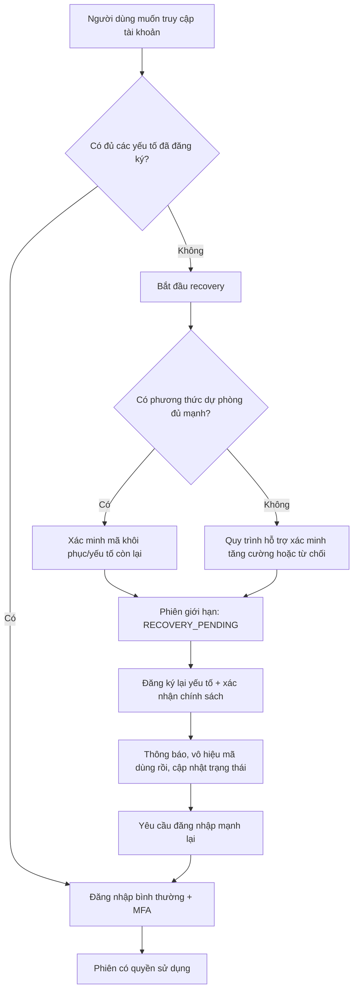
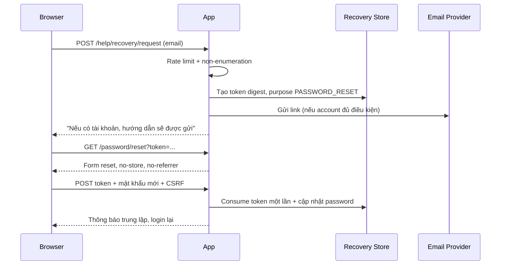
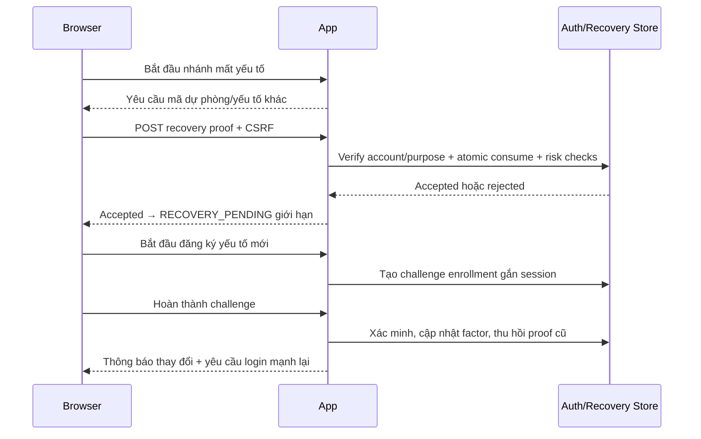

# Khôi phục tài khoản, mất yếu tố và kiểm thử các đường đi thay thế

> **Phạm vi:** xác thực nâng cao trong ứng dụng **Spring Security Servlet** (Spring MVC/Spring Boot 3.x, Spring Security 6.x). Bài tập trung vào thiết kế, tích hợp và kiểm thử đường **khôi phục tài khoản**, đặc biệt khi người dùng mất một yếu tố MFA hoặc thiết bị, mà không tạo ra một "cửa hậu" yếu hơn luồng đăng nhập chính. Ví dụ minh họa bằng **Java 17+**, kết hợp một chương trình độc lập có thể chạy và các đoạn cấu hình Spring Security được ghi rõ điều kiện áp dụng.

## 1. Kết quả học tập

Hoàn thành bài này, bạn có thể:

1. Phân biệt **quên mật khẩu**, **mất yếu tố MFA**, **mất tất cả thiết bị/passkey**, **mất quyền truy cập email**, **tài khoản bị chiếm quyền** và **khôi phục phiên bị khóa**.
2. Lựa chọn các đường khôi phục phù hợp với mức độ bảo đảm cần thiết: yếu tố khác đã đăng ký, mã dự phòng một lần, recovery key, kiểm tra danh tính bởi nhân sự, hoặc quy trình ngoài kênh đã thiết kế.
3. Thiết kế state machine để người dùng trong trạng thái **đang khôi phục** không có quyền như người đã hoàn thành xác thực mạnh; buộc đăng ký lại yếu tố và vô hiệu hóa bằng chứng cũ khi cần.
4. Tạo, lưu và tiêu thụ mã dự phòng có entropy cao, ngăn replay và race condition; biết vì sao mật khẩu reset link **không tự động** cho phép thay MFA.
5. Tích hợp các yêu cầu về CSRF, session, SecurityContext, authorization, risk signals, rate limiting, audit, thông báo, chống enumeration và kiểm soát phục hồi sau compromise.
6. Viết test cho cả **luồng chính và đường thay thế** (happy path, mã hết hạn, mã sai, hai request đồng thời, tài khoản khóa, email đổi, session cũ, edge cases và thất bại của dịch vụ phụ thuộc).

## 2. Vì sao đường khôi phục là một phần của xác thực?

Một hệ thống có MFA mạnh ở trang đăng nhập nhưng cho "quên OTP?" rồi thay OTP bằng câu hỏi bảo mật dễ đoán, email chưa được bảo vệ hoặc yêu cầu nhân viên hỗ trợ qua chat không xác minh danh tính, thực chất đã tạo **đường tắt** vượt qua MFA.

Hãy mô hình hóa xác thực như một tập đường đi:



Sơ đồ là **mô hình an toàn**, không mặc định các nhà cung cấp có sẵn mọi bước. Nếu không thể xác minh đủ mạnh, một kết quả **từ chối hoặc trì hoãn khôi phục** có thể đúng hơn cho phép truy cập dữ liệu nhạy cảm.

### Các nguyên tắc nền

- **Không có yếu tố nào đủ mạnh chỉ vì tên là "recovery".** Từng phương thức phải được đánh giá về khả năng bị chiếm, phát lại, giả mạo, khả năng thu hồi và mức độ xác minh chủ thể.
- **Đường thay thế không tự động tương đương đăng nhập mạnh.** Khi khôi phục thành công, ứng dụng có thể chỉ cho **quyền đặt lại yếu tố**, yêu cầu kiểm tra bổ sung và đăng nhập lại, thay vì cấp ngay quyền giao dịch/chuyển tiền/quản trị.
- **Người dùng hợp lệ phải có lối thoát đã chuẩn bị**, ví dụ backup codes được cấp khi bật MFA. Nếu không có bằng chứng đáng tin, hỗ trợ thủ công cần quy tắc riêng và kiểm soát gian lận.
- **Mọi điểm kết thúc đều kiểm thử được**: thành công, thất bại, timeout, replay, race, cancel và lỗi dependency.

## 3. Phân loại sự cố và chọn đường khôi phục

| Sự cố | Người dùng còn gì? | Đường có thể cân nhắc | Điều không nên suy diễn |
| --- | --- | --- | --- |
| Quên mật khẩu, MFA còn dùng được | Thiết bị/khóa MFA, kênh đã đăng ký | Password reset token một lần + bước xác minh MFA/step-up theo chính sách | Đổi mật khẩu không chứng minh người dùng đã vượt qua MFA. |
| Mất điện thoại OTP nhưng còn passkey/security key dự phòng | Một yếu tố đã đăng ký khác | Xác thực bằng yếu tố còn lại, rồi đăng ký thiết bị mới | Không phải mọi "trusted device" đều là yếu tố độc lập. |
| Mất TOTP nhưng có mã dự phòng | Recovery code đã cấp trước | Tiêu thụ **một mã**, giới hạn phiên để đăng ký lại MFA | Không tái sử dụng mã hoặc cấp full session ngay. |
| Mất tất cả yếu tố MFA, còn email và mật khẩu | Kênh email + một mật khẩu | Đánh giá rủi ro, quy trình hỗ trợ/identity proofing phù hợp mức bảo đảm | **Email inbox + password** không mặc nhiên tương đương yếu tố đã mất; kẻ tấn công có thể nắm cả hai. |
| Mất cả email khôi phục | Có thể có mã/phương thức offline | Mã khôi phục lưu an toàn hoặc quy trình hỗ trợ có chứng cứ mạnh | Không chuyển email theo lời yêu cầu từ cuộc gọi chưa xác minh. |
| Tài khoản bị chiếm, attacker thêm yếu tố | Một số tín hiệu hoặc bằng chứng độc lập | Quy trình account-takeover có kiểm soát, đóng băng thao tác nguy cơ cao, điều tra và thu hồi phiên | "Reset MFA" không giải quyết tự động phiên/token attacker đang giữ. |
| Người dùng chỉ đổi máy bình thường | Yếu tố cũ còn hoạt động | Thêm yếu tố mới **trước khi** gỡ yếu tố cũ, xác thực lại nếu cần | Không bắt người dùng làm quy trình mất thiết bị nếu vẫn đủ bằng chứng. |

**Phân biệt quan trọng:** reset password, đổi email khôi phục và reset MFA là **ba hành động bảo mật khác nhau**. Nếu một đường ít tin cậy có thể trực tiếp thực hiện cả ba hành động, attacker có thể nối chúng thành một chuỗi chiếm tài khoản.

### Mức độ đảm bảo và độ nhạy hành động

Ứng dụng học trực tuyến và ứng dụng chuyển tiền không nhất thiết chọn chung chính sách. Tài khoản với quyền quản trị, thanh toán, truy cập bí mật, thay thông tin pháp lý hoặc điều khiển thiết bị cần tiêu chuẩn recovery cao hơn. Hãy xác định **mục tiêu bảo đảm** và hậu quả mất tài khoản trước khi chọn phương thức thay thế.

Các dấu hiệu rủi ro như vị trí bất thường, thiết bị mới, địa chỉ IP có dấu hiệu tự động hóa hoặc nhiều lần thử mã có thể tăng mức giám sát, nhưng tín hiệu đó **không thay** bằng chứng xác thực. Geo-IP có thể sai do VPN, di động hoặc NAT; không coi nó là danh tính.

## 4. Threat model cho account recovery

Một số kịch bản cần được đưa vào threat model từ đầu:

1. **Account enumeration:** attacker nhập hàng nghìn email để biết tài khoản nào tồn tại bằng thông báo/trạng thái HTTP/thời gian trả lời.
2. **Token guessing và brute force:** mã ngắn, không giới hạn thử hoặc endpoint reset công khai cho phép dò.
3. **Replay:** một mã dự phòng hoặc reset token đã dùng vẫn được chấp nhận lần thứ hai.
4. **Race:** hai request song song tiêu thụ cùng mã trước khi cả hai đánh dấu đã dùng, cho phép hai phiên phục hồi.
5. **Recovery channel compromise:** email, SIM hoặc tài khoản hỗ trợ bị chiếm, làm kênh khôi phục không còn đáng tin.
6. **Session fixation hoặc stale privilege:** sau reset/đổi MFA, phiên cũ vẫn có quyền cao hoặc cookie phiên không được làm mới.
7. **Social engineering nhân sự hỗ trợ:** yêu cầu gỡ yếu tố có vẻ hợp lệ nhưng bằng chứng danh tính giả.
8. **Phishing và mã bị rò:** recovery code bị gửi cho trang giả hoặc bị lộ qua URL, referrer, log, analytics, browser extensions.
9. **Cross-account binding:** token/mã của user A được chấp nhận cho user B vì chỉ kiểm tra giá trị mà không ràng buộc `userId` và `purpose`.
10. **Fallback chaining:** attacker lần lượt dùng "quên mật khẩu" → "đổi email" → "mất MFA" để bẻ gãy từng rào cản riêng lẻ.

Mỗi kịch bản cần có một hoặc nhiều **control** và test cụ thể; chỉ thử một lần đăng nhập thành công sẽ bỏ sót phần quan trọng nhất.

## 5. Mô hình trạng thái an toàn: không tự cấp quyền sau recovery

Một mô hình nghiệp vụ có thể dùng các trạng thái:

| Trạng thái | Ví dụ sự kiện vào | Quyền nên có |
| --- | --- | --- |
| `ANONYMOUS` | Chưa được chứng thực | Chỉ bắt đầu yêu cầu khôi phục, nhận câu trả lời không lộ tài khoản. |
| `PASSWORD_VERIFIED` | Đã chứng minh yếu tố password nhưng chưa đủ MFA | Chỉ hoàn tất MFA hoặc bắt đầu một recovery path đã được đánh giá. |
| `RECOVERY_PENDING` | Recovery proof hợp lệ hoặc ticket hỗ trợ đã được phê duyệt | **Chỉ** xem/đăng ký lại yếu tố theo flow hẹp, không đọc tài nguyên nhạy cảm. |
| `FACTOR_REENROLL_PENDING` | Proof đã dùng, cần đăng ký khóa/TOTP mới | Xác nhận challenge của yếu tố mới trước khi kích hoạt nó. |
| `MFA_VERIFIED` | Hoàn thành đầy đủ yêu cầu xác thực | Có thể vào route cần MFA, vẫn cần authorization theo vai trò/tài nguyên. |
| `RECOVERY_DENIED/LOCKED` | Rủi ro cao, sai quá nhiều hoặc không đủ chứng cứ | Từ chối/giới hạn tiếp, cung cấp hướng dẫn trợ giúp không lộ thông tin. |

Đây là **mô hình logic**. Spring Security không tự tạo những authority trên chỉ bằng cách cấu hình `oauth2Login`, `formLogin` hay `rememberMe`. Nếu cần dùng tên `MFA_VERIFIED` hay `RECOVERY_PENDING` trong `GrantedAuthority`, ứng dụng phải **cấp/phân giải chúng bằng pipeline đáng tin**, ràng buộc với phiên hiện tại, cơ chế login và thời điểm step-up; không lấy trực tiếp từ query param, JSON hoặc cookie do client tự tạo.

### Quy tắc chuyển trạng thái

- Chỉ chuyển **ANONYMOUS → RECOVERY_PENDING** khi một cơ chế khôi phục cụ thể đã thực sự xác minh được bằng chứng đủ mạnh. Một email đã được gửi không phải bằng chứng.
- Chỉ chuyển **PASSWORD_VERIFIED → MFA_VERIFIED** nếu yếu tố bổ sung thực sự được xác minh, không vì endpoint `/mfa/complete` được gọi.
- Chỉ chuyển **RECOVERY_PENDING → FACTOR_REENROLL_PENDING → MFA_VERIFIED** sau bước thay thế yếu tố đúng chính sách. Tùy sản phẩm, sau thay thế yếu tố tốt hơn là buộc **đăng nhập mới** và hạn chế hành động nhạy cảm trong một khoảng thời gian.
- **Từ chối các transition không hợp lệ**, ví dụ từ ANONYMOUS gọi `POST /mfa/replace`, hoặc `RECOVERY_PENDING` gọi `POST /transfer`.
- Với yêu cầu đồng thời, cập nhật trạng thái và tiêu thụ recovery proof phải là **giao dịch nguyên tử**, có idempotency/locking thích hợp; không suy ra tính nguyên tử từ việc code chạy trong một thread ở development.

### Phân tách quyền ở các endpoint

```text
GET  /help/recovery                  → public, không lộ tài khoản tồn tại
POST /help/recovery/request          → public, chống CSRF/abuse, chỉ phát yêu cầu
POST /recovery/proof/verify          → chỉ xác minh bằng chứng, cấp quyền giới hạn
POST /recovery/factors/enroll/start  → cần RECOVERY_PENDING
POST /recovery/factors/enroll/verify → cần RECOVERY_PENDING + challenge mới đúng
GET  /account/dashboard             → cần MFA_VERIFIED và quyền đọc
POST /account/security/disable-mfa  → cần step-up và policy đặc biệt
```

Sơ đồ endpoint là thiết kế tham khảo, **không có trong mặc định Spring Security**. Quyền của một endpoint public chỉ là được gửi yêu cầu, không đồng nghĩa được thực hiện thay đổi tài khoản. Recovery proof không phải session đăng nhập đầy đủ.

## 6. Phương thức dự phòng: ưu/nhược điểm

### 6.1. Yếu tố dự phòng đã đăng ký trước

Một security key thứ hai, passkey còn trên thiết bị khác, TOTP dự phòng hoặc yếu tố xác minh khác đã đăng ký từ trước thường là đường dễ bảo vệ hơn một ticket gửi tới email mới. Server phải kiểm tra yếu tố dự phòng **đã gắn với user trước sự cố**, không phải yếu tố mới do yêu cầu khôi phục tự cung cấp.

Yếu tố khác cùng thiết bị/cloud account có thể không độc lập như kỳ vọng. Ví dụ: nhiều passkey cùng phụ thuộc một tài khoản đồng bộ bị chiếm có thể tạo một điểm lỗi chung. Rủi ro và trải nghiệm cần được thiết kế theo loại người dùng.

### 6.2. Mã dự phòng một lần

Khi user bật MFA lần đầu, hệ thống có thể tạo một bộ **backup/recovery codes** có entropy cao:

- Sinh từ `SecureRandom` (hoặc CSPRNG tương đương), không dùng `Math.random()`, timestamp, email hoặc sequence.
- Cho user tải/lưu vào password manager hoặc phương tiện ngoại tuyến bảo vệ, chỉ **hiển thị giá trị thô lúc cấp**.
- Chỉ lưu **digest có ràng buộc với tài khoản**, tốt hơn là keyed digest/HMAC khi có yêu cầu tăng cường chống rò dữ liệu; không lưu plaintext vào database/log.
- Mỗi mã được chấp nhận **duy nhất một lần**. Hai yêu cầu đồng thời không được cùng thành công.
- Mã thuộc **một account/tenant và một purpose**, không dùng mã của user A để khôi phục user B.
- Việc sử dụng mã phải có **rate limiting, cảnh báo, audit** và thường dẫn tới một phiên giới hạn để re-enroll yếu tố, không tự động cấp quyền quản trị.
- Khi sinh lại cả bộ mã, vô hiệu bộ cũ theo giao dịch, ghi nhận thời gian/tác nhân, thông báo cho chủ tài khoản.
- Không tự gửi toàn bộ backup codes qua email mỗi lần user hỏi, bởi email có thể chính là kênh bị compromise.

Mã ngẫu nhiên dài khác password người dùng tự chọn: với một bí mật có entropy cao được tạo bằng CSPRNG, SHA-256/HMAC có thể phù hợp để kiểm tra đối chiếu. Với password hoặc security answers có entropy thấp, phải dùng **password hashing chuyên dụng** như Argon2id/bcrypt/scrypt cùng chính sách phù hợp, không lưu SHA-256 nhanh đơn thuần.

### 6.3. Email link một lần

Email có thể phù hợp cho **password reset** tùy threat model, nhưng email không mặc nhiên thay thế yếu tố MFA bị mất. Đối với link reset:

- Token chứa ít nhất một lượng entropy lớn (ví dụ 256 bit ngẫu nhiên), TTL ngắn và scope riêng (`PASSWORD_RESET`).
- Lưu hash/keyed hash trong DB, dùng token **một lần**, ràng buộc user/account/purpose.
- Gửi link **đúng origin** đã cấu hình ở server, không dựng URL từ `Host`/`X-Forwarded-Host` tùy ý (rủi ro reset-link poisoning).
- Endpoint **GET hiển thị form**, không tiêu thụ token hay đổi password qua GET; tiêu thụ token trong POST có CSRF/Origin policy thích hợp và atomic transaction.
- Đặt `Cache-Control: no-store`, `Referrer-Policy: no-referrer` và hạn chế third-party scripts trên trang có token trong URL để giảm rò link.
- Tránh log raw token/URL query, bảo vệ kênh email và đánh dấu các hành động nhạy cảm bằng audit.
- Sau reset mật khẩu, xác thực yếu tố MFA theo chính sách (nếu còn), xem xét thu hồi phiên/token cũ và thông báo thay đổi.

**Không dùng cùng một token cho "đặt lại mật khẩu", "đổi email", "vô hiệu MFA".** Domain separation theo purpose là tối thiểu, cùng với authorization đã xác minh.

### 6.4. Hỗ trợ nhân sự hoặc identity proofing

Khi không còn yếu tố nào đáng tin, quy trình hỗ trợ có thể được thiết kế cho mức độ rủi ro và nghĩa vụ pháp lý của dịch vụ. Chọn cơ chế đủ mạnh, hạn chế dữ liệu thu thập, bảo vệ PII, phân quyền cho nhân sự, áp dụng **dual control/approval** cho tài khoản nhạy cảm, audit và thời gian chờ chống lạm dụng nếu cần.

Các câu hỏi kiểu "ngày sinh", "mẹ tên gì" hoặc thông tin công khai trên mạng xã hội **không phải bằng chứng mạnh**. Nhân viên hỗ trợ không được đặt lại MFA chỉ vì ai đó biết số điện thoại/email, và không yêu cầu user đọc password, OTP hay recovery code qua chat/điện thoại.

### 6.5. Những phương thức cần cân nhắc kỹ

| Phương thức | Cạm bẫy |
| --- | --- |
| SMS/voice | SIM swap, chuyển số, phishing, rủi ro roaming; nếu đã mất số điện thoại thì không còn là kênh dự phòng. |
| Email cá nhân | Có thể cùng bị chiếm hoặc đã mất; password reset bằng email không xác minh quyền sở hữu MFA device. |
| Trusted device | Cookie dễ sao chép/đánh cắp hoặc còn trên thiết bị mất; cần ràng buộc và giới hạn thời hạn. |
| Câu hỏi bảo mật | Thường entropy thấp, dữ liệu có thể tìm được hoặc bị lộ. |
| "Đăng nhập bằng provider B" | Chỉ hợp lệ khi **provider B đã liên kết trước** và identifier đã được xác minh; không tự động nối account theo email trùng. |
| Helpdesk shortcut | Bị social engineering, privilege misuse, insider threat; phải có kiểm soát kép và audit khi phù hợp. |

## 7. Ví dụ Java 17 chạy độc lập: mã dự phòng dùng một lần

Chương trình sau minh họa **phần lõi tạo/đối chiếu recovery code**; không cấp session, không reset MFA và không thay thế server-side risk checks. Chạy trực tiếp JDK 17, không cần Maven hoặc Spring. Mã thô chỉ xuất hiện trong biến local và không được in ra console. Demo dùng kho dữ liệu **trong RAM** và HMAC key ngẫu nhiên trong RAM; production phải dùng database transaction/unique constraint, persistent secrets manager và rotation policy.

Lưu nội dung vào file **`RecoveryCodesDemo.java`**:

```java
import javax.crypto.Mac;
import javax.crypto.spec.SecretKeySpec;
import java.nio.charset.StandardCharsets;
import java.security.SecureRandom;
import java.util.ArrayList;
import java.util.Base64;
import java.util.List;
import java.util.Set;
import java.util.concurrent.ConcurrentHashMap;

public class RecoveryCodesDemo {
    static final class RecoveryCodes {
        private final SecureRandom random = new SecureRandom();
        private final byte[] hmacKey = new byte[32];

        // userId -> tập digest của các mã còn sử dụng được
        private final ConcurrentHashMap<String, Set<String>> digests =
                new ConcurrentHashMap<>();

        RecoveryCodes() {
            random.nextBytes(hmacKey);
        }

        private String newCode() {
            byte[] bytes = new byte[24]; // 192 bit ngẫu nhiên
            random.nextBytes(bytes);
            return Base64.getUrlEncoder()
                    .withoutPadding().encodeToString(bytes);
        }

        private String digest(String userId, String code) {
            try {
                Mac mac = Mac.getInstance("HmacSHA256");
                mac.init(new SecretKeySpec(hmacKey, "HmacSHA256"));
                mac.update(userId.getBytes(StandardCharsets.UTF_8));
                mac.update((byte) 0);
                byte[] bytes = mac.doFinal(
                        code.getBytes(StandardCharsets.UTF_8));
                return Base64.getUrlEncoder()
                        .withoutPadding().encodeToString(bytes);
            } catch (Exception ex) {
                throw new IllegalStateException("HMAC unavailable", ex);
            }
        }

        // Chỉ gọi sau bước cấp quyền enroll/recovery đã xác minh.
        // Cấp bộ mới cũng hủy toàn bộ bộ cũ của user đó.
        List<String> replaceAll(String userId, int count) {
            if (userId == null || userId.isBlank()
                    || count < 1 || count > 20) {
                throw new IllegalArgumentException("Invalid input");
            }
            List<String> rawCodes = new ArrayList<>();
            Set<String> stored = ConcurrentHashMap.newKeySet();
            for (int i = 0; i < count; i++) {
                String code = newCode();
                rawCodes.add(code);
                stored.add(digest(userId, code));
            }
            digests.put(userId, stored);
            return List.copyOf(rawCodes);
        }

        boolean consume(String userId, String code) {
            if (userId == null || code == null || code.isBlank()) {
                return false;
            }
            Set<String> stored = digests.get(userId);
            if (stored == null) {
                return false;
            }
            // remove trên ConcurrentHashMap key-set là nguyên tử
            // cho MỘT digest trong MỘT tiến trình demo.
            return stored.remove(digest(userId, code));
        }

        int remaining(String userId) {
            Set<String> stored = digests.get(userId);
            return stored == null ? 0 : stored.size();
        }
    }

    public static void main(String[] args) {
        RecoveryCodes service = new RecoveryCodes();
        List<String> issued = service.replaceAll("alice", 3);
        String first = issued.get(0);

        System.out.println("issued: " + issued.size());
        System.out.println("wrong account: "
                + service.consume("bob", first));
        System.out.println("first use: "
                + service.consume("alice", first));
        System.out.println("replay: "
                + service.consume("alice", first));
        System.out.println("remaining: "
                + service.remaining("alice"));
    }
}
```

Chạy trong thư mục chứa file:

```bash
javac RecoveryCodesDemo.java
java RecoveryCodesDemo
```

**Stdout chính xác:**

```text
issued: 3
wrong account: false
first use: true
replay: false
remaining: 2
```

### Điều gì đã được chứng minh — và điều gì chưa?

- `SecureRandom` sinh từng mã có 192 bit ngẫu nhiên; mã không dựa vào userId hoặc timestamp.
- HMAC-SHA256 lưu giá trị kiểm tra thay vì raw code; HMAC input bao gồm userId và dấu phân cách. Vì vậy mã của alice không khớp kho mã của bob.
- `ConcurrentHashMap.newKeySet().remove` là nguyên tử khi xóa **một phần tử** trong một JVM; test replay sau lần thành công trả false.
- Demo **chưa** có xác thực user, CSRF, TTL của recovery session, giới hạn số lần thử, audit, phân quyền cấp mã, persistent store, đa instance hay bước re-enrollment. Không copy class này vào production làm toàn bộ account recovery.
- Trong hệ nhiều instance, hai request có thể tới hai process khác nhau; bộ mã trong RAM không chia sẻ, và khóa HMAC cũng khác. Production cần một kho dữ liệu chung với **atomic consume/transaction** và HMAC key bền vững trong secret manager. Việc `replaceAll` đồng thời với `consume` cũng cần giao dịch/lock theo user; phép `put` ở demo không bảo đảm một quy trình recovery nghiệp vụ hoàn chỉnh.

**Vì sao không in mã ra console?** Giá trị raw chỉ phải giao cho chủ tài khoản bằng kênh đã xác minh ngay lúc enroll. Log access, crash dump, bản ghi audit hoặc telemetry không nên chứa mã; test có thể giữ mã trong biến để mô phỏng người dùng mà không đưa vào output.

## 8. Thêm token reset ngắn hạn có scope rõ ràng

Mã backup được phát trước và có thể được dùng khi mất thiết bị; **reset ticket** thường có TTL ngắn, được cấp **sau** khi một bước xác minh điều kiện phù hợp xảy ra. Chúng là hai loại bằng chứng khác nhau.

Một bản ghi DB khuyến nghị:

```text
RecoveryTicket(
  id,
  user_id,
  tenant_id,
  purpose,              // PASSWORD_RESET hoặc MFA_REENROLL
  token_digest,         // không lưu raw token
  created_at,
  expires_at,
  consumed_at,          // null nếu chưa dùng
  verification_context, // nguồn bằng chứng đã xác minh, không chứa secret
  issued_by,
  risk_decision_id
)
```

Lưu ý: đây là **data model minh họa**, không phải class có sẵn của Spring Security. Nên đặt unique index thích hợp cho token digest và dùng một transaction để xác minh + chuyển `consumed_at` từ null sang thời gian hiện tại + cập nhật recovery state.

Ví dụ pseudo SQL ở mức nguyên tử trên DB hỗ trợ cập nhật có điều kiện:

```sql
UPDATE recovery_ticket
SET consumed_at = CURRENT_TIMESTAMP
WHERE token_digest = :digest
  AND user_id = :userId
  AND tenant_id = :tenantId
  AND purpose = :purpose
  AND consumed_at IS NULL
  AND expires_at > CURRENT_TIMESTAMP;
```

Chỉ xem tiêu thụ token thành công khi **số dòng bị cập nhật = 1**, và commit transaction thành công. Hai request đồng thời chỉ một request được claim một row theo concurrency semantics của database. Sau đó **quyền giới hạn** cho việc re-enroll phải được phát hành/cập nhật nhất quán; không cấp quyền dựa trên kết quả kiểm tra "SELECT thấy hợp lệ" trước khi UPDATE thành công.

Nếu dùng token một lần **để đổi mật khẩu**, thao tác đổi password và consume token nên thuộc cùng giao dịch hoặc có thiết kế idempotency/compensation rõ ràng để không nhận token nhiều lần khi request retry.

### TTL và rủi ro relay

TTL 10–15 phút thường được chọn làm ví dụ cho reset link, nhưng thời hạn đúng là **quyết định sản phẩm và rủi ro**, không phải quy tắc mặc định của Spring Security. Nên dùng timestamp do server/database quản lý, UTC, kiểm tra clock skew, và tuyệt đối không tin `expiresAt` do client gửi.

Nếu token ở URL, trình duyệt có thể ghi vào history, extension, referrer hoặc log reverse proxy. Thiết lập Referrer-Policy và no-store, không chèn third-party analytics trên trang chứa token; có thể đổi token trong URL sang trạng thái server-side tạm thời sau khi GET đã tải form, trước khi POST dùng nó. Chỉ thay đổi thiết kế khi vẫn bảo đảm CSRF, session binding và single-use.

## 9. Tích hợp với Spring Security Servlet

Spring Security cung cấp nền tảng authentication, authorization, CSRF, session management và filters. Tuy nhiên **luồng xác minh mã recovery, phân hạng yếu tố và chuyển trạng thái MFA vẫn là logic ứng dụng**, không được tạo sẵn chỉ với một flag.

### 9.1. SecurityFilterChain minh họa phân quyền theo trạng thái

Ví dụ này là **một đoạn cấu hình** cho ứng dụng đã có custom authentication pipeline phát authority đáng tin cậy `RECOVERY_PENDING` và `MFA_VERIFIED`. Không phải chương trình standalone: các endpoint/service và logic cấp authorities phải được xây riêng.

```java
import org.springframework.context.annotation.Bean;
import org.springframework.context.annotation.Configuration;
import org.springframework.http.HttpMethod;
import org.springframework.security.config.annotation.web.builders.HttpSecurity;
import org.springframework.security.web.SecurityFilterChain;

@Configuration
class WebSecurityConfig {
    @Bean
    SecurityFilterChain securityFilterChain(HttpSecurity http)
            throws Exception {
        return http
            .authorizeHttpRequests(auth -> auth
                .requestMatchers(
                    "/login", "/error", "/help/recovery").permitAll()
                .requestMatchers(HttpMethod.POST,
                    "/help/recovery/request").permitAll()
                .requestMatchers("/recovery/factors/**")
                    .hasAuthority("RECOVERY_PENDING")
                .requestMatchers("/account/**")
                    .hasAuthority("MFA_VERIFIED")
                .anyRequest().denyAll())
            .formLogin(login -> login.permitAll())
            // CSRF mặc định vẫn bật cho form POST dựa trên session.
            .build();
    }
}
```

**Điều cần đọc đúng:**

- `permitAll()` chỉ có nghĩa endpoint public được **gọi**, không phải bất kỳ người nào cũng được reset tài khoản. Controller cần thực hiện xác minh/risk check và trả thông báo trung lập.
- `RECOVERY_PENDING` và `MFA_VERIFIED` là authorities **ứng dụng tự định nghĩa**. Bạn phải bảo đảm chỉ cấp chúng khi proof hợp lệ, không để client tự khai rồi nhận quyền.
- Matcher `/recovery/factors/**` đứng trước `/account/**` nên route re-enrollment không vô tình bị quyền "đăng nhập đầy đủ" bao phủ. Khi đổi route, viết regression test cho thứ tự matchers.
- `formLogin` ở đây chỉ thể hiện một cách tạo bước xác thực ban đầu; muốn MFA thực sự, phải có custom flow/step-up. **Đừng nhầm `formLogin` mặc định = MFA.**
- CSRF mặc định vẫn hoạt động với POST dùng cookie session, kể cả POST public `/help/recovery/request`. Endpoint GET chỉ hiển thị form không tự thực hiện reset. Nếu client dùng API không cookie riêng, đánh giá CSRF phù hợp đúng chain thay vì tắt global.
- Authentication failure và access denied phải phân biệt: thiếu bằng chứng đăng nhập có thể 401/redirect login; đã có session giới hạn nhưng thiếu quyền phải bị 403 theo policy. Custom entry point hoặc failure handler cần giữ thông điệp không lộ tài khoản.

### 9.2. Trạng thái recovery không được nâng cấp từ input của trình duyệt

Một anti-pattern nguy hiểm:

```java
// PHẢN VÍ DỤ — KHÔNG triển khai.
if ("true".equals(request.getParameter("mfaRecovered"))) {
    // Đừng cấp quyền MFA_VERIFIED từ tham số của client.
}
```

Thay vào đó, server phải có một **RecoveryWorkflowService** thực hiện:
1. Kiểm tra principal/userId mục tiêu bằng dữ liệu đáng tin từ quá trình recovery, không lấy email trong request làm bằng chứng duy nhất.
2. Xác thực recovery proof theo purpose/account, kiểm tra TTL, rate limit, trạng thái khóa và risk decision.
3. Tiêu thụ proof bằng giao dịch nguyên tử.
4. Cấp trạng thái `RECOVERY_PENDING` ràng buộc với session/bằng chứng, thời hạn ngắn và **không có quyền giao dịch**.
5. Yêu cầu xác minh enrollment của yếu tố mới (ví dụ TOTP challenge hoặc WebAuthn registration + verification); kiểm tra origin/RP ID/challenge/user binding theo giao thức tương ứng.
6. Vô hiệu hóa proof đã dùng và cập nhật danh sách yếu tố theo chính sách. Có thể chấm dứt/restrict các session cũ, gửi thông báo và yêu cầu login lại.
7. Chỉ nâng cấp session nếu policy cho phép sau khi xác minh đủ; thường **invalidate/rotate session** và yêu cầu đăng nhập mạnh mới sẽ dễ kiểm soát hơn.

Đây là một chuỗi nghiệp vụ, không phải lời hứa `SecurityContextHolder.getContext().setAuthentication(...)` sẽ tự quản lý mọi bảo đảm phiên. Nếu bạn thay `Authentication` trong quá trình recovery, phải xử lý **SessionAuthenticationStrategy**, session fixation protection, `SecurityContextRepository`, security context persistence của phiên bản Spring Security đang chạy, CSRF token lifecycle và các session trên thiết bị khác. Nâng cấp authority rồi bỏ qua việc lưu/rotate context/session có thể tạo hành vi không nhất quán hoặc mở cửa privilege escalation.

### 9.3. Có nên tách security chain?

Có thể dùng chain riêng cho API bearer-token stateless và chain cho web browser cookie/session. Nhưng **đừng tạo chain "recovery" tự động yếu hơn** chỉ vì URL public. Mỗi chain phải có matcher phạm vi hẹp, cấu hình CSRF/session/authentication rõ ràng, cùng kiểm thử mọi path — đặc biệt error và callback.

Nếu form-based recovery dùng HttpSession, `SessionCreationPolicy.STATELESS` không tương thích với việc dựa vào session để lưu recovery state trừ khi ứng dụng chủ động đưa state vào cơ chế khác an toàn. Đồng thời, `web.ignoring()` bỏ qua Spring Security filter chain, nên hạn chế dùng trên các route recovery nhạy cảm; thường chọn `permitAll()` để vẫn có CSRF/security headers.

## 10. Luồng đổi mật khẩu và luồng thay MFA phải độc lập

### Password reset



Đối với tài khoản bật MFA, **password mới không xóa MFA**. Nếu user vừa reset password vừa mất MFA, phải dùng một recovery flow bổ sung có bằng chứng đủ mạnh, không được gộp thành "reset password rồi bỏ OTP".

### MFA recovery



Nếu user không có mã dự phòng lẫn yếu tố dự phòng, hệ thống có thể chuyển sang hỗ trợ trực tiếp hoặc quy trình identity proofing. Không nên coi biết email, số điện thoại hoặc thông tin profile là thay thế mặc định cho proof.

## 11. Kịch bản kiểm thử bắt buộc cho đường thay thế

Các test cần kiểm tra cả **endpoint, nghiệp vụ, session và đa request**, không chỉ gọi helper method. Một test plan thực tế:

| Nhóm | Trường hợp | Kết quả mong đợi |
| --- | --- | --- |
| Phạm vi | Yêu cầu recovery cho email không tồn tại | Response công khai không tiết lộ account existence; không tạo user. |
| Phạm vi | Account đang khóa/đang bị điều tra | Áp dụng chính sách risk, không mở khóa do link token đơn thuần. |
| Mã sai | Mã không khớp hoặc thuộc user khác | Từ chối, tăng bộ đếm/rate limit; không cấp RECOVERY_PENDING. |
| Mục đích | Password reset token gửi vào endpoint đổi MFA | Từ chối do purpose khác, dù token hợp lệ ở flow kia. |
| TTL | Token hết hạn / future-issued / clock skew | Từ chối hoặc áp dụng tolerance do server định nghĩa, không dùng đồng hồ client. |
| Replay | Dùng token/mã hai lần | Lần đầu thành công; những lần sau thất bại. |
| Race | Hai request tiêu thụ cùng mã đồng thời | **Tối đa một** request thành công trên datastore chung. |
| Nâng quyền | RECOVERY_PENDING truy cập `/account/billing` | 403; không lấy được dữ liệu/hành động yêu cầu MFA. |
| Re-enrollment | Gửi yếu tố mới nhưng không hoàn thành challenge | Không kích hoạt yếu tố chưa được chứng minh; giữ trạng thái giới hạn. |
| Session | Dùng session cũ sau đổi yếu tố | Bị thu hồi/hạn chế theo policy; cookie phiên được rotate khi nâng quyền. |
| CSRF | POST recovery từ trang cross-site không có token hợp lệ | Bị chặn nếu flow dùng cookie session và CSRF protection. |
| Open redirect | Tham số `next=https://attacker.test` | Không redirect tới origin không được phép. |
| Notification | Đổi MFA thành công | Thông báo qua kênh đã đăng ký, audit không chứa secret. |
| Dependency | Email provider/DB/HMAC key store unavailable | Fail closed, có xử lý retry/idempotency đúng; không bỏ verification. |
| Abuse | Nhiều yêu cầu cho một identity/từ nhiều IP | Rate limit đa chiều, không khóa hàng loạt vô hạn vì attacker muốn DoS. |
| Phishing | Cố bắt user cung cấp recovery code qua support | Quy trình support không yêu cầu secret; phát hiện và cảnh báo. |
| Thay email | Khôi phục bằng email mới vừa đổi | Không tự tin email vừa thay là bằng chứng độc lập cho cả hai hành động. |
| Credential theft | Attacker đã có cookie/token khác | Thu hồi/giới hạn phiên cũ theo policy, không coi thay mật khẩu là xử lý trọn vẹn. |

### 11.1. Test pure Java với mã một lần

Chương trình `RecoveryCodesDemo.java` ở trên đã thể hiện ba assertion hành vi dưới dạng stdout:

- Dùng mã đúng nhưng sai account → `false`.
- Dùng lần đầu đúng account → `true`.
- Dùng lại đúng mã → `false`.

Với JUnit, có thể kiểm tra concurrency ở tầng service; **test đa instance cần DB thật** để tránh kết luận sai khi ứng dụng dùng bộ nhớ trong từng process. JUnit nội bộ không thể đảm bảo giao dịch dữ liệu production thực sự atomic.

### 11.2. MockMvc kiểm thử authorization và CSRF

Ví dụ sau là **đoạn test tích hợp minh họa** trong project có Spring Security Test, các endpoint như phần 9 và một cơ chế **test authentication** cấp authorities đáng tin. Nó không phải test có thể chạy độc lập với chương trình Java 17 ở phần 7, bởi cần tạo controller và workflow service tương ứng.

```java
import org.junit.jupiter.api.Test;
import org.springframework.beans.factory.annotation.Autowired;
import org.springframework.boot.test.autoconfigure.web.servlet.AutoConfigureMockMvc;
import org.springframework.boot.test.context.SpringBootTest;
import org.springframework.test.web.servlet.MockMvc;

import static org.springframework.security.test.web.servlet.request
    .SecurityMockMvcRequestPostProcessors.csrf;
import static org.springframework.security.test.web.servlet.request
    .SecurityMockMvcRequestPostProcessors.user;
import static org.springframework.test.web.servlet.request.MockMvcRequestBuilders.get;
import static org.springframework.test.web.servlet.request.MockMvcRequestBuilders.post;
import static org.springframework.test.web.servlet.result.MockMvcResultMatchers.status;

@SpringBootTest
@AutoConfigureMockMvc
class RecoveryAuthorizationTest {
    @Autowired
    MockMvc mvc;

    @Test
    void pendingRecoveryCannotReadSensitiveAccount() throws Exception {
        mvc.perform(get("/account/dashboard")
                .with(user("alice")
                    .authorities(() -> "RECOVERY_PENDING")))
            .andExpect(status().isForbidden());
    }

    @Test
    void mfaVerifiedUserMayReadAccount() throws Exception {
        mvc.perform(get("/account/dashboard")
                .with(user("alice")
                    .authorities(() -> "MFA_VERIFIED")))
            .andExpect(status().isOk());
    }

    @Test
    void recoveryRequestPostWithoutCsrfIsRejected() throws Exception {
        mvc.perform(post("/help/recovery/request")
                .param("email", "alice@example.test"))
            .andExpect(status().isForbidden());
    }

    @Test
    void publicRecoveryRequestWithCsrfReachesController() throws Exception {
        mvc.perform(post("/help/recovery/request")
                .with(csrf())
                .param("email", "alice@example.test"))
            .andExpect(status().isAccepted());
    }
}
```

**Giới hạn của các test trên:** `with(user(...).authorities(...))` **giả lập authorities**; nó giúp test security matcher nhưng **không chứng minh** workflow tạo authorities đúng. Test `202 Accepted` giả định controller demo đã được triển khai để trả 202, đáp ứng non-enumeration; nếu controller của bạn dùng response 200 hoặc 204 trung lập thì sửa assertion cho đúng contract. Để bảo vệ toàn diện, cần **integration test** qua thực tế phát/tiêu thụ token và re-enrollment, chứ không chỉ giả lập một principal đã authenticated.

Với chính sách nhiều chain, test `/help/recovery/request` có/không có CSRF cần đi qua đúng web chain. Không lấy việc `permitAll` làm lý do để mặc định mong POST không có CSRF cũng được phép.

### 11.3. Test chống race bằng datastore thật

Một bài test có giá trị cao là gửi cùng một mã vào hai transaction đồng thời, ví dụ qua `ExecutorService`/`CountDownLatch` hoặc integration test chạy trên DB thực. Số thành công **phải = 1** khi xử lý đồng thời; còn 0 có thể chấp nhận nếu proof hết hạn hoặc hệ thống từ chối trước đó, nhưng không bao giờ được là 2.

Thiết kế nghiệp vụ nên có **constraint ở database** và transaction để tránh chỉ dựa vào `synchronized` của một JVM. Đoạn SQL `UPDATE ... consumed_at IS NULL` ở phần 8 có thể làm cơ sở; kiểm tra row count/commit result thay vì "SELECT thấy hợp lệ" rồi update sau.

Nếu re-enrollment ở nhiều bước, test cũng phải xác minh một session không thể **replay challenge**, kích hoạt hai factor trái chính sách hoặc nâng quyền hai lần từ một proof. Test stress và property-based có thể hữu ích khi số nhánh lớn.

## 12. Kiểm thử end-to-end: ma trận theo yếu tố bị mất

Một **ma trận đường đi** giúp phát hiện bypass khó thấy khi chỉ kiểm tra từng endpoint:

| Yếu tố 1 | Yếu tố 2 | Bằng chứng dự phòng | Đường hợp lệ | Trạng thái cuối |
| --- | --- | --- | --- | --- |
| Password đúng | TOTP đúng | Không cần | Login bình thường | MFA_VERIFIED |
| Password đúng | TOTP mất | Recovery code còn | Recovery giới hạn → re-enroll → login mạnh lại | MFA_VERIFIED sau khi xác minh mới |
| Password đúng | TOTP mất | Không có mã | Không cấp full session; chuyển hỗ trợ hoặc từ chối | RECOVERY_PENDING chỉ khi đủ chứng cứ |
| Password quên | TOTP còn | Password reset proof hợp lệ | Đặt password mới, xác thực MFA theo policy | MFA_VERIFIED sau bước MFA |
| Password quên | TOTP mất | Chỉ biết email | Không tự động tắt MFA | Không truy cập quyền cao |
| Password đúng | Security key mất | Key dự phòng còn | Dùng key khác đã đăng ký, quản lý yếu tố | MFA_VERIFIED sau xác minh |
| Không có bằng chứng | Không có | Gửi ticket chat | Chỉ tiếp nhận yêu cầu, xác minh ngoài kênh phù hợp | Không tự cấp quyền |
| Phiên attacker đang hoạt động | Thiết bị user bị mất | User chứng minh takeover | Kiểm soát compromise, thu hồi phiên, reset yếu tố | Login lại sau xử lý |

Từng hàng nên được kiểm thử cả khi dùng trình duyệt, nhiều tab, mạng chậm, cookie hết hạn, back/forward, refresh, mobile, và cả thao tác trên nhiều thiết bị.

### Các câu hỏi cần hỏi trong QA

- Nếu người dùng mở **hai tab recovery**, tab A thành công thì tab B còn quyền thao tác gì?
- Nếu người dùng yêu cầu một link mới, link cũ có còn hợp lệ theo chính sách không?
- Nếu gửi email thất bại nhưng ticket đã được ghi DB, người dùng có bị kẹt ở trạng thái khó dự đoán không?
- Nếu token bị dùng đúng lúc hết hạn, thành công hay thất bại có được xử lý **nhất quán** theo clock/database không?
- Nếu support agent nhầm user A với user B, có **phê duyệt thứ hai** hoặc validation binding ngăn đổi factor không?
- Nếu app deploy lại giữa bước proof và bước re-enrollment, recovery state có được bảo toàn an toàn (hoặc hủy một cách rõ ràng) không?
- Nếu JWT/session của phiên trước còn trong cache, recovery thành công có thực sự thu hồi quyền nhạy cảm của phiên bị compromise không?
- Nếu người dùng nhập mã backup lên trang phishing, có cách đánh dấu lộ mã và tái cấp bộ mã sau login mạnh không?
- Nếu route công khai mới được thêm cho support, nó có làm bypass authorization của `/account/**` không?

## 13. HTTP và browser: các lớp bảo vệ cần thiết

### CSRF trên form recovery

Những trang recovery dùng **session cookie** vẫn cần CSRF token cho POST thay đổi trạng thái. Đây là lỗi thường gặp khi dev đặt `permitAll()` rồi tưởng rằng `CsrfFilter` không kiểm tra nữa. `permitAll` chỉ bỏ yêu cầu authentication của authorization decision; nếu đã bật CSRF mặc định, request POST thiếu token vẫn bị chặn.

Mã phục hồi hay link token **không tự giải quyết** CSRF ở những thao tác khác như thay email, vô hiệu MFA, logout phiên hoặc thay password. Nên thiết kế các action với một bằng chứng chuyên biệt, CSRF protection, TTL và replay guard đúng threat model.

### SameSite, Origin, Fetch Metadata

Cookie `SameSite=Lax/Strict` và kiểm tra `Origin`/`Referer` hoặc `Sec-Fetch-Site` có thể giảm các request cross-site ngoài ý muốn. Nhưng SameSite không thay CSRF token, và origin browser có thể vắng trong một số bối cảnh hoặc bị giả bởi HTTP client không phải browser. Với các link từ email hoặc callback cross-site, kiểm thử cookie thực tế để tránh làm hỏng flow hợp lệ.

### HTTP response headers và cache

Response chứa token hoặc dữ liệu recovery nhạy cảm nên có chính sách cache/referrer thích hợp:

```http
Cache-Control: no-store
Referrer-Policy: no-referrer
X-Content-Type-Options: nosniff
```

Trên HTML page có token trong URL, tránh tải third-party JS, pixel hoặc image từ origin khác nếu không thiết kế bảo vệ rò mã. Hạn chế lỗi XSS bằng output encoding, CSP phù hợp và kiểm tra dependency. Header không thay xác minh token.

### Rate limiting và non-enumeration

Tạo rate limit theo nhiều chiều (account/identifier đã được normalize, IP, subnet, device/session, behavior) và xem xét CAPTCHA hoặc trì hoãn có kiểm soát khi có abuse. Tránh thiết kế chỉ khóa theo username khiến attacker có thể gây DoS hàng loạt. Response public nên tương đương giữa user tồn tại/không tồn tại, không đưa userId, email đầy đủ hoặc trạng thái khóa ra cho client không được xác thực.

**Thông báo ví dụ:**

```text
Nếu tài khoản đủ điều kiện, hướng dẫn khôi phục sẽ được gửi qua kênh đã đăng ký.
```

Trả thông điệp thống nhất không có nghĩa hệ thống phải thực hiện cùng mọi chi tiết nội bộ; cần quản lý timing/headers/log/rate limit để tránh kênh rò.

## 14. Sau recovery: session, thông báo và thu hồi

Một recovery proof được chấp nhận **không kết thúc trách nhiệm bảo mật**. Quy trình sau đó nên xử lý:

1. **Phiên hiện tại:** phân loại quyền hạn, làm mới session identifier khi tăng độ tin cậy, đặt timeout ngắn cho trạng thái giới hạn. Không giữ authority cũ vô hạn trong session sau thay đổi yếu tố.
2. **Phiên khác:** theo mức rủi ro, thu hồi hoặc yêu cầu re-authentication. Spring Security có `SessionRegistry` và session management, nhưng cơ chế thu hồi phân tán cần thiết kế theo session store và token architecture.
3. **Remember-me / thiết bị tin cậy:** xoá hoặc thu hồi token tương ứng nếu factor loss hay compromise làm giảm bảo đảm. Không giữ remember-me như một MFA replacement.
4. **Recovery codes:** vô hiệu mã đã dùng; sau hoàn tất MFA, khuyến khích cấp bộ mới, thu hồi bộ cũ sau bước xác thực đủ mạnh.
5. **Email/phone/contacts:** thông báo sự kiện "MFA removed", "new factor enrolled", "recovery code used" tới **kênh đã đăng ký trước** phù hợp; không chỉ gửi tới địa chỉ vừa được thay đổi.
6. **Audit:** ghi subject, mục đích, trạng thái, thời điểm, source hợp lệ, risk decision, idempotency/correlation ID và tác nhân hỗ trợ; **không** log raw code, OTP, session cookie, reset link hoặc private key.
7. **Cooldown** với hành động đặc biệt nguy hiểm: có thể trì hoãn thay đổi tài khoản nhạy cảm sau recovery tùy sản phẩm, kèm thông báo và kênh phản hồi khi không do user thực hiện.
8. **User experience:** thông báo rõ điều gì đã thay đổi, cách đăng ký yếu tố thay thế, đâu là hỗ trợ đáng tin, cách báo cáo suspected takeover; đừng tiết lộ chi tiết nội bộ giúp attacker dò hệ thống.

Khi hệ thống có nhiều dịch vụ, event "account recovered" không tự động thu hồi mọi access token JWT phát trước đó. JWT self-contained có thể còn hạn cho tới `exp` nếu các Resource Server không kiểm tra epoch/revocation. Phải kiểm thử thật với session/token architecture của tổ chức.

## 15. Những anti-pattern thường gặp

| Anti-pattern | Vì sao nguy hiểm | Thiết kế thay thế |
| --- | --- | --- |
| `POST /disable-mfa` chỉ cần password | Password bị lộ là đủ bỏ MFA. | Step-up hoặc recovery proof riêng với phiên giới hạn. |
| Gửi recovery code qua email bất cứ lúc nào | Email compromise trở thành đường bypass. | Cấp mã dự phòng khi MFA enrollment và lưu an toàn; email recovery đánh giá riêng. |
| Recovery token tái dùng nhiều lần | Replay, chiếm nhiều phiên. | Atomic consume + uniqueness/purpose/TTL. |
| Token không gắn account/tenant | Token user A có thể ảnh hưởng user B. | Bind `userId`, tenant, purpose; kiểm tra server-side. |
| Lưu raw code/reset token | DB/log leak làm mất credential. | Lưu hash/keyed digest; tiết lộ raw một lần cho user. |
| Xóa yếu tố cũ trước khi kiểm tra yếu tố mới | User bị khóa hoặc attacker bỏ MFA mà chưa đăng ký yếu tố mạnh. | Re-enroll challenge → verify → commit factor swap atomically. |
| Cấp `MFA_VERIFIED` từ checkbox/query param | Client tự nâng quyền. | Auth pipeline server xác minh proof và state. |
| Reset password rồi ngầm reset MFA | Kênh email yếu hơn phá toàn hệ thống. | Hai flow riêng, proof riêng và quyền riêng. |
| `permitAll()` rồi tắt CSRF toàn hệ thống | Form recovery/session bị CSRF; những route khác mất bảo vệ. | Giữ CSRF phù hợp, phân tách API stateless nếu thật sự cần. |
| Hỗ trợ thay MFA không có audit/approval | Social engineering/insider risk. | Quy trình policy, phân quyền, logging, dual control khi thích hợp. |
| Chỉ test happy path | Không phát hiện replay, race, cross-account, privilege bypass. | Ma trận positive/negative, concurrency, abuse, recovery denial. |
| Sau recovery giữ toàn bộ phiên cũ | Attacker còn token/session trước takeover. | Session/token invalidation và step-up tương ứng kiến trúc. |

## 16. Checklist thiết kế và đánh giá hệ thống

Trước khi triển khai production, cần trả lời được:

- [ ] Các **loại sự cố** nào được hỗ trợ? Mỗi loại có evidence/purpose độc lập hay đang chung một token/đường bypass?
- [ ] Mỗi đường recovery có assurance tương xứng với tài nguyên và quyền có thể lấy lại?
- [ ] Recovery code/token có CSPRNG, entropy phù hợp, ràng buộc account/tenant/purpose, expiry và atomic single-use?
- [ ] Có rate limiting, non-enumeration, quy trình chống DoS và lộ dữ liệu trong log/notification?
- [ ] Có trạng thái `RECOVERY_PENDING` giới hạn; không vô tình cấp quyền `MFA_VERIFIED` trước khi đủ proof?
- [ ] Re-enrollment thực sự xác minh challenge của yếu tố mới trước khi kích hoạt/loại yếu tố cũ?
- [ ] Web Servlet dùng CSRF cho POST cookie/session; cấu hình authentication/session và route matchers không cho bypass?
- [ ] Session fixation, security-context persistence, các phiên khác, remember-me và JWT tồn tại được xem xét?
- [ ] Có audit/notification, trách nhiệm nhân sự, kênh đối soát khi nghi takeover?
- [ ] Test replay, race, cross-account, expired, thiếu state, lỗi dependency, nhiều browser tabs/devices và negative authorization?
- [ ] Recovery cho tài khoản đặc quyền có step-up/identity proofing và chính sách khắt khe hơn tài khoản thông thường?
- [ ] Tài liệu hỗ trợ không bao giờ yêu cầu user cung cấp mật khẩu, mã OTP hoặc backup code cho nhân viên?

## 17. Câu hỏi ôn tập

**Câu 1:** Tại sao reset password qua email không tự động cho phép xóa TOTP?

Vì email có thể là kênh yếu hơn hoặc cùng bị chiếm với password. Việc reset một yếu tố không tự chứng minh người yêu cầu sở hữu yếu tố thứ hai. Cần một recovery proof/assurance và quy trình thay thế yếu tố riêng.

**Câu 2:** `permitAll` trên endpoint bắt đầu recovery có nghĩa POST không cần CSRF?

Không. `permitAll` thuộc authorization, còn CSRF là một kiểm soát khác của Spring Security. Với form dùng session cookie, POST cần token hợp lệ theo policy.

**Câu 3:** Vì sao nên "consume" token bằng UPDATE có điều kiện thay vì SELECT rồi UPDATE?

Vì hai request có thể cùng SELECT thấy token còn hạn, chưa dùng. UPDATE có điều kiện và giao dịch phù hợp đảm bảo **tối đa một** request claim proof.

**Câu 4:** Khi user dùng backup code đúng, có nên cấp quyền quản trị ngay?

Không mặc nhiên. Trong mô hình an toàn, proof chuyển người dùng vào **recovery-limited state**, cho phép re-enroll/đăng nhập lại, sau đó quyền quản trị vẫn phải qua authentication và authorization phù hợp.

**Câu 5:** Test MockMvc giả lập authority `MFA_VERIFIED` có chứng minh luồng recovery an toàn không?

Không. Nó chỉ xác minh rule matchers/authorization ở request đã được mô phỏng. Phải kiểm thử **nguồn tạo quyền**, proof consumption, state transitions, race, expiry, session/token revocation và chức năng thực.

## 18. Ghi nhớ

**Account recovery là một đường xác thực thay thế có mức rủi ro riêng**, không phải nút "quên mật khẩu" hay một endpoint public. Mất yếu tố MFA cần bằng chứng đã được chuẩn bị trước hoặc quy trình proofing phù hợp; việc có email/password chưa đủ để bỏ yếu tố khác.

Thiết kế tốt giữ ba ranh giới:

1. **Proof:** xác minh đúng account, purpose, TTL, nguồn tin cậy; mã không thể đoán, không replay và tiêu thụ nguyên tử.
2. **Privilege:** recovery session có **quyền tối thiểu**, không phải phiên đã hoàn thành MFA; chỉ nâng cấp sau re-enrollment/step-up thực sự.
3. **Post-recovery:** vô hiệu bằng chứng cũ, xử lý session/token, thông báo/audit và kiểm thử mọi đường đi thay thế — nhất là negative path và concurrency.

Trong Spring Security Servlet, hãy xem recovery service là **phần nghiệp vụ bảo mật cần tự thiết kế**, còn `SecurityFilterChain`, `CsrfFilter`, `SecurityContext` và session infrastructure là các cơ chế để thi hành, giới hạn và kiểm thử những quyết định đó.