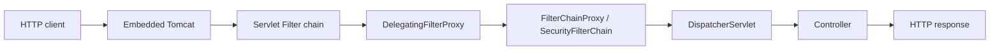

# Khởi tạo ứng dụng Servlet với `spring-boot-starter-security`

**Chủ đề:** Spring Security – Servlet · **Nhóm:** Khởi tạo.

Bài này hướng dẫn tạo từ đầu một ứng dụng **Spring Boot chạy trên Servlet stack**, thêm `spring-boot-starter-security`, quan sát bảo mật mặc định, rồi khai báo `SecurityFilterChain` để có endpoint công khai, endpoint yêu cầu đăng nhập và kiểm thử CSRF. Ví dụ hoàn chỉnh dùng **Java 17**, **Spring Boot 3.3.5** (thuộc thế hệ Spring Security 6), Maven và embedded Tomcat. Phiên bản được cố định để code, lệnh chạy và hành vi dễ đối chiếu; khi triển khai thật cần chọn phiên bản được hỗ trợ và tương thích trong dự án.

## 1. Hiểu đúng hai starter cần có

- **`spring-boot-starter-web`** cung cấp web stack dựa trên **Servlet**: Spring MVC, `DispatcherServlet`, Jackson và Tomcat nhúng theo cấu hình mặc định của starter.
- **`spring-boot-starter-security`** mang vào ứng dụng các thư viện Spring Security và hỗ trợ auto-configuration của Spring Boot. Khi môi trường là ứng dụng web Servlet, Spring Boot có thể đăng ký lớp tích hợp Servlet Filter để bảo vệ các request đi vào.
- **Servlet container** quản lý các request/response Jakarta Servlet; **Spring Security** thực thi một chuỗi security filter trước khi request đến controller; **Spring MVC** ánh xạ và gọi controller.

`spring-boot-starter-security` **không tự tạo REST endpoint** và cũng không thay thế `spring-boot-starter-web`. Thêm dependency bảo mật vào ứng dụng có thể thay đổi kết quả gọi một URL vốn đang truy cập được: request chưa đăng nhập bị từ chối hoặc được chuyển tới trang login trước khi vào controller.



Sơ đồ là đường đi điển hình của một request **được cho phép**. Security filter cũng có thể kết thúc sớm bằng `401`, `403` hoặc redirect; khi đó `DispatcherServlet`/controller không được gọi. Response đi ngược lại qua filter chain trong xử lý đồng bộ.

> **Lưu ý phiên bản:** Spring Boot 3 / Spring Framework 6 dùng package `jakarta.servlet.*`. Các hướng dẫn Spring Security cũ còn dùng `WebSecurityConfigurerAdapter`, `antMatchers` hoặc `javax.servlet.*` không nên chép nguyên sang ví dụ này.

## 2. Chuẩn bị và tạo project

Cài **JDK 17+**, Maven 3.6.3+ (khuyến nghị Maven 3.9.x), và một HTTP client như `curl`. Xác minh:

```bash
java -version
mvn -version
```

Có thể dùng **Spring Initializr** trên IDE/trang tạo project, chọn:

| Thiết lập | Giá trị minh họa |
| --- | --- |
| Project | Maven |
| Language | Java |
| Spring Boot | `3.3.5` |
| Group | `demo` |
| Artifact | `secure-servlet` |
| Package name | `demo.servlet` |
| Packaging | `Jar` |
| Java | `17` |
| Dependencies | **Spring Web**, **Spring Security** |

Hoặc tự tạo thư mục `secure-servlet/` và các file dưới đây. Để chạy được kiểm thử, `pom.xml` còn có Spring Boot Test và Spring Security Test ở `test` scope.

Cấu trúc cuối cùng:

```text
secure-servlet/
├── pom.xml
└── src/
    ├── main/
    │   └── java/demo/servlet/
    │       ├── ServletSecurityApplication.java
    │       ├── ApiController.java
    │       └── SecurityConfig.java
    └── test/
        └── java/demo/servlet/
            └── ServletSecurityApplicationTests.java
```

### `pom.xml` — phụ thuộc và build

```xml
<?xml version="1.0" encoding="UTF-8"?>
<project xmlns="http://maven.apache.org/POM/4.0.0"
         xmlns:xsi="http://www.w3.org/2001/XMLSchema-instance"
         xsi:schemaLocation="http://maven.apache.org/POM/4.0.0 https://maven.apache.org/xsd/maven-4.0.0.xsd">
    <modelVersion>4.0.0</modelVersion>

    <parent>
        <groupId>org.springframework.boot</groupId>
        <artifactId>spring-boot-starter-parent</artifactId>
        <version>3.3.5</version>
        <relativePath/>
    </parent>

    <groupId>demo</groupId>
    <artifactId>secure-servlet</artifactId>
    <version>0.0.1-SNAPSHOT</version>
    <name>secure-servlet</name>

    <properties>
        <java.version>17</java.version>
    </properties>

    <dependencies>
        <dependency>
            <groupId>org.springframework.boot</groupId>
            <artifactId>spring-boot-starter-web</artifactId>
        </dependency>
        <dependency>
            <groupId>org.springframework.boot</groupId>
            <artifactId>spring-boot-starter-security</artifactId>
        </dependency>

        <dependency>
            <groupId>org.springframework.boot</groupId>
            <artifactId>spring-boot-starter-test</artifactId>
            <scope>test</scope>
        </dependency>
        <dependency>
            <groupId>org.springframework.security</groupId>
            <artifactId>spring-security-test</artifactId>
            <scope>test</scope>
        </dependency>
    </dependencies>

    <build>
        <plugins>
            <plugin>
                <groupId>org.springframework.boot</groupId>
                <artifactId>spring-boot-maven-plugin</artifactId>
            </plugin>
        </plugins>
    </build>
</project>
```

**Vì sao không khai báo version riêng cho `spring-security-*`?** Parent/BOM của Spring Boot quản lý tập dependency tương thích; tự ghép version không cần thiết có thể gây lỗi classpath.

Nếu project dùng Gradle, hai dependency chính tương đương là:

```kotlin
dependencies {
    implementation("org.springframework.boot:spring-boot-starter-web")
    implementation("org.springframework.boot:spring-boot-starter-security")
    testImplementation("org.springframework.boot:spring-boot-starter-test")
    testImplementation("org.springframework.security:spring-security-test")
}
```

Đây **chỉ là đoạn dependency**, không phải file `build.gradle.kts` chạy độc lập; vẫn cần plugin Spring Boot, dependency management, Java toolchain, repository và cấu hình test tương ứng.

## 3. Điểm khởi động và controller

### `src/main/java/demo/servlet/ServletSecurityApplication.java`

```java
package demo.servlet;

import org.springframework.boot.SpringApplication;
import org.springframework.boot.autoconfigure.SpringBootApplication;

@SpringBootApplication
public class ServletSecurityApplication {
    public static void main(String[] args) {
        SpringApplication.run(ServletSecurityApplication.class, args);
    }
}
```

`@SpringBootApplication` kích hoạt component scanning dưới package `demo.servlet` và Spring Boot auto-configuration. Vì dự án có Servlet web starter, ứng dụng chạy với embedded Servlet container và đăng ký các thành phần Spring MVC cần thiết.

### `src/main/java/demo/servlet/ApiController.java`

```java
package demo.servlet;

import org.springframework.http.MediaType;
import org.springframework.security.core.Authentication;
import org.springframework.web.bind.annotation.GetMapping;
import org.springframework.web.bind.annotation.PostMapping;
import org.springframework.web.bind.annotation.RestController;

@RestController
public class ApiController {
    @GetMapping(value = "/api/public",
                produces = MediaType.TEXT_PLAIN_VALUE)
    public String publicEndpoint() {
        return "public";
    }

    @GetMapping(value = "/api/private",
                produces = MediaType.TEXT_PLAIN_VALUE)
    public String privateEndpoint(Authentication authentication) {
        return "private for " + authentication.getName();
    }

    @PostMapping(value = "/api/private",
                 produces = MediaType.TEXT_PLAIN_VALUE)
    public String updatePrivate(Authentication authentication) {
        return "saved by " + authentication.getName();
    }
}
```

Ba endpoint được khai báo tường minh:

| Method + URI | Ý định |
| --- | --- |
| `GET /api/public` | Đọc tài nguyên công khai |
| `GET /api/private` | Đọc tài nguyên yêu cầu xác thực |
| `POST /api/private` | Mô phỏng thao tác thay đổi trạng thái, cần xác thực và CSRF token theo cấu hình mặc định |

Trong `@RestController`, giá trị `String` là **response body**; `Authentication` cho biết danh tính sau khi request được Spring Security xác thực. Chỉ gọi `authentication.getName()` ở endpoint đã được bảo vệ phù hợp.

## 4. Quan sát chế độ bảo mật mặc định trước khi tự cấu hình

**Thử theo hai pha để thấy rõ tác động của starter.** Pha đầu chạy với `ServletSecurityApplication.java`, `ApiController.java` và `pom.xml`, **chưa tạo `SecurityConfig.java`**:

```bash
mvn spring-boot:run
```

Khi Spring Security có trên classpath, với cấu hình bảo mật mặc định của Spring Boot Servlet app và **chưa tự cung cấp `SecurityFilterChain`**, các HTTP request thông thường đều cần xác thực. Boot cũng tạo một người dùng thử nghiệm (`user`) với mật khẩu ngẫu nhiên **nếu không có bean/user store thay thế**; mật khẩu thường được in ra startup log để phục vụ phát triển.

Ví dụ kiểm tra (với request không nhận HTML):

```bash
curl -i -H 'Accept: application/json' http://localhost:8080/api/public
```

Dù có `@GetMapping("/api/public")`, request anonymous trong pha này thường nhận **`401 Unauthorized`**, vì security filter xử lý trước MVC. Với client/browser muốn HTML, cấu hình form login mặc định thường dẫn tới **redirect tới `/login`**. Spring Security mặc định hỗ trợ cả form login và HTTP Basic trong trường hợp này; hành vi cụ thể phụ thuộc headers và cấu hình.

Để thử tài khoản được Boot sinh ra, dùng user `user` và mật khẩu **đọc từ log của lần khởi động đó** (không đưa mật khẩu thật vào tài liệu hay git):

```bash
curl -i -u user:<generated-password> http://localhost:8080/api/public
```

Dòng này là **mẫu lệnh** có placeholder cho mật khẩu sinh khi khởi động, không phải lệnh có thể chạy nguyên văn. Sau khi kết thúc pha quan sát, dừng ứng dụng (`Ctrl+C`) và thêm `SecurityConfig.java` của phần kế tiếp. Khi đã định nghĩa `UserDetailsService` riêng, tài khoản `user` mặc định ở pha này sẽ **không còn** là tài khoản được Boot sinh tự động.

### Auto-configuration làm những gì?

- Các auto-configuration của Boot phát hiện Spring Security và web Servlet để thiết lập bảo mật HTTP mặc định khi ứng dụng chưa cung cấp cấu hình thay thế phù hợp.
- `DelegatingFilterProxy` là cầu nối từ **Servlet Filter** của container vào bean Spring tên `springSecurityFilterChain`, thường là `FilterChainProxy`.
- `FilterChainProxy` chọn `SecurityFilterChain` phù hợp rồi chạy các filter xác thực, phân quyền, CSRF, xử lý exception, security headers... theo cấu hình.
- Một bean `SecurityFilterChain` tự định nghĩa sẽ thay thế **quy tắc web mặc định** của Boot; điều đó **không đồng nghĩa** tự động có người dùng/mật khẩu mới. Auto-configuration của user store là cơ chế riêng, vì vậy ví dụ sẽ khai báo `UserDetailsService` rõ ràng.
- `@EnableWebSecurity` thường không cần thiết với cấu hình Spring Boot Servlet thông dụng này; khai báo bean `SecurityFilterChain` là cách hiện đại để viết chính sách.

**Không nhầm:** `SecurityFilterChain` là chuỗi security filter do Spring Security quản lý, **không phải** một servlet `Filter` đơn lẻ đăng ký để thay thế Tomcat hoặc `DispatcherServlet`.

## 5. Cấu hình `SecurityFilterChain` và tài khoản minh họa

### `src/main/java/demo/servlet/SecurityConfig.java`

```java
package demo.servlet;

import org.springframework.context.annotation.Bean;
import org.springframework.context.annotation.Configuration;
import org.springframework.security.config.Customizer;
import org.springframework.security.config.annotation.web.builders.HttpSecurity;
import org.springframework.security.core.userdetails.User;
import org.springframework.security.core.userdetails.UserDetails;
import org.springframework.security.core.userdetails.UserDetailsService;
import org.springframework.security.crypto.bcrypt.BCryptPasswordEncoder;
import org.springframework.security.crypto.password.PasswordEncoder;
import org.springframework.security.provisioning.InMemoryUserDetailsManager;
import org.springframework.security.web.SecurityFilterChain;

@Configuration
public class SecurityConfig {
    @Bean
    SecurityFilterChain securityFilterChain(HttpSecurity http) throws Exception {
        http.authorizeHttpRequests(authorize -> authorize
                .requestMatchers("/api/public").permitAll()
                .anyRequest().authenticated());

        http.httpBasic(Customizer.withDefaults());
        http.formLogin(Customizer.withDefaults());

        // Không tắt CSRF: giữ giá trị mặc định để bảo vệ POST.
        return http.build();
    }

    @Bean
    PasswordEncoder passwordEncoder() {
        return new BCryptPasswordEncoder();
    }

    @Bean
    UserDetailsService users(PasswordEncoder encoder) {
        UserDetails learner = User.withUsername("learner")
                .password(encoder.encode("change-me"))
                .roles("USER")
                .build();
        return new InMemoryUserDetailsManager(learner);
    }
}
```

**Giải thích từng phần:**

1. **`@Bean SecurityFilterChain`** nhận `HttpSecurity` do Spring Security hỗ trợ cấu hình; `http.build()` tạo chain để framework sử dụng.
2. **`requestMatchers("/api/public").permitAll()`** cho phép truy cập endpoint này mà không cần đăng nhập. Đây là quy tắc **authorization**; các filter bảo mật khác vẫn hoạt động.
3. **`anyRequest().authenticated()`** yêu cầu caller được xác thực với mọi request chưa khớp quy tắc trước. Đặt matcher cụ thể trước quy tắc tổng quát.
4. **`httpBasic(...)`** cho phép kiểm thử với header `Authorization: Basic ...`; credentials được gửi trong mỗi request. **Chỉ dùng Basic qua HTTPS** ngoài môi trường thử nghiệm.
5. **`formLogin(...)`** bật form đăng nhập dành cho luồng trình duyệt. Tùy `Accept`/request, người dùng chưa đăng nhập có thể nhận `302` tới `/login` thay vì `401`.
6. **`UserDetailsService`** tạo user trong bộ nhớ chỉ nhằm minh họa; `PasswordEncoder` dùng BCrypt để lưu **hash** trong `UserDetails`, thay vì lưu plaintext. `roles("USER")` tương ứng authority `ROLE_USER`.
7. **CSRF vẫn được bật** theo mặc định; với `POST /api/private`, có username/password đúng nhưng thiếu CSRF token vẫn có thể bị từ chối `403`.

Ở đây `learner` và `change-me` là **tài khoản demo hardcode** cho bài học. Không sao chép credentials vào ứng dụng production; thay bằng user store/identity provider, secret management, HTTPS, chính sách session và authentication phù hợp. Bcrypt tạo salt ngẫu nhiên nên hash sinh ra mỗi lần có thể khác nhau, nhưng mật khẩu `change-me` vẫn xác minh đúng.

### Sự khác nhau giữa authentication và authorization

- **Authentication:** credentials có đúng để nhận danh tính `learner` không?
- **Authorization:** một danh tính đã xác thực được vào `/api/private` không?
- **CSRF:** request thay đổi trạng thái có token hợp lệ không? Đây là lớp kiểm tra riêng, thường áp dụng cho POST/PUT/PATCH/DELETE khi cookie/session có thể được trình duyệt tự gửi.

Do đó, `permitAll()` **không phải** cách tắt CSRF; và `authenticated()` không tự có nghĩa caller được mọi role nghiệp vụ. Muốn phân quyền chi tiết có thể dùng `hasRole("...")`, `hasAuthority("...")` hoặc method security theo yêu cầu thực tế.

## 6. Chạy project và đối chiếu kết quả HTTP

Trong thư mục `secure-servlet/`, sau khi có đầy đủ bốn file Java (bao gồm test ở phần 7):

```bash
mvn clean test
mvn spring-boot:run
```

Khi ứng dụng chạy ở cổng mặc định `8080`, mở terminal khác:

```bash
# 1. Anonymous được vào public.
curl -s http://localhost:8080/api/public

# 2. Anonymous bị từ chối tại private.
curl -s -o /dev/null -w '%{http_code}\n' \
  -H 'Accept: application/json' \
  http://localhost:8080/api/private

# 3. HTTP Basic hợp lệ được vào private.
curl -s -u learner:change-me http://localhost:8080/api/private

# 4. Dù có Basic, POST thiếu CSRF token bị từ chối.
curl -s -o /dev/null -w '%{http_code}\n' \
  -u learner:change-me \
  -X POST http://localhost:8080/api/private
```

Bốn lệnh trên, thực hiện theo thứ tự, có output **chính xác về nội dung** (lệnh 1 và 3 không tự thêm newline, vì vậy trong terminal output thực tế có thể nối với prompt/lệnh kế tiếp):

```text
public
401
private for learner
403
```

Mỗi dòng ở khối trên là giá trị một lệnh trả về, **không phải** một chuỗi output được in liên tục bởi một chương trình. Với `curl -i`, còn xuất hiện status line, headers như `WWW-Authenticate`, `Set-Cookie` hay redirect tùy tình huống; các header đó không được hứa là giống nhau trong mọi môi trường.

**Diễn giải:** `GET /api/public` → `200 OK`; anonymous `GET /api/private` với `Accept: application/json` → `401`; authenticated `GET /api/private` → `200 OK`; `POST /api/private` không có CSRF token → `403`. Đừng dùng `curl -L` khi muốn quan sát trực tiếp redirect HTTP. Trong Windows PowerShell, nên dùng `curl.exe` để tránh nhầm alias ở các phiên bản PowerShell cũ.

Ví dụ không cung cấp workflow lấy CSRF token bằng `curl` vì token/cookie phụ thuộc cơ chế lưu trữ. Phần kiểm thử ngay sau đây mô phỏng token hợp lệ bằng Spring Security Test; với frontend trình duyệt thật, hãy tích hợp cách nhận/gửi CSRF token theo cấu hình được chọn.

## 7. Kiểm thử tự động với MockMvc và Spring Security Test

`spring-boot-starter-test` cung cấp JUnit 5, Spring Test và MockMvc; `spring-security-test` cung cấp helpers như `httpBasic(...)` và `csrf()` để kiểm thử chính sách bảo mật mà không phải gửi request mạng tới Tomcat.

### `src/test/java/demo/servlet/ServletSecurityApplicationTests.java`

```java
package demo.servlet;

import org.junit.jupiter.api.Test;
import org.springframework.beans.factory.annotation.Autowired;
import org.springframework.boot.test.autoconfigure.web.servlet.AutoConfigureMockMvc;
import org.springframework.boot.test.context.SpringBootTest;
import org.springframework.http.MediaType;
import org.springframework.test.web.servlet.MockMvc;

import static org.springframework.security.test.web.servlet.request.SecurityMockMvcRequestPostProcessors.csrf;
import static org.springframework.security.test.web.servlet.request.SecurityMockMvcRequestPostProcessors.httpBasic;
import static org.springframework.test.web.servlet.request.MockMvcRequestBuilders.get;
import static org.springframework.test.web.servlet.request.MockMvcRequestBuilders.post;
import static org.springframework.test.web.servlet.result.MockMvcResultMatchers.content;
import static org.springframework.test.web.servlet.result.MockMvcResultMatchers.status;

@SpringBootTest
@AutoConfigureMockMvc
class ServletSecurityApplicationTests {
    @Autowired
    MockMvc mvc;

    @Test
    void publicGetWorksWithoutCredentials() throws Exception {
        mvc.perform(get("/api/public"))
                .andExpect(status().isOk())
                .andExpect(content().string("public"));
    }

    @Test
    void privateGetRejectsAnonymous() throws Exception {
        mvc.perform(get("/api/private")
                        .accept(MediaType.APPLICATION_JSON))
                .andExpect(status().isUnauthorized());
    }

    @Test
    void privateGetAcceptsBasicCredentials() throws Exception {
        mvc.perform(get("/api/private")
                        .with(httpBasic("learner", "change-me")))
                .andExpect(status().isOk())
                .andExpect(content().string("private for learner"));
    }

    @Test
    void privatePostWithoutCsrfIsRejected() throws Exception {
        mvc.perform(post("/api/private")
                        .with(httpBasic("learner", "change-me")))
                .andExpect(status().isForbidden());
    }

    @Test
    void privatePostWithValidCsrfWorks() throws Exception {
        mvc.perform(post("/api/private")
                        .with(httpBasic("learner", "change-me"))
                        .with(csrf()))
                .andExpect(status().isOk())
                .andExpect(content().string("saved by learner"));
    }
}
```

Chạy:

```bash
mvn test
```

Với đúng cấu hình ví dụ, năm test trên phải **PASS**. `csrf()` là request post-processor của **môi trường test**, dùng để tạo/đính kèm CSRF token thích hợp cho MockMvc; không có nghĩa một client thực tế chỉ cần gửi literal `csrf()`.

Kiểm thử minh họa ba quy tắc độc lập: endpoint public không cần credentials, endpoint private yêu cầu authentication, và một request thay đổi trạng thái vẫn cần CSRF token dù đã xác thực bằng Basic. Có thể thêm test cho `GET /login` hoặc nội dung redirect nếu ứng dụng thực sự phục vụ trình duyệt có form login; đừng mặc định API client và browser nhận cùng một response khi chưa đăng nhập.

## 8. Spring Security được khởi tạo ở đâu trong ứng dụng Servlet?

Trình tự khi ứng dụng khởi động, ở mức khái niệm:

1. `SpringApplication.run(...)` xây dựng Spring `ApplicationContext`; auto-configuration phát hiện web Servlet và Spring Security.
2. Bean `SecurityFilterChain` do `SecurityConfig` cung cấp được tạo, gắn các matcher, authentication mechanisms và security filters vào chain.
3. Boot đăng ký cầu nối `DelegatingFilterProxy`/filter registration thích hợp cho ứng dụng Servlet. Spring Security quản lý `FilterChainProxy` và các `SecurityFilterChain`, còn Servlet container quản lý vòng đời lời gọi Filter trên HTTP request.
4. Khi request tới, container gọi servlet filter chain. Cầu nối chuyển sang `springSecurityFilterChain`; Spring Security chọn security chain phù hợp và kiểm tra request trước controller.
5. Nếu request được cho đi tiếp, `DispatcherServlet` nhận request, gọi handler/controller rồi tạo response. Nếu bị chặn, security layer tự xây dựng response hoặc redirect và controller không chạy.

**Cần tách hai khái niệm “filter”:**

| Thành phần | Vai trò |
| --- | --- |
| Servlet `Filter` | Giao diện `jakarta.servlet.Filter` do container gọi trên các dispatch được cấu hình |
| `DelegatingFilterProxy` | Servlet Filter ủy quyền tới một bean Spring |
| `FilterChainProxy` | Filter trung tâm của Spring Security, chọn chuỗi bảo mật ứng với request |
| `SecurityFilterChain` | Danh sách security filters và điều kiện khớp request do Spring Security quản lý |
| `DispatcherServlet` | Front controller của Spring MVC, xử lý mapping/controller khi request đi qua filter thành công |

Nếu dự án có **nhiều `SecurityFilterChain`**, thứ tự `@Order` và `securityMatcher` quyết định chain nào khớp trước; `requestMatchers` **bên trong** `authorizeHttpRequests` chỉ là quy tắc authorization của chain đó. Bài này dùng một chain để tránh nhầm matcher lựa chọn chain với matcher phân quyền.

## 9. Những lỗi khởi tạo và vận hành thường gặp

### 9.1. Vừa thêm dependency thì tất cả endpoint trở thành `401`/redirect

Đó có thể là bảo mật HTTP mặc định của Boot: tất cả request đều yêu cầu xác thực khi chưa khai báo chính sách của ứng dụng. Kiểm tra có `SecurityFilterChain` tùy chỉnh chưa và đường dẫn đã được `permitAll()` đúng chưa. Không xóa starter chỉ để trả endpoint về trạng thái công khai.

### 9.2. `permitAll()` rồi mà POST vẫn `403`

`permitAll()` bỏ yêu cầu authorization cho đường dẫn đó; **CSRF filter vẫn chạy** với các HTTP methods cần bảo vệ. Kiểm tra token, cookie/session, cấu hình CSRF và cơ chế xác thực. Không mặc định tắt CSRF vì thấy `403`; nếu API thật sự stateless và chỉ dùng credential mà browser không tự đính kèm, hãy phân tích mô hình đe dọa trước khi thay đổi cấu hình.

### 9.3. Dùng `401`, `403` và `302` như cùng một lỗi

| Triệu chứng | Câu hỏi cần kiểm tra |
| --- | --- |
| `401 Unauthorized` | Có credentials hợp lệ không? Authentication mechanism có gửi challenge? |
| `403 Forbidden` | Caller thiếu quyền, request thiếu CSRF token, hay access denied ở filter? |
| `302 Location: /login` | Client đang được dẫn vào form login? Header `Accept`/entry point có ảnh hưởng không? |
| `404 Not Found` | Request đã qua bảo mật nhưng không có route MVC/Servlet tương ứng? |
| `405 Method Not Allowed` | URL có handler nhưng HTTP method không được mapping hỗ trợ? |

Không suy ra nguyên nhân chỉ từ mã HTTP; xem log cấu hình và filter chain đã chọn. Khi debug có thể tăng mức log **trong môi trường phát triển**, tránh ghi thông tin nhạy cảm:

```properties
# src/main/resources/application.properties (chỉ sử dụng tạm khi debug)
logging.level.org.springframework.security=DEBUG
```

Đây là **đoạn cấu hình tùy chọn**, không bắt buộc cho project chạy và không nên mặc định giữ DEBUG chứa thông tin bảo mật ở production.

### 9.4. Tưởng thêm `SecurityFilterChain` là xóa cả generated user

Chính sách HTTP mặc định và auto-configuration của user store là hai phần khác nhau. Tự định nghĩa web chain thường khiến default web security của Boot rút lui, nhưng nếu không có `UserDetailsService`, `AuthenticationProvider` hay user store phù hợp khác, Boot vẫn có thể tạo default user. Ví dụ đã tự tạo `UserDetailsService`, nên username demo là `learner`, không phải `user`.

### 9.5. Tạo `@Bean` nhưng không được quét

`@SpringBootApplication` quét package của main class và các package con theo cấu hình mặc định. Đặt `SecurityConfig` ngoài phạm vi này mà không có import/component scan tương ứng có thể khiến bean không được tạo và default behavior còn hiệu lực. Giữ các class trong `demo.servlet` như cây thư mục đã hướng dẫn.

### 9.6. Không đúng Servlet stack hoặc trộn thế hệ API

Bài này yêu cầu `spring-boot-starter-web` và Spring MVC. Nếu làm ứng dụng WebFlux/reactive thì cơ chế tương ứng là `SecurityWebFilterChain` và `ServerHttpSecurity`, **khác** `SecurityFilterChain`/`HttpSecurity` của Servlet. Trộn `javax.servlet` cũ với Spring Boot 3 (`jakarta.servlet`) cũng gây lỗi biên dịch/tương thích.

### 9.7. Mật khẩu sai format, hoặc tự lưu plaintext

Spring Security cần `PasswordEncoder` và chuỗi password lưu trữ khớp với encoder. Ở ví dụ, `.password(encoder.encode("change-me"))` và `BCryptPasswordEncoder` phù hợp nhau. Đừng bỏ encoder rồi lưu password trực tiếp hoặc để `{noop}` trong ứng dụng thật. Nếu có custom authentication provider/user database, phải kiểm tra cách hash và lưu trữ mật khẩu nhất quán.

### 9.8. Chỉ test controller, không test filter chain

Mock trực tiếp `ApiController` không chứng minh rằng authentication/authorization/CSRF đang hoạt động. Với bảo mật Servlet, nên có test qua `MockMvc` đã tích hợp Spring Security filter chain hoặc integration test HTTP thực tế; ví dụ phần 7 đã kiểm tra cả trường hợp bị từ chối trước controller.

## 10. Từ demo đến cấu hình thực tế

Bộ ví dụ cung cấp các nguyên tắc khởi tạo, **chưa phải thiết kế xác thực production**. Khi chuyển từ demo sang dịch vụ thật, cần quyết định:

- **Kiểu ứng dụng:** web form/session, REST API dùng token, hay hệ thống hỗn hợp. Chọn authentication mechanism, session management và CSRF theo client thực tế; không giữ Basic hoặc form login chỉ vì ví dụ có cả hai.
- **Nguồn danh tính:** thay `InMemoryUserDetailsManager` bằng user store/identity provider phù hợp; password hashing, khóa, secret và vòng đời tài khoản cần quản lý riêng.
- **Phân quyền:** viết matcher theo từng endpoint/method, kiểm thử cả anonymous và authenticated users. Với nhiều chain, thiết lập `securityMatcher`/`@Order` và fallback chain rõ ràng.
- **HTTPS, cookie và reverse proxy:** bảo vệ thông tin đăng nhập khi truyền, cấu hình `Secure`, `HttpOnly`, `SameSite` khi dùng session cookies, tin forwarded headers chỉ từ proxy đáng tin.
- **Quan sát và kiểm thử:** kiểm tra `401`/`403`/login redirect/CSRF/handler mapping; tránh log `Authorization`, cookies, CSRF tokens hoặc mật khẩu.

## 11. Bài tập tự kiểm tra

1. Chạy pha mặc định **không có `SecurityConfig`**, ghi lại response khi anonymous GET `/api/public`; sau đó thêm `SecurityConfig` và giải thích vì sao URL này trở thành công khai.
2. Thử `curl -u learner:sai-mat-khau` với `/api/private`: giải thích vì sao không có `200 OK` và controller không trả body `"private for learner"`.
3. Thử `POST /api/private` qua MockMvc với `httpBasic(...)` trước/sau khi thêm `.with(csrf())`. Phân biệt **authentication thành công** với **CSRF hợp lệ**.
4. Đổi `requestMatchers("/api/public").permitAll()` thành quy tắc yêu cầu authenticated; sửa test cho đúng hành vi mong muốn. Giải thích thứ tự đặt `anyRequest().authenticated()`.
5. Bổ sung `GET /api/admin` và quy tắc `.hasRole("ADMIN")`. Với user chỉ có `ROLE_USER`, phân biệt trường hợp chưa đăng nhập với đã đăng nhập nhưng thiếu quyền.
6. Chỉ ra điểm khác nhau giữa `DelegatingFilterProxy`, `FilterChainProxy`, `SecurityFilterChain` và `DispatcherServlet` khi xử lý một GET được cho phép.

**Ghi nhớ:** Khởi tạo một Servlet app có Spring Security gồm ba phần tương thích với nhau: **web starter để có Servlet/MVC**, **security starter để đưa bảo mật vào HTTP pipeline**, và **`SecurityFilterChain` + cơ chế xác thực để diễn đạt chính sách của chính ứng dụng**. Quan sát chế độ mặc định trước, sau đó viết cấu hình có chủ đích và kiểm tra qua filter chain bằng test sẽ giúp tránh lỗi `401`, `403` và redirect khó hiểu.