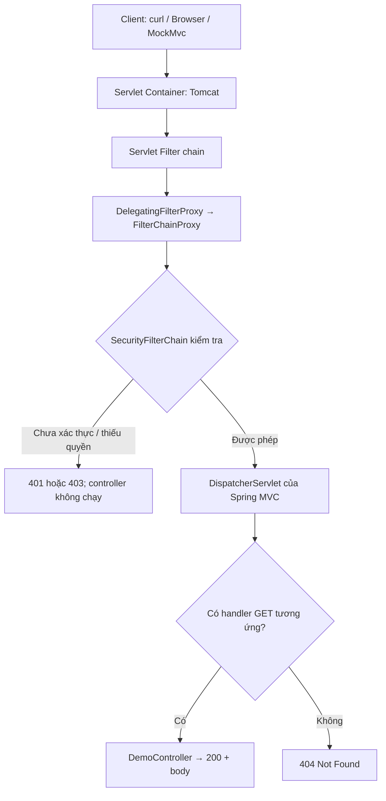

# Thử nghiệm endpoint công khai, endpoint được bảo vệ và phản hồi ban đầu

> **Ngữ cảnh:** Spring Boot 3.x + Spring MVC + Spring Security 6.x trên **Servlet stack**, Java 17 trở lên. Bài thực hành tạo ứng dụng tối thiểu, gửi các HTTP request đầu tiên, đọc status/headers/body và phân biệt lỗi do bảo mật với lỗi do định tuyến. Mục tiêu là **quan sát được hành vi**, hiểu vì sao có kết quả đó, rồi xác nhận bằng kiểm thử lặp lại.

## 1. Kết quả cần đạt

Sau bài này, bạn có thể:

1. Khởi động ứng dụng Spring Boot Servlet có Spring Web và Spring Security; biết cách xác nhận server đang lắng nghe HTTP.
2. Tạo một endpoint công khai `GET /public` và hai endpoint cần đăng nhập: `GET /private` và `GET /admin`.
3. Gọi endpoint không kèm thông tin xác thực, kèm thông tin sai và kèm thông tin đúng bằng `curl`; đọc được **200**, **401**, **403** và **404**.
4. Giải thích được đường đi **client → Servlet container → Spring Security filter chain → DispatcherServlet/Spring MVC → controller**.
5. Biến quan sát thủ công thành test `MockMvc` để phát hiện thay đổi ngoài ý muốn trong cấu hình bảo mật.

Điểm mấu chốt: **Tên endpoint không quyết định quyền truy cập.** Controller chỉ định nghĩa cách xử lý một route; `SecurityFilterChain` quyết định request nào được đi tiếp. Trong ứng dụng mới có Spring Security, đừng mặc định rằng route mới tạo sẽ tự công khai.

## 2. Chuẩn bị dự án Servlet

Tạo dự án từ Spring Initializr hoặc một project Spring Boot 3.x đang ở trạng thái chạy được, với:

- **Language:** Java; **Java:** 17 hoặc 21; **Build:** Gradle (Groovy DSL).
- **Dependencies:** Spring Web, Spring Security. Để chạy phần test ở cuối, cần thêm Spring Boot Starter Test và Spring Security Test.
- **Package gốc trong ví dụ:** `com.example.demo`. Đặt lớp `@SpringBootApplication` tại package gốc này để Spring quét được các bean/controller bên dưới.
- Dùng Gradle wrapper có sẵn của project. Không cần cài riêng Gradle toàn hệ thống.

Trong `build.gradle` do Spring Initializr tạo, phần `dependencies` tương ứng sẽ có dạng:

```groovy
dependencies {
    implementation 'org.springframework.boot:spring-boot-starter-web'
    implementation 'org.springframework.boot:spring-boot-starter-security'

    testImplementation 'org.springframework.boot:spring-boot-starter-test'
    testImplementation 'org.springframework.security:spring-security-test'
}
```

Đoạn này là **phần dependencies của một build.gradle đã có plugins và repositories** (không phải file Gradle độc lập). Dùng phiên bản Spring Boot 3.x phù hợp với project và để Boot quản lý phiên bản của các starter/dependency tương thích.

Cấu trúc file hoàn chỉnh cho ví dụ:

```text
src/
├── main/java/com/example/demo/
│   ├── SecurityDemoApplication.java
│   ├── DemoController.java
│   └── SecurityConfig.java
└── test/java/com/example/demo/
    └── SecurityEndpointsTest.java
```

Chỉ cần ba file trong `src/main` để chạy HTTP. File ở `src/test` dùng để tự động hóa kiểm thử ở phần sau.

## 3. Tạo ứng dụng và ba endpoint

**`src/main/java/com/example/demo/SecurityDemoApplication.java`**

```java
package com.example.demo;

import org.springframework.boot.SpringApplication;
import org.springframework.boot.autoconfigure.SpringBootApplication;

@SpringBootApplication
public class SecurityDemoApplication {
    public static void main(String[] args) {
        SpringApplication.run(SecurityDemoApplication.class, args);
    }
}
```

**`src/main/java/com/example/demo/DemoController.java`**

```java
package com.example.demo;

import java.security.Principal;
import org.springframework.web.bind.annotation.GetMapping;
import org.springframework.web.bind.annotation.RestController;

@RestController
public class DemoController {

    @GetMapping("/public")
    public String publicEndpoint() {
        return "PUBLIC_OK";
    }

    @GetMapping("/private")
    public String privateEndpoint(Principal principal) {
        return "PRIVATE_OK: " + principal.getName();
    }

    @GetMapping("/admin")
    public String adminEndpoint(Principal principal) {
        return "ADMIN_OK: " + principal.getName();
    }
}
```

`@RestController` cho phép Spring MVC trả trực tiếp chuỗi làm HTTP response body. `@GetMapping` định nghĩa HTTP method/path và `DispatcherServlet` sẽ tìm ra controller phù hợp **nếu request vượt qua security filters**. `Principal` trong endpoint có bảo vệ giúp quan sát danh tính người dùng đã xác thực.

Ngay lúc này, code controller **chưa nói endpoint nào public hay private**. Quyền truy cập đến từ cấu hình bảo mật bên dưới.

## 4. Định nghĩa quy tắc bảo mật tối thiểu

**`src/main/java/com/example/demo/SecurityConfig.java`**

```java
package com.example.demo;

import org.springframework.context.annotation.Bean;
import org.springframework.context.annotation.Configuration;
import org.springframework.http.HttpMethod;
import org.springframework.security.config.Customizer;
import org.springframework.security.config.annotation.web.builders.HttpSecurity;
import org.springframework.security.core.userdetails.User;
import org.springframework.security.core.userdetails.UserDetailsService;
import org.springframework.security.crypto.factory.PasswordEncoderFactories;
import org.springframework.security.crypto.password.PasswordEncoder;
import org.springframework.security.provisioning.InMemoryUserDetailsManager;
import org.springframework.security.web.SecurityFilterChain;

@Configuration
public class SecurityConfig {

    @Bean
    SecurityFilterChain securityFilterChain(HttpSecurity http) throws Exception {
        return http
                .authorizeHttpRequests(authorize -> authorize
                        .requestMatchers(HttpMethod.GET, "/public").permitAll()
                        .requestMatchers(HttpMethod.GET, "/admin").hasRole("ADMIN")
                        .anyRequest().authenticated()
                )
                .httpBasic(Customizer.withDefaults())
                .build();
    }

    @Bean
    PasswordEncoder passwordEncoder() {
        return PasswordEncoderFactories.createDelegatingPasswordEncoder();
    }

    @Bean
    UserDetailsService userDetailsService(PasswordEncoder encoder) {
        var learner = User.withUsername("learner")
                .password(encoder.encode("demo-pass"))
                .roles("USER")
                .build();

        var admin = User.withUsername("admin")
                .password(encoder.encode("admin-pass"))
                .roles("ADMIN")
                .build();

        return new InMemoryUserDetailsManager(learner, admin);
    }
}
```

Giải thích từng quyết định:

- **`requestMatchers(HttpMethod.GET, "/public").permitAll()`:** chỉ yêu cầu `GET /public` được phép truy cập dù chưa đăng nhập. Nếu đổi sang `POST /public`, request không thuộc quy tắc này.
- **`requestMatchers(HttpMethod.GET, "/admin").hasRole("ADMIN")`:** chỉ người đã xác thực và có role `ADMIN` được phép truy cập `GET /admin`. `hasRole("ADMIN")` kiểm tra authority `ROLE_ADMIN` do `.roles("ADMIN")` tạo ra.
- **`anyRequest().authenticated()`:** mọi request còn lại cần xác thực, bao gồm `GET /private` và cả những path chưa có controller. Thứ tự matcher rất quan trọng: quy tắc cụ thể đặt trước `anyRequest()`.
- **`httpBasic(...)`:** bật cơ chế HTTP Basic để kiểm tra bằng `curl -u` và quan sát challenge 401. Ví dụ không bật form login, do đó không cần dựa vào trang đăng nhập mặc định.
- **`UserDetailsService`:** tạo hai user trong bộ nhớ, giúp phép thử có kết quả ổn định: `learner` mang role `USER`, `admin` mang role `ADMIN`. `PasswordEncoder` mã hóa mật khẩu trước khi đưa vào kho user.

Hai mật khẩu trong ví dụ là **dữ liệu học tập**, không phải cấu hình tài khoản thực. HTTP Basic truyền credentials theo mã hóa Base64 trong header; khi dùng bên ngoài môi trường local, phải có HTTPS và cơ chế quản lý danh tính phù hợp.

Không gọi `csrf.disable()`: tất cả phép thử chính đều là `GET`, nên không cần tắt bảo vệ CSRF mặc định. Khi mở rộng sang các HTTP method thay đổi trạng thái, phải đánh giá CSRF theo kiểu xác thực/session thực tế.

## 5. Khởi động: xác nhận ứng dụng sẵn sàng trước khi thử Security

Tại thư mục gốc project (nơi có `gradlew` hoặc `gradlew.bat`), chạy:

```bash
# macOS / Linux
./gradlew bootRun

# Windows PowerShell
.\gradlew.bat bootRun
```

Nếu chạy thành công và không thay đổi cấu hình port, ứng dụng lắng nghe trên **localhost:8080**. Trong console có thể thấy log tương tự “Tomcat started on port 8080” và “Started SecurityDemoApplication”; câu chữ/thời gian cụ thể phụ thuộc phiên bản và cấu hình.

Cần phân biệt **server đã chạy** với **endpoint phản hồi 200**. Một ứng dụng chạy thành công vẫn có thể trả 401, 403 hoặc 404 cho từng request; đó là kết quả xử lý HTTP, không phải bằng chứng Boot khởi động thất bại.

Nếu port 8080 đã bị dùng, sửa `server.port` hoặc dừng tiến trình chiếm port rồi thống nhất lại URL khi chạy `curl`. Đừng vội chẩn đoán “Security sai” khi client chưa kết nối được tới server.

## 6. Bản đồ đường đi request



Trong ứng dụng thực, error dispatch, authentication entry point, CSRF và handler exceptions có thể làm sơ đồ chi tiết hơn. Với ba route `GET` của bài này, sơ đồ đủ để giải thích kết quả cần quan sát:

- `GET /public`: luật `permitAll()` cho qua; MVC gọi `publicEndpoint()`.
- `GET /private` không có credentials: Security chặn; MVC không gọi `privateEndpoint()`.
- `GET /private` với credentials đúng: Security xác thực; MVC gọi `privateEndpoint()` và nhận được `Principal`.
- `GET /admin` với user `learner`: đã đăng nhập nhưng thiếu role, nên Security chặn trước controller.
- `GET /missing` với credentials đúng: vượt qua Security, nhưng MVC không tìm thấy handler nên kết quả là 404.

Đây là lý do **401/403 và 404 phải được phân tích theo thứ tự các tầng**, thay vì đoán từ tên URL.

## 7. Thử nghiệm thủ công bằng curl

Mở terminal thứ hai, giữ ứng dụng đang chạy trong terminal đầu tiên. `-i` yêu cầu `curl` hiển thị cả response headers; `-u username:password` gửi Basic credentials. Trong PowerShell, ưu tiên `curl.exe` vì lệnh `curl` có thể trỏ tới alias `Invoke-WebRequest` trên một số môi trường.

### Thử 1 — Endpoint công khai

```bash
curl -i http://localhost:8080/public

# Windows PowerShell:
curl.exe -i http://localhost:8080/public
```

**Kỳ vọng:** status **200 OK**, body chính xác:

```text
PUBLIC_OK
```

Bạn không gửi `Authorization` header, nhưng request vẫn tới MVC nhờ `permitAll()`. **Public không có nghĩa là bỏ qua Spring Security filter chain**; nó có nghĩa Security cho phép request tiếp tục.

### Thử 2 — Endpoint được bảo vệ, chưa đăng nhập

```bash
curl -i http://localhost:8080/private

# Windows PowerShell:
curl.exe -i http://localhost:8080/private
```

**Kỳ vọng:** status **401 Unauthorized**. Với HTTP Basic, thường có header challenge dạng:

```http
HTTP/1.1 401
WWW-Authenticate: Basic realm="Realm"
```

Tên realm, response body và các headers khác tùy cấu hình. Ở đây câu trả lời quan trọng là **401**: Security yêu cầu credentials hợp lệ; method `privateEndpoint()` **chưa chạy**.

### Thử 3 — Endpoint được bảo vệ, credentials sai

```bash
curl -i -u learner:wrong-pass http://localhost:8080/private

# Windows PowerShell:
curl.exe -i -u learner:wrong-pass http://localhost:8080/private
```

**Kỳ vọng:** **401 Unauthorized**. Có gửi header `Authorization` không đồng nghĩa xác thực thành công. Password không khớp `UserDetailsService`/`PasswordEncoder` nên Security không thiết lập danh tính hợp lệ.

### Thử 4 — Endpoint được bảo vệ, credentials đúng

```bash
curl -i -u learner:demo-pass http://localhost:8080/private

# Windows PowerShell:
curl.exe -i -u learner:demo-pass http://localhost:8080/private
```

**Kỳ vọng:** status **200 OK**, body chính xác:

```text
PRIVATE_OK: learner
```

Bây giờ `Authentication` hợp lệ được đưa vào ngữ cảnh request; sau khi Security cho qua, MVC gọi controller và tham số `Principal` cung cấp tên `learner`.

### Thử 5 — Đã xác thực, nhưng thiếu quyền ADMIN

```bash
curl -i -u learner:demo-pass http://localhost:8080/admin

# Windows PowerShell:
curl.exe -i -u learner:demo-pass http://localhost:8080/admin
```

**Kỳ vọng:** **403 Forbidden**. User `learner` có `ROLE_USER`, trong khi endpoint yêu cầu `ROLE_ADMIN`. Đây là bài học quan trọng: **401 thường gắn với việc chưa có xác thực hợp lệ; 403 thường gắn với quyền truy cập bị từ chối sau khi đã xác thực**.

### Thử 6 — Đủ quyền ADMIN

```bash
curl -i -u admin:admin-pass http://localhost:8080/admin

# Windows PowerShell:
curl.exe -i -u admin:admin-pass http://localhost:8080/admin
```

**Kỳ vọng:** status **200 OK**, body:

```text
ADMIN_OK: admin
```

Cùng URL và HTTP method nhưng thay đổi quyền người gọi dẫn đến khác biệt 403 → 200. Điều này cho thấy role authorization nằm ở Security, dù controller `adminEndpoint()` không tự kiểm tra role.

### Thử 7 — Không có handler nhưng đã xác thực

```bash
curl -i -u learner:demo-pass http://localhost:8080/missing

# Windows PowerShell:
curl.exe -i -u learner:demo-pass http://localhost:8080/missing
```

**Kỳ vọng:** **404 Not Found**. Security cho user đã đăng nhập đi tiếp theo `anyRequest().authenticated()`, nhưng MVC không tìm thấy route `/missing`.

Nếu thử `GET /missing` **không có credentials**, có thể nhận **401 trước khi có cơ hội nhận 404**: security filter kiểm tra request trước khi MVC xác định controller. Vì vậy, muốn kiểm tra routing của đường dẫn protected thì trước hết phải vượt qua Security.

## 8. Bảng đối chiếu các response đầu tiên

| Request | Credentials | HTTP status kỳ vọng | Tầng giải thích |
|---|---|---:|---|
| `GET /public` | Không có | **200** | Security cho qua; MVC trả `PUBLIC_OK` |
| `GET /private` | Không có | **401** | Security yêu cầu HTTP Basic |
| `GET /private` | `learner` + sai password | **401** | Authentication không thành công |
| `GET /private` | `learner` + đúng password | **200** | Authentication thành công; MVC trả `PRIVATE_OK: learner` |
| `GET /admin` | `learner` + đúng password | **403** | Đã xác thực nhưng thiếu `ROLE_ADMIN` |
| `GET /admin` | `admin` + đúng password | **200** | Có role; MVC trả `ADMIN_OK: admin` |
| `GET /missing` | `learner` + đúng password | **404** | Security cho qua nhưng MVC không có handler |
| `GET /missing` | Không có | **401** | Security chặn trước MVC |

**Đọc response theo ba phần:** status phản ánh kết quả xử lý; headers cho biết challenge, kiểu nội dung hoặc chính sách HTTP; body là dữ liệu do controller hoặc cơ chế lỗi tạo ra. `curl -i` giúp nhìn cả ba. Đừng viết test so sánh toàn bộ chuỗi headers vì thứ tự và nội dung của một số header phụ thuộc phiên bản/server; ở đây hãy kiểm tra status, body cần thiết và header đặc trưng.

`401` và `403` cũng không có ý nghĩa tuyệt đối trong mọi cơ chế authentication. Khi cấu hình form login và browser gửi `Accept: text/html`, request chưa đăng nhập có thể được **redirect 302** tới trang đăng nhập. Bài này chủ động bật **HTTP Basic** và chỉ xét các `GET` để tạo kết quả dễ quan sát, lặp lại.

## 9. So sánh với mặc định ban đầu của Spring Boot

Ba trạng thái cần phân biệt khi làm quen Spring Security:

1. **Chỉ thêm Spring Web, chưa thêm Security:** Các endpoint do controller ánh xạ thường không có lớp xác thực Spring Security; `GET /private` cũng có thể trả 200 dù tên là “private”. Đây chưa phải ứng dụng an toàn.
2. **Thêm Spring Security starter nhưng chưa tự khai báo `SecurityFilterChain`:** Spring Boot thường áp dụng default bảo vệ các requests bằng authentication; khi phát triển có thể thấy mật khẩu user tạm được sinh và in vào log. Tùy content negotiation và cơ chế login mặc định, client có thể nhận HTTP 401 hoặc 302. `GET /public` **không tự công khai chỉ vì nó tên là public**.
3. **Khai báo `SecurityFilterChain` như ví dụ:** Quy tắc rõ ràng: `GET /public` public, `GET /admin` đòi `ROLE_ADMIN`, các request còn lại yêu cầu xác thực. Đầu ra thử nghiệm đã xác định ở phần 7–8.

Khi tự định nghĩa chain, bạn phải tự đảm bảo các URL cần bảo vệ được bao phủ. `requestMatchers(...)` bên trong `authorizeHttpRequests` là quy tắc **authorization**; `http.securityMatcher(...)` (nếu dùng) giới hạn **phạm vi một SecurityFilterChain được chọn**. Một URL không khớp chain nào có thể không được Spring Security bảo vệ, dù project có starter.

## 10. Kiểm thử lặp lại bằng MockMvc

`curl` giúp hiểu hành vi thực và headers qua HTTP; `MockMvc` giúp kiểm tra endpoint và Spring Security filters trong môi trường test mà không cần chạy server tại port 8080. Đảm bảo có hai dependency test đã nêu ở `build.gradle`.

**`src/test/java/com/example/demo/SecurityEndpointsTest.java`**

```java
package com.example.demo;

import org.junit.jupiter.api.Test;
import org.springframework.beans.factory.annotation.Autowired;
import org.springframework.boot.test.autoconfigure.web.servlet.AutoConfigureMockMvc;
import org.springframework.boot.test.context.SpringBootTest;
import org.springframework.test.web.servlet.MockMvc;

import static org.springframework.security.test.web.servlet.request.SecurityMockMvcRequestPostProcessors.httpBasic;
import static org.springframework.test.web.servlet.request.MockMvcRequestBuilders.get;
import static org.springframework.test.web.servlet.result.MockMvcResultMatchers.content;
import static org.springframework.test.web.servlet.result.MockMvcResultMatchers.status;

@SpringBootTest
@AutoConfigureMockMvc
class SecurityEndpointsTest {

    @Autowired
    private MockMvc mockMvc;

    @Test
    void publicEndpointIsAvailableAnonymously() throws Exception {
        mockMvc.perform(get("/public"))
                .andExpect(status().isOk())
                .andExpect(content().string("PUBLIC_OK"));
    }

    @Test
    void privateEndpointRejectsAnonymous() throws Exception {
        mockMvc.perform(get("/private"))
                .andExpect(status().isUnauthorized());
    }

    @Test
    void privateEndpointRejectsWrongPassword() throws Exception {
        mockMvc.perform(get("/private").with(httpBasic("learner", "wrong-pass")))
                .andExpect(status().isUnauthorized());
    }

    @Test
    void privateEndpointAcceptsValidCredentials() throws Exception {
        mockMvc.perform(get("/private").with(httpBasic("learner", "demo-pass")))
                .andExpect(status().isOk())
                .andExpect(content().string("PRIVATE_OK: learner"));
    }

    @Test
    void adminEndpointRejectsAuthenticatedLearner() throws Exception {
        mockMvc.perform(get("/admin").with(httpBasic("learner", "demo-pass")))
                .andExpect(status().isForbidden());
    }

    @Test
    void adminEndpointAcceptsAdmin() throws Exception {
        mockMvc.perform(get("/admin").with(httpBasic("admin", "admin-pass")))
                .andExpect(status().isOk())
                .andExpect(content().string("ADMIN_OK: admin"));
    }

    @Test
    void unknownPathAfterAuthenticationReturns404() throws Exception {
        mockMvc.perform(get("/missing").with(httpBasic("learner", "demo-pass")))
                .andExpect(status().isNotFound());
    }
}
```

Chạy test từ thư mục project:

```bash
# macOS / Linux
./gradlew test

# Windows PowerShell
.\gradlew.bat test
```

Nếu project có cấu hình Spring Boot 3.x và Gradle wrapper tương thích, kỳ vọng Gradle báo **BUILD SUCCESSFUL** và bảy test pass. Đó là **kết quả kỳ vọng khi chạy mã trong project**, không phải log đã thực thi sẵn trong bài viết. Test `httpBasic(...)` tạo Basic Authorization header cho request `MockMvc`; do vậy nó kiểm tra luồng xác thực HTTP, không chỉ gọi trực tiếp một Java method của controller.

Nếu test chỉ gọi `new DemoController().privateEndpoint(...)`, nó **không đi qua `SecurityFilterChain`**, nên sẽ không phát hiện trường hợp endpoint vô tình trở nên công khai. Mục tiêu của những test trên là xác nhận hành vi từ góc nhìn HTTP client.

## 11. Khi kết quả khác kỳ vọng, hãy chẩn đoán theo tầng

### 11.1. Connection refused hoặc không nhận HTTP response

Đây thường là vấn đề **khởi động/network**, không phải kết quả authentication. Kiểm tra `bootRun` còn chạy không, có lỗi port conflict không, đúng `localhost:8080` chưa, app có đổi `server.port`/context path không. `curl` không thể nhận 401 nếu server chưa phục vụ HTTP.

### 11.2. `GET /public` trả 401

Kiểm tra bean `SecurityFilterChain` có được load không; matcher có đúng **GET**, đúng `/public` và đúng thứ tự trước `anyRequest()` không. Nếu `SecurityConfig` nằm ngoài package scan của lớp `@SpringBootApplication`, Boot có thể dùng cấu hình mặc định. Không sửa bằng cách tự gắn `@PermitAll` lên controller rồi cho rằng HTTP filter sẽ tự thay đổi; hãy nhìn chính sách Security đang thực thi.

### 11.3. `GET /private` trả 200 khi chưa gửi credentials

Kiểm tra lại Security starter, cấu hình filter chain, rule `permitAll()` có quá rộng không, ứng dụng có match chain cần thiết không, request đang dùng session/cookie xác thực nào. Một endpoint trả 200 không tự chứng minh nó được bảo vệ đúng; hãy thử trong client mới không có cookies hoặc Authorization header.

### 11.4. `GET /private` trả 401 dù đã gửi credentials

Kiểm tra đúng user/password, password encoding, và request thực sự có Basic Authorization header. Dòng `curl -u` tương ứng với user trong memory store; header Basic khác với Bearer token. Không nhầm 401 với 403: 401 ở đây nghĩa là chưa tạo được authentication hợp lệ.

### 11.5. `GET /admin` trả 403 với user learner

Đây là **đúng theo ví dụ**: `learner` có `ROLE_USER`, không có `ROLE_ADMIN`. So sánh với user `admin`. Khi sử dụng `hasRole("ADMIN")`, Spring Security kiểm tra authority có tiền tố `ROLE_`; đừng thêm tiền tố này lần thứ hai vào tên role trong `hasRole`.

### 11.6. Một URL trả 404, 405 hoặc 403 bất ngờ

- **404 Not Found:** không có handler/path phù hợp (sau khi Security cho request đi tiếp), hoặc vấn đề context path/định tuyến.
- **405 Method Not Allowed:** path có thể tồn tại nhưng không hỗ trợ HTTP method đó. `@GetMapping` không đồng nghĩa `@PostMapping`.
- **403 Forbidden:** có thể thiếu authority hoặc, với các phương thức thay đổi trạng thái, bị CSRF filter từ chối. Ví dụ chỉ dùng `GET` để loại bỏ biến số CSRF ở bài khởi tạo này.
- Một request không có credentials có thể bị **401 trước khi MVC có cơ hội trả 404/405**. Hãy xác thực trước khi kiểm tra route protected.

Đừng tắt CSRF chỉ để làm phép thử `POST` “hết 403”. Cần xác định request dùng session cookie, HTTP Basic, bearer token hay cơ chế khác và quyết định chính sách CSRF theo mô hình thực tế.

### 11.7. Browser hiển thị trang đăng nhập thay vì 401

Nếu bạn không dùng cấu hình HTTP Basic như trong bài mà bật **form login** (hoặc dựa vào default Boot), response của browser có thể là **302 redirect** đến trang login. Kiểm tra `Location` header, `Accept` header và các cơ chế authentication đang bật. Phân biệt **redirect** với lỗi kết nối hoặc 404; không phải mọi client đều thấy cùng giao diện.

### 11.8. Header và body khác ảnh chụp minh họa

HTTP version, `Content-Type`, `Cache-Control`, `X-Content-Type-Options`, `WWW-Authenticate`, body của trang lỗi hoặc thứ tự headers có thể khác theo phiên bản. Để đối chiếu bài này, kiểm tra **status**, body cụ thể `PUBLIC_OK`/`PRIVATE_OK: learner`/`ADMIN_OK: admin` và việc controller có được gọi hay không; chỉ khẳng định headers có ý nghĩa khi chúng nằm trong cấu hình đang xét.

## 12. Vì sao có cả 401 và 403 dù controller không kiểm tra?

Ở tầng Servlet, `DelegatingFilterProxy` ủy quyền cho bean Spring `FilterChainProxy`, bean này chọn `SecurityFilterChain` và chạy các security filters. Tùy tình huống, các filter có thể:

1. Đọc `Authorization: Basic ...`, xác thực credential và tạo `Authentication`.
2. Đưa authentication vào `SecurityContext` cho request.
3. Kiểm tra `authorizeHttpRequests`: anonymous có được vào không, user có role cần thiết không.
4. Gửi response chặn request hoặc cho đi tiếp tới `DispatcherServlet`.

Nếu đi tiếp, Spring MVC mới chọn handler bằng `@GetMapping` và gọi method Java. Phần xử lý authentication/authorization xảy ra **trước controller**, nên `@ControllerAdvice` của MVC không mặc nhiên xử lý mọi response phát sinh tại security filter. Mặt khác, kể cả request đã xác thực, controller vẫn có thể trả lỗi nghiệp vụ hoặc 404/405 do MVC.

Các ví dụ `GET` chưa bàn chi tiết việc lưu `SecurityContext` giữa các request. HTTP Basic ở đây được dùng để cung cấp credentials trên từng request thử nghiệm; trong ứng dụng production, cấu hình session/stateless, CSRF và identity provider cần được thiết kế theo nhu cầu riêng.

## 13. Bài tập thực hành có thể tự kiểm chứng

1. **Thêm endpoint public:** thêm `@GetMapping("/health")` trả `"HEALTH_OK"`; bổ sung `"/health"` trong rule `permitAll()`. Quan sát `GET /health` không có credentials trả 200, rồi bỏ rule public và thấy yêu cầu đăng nhập.
2. **Kiểm tra thay đổi role:** gọi `/admin` lần lượt bằng `learner` và `admin`. Ghi lại status và giải thích vì sao cùng URL cho 403 và 200.
3. **Kiểm tra lỗi routing có xác thực:** gọi `/no-such-path` lần lượt không credentials và có credentials hợp lệ. So sánh 401 và 404 để xác định tầng nào trả response trước.
4. **Đổi thứ tự matcher:** nếu vô tình đặt `anyRequest().authenticated()` trước các rule cụ thể, cấu hình authorization có thể không hợp lệ hoặc rule cụ thể không được áp dụng đúng ý. Khôi phục thứ tự: URL cụ thể trước, fallback cuối.
5. **Thêm một phép test:** tạo test cho `GET /missing` không gửi credentials và kỳ vọng 401; giải thích tại sao một URL không có controller vẫn nhận response từ Security trước MVC.

Sau mỗi thay đổi, chạy lại `./gradlew test` và dùng `curl -i` để đối chiếu. Đừng dùng một status code đơn lẻ để kết luận thành công: một endpoint public phải trả đúng nội dung khi anonymous, endpoint private phải chặn anonymous **và** cho người hợp lệ đi tiếp.

## 14. Ghi nhớ trước khi học cấu hình nâng cao

- **Spring Boot** khởi tạo ứng dụng và server; **Servlet Container** tiếp nhận HTTP; **Spring Security filters** quyết định request được đi tiếp hay bị từ chối; **Spring MVC** tìm handler và trả nội dung.
- **200:** controller đã xử lý thành công request được phép. **401:** cần credentials hợp lệ. **403:** bị từ chối quyền (hoặc CSRF). **404:** không tìm thấy handler sau khi request vượt qua các lớp trước đó.
- `permitAll()` vẫn đi qua security filters; `authenticated()` yêu cầu danh tính; `hasRole("ADMIN")` yêu cầu role phù hợp.
- Với code trong bài, chuỗi thử tối thiểu đáng nhớ là: **public anonymous → 200**, **private anonymous → 401**, **private learner → 200**, **admin learner → 403**, **admin admin → 200**, **missing learner → 404**.
- Bắt đầu bằng request thật và kiểm tra bằng `MockMvc` giúp phát hiện sớm khác biệt giữa **“ứng dụng chạy được”** và **“endpoint được bảo vệ đúng”**.