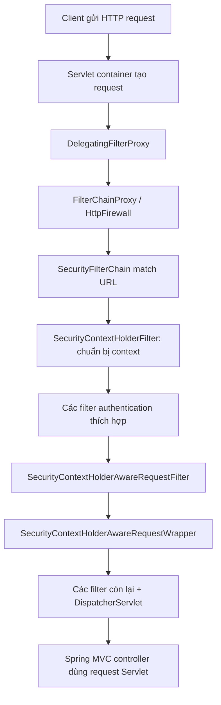

# SecurityContextHolderAwareRequestFilter và các lớp bao Servlet request

> **Phạm vi:** Spring Security **Servlet** + Spring MVC, Java 17+, Spring Boot 3.x và Spring Security 6.x. Tìm hiểu cách Spring Security kết nối `SecurityContext` với các phương thức bảo mật chuẩn của `HttpServletRequest` thông qua `SecurityContextHolderAwareRequestFilter` và `SecurityContextHolderAwareRequestWrapper`; phân biệt chúng với các request wrapper khác, giải thích filter ordering, Servlet API programmatic authentication và async.

## 1. Vấn đề thực tế: request Servlet có biết danh tính do Spring Security xác thực không?

Trong Spring MVC, controller có thể dùng Servlet API tiêu chuẩn:

```java
@GetMapping("/my-profile")
public String profile(HttpServletRequest request) {
    return request.getRemoteUser();
}
```

Nhưng Servlet container tạo request trước khi Spring Security xử lý authentication. Nếu ứng dụng đăng nhập bằng HTTP Basic, form login, session, OAuth2/OIDC hoặc custom authentication provider của **Spring Security**, container request gốc **không nhất thiết** nhận biết Spring `Authentication`. Vậy tại sao `getRemoteUser()`, `getUserPrincipal()` và `isUserInRole()` vẫn có thể hoạt động đúng trong controller?

**Câu trả lời là Servlet API integration.** `SecurityContextHolderAwareRequestFilter` bọc request bằng một `SecurityContextHolderAwareRequestWrapper`, để các phương thức bảo mật chuẩn Servlet phản ánh thông tin từ `SecurityContextHolder`.

Các phương thức chính:

- `request.getRemoteUser()`: trả tên user được xác thực hoặc `null` khi không có user phù hợp.
- `request.getUserPrincipal()`: trả `Principal` được Spring Security tích hợp với request (thường là `Authentication`), hoặc `null` đối với anonymous.
- `request.isUserInRole("ADMIN")`: tra role theo `GrantedAuthority` và quy ước role prefix.
- `request.authenticate(response)`: hỗ trợ Servlet programmatic authentication theo cơ chế đã cấu hình.
- `request.login(username, password)`: hỗ trợ đăng nhập lập trình theo Servlet API.
- `request.logout()`: hỗ trợ đăng xuất lập trình, với ý nghĩa và các giới hạn của handler được cấu hình.

**Không nhầm:** request wrapper **không phải authentication provider**; nó không xác minh password, không tự cấp roles và không tạo authorization policy. Nó chỉ tạo *cầu nối* để Servlet API nhìn thấy authentication mà Spring Security đã quản lý.

## 2. Các thành phần phải tách riêng

### 2.1. SecurityContextHolder, SecurityContext và Authentication

`SecurityContextHolder` là API lấy `SecurityContext` cho luồng xử lý hiện tại. `SecurityContext` chứa `Authentication`, khi có:

```java
Authentication auth =
        SecurityContextHolder.getContext().getAuthentication();
```

`Authentication` chứa tên định danh (`getName()`), principal nội bộ (`getPrincipal()`), danh sách quyền (`getAuthorities()`) và các thông tin theo provider. Đây là trạng thái **Spring Security**, không phải thuộc tính tự nhiên của `HttpServletRequest` gốc.

Trong ứng dụng Servlet thông thường, security context được chuẩn bị bởi các security filters như `SecurityContextHolderFilter` và nguồn `SecurityContextRepository`. Ở các cấu hình/version cũ có thể gặp `SecurityContextPersistenceFilter`. Việc lưu context giữa nhiều request phụ thuộc session/repository và chính sách persistence, không do request wrapper tự quyết định.

**Lưu ý anonymous:** khi `AnonymousAuthenticationFilter` hoạt động, `SecurityContextHolder` có thể chứa `AnonymousAuthenticationToken`. Token này có thể có `isAuthenticated() == true`, dù người dùng không thật sự đăng nhập. Vì vậy đừng kết luận “đã login” chỉ từ `auth != null && auth.isAuthenticated()`. Dùng quy tắc authorization, `AuthenticationTrustResolver` hoặc Servlet-aware principal semantics phù hợp.

### 2.2. Servlet API và request container

Các phương thức:

```java
String remoteUser = request.getRemoteUser();
Principal user = request.getUserPrincipal();
boolean admin = request.isUserInRole("ADMIN");
```

thuộc Servlet specification. Một container dùng container-managed authentication có thể tự cung cấp identity cho chúng. Khi Spring Security làm chủ authentication, việc container gốc chưa biết identity đó là bình thường. Spring Security cung cấp request wrapper để đồng bộ góc nhìn ở tầng Servlet API.

### 2.3. SecurityContextHolderAwareRequestFilter

`SecurityContextHolderAwareRequestFilter` là filter thuộc gói `org.springframework.security.web.servletapi`. Nó nhận `HttpServletRequest`, tạo hoặc cung cấp security-aware request wrapper và truyền request đã bao xuống `FilterChain`. Wrapper kế thừa/ủy quyền các hành vi HTTP thông thường nhưng cung cấp các phương thức bảo mật dựa trên Spring `SecurityContext`.

Đặc điểm đáng nhớ:

1. Nó **bọc request**, không tải user từ DB hay so sánh password.
2. Nó cần nằm trong **SecurityFilterChain thực sự match request**.
3. API bảo mật chuẩn ở **filter/controller chạy sau wrapper** có thể thấy Spring authentication.
4. Custom filter chạy **trước wrapper** có thể nhìn thấy container principal/null thay vì Spring principal.
5. Nếu route bị bỏ qua khỏi toàn bộ security filter chain, integration có thể không xuất hiện ở route đó.

### 2.4. SecurityContextHolderAwareRequestWrapper

`SecurityContextHolderAwareRequestWrapper` là một lớp bao `HttpServletRequestWrapper`. Điểm chính là **delegation có chọn lọc**: request path, headers, parameters và các API thông thường vẫn tuân theo request được bao; các security methods sử dụng ngữ nghĩa Spring Security.

`getUserPrincipal()` thường biểu diễn `Authentication` như một `Principal`. **Không cast mặc định** nó thành entity/domain user. Nếu cần `UserDetails` hoặc `OidcUser`, truy cập `Authentication#getPrincipal()` phù hợp hoặc dùng `@AuthenticationPrincipal`, rồi ánh xạ sang đối tượng nghiệp vụ đã xác minh.

## 3. Thứ tự filter và đường đi của request



Sơ đồ mô tả **trách nhiệm và vị trí tương đối** để học, không phải filter order cố định cho mọi ứng dụng: Security chain thực tế còn có CORS, CSRF, logout, anonymous, session management, exception translation, authorization, custom filters; có thể có nhiều chains. Khi debug, phải xem chain match request và thứ tự thực tế.

| Thành phần | Trách nhiệm chính | Không làm thay việc gì? |
| --- | --- | --- |
| `DelegatingFilterProxy` | Nối Servlet container với Spring-managed filter | Không tự quyết định username/password |
| `FilterChainProxy` | Chọn và chạy các security filter chains | Không thay thế authorization policy của từng chain |
| `HttpFirewall` / `FirewalledRequest` | Kiểm tra/chuẩn hóa đặc điểm request phục vụ security matching | Không biến user thành đã đăng nhập |
| `SecurityContextHolderFilter` | Chuẩn bị và dọn dẹp Spring security context theo repository | Không tự bọc Servlet API request |
| Authentication filters | Kiểm tra credential hoặc phục hồi trạng thái auth | Không tự quyết định mọi business permission |
| `SecurityContextHolderAwareRequestFilter` | Bọc request để Servlet security methods phản ánh Spring context | Không xác thực password hay authorize |
| `AuthorizationFilter` | Thực thi chính sách access rule dựa trên authentication | Không thay thế Servlet request wrapper |
| `DispatcherServlet` | Định tuyến request tới Spring MVC | Không tự cấp authentication |

### 3.1. Vị trí trước/sau wrapper quan trọng như thế nào?

Giả sử custom logging filter ở trước `SecurityContextHolderAwareRequestFilter` gọi `request.getUserPrincipal()`. Nó có thể nhận `null` vì request chưa được bọc. Sau đó, trong controller, cùng request logic có thể trả principal của Spring Security. Đây là hiện tượng **khác wrapper theo vị trí**, không nhất thiết là Spring Security mất context.

Nếu cần đọc Servlet-aware principal ở một custom filter, có thể đặt nó **sau** `SecurityContextHolderAwareRequestFilter` trong chain, theo mục đích:

```java
http.addFilterAfter(
        new AuditRequestFilter(),
        SecurityContextHolderAwareRequestFilter.class
);
```

Đây là **snippet cấu hình vị trí**, không phải một class độc lập; cần định nghĩa `AuditRequestFilter` và import class liên quan. Đừng vừa tạo filter bean khiến Spring Boot auto-register ở Servlet container vừa add vào Security chain mà không kiểm soát, vì filter có thể chạy **hai lần** ở các vị trí khác nhau.

### 3.2. permitAll và bỏ qua Security chain

`.requestMatchers("/public").permitAll()` chỉ cho phép tất cả user vào URL; request vẫn có thể đi qua security filters, nhận headers/context/wrapper. Ngược lại, `web.ignoring()` hoặc security matcher khiến đường dẫn **không qua chain** có thể bỏ luôn Servlet API integration. Điều này giải thích tại sao một endpoint public vẫn có `getUserPrincipal()` khi user gửi credential hợp lệ, còn một route bị ignore có thể không.

Không vội bỏ đường dẫn ra khỏi Security chain để “tối ưu” nếu endpoint còn cần security headers, context integration hoặc logging. Xác định rõ khác biệt giữa **permit** và **bypass**.

## 4. Các lớp bao Servlet request: không phải wrapper nào cũng là security wrapper

### 4.1. ServletRequestWrapper và HttpServletRequestWrapper

`jakarta.servlet.ServletRequestWrapper` và `jakarta.servlet.http.HttpServletRequestWrapper` là các adapter cho Servlet request. Một lớp bao có thể giữ tham chiếu tới request bên trong rồi chuyển tiếp các phương thức chưa ghi đè. Framework dùng chúng để thêm một hành vi mà không phải viết lại toàn bộ Servlet API.

Ví dụ wrapper tối giản Java 17:

```java
package com.example.servletwrap;

import jakarta.servlet.http.HttpServletRequest;
import jakarta.servlet.http.HttpServletRequestWrapper;

public final class RequestTagWrapper extends HttpServletRequestWrapper {
    private final String requestTag;

    public RequestTagWrapper(HttpServletRequest original, String requestTag) {
        super(original);
        this.requestTag = requestTag;
    }

    public String getRequestTag() {
        return requestTag;
    }
}
```

Wrapper trên chỉ thêm dữ liệu `requestTag`; các phương thức bảo mật tiếp tục được delegate đến request nằm bên trong. Nó **không** tự thay đổi role, principal hay session. Nếu bao ngoài `SecurityContextHolderAwareRequestWrapper` thì delegation đúng giúp giữ semantics Spring Security.

### 4.2. FirewalledRequest và SecurityContextHolderAwareRequestWrapper

`FirewalledRequest` là abstraction do `HttpFirewall` tạo, phục vụ xử lý request an toàn trong `FilterChainProxy`. `StrictHttpFirewall` có thể từ chối những request không đáp ứng quy tắc URL, HTTP method hoặc header; đó là một vấn đề khác hoàn toàn với **Servlet security-aware principal**.

Trong một request có thể tồn tại nhiều lớp:

```text
HttpServletRequest tại Controller
  -> wrapper do filter/tracing thêm
      -> SecurityContextHolderAwareRequestWrapper
          -> FirewalledRequest
              -> HttpServletRequest của Servlet container
```

Đây chỉ là **một hình minh họa**, không cam kết mọi ứng dụng có đúng lớp/thứ tự đó. Framework, Servlet container, reverse proxy integration, Spring MVC và các filter tùy chỉnh có thể thêm hoặc thay đổi wrapper.

### 4.3. ContentCachingRequestWrapper không phải security wrapper

`ContentCachingRequestWrapper` thuộc Spring Web hỗ trợ cache request body trong các ngữ cảnh phù hợp để phục vụ logging/đọc nội dung. Nó **không** cung cấp authentication và không thay thế `SecurityContextHolderAwareRequestWrapper`. Nếu một filter bọc request để đọc payload nhưng không delegate đúng, application code có thể mất thông tin principal, parameter hoặc dispatch semantics.

**Không unwrap request** để lấy request gốc chỉ vì muốn tránh lớp bao. Việc này có thể bỏ qua security-aware methods, cached payload hoặc các chỉnh sửa hợp lệ của framework. Không cast cứng request sang một wrapper cụ thể rồi phụ thuộc tên class: wrapper có thể khác theo container, filter order và middleware.

## 5. Hiểu các Servlet security methods thật chính xác

### 5.1. getRemoteUser()

```java
String username = request.getRemoteUser();
```

Khi có authenticated Spring principal và request đã qua wrapper, tên thường tương đương `Authentication#getName()`. Nó có thể là username, subject hoặc identifier do authentication provider xác định, **không luôn là email**. Nếu không có user phù hợp, giá trị có thể `null`. Không sử dụng chuỗi trả về làm authorization decision duy nhất khi ứng dụng cần tenant/object permissions.

### 5.2. getUserPrincipal()

```java
Principal principal = request.getUserPrincipal();
```

`Principal` là interface chuẩn Java. Với Spring Security integration, principal có thể là một `Authentication` đã được xác thực. `Authentication#getPrincipal()` lại có thể chứa `UserDetails`, custom user, `OidcUser` hoặc chuỗi username, tùy provider.

Nếu cần authorities từ Spring:

```java
Principal principal = request.getUserPrincipal();
if (principal instanceof Authentication auth) {
    Collection<? extends GrantedAuthority> granted =
            auth.getAuthorities();
}
```

Đây là **snippet nằm trong một method** và cần import `Principal`, `Authentication`, `GrantedAuthority`. Nó không phải chương trình Java độc lập. Tránh cast:

```java
// Không đúng cho mọi authentication provider:
MyDomainUser user = (MyDomainUser) request.getUserPrincipal();
```

Trong Spring MVC, có thể sử dụng `@AuthenticationPrincipal` hoặc argument `Authentication` để làm việc với Spring-specific identity, rồi tra cứu domain user theo ID đã được xác minh.

### 5.3. isUserInRole(String role)

```java
boolean hasAdmin = request.isUserInRole("ADMIN");
```

Với mặc định phổ biến của Spring Security:

- `User.withUsername("admin").roles("ADMIN")` tạo authority `ROLE_ADMIN`.
- `isUserInRole("ADMIN")` kiểm tra role theo quy ước prefix, và thường trả `true` khi authority `ROLE_ADMIN` hiện diện.
- `hasRole("ADMIN")` trong DSL authorization sử dụng quy ước prefix tương ứng.
- `hasAuthority("SCOPE_read")` là so khớp authority cụ thể, **không tự tương đương** `isUserInRole("read")`.
- Tùy chỉnh role prefix hoặc authorities mapper có thể làm kết quả khác; hãy đồng bộ cấu hình và kiểm tra thực tế.

**Đây là API truy vấn**, không tự bảo vệ route. Nếu controller chỉ hiển thị nút admin khi `isUserInRole` true nhưng server không có rule authorization, người dùng vẫn có thể gọi URL admin trực tiếp.

### 5.4. authenticate(response)

```java
boolean ok = request.authenticate(response);
```

Đây là Servlet API cho **programmatic authentication**. Thông qua Spring Security Servlet API integration, yêu cầu có thể kích hoạt authentication mechanism/entry point. Trong một số tình huống nó làm thay đổi response bằng challenge hoặc redirect; kết quả phụ thuộc cơ chế đã cấu hình.

Không dùng `request.authenticate(response)` như một cách vô hại để “hỏi” xem user có role nào. Để kiểm tra identity, dùng principal/authorization APIs; để bảo vệ URL, dùng `authorizeHttpRequests` và method security.

### 5.5. login(username, password) và logout()

```java
request.login(username, password);
request.logout();
```

Hai API thuộc Servlet contract; Spring Security integration có thể chuyển chúng tới authentication/logout handling tương ứng. Điều cần kiểm chứng:

- Programmatic login khác việc gửi form qua `UsernamePasswordAuthenticationFilter` hoặc OAuth2 login. Nó phải phù hợp authentication manager, context repository, session-fixation protection, CSRF và error handling của app.
- `request.logout()` không có nghĩa **toàn bộ** custom `LogoutFilter` handlers, cookie cleanup, remember-me cleanup, token revocation hoặc đăng xuất OIDC ở nhà cung cấp danh tính chắc chắn chạy giống endpoint logout được cấu hình.
- Với app session web, thường ưu tiên dùng `POST /logout` qua Spring Security `logout()` và CSRF token, thay vì tự tạo GET logout endpoint.
- Logout chỉ quản lý trạng thái đăng nhập/phiên theo thiết kế; không xóa hoặc khóa user DB.

Đừng tạo một `UsernamePasswordAuthenticationToken` có quyền ADMIN rồi tự đặt vào `SecurityContextHolder` chỉ vì request mang username; đó không phải phép xác thực an toàn.

## 6. Ví dụ runnable: Spring Boot 3.4, Java 17, SecurityFilterChain và Servlet API

Ví dụ chạy HTTP Basic để dễ quan sát response bằng terminal, không cần DB. Spring MVC controller dùng `HttpServletRequest` trực tiếp. Các tài khoản/password dưới đây **chỉ dành cho local test**, không dùng cho production.

### 6.1. Gradle

Tệp `settings.gradle`:

```groovy
rootProject.name = 'servlet-request-demo'
```

Tệp `build.gradle`:

```groovy
plugins {
    id 'java'
    id 'org.springframework.boot' version '3.4.2'
    id 'io.spring.dependency-management' version '1.1.7'
}

group = 'com.example'
version = '0.0.1-SNAPSHOT'

java {
    toolchain {
        languageVersion = JavaLanguageVersion.of(17)
    }
}

repositories {
    mavenCentral()
}

dependencies {
    implementation 'org.springframework.boot:spring-boot-starter-web'
    implementation 'org.springframework.boot:spring-boot-starter-security'
    testImplementation 'org.springframework.boot:spring-boot-starter-test'
    testImplementation 'org.springframework.security:spring-security-test'
}

tasks.named('test') {
    useJUnitPlatform()
}
```

Spring Boot 3.x dùng `jakarta.servlet` thay cho `javax.servlet` của thế hệ trước. Nếu tích hợp vào project hiện hữu, sử dụng dependency management đã thống nhất của project thay vì trộn version framework tùy ý.

### 6.2. Điểm chạy Spring Boot

Tệp `src/main/java/com/example/servletwrap/RequestDemoApplication.java`:

```java
package com.example.servletwrap;

import org.springframework.boot.SpringApplication;
import org.springframework.boot.autoconfigure.SpringBootApplication;

@SpringBootApplication
public class RequestDemoApplication {
    public static void main(String[] args) {
        SpringApplication.run(RequestDemoApplication.class, args);
    }
}
```

### 6.3. Bật Servlet API integration

Tệp `src/main/java/com/example/servletwrap/SecurityConfig.java`:

```java
package com.example.servletwrap;

import org.springframework.context.annotation.Bean;
import org.springframework.context.annotation.Configuration;
import org.springframework.security.config.Customizer;
import org.springframework.security.config.annotation.web.builders.HttpSecurity;
import org.springframework.security.core.userdetails.User;
import org.springframework.security.core.userdetails.UserDetails;
import org.springframework.security.core.userdetails.UserDetailsService;
import org.springframework.security.crypto.PasswordEncoder;
import org.springframework.security.crypto.factory.PasswordEncoderFactories;
import org.springframework.security.provisioning.InMemoryUserDetailsManager;
import org.springframework.security.web.SecurityFilterChain;

@Configuration
public class SecurityConfig {
    @Bean
    PasswordEncoder passwordEncoder() {
        return PasswordEncoderFactories.createDelegatingPasswordEncoder();
    }

    @Bean
    UserDetailsService users(PasswordEncoder encoder) {
        UserDetails viewer = User.withUsername("viewer")
                .password(encoder.encode("viewer-pass"))
                .roles("VIEWER")
                .build();

        UserDetails admin = User.withUsername("admin")
                .password(encoder.encode("admin-pass"))
                .roles("ADMIN")
                .build();

        return new InMemoryUserDetailsManager(viewer, admin);
    }

    @Bean
    SecurityFilterChain securityFilterChain(HttpSecurity http)
            throws Exception {

        return http
                .authorizeHttpRequests(auth -> auth
                        .requestMatchers("/public").permitAll()
                        .requestMatchers("/admin/**").hasRole("ADMIN")
                        .anyRequest().authenticated()
                )
                .httpBasic(Customizer.withDefaults())
                .servletApi(Customizer.withDefaults())
                .build();
    }
}
```

**Trọng tâm là `.servletApi(Customizer.withDefaults())`.** Với Spring Security 6, cấu hình này bật tích hợp Servlet API/`SecurityContextHolderAwareRequestFilter` trong chain. Việc `httpBasic()` kiểm tra credential là chuyện khác. `hasRole("ADMIN")` mới là **quy tắc bảo vệ** `/admin/**`. Một số phiên bản/cấu hình mặc định đã hỗ trợ Servlet API integration; khai báo tường minh ở đây để làm rõ ý định học tập.

`DelegatingPasswordEncoder` băm password của tài khoản demo. Mỗi lần khởi động encoder có thể tạo salt khác nhưng mật khẩu đăng nhập là string test đã đặt. Các request demo là GET, nên không cần CSRF token; khi thêm POST thay đổi trạng thái thì phải giữ CSRF protection và làm việc với token đúng cách.

### 6.4. Controller đọc Servlet request

Tệp `src/main/java/com/example/servletwrap/RequestController.java`:

```java
package com.example.servletwrap;

import java.security.Principal;
import java.util.LinkedHashMap;
import java.util.Map;

import jakarta.servlet.http.HttpServletRequest;
import org.springframework.web.bind.annotation.GetMapping;
import org.springframework.web.bind.annotation.RestController;

@RestController
public class RequestController {
    @GetMapping("/public")
    public Map<String, Object> publicPage(HttpServletRequest request) {
        return snapshot(request);
    }

    @GetMapping("/me")
    public Map<String, Object> profile(HttpServletRequest request) {
        return snapshot(request);
    }

    @GetMapping("/admin/panel")
    public Map<String, Object> adminPanel(HttpServletRequest request) {
        return snapshot(request);
    }

    private Map<String, Object> snapshot(HttpServletRequest request) {
        Principal p = request.getUserPrincipal();
        Map<String, Object> result = new LinkedHashMap<>();
        result.put("remoteUser", request.getRemoteUser());
        result.put("principalName", p == null ? null : p.getName());
        result.put("viewer", request.isUserInRole("VIEWER"));
        result.put("admin", request.isUserInRole("ADMIN"));
        return result;
    }
}
```

Dùng `LinkedHashMap` vì nó chấp nhận `null` đối với anonymous `remoteUser` và `principalName`. Dùng `Map.of(...)` với bất kỳ value null sẽ ném `NullPointerException` và dễ bị chẩn đoán sai là lỗi Spring Security. Code **không tự chặn** `/admin/panel`; rule ở `SecurityConfig` đảm nhận việc đó trước khi controller được gọi.

### 6.5. Chạy và đọc phản hồi

Nếu Gradle Wrapper đã có trong dự án:

```bash
# Linux/macOS
./gradlew bootRun

# Windows PowerShell
.\gradlew.bat bootRun
```

Thử trên backend mặc định `http://localhost:8080`:

```bash
curl -i http://localhost:8080/public
curl -i http://localhost:8080/me
curl -i -u viewer:viewer-pass http://localhost:8080/me
curl -i -u viewer:viewer-pass http://localhost:8080/admin/panel
curl -i -u admin:admin-pass http://localhost:8080/admin/panel
```

| Request | HTTP status dự kiến | Ý nghĩa |
| --- | --- | --- |
| Public không credential | 200 | Route permitAll, principal anonymous/null |
| /me không credential | 401 với HTTP Basic challenge | Chưa xác thực |
| /me với viewer | 200 | User viewer có ROLE_VIEWER |
| /admin/panel với viewer | 403 | Thiếu ROLE_ADMIN nên controller không chạy |
| /admin/panel với admin | 200 | User admin có ROLE_ADMIN |

Body JSON của `GET /public` không credentials:

```json
{
  "remoteUser": null,
  "principalName": null,
  "viewer": false,
  "admin": false
}
```

Body của `GET /me` với viewer:

```json
{
  "remoteUser": "viewer",
  "principalName": "viewer",
  "viewer": true,
  "admin": false
}
```

Body của `GET /admin/panel` với admin:

```json
{
  "remoteUser": "admin",
  "principalName": "admin",
  "viewer": false,
  "admin": true
}
```

Thứ tự thuộc tính/whitespace JSON do serializer quyết định, nhưng ý nghĩa và giá trị trong cấu hình demo phải tương ứng. Nếu gọi qua reverse proxy, hoặc filter custom thay đổi status, phải kiểm tra đường đi thực tế thay vì suy ra từ kết quả curl này.

### 6.6. Test tích hợp với Spring Security + MockMvc

Tệp `src/test/java/com/example/servletwrap/RequestControllerTest.java`:

```java
package com.example.servletwrap;

import org.junit.jupiter.api.Test;
import org.springframework.beans.factory.annotation.Autowired;
import org.springframework.boot.test.autoconfigure.web.servlet.AutoConfigureMockMvc;
import org.springframework.boot.test.context.SpringBootTest;
import org.springframework.test.web.servlet.MockMvc;

import static org.springframework.security.test.web.servlet.request.SecurityMockMvcRequestPostProcessors.httpBasic;
import static org.springframework.test.web.servlet.request.MockMvcRequestBuilders.get;
import static org.springframework.test.web.servlet.result.MockMvcResultMatchers.jsonPath;
import static org.springframework.test.web.servlet.result.MockMvcResultMatchers.status;

@SpringBootTest
@AutoConfigureMockMvc
class RequestControllerTest {
    @Autowired
    MockMvc mvc;

    @Test
    void publicIsAnonymous() throws Exception {
        mvc.perform(get("/public"))
                .andExpect(status().isOk())
                .andExpect(jsonPath("$.admin").value(false));
    }

    @Test
    void servletMethodsSeeViewer() throws Exception {
        mvc.perform(get("/me").with(httpBasic("viewer", "viewer-pass")))
                .andExpect(status().isOk())
                .andExpect(jsonPath("$.remoteUser").value("viewer"))
                .andExpect(jsonPath("$.principalName").value("viewer"))
                .andExpect(jsonPath("$.viewer").value(true))
                .andExpect(jsonPath("$.admin").value(false));
    }

    @Test
    void viewerCannotAccessAdmin() throws Exception {
        mvc.perform(get("/admin/panel")
                        .with(httpBasic("viewer", "viewer-pass")))
                .andExpect(status().isForbidden());
    }

    @Test
    void adminRoleIsAvailable() throws Exception {
        mvc.perform(get("/admin/panel")
                        .with(httpBasic("admin", "admin-pass")))
                .andExpect(status().isOk())
                .andExpect(jsonPath("$.admin").value(true));
    }
}
```

Chạy `./gradlew test`. Với dependency và môi trường build hợp lệ, các ca test này cần thành công.

**Điểm quan trọng:** `@AutoConfigureMockMvc` cùng `@SpringBootTest` giúp sử dụng chain Spring Security thực trong MockMvc. Nếu tự tạo `MockMvcBuilders.standaloneSetup(controller)` không gắn security filters, request không được bao giống runtime; `getUserPrincipal()` hoặc `isUserInRole()` có thể trả khác, dẫn tới kết luận sai rằng integration hỏng.

## 7. Những ranh giới không được nhầm

### 7.1. SecurityContextHolderAwareRequestFilter khác SecurityContextHolderFilter

Tên hai filter gần giống nhưng vai trò khác hoàn toàn:

| Filter | Làm gì? |
| --- | --- |
| `SecurityContextHolderFilter` | Đưa context vào `SecurityContextHolder` theo request/repository và dọn cleanup |
| `SecurityContextHolderAwareRequestFilter` | Cung cấp `HttpServletRequest` wrapper hỗ trợ security-aware Servlet API methods |
| `SecurityContextPersistenceFilter` | Cơ chế load/save context trong các cấu hình/version trước |
| `AuthorizationFilter` | Thực thi điều kiện `authenticated()`, `hasRole()`, ... |
| `ExceptionTranslationFilter` | Ánh xạ exceptions authentication/access-denied phù hợp thành HTTP response |

Thiếu context persistence thì chỉ thêm wrapper không sửa được phiên bị mất. Thiếu Servlet API wrapper thì chỉ thêm context filter cũng không bảo đảm request gốc của container có principal Spring. Cần đặt đúng vấn đề.

### 7.2. isUserInRole khác authorization

`request.isUserInRole("ADMIN")` là **truy vấn**; không tự bảo vệ endpoint. Nếu frontend ẩn nút admin theo boolean nhưng backend không có security rule, attacker vẫn có thể gọi endpoint. Luôn có `authorizeHttpRequests` và/hoặc method security, object-level authorization theo domain.

`hasRole("ADMIN")` thường so khớp `ROLE_ADMIN`; `hasAuthority("ADMIN")` yêu cầu authority chính xác `ADMIN`. Khi tùy chỉnh prefix, cần kiểm tra mọi thành phần — Servlet role check, web rules và method rules — nhất quán.

### 7.3. Anonymous authentication không chứng minh đã login

`AnonymousAuthenticationToken` có thể được đánh dấu authenticated trong mô hình token của Spring nhưng vẫn là anonymous. Không dùng mỗi `Authentication#isAuthenticated()` làm bảo chứng user đã login. Có thể dùng `request.getUserPrincipal()` trong Servlet API integration hoặc `AuthenticationTrustResolver`/authorization policy tùy mục tiêu.

### 7.4. Principal khác domain user

`getUserPrincipal()` thường là `Authentication`; `getPrincipal()` bên trong có thể là `UserDetails`, `OidcUser` hoặc định danh khác. Không cast một cách mù quáng sang entity JPA. Tra cứu user nội bộ bằng ID/subject được xác minh, đặc biệt với OAuth2/OIDC.

### 7.5. Programmatic logout không xóa account hoặc OP session

`request.logout()` không mặc định xóa database user, revoke mọi access token hay logout khỏi SSO provider. Nếu cần OIDC logout hoặc global session revocation, có quy trình riêng. Với session-based web UI, dùng Spring Security logout endpoint phù hợp và CSRF.

## 8. Bất đồng bộ, request dispatch và security context propagation

### 8.1. Request wrapper không phải cơ chế truyền context sang mọi thread

`SecurityContextHolder` thường dùng `MODE_THREADLOCAL`. Một thread mới từ `CompletableFuture`, `@Async` hay executor custom **không tự mang context** trong mọi cấu hình. Việc controller nhận request đã được bọc **không đảm bảo** tác vụ nền có authentication.

Một số công cụ liên quan:

- `SecurityContextHolderAwareRequestFilter` hỗ trợ các khía cạnh Servlet async API như `AsyncContext.start(Runnable)` qua wrapper.
- `WebAsyncManagerIntegrationFilter` hỗ trợ một số cơ chế Spring MVC async, ví dụ controller trả `Callable`.
- `DelegatingSecurityContextRunnable`/`DelegatingSecurityContextExecutor` giúp chạy task với context được gắn và cleanup theo contract.
- Với task nền dài hạn, thường nên truyền business user ID/tenant ID đã xác minh thay vì giữ `HttpServletRequest` hay session context suốt nhiều giờ.

Snippet cho executor (không phải Java class độc lập):

```java
Executor secureExecutor =
        new DelegatingSecurityContextExecutor(delegateExecutor);

secureExecutor.execute(() -> {
    Authentication auth =
            SecurityContextHolder.getContext().getAuthentication();
    // Sử dụng context có chủ đích trong phạm vi tác vụ.
});
```

`delegateExecutor` cần được định nghĩa bởi application; import `Executor`, `DelegatingSecurityContextExecutor`, `Authentication` và `SecurityContextHolder` tương ứng. Không sử dụng `MODE_INHERITABLETHREADLOCAL` như một “fix” vô điều kiện cho thread pool; context có thể bị tái sử dụng sai nếu lifecycle không được quản lý.

### 8.2. Async dispatch có thể thay đổi wrapper

Servlet async/error dispatch có thể đi qua các dispatcher types và filter mappings khác nhau. Không giả định request được bao y hệt ở mọi dispatch. Nếu một lỗi chỉ xuất hiện trong `Callable`, `DeferredResult`, background thread hoặc error page, hãy kiểm tra WebAsyncManager/Servlet async integration, security chain và ngữ cảnh thực tế của thread/dispatch.

## 9. Khi viết custom filter và wrapper cần tránh điều gì?

**Tránh double registration.** Nếu một `OncePerRequestFilter` là bean để Spring Boot auto-register trong Servlet container và bạn cũng `http.addFilterAfter(...)` vào Security chain, nó có thể chạy ở hai vị trí. Kiểm soát registration rõ ràng; với filter chỉ thuộc security chain, cần bảo đảm không tự đăng ký thêm ở container.

**Tránh giả mạo role trong wrapper:**

```java
@Override
public boolean isUserInRole(String role) {
    return "ADMIN".equals(role) || super.isUserInRole(role);
}
```

Đây là ví dụ **cố ý sai**. Nó khiến code Servlet tin rằng user có ADMIN trong khi Spring `Authentication` và authorization rule thực tế có thể không cấp `ROLE_ADMIN`, tạo hai nguồn sự thật về quyền. Ánh xạ role/authority tại authentication provider hoặc authorized policy, không vá `isUserInRole` bằng một wrapper tùy biến.

**Tránh giữ request trong singleton.** `HttpServletRequest` là request-scoped; giữ nó trong field static hoặc queue/task sống lâu có thể rò rỉ trạng thái, sai user hoặc dùng object sau khi request kết thúc. Nếu cần audit background, chỉ lưu dữ liệu đã lọc như subject ID, route, timestamp, correlation ID.

**Tránh unwrap không cần thiết.** Bỏ các wrapper có thể làm mất chính sách security, cached body hay normalization do framework cung cấp. Thay vì phụ thuộc `request.getClass().getName()`, viết test hành vi và dùng API công khai.

## 10. Debug: bảng triệu chứng và hướng xử lý

| Triệu chứng | Nguyên nhân thường gặp | Cách kiểm tra |
| --- | --- | --- |
| Controller `getUserPrincipal()` trả null dù client đã gửi cookie | Session hết hạn, auth chưa lưu, route bị ignored, security chain khác | Kiểm tra session/repository, authentication và chain matcher |
| Controller `getRemoteUser()` khác email | `Authentication#getName()` có thể là subject/username khác | Kiểm tra principal mapper; không giả định luôn email |
| `isUserInRole("ADMIN")` false dù đã login | Chỉ có `ROLE_USER` hoặc prefix/mapping khác | Đọc `GrantedAuthority` đã lọc, đối chiếu role prefix |
| Filter custom thấy principal null, controller lại thấy user | Custom filter chạy trước wrapper | Kiểm tra filter order, đặt filter đúng nơi |
| Anonymous có `auth.isAuthenticated()==true` | `AnonymousAuthenticationToken` | Dùng trust resolver hoặc authorization semantics phù hợp |
| Spring MVC test trả null principal nhưng request thật đúng | Test không áp security filters | Dùng MockMvc tích hợp Spring Security |
| Một URL không có security-aware request | `web.ignoring` hoặc chain match thiếu servletApi | Kiểm tra chain match và cấu hình |
| Role hiển thị đúng nhưng truy cập vẫn 403 | Authorization rule khác hoặc method/object policy | Kiểm tra rule thực thi và authority thực |
| HTTP 401 khi gửi Basic credentials | Password sai/manager sai hoặc filter không xử lý | Kiểm tra AuthenticationManager và HTTP Basic challenge |
| POST bị 403 dù role có đủ | CSRF token thiếu/sai hoặc business policy | Kiểm tra CSRF riêng trước khi chỉnh wrapper |
| `@Async` không nhìn thấy SecurityContext | ThreadLocal không lan sang thread khác | Dùng DelegatingSecurityContext* hoặc business ID |
| Request wrapper custom làm mất principal | Override/unwrap phá delegation | Ủy quyền security methods, không tự giả quyền |
| Hai lần audit cho mỗi request | Filter được đăng ký ở container lẫn security chain | Kiểm tra FilterRegistrationBean và SecurityFilterChain |
| Lỗi khi nâng Boot 2 lên Boot 3 | Dùng `javax.servlet` cũ | Đổi sang `jakarta.servlet` theo stack Servlet mới |
| `request.logout()` không revoke token ở OP | Servlet logout không phải OAuth2/OIDC logout protocol | Thiết kế token/session/OP logout riêng |

Quy trình chẩn đoán hiệu quả:

1. Xác nhận client thật sự đã xác thực thành công; có `Authorization` header hay cookie **không đủ** để kết luận.
2. Xác định URL match `SecurityFilterChain` nào và có đi qua `SecurityContextHolderAwareRequestFilter` không.
3. So sánh trong controller kết quả `getUserPrincipal()` với `SecurityContextHolder.getContext().getAuthentication()`; không log credentials.
4. Kiểm tra role prefix `ROLE_`, `GrantedAuthority` và policy `hasRole`/`hasAuthority`.
5. Kiểm tra custom filters/wrappers có chạy sai thứ tự hoặc bị đăng ký lặp không.
6. Nếu khác biệt chỉ ở async/error dispatch, kiểm tra thread và dispatcher types.
7. Test bằng MockMvc có security filters, rồi so với HTTP thật.
8. Phân biệt lỗi authentication 401, authorization 403, CSRF 403 và lỗi HTTP request khác.

## 11. Checklist triển khai

- [ ] Xác nhận Spring Security Servlet filter chain áp dụng cho URL MVC đang xét.
- [ ] Hiểu `SecurityContextHolderFilter` quản lý context khác với `SecurityContextHolderAwareRequestFilter` bọc request.
- [ ] Bật hoặc xác nhận `servletApi(Customizer.withDefaults())` khi cần Servlet API integration.
- [ ] Không cast `getUserPrincipal()` thành entity user một cách mù quáng.
- [ ] Ánh xạ role prefix/authorities nhất quán giữa `isUserInRole`, URL và method security.
- [ ] Kiểm tra đúng hành vi anonymous; không dùng riêng `isAuthenticated()`.
- [ ] Bảo vệ endpoint bằng authorization rule thực tế, không chỉ ẩn nút trong UI.
- [ ] Giữ wrapper delegation đúng; tránh unwrapping và override quyền.
- [ ] Không đăng ký custom filter ở nhiều tầng một cách vô ý.
- [ ] Kiểm thử `request.authenticate/login/logout` với persistence, CSRF và logout handling nếu thực sự dùng.
- [ ] Với async/thread pool, truyền context đúng cơ chế, không dựa vào wrapper như giải pháp tổng quát.
- [ ] Dùng MockMvc có Spring Security integration và test role/user thật.
- [ ] Không log raw token, password, cookie, session ID và principal details nhạy cảm.

## 12. Câu hỏi tự kiểm tra

**1. SecurityContextHolderAwareRequestFilter có tự xác thực mật khẩu không?**  
Không. Filter này bọc request để Servlet API phản ánh Spring Security context. Authentication filters/providers mới xác minh credential.

**2. Vì sao custom filter thấy principal null, controller lại thấy user?**  
Custom filter có thể chạy trước security-aware wrapper hoặc trước khi context được thiết lập. Thứ tự filter rất quan trọng.

**3. User có authority ROLE_ADMIN; isUserInRole("ADMIN") mặc định trả gì?**  
Thông thường `true` khi request qua Servlet API integration và role prefix cấu hình đúng.

**4. Có nên dùng getUserPrincipal() như MyDomainUser?**  
Không mặc định; nó có thể là `Authentication`. Muốn domain user phải mapping/tra cứu thích hợp.

**5. permitAll và web.ignoring khác gì?**  
`permitAll` cho request đi qua chain nhưng không yêu cầu authority; `web.ignoring` có thể bỏ qua luôn các security filters, bao gồm request wrapper.

**6. Wrapper có tự bảo vệ /admin không?**  
Không. Phải dùng `hasRole("ADMIN")`, method security hoặc các quy tắc authorization khác.

**7. Tại sao @Async không thấy user dù request.getRemoteUser() hoạt động?**  
SecurityContext thường thread-local; cần cơ chế propagation cho thread khác hoặc truyền identity có chủ đích.

**8. request.logout() có xóa tài khoản DB không?**  
Không. Logout phiên, token revocation, account lifecycle và đăng xuất tại IdP là các khái niệm khác nhau.

## Kết luận

`SecurityContextHolderAwareRequestFilter` là **cầu nối Spring Security → Servlet API**. Nó đưa xuống phần còn lại của chain một `SecurityContextHolderAwareRequestWrapper` để `HttpServletRequest#getRemoteUser()`, `getUserPrincipal()`, `isUserInRole()` và các API đăng nhập/đăng xuất lập trình có thể tích hợp với Spring security context.

**Nhớ ba tầng riêng:** context được chuẩn bị/lưu bởi cơ chế Spring Security, request được **bọc** để tương thích Servlet API, và quyền được **thực thi** bởi authorization policy. Một wrapper không tự thay thế các tầng khác. Với Spring MVC, ưu tiên cấu hình chính thống, quan sát filter order, giữ delegation, kiểm thử async và xác minh bằng cả MockMvc có security filters lẫn HTTP request thật.
