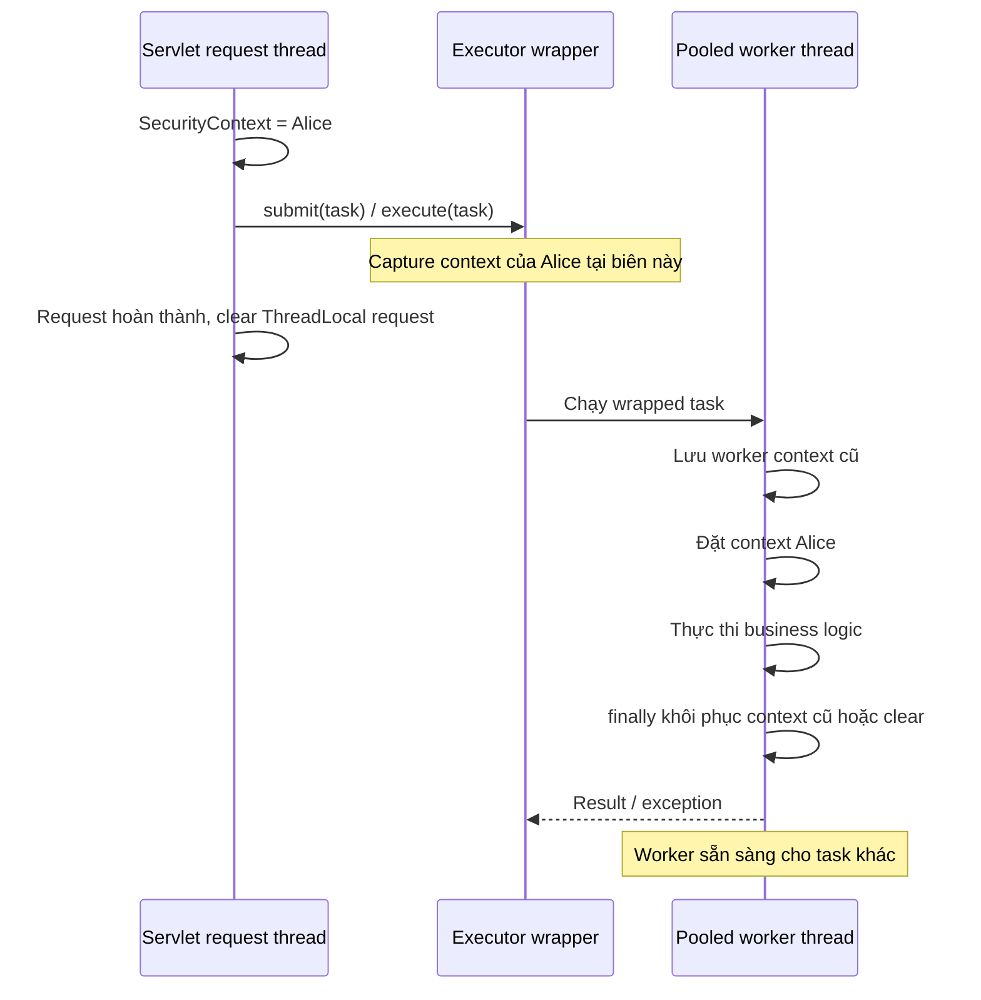

# Chụp ngữ cảnh khi gửi việc và dọn ngữ cảnh khi hoàn tất

> **Phạm vi:** Spring Security trên **Servlet stack** (Spring MVC, Spring Boot 3.x, Spring Security 6.x), trong các luồng bất đồng bộ (`Executor`/`ExecutorService`, `@Async`, `Callable`, `CompletableFuture`). Trọng tâm là **thời điểm chụp SecurityContext khi giao việc** và **dọn/khôi phục SecurityContext trong thread thực thi khi công việc kết thúc**. Ví dụ dùng Java 17+, Spring Boot 3.3.0 và Spring Security Test. Đây là kiến thức về context của Spring Security, **không phải** cơ chế tự động truyền mọi `ThreadLocal`, HTTP request, transaction hay tracing context.

## 1. Mục tiêu học tập

Sau bài này, bạn có thể:

1. Giải thích vì sao `SecurityContextHolder` với chế độ mặc định `MODE_THREADLOCAL` không tự đưa `Authentication` của request thread sang worker thread của thread pool.
2. Phân biệt ba thời điểm: **tạo/wrap tác vụ**, **submit/execute tác vụ**, và **worker thực thi tác vụ**; biết thời điểm nào snapshot được chọn bởi từng cơ chế.
3. Dùng đúng `DelegatingSecurityContextRunnable`, `DelegatingSecurityContextCallable`, `DelegatingSecurityContextExecutor`, `DelegatingSecurityContextExecutorService` và `DelegatingSecurityContextAsyncTaskExecutor`.
4. Hiểu nguyên tắc `try/finally`: lưu ngữ cảnh trước đó của worker, đặt ngữ cảnh được giao, chạy tác vụ và **khôi phục ngữ cảnh trước đó hoặc clear** dù thành công, lỗi hay exception.
5. Cấu hình `@Async` có executor truyền ngữ cảnh trong Spring Boot Servlet và kiểm thử không rò principal giữa các request.
6. Phân biệt hỗ trợ của Spring MVC `Callable` với các tác vụ tự tạo bằng `CompletableFuture.supplyAsync`/`DeferredResult`/scheduler; biết đường nào cần wrapper riêng.
7. Nhận diện rủi ro **mutable SecurityContext reference**, quyền đã bị thu hồi, background job chạy sau phiên đăng nhập và cấu hình `MODE_INHERITABLETHREADLOCAL` sai với thread pool.

## 2. Vấn đề gốc: danh tính gắn với thread, worker được tái sử dụng

Trong Servlet request bình thường, một security filter chain xác thực request và làm cho `SecurityContextHolder` của **thread đang xử lý** có `SecurityContext` với `Authentication` tương ứng. Code ứng dụng có thể đọc:

```java
Authentication auth =
    SecurityContextHolder.getContext().getAuthentication();
String name = (auth == null) ? "anonymous" : auth.getName();
```

Đây là **đoạn minh họa**, không phải một lớp Java độc lập. Ở chế độ mặc định `MODE_THREADLOCAL`, context nằm trong `ThreadLocal` của thread hiện tại. Nếu controller submit việc sang pool:

```text
HTTP request /api/who
  servlet-http-7: Authentication = alice
        │
        └─ executor.submit(task)
                │
                ▼
           pool-worker-2: Authentication = null (nếu không truyền)
```

Spring Security **không thể giả định** worker pool có cùng `ThreadLocal` với request thread. Thậm chí worker thường chạy lâu hơn HTTP request và được tái sử dụng cho request của người khác.

Nếu dev tự gọi `SecurityContextHolder.setContext(aliceContext)` trong worker rồi **quên clear**, worker có thể tiếp tục giữ danh tính Alice khi xử lý tác vụ của Bob. Đây là bug **privilege leakage** (rò quyền qua thread reuse) chứ không chỉ là thiếu log.

### Ví dụ phản-pattern

```java
// PHẢN VÍ DỤ: không dùng trong production.
executor.execute(() -> {
    SecurityContextHolder.setContext(capturedContext);
    doWork(); // nếu ném exception, context có thể tồn tại mãi
});
```

Đoạn trên cũng không khôi phục ngữ cảnh ban đầu của worker. Cách đúng là dùng wrapper do Spring Security cung cấp hoặc `try/finally` chính xác với policy lưu/khôi phục.

## 3. Phân biệt capture, propagation, restoration và cleanup

Bốn khái niệm này phục vụ những câu hỏi khác nhau:

| Khái niệm | Câu hỏi cần trả lời | Điều phải bảo đảm |
| --- | --- | --- |
| **Capture** | Danh tính nào được lấy từ request thread, **lúc nào**? | Chụp đúng principal tại biên submit hoặc tạo wrapper, không chụp ngầm khi worker chạy. |
| **Propagation** | Worker nhìn thấy `Authentication` nào? | Đặt đúng `SecurityContext` trong worker trước khi gọi business action. |
| **Restoration** | Worker đã có ngữ cảnh trước đó thì sao? | Sau task, khôi phục đúng trạng thái trước task thay vì ghi đè bừa. |
| **Cleanup** | Có exception/cancel/reuse không? | Không để danh tính của task cũ tồn tại trên thread sau khi kết thúc. |

### Mốc thời gian quan trọng



**Lưu ý:** mốc capture phụ thuộc cách gọi API:

- `new DelegatingSecurityContextRunnable(task)` hoặc `new DelegatingSecurityContextCallable<>(callable)` thường chụp context của **thread đang tạo wrapper** nếu không truyền context rõ ràng. Tạo wrapper quá sớm có thể chụp sai user.
- `new DelegatingSecurityContextExecutor(rawExecutor)` (không truyền một `SecurityContext` cố định) bọc task khi `execute(...)` được gọi, nhờ đó chụp context của **thread submit** tại thời điểm submit.
- `new DelegatingSecurityContextExecutorService(rawService)` tương tự với `submit`/`execute`, dùng khi cần `Future` và lifecycle của `ExecutorService`.
- `new DelegatingSecurityContextAsyncTaskExecutor(delegate)` là dạng tiện dụng để `@Async` hoặc những đoạn dùng `AsyncTaskExecutor` gửi task; với constructor không truyền context cố định, mỗi tác vụ lấy context tương ứng khi được bọc để gửi đi.
- Một số constructor **nhận sẵn SecurityContext**: đó là fixed/delegated context đã chỉ định. Khi đó không mặc nhiên thay theo mỗi request; chỉ chọn nếu thật sự cần chạy tác vụ dưới danh tính cố định đã được duyệt.

**Quy tắc:** *capture phải xảy ra tại ranh giới đáng tin*, thường là nơi request đã xác thực giao công việc; *cleanup xảy ra ở mọi đường rời worker*, bao gồm exception.

## 4. SecurityContextHolder và vì sao không dùng INHERITABLETHREADLOCAL làm bản vá

Spring Security cung cấp nhiều strategy quản lý `SecurityContextHolder`:

| Strategy | Phạm vi | Khuyến nghị |
| --- | --- | --- |
| `MODE_THREADLOCAL` | Mỗi thread có ngữ cảnh riêng. | Mặc định thích hợp cho Servlet; chủ động propagate khi cần. |
| `MODE_INHERITABLETHREADLOCAL` | Thread con mới có thể kế thừa context tại lúc tạo thread. | **Không phải** giải pháp đáng tin cho thread pool lâu sống; có thể giữ identity cũ. |
| `MODE_GLOBAL` | Một context chung trong JVM. | Không dùng cho server đa người dùng; nguy cơ chia sẻ auth toàn cục. |

`InheritableThreadLocal` hoạt động quanh **thời điểm tạo thread con**. Pool thường tạo thread một lần rồi xử lý nhiều request khác nhau. Do vậy Bob có thể gặp worker vốn được tạo khi Alice đang đăng nhập, hoặc không nhận context nào. Không giải quyết được việc capture **theo tác vụ** và dọn sau tác vụ.

Trong ví dụ production, không đổi global `SecurityContextHolder.setStrategyName(...)` để chữa một executor riêng. Hãy đặt wrapper tại chính ranh giới submit và kiểm thử thread reuse.

## 5. Những API truyền SecurityContext của Spring Security

### 5.1. DelegatingSecurityContextRunnable

`DelegatingSecurityContextRunnable` bọc `Runnable`. Về mặt khái niệm:

```java
// PSEUDOCODE minh họa; không phải source chính xác của thư viện.
SecurityContext previous = SecurityContextHolder.getContext();
try {
    SecurityContextHolder.setContext(captured);
    delegate.run();
} finally {
    // Khôi phục previous theo strategy/framework,
    // hoặc clear nếu worker trước đó không có context.
    restoreOrClear(previous);
}
```

Đoạn trên chỉ mô tả invariant; `restoreOrClear` là tên giả định để đọc ý tưởng, **không phải API Java**. Trong code thật nên dùng wrapper của Spring Security thay vì tự sao chép pseudocode.

API thường dùng:

```java
import org.springframework.security.concurrent.DelegatingSecurityContextRunnable;

Runnable task = () -> doSensitiveWork();

// Capture theo context của thread TẠO wrapper:
Runnable secured = new DelegatingSecurityContextRunnable(task);
executor.execute(secured);
```

Đây là **snippet**: `doSensitiveWork` và `executor` phải do ứng dụng khai báo. Nếu đã tạo wrapper khi thread không có identity, đến khi submit trong request đã login thì wrapper vẫn có thể mang context rỗng. Ngược lại, tạo wrapper trong Alice request nhưng lưu nó để Bob submit sau có thể mang sai identity. Cần thiết kế capture tại đúng biên.

Nếu cần chọn context rõ ràng:

```java
import org.springframework.security.core.Authentication;
import org.springframework.security.core.context.SecurityContext;
import org.springframework.security.core.context.SecurityContextHolder;
import org.springframework.security.concurrent.DelegatingSecurityContextRunnable;

Authentication auth =
        SecurityContextHolder.getContext().getAuthentication();
SecurityContext snapshot = SecurityContextHolder.createEmptyContext();
snapshot.setAuthentication(auth);
Runnable wrapped =
        new DelegatingSecurityContextRunnable(task, snapshot);
executor.execute(wrapped);
```

Đây cũng là **snippet**. Nó tạo **đối tượng SecurityContext mới**, giảm nguy cơ code khác gán lại `Authentication` trên chính context object ban đầu; nhưng `Authentication` bên trong vẫn là **tham chiếu**, không phải bản sao bất biến. Không dùng snippet để vượt qua bước kiểm tra quyền thực tế.

### 5.2. DelegatingSecurityContextCallable

`Callable<T>` trả kết quả và có thể ném checked exception; wrapper `DelegatingSecurityContextCallable<T>` cho `ExecutorService.submit(Callable<T>)`. Ý tưởng tương tự Runnable: đặt context, gọi `call()`, rồi dọn/khôi phục trong mọi đường rời.

```java
import org.springframework.security.concurrent.DelegatingSecurityContextCallable;

Callable<String> delegate = () ->
    SecurityContextHolder.getContext()
        .getAuthentication().getName();

Callable<String> secured =
    new DelegatingSecurityContextCallable<>(delegate);
Future<String> result = rawExecutorService.submit(secured);
```

Cần import `Callable`, `Future` và có `rawExecutorService`; đoạn trên không độc lập. `secured` chụp context theo nơi nó được tạo, **không phải** khi `Future.get()` được gọi.

### 5.3. DelegatingSecurityContextExecutor

Khi nhiều điểm gọi cùng dùng một `Executor`, bọc executor một lần thường ít lỗi hơn bọc thủ công từng `Runnable`:

```java
import java.util.concurrent.Executor;
import org.springframework.security.concurrent.DelegatingSecurityContextExecutor;

Executor securedExecutor =
    new DelegatingSecurityContextExecutor(rawExecutor);

securedExecutor.execute(() -> doSensitiveWork());
```

Với constructor không truyền fixed context, wrapper chụp context ở mỗi `execute`. Đây là lựa chọn dễ duy trì cho pipeline dùng `Executor` mà không cần `Future`; `rawExecutor` và `doSensitiveWork` phải có trong ứng dụng.

### 5.4. DelegatingSecurityContextExecutorService

Khi cần `ExecutorService`, `submit(Callable)`, `Future` hoặc shutdown semantics, dùng wrapper tương ứng:

```java
import java.util.concurrent.ExecutorService;
import java.util.concurrent.Executors;
import org.springframework.security.concurrent.DelegatingSecurityContextExecutorService;

ExecutorService pool = Executors.newFixedThreadPool(4);
ExecutorService secured =
    new DelegatingSecurityContextExecutorService(pool);

// "secured.submit(...)" capture context của caller tại lúc submit.
Future<String> future = secured.submit(
    () -> SecurityContextHolder.getContext()
        .getAuthentication().getName());
```

Với executor do ứng dụng tự tạo, ứng dụng phải quản lý shutdown, backpressure và lifecycle. Không tạo một pool mới mỗi HTTP request. Nếu một framework quản lý executor qua Spring bean, để framework sở hữu vòng đời thay vì tạo/destroy thủ công.

### 5.5. DelegatingSecurityContextAsyncTaskExecutor

`@Async` trong Spring dùng `TaskExecutor`; `DelegatingSecurityContextAsyncTaskExecutor` bọc `AsyncTaskExecutor` phù hợp. Không giống `MODE_INHERITABLETHREADLOCAL`, wrapper có thể lấy danh tính tại lúc **caller gửi task** và dọn tại worker khi hoàn thành. Cấu hình đầy đủ ở phần 7.

**Không đồng nghĩa với sao chép mọi context:** security wrapper truyền `SecurityContext`. MDC/log tracing, locale, transaction-bound resources, JPA persistence context, `RequestContextHolder` và request body không tự được truyền theo. Mỗi loại context có contract và lifecycle riêng; đừng assume rằng có `Authentication` ở worker thì servlet request hoặc transaction vẫn mở.

## 6. Các trường hợp khác nhau khi "capture" và "cleanup"

### 6.1. Tạo task trước, submit sau

```text
T0: ứng dụng tạo Runnable không chứa security context
T1: request Alice submit qua DelegatingSecurityContextExecutor
T2: worker xử lý task với context Alice; finally dọn
```

Trường hợp này đúng nếu authentication của Alice đã được thiết lập tại **T1** và wrapper executor có semantics capture-per-submit.

Ngược lại:

```text
T0: tạo DelegatingSecurityContextRunnable khi anonymous
T1: Alice login
T2: submit wrapper tạo ở T0
T3: worker chạy với context chụp ở T0, KHÔNG phải context T2
```

Vì thế, đừng lưu `DelegatingSecurityContextRunnable` như một singleton bean để dùng lại cho nhiều user; nó không phải general-purpose user-aware job.

### 6.2. Submit khi request kết thúc nhanh

Worker có thể bắt đầu **sau khi** response HTTP đã trả và filter đã dọn context của request thread. Điều này không làm mất capture nếu wrapper đã lấy context ở T1 khi submit. Tuy nhiên ngữ cảnh đó là dữ liệu đã nắm ở một thời điểm, **không chứng minh quyền vẫn còn hiệu lực** vào lúc task chạy.

Nếu một job chạy vài phút sau cần đọc/chỉnh dữ liệu nhạy cảm, nên mang **userId/tenantId/scope công việc tối thiểu** và kiểm tra authorization ở thời điểm thực thi dựa trên dữ liệu tin cậy. Không dựa hoàn toàn vào quyền trong SecurityContext stale đã chụp từ request cũ.

### 6.3. Task ném exception

Cleanup phải chạy kể cả khi `delegate.run()` hoặc `Callable.call()` ném exception. Cơ chế wrapper dùng `finally` để tránh identity cũ tồn tại trên worker. Exception vẫn được truyền về `Future`/framework theo cách thường thấy; wrapper bảo mật không tự xử lý business retry/compensation.

### 6.4. Task bị cancel hoặc timeout

- Nếu `Future.cancel(true)` làm worker bị interrupt khi đang chạy, code hợp tác với interrupt có thể dừng, sau đó `finally` của wrapper phải dọn context.
- Nếu task **chưa từng bắt đầu**, không có context được đặt lên worker cho task đó.
- Timeout ở caller (`future.get(timeout, unit)`) **không tự động hủy** task worker; task có thể tiếp tục chạy với context đã chụp. Cần cancellation policy và giới hạn thời gian thực thi.
- Không tự retry task có side effect chỉ vì nhận timeout; cần idempotency hoặc transaction semantics ở nghiệp vụ.
- Scheduler và job queue lâu dài không nên serialize toàn bộ `SecurityContext` sang DB/queue để tạo lại auth về sau. Dùng payload tối thiểu + service identity phù hợp + tái xác minh quyền.

## 7. Dự án chạy được: @Async capture đúng và cleanup bằng Spring Security

Ví dụ hoàn chỉnh dùng **Spring Boot 3.3.0**, Java 17, Maven, Spring Security 6 và `@Async`. Có một API:

- `GET /public/ping`: public, trả `pong`.
- `GET /api/who`: yêu cầu HTTP Basic; controller submit việc sang worker và worker trả về **tên principal mà SecurityContextHolder trong worker thấy**.

Chúng ta dùng **ThreadPoolTaskExecutor là bean riêng** để Spring quản lý lifecycle, sau đó bọc nó thành `DelegatingSecurityContextAsyncTaskExecutor`. Phương thức `@Async("securityTaskExecutor")` gọi qua bean **khác** controller nên Spring AOP proxy có thể intercept. Không hardcode authenticated user trong task.

### 7.1. Cấu trúc file

```text
security-async-capture/
├── pom.xml
└── src/
    ├── main/java/demo/async/
    │   ├── AsyncApplication.java
    │   ├── SecurityConfig.java
    │   ├── AsyncExecutorConfig.java
    │   ├── IdentityWorker.java
    │   └── IdentityController.java
    └── test/java/demo/async/
        ├── AsyncPropagationTest.java
        └── ContextCleanupTest.java
```

### 7.2. Maven POM

**`pom.xml`:**

```xml
<project xmlns="http://maven.apache.org/POM/4.0.0"
         xmlns:xsi="http://www.w3.org/2001/XMLSchema-instance"
         xsi:schemaLocation="http://maven.apache.org/POM/4.0.0 https://maven.apache.org/xsd/maven-4.0.0.xsd">
    <modelVersion>4.0.0</modelVersion>
    <parent>
        <groupId>org.springframework.boot</groupId>
        <artifactId>spring-boot-starter-parent</artifactId>
        <version>3.3.0</version>
        <relativePath/>
    </parent>
    <groupId>demo</groupId>
    <artifactId>security-async-capture</artifactId>
    <version>0.0.1-SNAPSHOT</version>
    <properties>
        <java.version>17</java.version>
    </properties>
    <dependencies>
        <dependency>
            <groupId>org.springframework.boot</groupId>
            <artifactId>spring-boot-starter-web</artifactId>
        </dependency>
        <dependency>
            <groupId>org.springframework.boot</groupId>
            <artifactId>spring-boot-starter-security</artifactId>
        </dependency>
        <dependency>
            <groupId>org.springframework.boot</groupId>
            <artifactId>spring-boot-starter-test</artifactId>
            <scope>test</scope>
        </dependency>
        <dependency>
            <groupId>org.springframework.security</groupId>
            <artifactId>spring-security-test</artifactId>
            <scope>test</scope>
        </dependency>
    </dependencies>
    <build>
        <plugins>
            <plugin>
                <groupId>org.springframework.boot</groupId>
                <artifactId>spring-boot-maven-plugin</artifactId>
            </plugin>
        </plugins>
    </build>
</project>
```

**`src/main/java/demo/async/AsyncApplication.java`:**

```java
package demo.async;

import org.springframework.boot.SpringApplication;
import org.springframework.boot.autoconfigure.SpringBootApplication;

@SpringBootApplication
public class AsyncApplication {
    public static void main(String[] args) {
        SpringApplication.run(AsyncApplication.class, args);
    }
}
```

### 7.3. SecurityFilterChain và tài khoản demo

**`src/main/java/demo/async/SecurityConfig.java`:**

```java
package demo.async;

import org.springframework.context.annotation.Bean;
import org.springframework.context.annotation.Configuration;
import org.springframework.security.config.Customizer;
import org.springframework.security.config.annotation.web.builders.HttpSecurity;
import org.springframework.security.core.userdetails.User;
import org.springframework.security.core.userdetails.UserDetailsService;
import org.springframework.security.crypto.bcrypt.BCryptPasswordEncoder;
import org.springframework.security.crypto.password.PasswordEncoder;
import org.springframework.security.provisioning.InMemoryUserDetailsManager;
import org.springframework.security.web.SecurityFilterChain;

@Configuration
public class SecurityConfig {
    @Bean
    SecurityFilterChain securityFilterChain(HttpSecurity http)
            throws Exception {
        return http
            .authorizeHttpRequests(auth -> auth
                .requestMatchers("/public/ping").permitAll()
                .requestMatchers("/api/who").authenticated()
                .anyRequest().denyAll())
            .httpBasic(Customizer.withDefaults())
            .build();
    }

    @Bean
    PasswordEncoder passwordEncoder() {
        return new BCryptPasswordEncoder();
    }

    @Bean
    UserDetailsService users(PasswordEncoder encoder) {
        return new InMemoryUserDetailsManager(
            User.withUsername("alice")
                .password(encoder.encode("demo-pass"))
                .roles("USER")
                .build());
    }
}
```

Đây là cấu hình demo cho HTTP Basic. Trong production, tài khoản/mật khẩu trong bộ nhớ không phù hợp; có thể thay bằng JWT, session login hoặc OIDC, nhưng nguyên tắc capture và cleanup SecurityContext vẫn cần áp dụng tại biên async.

### 7.4. Executor: delegate pool + security wrapper

**`src/main/java/demo/async/AsyncExecutorConfig.java`:**

```java
package demo.async;

import org.springframework.beans.factory.annotation.Qualifier;
import org.springframework.context.annotation.Bean;
import org.springframework.context.annotation.Configuration;
import org.springframework.core.task.AsyncTaskExecutor;
import org.springframework.scheduling.annotation.EnableAsync;
import org.springframework.scheduling.concurrent.ThreadPoolTaskExecutor;
import org.springframework.security.task.DelegatingSecurityContextAsyncTaskExecutor;

@Configuration
@EnableAsync
public class AsyncExecutorConfig {
    @Bean(name = "workerPool")
    ThreadPoolTaskExecutor workerPool() {
        ThreadPoolTaskExecutor pool = new ThreadPoolTaskExecutor();
        pool.setCorePoolSize(2);
        pool.setMaxPoolSize(4);
        pool.setQueueCapacity(32);
        pool.setThreadNamePrefix("secured-worker-");
        return pool;
    }

    @Bean(name = "securityTaskExecutor")
    AsyncTaskExecutor securityTaskExecutor(
            @Qualifier("workerPool") ThreadPoolTaskExecutor pool) {
        // Không truyền SecurityContext cố định:
        // mỗi lần gửi task, wrapper lấy context của caller.
        return new DelegatingSecurityContextAsyncTaskExecutor(pool);
    }
}
```

**Vì sao tạo hai bean?** `ThreadPoolTaskExecutor` là tài nguyên thật, có lifecycle và pool size do Spring quản lý. `DelegatingSecurityContextAsyncTaskExecutor` chỉ là lớp bọc bảo mật. Bean name được ghi tường minh trong `@Async("securityTaskExecutor")` để không vô tình dùng một executor khác không truyền identity.

Với constructor không truyền `SecurityContext`, wrapper sẽ capture context gắn với caller khi submit. Không truyền một `SecurityContext` cố định chứa user Alice vào bean singleton: tất cả người dùng có thể bị chạy task dưới danh tính Alice.

ThreadPool với queue 32 trong demo chỉ để dễ học. Production cần capacity, rejection/backpressure, timeout, monitoring và graceful shutdown theo tải thật. Dù security wrapper dọn context, nó **không** quản lý hết tài nguyên nghiệp vụ.

### 7.5. Worker và controller

**`src/main/java/demo/async/IdentityWorker.java`:**

```java
package demo.async;

import java.util.concurrent.CompletableFuture;
import org.springframework.scheduling.annotation.Async;
import org.springframework.security.core.Authentication;
import org.springframework.security.core.context.SecurityContextHolder;
import org.springframework.stereotype.Service;

@Service
public class IdentityWorker {
    @Async("securityTaskExecutor")
    public CompletableFuture<String> currentIdentity() {
        Authentication a =
            SecurityContextHolder.getContext().getAuthentication();

        String name = (a == null) ? "NO_AUTH" : a.getName();
        return CompletableFuture.completedFuture(name);
    }
}
```

**`src/main/java/demo/async/IdentityController.java`:**

```java
package demo.async;

import java.util.Map;
import java.util.concurrent.CompletableFuture;
import org.springframework.security.core.Authentication;
import org.springframework.web.bind.annotation.GetMapping;
import org.springframework.web.bind.annotation.RestController;

@RestController
public class IdentityController {
    private final IdentityWorker worker;

    public IdentityController(IdentityWorker worker) {
        this.worker = worker;
    }

    @GetMapping("/public/ping")
    public String ping() {
        return "pong";
    }

    @GetMapping("/api/who")
    public CompletableFuture<Map<String, String>> who(Authentication auth) {
        return worker.currentIdentity()
            .thenApply(fromWorker -> Map.of(
                "requestPrincipal", auth.getName(),
                "workerPrincipal", fromWorker));
    }
}
```

**Đọc luồng thực thi:**

1. Spring Security xác thực HTTP Basic Alice ở request thread.
2. Controller được phép gọi `/api/who` vì `authenticated()`; nó gọi `worker.currentIdentity()` **qua Spring bean khác**, kích hoạt `@Async`.
3. Proxy `@Async` gửi task qua `securityTaskExecutor`. Wrapper lấy SecurityContext của caller và tạo task bao bọc.
4. Trong worker pool, `SecurityContextHolder.getContext().getAuthentication()` trả danh tính Alice; phương thức tạo `CompletableFuture.completedFuture("alice")`.
5. Khi delegate hoàn thành (hoặc ném lỗi), security wrapper **khôi phục/clear** context trong worker.
6. Controller dùng `thenApply` để tạo response. Callback `thenApply` có thể chạy trên thread hoàn thành tương ứng, nên nó **không nên** phụ thuộc vào SecurityContextHolder; ví dụ dùng `auth.getName()` lấy tại request thread và chuỗi trả về.
7. Spring MVC xử lý `CompletableFuture` như một kết quả bất đồng bộ và gửi JSON khi hoàn tất.

**Không trông chờ `thenApplyAsync` hoặc `supplyAsync` không chỉ định executor cũng mang SecurityContext**. Chúng có thể sử dụng common pool hoặc executor khác chưa bọc; chỉ phần task đi qua đúng security-aware executor mới có bảo đảm mong muốn.

### 7.6. Chạy project

Trong thư mục `security-async-capture`:

```bash
mvn test
mvn spring-boot:run
```

Thử public API:

```bash
curl -i http://localhost:8080/public/ping
```

Body dự kiến:

```text
pong
```

Thử API yêu cầu xác thực:

```bash
curl -i -u alice:demo-pass http://localhost:8080/api/who
```

Với cấu hình demo, status dự kiến `200 OK`, body JSON mang cả principal ở request và worker:

```json
{
  "requestPrincipal": "alice",
  "workerPrincipal": "alice"
}
```

Định dạng khoảng trắng và thứ tự khóa JSON thực tế phụ thuộc serializer; không so toàn chuỗi body JSON như một định dạng có thứ tự cố định. Request anonymous tới `/api/who` nhận `401` với HTTP Basic challenge, không được phép khởi tạo công việc cần xác thực.

## 8. Kiểm thử MockMvc: user ở worker và anonymous bị chặn

**`src/test/java/demo/async/AsyncPropagationTest.java`:**

```java
package demo.async;

import org.junit.jupiter.api.Test;
import org.springframework.beans.factory.annotation.Autowired;
import org.springframework.boot.test.autoconfigure.web.servlet.AutoConfigureMockMvc;
import org.springframework.boot.test.context.SpringBootTest;
import org.springframework.test.web.servlet.MockMvc;
import org.springframework.test.web.servlet.MvcResult;

import static org.springframework.security.test.web.servlet.request
    .SecurityMockMvcRequestPostProcessors.user;
import static org.springframework.test.web.servlet.request.MockMvcRequestBuilders.get;
import static org.springframework.test.web.servlet.request
    .MockMvcRequestBuilders.asyncDispatch;
import static org.springframework.test.web.servlet.result.MockMvcResultMatchers.jsonPath;
import static org.springframework.test.web.servlet.result.MockMvcResultMatchers.request;
import static org.springframework.test.web.servlet.result.MockMvcResultMatchers.status;

@SpringBootTest
@AutoConfigureMockMvc
class AsyncPropagationTest {
    @Autowired
    MockMvc mvc;

    @Test
    void anonymousCannotSubmitProtectedWork() throws Exception {
        mvc.perform(get("/api/who"))
            .andExpect(status().isUnauthorized());
    }

    @Test
    void aliceIsVisibleInsideAsyncWorker() throws Exception {
        MvcResult started = mvc.perform(
                get("/api/who").with(user("alice")))
            .andExpect(request().asyncStarted())
            .andReturn();

        mvc.perform(asyncDispatch(started))
            .andExpect(status().isOk())
            .andExpect(jsonPath("$.requestPrincipal").value("alice"))
            .andExpect(jsonPath("$.workerPrincipal").value("alice"));
    }
}
```

MockMvc ở test thứ hai phải xử lý **async dispatch** trước khi assert JSON cuối. `with(user("alice"))` là test post-processor cấp principal giả lập để kiểm chứng luồng security/filter; đây **không** phải kiểm thử password Alice thật. Khi test HTTP Basic thật, gửi Authorization header hợp lệ hoặc dùng integration HTTP client với credential demo.

**Kiểm thử ngược có giá trị:** thử bỏ wrapper và dùng raw `workerPool`; task rất có thể thấy `NO_AUTH`, tùy thread/context mặc định, dù controller có principal Alice. Không dùng "test pass khi bỏ wrapper" làm bằng chứng ứng dụng đúng; điều quan trọng là xác nhận phạm vi thread bạn nghĩ đang được propagate.

## 9. Kiểm thử không rò context với ExecutorService một thread

Dùng **một worker duy nhất** là cách tốt để phát hiện lỗi reuse: nếu thread xử lý tác vụ của Alice rồi vẫn mang context sau khi hoàn tất, lần tiếp theo trên cùng thread sẽ thấy danh tính cũ.

Ví dụ dưới là **JUnit test đầy đủ ở cấp lớp**, thêm vào dự án phần 7; nó không gọi web server hoặc nguồn dữ liệu bên ngoài.

**`src/test/java/demo/async/ContextCleanupTest.java`:**

```java
package demo.async;

import java.util.List;
import java.util.concurrent.ExecutorService;
import java.util.concurrent.Executors;
import java.util.concurrent.Future;
import java.util.concurrent.TimeUnit;
import org.junit.jupiter.api.Test;
import org.springframework.security.authentication.UsernamePasswordAuthenticationToken;
import org.springframework.security.concurrent.DelegatingSecurityContextExecutorService;
import org.springframework.security.core.Authentication;
import org.springframework.security.core.authority.SimpleGrantedAuthority;
import org.springframework.security.core.context.SecurityContext;
import org.springframework.security.core.context.SecurityContextHolder;

import static org.junit.jupiter.api.Assertions.assertEquals;
import static org.junit.jupiter.api.Assertions.assertNull;

class ContextCleanupTest {
    @Test
    void contextIsPresentForDelegatedTaskAndClearedAfterwards()
            throws Exception {
        ExecutorService raw = Executors.newSingleThreadExecutor();
        ExecutorService secured =
            new DelegatingSecurityContextExecutorService(raw);

        try {
            Authentication alice =
                UsernamePasswordAuthenticationToken.authenticated(
                    "alice",
                    "not-a-password",
                    List.of(new SimpleGrantedAuthority("ROLE_USER")));
            SecurityContext requestContext =
                SecurityContextHolder.createEmptyContext();
            requestContext.setAuthentication(alice);
            SecurityContextHolder.setContext(requestContext);

            Future<String> received = secured.submit(() -> {
                Authentication onWorker =
                    SecurityContextHolder.getContext().getAuthentication();
                return onWorker == null ? "NO_AUTH" : onWorker.getName();
            });

            // Chỉ clear ThreadLocal của caller, không sửa object context
            // đã được bọc để thực thi trên worker.
            SecurityContextHolder.clearContext();

            assertEquals("alice", received.get(5, TimeUnit.SECONDS));

            // Gửi thẳng qua raw pool cùng một thread: lúc này task mới
            // KHÔNG được thừa hưởng Alice sau khi wrapped task kết thúc.
            Future<Authentication> after = raw.submit(() ->
                SecurityContextHolder.getContext().getAuthentication());
            assertNull(after.get(5, TimeUnit.SECONDS));
        } finally {
            SecurityContextHolder.clearContext();
            raw.shutdownNow();
            raw.awaitTermination(5, TimeUnit.SECONDS);
        }
    }
}
```

**Bằng chứng từ test:**

- Caller giữ `Authentication` Alice khi submit qua `secured`.
- Worker nhận danh tính Alice **chỉ trong thời gian task chạy**.
- Caller clear context sau submit không tự hủy context đã capture trong wrapper (không có mutation trên đối tượng cũ).
- Task kế tiếp qua `raw` chạy trên **chính worker thread đó**, thấy `Authentication == null`; không còn identity Alice bị rò.
- Test không kiểm tra nhiều instance, revoke authority, thời gian trễ hoặc all-thread context trong Spring MVC. Những thứ đó có test riêng.

**Giới hạn:** ví dụ dùng context để minh họa, nhưng Spring Security không bảo đảm biến một authentication object mutable thành immutable snapshot. Nếu caller **sửa chính đối tượng `SecurityContext` đã capture** giữa submit và execution, worker có thể thấy giá trị mới. Cách xử lý ở phần 12.

## 10. Chạy khi task ném lỗi: cleanup vẫn phải xảy ra

Cleanup phải nằm trong `finally` của wrapper. Dưới đây là một test bổ sung **có thể đặt trong `ContextCleanupTest`** (cần import `ExecutionException`, `assertThrows`, `assertNull` như đang dùng), chỉ minh họa một method:

```java
@Test
void cleanupEvenWhenBusinessTaskThrows() throws Exception {
    ExecutorService raw = Executors.newSingleThreadExecutor();
    ExecutorService secured =
        new DelegatingSecurityContextExecutorService(raw);
    try {
        SecurityContext ctx =
            SecurityContextHolder.createEmptyContext();
        ctx.setAuthentication(
            UsernamePasswordAuthenticationToken.authenticated(
                "alice", "N/A",
                List.of(new SimpleGrantedAuthority("ROLE_USER"))));
        SecurityContextHolder.setContext(ctx);

        Future<?> failed = secured.submit(() -> {
            throw new IllegalStateException("business failure");
        });
        SecurityContextHolder.clearContext();

        assertThrows(java.util.concurrent.ExecutionException.class,
            () -> failed.get(5, TimeUnit.SECONDS));

        assertNull(raw.submit(() ->
            SecurityContextHolder.getContext().getAuthentication())
            .get(5, TimeUnit.SECONDS));
    } finally {
        SecurityContextHolder.clearContext();
        raw.shutdownNow();
    }
}
```

Một ngoại lệ nghiệp vụ vẫn có thể khiến kết quả `Future.get` ném `ExecutionException`, nhưng worker đã đi qua cleanup. Test này chỉ thêm kiểm thử cleanup khi exception; không đề xuất catch-and-ignore exception hoặc retry tác vụ nhạy cảm tùy tiện.

## 11. Các async API Servlet: không đánh đồng mọi cơ chế

| Cơ chế | Ai tạo/sở hữu worker? | SecurityContext có tự đi qua? | Cách tiếp cận |
| --- | --- | --- | --- |
| Request đồng bộ Servlet | Container xử lý trong một request thread | Security filter chain đặt context cho request. | Dùng Spring Security như bình thường. |
| Spring MVC controller trả `Callable<T>` | Spring MVC async integration | Spring Security có hỗ trợ tích hợp `WebAsyncManagerIntegrationFilter` cho MVC `Callable`. | Vẫn cần kiểm thử đúng lifecycle, executor, dispatch và phiên bản cụ thể. |
| Spring MVC `WebAsyncTask<T>` | Spring MVC xử lý Callable có metadata | Thường đi theo cơ chế Callable integration. | Kiểm thử timeout/error/dispatch, đừng suy ra toàn bộ custom worker được truyền. |
| Spring MVC `DeferredResult<T>` | Ứng dụng thường hoàn tất từ thread tự quản | Không bảo đảm tự propagate cho code do bạn submit. | Dùng security-aware executor/wrapper tại nơi sản sinh result. |
| `@Async` | Spring task executor | Không tự bảo đảm với raw executor không bọc. | Dùng `DelegatingSecurityContextAsyncTaskExecutor`. |
| `CompletableFuture.supplyAsync(...)` không executor | Thường common pool hoặc cơ chế mặc định của JDK | **Không** tự nhận Spring Security ThreadLocal. | Truyền executor đã bọc hoặc truyền dữ liệu nghiệp vụ tối thiểu. |
| `CompletableFuture.thenApplyAsync(...)` | Executor do JDK chọn khi không được chỉ rõ | Không; stage mới có thể chạy trên thread khác. | Chọn executor đã bọc tại đúng điểm capture, hoặc không phụ thuộc holder trong stage. |
| `ExecutorService.submit(...)` thuần | Pool bạn tạo | Không. | Bọc bằng `DelegatingSecurityContextExecutorService`. |
| `new Thread(...)` | Thread do bạn tự tạo | Không đáng tin với `MODE_THREADLOCAL`. | Tránh tạo thread tùy tiện trong server; dùng executor được quản lý. |
| Scheduler/queue dài hạn (Quartz, Kafka, RabbitMQ...) | Worker độc lập/request đã kết thúc | **Không** thể giả định có SecurityContext người dùng. | Job có identity/capability riêng, authorization khi thực thi và audit. |

Spring MVC có cơ chế đặc biệt cho `Callable` nên không đúng khi nói "mọi async đều không propagate"; nhưng cũng sai nếu cho rằng `WebAsyncManagerIntegrationFilter` sẽ lo cho tất cả `CompletableFuture` và việc tự submit.

### Vì sao xử lý Servlet async khác với security-aware executor?

`Callable` được tạo từ controller và đưa cho **Spring MVC async infrastructure**. Spring Security tích hợp vào WebAsyncManager ở các điểm thích hợp để giữ context cho phần Callable. Còn `@Async` và `CompletableFuture.supplyAsync` là cơ chế task submission **ngoài luồng Callable integration**; nếu dùng executor khác, Spring Security không thể đoán được người dùng nào cần gán cho thread đó.

Đừng sửa lỗi bằng cách đưa một `HttpServletRequest` vào background thread; request có lifecycle và ownership riêng, có thể đã kết thúc hoặc bị recycle. Truyền dữ liệu cần thiết một cách có kiểm soát.

## 12. Context "snapshot" là tham chiếu mutable, không phải bất biến

Tên "chụp ngữ cảnh" có thể khiến người đọc hiểu sai rằng framework luôn **deep-copy** authentication, roles và claims. Trên thực tế, nhiều wrapper Spring Security giữ **tham chiếu `SecurityContext` đã capture**. Một `SecurityContextImpl` thường cho phép `setAuthentication(...)`, và bản thân `Authentication`/principal có thể chứa các đối tượng mutable.

Ví dụ tình huống:

```text
T1: contextObject.authentication = Alice
T2: wrapper capture tham chiếu contextObject
T3: code khác gọi contextObject.setAuthentication(Bob)
T4: worker chạy với cùng contextObject → có thể thấy Bob
```

**Không nên dùng mutability như một kênh "cập nhật context" giữa threads.** Điều đó tạo race condition và rò identity. Nếu cần tính nhất quán theo yêu cầu:

- Chụp dữ liệu tối thiểu (`userId`, tenant, IDs của resource, operation ID) như một value object immutable, rồi tái xác minh authorization ở thời điểm thực thi.
- Nếu bắt buộc chạy dưới `Authentication` trong thread worker, tạo **`SecurityContext` mới** khi submit và đặt Authentication đã được xác minh; tránh mutate context object sau khi submit, đồng thời bảo đảm principal/authorities không bị sửa ngoài ý muốn.
- Không truyền thẳng mutable session object, `HttpServletRequest` hoặc entity JPA đang attached vào background job dài hạn.
- Không tạo "superuser" `Authentication` chỉ để background task thuận tiện; nếu job thật sự là system job, dùng service identity riêng với least privilege và audit.

Security context propagation giải quyết **availability của authentication cho code trong thread**, không giải quyết transactional isolation, revocation hoặc business authorization một cách kỳ diệu.

### Context truyền tới thread nhưng quyền đã thay đổi?

Một tác vụ được submit dưới Alice lúc 10:00 có thể thực thi lúc 10:15, sau khi Alice bị vô hiệu hóa hoặc quyền quản trị đã bị thu hồi. Wrapper vẫn có thể mang context đã capture ở 10:00. Với tác vụ nhạy cảm, kiểm tra **quyền hiện tại** tại thời điểm execute bằng một nguồn đáng tin, giới hạn TTL/queue delay và ghi audit; không coi việc `Authentication.isAuthenticated() == true` là câu trả lời đủ.

## 13. Trường hợp thất bại và đường dọn ngữ cảnh

### 13.1. Manual ThreadLocal handling và try/finally

Nếu bạn không thể dùng wrapper vì tích hợp đặc biệt, invariant tối thiểu phải được thực thi:

1. Lấy **context đã xác minh** từ caller và xác định scope sử dụng.
2. Bọc task sao cho worker ghi nhớ **context hiện có của chính worker** trước khi đặt context mới.
3. `try` chạy delegate; `finally` luôn khôi phục ngữ cảnh đúng, ngay cả lỗi.
4. Không quên việc worker có thể đã chứa context mà framework đang quản lý; chỉ `clearContext` một cách mù quáng có thể làm mất ngữ cảnh có trước của worker.
5. Với nested wrappers, outer và inner wrapper đều phải có discipline khôi phục. Inner kết thúc phải trả lại context của outer; outer kết thúc phải trả lại context trước outer.

Spring Security wrappers giúp thực thi invariant này. Đừng viết một custom security `TaskDecorator` dựa trên assumption "worker luôn rỗng" mà chưa có test.

### 13.2. Nested tasks

Giả sử worker đang chạy trong context Alice rồi submit một tác vụ con qua security-aware executor. Tác vụ con phải nhận context được capture đúng lúc submit; nếu nó chạy trong cùng thread hoặc thread khác, các wrapper phải khôi phục/clear sau khi hoàn tất. Một task con dùng raw pool khác không tự được bảo vệ bởi wrapper của task cha. Bọc **mọi ranh giới submit** thực sự có sử dụng authentication.

### 13.3. Future chaining

`CompletableFuture.thenApply` có thể chạy ngay trên thread hoàn thành stage trước đó hoặc caller nếu stage đã xong; `thenApplyAsync` chọn executor phù hợp. Vì vậy, **không dựa vào thread chạy stage để suy luận identity**. Nếu code trong stage cần auth, truyền executor đã bọc ở đúng chỗ hoặc truyền immutable business identity/capability và kiểm tra quyền.

Một `CompletableFuture` chứa chuỗi kết quả nghiệp vụ không tự mang `SecurityContext`. Context là thuộc tính của **thread tại thời điểm code chạy**, không phải metadata mặc định gắn với future object.

### 13.4. Exception and request completion

- Exception phát sinh trong worker được xử lý theo contract của `Executor`, `Future` hoặc `@Async`, nhưng cleanup của wrapper vẫn cần chạy.
- Servlet request có thể kết thúc trước worker; context request có thể được clear ở end-of-request. Điều này không xóa context object đã chụp và không thu hồi quyền một cách tự động.
- Nếu task bị từ chối trước khi chạy (executor queue đầy), không có bước "set worker context" xảy ra; caller phải xử lý rejected execution.
- Nếu code chạy mãi không kết thúc, `finally` chưa thể được thực thi; cần timeout/cancellation/monitoring thực tế.

## 14. Giám sát và kiểm toán: thông tin nào được truyền và ghi

Để điều tra lỗi async, việc ghi nhận correlation ID và principal có thể có ích, nhưng tránh log raw credentials/session cookies/JWT hoặc PII không cần thiết. Một số nguyên tắc:

- Ghi **job ID, operation, tenant đã được xác minh, outcome, error class**, enqueue time và execution time.
- Không ghi `SecurityContext` nguyên object vào log; Authentication có thể chứa credentials, thông tin profile hoặc authorities nhạy cảm.
- Nếu cần principal ID cho audit, dùng ID đã chuẩn hóa từ principal đáng tin và chính sách privacy/retention phù hợp.
- **MDC/trace/span context không được bảo đảm chỉ bởi `DelegatingSecurityContext*`.** Có thể sử dụng observability-specific propagation hoặc TaskDecorator phù hợp; nếu kết hợp nhiều wrappers, test thứ tự restore/cleanup cho từng loại context.
- Đừng suy ra executor cleanup đúng chỉ vì log request thread hiển thị tên Alice; phải log/test **ở bên trong worker** và thử thread reuse.

Trong hệ thống có rate limit/queue và nhiều node, theo dõi thời gian chờ cũng quan trọng vì security context đã capture càng cũ càng dễ không phản ánh quyền hiện tại.

## 15. Checklist kiểm thử

| Kiểu kiểm thử | Tình huống | Kỳ vọng |
| --- | --- | --- |
| Positive | Alice submit qua security-aware executor | Worker nhìn thấy Authentication Alice. |
| Anonymous | Caller anonymous submit vào endpoint yêu cầu auth | Request bị chặn trước khi tác vụ nhạy cảm được gửi. |
| Không bọc | Caller Alice submit qua raw pool | Worker **không được giả định** có Alice; default thường null. |
| Reuse | Alice task xong, raw task tiếp theo trên cùng worker | Không còn Authentication Alice. |
| Isolation | Alice task rồi Bob task qua wrapper | Mỗi task nhìn đúng context riêng; không mix principal. |
| Failure | Worker ném exception | Future/error handler nhận lỗi; context được restore/clear. |
| Cancellation | Future bị hủy/interrupted | Cleanup chạy khi delegate thực sự kết thúc. |
| Queue delay | Task đợi lâu; caller clear sau submit | Worker nhận context đã capture, không phụ thuộc holder caller còn tồn tại. |
| Mutable context | Caller mutate cùng SecurityContext sau submit | Không được dựa vào một "deep snapshot"; tránh hoặc kiểm soát mutation. |
| Nested wrappers | Inner kết thúc, outer vẫn chạy | Inner khôi phục outer context, outer khôi phục context cũ. |
| Cross-user | User A và user B submit đồng thời | Không thể dùng một fixed-context singleton với identity A cho B. |
| Revocation | Quyền user bị thu hồi trước execute | Business action nhạy cảm phải xác minh quyền hiện thời. |
| Missing @Async proxy | `@Async` method được gọi bằng `this.` trong cùng bean | Không giả định chạy bất đồng bộ; xác nhận proxy/executor đúng. |
| CompletableFuture | Stage dùng common pool hoặc executor khác | Không mặc định có context của request. |
| MVC Callable | Controller trả `Callable` | Kiểm thử tích hợp Security MVC Callable và async dispatch. |
| Shutdown | App đóng trong khi jobs đang chạy | Có policy graceful shutdown/cancel, cleanup khi task thực sự kết thúc. |

### Lưu ý khi viết test xác định được lỗi

- Dùng **single-thread executor** cho test cleanup để chắc chắn task sau chạy đúng thread cũ.
- Dùng `CountDownLatch` khi cần chứng minh "capture tại submit nhưng execute sau khi caller đã clear", thay vì dựa vào sleep không xác định.
- Đặt timeout trên `Future.get` để test không treo vô hạn; shutdown executor trong `finally`.
- Dùng `MockMvc.asyncDispatch(...)` với controller trả `CompletableFuture`/`Callable`, không assert body trước khi async hoàn tất.
- Tách test **authorization endpoint** (cần hay không cần auth) khỏi test **context propagation** (principal nào ở worker).
- Với việc truyền context không nên có (ví dụ job nền dài hạn), test rằng job có service identity/validation riêng, không mang auth người dùng tùy ý.

## 16. Những lỗi thường gặp

| Triệu chứng | Nguyên nhân hay gặp | Cách khắc phục |
| --- | --- | --- |
| `SecurityContextHolder.getContext().getAuthentication() == null` trong `@Async` | Executor chưa được bọc, task chạy trên pool khác. | Dùng `DelegatingSecurityContextAsyncTaskExecutor` và `@Async("securityTaskExecutor")`. |
| Worker luôn thấy user cũ | Đã setContext thủ công nhưng quên clear hoặc dùng fixed context sai. | Dùng wrapper context-per-submit; test single-thread reuse. |
| Worker thấy anonymous dù caller đã login | Bọc Runnable trước khi request authentication có mặt hoặc @Async không đi qua proxy. | Capture ở biên submit đúng nơi, kiểm tra proxy/bean routing. |
| User B thấy quyền của Alice | Singleton wrapper có context cố định, ThreadLocal rò, INHERITABLETHREADLOCAL trong pool. | Không dùng fixed user context cho multi-tenant requests; khôi phục/clear. |
| `CompletableFuture.thenApplyAsync` không thấy principal | Stage dùng executor khác/common pool. | Chỉ định executor bảo mật cho stage hoặc truyền dữ liệu business cần thiết. |
| `Future.get` timeout nhưng side effect vẫn xảy ra | Timeout ở caller không hủy worker. | Cancellation/timeout thực, thiết kế idempotency. |
| Cleanup test đỗ ở pool 4 threads nhưng rò vẫn xảy ra | Task probe chạy trên thread khác thread bị rò. | Test với pool 1 thread, task A rồi raw probe cùng thread. |
| Sau khi role bị revoke, queued task vẫn chạy với role cũ | Context chứa quyền thời điểm capture, không re-check. | Kiểm tra authorization mới ở lúc execute cho tác vụ nhạy cảm. |
| Dùng `MODE_INHERITABLETHREADLOCAL` tưởng đã sửa | Pool thread có vòng đời khác request. | Chọn decorator/security-aware executor; tránh strategy toàn cục. |
| `@Async` gọi trong cùng bean không bất đồng bộ | Self-invocation bypass Spring AOP proxy. | Gọi từ bean khác hoặc thiết kế proxy invocation chính xác. |
| @Async task thất bại không báo cho caller | `void` async method xử lý lỗi qua `AsyncUncaughtExceptionHandler`, không trả Future. | Ưu tiên return `CompletableFuture` khi caller cần quan sát lỗi, cấu hình error handling. |
| Context có auth nhưng không có MDC/transaction | Wrapper chỉ truyền SecurityContext. | Tách tracing/transaction context riêng và kiểm thử isolation. |

## 17. Câu hỏi ôn tập

**1. Vì sao `SecurityContextHolder` hoạt động trong controller nhưng không hiện ra trong worker?**

Vì mặc định là ThreadLocal: controller và worker thuộc hai thread khác nhau. Cần capture/propagate qua wrapper hoặc truyền identity nghiệp vụ rồi tái xác minh ở worker.

**2. Thời điểm nào nên chụp context nếu một `Runnable` được tạo trước khi user login?**

Chụp **khi submit** sau khi authentication đã được xác minh, ví dụ thông qua `DelegatingSecurityContextExecutor` không có fixed context; không chụp sớm lúc tạo Runnable/bean.

**3. Vì sao cần `finally` cả khi task thành công?**

Worker có thể được tái sử dụng. Nếu không dọn, danh tính của task cũ tồn tại trên cùng thread. `finally` cũng chạy khi business code ném exception, giúp tránh leak.

**4. Nếu caller đã clear context sau submit thì task có còn thấy user không?**

Với wrapper đúng và context object không bị mutate sau capture, có; wrapper đã giữ tham chiếu tại submit. Điều này không biến identity đó thành immutable snapshot hoặc bảo đảm role vẫn còn hiệu lực về sau.

**5. Vì sao `MODE_INHERITABLETHREADLOCAL` không phù hợp để sửa context propagation trong pool?**

Nó liên quan thread con **lúc tạo thread**, còn thread pool dùng lại worker qua nhiều request. Có nguy cơ thiếu context hoặc dùng danh tính cũ.

**6. `@Async` trả `CompletableFuture` có nghĩa mọi `thenApplyAsync` sau đó nhận SecurityContext không?**

Không. Mỗi stage async có thể dùng executor khác; Future không tự mang context. Cần chọn executor được bọc hoặc không phụ thuộc holder trong stage.

**7. Trong một test, làm sao chứng minh worker không giữ Alice sau khi thực hiện task?**

Dùng `newSingleThreadExecutor`, submit một task Alice qua `DelegatingSecurityContextExecutorService`, chờ hoàn tất, rồi submit một probe **trực tiếp qua raw executor trên chính worker đó**. Probe phải thấy authentication null (nếu ban đầu worker rỗng).

**8. Vì sao capture context không đủ để authorize job chạy sau vài giờ?**

Vì role, tenant membership hoặc quyền truy cập có thể thay đổi trong lúc job chờ. Job nhạy cảm cần kiểm tra quyền tại thời điểm thực thi, thay vì tin mãi context cũ.

## 18. Ghi nhớ

**Spring Security không tự truyền ThreadLocal của Servlet request sang mọi async worker.** Một security-aware executor có thể chụp `SecurityContext` của caller **khi submit**, đặt nó ở worker khi xử lý, rồi **khôi phục/clear ở `finally`** để không rò identity giữa các tác vụ.

Hãy phân biệt:

- **Capture đúng lúc:** dùng wrapper được tạo/submit trong phạm vi authentication đã xác minh, không tạo wrapper người dùng thành singleton.
- **Cleanup đúng chỗ:** luôn bảo đảm ngữ cảnh của worker trở về trạng thái trước task, kể cả exception, cancellation khi task kết thúc và nested calls.
- **Bảo mật nghiệp vụ còn hiệu lực:** propagation không sao chép quyền bất biến, không truyền session/transaction/trace và không thay việc tái xác minh quyền cho delayed/background jobs.
- **Kiểm thử đúng thread:** assert principal **bên trong worker**, kiểm tra raw single-thread probe sau task, dùng MockMvc async dispatch và tạo các đường lỗi/timeout.

**Quy tắc thiết kế:** capture ở **ranh giới giao việc**, propagate trong **phạm vi task**, restore/clear ở **ranh giới hoàn tất**; nếu không thể chỉ rõ ba ranh giới này, việc truyền SecurityContext đang thiếu một bảo đảm quan trọng.