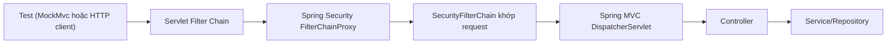
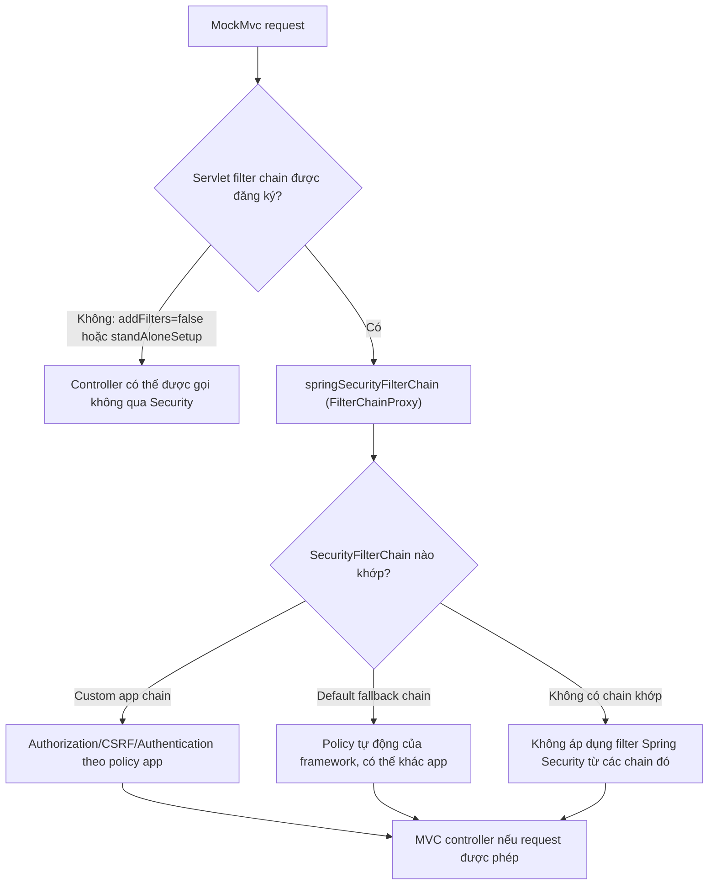

# @WebMvcTest, @SpringBootTest và cách nạp cấu hình SecurityFilterChain

> **Phạm vi:** kiểm thử HTTP cho ứng dụng **Spring Security Servlet** trên **Spring MVC / Spring Boot 3.3.0 / Spring Security 6.x / Java 17+**. Bài học tập trung vào khác biệt giữa **MVC test slice** và **full application context**, cách làm cho **SecurityFilterChain thực sự được nạp vào MockMvc**, cách dùng `spring-security-test` để kiểm tra 401/403/CSRF, và cách tránh các bài test "xanh" nhưng đã vô hiệu hóa bảo mật ngoài ý muốn.

## 1. Mục tiêu học tập

Sau bài này, bạn có thể:

1. Phân biệt chính xác `@WebMvcTest`, `@SpringBootTest` và `@AutoConfigureMockMvc`: phạm vi bean được nạp, chi phí khởi tạo, cách chạy MockMvc và loại lỗi phát hiện được.
2. Nhận biết **Spring Security filter chain** trong MockMvc, biết tại sao `@AutoConfigureMockMvc(addFilters = false)` làm test security trở nên không đáng tin.
3. Nạp cấu hình `SecurityFilterChain` chủ động trong MVC slice bằng `@Import(SecurityConfig.class)` và cung cấp các dependency bị slice loại ra bằng `@MockBean` hoặc test configuration.
4. Viết hai nhóm kiểm thử trên cùng một API: kiểm tra MVC/authorization với `@WebMvcTest` và kiểm tra cấu hình ứng dụng thật với `@SpringBootTest`.
5. Sử dụng `SecurityMockMvcRequestPostProcessors.user`, `httpBasic`, `csrf` và `@WithMockUser` đúng vai trò; biết thứ gì **được giả lập** và thứ gì đi qua cơ chế xác thực thật.
6. Đọc kết quả 200, 401, 403, redirect, CSRF failure và response headers dựa trên endpoint/method cụ thể; không đánh đồng mọi status 403 với "thiếu role".
7. Chẩn đoán sai khác do test context, các chain được chọn theo `securityMatcher`, servlet filter order, mock service, caching test context và test-only configuration.

## 2. Bốn lớp phải phân biệt khi kiểm thử HTTP

Khi gọi HTTP endpoint có Spring Security, có nhiều lớp độc lập:



Một bài test chỉ kiểm tra controller gọi đúng service có thể bỏ qua authentication, CSRF và SecurityFilterChain. Ngược lại, một test trả `401` có thể chỉ chứng minh default security auto-configuration đang chạy, **chứ không chứng minh policy của ứng dụng thật đã được nạp**.

### Nguồn gốc quyết định 200/401/403

- `401 Unauthorized`: thường thiếu hoặc thất bại authentication đối với resource có cơ chế challenge như HTTP Basic hoặc Bearer; nếu cấu hình `formLogin` thì anonymous có thể được **redirect** tới trang login thay vì trả 401.
- `403 Forbidden`: đã có principal nhưng không đủ authority cho endpoint, **hoặc** `CsrfFilter` từ chối POST/PUT/PATCH/DELETE thiếu token dù request có thể chưa đi tới authorization decision.
- `200 OK`: request qua các filter hiện diện, controller trả thành công; **không đủ để chứng minh filter bảo mật đúng** nếu filter đã bị tắt hoặc chain không khớp.
- `302 Found`: có thể là redirect login, redirect thành công sau authentication, hoặc business redirect; đọc `Location` và flow cụ thể.
- `404 Not Found`: path không có handler sau khi qua filter, **nhưng** nếu rule `anyRequest().denyAll()` chặn trước, cùng URL có thể cho 403. Không ép 404 là kỳ vọng mọi URL lạ.

## 3. @WebMvcTest và @SpringBootTest khác nhau thế nào?

| Tiêu chí | `@WebMvcTest` | `@SpringBootTest` |
| --- | --- | --- |
| Mục đích | Test MVC slice: controllers, routing, binding, JSON, advice, validation và web-related beans. | Test context ứng dụng đầy đủ: cấu hình, component graph, integration logic, security và bean wiring. |
| Bean được nạp | Chỉ phần web slice + auto-configuration tương ứng; không mặc định nạp mọi `@Service`, `@Repository`. | Quét bean ứng dụng từ `@SpringBootConfiguration`/`@SpringBootApplication` và những auto-configuration áp dụng. |
| Security | Có thể auto-configure Spring Security và các filter; **cấu hình custom** có thể cần `@Import` rõ ràng. | Tải cấu hình security ứng dụng cùng các bean thật, trừ khi bị override bởi profile/test config. |
| MockMvc | Tự auto-configure MockMvc trong thiết lập thông dụng. | Cần `@AutoConfigureMockMvc` để có MockMvc injection; annotation `@SpringBootTest` một mình không tạo MockMvc bean theo mặc định. |
| Test dependency | Controller dependency ngoài slice thường cần `@MockBean`/test bean. | Có thể dùng service thật, kết nối DB/test container/mock ngoại vi tùy cấu hình. |
| Servlet container | Mock servlet environment, không có HTTP socket thật. | Mặc định `webEnvironment = MOCK`; `RANDOM_PORT` mới khởi chạy embedded server thật. |
| Tốc độ | Thường nhanh, scope nhỏ hơn. | Thường chậm hơn do context rộng và phụ thuộc hệ thống. |
| Nên kiểm chứng | Contract HTTP/MVC và filter policy đã import trong slice. | Cấu hình/bean wiring thật, security filter chain, real authentication provider và integration của nhiều layer. |

**Hai kiểu test bổ sung cho nhau**, không có annotation nào "tự tốt hơn" trong mọi hoàn cảnh. Chọn theo lỗi cần tìm: câu hỏi "controller trả JSON đúng không?" ưu tiên slice; câu hỏi "production SecurityFilterChain thực tế có hoạt động không?" cần full-context hoặc test qua HTTP container.

### @SpringBootTest có phải lúc nào cũng là E2E không?

**Không.** Một `@SpringBootTest` với MockMvc có application context rộng, nhưng request vẫn được mô phỏng bởi `MockHttpServletRequest`/`MockHttpServletResponse`. Nó không mặc nhiên kiểm tra TLS, proxy, CORS của gateway, load balancer, real network socket hay khả năng tương thích browser.

Muốn kiểm thử HTTP thật tới embedded server, cân nhắc:

```java
@SpringBootTest(webEnvironment = SpringBootTest.WebEnvironment.RANDOM_PORT)
class RealHttpIntegrationTest {
    // Gọi URL với TestRestTemplate, RestClient hoặc HTTP client thật.
}
```

Đoạn trên là **minh họa annotation**, không phải class test chạy độc lập. Không đồng nhất `RANDOM_PORT` với MockMvc hoặc cho rằng việc tiêm MockMvc trong RANDOM_PORT sẽ tự dùng cổng mạng thật.

## 4. SecurityFilterChain được tạo và áp dụng ở đâu?

Trong ứng dụng Servlet, `HttpSecurity.build()` tạo một `SecurityFilterChain` bean. Spring Security tập hợp một hay nhiều chain vào một `FilterChainProxy`, thường được đăng ký qua bean/filter mang tên `springSecurityFilterChain`. Servlet filter bridge đưa request vào đó, rồi Spring Security chọn **chain đầu tiên có request matcher khớp**.



**Điểm mấu chốt:** "Có Spring Security trên classpath" và "đang dùng đúng `SecurityFilterChain` của ứng dụng" là hai câu hỏi khác nhau.

### Default fallback không phải policy của ứng dụng

Khi không có `SecurityFilterChain` custom trong context, Spring Boot có thể tạo fallback security chain theo auto-configuration. Trong MVC slice, bean configuration đặt trong `@Configuration`/`@Component` thông thường có thể không được đưa vào slice như bạn kỳ vọng. Khi đó test thấy 401/redirect login nhưng **không phải** do rule `/api/items` của ứng dụng.

Ngược lại, import quá rộng các configuration application vào `@WebMvcTest` có thể kéo DB, messaging, cloud clients và làm mất lợi thế slice. Cách đúng là **import chính xác security configuration và mock những dependency thật sự cần**.

### SecurityMatcher và authorizeHttpRequests

- `http.securityMatcher("/api/**")` của một chain giới hạn request **vào chain nào**.
- `authorizeHttpRequests(... requestMatchers(...) ...)` xác định **quyền truy cập bên trong chain đã được chọn**.
- Với nhiều chain, thứ tự `@Order` và path/method matching quyết định chính xác filter nào chạy.
- `permitAll()` không bỏ filter chain; CSRF, headers và các filter khác vẫn có thể chạy.
- `web.ignoring()` bỏ đường dẫn khỏi Spring Security filter chain; dùng nó trên endpoint cần security header có thể tạo sai lệch.

## 5. Ứng dụng mẫu: API có public endpoint, scope và CSRF

Demo sử dụng **Java 17+**, Maven, **Spring Boot 3.3.0** và Spring Security 6. Mọi source dưới đây nằm trong cùng một project. Với cấu hình này:

| Endpoint | Policy mong đợi |
| --- | --- |
| `GET /api/public/ping` | Public, trả `pong`. |
| `GET /api/items` | Cần `SCOPE_inventory.read`; trả chuỗi từ service. |
| `POST /api/reserve` | Cần `SCOPE_inventory.write` **và CSRF token**, vì CSRF mặc định được bật. |
| Các request khác | Bị deny theo `anyRequest().denyAll()` trước khi đến controller nếu khớp chain. |

HTTP Basic chỉ để test authentication provider cục bộ dễ hiểu. Với API thuần Bearer token không dùng ambient cookie credentials, chính sách CSRF có thể khác; **đừng sao chép `csrf.disable()` toàn cục từ ví dụ nào đó khi đang dùng browser cookie/session**.

### 5.1. Cấu trúc file

```text
mvc-security-test-demo/
├── pom.xml
└── src/
    ├── main/
    │   └── java/demo/httpsecurity/
    │       ├── DemoApplication.java
    │       ├── config/SecurityConfig.java
    │       ├── service/CatalogService.java
    │       └── web/CatalogController.java
    └── test/
        └── java/demo/httpsecurity/
            ├── CatalogWebSliceTest.java
            └── FullSecurityIntegrationTest.java
```

### 5.2. Maven pom.xml

```xml
<project xmlns="http://maven.apache.org/POM/4.0.0"
         xmlns:xsi="http://www.w3.org/2001/XMLSchema-instance"
         xsi:schemaLocation="http://maven.apache.org/POM/4.0.0 https://maven.apache.org/xsd/maven-4.0.0.xsd">
    <modelVersion>4.0.0</modelVersion>
    <parent>
        <groupId>org.springframework.boot</groupId>
        <artifactId>spring-boot-starter-parent</artifactId>
        <version>3.3.0</version>
        <relativePath/>
    </parent>
    <groupId>demo</groupId>
    <artifactId>mvc-security-test-demo</artifactId>
    <version>0.0.1-SNAPSHOT</version>
    <properties>
        <java.version>17</java.version>
    </properties>
    <dependencies>
        <dependency>
            <groupId>org.springframework.boot</groupId>
            <artifactId>spring-boot-starter-web</artifactId>
        </dependency>
        <dependency>
            <groupId>org.springframework.boot</groupId>
            <artifactId>spring-boot-starter-security</artifactId>
        </dependency>
        <dependency>
            <groupId>org.springframework.boot</groupId>
            <artifactId>spring-boot-starter-test</artifactId>
            <scope>test</scope>
        </dependency>
        <dependency>
            <groupId>org.springframework.security</groupId>
            <artifactId>spring-security-test</artifactId>
            <scope>test</scope>
        </dependency>
    </dependencies>
    <build>
        <plugins>
            <plugin>
                <groupId>org.springframework.boot</groupId>
                <artifactId>spring-boot-maven-plugin</artifactId>
            </plugin>
        </plugins>
    </build>
</project>
```

`spring-security-test` cung cấp `user()`, `httpBasic()`, `csrf()`, `@WithMockUser` và các matcher/integration hỗ trợ MockMvc. Chỉ thêm `spring-boot-starter-test` mà thiếu dependency này có thể dẫn đến không biên dịch được các static imports trên.

### 5.3. Application và service

**`src/main/java/demo/httpsecurity/DemoApplication.java`:**

```java
package demo.httpsecurity;

import org.springframework.boot.SpringApplication;
import org.springframework.boot.autoconfigure.SpringBootApplication;

@SpringBootApplication
public class DemoApplication {
    public static void main(String[] args) {
        SpringApplication.run(DemoApplication.class, args);
    }
}
```

**`src/main/java/demo/httpsecurity/service/CatalogService.java`:**

```java
package demo.httpsecurity.service;

import org.springframework.stereotype.Service;

@Service
public class CatalogService {
    public String items() {
        return "stock=7";
    }

    public String reserve() {
        return "reservation-created";
    }
}
```

Đây là service giả định có kết quả cố định để không cần DB. Trong production, kiểm tra quyền trên từng resource/tenant còn quan trọng hơn chỉ có quyền tổng quát `inventory.read`/`inventory.write`.

**`src/main/java/demo/httpsecurity/web/CatalogController.java`:**

```java
package demo.httpsecurity.web;

import demo.httpsecurity.service.CatalogService;
import org.springframework.web.bind.annotation.GetMapping;
import org.springframework.web.bind.annotation.PostMapping;
import org.springframework.web.bind.annotation.RequestMapping;
import org.springframework.web.bind.annotation.RestController;

@RestController
@RequestMapping("/api")
public class CatalogController {
    private final CatalogService catalogService;

    public CatalogController(CatalogService catalogService) {
        this.catalogService = catalogService;
    }

    @GetMapping("/public/ping")
    public String ping() {
        return "pong";
    }

    @GetMapping("/items")
    public String items() {
        return catalogService.items();
    }

    @PostMapping("/reserve")
    public String reserve() {
        return catalogService.reserve();
    }
}
```

### 5.4. SecurityConfig: policy thống nhất cho slice và full context

**`src/main/java/demo/httpsecurity/config/SecurityConfig.java`:**

```java
package demo.httpsecurity.config;

import org.springframework.context.annotation.Bean;
import org.springframework.context.annotation.Configuration;
import org.springframework.http.HttpMethod;
import org.springframework.security.config.Customizer;
import org.springframework.security.config.annotation.web.builders.HttpSecurity;
import org.springframework.security.core.userdetails.User;
import org.springframework.security.core.userdetails.UserDetailsService;
import org.springframework.security.crypto.bcrypt.BCryptPasswordEncoder;
import org.springframework.security.crypto.password.PasswordEncoder;
import org.springframework.security.provisioning.InMemoryUserDetailsManager;
import org.springframework.security.web.SecurityFilterChain;

@Configuration
public class SecurityConfig {
    @Bean
    SecurityFilterChain appSecurity(HttpSecurity http) throws Exception {
        return http
            .authorizeHttpRequests(auth -> auth
                .requestMatchers("/api/public/ping").permitAll()
                .requestMatchers(HttpMethod.GET, "/api/items")
                    .hasAuthority("SCOPE_inventory.read")
                .requestMatchers(HttpMethod.POST, "/api/reserve")
                    .hasAuthority("SCOPE_inventory.write")
                .anyRequest().denyAll())
            .httpBasic(Customizer.withDefaults())
            .build();
    }

    @Bean
    PasswordEncoder passwordEncoder() {
        return new BCryptPasswordEncoder();
    }

    @Bean
    UserDetailsService users(PasswordEncoder encoder) {
        return new InMemoryUserDetailsManager(
            User.withUsername("reader")
                .password(encoder.encode("reader-pass"))
                .authorities("SCOPE_inventory.read")
                .build(),
            User.withUsername("writer")
                .password(encoder.encode("writer-pass"))
                .authorities("SCOPE_inventory.read",
                             "SCOPE_inventory.write")
                .build());
    }
}
```

**Giải thích:**

1. `appSecurity` là bean **SecurityFilterChain của ứng dụng**, không phải quy tắc được tạo tự động khi thiếu cấu hình.
2. `requestMatchers("/api/public/ping").permitAll()` cho phép anonymous gọi ping; **không vô hiệu hóa security filter**.
3. `GET /api/items` yêu cầu đúng `SCOPE_inventory.read`. `POST /api/reserve` yêu cầu `SCOPE_inventory.write`.
4. `httpBasic(Customizer.withDefaults())` bật HTTP Basic. Không bật `formLogin`, nên endpoint được bảo vệ khi anonymous thường nhận `401` thay vì redirect sang login page.
5. Không gọi `csrf.disable()`, nên CSRF mặc định của Spring Security vẫn áp dụng cho `POST /api/reserve`. Có đúng authority mà thiếu CSRF token vẫn có thể nhận `403`.
6. `reader` và `writer` là tài khoản test/lab trong bộ nhớ, không dùng làm production credential.
7. Khi import đúng `SecurityConfig` trong MVC slice, security chain, encoder và user-details beans này được nạp theo cấu hình rõ ràng. Với full context, bean được quét từ package gốc của ứng dụng.

**Lưu ý quan trọng:** danh sách `authorities("SCOPE_inventory.read")` ở đây là **Spring Security authority string** thủ công cho ví dụ HTTP Basic; đây **không phải OAuth2 access token hay token scope do issuer cung cấp**. Cùng naming convention với `SCOPE_` không làm Basic thành JWT Resource Server.

## 6. Test MVC slice bằng @WebMvcTest + @Import(SecurityConfig.class)

### 6.1. Vì sao cần @MockBean CatalogService?

`@WebMvcTest(CatalogController.class)` tập trung vào controller và MVC support; nó **không tự động đưa toàn bộ @Service vào context**. Controller có constructor dependency `CatalogService`; nếu không cung cấp bean tương ứng, context có thể báo `NoSuchBeanDefinitionException` hoặc `UnsatisfiedDependencyException`.

`@MockBean` (có trong **Spring Boot 3.3.0**) tạo Mockito mock bean trong test context để controller nhận đúng dependency. Vì service đã mock, cần khai báo `when(...).thenReturn(...)` hoặc `given(...).willReturn(...)` trước khi assert body. Trong các phiên bản mới hơn, API test mocking có thể đổi/deprecate; **ví dụ này cố định phiên bản Boot 3.3** và không dùng annotation `@MockitoBean` vốn xuất hiện trong stack mới hơn.

### 6.2. Vì sao cần @Import(SecurityConfig.class)?

Một MVC slice không nên dựa vào may rủi của component scanning để lấy mọi `@Configuration` của ứng dụng. Lệnh `@Import(SecurityConfig.class)` đưa **đúng bean SecurityFilterChain và dependency cấu hình** vào slice. `@AutoConfigureMockMvc(addFilters = true)` nêu rõ ý đồ đưa registered filters vào MockMvc; giá trị `true` là hành vi mặc định phù hợp.

Nếu SecurityConfig của dự án thật có dependency DB/secret manager, hãy tách bean security chain khỏi infrastructure nặng hoặc cấp các bean test phù hợp để slice vẫn nhỏ. Không lạm dụng import nguyên cả application config package.

### 6.3. Full test file

**`src/test/java/demo/httpsecurity/CatalogWebSliceTest.java`:**

```java
package demo.httpsecurity;

import demo.httpsecurity.config.SecurityConfig;
import demo.httpsecurity.service.CatalogService;
import demo.httpsecurity.web.CatalogController;
import org.junit.jupiter.api.Test;
import org.springframework.beans.factory.annotation.Autowired;
import org.springframework.boot.test.autoconfigure.web.servlet.AutoConfigureMockMvc;
import org.springframework.boot.test.autoconfigure.web.servlet.WebMvcTest;
import org.springframework.boot.test.mock.mockito.MockBean;
import org.springframework.context.ApplicationContext;
import org.springframework.context.annotation.Import;
import org.springframework.security.core.authority.SimpleGrantedAuthority;
import org.springframework.test.web.servlet.MockMvc;

import static org.assertj.core.api.Assertions.assertThat;
import static org.mockito.BDDMockito.given;
import static org.mockito.Mockito.verify;
import static org.mockito.Mockito.verifyNoInteractions;
import static org.springframework.security.test.web.servlet.request
    .SecurityMockMvcRequestPostProcessors.csrf;
import static org.springframework.security.test.web.servlet.request
    .SecurityMockMvcRequestPostProcessors.user;
import static org.springframework.test.web.servlet.request.MockMvcRequestBuilders.get;
import static org.springframework.test.web.servlet.request.MockMvcRequestBuilders.post;
import static org.springframework.test.web.servlet.result.MockMvcResultMatchers.content;
import static org.springframework.test.web.servlet.result.MockMvcResultMatchers.status;

@WebMvcTest(CatalogController.class)
@Import(SecurityConfig.class)
@AutoConfigureMockMvc(addFilters = true)
class CatalogWebSliceTest {
    @Autowired
    MockMvc mvc;

    @Autowired
    ApplicationContext context;

    @MockBean
    CatalogService catalogService;

    @Test
    void securityChainFromApplicationIsPresent() {
        assertThat(context.containsBean("appSecurity")).isTrue();
        assertThat(context.containsBean("springSecurityFilterChain")).isTrue();
    }

    @Test
    void publicPingAllowedWithoutCredentials() throws Exception {
        mvc.perform(get("/api/public/ping"))
            .andExpect(status().isOk())
            .andExpect(content().string("pong"));
    }

    @Test
    void anonymousCannotReadItems() throws Exception {
        mvc.perform(get("/api/items"))
            .andExpect(status().isUnauthorized());
        verifyNoInteractions(catalogService);
    }

    @Test
    void readerCanReadItemsWithMockPrincipal() throws Exception {
        given(catalogService.items()).willReturn("stock=7");

        mvc.perform(get("/api/items")
                .with(user("reader").authorities(
                    new SimpleGrantedAuthority("SCOPE_inventory.read"))))
            .andExpect(status().isOk())
            .andExpect(content().string("stock=7"));

        verify(catalogService).items();
    }

    @Test
    void readerCannotReserveEvenWithValidCsrf() throws Exception {
        mvc.perform(post("/api/reserve")
                .with(user("reader").authorities(
                    new SimpleGrantedAuthority("SCOPE_inventory.read")))
                .with(csrf()))
            .andExpect(status().isForbidden());
        verifyNoInteractions(catalogService);
    }

    @Test
    void writerWithoutCsrfCannotReserve() throws Exception {
        mvc.perform(post("/api/reserve")
                .with(user("writer").authorities(
                    new SimpleGrantedAuthority("SCOPE_inventory.write"))))
            .andExpect(status().isForbidden());
        verifyNoInteractions(catalogService);
    }

    @Test
    void writerWithCsrfCanReserve() throws Exception {
        given(catalogService.reserve())
            .willReturn("reservation-created");

        mvc.perform(post("/api/reserve")
                .with(user("writer").authorities(
                    new SimpleGrantedAuthority("SCOPE_inventory.write")))
                .with(csrf()))
            .andExpect(status().isOk())
            .andExpect(content().string("reservation-created"));

        verify(catalogService).reserve();
    }
}
```

**Vì sao test này có giá trị?**

- Test kiểm tra **bean appSecurity tồn tại** để giảm rủi ro "test xanh nhờ fallback chain"; đó là bằng chứng bean được nạp, không phải bằng chứng mọi request chọn đúng chain nếu có nhiều chain.
- Test ping xác nhận route công khai.
- Test anonymous xác nhận HTTP Basic challenge và không đi tới service.
- Test reader đã mock identity bằng `user()`; nó chỉ chứng minh **authorization theo authority**, không kiểm tra password encoder.
- Test reader POST kèm CSRF hợp lệ nhưng không có write authority cho `403` — kiểm tra **authorization**.
- Test writer POST không CSRF cho `403` — kiểm tra **CSRF**. Cần tách hai nguyên nhân cùng status 403.
- Test writer POST với đúng authority và CSRF cho `200` — kiểm tra **positive path**.
- `verifyNoInteractions(catalogService)` bảo đảm request bị filter chặn trước khi controller gọi service, thay vì controller tự trả `403` theo business logic.

**Quan trọng:** mọi `with(user(...))` ở đây tạo một user test đã authenticated; **không thử HTTP Basic credentials, mật khẩu thật hay UserDetailsService**. Những thứ đó được kiểm tra ở test full context tiếp theo.

### 6.4. Chỉ cần vài annotation có đủ không?

Chỉ dùng:

```java
@WebMvcTest(CatalogController.class)
class SomeTest { /* ... */ }
```

không phải lúc nào cũng đưa **cùng chain production** vào context. Ngoài ra, nếu controller có `CatalogService` dependency mà không mock, test có thể không khởi tạo được. Khi thêm `@Import(SecurityConfig.class)`, cần nhìn dependency của security configuration: nếu chain dùng custom auth provider, JWT decoder, method security hay authorization manager, chúng cũng phải được cung cấp trong slice để test đúng policy đang thử.

Không viết test "mong tất cả URL bị chặn" khi bạn chưa biết nó đang dùng fallback chain hay custom chain.

## 7. Full application context với @SpringBootTest + @AutoConfigureMockMvc

Trong ví dụ này, full test **không dùng `@MockBean` cho `CatalogService`**. `@SpringBootTest` nạp `DemoApplication`, quét `CatalogService`, `CatalogController` và `SecurityConfig`. MockMvc được tạo nhờ `@AutoConfigureMockMvc`.

**`src/test/java/demo/httpsecurity/FullSecurityIntegrationTest.java`:**

```java
package demo.httpsecurity;

import org.junit.jupiter.api.Test;
import org.springframework.beans.factory.annotation.Autowired;
import org.springframework.boot.test.autoconfigure.web.servlet.AutoConfigureMockMvc;
import org.springframework.boot.test.context.SpringBootTest;
import org.springframework.test.web.servlet.MockMvc;

import static org.springframework.security.test.web.servlet.request
    .SecurityMockMvcRequestPostProcessors.csrf;
import static org.springframework.security.test.web.servlet.request
    .SecurityMockMvcRequestPostProcessors.httpBasic;
import static org.springframework.test.web.servlet.request.MockMvcRequestBuilders.get;
import static org.springframework.test.web.servlet.request.MockMvcRequestBuilders.post;
import static org.springframework.test.web.servlet.result.MockMvcResultMatchers.content;
import static org.springframework.test.web.servlet.result.MockMvcResultMatchers.status;

@SpringBootTest
@AutoConfigureMockMvc
class FullSecurityIntegrationTest {
    @Autowired
    MockMvc mvc;

    @Test
    void publicRouteWorksWithoutAuthentication() throws Exception {
        mvc.perform(get("/api/public/ping"))
            .andExpect(status().isOk())
            .andExpect(content().string("pong"));
    }

    @Test
    void missingBasicCredentialsRejected() throws Exception {
        mvc.perform(get("/api/items"))
            .andExpect(status().isUnauthorized());
    }

    @Test
    void wrongBasicPasswordRejected() throws Exception {
        mvc.perform(get("/api/items")
                .with(httpBasic("reader", "incorrect")))
            .andExpect(status().isUnauthorized());
    }

    @Test
    void realReaderUserCanReadRealService() throws Exception {
        mvc.perform(get("/api/items")
                .with(httpBasic("reader", "reader-pass")))
            .andExpect(status().isOk())
            .andExpect(content().string("stock=7"));
    }

    @Test
    void realReaderUserHasNoWriteAuthority() throws Exception {
        mvc.perform(post("/api/reserve")
                .with(httpBasic("reader", "reader-pass"))
                .with(csrf()))
            .andExpect(status().isForbidden());
    }

    @Test
    void writerWithoutCsrfRejected() throws Exception {
        mvc.perform(post("/api/reserve")
                .with(httpBasic("writer", "writer-pass")))
            .andExpect(status().isForbidden());
    }

    @Test
    void writerWithCsrfMayReserve() throws Exception {
        mvc.perform(post("/api/reserve")
                .with(httpBasic("writer", "writer-pass"))
                .with(csrf()))
            .andExpect(status().isOk())
            .andExpect(content().string("reservation-created"));
    }
}
```

**Vì sao đây là integration test mạnh hơn slice?**

1. `httpBasic("reader", "reader-pass")` thêm Authorization header HTTP Basic vào request **giả lập**; Spring Security phải giải mã header, tìm user qua `UserDetailsService` và kiểm tra BCrypt password. Khác với `user()`, nó thực sự đi qua authentication filter/provider phù hợp.
2. Test dùng `CatalogService` thật thay vì mock; nếu wiring service hoặc controller hỏng, test sẽ phát hiện.
3. Test `wrongBasicPasswordRejected` bắt lỗi credential validation mà slice giả lập user không thể thấy.
4. Test `writerWithoutCsrfRejected` xác minh CSRF mặc định còn bật trong full context, nên test không âm thầm chạy với một config slice đặc biệt.
5. Full context vẫn dùng **MockMvc**, không tạo HTTP socket mạng; chưa kiểm tra ingress/proxy/CDN hay TLS.

### Chạy test và ứng dụng

Trong thư mục `mvc-security-test-demo`:

```bash
mvn test
mvn spring-boot:run
```

Hai test class được JUnit 5 nhận diện theo Maven/Spring Boot starter mặc định. Khi chạy app, thử:

```bash
curl -i http://localhost:8080/api/public/ping
curl -i http://localhost:8080/api/items
curl -i -u reader:reader-pass http://localhost:8080/api/items
curl -i -u reader:reader-pass -X POST http://localhost:8080/api/reserve
```

Kết quả dự kiến:

| Request | Status | Body chính |
| --- | --- | --- |
| `GET /api/public/ping` | `200` | `pong` |
| `GET /api/items` anonymous | `401` | Không cần dựa vào body cụ thể; có thể có `WWW-Authenticate` |
| `GET /api/items` reader | `200` | `stock=7` |
| `POST /api/reserve` reader, không CSRF | `403` | Bị CSRF từ chối (đồng thời reader thiếu quyền ghi) |

Để chứng minh **reader thiếu authority**, test phải gửi CSRF **hợp lệ** trước (như `realReaderUserHasNoWriteAuthority`). Nếu không, security chain có thể từ chối từ `CsrfFilter` trước khi kiểm tra authority. Trong kiểm thử end-to-end qua browser, cần thu thập và gửi CSRF token đúng với repository/session; `with(csrf())` là helper test, **không tồn tại trong curl/browser production**.

## 8. Phân biệt user(), @WithMockUser, httpBasic() và jwt()

| Cách test | Nó thực sự làm gì? | Không chứng minh được gì? |
| --- | --- | --- |
| `with(user("alice"))` | Gắn `SecurityContext` giả lập với principal/authority cho MockMvc request. | Không kiểm tra password authentication, user store, token verifier. |
| `@WithMockUser(username="alice", authorities={"SCOPE_inventory.read"})` | Đặt security context giả lập cho test theo annotation. | Không chạy login provider thật, không thử credentials. |
| `with(httpBasic("alice","password"))` | Thêm header Basic; nếu Security filter chạy, authentication qua provider/UserDetailsService thật (hoặc bean test). | Không chứng minh HTTP socket thật hay kiểm tra các identity provider không dùng Basic. |
| `with(jwt())` | Cấp authenticated JWT principal giả lập cho test authorization. | **Không xác minh chữ ký JWT/JWKS**, issuer/audience bằng decoder thật. |
| `with(csrf())` | Tạo CSRF token test hợp lệ cho request MockMvc. | Không thay thế test browser thật, cookie policy, chống CSRF ở proxy. |

**Bẫy phổ biến:** test `with(user())` trả 200 ngay cả khi `UserDetailsService` sai, password encoder chưa được nạp hoặc OAuth/OIDC login flow lỗi; test đó chỉ xét authorization sau khi có principal mô phỏng. Cần thêm test với `httpBasic`/OAuth2 test IdP/JWT thật theo mục tiêu bảo mật.

### @WithMockUser là công cụ, không phải đường tắt bật bảo mật

`@WithMockUser` đưa authentication giả vào context của test, rất hữu ích cho kiểm tra quyền. Nhưng nếu filter bị tắt, một số test vẫn trông "hợp lệ" vì controller hoặc method security tiếp nhận mock context; do đó **không dùng sự có mặt của @WithMockUser làm bằng chứng springSecurityFilterChain đang chạy**. Test anonymous/CSRF và kiểm tra filter bean là những đối chứng quan trọng.

## 9. Cách chứng minh chain thật được nạp trong test

### 9.1. Kiểm tra bean cụ thể và filter bridge

Với demo, cấu hình tạo bean có tên `appSecurity`. Trong test context:

```java
@Autowired
ApplicationContext context;

@Test
void expectedBeansLoaded() {
    assertThat(context.containsBean("appSecurity")).isTrue();
    assertThat(context.containsBean("springSecurityFilterChain")).isTrue();
}
```

Đây là **snippet cho test** (cần imports như phần 6), không phải chương trình độc lập. Nó chứng minh bean tồn tại; nếu có nhiều `SecurityFilterChain`, chỉ kiểm tra tên bean **chưa chứng minh** request đi qua bean nào.

### 9.2. Kiểm tra hành vi, không chỉ đếm bean

Một bộ test tối thiểu cho chain cần chứng minh đồng thời:

- Anonymous vào `/api/items` nhận 401/redirect được định nghĩa.
- User chỉ có scope read vào `/api/items` nhận 200, nhưng POST `/api/reserve` với CSRF hợp lệ nhận 403.
- User có write authority POST không có CSRF nhận 403; có token CSRF hợp lệ nhận 200.
- Request vào endpoint public nhận 200 **khi không có auth**.
- Controller/service không được gọi nếu request bị filter chặn.
- Với nhiều chain, test cả path/method rơi vào chain API, chain UI và đường không khớp; xác nhận header/CSRF/entrypoint phù hợp.

Nếu chỉ assert "GET protected trả 401", một chain default **hoàn toàn khác** cũng có thể làm test đỗ. Hãy kiểm tra behavior của **rule đặc thù** cho ứng dụng.

### 9.3. Debug filter chain khi test thất bại

Trong môi trường test, bật:

```properties
logging.level.org.springframework.security=DEBUG
```

Hoặc truyền property chỉ cho test:

```java
@SpringBootTest(properties = {
    "logging.level.org.springframework.security=DEBUG"
})
@AutoConfigureMockMvc
class DiagnosticSecurityTest {
    // Dùng khi cần điều tra; không phải một class demo độc lập hoàn chỉnh.
}
```

Debug log có thể cho thấy request được bảo vệ, filter chain được áp dụng và một số decision; nhưng không nên bật quá lâu trong production vì log bảo mật dễ chứa context nhạy cảm/PII. Không sao chép nguyên Authorization header, cookie, token hay password vào issue tracker.

Khi gặp kết quả bất thường, ưu tiên kiểm tra theo thứ tự: bean chain được nạp? MockMvc có addFilters? request khớp chain nào? authentication tạo ra chưa? CSRF filter có từ chối trước? controller có chạy chưa? Đây thường là quy trình chẩn đoán nhanh hơn thay đổi ngẫu nhiên annotation.

## 10. SecurityFilterChain trong @WebMvcTest không chỉ có một cách nạp

### Cách A: Import cấu hình Security ứng dụng (khuyến nghị khi muốn test policy thật)

```java
@WebMvcTest(CatalogController.class)
@Import(SecurityConfig.class)
@AutoConfigureMockMvc(addFilters = true)
class CatalogWebSliceTest {
    // @MockBean cho dependencies ngoài MVC slice.
}
```

Ưu điểm: kiểm chứng đúng matcher, header, auth/CSRF policy của config đang dùng ở production; tránh viết lại rule với giả định khác. Nhược điểm: một cấu hình SecurityConfig gộp nhiều dependency nặng có thể kéo nhiều bean vào slice.

### Cách B: Import test-only SecurityFilterChain để cô lập MVC

```java
@WebMvcTest(CatalogController.class)
@Import(ControllerOnlySecurityTest.TestSecurity.class)
class ControllerOnlySecurityTest {
    @TestConfiguration
    static class TestSecurity {
        @Bean
        SecurityFilterChain chain(HttpSecurity http) throws Exception {
            return http
                .authorizeHttpRequests(a -> a
                    .anyRequest().permitAll())
                .build();
        }
    }
}
```

**Đây chỉ là cấu hình mô tả kỹ thuật**, các import và mock dependency của controller được lược bỏ. Nếu chọn Cách B, bạn **không được nói test này đã kiểm chứng chính sách production**, vì tất cả request đã được `permitAll`. Cách này chỉ thích hợp khi test riêng routing/serialization và có các test security độc lập đủ mạnh.

### Cách C: @SpringBootTest + @AutoConfigureMockMvc

```java
@SpringBootTest
@AutoConfigureMockMvc
class RealPolicyTest {
    // Nạp mọi cấu hình ứng dụng và kiểm thử HTTP MockMvc.
}
```

Ưu điểm: kiểm thử cấu hình thật và wiring bean trên phạm vi rộng. Nhược điểm: khởi động lâu hơn, đòi hỏi DB/provider/client phù hợp; có thể bị ảnh hưởng test profile hoặc bean overrides. Không thay thế hoàn toàn MVC slice vì slice vẫn cho phản hồi chẩn đoán nhanh khi controller có lỗi riêng.

### Chọn cách theo câu hỏi kiểm thử

- "Controller validate JSON/binding ra sao khi service trả lỗi?" → `@WebMvcTest` + mock service; có thể import security config nếu cần rule thật.
- "GET /api/items có thật sự yêu cầu SCOPE_inventory.read?" → slice với **SecurityConfig thật**, hoặc full context.
- "HTTP Basic password có đúng và CSRF có chạy cùng chain thật không?" → `@SpringBootTest` + MockMvc với `httpBasic()` và `csrf()`.
- "Response qua proxy HTTPS có cookie/SameSite/HSTS đúng không?" → HTTP integration test vào môi trường đại diện cho deployment, không chỉ MockMvc.

## 11. @AutoConfigureMockMvc(addFilters=false) là gì?

Annotation `@AutoConfigureMockMvc` có thuộc tính `addFilters`. Khi đặt `false`, nó **không đăng ký các filter từ application context vào MockMvc** theo cấu hình auto; điều này có thể loại `springSecurityFilterChain` và những Servlet filters khác khỏi pipeline request.

```java
// Chỉ dùng nếu chủ đích là test controller KHÔNG qua filters.
// TUYỆT ĐỐI không coi đây là test Spring Security.
@AutoConfigureMockMvc(addFilters = false)
```

Một test protected endpoint có thể trả 200 khi filter tắt; đó không phải bằng chứng endpoint thực sự an toàn. Nếu dùng `MockMvcBuilders.standaloneSetup(controller)` thì chỉ controller/MVC được cấu hình thủ công, **không tự có security filters**. Để test security trong setup custom, cần tích hợp/filter đúng, ví dụ `springSecurity()` khi dùng context Spring Security; mặc định dễ tin cậy hơn là dùng `@WebMvcTest` hoặc `@SpringBootTest + @AutoConfigureMockMvc`.

### Nguyên tắc không được sai

**Có `SecurityFilterChain` bean ≠ chắc chắn MockMvc đang chạy filter đó.** Cần cả bean phù hợp **và** MockMvc được thiết lập để sử dụng các filters tương ứng. Đoạn kiểm tra bean ở phần 9 phải đi cùng assertion behavior ở phần 6/7.

## 12. Các lỗi cấu hình dễ gặp

| Triệu chứng | Nguyên nhân | Cách xử lý |
| --- | --- | --- |
| `@WebMvcTest` báo thiếu `CatalogService` | Slice không lấy toàn bộ `@Service`. | `@MockBean CatalogService` hoặc test bean tường minh. |
| MVC slice trả 401 cho cả public ping | Custom SecurityConfig không được import; fallback chain hoặc matcher khác. | `@Import(SecurityConfig.class)`, test `appSecurity` và public route. |
| Slice được 200 dù production 403 | Test-only `permitAll`, `addFilters=false`, `standaloneSetup` hoặc mock principal có quyền cao hơn. | So sánh config/bean, addFilters, authority của test principal, kiểm tra negative path. |
| `@SpringBootTest` không inject được MockMvc | Thiếu `@AutoConfigureMockMvc`. | Thêm annotation; phân biệt test HTTP qua port thật. |
| `POST` nhận 403 mặc dù có role | Thiếu/invalid CSRF token; `CsrfFilter` từ chối trước authorization. | Test `with(csrf())` trước khi kết luận về role, tách negative CSRF test. |
| `GET` trả 302 thay vì 401 | Config có `formLogin` hoặc exception entry point khác HTTP Basic. | Dựa trên entrypoint mong đợi, assert `Location`, không ép 401. |
| `403` vì `hasRole("ADMIN")` | Spring Security thêm prefix `ROLE_` cho hasRole, trong khi test cấp authority khác. | Test đúng role/authority; `hasAuthority("SCOPE_x")` cần chính xác string. |
| `@WithMockUser` pass, Basic thật fail | Mock principal bỏ qua UserDetailsService/encoder. | Thêm `httpBasic()` test trong full context. |
| Test dự án khác chạy riêng nhưng cả suite fail | Context caching, test config/profile/mocks, shared static mutable state hoặc DB state. | Kiểm tra isolation, reset state; chỉ dùng `@DirtiesContext` khi thực sự cần. |
| Lỗi `NoSuchBeanDefinitionException` của JwtDecoder/AuthenticationProvider | SecurityConfig cần bean ngoài MVC slice. | Import/mock đúng dependency, tách config, hoặc chuyển test sang full context. |
| Có hai SecurityFilterChain bean và test sai | `@Order`/`securityMatcher` khiến request chọn chain khác dự kiến. | Kiểm thử từng path, matcher và thứ tự, inspect debug log. |
| Security filter chạy hai lần | Đăng ký filter hoặc proxy sai trong custom test setup, vừa thêm filter thủ công vừa auto-register. | Dùng một cách tích hợp `springSecurity()` và cấu hình MockMvc rõ ràng. |
| 404 không xuất hiện vì bị 403 | `anyRequest().denyAll` chặn URL trước DispatcherServlet. | Quyết định policy: deny hay để MVC 404; test đúng mục tiêu. |
| Response headers khác production | Proxy/gateway/CDN hoặc chain/routing khác. | Test môi trường triển khai thật; MockMvc chỉ thấy header của app. |

## 13. Mở rộng sang method security, nhiều chain và các test slices khác

### 13.1. Method security

`@PreAuthorize`/`@PostAuthorize` phụ thuộc vào `@EnableMethodSecurity` và AOP/method-security infrastructure. Slice chỉ có web beans có thể **không đại diện** cho cách service layer bị proxy trong full context. Mock `CatalogService` cũng bỏ qua method security bên trong real service. Muốn kiểm thử bảo vệ ở service level, hãy chọn `@SpringBootTest` hoặc cấu hình test nạp bean thật và method security đủ thành phần.

**Sai lầm:** service thật có `@PreAuthorize("hasRole('ADMIN')")` nhưng `@WebMvcTest` mock service, test gọi controller pass rồi tuyên bố method security được kiểm chứng. Test này chưa từng gọi service proxy thật.

### 13.2. Nhiều chain có thứ tự

Ví dụ ứng dụng có:

```text
@Order(1) securityMatcher("/api/**")  → Bearer/JWT, stateless
@Order(2) securityMatcher("/web/**")  → Session/formLogin, CSRF
fallback chain                       → denyAll
```

Ở đây, `securityMatcher` quyết định chain **được chọn trước**; `authorizeHttpRequests` quyết định quyền **sau khi chain được chọn**. Test `/api/public/ping` không chứng minh chính sách `/web/**`. Nếu import một chain riêng của API vào MVC slice mà bỏ các chain khác, bạn phải ghi rõ phạm vi; full-context test cần xác nhận toàn bộ đường đi.

### 13.3. Filter tùy chỉnh

Nếu dự án có JWT filter, audit filter, exception mapping filter hoặc header writer, kiểm tra xem chúng được đăng ký qua Spring Security chain hay thành servlet filter độc lập. Cấu hình test có thể vô tình đăng ký filter hai lần, hoặc slice không chứa bean filter vì component scanning khác full app.

Đừng bắt chước implementation SecurityFilterChain bằng một filter stub quá đơn giản khi test định chứng minh đường thật. Nếu muốn cô lập controller, ghi rõ "test MVC chỉ" và chuyển kiểm chứng filter thật sang suite khác.

### 13.4. Testcontainers và dịch vụ phụ thuộc

`@SpringBootTest` không mặc nhiên cần DB thật; nó chỉ nạp những dependency ứng dụng đã cấu hình. Nếu project có database, messaging, Redis, IAM/IdP, hãy sử dụng test profile, Testcontainers hoặc server giả có contract rõ ràng; không tự mock toàn bộ thế giới rồi tuyên bố integration đã kiểm thử end-to-end.

OAuth2/OIDC login cần test IdP hoặc sandbox đúng luồng để kiểm thử authorization code và state; JWT Resource Server cần test decoder thật/JWKS để chứng minh cryptographic verification. `@WithMockUser` và `jwt()` phù hợp cho authorization nhưng chưa bao phủ phần đó.

## 14. Checklist chọn và duy trì test suite

Trước khi mở PR, trả lời các câu hỏi:

- [ ] Test là MVC slice hay full application context? Mục tiêu rõ ràng?
- [ ] `SecurityFilterChain` production có trong test context không? `@Import`/bean scanning đã kiểm chứng?
- [ ] MockMvc có Servlet filters thực sự? Không có `addFilters=false` ở test security?
- [ ] Controller dependency có được mock đúng, không kéo hạ tầng không liên quan?
- [ ] Test public path, anonymous path, authorized path, forbidden path, CSRF missing/present?
- [ ] Phân biệt 401 authentication với 403 authorization/CSRF và 302 redirect theo entrypoint?
- [ ] Test principal giả lập (`user`/`@WithMockUser`/`jwt`) đã được đánh dấu giới hạn?
- [ ] Ít nhất một test full-context dùng cơ chế credential thật của demo (`httpBasic`) nếu cần chứng minh UserDetailsService/encoder?
- [ ] Có kiểm tra negative path để phát hiện test-only `permitAll`/fallback default chain?
- [ ] Multi-chain: đường/method nào chọn chain nào? Đã test `@Order` và securityMatcher?
- [ ] Các lớp AOP/method security bị mock mất trong slice có test riêng?
- [ ] Test không phụ thuộc credential production, network ngoài ý muốn hoặc mutation toàn cục?
- [ ] Khi refactor SecurityConfig, suite kiểm chứng behavior thay vì chỉ nhìn tên bean?
- [ ] Có một mức test HTTP thật nếu cần kiểm chứng TLS/proxy/session cookie?
- [ ] Error logs/test reports không chứa token, Authorization headers hay password thật?

## 15. Câu hỏi ôn tập

**1. Nếu `@WebMvcTest` trả 401 khi anonymous gọi một URL, có nghĩa SecurityConfig production đã được nạp không?**

Không. Default security fallback cũng có thể chặn URL. Kiểm tra bean `SecurityFilterChain` custom, `@Import` và các rule đặc thù như một public route hoặc authority riêng.

**2. Có cần `@AutoConfigureMockMvc` khi dùng `@SpringBootTest` không?**

Nếu muốn inject và sử dụng `MockMvc` theo cấu hình thông dụng, **có**. `@SpringBootTest` nạp context nhưng không mặc định đăng ký MockMvc bean cho bạn.

**3. Tại sao `@WebMvcTest` không có CatalogService trong ví dụ?**

MVC slice giới hạn phạm vi quét bean. `CatalogService` là service ngoài MVC slice, nên cần `@MockBean`/test bean cho controller. Điều này cho phép kiểm tra HTTP/MVC mà không mang hạ tầng thật vào slice.

**4. Khi test đã dùng `with(user("writer"))`, có phải password authentication được kiểm tra không?**

Không. Nó đưa authentication mock vào MockMvc. Dùng `httpBasic("writer", "writer-pass")` qua filter/provider trong full context nếu muốn kiểm tra credential thật của demo.

**5. Tại sao writer POST với authority đúng vẫn có thể trả 403?**

Vì Spring Security CSRF mặc định chặn unsafe methods không có token hợp lệ. Phải dùng `with(csrf())` để cô lập kiểm thử authorization, và có test thiếu CSRF riêng.

**6. `@AutoConfigureMockMvc(addFilters=false)` có giúp security test chạy nhanh mà vẫn đúng không?**

Nó có thể bỏ các Servlet filters khỏi MockMvc, bao gồm `springSecurityFilterChain`. Do đó không phù hợp khi mục tiêu là chứng minh authentication, CSRF hoặc authorization bằng filter.

**7. `@SpringBootTest` + MockMvc có kiểm tra network HTTPS thật không?**

Không. MockMvc không gửi HTTP socket tới server. Dùng `RANDOM_PORT` và HTTP client thực để kiểm thử tầng mạng, ngoài ra proxy/gateway cần môi trường triển khai đại diện.

**8. Nếu security rule nằm trên `@PreAuthorize` trong service, slice mock service có bảo vệ được test không?**

Không. Mock service không chạy method security proxy của bean thật. Cần test method security riêng với bean/authorization infrastructure đúng.

## 16. Ghi nhớ

- `@WebMvcTest` là **MVC slice**: nhanh và tập trung; khi kiểm thử security policy thật, nạp đúng `SecurityFilterChain` (ví dụ `@Import(SecurityConfig.class)`) và mock dependency nằm ngoài slice.
- `@SpringBootTest` là **full application context**; thêm `@AutoConfigureMockMvc` để sử dụng MockMvc với filter chain/bean wiring của ứng dụng. Nếu muốn network HTTP thật, dùng web environment và HTTP client phù hợp.
- Có bean `SecurityFilterChain` **không tự chứng minh** request test đi qua nó; phải bảo đảm `springSecurityFilterChain` được đăng ký trong MockMvc **và** assert hành vi riêng của chính policy app.
- `user()` và `@WithMockUser` mô phỏng authentication; `httpBasic()` gửi credential cho authentication filter; `csrf()` tạo CSRF token test — mỗi công cụ trả lời một câu hỏi khác nhau.
- Một test suite đúng cần kiểm tra **public → anonymous → authenticated → forbidden → CSRF missing/present**, và phân biệt 401/403/redirect theo cấu hình thực.
- Khi refactor nhiều chain, method security, IdP hoặc custom filters, tăng mức test tương xứng; không dùng test MVC đã tắt filters để chứng nhận bảo mật HTTP.

**Quy tắc thực hành:** nói rõ **context nào được nạp**, **filter nào chạy**, **credential được giả lập hay được xác thực**, và **quyết định policy nào được assert**. Nếu một trong bốn điều đó chưa được xác minh, kết quả test HTTP có thể đúng về status nhưng sai về ý nghĩa bảo mật.