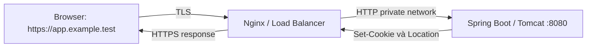

# Kiểm thử với container thật cho cookie, HTTPS, proxy và hành vi trình duyệt

> **Phạm vi:** Kiểm thử HTTP trong **Spring Security Servlet** với Java 17+, Spring Boot 3.x, Servlet container thật, cookie phiên, CSRF, HTTPS/TLS, reverse proxy và browser. Mục tiêu là biết khi nào `MockMvc` chưa đủ, cách chạy kiểm thử qua socket HTTP của Tomcat thật, cách xác minh cookie/redirect sau TLS termination và cách kiểm tra các chính sách mà **chỉ trình duyệt thật** mới thực thi. Các ví dụ local dùng tài khoản và chứng chỉ thử nghiệm, không phải cấu hình đưa thẳng vào production.

## 1. Vì sao MockMvc pass mà trình duyệt vẫn không đăng nhập được?

Ứng dụng có thể có test rất xanh:

```java
mockMvc.perform(get("/private").with(user("alice")))
        .andExpect(status().isOk());
```

Thế nhưng browser thật lại gặp:

- Đăng nhập xong quay về login vì cookie `JSESSIONID` không được gửi hoặc bị chặn.
- Redirect sang `http://` dù người dùng truy cập `https://` qua proxy.
- Cookie có `SameSite=None` nhưng không có `Secure` nên bị browser từ chối.
- Form POST trả **403** do CSRF token không khớp với session cookie.
- Cookie được cấp trên một host/path nhưng request kế tiếp lại sang host/path khác.
- Cross-origin `fetch` có cookie trong browser nhưng API không có CORS credentials policy phù hợp.
- Sau login, server đổi session ID (session fixation protection), nhưng proxy/client không lưu cookie mới.
- WebSocket hoặc callback OAuth2 đi qua redirect với scheme/hostname khác dẫn đến mất session hoặc mismatch redirect URI.

Nguyên nhân: `MockMvc` giả lập request/response Servlet và các filter, nhưng **không mở một HTTP socket thật**, không dùng browser cookie jar hay TLS handshake thật; nó không kiểm chứng mọi quy tắc network, proxy, cookie và browser.

**Nguyên tắc:** test ở tầng gần thực tế nhất đối với rủi ro đang kiểm chứng. Unit/MockMvc nhanh để kiểm tra controller/filter/security rules. Test embedded Servlet container để kiểm tra HTTP thực, session và `Set-Cookie`. Test qua reverse proxy để kiểm tra HTTPS termination/forwarded headers. Test browser để kiểm tra cookie policy, navigation, CORS và hành vi do browser thực thi.

## 2. “Container thật” có thể có hai nghĩa

Trong bối cảnh Spring Security Servlet:

1. **Servlet container thật:** Tomcat/Jetty/Undertow đang thực sự nhận request qua cổng HTTP(S). `@SpringBootTest(webEnvironment = RANDOM_PORT)` thường khởi chạy **embedded Tomcat** với network socket thật. Đó là một Servlet container thật, **không phải** `MockHttpServletRequest` của MockMvc.
2. **OS container thật:** ứng dụng chạy trong Docker/Podman/Testcontainers, có thể kèm reverse proxy và mạng container. Đây là cấp độ triển khai khác, hữu ích để kiểm tra host, port, TLS termination và kết nối service. Docker **không bắt buộc** để có Servlet container thật.

Bốn cấp kiểm thử nên phân biệt:

| Cấp | Công cụ ví dụ | Kiểm được gì? | Không tự kiểm được gì? |
| --- | --- | --- | --- |
| Unit / MockMvc | JUnit, `spring-security-test`, `@WebMvcTest` hoặc `@SpringBootTest` + MockMvc | Matcher, filter, CSRF, authentication/authorization giả lập, MVC serialization | TLS handshake, cookie jar của trình duyệt, reverse proxy thật |
| Real HTTP + Servlet container | `@SpringBootTest(RANDOM_PORT)` + `HttpClient`/`TestRestTemplate` | HTTP status, `Set-Cookie`, session rotation, form login, redirect, CSRF trên socket | Browser enforcement, proxy TLS termination nếu chưa dựng |
| App + reverse proxy | Docker Compose, Testcontainers, Nginx/Traefik, TLS | Headers forwarded, HTTPS URL reconstruction, cookie `Secure`, domain/path, redirects | JS navigation, third-party cookie policy của browser |
| End-to-end browser | Playwright hoặc Selenium với Chrome/Firefox/WebKit | Browser cookie store, SameSite, Secure, HttpOnly, CORS, redirects, form, storage | Không thay thế kiểm thử policy riêng hoặc kiểm thử tải |

**Không dùng một test “status 200” để suy ra tất cả các cấp đã đúng.** Khi đưa chứng cứ cho QA, ghi rõ cấp, transport, host/scheme, browser, cookie, proxy topology và kết quả.

## 3. Cần hiểu cookie trước khi kiểm thử Spring Security

### 3.1. Cookie phiên là gì?

Trong ứng dụng Spring Security Servlet dùng session, Servlet container có thể phát một session cookie như:

```http
HTTP/1.1 200 OK
Set-Cookie: JSESSIONID=opaque-session-id; Path=/; HttpOnly; SameSite=Lax
```

Khi browser nhận cookie hợp lệ, nó sẽ gửi lại theo domain/path/scheme/policy:

```http
GET /account HTTP/1.1
Host: app.example.test
Cookie: JSESSIONID=opaque-session-id
```

Session ID là **bearer credential** của phiên. Không log hoặc chèn ID thật vào bài học, screenshot công khai, issue tracker hay analytics. Spring Security quản lý `SecurityContext` theo chiến lược/repository được cấu hình; Servlet session có thể giữ dữ liệu xác thực. Xóa cookie phía browser không đồng nghĩa mọi token hay remote session bị revoke, và xóa local session không tự đăng xuất khỏi IdP.

### 3.2. Thuộc tính cookie có ý nghĩa gì?

| Thuộc tính | Ý nghĩa chính | Điều cần test |
| --- | --- | --- |
| `HttpOnly` | JavaScript không đọc cookie qua `document.cookie`; browser vẫn có thể tự gửi trong HTTP request | Cookie được đặt HttpOnly, app vẫn gửi request authenticated bình thường |
| `Secure` | Browser chỉ gửi qua kênh HTTPS (có khác biệt đặc biệt ở localhost do browser) | Cookie có `Secure` trên HTTPS, không phụ thuộc exception localhost trong production |
| `SameSite=Strict` | Giới hạn gửi cookie trong ngữ cảnh cross-site mạnh hơn | Cross-site navigation/callback có thể cần điều chỉnh UX |
| `SameSite=Lax` | Thường cho phép cookie trong same-site và một số top-level cross-site navigation an toàn; hạn chế request cross-site khác | Form, callback/login redirect, CSRF và external navigation |
| `SameSite=None` | Cho phép sử dụng trong cross-site contexts nếu chính sách browser vẫn cho phép; **cần Secure** | Browser có thể chặn third-party cookies dù `None; Secure` đã đúng |
| `Path` | Giới hạn request path mà cookie được gửi | Có context path, slash và redirect khác nhau không? |
| `Domain` | Phạm vi host/domain của cookie; không khai báo thì thường host-only | App/API ở host khác, sibling subdomain và isolation |
| `Max-Age`/`Expires` | Thời gian sống cookie ở phía client | Cookie persistent hoặc session cookie, cleanup sau logout |
| `__Host-` prefix | Theo browser rule, cookie cần Secure, Path=/ và không có Domain | Dùng khi cần ràng buộc cookie về host; test trình duyệt thực |

**HttpOnly không phải mã hóa**, `Secure` không thay thế CSRF protection, và `SameSite` không thay thế kiểm soát quyền truy cập. HTTPS bảo vệ transport khi xác minh certificate đúng; cookie chỉ là một phần của cơ chế session.

### 3.3. Same-origin khác same-site

- **Origin** là tổ hợp scheme + hostname + port. `https://app.example.com` và `https://api.example.com` khác origin; hai port khác nhau cũng khác origin.
- **Site** thường dựa trên scheme và registrable domain (schemeful same-site). Hai subdomain nêu trên có thể cùng site nhưng khác origin.
- Cookie `SameSite=Lax` có thể vẫn được gửi trong yêu cầu **cross-origin nhưng same-site**, tùy cookie domain/path/credentials và policy browser. Tuy nhiên `fetch` cross-origin vẫn chịu **CORS**.
- `https://app.example.com` và `https://api.other.test` là cross-site; `SameSite=None; Secure` có thể cần nếu thiết kế thực sự đòi gửi cookie cross-site. Browser privacy/third-party cookie restrictions vẫn có thể chặn.
- `http://` và `https://` có thể được xem là khác site theo chính sách schemeful same-site. Không coi “cùng hostname” là đủ khi khác scheme.

**Test bằng domain/topology giống production.** Hành vi đặc biệt của `localhost`, local HTTPS exceptions, browser flags hoặc chế độ bỏ qua certificate errors chỉ dành cho môi trường test.

### 3.4. Session fixation protection và cookie thay đổi sau login

Khi đăng nhập thành công, Spring Security có thể đổi session ID (`changeSessionId` theo cấu hình/container) để giảm nguy cơ session fixation. Vì vậy:

1. Browser có cookie session trước login để chứa CSRF token/state.
2. Sau login có thể nhận `Set-Cookie` với **JSESSIONID mới**.
3. Client phải lưu cookie mới và gửi nó ở request kế tiếp.
4. Chỉ gửi lại cookie cũ hoặc giả định ID không đổi có thể khiến test thất bại dù authentication đúng.

Không assert “session ID phải đúng một chuỗi cố định”. Trong test tích hợp, xác minh hành vi: request sau login được xác thực và logout làm mất quyền. Nếu kiểm thử chính sách session fixation, ghi nhận ID trước/sau qua API test có kiểm soát thay vì in secrets vào log.

## 4. Chuẩn bị ví dụ Spring Boot 3.x dùng Servlet container thật

Mẫu sau dùng **Spring Boot 3.4.x, Java 17, embedded Tomcat** mặc định của `spring-boot-starter-web` và Spring Security form login. Nó đủ để chạy test request qua cổng HTTP thật bằng Java `HttpClient`; không cần browser cho tầng này. Bước HTTPS và reverse proxy sẽ được bổ sung riêng.

### 4.1. Cấu trúc file

```text
real-http-security-demo/
├── settings.gradle
├── build.gradle
└── src/
    ├── main/
    │   ├── java/com/example/realhttp/
    │   │   ├── RealHttpApplication.java
    │   │   ├── SecurityConfig.java
    │   │   └── DemoController.java
    │   └── resources/
    │       ├── application.yml
    │       └── application-https.yml
    └── test/
        └── java/com/example/realhttp/
            └── RealHttpSessionTest.java
```

Các tệp liên quan TLS (`application-https.yml` và keystore) sẽ được tạo ở phần HTTPS. Không để private key production hay password keystore thật trong repository.

### 4.2. Gradle

`settings.gradle`:

```groovy
rootProject.name = 'real-http-security-demo'
```

`build.gradle`:

```groovy
plugins {
    id 'java'
    id 'org.springframework.boot' version '3.4.2'
    id 'io.spring.dependency-management' version '1.1.7'
}

group = 'com.example'
version = '0.0.1-SNAPSHOT'

java {
    toolchain {
        languageVersion = JavaLanguageVersion.of(17)
    }
}

repositories {
    mavenCentral()
}

dependencies {
    implementation 'org.springframework.boot:spring-boot-starter-web'
    implementation 'org.springframework.boot:spring-boot-starter-security'

    testImplementation 'org.springframework.boot:spring-boot-starter-test'
    testImplementation 'org.springframework.security:spring-security-test'
}

tasks.named('test') {
    useJUnitPlatform()
}
```

Dùng dependency management của Boot để tránh trộn các phiên bản Spring Security/Spring MVC không tương thích. Với ứng dụng hiện hữu, không cần sao chép nguyên bản các plugin version nếu dự án đang quản lý bằng một BOM khác.

### 4.3. Application class

`src/main/java/com/example/realhttp/RealHttpApplication.java`:

```java
package com.example.realhttp;

import org.springframework.boot.SpringApplication;
import org.springframework.boot.autoconfigure.SpringBootApplication;

@SpringBootApplication
public class RealHttpApplication {
    public static void main(String[] args) {
        SpringApplication.run(RealHttpApplication.class, args);
    }
}
```

### 4.4. SecurityConfig với form login và session

`src/main/java/com/example/realhttp/SecurityConfig.java`:

```java
package com.example.realhttp;

import org.springframework.context.annotation.Bean;
import org.springframework.context.annotation.Configuration;
import org.springframework.security.config.Customizer;
import org.springframework.security.config.annotation.web.builders.HttpSecurity;
import org.springframework.security.core.userdetails.User;
import org.springframework.security.core.userdetails.UserDetailsService;
import org.springframework.security.crypto.PasswordEncoder;
import org.springframework.security.crypto.factory.PasswordEncoderFactories;
import org.springframework.security.provisioning.InMemoryUserDetailsManager;
import org.springframework.security.web.SecurityFilterChain;

@Configuration
public class SecurityConfig {

    @Bean
    PasswordEncoder passwordEncoder() {
        return PasswordEncoderFactories.createDelegatingPasswordEncoder();
    }

    @Bean
    UserDetailsService users(PasswordEncoder encoder) {
        return new InMemoryUserDetailsManager(
                User.withUsername("alice")
                        .password(encoder.encode("alice-pass"))
                        .roles("USER")
                        .build()
        );
    }

    @Bean
    SecurityFilterChain securityFilterChain(HttpSecurity http)
            throws Exception {
        return http
                .authorizeHttpRequests(auth -> auth
                        .requestMatchers("/").permitAll()
                        .anyRequest().authenticated()
                )
                .formLogin(Customizer.withDefaults())
                .build();
    }
}
```

Giải thích:

- `anyRequest().authenticated()` bảo vệ `/account` và `POST /settings`, nhưng trang `/` công khai.
- `formLogin()` bật trang login mặc định `GET /login` và xử lý form `POST /login` theo cơ chế Spring Security.
- CSRF protection **không bị tắt**. Khi browser render form login mặc định, một hidden field `_csrf` được dùng cho POST; thiếu token có thể trả HTTP 403.
- Tài khoản trong memory chỉ dùng test. Trong production cần user store, quản lý password, khóa user, session policy và audit phù hợp.
- Không dùng `csrf.disable()` để làm integration test dễ qua. Test cần phản ánh đúng bảo vệ production.

### 4.5. Controller

`src/main/java/com/example/realhttp/DemoController.java`:

```java
package com.example.realhttp;

import java.util.Map;
import org.springframework.security.core.Authentication;
import org.springframework.web.bind.annotation.GetMapping;
import org.springframework.web.bind.annotation.PostMapping;
import org.springframework.web.bind.annotation.RestController;

@RestController
public class DemoController {

    @GetMapping("/")
    public Map<String, String> home() {
        return Map.of("message", "public");
    }

    @GetMapping("/account")
    public Map<String, String> account(Authentication auth) {
        return Map.of("user", auth.getName());
    }

    @PostMapping("/settings")
    public Map<String, Boolean> settings() {
        return Map.of("accepted", true);
    }
}
```

`/settings` cố tình không ghi DB để test CSRF đơn giản; production mutation cần thêm authorization, validation và transaction. Với request có authentication hợp lệ và CSRF token đúng, controller có thể trả `{"accepted":true}`. Với cùng session nhưng thiếu CSRF token, `CsrfFilter` có thể chặn bằng 403 trước khi body chạy.

### 4.6. application.yml cho local HTTP

`src/main/resources/application.yml`:

```yaml
server:
  port: 8080
  servlet:
    session:
      cookie:
        name: JSESSIONID
        http-only: true
        same-site: lax
        secure: false
```

Đây là profile **local HTTP test**. Giá trị `secure: false` không phải khuyến nghị production: khi phục vụ qua HTTPS, phải bảo đảm cookie `Secure`. Với TLS trực tiếp hoặc proxy TLS termination, dùng cấu hình `secure: true` và kiểm tra header `Set-Cookie` thực tế ở browser.

## 5. Integration test qua cổng HTTP thật bằng Java 17 HttpClient

`@SpringBootTest(webEnvironment = SpringBootTest.WebEnvironment.RANDOM_PORT)` khởi động một Servlet container thực, gán port khả dụng và nhận HTTP requests qua network socket. Khác `MockMvc`, test sau dùng `java.net.http.HttpClient`, một `CookieManager` và session cookie thực sự được server phát.

### 5.1. Test class có thể chạy bằng Gradle

Tệp `src/test/java/com/example/realhttp/RealHttpSessionTest.java`:

```java
package com.example.realhttp;

import java.net.CookieManager;
import java.net.CookiePolicy;
import java.net.URI;
import java.net.URLEncoder;
import java.net.http.HttpClient;
import java.net.http.HttpRequest;
import java.net.http.HttpResponse;
import java.nio.charset.StandardCharsets;
import java.util.List;
import java.util.regex.Matcher;
import java.util.regex.Pattern;

import org.junit.jupiter.api.Test;
import org.springframework.beans.factory.annotation.Value;
import org.springframework.boot.test.context.SpringBootTest;
import org.springframework.boot.test.web.server.LocalServerPort;

import static org.assertj.core.api.Assertions.assertThat;

@SpringBootTest(webEnvironment = SpringBootTest.WebEnvironment.RANDOM_PORT)
class RealHttpSessionTest {

    @LocalServerPort
    int port;

    private String url(String path) {
        return "http://localhost:" + port + path;
    }

    private HttpClient clientWithCookies() {
        CookieManager cookies =
                new CookieManager(null, CookiePolicy.ACCEPT_ALL);
        return HttpClient.newBuilder()
                .cookieHandler(cookies)
                .followRedirects(HttpClient.Redirect.NEVER)
                .build();
    }

    private HttpResponse<String> get(HttpClient client, String path)
            throws Exception {
        HttpRequest request = HttpRequest.newBuilder(
                        URI.create(url(path)))
                .GET()
                .build();
        return client.send(
                request, HttpResponse.BodyHandlers.ofString());
    }

    private String csrfFromLoginHtml(String html) {
        Matcher inputs = Pattern.compile(
                "<input\\b[^>]*>", Pattern.CASE_INSENSITIVE)
                .matcher(html);

        while (inputs.find()) {
            String tag = inputs.group();
            if (tag.contains("name=\"_csrf\"")) {
                Matcher value = Pattern.compile(
                        "value=\"([^\"]+)\"").matcher(tag);
                if (value.find()) {
                    return value.group(1);
                }
            }
        }
        throw new IllegalStateException(
                "CSRF field missing from generated login form");
    }

    @Test
    void formLoginCreatesUsableSessionCookie() throws Exception {
        HttpClient browserLikeClient = clientWithCookies();

        // GET login page: server cung cấp form và CSRF token.
        HttpResponse<String> page =
                get(browserLikeClient, "/login");
        assertThat(page.statusCode()).isEqualTo(200);

        String csrf = csrfFromLoginHtml(page.body());

        // Kiểm tra header Set-Cookie thật, không chỉ cookie object.
        List<String> cookies =
                page.headers().allValues("set-cookie");
        assertThat(String.join(";", cookies))
                .containsIgnoringCase("httponly")
                .containsIgnoringCase("samesite=lax");

        String form = "username=alice"
                + "&password=alice-pass"
                + "&_csrf=" + URLEncoder.encode(
                        csrf, StandardCharsets.UTF_8);

        HttpRequest postLogin = HttpRequest.newBuilder(
                        URI.create(url("/login")))
                .header("Content-Type",
                        "application/x-www-form-urlencoded")
                .POST(HttpRequest.BodyPublishers.ofString(form))
                .build();

        HttpResponse<String> login = browserLikeClient.send(
                postLogin,
                HttpResponse.BodyHandlers.ofString());

        // Form login success redirect (mặc định thường 302).
        assertThat(login.statusCode()).isEqualTo(302);

        // CookieManager gửi session cookie mới trong request kế tiếp.
        HttpResponse<String> account =
                get(browserLikeClient, "/account");
        assertThat(account.statusCode()).isEqualTo(200);
        assertThat(account.body()).contains("\"user\":\"alice\"");
    }

    @Test
    void anotherClientWithoutCookieIsNotLoggedIn() throws Exception {
        HttpClient anonymous = clientWithCookies();

        HttpResponse<String> response = get(anonymous, "/account");
        assertThat(response.statusCode()).isEqualTo(302);
        assertThat(response.headers()
                .firstValue("location").orElse(""))
                .contains("/login");
    }

    @Test
    void loginPostWithoutCsrfIsRejected() throws Exception {
        HttpClient client = clientWithCookies();

        HttpRequest post = HttpRequest.newBuilder(
                        URI.create(url("/login")))
                .header("Content-Type",
                        "application/x-www-form-urlencoded")
                .POST(HttpRequest.BodyPublishers.ofString(
                        "username=alice&password=alice-pass"))
                .build();

        HttpResponse<String> response = client.send(
                post, HttpResponse.BodyHandlers.ofString());
        assertThat(response.statusCode()).isEqualTo(403);
    }
}
```

**Lưu ý về HTML parser:** test đọc token từ form login mặc định, phù hợp để minh họa lớp HTTP trong cấu hình này. Nếu Spring Security thay đổi cấu trúc trang login ở phiên bản khác, test có thể cần một parser HTML phù hợp hoặc endpoint cung cấp CSRF token theo hợp đồng app; **không bỏ CSRF** để khiến test xanh. Nếu custom login page, assert token và submit theo form của bạn.

**Lưu ý về request body:** `HttpClient` trong ví dụ dùng `CookieManager` nên cookie từ `GET /login` (và `Set-Cookie` sau login) được gửi trong request tiếp theo. Một script `curl` không có `-b/-c` hoặc hai client không dùng chung cookie store sẽ mô phỏng **hai phiên khác nhau**, không phải bug authentication.

### 5.2. Bằng chứng mà test thực sự cung cấp

- Một instance **Servlet container đang lắng nghe trên cổng thật**, không phải request mô phỏng.
- `Set-Cookie` được phát và Java HTTP client lưu/gửi lại; session sau login có thể dùng.
- Form login cần CSRF token hợp lệ; thiếu token bị từ chối.
- Client không giữ cookie phải đăng nhập lại.
- HTTP status và redirect có thể được kiểm tra từ dữ liệu protocol.

**Không được suy ra** browser đã chấp nhận cookie trên HTTPS hay third-party context, vì `java.net.CookieManager` **không triển khai toàn bộ cookie/permission model của Chrome/Firefox/Safari**. Header `Set-Cookie` đúng là điều kiện cần, không phải bảo đảm browser sẽ lưu/gửi.

### 5.3. Chạy test

Trong dự án có Gradle Wrapper và JDK 17:

```bash
# Linux/macOS
./gradlew test

# Windows PowerShell
.\gradlew.bat test
```

Kỳ vọng ba test pass khi cấu hình và dependency đúng. Đây là **kết quả thiết kế** chứ không phải tuyên bố đã chạy trong máy người học. Log Gradle và thời gian chạy không cố định; thông số port là random, lấy từ `@LocalServerPort` thay vì hardcode `8080` vào test.

### 5.4. Vì sao MockMvc không thay thế test này?

`MockMvc` rất tốt cho kiểm tra `SecurityFilterChain`, session mocks, CSRF và MVC dispatch mà không tốn overhead mở socket. Nhưng nó không thực hiện **TLS handshake thật**, không đi qua proxy hoặc kiểm tra cookie jar ngoài Servlet mock. Nếu test dùng `with(user("alice"))`, nó cũng không chứng minh flow login/cookie đúng. Nên giữ cả hai tầng thay vì bỏ MockMvc.

## 6. Kiểm thử HTTPS/TLS trực tiếp trên embedded Tomcat

Để kiểm chứng TLS thực, có thể bật HTTPS trực tiếp trên Tomcat của Spring Boot với keystore dành cho **local test**. Không kiểm tra browser behavior chỉ bằng việc thêm `Secure` vào string; cần có HTTPS connection thật.

### 6.1. Tạo PKCS12 keystore thử nghiệm

Trong dự án, chạy:

```bash
keytool -genkeypair \
  -alias localhost-test \
  -keyalg RSA -keysize 2048 \
  -storetype PKCS12 \
  -keystore src/main/resources/localhost-test.p12 \
  -storepass changeit -keypass changeit \
  -validity 7 \
  -dname "CN=localhost, OU=LocalTest, O=Example, L=Test, ST=Test, C=VN" \
  -ext "SAN=dns:localhost,ip:127.0.0.1"
```

Đây là private key/certificate **tự ký chỉ dùng ở local**. Không commit key thật, không chia sẻ keystore/password. Nếu certificate được cài ở môi trường thật, dùng CA/truststore phù hợp và chính sách rotation. Trên Windows, dùng command `keytool` tương ứng trong terminal và điều chỉnh ký hiệu nối dòng cho PowerShell; không copy dấu `\` của shell POSIX làm toán tử PowerShell.

### 6.2. Profile HTTPS riêng

Tệp `src/main/resources/application-https.yml`:

```yaml
server:
  port: 8443
  ssl:
    enabled: true
    key-store: classpath:localhost-test.p12
    key-store-type: PKCS12
    key-store-password: ${LOCAL_SSL_PASSWORD}
    key-alias: localhost-test
  servlet:
    session:
      cookie:
        secure: true
        http-only: true
        same-site: lax
```

Khởi chạy với `LOCAL_SSL_PASSWORD=changeit` **chỉ trong local test**, tương ứng lệnh keytool. Trong production secret phải được quản lý ngoài source. Kích hoạt:

```bash
./gradlew bootRun --args='--spring.profiles.active=https'
```

Thử bằng CLI:

```bash
# -k chỉ để test chứng chỉ tự ký, không dùng -k production
curl -k -i https://localhost:8443/login
```

Quan sát:

- TLS handshake diễn ra với certificate chứa SAN cho `localhost`.
- `Set-Cookie` chứa `HttpOnly`, `SameSite=Lax` và **`Secure`** khi session được tạo.
- Sau POST login với cookie/CSRF phù hợp, session vẫn hoạt động trên HTTPS.
- `Location` của redirect dùng HTTPS/host/port đúng nếu Spring nhận biết request công khai.

**Không tuyên bố đã test TLS nếu chỉ gọi `http://localhost:8080` với cookie `Secure` trong header.** Phải mở kết nối HTTPS thực. `curl -k` bỏ kiểm tra certificate để gỡ vướng chứng chỉ tự ký; nó **không chứng minh chain-of-trust hợp lệ**. Muốn test certificate verification, sử dụng CA tin cậy hoặc cung cấp trust anchor đúng cho client và chạy không có `-k`.

### 6.3. Các ca TLS cần test thêm

| Tình huống | Kỳ vọng |
| --- | --- |
| Truy cập HTTPS với certificate hợp lệ và hostname đúng | TLS thành công, app phục vụ request |
| Certificate sai hostname/hết hạn/không tin cậy | Browser/client chuẩn từ chối hoặc cảnh báo; test không được bỏ qua |
| Cookie `Secure` sau login HTTPS | Browser lưu và gửi trên kết nối HTTPS hợp lệ |
| HTTP thường tới một cổng chỉ HTTPS | Lỗi kết nối/protocol, không phải status login |
| HTTP → HTTPS redirect ở edge | Không đưa credential vào HTTP; chính sách redirect/HSTS phù hợp |
| TLS 1.0/cipher yếu | Không được bật theo security baseline |
| HSTS trên host có HTTPS chuẩn | Header `Strict-Transport-Security` phù hợp scope/policy, không bật bừa trên domain test dùng chung |

Trong ứng dụng production, HTTPS thường kết thúc tại load balancer/reverse proxy chứ không ở embedded Tomcat. Khi đó backend có thể nhận HTTP từ mạng nội bộ, nhưng **browser vẫn phải thấy HTTPS và cookie Secure**.

## 7. Kiểm thử reverse proxy: vấn đề “ngoài HTTPS, trong HTTP”

Sơ đồ điển hình:



Trên đường từ proxy vào app, request có thể là HTTP thuần. Nếu app lấy scheme, host, port từ kết nối backend mà **không biết external request**, nó có thể tạo:

```http
Location: http://app:8080/login
```

Thay vì external URL mong muốn:

```http
Location: https://app.example.test/login
```

Các hệ quả:

- Browser redirect sang HTTP hoặc hostname nội bộ không truy cập được.
- OAuth2/OIDC redirect URI không khớp đăng ký.
- Cookie `Secure` không được set như mong muốn nếu cấu hình dựa trên backend scheme.
- Callback login/CSRF/session có thể lỗi do host/scheme không nhất quán.
- HTTPS trang cha gọi HTTP API gây mixed content.

### 7.1. Forwarded headers và trust boundary

Reverse proxy thường báo cho app biết scheme/host công khai qua:

```http
X-Forwarded-Proto: https
X-Forwarded-Host: app.example.test
X-Forwarded-Port: 443
X-Forwarded-For: client-ip
```

Một số hệ thống dùng header chuẩn `Forwarded`. **Chỉ tin các header này khi request thật sự đi qua reverse proxy đáng tin.** Attacker có thể gửi `X-Forwarded-Host` giả nếu app public trực tiếp hoặc proxy chuyển tiếp raw user-supplied values, dẫn tới open redirect/host header injection hoặc sai callback URL.

Spring Boot có tùy chọn `server.forward-headers-strategy` với các giá trị như `none`, `native` hoặc `framework` tùy stack/container. Với `framework`, Spring có thể sử dụng cơ chế xử lý forwarded headers như `ForwardedHeaderFilter`. Cấu hình cụ thể phải đi cùng **network boundary** và proxy reset/sanitize headers.

### 7.2. Docker Compose: app phía sau Nginx HTTPS

Phần này là **môi trường test riêng**, khác với profile TLS trực tiếp trên Tomcat. App chạy HTTP nội bộ; proxy phục vụ `https://localhost:8443` và gắn headers forwarded đã kiểm soát.

Sau `./gradlew bootJar`, tạo `Dockerfile`:

```dockerfile
FROM eclipse-temurin:17-jre
WORKDIR /app
COPY build/libs/real-http-security-demo-0.0.1-SNAPSHOT.jar app.jar
EXPOSE 8080
ENTRYPOINT ["java", "-jar", "/app/app.jar"]
```

Tệp `compose.yml`:

```yaml
services:
  app:
    build: .
    environment:
      SERVER_FORWARD_HEADERS_STRATEGY: framework
      SERVER_SERVLET_SESSION_COOKIE_SECURE: "true"
    expose:
      - "8080"

  nginx:
    image: nginx:1.27-alpine
    depends_on:
      - app
    ports:
      - "8443:443"
    volumes:
      - ./nginx.conf:/etc/nginx/conf.d/default.conf:ro
      - ./tls:/etc/nginx/tls:ro
```

Tệp `nginx.conf`, **chỉ dành cho local test hostname localhost, external port 8443**:

```nginx
server {
    listen 443 ssl;
    server_name localhost;

    ssl_certificate /etc/nginx/tls/localhost.crt;
    ssl_certificate_key /etc/nginx/tls/localhost.key;

    location / {
        proxy_pass http://app:8080;
        proxy_set_header Host localhost:8443;
        proxy_set_header X-Forwarded-Host localhost:8443;
        proxy_set_header X-Forwarded-Proto https;
        proxy_set_header X-Forwarded-Port 8443;
        proxy_set_header X-Forwarded-For $remote_addr;
        proxy_set_header Forwarded "";
    }
}
```

Giải thích:

- `app` chỉ được `expose` trong mạng Compose, không publish port backend cho browser ngoài host. Edge thực tế còn cần firewall/network policy.
- Nginx là điểm TLS termination. Dòng `X-Forwarded-Proto https` và `X-Forwarded-Port 8443` mô tả đúng URL bên ngoài của **bộ demo**.
- `Host`/`X-Forwarded-Host` được đặt giá trị cố định đã biết, không truyền nguyên một host do client tùy ý khai báo. Production phải dùng allowlist host và cấu hình port/domain tương ứng.
- `Forwarded ""` giúp không chuyển tiếp một header `Forwarded` không tin cậy từ client vào ứng dụng trong demo; proxy edge còn phải scrub các biến thể forwarded khác theo topology.
- `SERVER_FORWARD_HEADERS_STRATEGY=framework` giúp Spring diễn giải request qua proxy, **nhưng chỉ an toàn khi app không nhận các forwarded headers không đáng tin từ Internet**.
- `SERVER_SERVLET_SESSION_COOKIE_SECURE=true` buộc session cookie có `Secure` dù Tomcat nhận HTTP từ proxy. Không dùng `secure=false` chỉ vì backend hop là HTTP.

Tạo certificate/self-signed key cho Nginx bằng OpenSSL local:

```bash
mkdir -p tls
openssl req -x509 -nodes -newkey rsa:2048 \
  -keyout tls/localhost.key \
  -out tls/localhost.crt \
  -days 7 -subj "/CN=localhost" \
  -addext "subjectAltName=DNS:localhost,IP:127.0.0.1"
```

Đây là **test private key**, không commit vào Git hoặc chia sẻ. Sau đó:

```bash
./gradlew bootJar
docker compose up --build
```

Thử:

```bash
# -k chỉ để kiểm tra self-signed local; không dùng để xác nhận CA trust
curl -k -i https://localhost:8443/login

# Kiểm tra redirect ở endpoint yêu cầu authentication
curl -k -i https://localhost:8443/account
```

Quan sát `Set-Cookie`, `Location` và URL browser. `Location` cần dùng external scheme/host/port. **Nếu app trả về localhost:8080 hoặc http://app:8080 thì test proxy forwarding chưa đúng**, kể cả TLS ở Nginx đã thành công.

### 7.3. Vì sao không gửi X-Forwarded-Proto: https trực tiếp rồi gọi là integration test?

Một test inject header `X-Forwarded-Proto` vào MockMvc có thể xác minh logic header processing, nhưng chưa chứng minh:

- Nginx thật set/reset header đúng.
- Kết nối browser–proxy có TLS và certificate hợp lệ.
- Backend không bị truy cập trực tiếp với forged headers.
- Port/host/redirect khớp topology production.
- Cookie Secure/Domain/Path được trình duyệt chấp nhận.

Test header injection là **unit/integration component test**, còn bài này yêu cầu thêm **real proxy + browser path** cho các vấn đề liên quan hệ thống.

## 8. Kiểm thử hành vi trình duyệt thật bằng Playwright

Java `HttpClient` có cookie jar nhưng không mô phỏng đầy đủ SameSite/third-party restrictions. Để xác minh browser lưu/gửi cookie, hãy dùng **Chrome/Chromium, Firefox, WebKit** qua một công cụ end-to-end như Playwright và môi trường HTTPS tương tự production.

### 8.1. Thiết lập Playwright độc lập

Trong một thư mục test riêng (không thay đổi mã Java demo):

```bash
npm init -y
npm install --save-dev @playwright/test
npx playwright install chromium
```

Tạo tệp `tests/session.spec.ts`:

```typescript
import { test, expect } from '@playwright/test';

const origin = 'https://localhost:8443';

// Chỉ bỏ qua chứng chỉ self-signed trong LOCAL TEST.
// Ở CI/prod-like environment dùng certificate được tin cậy.
test.use({ ignoreHTTPSErrors: true });

test('login qua browser và cookie có flags đúng', async ({
  page, context
}) => {
  await page.goto(origin + '/login');

  await page.locator('input[name="username"]').fill('alice');
  await page.locator('input[name="password"]').fill('alice-pass');
  await page.locator('button[type="submit"]').click();

  await page.goto(origin + '/account');
  await expect(page.locator('body')).toContainText('"user":"alice"');

  const cookies = await context.cookies();
  const session = cookies.find(c => c.name === 'JSESSIONID');

  expect(session).toBeDefined();
  expect(session?.httpOnly).toBe(true);
  expect(session?.secure).toBe(true);
  expect(session?.sameSite).toBe('Lax');
});

test('context mới chưa có session của context cũ', async ({browser}) => {
  const other = await browser.newContext({
    ignoreHTTPSErrors: true
  });

  const page = await other.newPage();
  await page.goto(origin + '/account');
  await expect(page).toHaveURL(/\/login(?:\?.*)?$/);
  await other.close();
});
```

Chạy:

```bash
npx playwright test tests/session.spec.ts --project=chromium
```

Nếu chưa có `playwright.config.ts` định nghĩa project tên `chromium`, bỏ `--project=chromium`:

```bash
npx playwright test tests/session.spec.ts
```

**Cảnh báo test setup:** không chạy test với thông tin user thật hay credential production. `ignoreHTTPSErrors: true` chỉ dùng cho chứng chỉ tự ký trong local test; nếu bật ở mọi CI, bạn có thể bỏ sót lỗi certificate, hostname mismatch hoặc chain-of-trust. Sau đó cần một lần kiểm thử browser với TLS certificate **được tin cậy** mà không ignore errors.

### 8.2. Những điều cần xem trong DevTools

Trong Chrome/Edge DevTools:

1. **Network → GET /login:** response có `Set-Cookie` không? Thuộc tính `Path`, `Secure`, `HttpOnly`, `SameSite` là gì?
2. **Application/Storage → Cookies:** browser **có lưu cookie** không? Nếu không, xem tab Issues/blocked reason.
3. **Network → POST /login:** request có cookie phiên và field `_csrf` đúng không? Response redirect hoặc lỗi?
4. **Network → GET /account:** cookie mới sau login có được gửi không? Response từ host/scheme nào?
5. **Console/Issues:** có mixed content, CORS failure, cookie rejection hoặc TLS warning?
6. **Network → redirect chain:** Location có đổi `https` sang `http`, đổi port hay hostname không?
7. **Preserve log:** bật để xem đủ request qua nhiều redirects; tránh screenshot lộ session IDs/token thật.

**Lưu ý:** `document.cookie` **không hiển thị HttpOnly cookie**, nhưng cookie vẫn có thể được browser tự gửi. Vì vậy `document.cookie` rỗng không chứng minh session cookie không tồn tại; cần xem Storage/Network hoặc Playwright `context.cookies()`.

### 8.3. Khác biệt giữa form submit và fetch API

Với form login truyền thống, browser quản lý cookie/redirect trong navigation. Với cross-origin `fetch`, có thêm điều kiện:

```javascript
const response = await fetch('https://api.example.test/account', {
  method: 'GET',
  credentials: 'include'
});
```

Điều này **chưa đủ** để thành công:

- API cần CORS allowlist origin cụ thể, không phải `Access-Control-Allow-Origin: *` cùng credentials.
- Nếu cho phép credentials, CORS response phải có policy tương ứng (ví dụ `Access-Control-Allow-Credentials: true`) và origin được chọn phù hợp.
- Browser còn kiểm tra cookie Domain/Path/SameSite/Secure và third-party tracking restrictions.
- CSRF protection vẫn cần cho request thay đổi trạng thái.
- Cross-origin **không đồng nghĩa cross-site**; dùng domain mô phỏng production để kiểm tra cả hai.

**Không nới lỏng CORS và SameSite toàn hệ thống chỉ để browser test pass.** Cần xác định kiến trúc thực sự cần cross-site cookie hay có thể dùng cùng origin/first-party routing.

## 9. HTTPS, cookie và proxy: ma trận test nên có trong CI

| Ca thử | Lớp kiểm thử phù hợp | Kỳ vọng / dấu hiệu |
| --- | --- | --- |
| GET `/account` khi chưa login | Real HTTP `@SpringBootTest` | 302 đến login trong form-login demo |
| GET login và gửi POST với CSRF + session cookie | Real HTTP `HttpClient` | 302 success, sau đó account 200 |
| POST login thiếu CSRF | Real HTTP hoặc MockMvc | 403, không tạo authenticated session |
| Login với client không lưu cookie | Real HTTP | Request tiếp theo chưa được login |
| Cookie `HttpOnly` | Real HTTP kiểm header + browser | JS không đọc được cookie, browser vẫn gửi |
| Cookie `Secure` trên HTTPS | Real TLS + browser | Cookie chỉ được gửi qua HTTPS theo policy |
| Cookie `SameSite=Lax` | Browser với navigation/cross-site thật | Đúng hành vi Lax; không chỉ assert string |
| Cookie `SameSite=None; Secure` | Browser trong cross-site context thực | Browser có thể chấp nhận hoặc chặn theo privacy policy; theo dõi lý do |
| Session ID đổi sau login | Real HTTP có cookie jar | Phiên mới hoạt động; kiểm tra rotation nếu policy yêu cầu |
| Logout POST + CSRF | Real HTTP/browser | Session vô hiệu và request sau logout bị yêu cầu login |
| Redirect qua Nginx TLS | Real proxy + browser/curl | `Location` dùng scheme/host/port external |
| Proxy thiếu forwarded headers | Real proxy test âm tính | Phát hiện URL `http://app:8080`/sai host |
| Header spoofing | Test security/network boundary | App không tin header không được proxy xác minh |
| Certificate hostname sai/hết hạn | Browser/HTTP client không ignore TLS errors | Handshake bị từ chối hoặc cảnh báo |
| HSTS | Real HTTPS/browser | Policy phù hợp, không gây lỗi local domain shared |
| OAuth2/OIDC callback trên HTTPS | Browser + external/mock IdP phù hợp | Redirect URI khớp, state/session cookie tồn tại |
| Cookie có context path | Real HTTP/browser | Cookie Path và redirect giữ đúng base path |
| Hai app ở hai subdomains | Browser real origins | Không rò cookie ngoài phạm vi; CORS/SameSite đúng |
| Browser back/forward/cache sau logout | Browser | Không hiển thị dữ liệu nhạy cảm không được phép từ cache |

Không nhất thiết phải thực hiện mọi ca trong một lần chạy unit tests. Có thể chia nhóm: PR nhanh, CI integration với Docker, nightly cross-browser và pre-release environment thật. Nhưng **trường hợp có rủi ro cụ thể phải có test ở đúng lớp**.

## 10. Xử lý các tình huống thường gây “đăng nhập lặp vô hạn”

### 10.1. Response có Set-Cookie nhưng request sau không gửi cookie

Kiểm tra theo thứ tự:

1. Browser có **chấp nhận lưu** cookie không (Issues/Storage)?
2. Request sau có cùng scheme/host/path mà cookie áp dụng không?
3. Cookie có `Secure` nhưng request lại HTTP không?
4. `SameSite` có ngăn cookie trong cross-site context không?
5. Browser có chặn third-party cookie không?
6. Cookie `Domain` có sai hostname hoặc được phát cho domain không hợp lệ không?
7. Có thay session ID sau login nhưng client vẫn gửi ID cũ?
8. Có proxy rewrite `Set-Cookie` hoặc `Path` ngoài ý muốn?
9. Có nhiều backend nodes không chia sẻ session store hoặc sticky/session strategy không phù hợp?

Không vội tắt `HttpOnly`, `Secure`, `SameSite` hoặc CSRF để “chữa” lỗi. Tìm thuộc tính/proxy topology và thiết kế session đúng trước.

### 10.2. Redirect bị trả thành HTTP phía sau HTTPS

Nguyên nhân có thể là app không nhận forwarded scheme hoặc proxy gửi/scrub header sai. Kiểm tra:

- Client truy cập URL public nào?
- TLS thực sự terminate ở đâu?
- Nginx/ingress đã ghi `X-Forwarded-Proto=https`, `X-Forwarded-Host` và port đúng chưa?
- Spring Boot `server.forward-headers-strategy` có tương ứng không?
- Backend có bị public trực tiếp, cho client giả forwarded headers không?
- OAuth2 redirect URI và application base URL có đăng ký đúng không?

**Không giải quyết bằng cách ép toàn bộ redirect URL cố định một cách thiếu kiểm soát**, vì nhiều môi trường/staging/tenant khác nhau có thể cần base URL khác. Với host allowlist và known external URL, cấu hình một nguồn tin cậy duy nhất cho URI generation.

### 10.3. Cross-site login callback bị mất session

Một số login/OAuth2/OIDC flow phụ thuộc browser quay lại từ identity provider. Chính sách `SameSite=Strict` có thể chặn cookie khi redirect cross-site; `Lax` có thể phù hợp với top-level GET callback nhưng không bảo đảm mọi mode như form POST hay iframe. Cần kiểm thử theo **response mode thực tế**, browser và cookie setup.

Nếu callback yêu cầu cross-site POST, có thể cần thiết kế session/state khác hoặc `SameSite=None; Secure` với risk controls, nhưng third-party cookie restrictions và CSRF vẫn áp dụng. Không đơn giản bỏ kiểm tra `state` hoặc CSRF để che lỗi cookie.

### 10.4. 403 trên POST dù GET /account trả 200

GET/POST khác CSRF semantics. Với session cookie auth, Spring Security thường yêu cầu CSRF token cho unsafe methods. Test:

- User đã authenticated và cookie còn hợp lệ?
- Token trong form/header có thuộc cùng session không?
- Token có được rotate/clear sau login/logout không?
- SPA có gửi đúng header hoặc form field theo `CsrfTokenRepository`/request handler đang dùng không?
- Proxy có thay origin/host gây lỗi kiểm tra nguồn không?
- 403 có thực sự từ `CsrfFilter` hay authorization/service policy?

**Không suy ra “thiếu role” từ mọi HTTP 403**. Test tách lỗi CSRF và lỗi authorization để chẩn đoán đúng.

### 10.5. Browser pass trên localhost nhưng fail staging/prod

`localhost` có một số ngoại lệ và cách xử lý khác về secure context, certificate và cookie. Đặc biệt:

- Cookie `Secure` trên HTTP localhost có thể được browser xử lý đặc biệt; không đại diện HTTP public.
- Cross-site/third-party cookie behavior phụ thuộc domain thực và browser privacy settings.
- Port/scheme/host tại staging khác local; proxy có thể tạo redirect sai.
- Local test chỉ một instance; staging dùng nhiều pods, load balancer, session store.
- HSTS, CSP, HTTPS redirect, SameSite và cookie prefix cần kiểm tra trên **hostname/CA thực**.

Tạo test environment có public-like hostname và TLS hợp lệ nếu rủi ro xoay quanh những điều trên.

## 11. Docker/Testcontainers: khi nào cần môi trường tương đương production?

`@SpringBootTest(RANDOM_PORT)` đủ để test Servlet container thật mà không cần Docker. Chỉ thêm Testcontainers/Compose khi muốn kiểm tra những thứ khác biệt ở deployment:

- Nginx/Traefik/Ingress tạo forwarded headers và TLS termination.
- App/backend private network so với frontend exposed port.
- Redis/JDBC session store qua nhiều instances.
- Cookie domain/path khi chạy nhiều hostnames.
- OAuth2/OIDC provider mock, external redirect và callback.
- TLS certificate/key và trust-chain thật.
- Health checks, startup/readiness và failover.

**Testcontainers không tự giải quyết browser:** dù ứng dụng nằm trong Docker, một API client có thể bỏ qua SameSite, cookie third-party policy và JS CORS. Cần **chạy browser engine thật** để kiểm chứng các hành vi đó. Ngược lại, browser E2E không tự đảm bảo unit authorization, CSRF negative tests hay kiểm tra account policy đã đầy đủ.

Đối với CI, làm rõ cách Docker host/port mapping được truyền vào Playwright; không hardcode localhost khi test runner chạy bên trong container khác. Nếu cần HTTPS trust, cấp test CA rõ ràng; chỉ dùng ignore-certificate tùy trường hợp gỡ lỗi local.

### 11.1. Cách chia test theo tốc độ và độ tin cậy

- **PR:** unit, MockMvc, `@SpringBootTest(RANDOM_PORT)` với cookie/session/CSRF. Tập trung các negative cases quan trọng.
- **CI integration:** app thật + proxy thật + TLS thật, kiểm tra `Location`, `Set-Cookie`, forwarded headers, login/session qua proxy.
- **Nightly hoặc pre-release:** browser E2E trên Chromium/Firefox/WebKit, cross-site flows, session expiry, logout, redirect và certificate trust.
- **Staging-like:** domain, path, CDN/ingress, HSTS, OAuth provider, session store, multi-instance; xác nhận hành vi sát production.

Định nghĩa rõ owner môi trường test và bí mật giả; test không tự gửi email/SMS thật, không sử dụng user/credential production và không lưu HAR trace có session token thật ra nơi công khai.

## 12. Test cases cần ưu tiên cho Spring Security Servlet

### 12.1. Authentication và session

- [ ] Anonymous GET protected route bị yêu cầu login bằng entry point đúng.
- [ ] Form login thành công với cookie jar được lưu và CSRF token hợp lệ.
- [ ] Sai password không tạo authenticated session.
- [ ] Session trước/sau login được quản lý đúng, fixation protection không làm mất auth.
- [ ] Hai clients không chia sẻ session ngoài ý muốn.
- [ ] Logout qua POST/CSRF làm session cũ không còn quyền; browser back không lộ nội dung nhạy cảm.
- [ ] Idle timeout và expired session có UX/response phù hợp.
- [ ] Cookie flags `HttpOnly`, `Secure`, `SameSite`, `Path`, `Domain` đúng theo profile.

### 12.2. HTTPS/TLS

- [ ] TLS handshake bằng certificate được tin cậy, hostname match, không dùng `-k` trong test xác minh trust.
- [ ] App/proxy không gửi redirect từ HTTPS quay về HTTP.
- [ ] Cookie Secure trên browser HTTPS; HTTP access không vô tình lộ credentials.
- [ ] HSTS/CSP/mixed-content policy phù hợp host và tính năng.
- [ ] TLS termination và HTTP backend hop được bảo vệ theo network policy.

### 12.3. Reverse proxy và forwarded headers

- [ ] Edge gửi đúng scheme/host/port do nó xác minh, bỏ header spoof từ client.
- [ ] Backend không public trực tiếp; reverse-proxy trust boundary được kiểm soát.
- [ ] `Location` và absolute URL khớp external hostname/port trong tất cả redirects.
- [ ] Cookie Path/Domain không bị rewrite sai; có test context path.
- [ ] Cấu hình forwarded strategy rõ ràng theo Servlet container và app.
- [ ] Multi-instance session store/sticky strategy bảo đảm request sau login đi node khác không mất auth.

### 12.4. Browser, CORS và CSRF

- [ ] Browser lưu và gửi cookie theo đúng SameSite; không dựa vào giả định của Java CookieManager.
- [ ] HttpOnly cookie không đọc được từ JS nhưng request vẫn authenticated.
- [ ] Cross-origin `fetch(credentials:'include')` có CORS allowlist/credentials đúng và cookie hợp lệ.
- [ ] Cross-site navigation/callback hoạt động theo login flow thật.
- [ ] Third-party cookie restrictions được kiểm thử trên các browser đích.
- [ ] POST/PUT/PATCH/DELETE có CSRF token hoặc cơ chế bảo vệ phù hợp; thiếu token bị từ chối.
- [ ] Không vô hiệu hóa TLS/certificate validation hay CSRF chỉ để test pass.
- [ ] Không ghi session ID, raw OAuth token, cookie hoặc credential thật trong CI logs/trace.

## 13. Những hiểu lầm phổ biến

| Hiểu lầm | Thực tế |
| --- | --- |
| “MockMvc pass thì cookie trong browser chắc chắn hoạt động.” | MockMvc không có browser cookie jar/TLS/proxy thực. |
| “@SpringBootTest RANDOM_PORT vẫn là MockMvc.” | RANDOM_PORT chạy embedded Servlet container thật nhận HTTP trên socket. |
| “Docker container là điều kiện bắt buộc để có Servlet container thật.” | Không; embedded Tomcat đang chạy là Servlet container thật. |
| “Header Set-Cookie có SameSite là browser chắc chắn gửi cookie.” | Browser còn xét Secure, origin/site, third-party restrictions và cookie scope. |
| “HttpOnly ngăn browser gửi cookie.” | HttpOnly ngăn JS đọc; browser vẫn tự gửi theo policy. |
| “Secure đã bảo vệ cookie khỏi CSRF.” | Secure chỉ giới hạn transport HTTPS; CSRF protection vẫn cần. |
| “SameSite và CORS là một.” | SameSite điều khiển gửi cookie theo site context, CORS điều khiển JS cross-origin access. |
| “Dùng cookie SameSite=None luôn sửa được login cross-site.” | Cần Secure, provider/browser policy và third-party restrictions vẫn có thể chặn. |
| “Backend HTTP đằng sau HTTPS proxy thì cookie cũng phải insecure.” | Browser phía ngoài HTTPS; phải set Secure và forwarded headers đúng. |
| “X-Forwarded-Proto cứ client gửi https thì tin.” | Chỉ tin proxy đáng tin đã sanitize headers; tránh header spoofing. |
| “curl -k thành công chứng minh certificate chuẩn.” | -k bỏ xác minh certificate; chỉ kiểm connectivity/TLS encryption thô. |
| “Một 403 sau login chắc chắn thiếu role.” | Có thể do CSRF, origin/cookie/session hoặc authorization rule khác. |
| “Cùng hostname là same-site bất kể scheme.” | Browser hiện đại có schemeful same-site semantics; HTTPS/HTTP khác biệt quan trọng. |
| “Một browser test cho localhost đủ xác nhận production.” | Localhost exceptions và proxy/domain/CA thật có thể khác. |
| “Chỉ test status 200 là đủ.” | Cần test cookie persistence, redirect, session isolation, negative cases và browser enforcement. |

## 14. Câu hỏi tự kiểm tra

**1.** Vì sao test MockMvc có `with(user("alice"))` pass nhưng browser vẫn bị redirect tới login?  
Vì MockMvc đưa authentication trực tiếp vào test context, không chứng minh HTTP login, session cookie, TLS và browser cookie policy hoạt động. Cần test container thật và browser.

**2.** `@SpringBootTest(RANDOM_PORT)` có phải khởi chạy Docker không?  
Không. Nó thường khởi động embedded Tomcat/Servlet container thật trên một HTTP port ngẫu nhiên; Docker/Testcontainers chỉ cần cho topology triển khai khác.

**3.** Cookie có `HttpOnly` thì `document.cookie` không hiện. Có phải cookie đã mất?  
Không. HttpOnly giới hạn JS access; dùng DevTools Network/Storage hoặc Playwright cookie API để xem browser có lưu/gửi không.

**4.** Sau login response trả 302 nhưng request kế tiếp chưa xác thực. Kiểm tra gì?  
Kiểm tra `Set-Cookie` mới, domain/path/SameSite/Secure, cookie jar, session ID rotation, forwarded scheme/host và session store.

**5.** Vì sao backend nhận HTTP vẫn cần `Secure` cookie khi có HTTPS reverse proxy?  
Vì kênh browser → proxy là HTTPS và cookie phiên phải được browser gửi qua HTTPS, không bị hạ cấp chỉ do backend hop HTTP.

**6.** Vì sao không tin `X-Forwarded-Host` từ mọi client?  
Vì attacker có thể giả external host/proto để ảnh hưởng redirect và absolute URL. Chỉ tin thông tin do proxy đáng tin xác minh/reset.

**7.** Dùng `curl -k` có chứng minh hostname/certificate hợp lệ không?  
Không. Nó bỏ xác minh certificate. Cần kiểm thử không có `-k` với trust store/CA đúng để chứng minh trust.

**8.** Tại sao `SameSite=Lax` có thể không giải quyết được fetch từ một site khác?  
Vì request cross-site không nhất thiết thuộc trường hợp Lax cho phép; còn CORS, credentials mode và third-party cookie restrictions.

**9.** HTTP client Java lưu cookie được thì browser chắc chắn cũng lưu?  
Không. Java CookieManager không thể giả lập đầy đủ chính sách browser và third-party cookie restrictions.

**10.** Test nào chứng minh CSRF thực sự được bật?  
Gửi POST thay đổi trạng thái qua session mà thiếu/sai CSRF token phải bị từ chối; với token hợp lệ và quyền đầy đủ thì có thể xử lý thành công.

## 15. Kết luận

Một bài kiểm thử Spring Security Servlet đáng tin phải xác minh **cơ chế** ở đúng lớp:

- **MockMvc** kiểm tra security rules nhanh mà không cần network.
- **Servlet container thật + HTTP client** kiểm tra cookie, session, form login, redirects và CSRF qua request/response thực.
- **HTTPS và reverse proxy thật** kiểm tra TLS termination, forwarded headers, Secure cookie, scheme/host/port và certificate trust.
- **Browser thật** kiểm tra cookie acceptance, SameSite, HttpOnly, cross-site navigation, CORS, third-party policy và các hành vi không thể suy ra từ response header.

**Đừng dừng ở status 200/302.** Hãy nhìn `Set-Cookie`, request `Cookie` kế tiếp, `Location`, TLS/certificate, session state, CSRF token, cookie blocked reason và toàn bộ redirect chain. Chỉ khi test đi qua đường mà người dùng thật sử dụng, bạn mới có bằng chứng vững chắc rằng xác thực qua cookie, HTTPS, proxy và trình duyệt thực sự hoạt động.
