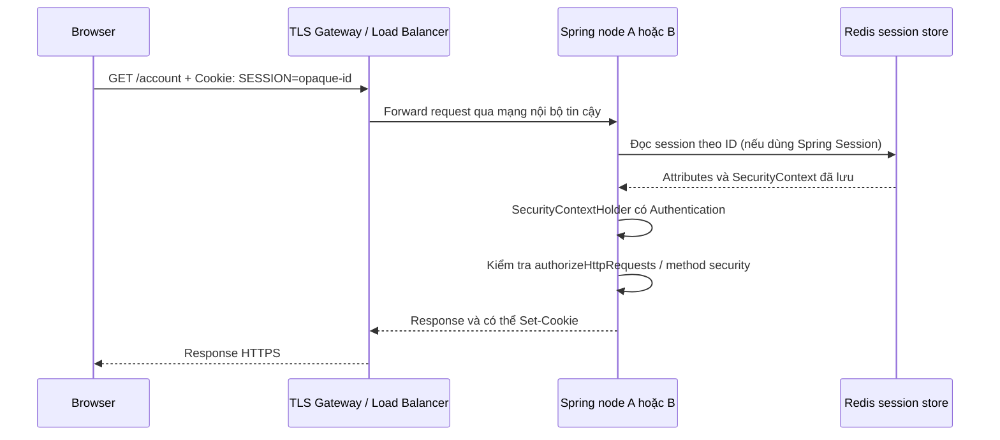

# Cookie an toàn, timeout và kho phiên khi triển khai nhiều nút — Spring Security Servlet

## 1. Mục tiêu và tình huống triển khai

Một ứng dụng **Spring Security Servlet** thường xác thực người dùng bằng form login, SAML2 hoặc OAuth2/OIDC rồi duy trì một phiên HTTP qua cookie. Khi chỉ có một máy, session nằm trong bộ nhớ của servlet container có thể hoạt động tốt; khi mở rộng thành nhiều node/pod sau Load Balancer, phiên có thể bị mất nếu request tiếp theo đi sang node khác. Đồng thời, cookie cấu hình không đúng, thời gian sống quá dài hoặc kho phiên không an toàn có thể dẫn đến chiếm đoạt tài khoản, CSRF và đăng nhập “chập chờn”.

Bài này tập trung vào **Spring Boot 3.x, Spring Security 6.x, Java 17+, Spring MVC/Servlet** và giải quyết ba trụ cột vận hành:

1. **Cookie phiên an toàn:** `Secure`, `HttpOnly`, `SameSite`, `Path`, `Domain`, HTTPS, session ID rotation, CSRF và các cấu hình khi có reverse proxy.
2. **Timeout rõ nghĩa:** idle timeout, session cookie lifetime, absolute timeout, cơ chế invalidation/logout, tác động của remember-me và các phép kiểm thử mốc thời gian.
3. **Kho phiên dùng chung cho nhiều node:** `HttpSession` với Spring Session + Redis, trust boundary, khả năng phục hồi, rollout, metrics, lỗi cache/session và test đa node.

Phân biệt ngay: **cookie chứa một session ID tham chiếu, không phải toàn bộ SecurityContext** trong mô hình server-side session. Browser giữ mã tham chiếu; server tìm dữ liệu phiên để xác định người dùng và SecurityContext tương ứng. Không ghi JWT, mật khẩu hoặc các đối tượng phân quyền tùy ý vào cookie phiên thuần.

## 2. Một request có phiên đã đăng nhập diễn ra như thế nào?



Các lớp cần hiểu:

- **Browser** quyết định gửi cookie theo host, Path, Secure, SameSite và chính sách cookie.
- **Gateway/Ingress** kết thúc hoặc chuyển tiếp TLS và gửi request đến node; nếu chỉ có TLS ngoài gateway, nội bộ phải được bảo vệ theo trust boundary phù hợp.
- **Servlet container + Spring Session** ánh xạ session ID thành dữ liệu phiên và thời hạn, rồi expose API `HttpSession`.
- **Spring Security** đọc/lưu `SecurityContext` qua cơ chế `SecurityContextRepository` phù hợp. Authentication và quyền có thể được đặt trong session; method security dùng thông tin đã xác thực của request hiện tại.
- **Redis hoặc kho phiên tập trung** cung cấp dữ liệu chung cho các node, không phải là chính sách xác thực/phân quyền tự thân.

Nếu node A ghi SecurityContext sau khi đăng nhập nhưng node B không đọc được cùng session, request kế tiếp có thể bị redirect trở lại trang login. Đừng mặc định đó là lỗi mật khẩu: nguyên nhân có thể là cookie, backend Redis, namespace, serialization, TTL hoặc proxy.

## 3. Cookie phiên an toàn: thuộc tính và hiểu lầm phổ biến

Một response minh họa với ứng dụng dùng Spring Session:

```http
HTTP/1.1 302 Found
Set-Cookie: SESSION=example-opaque-session-id; Path=/; Secure; HttpOnly; SameSite=Lax
Location: /account
Cache-Control: no-store
```

Đây là **ví dụ cấu trúc**, không phải cookie thật để sử dụng. Không bao giờ copy một session ID giữa người dùng hoặc đặt session ID cố định.

| Thuộc tính | Ý nghĩa | Điều cần chú ý |
| --- | --- | --- |
| `Secure` | Chỉ gửi cookie trên kết nối HTTPS theo quy tắc browser | Cần HTTPS ở phía browser; proxy TLS termination phải cấu hình đúng |
| `HttpOnly` | JavaScript không đọc trực tiếp cookie qua `document.cookie` | Giảm nguy cơ đánh cắp cookie qua một số XSS, **không** thay bảo vệ XSS |
| `SameSite=Lax` | Giới hạn gửi cookie trong nhiều tình huống cross-site, thường vẫn cho top-level navigation GET | Không thay CSRF token; một số callback POST từ IdP có thể cần chính sách khác |
| `SameSite=Strict` | Hạn chế cross-site mạnh hơn | Dễ làm gián đoạn SSO/redirect và liên kết đến ứng dụng từ site khác |
| `SameSite=None` | Cho phép gửi cookie trong ngữ cảnh cross-site khi browser chấp nhận | Phải kèm `Secure`; vẫn cần CSRF/validation và tính đến chặn third-party cookie |
| `Path=/` | Cookie đi tới các path trên host phù hợp | Không phải ranh giới phân quyền giữa các ứng dụng cùng origin |
| Không đặt `Domain` | Cookie host-only, giới hạn một host chính xác | Ưu tiên hơn Domain rộng nếu không có nhu cầu chia subdomain |
| `Domain=example.test` | Cookie có thể được gửi tới subdomain phù hợp | Phạm vi rộng hơn; tăng nguy cơ từ subdomain yếu hoặc bị chiếm |
| `Max-Age`/`Expires` | Tuổi lưu cookie trong browser | **Không đồng nghĩa** TTL của server-side session |
| Tên `SESSION`/`JSESSIONID` | Tên cookie do Spring Session/container sử dụng | Spring Session Redis thường dùng `SESSION`, container session thường dùng `JSESSIONID`; cần kiểm tra thực tế |

`Secure` và `HttpOnly` không “mã hóa cookie” theo nghĩa dữ liệu trong browser không thể bị lộ. Kẻ tấn công có quyền dùng browser đã đăng nhập vẫn có thể thực hiện hành động nếu ứng dụng không kiểm tra quyền và CSRF; session ID bị đánh cắp từ log, proxy hoặc thiết bị vẫn nguy hiểm trong thời gian còn hiệu lực.

### 3.1. Vì sao không đặt Domain rộng khi không cần?

Với ứng dụng ở `app.example.test`, cookie **host-only** được giới hạn cho host đó. Nếu đặt `Domain=example.test`, cookie có thể được gửi cho nhiều subdomain và một subdomain không an toàn có thể ảnh hưởng đến bảo mật cookie của ứng dụng.

Cookie host-only khác hoàn toàn với **CORS**: CORS điều khiển truy cập response qua JavaScript; nó không phải cơ chế kiểm soát toàn bộ HTTP request và không thể thay `Domain`, `SameSite` hoặc CSRF.

### 3.2. Prefix `__Host-` và `__Secure-`

Browser có hỗ trợ các quy tắc tên cookie:

- `__Secure-`: cookie phải được đặt qua HTTPS với `Secure`.
- `__Host-`: yêu cầu `Secure`, `Path=/` và **không có `Domain`**, nhằm ràng buộc cookie chặt hơn với host.

Nếu muốn dùng `__Host-SESSION`, phải cấu hình **tất cả** các thuộc tính trên, kiểm tra browser và proxy thực, và cập nhật logout cookie deletion cùng tên. Đừng đổi tên cookie giữa hai deployment mà không có rollout và kiểm thử tương thích; người dùng có thể bị yêu cầu đăng nhập lại.

## 4. CSRF, SameSite và phiên được gửi tự động

Ứng dụng dùng cookie session sẽ nhận cookie **tự động** từ browser khi quy tắc cookie cho phép. Một request cross-site có thể lợi dụng phiên có sẵn để thực hiện thay đổi trạng thái nếu server không kiểm tra CSRF.

Vì vậy:

1. Giữ **CSRF protection** của Spring Security cho các thao tác dùng cookie/session. Form POST/PUT/PATCH/DELETE cần xử lý token/biện pháp tương đương theo kiến trúc.
2. Dùng `SameSite=Lax` như một lớp phòng thủ bổ sung; nó **không thay** CSRF token và không phải bảo đảm mọi cross-site request đều vô hại.
3. Không tạo tác vụ thay đổi trạng thái qua GET chỉ để tránh CSRF hoặc vì logout link dễ viết.
4. Với SPA dùng cookie và AJAX, cần thiết kế cách cấp CSRF token cho frontend, gửi token trong header/form và CORS đúng origin; không bật `allowCredentials` cho mọi origin.
5. Với OAuth2 login, callback Authorization Code thông thường là **top-level GET**, thường tương thích `SameSite=Lax`. Với **SAML2 HTTP-POST binding** hoặc OIDC `response_mode=form_post`, callback có thể là **cross-site POST**, khiến `SameSite=Lax` không gửi cookie phiên cần thiết.

Không đổi toàn bộ cookie thành `SameSite=None` chỉ để chữa một lỗi callback trước khi xác minh giao thức, proxy, browser và IdP. Nếu bắt buộc có cross-site POST, dùng `SameSite=None; Secure` cùng CSRF, state/nonce/SAML validation và chính sách trust phù hợp. Một số môi trường browser chặn third-party cookies độc lập với SameSite; cần thử thực tế.

### 4.1. Session cookie so với CSRF token

Session cookie chứng minh browser đang nắm **session ID** hiện tại, nhưng server vẫn cần biết request thay đổi dữ liệu có được khởi tạo hợp lệ bởi ứng dụng hay không. CSRF token là một giá trị/kiểm tra khác và thường có vòng đời riêng.

`HttpOnly` của session cookie ngăn script đọc ID, nhưng script chạy trên origin hợp lệ vẫn có thể gửi authenticated request. Chống XSS, CSRF, CSP, input validation và authorization theo object cần được kết hợp; không có một cờ cookie nào thay được tất cả.

## 5. Session fixation: đổi session ID khi đăng nhập

**Session fixation** xảy ra nếu kẻ tấn công khiến nạn nhân dùng một session ID đã biết trước lúc login, rồi sau login ID đó vẫn được giữ làm credential của phiên đã xác thực.

Spring Security Servlet có **session fixation protection**. Trên Servlet container hiện đại, chiến lược phù hợp thường là `changeSessionId()` khi người dùng được xác thực qua cơ chế login/session. Nó đổi session identifier, vẫn giữ các attribute cần thiết theo hành vi của container và framework.

```java
http.sessionManagement(session ->
    session.sessionFixation(fixation -> fixation.changeSessionId()));
```

Đoạn trên được đặt **bên trong cấu hình `SecurityFilterChain`**, không phải Java program chạy độc lập. Trong Spring Security 6, cách bảo vệ session fixation mặc định phụ thuộc servlet container/cách xác thực và đã có cơ chế an toàn thông thường; cấu hình tường minh giúp diễn đạt chính sách.

**Cần kiểm thử:** ID trước login không được dùng như ID hợp lệ sau login, ID sau login được trả về qua `Set-Cookie` đúng tên/path/domain, và session cũ không còn chứng thực được người dùng. Cũng cần kiểm tra rủi ro khi custom authentication tự sửa `SecurityContextHolder` mà không thực hiện save, session strategy và cleanup theo chuẩn.

Đừng đổi session ID trên **mỗi request** như một thay thế cho bảo vệ session fixation: việc đó tạo tải và race condition khi browser gửi nhiều request đồng thời. Đổi ở ranh giới bảo mật phù hợp như login, và xác định chính sách khi nâng cấp quyền quan trọng.

## 6. Timeout: có ít nhất bốn khái niệm khác nhau

### 6.1. Idle timeout (`maxInactiveInterval`)

Một session thường hết hạn nếu không có hoạt động được nhận diện trong một khoảng thời gian, ví dụ **30 phút không hoạt động**. Servlet `HttpSession.getMaxInactiveInterval()` trả số giây cấu hình cho session (âm có thể mang ý nghĩa không hết hạn tự động theo contract, **không khuyến nghị** cho phiên người dùng).

Với ứng dụng 30 phút idle timeout:

```text
T0 09:00: user login, session active
T1 09:15: request có hoạt động -> tính lại idle window theo cơ chế store
T2 09:40: request -> vẫn có thể hợp lệ nếu idle < 30 phút
T3 10:20: request -> session đã có thể expired nếu không hoạt động từ 09:40
```

**Hoạt động** thường được nhận diện khi session được truy cập qua request/filter; polling, background AJAX, keep-alive hoặc tác vụ định kỳ có thể vô tình kéo dài idle window. Chỉ thay UI timer mà không kiểm tra cookie/session store thực tế dễ gây sai lệch.

### 6.2. Absolute timeout

**Absolute timeout** giới hạn tổng tuổi đời của một phiên tính từ mốc login/creation, ví dụ 8 giờ, **bất kể người dùng vẫn hoạt động**. Không phải cấu hình `maxInactiveInterval=30m` tự áp dụng luôn absolute timeout.

Để có absolute timeout, ứng dụng phải có chính sách riêng: lưu mốc được tin cậy lúc xác thực, kiểm tra trước khi cho phép request/tác vụ và invalidate/session renewal hoặc yêu cầu reauthentication khi vượt giới hạn. Không dùng dữ liệu `lastAccessedTime` để đại diện thời điểm login.

Nếu đã dùng session rotation, quyết định mốc absolute timeout theo **lần xác thực thực sự**, không tự reset cửa sổ 8 giờ chỉ vì session ID được đổi.

### 6.3. Browser cookie lifetime

Một cookie **không có** `Max-Age`/`Expires` thường là session cookie phía browser, có thể bị loại khi browser session kết thúc; một số browser có tính năng restore session nên không thể coi “đóng tab” là logout bảo mật chắc chắn.

Ngược lại, một cookie persistent còn trên browser **không khiến session Redis đã hết hạn sống lại**. Browser có thể vẫn gửi ID nhưng server phải trả về unauthenticated khi session không tồn tại hoặc không còn hợp lệ.

### 6.4. Remember-me và hạn của token

Spring Security **remember-me** là tính năng khác với session HTTP. Khi được bật, một cookie/token nhớ đăng nhập có thể tạo lại Authentication/session mới sau khi session cũ hết hạn, tùy cấu hình. Vì vậy kiểm thử timeout phải xác định rõ remember-me có đang bật hay không; “session hết hạn nhưng vừa refresh đã đăng nhập lại” không nhất thiết là Redis TTL sai.

JWT access token, refresh token, SAML IdP SSO session và OAuth2 authorized-client state cũng có tuổi đời/thu hồi riêng. Logout một HTTP session **không tự thu hồi mọi token hoặc session liên kết**.

## 7. Java 17: mô phỏng idle và absolute timeout bằng thời gian cố định

Chương trình độc lập sau không phụ thuộc Spring, cho thấy hai điều kiện timeout khác nhau. File **`SessionWindowDemo.java`**:

```java
import java.time.Duration;
import java.time.Instant;

public class SessionWindowDemo {

    static boolean expired(
            Instant createdAt,
            Instant lastActiveAt,
            Instant now,
            Duration idleLimit,
            Duration absoluteLimit) {

        boolean idleExpired =
            !now.isBefore(lastActiveAt.plus(idleLimit));
        boolean absoluteExpired =
            !now.isBefore(createdAt.plus(absoluteLimit));

        return idleExpired || absoluteExpired;
    }

    public static void main(String[] args) {
        Instant start = Instant.parse("2026-01-01T00:00:00Z");
        Duration idle = Duration.ofMinutes(30);
        Duration absolute = Duration.ofHours(8);

        System.out.println("active=" + expired(
            start, start.plusSeconds(600), start.plusSeconds(1200),
            idle, absolute));

        System.out.println("idle=" + expired(
            start, start.plusSeconds(600), start.plusSeconds(2460),
            idle, absolute));

        System.out.println("absolute=" + expired(
            start, start.plusSeconds(28200), start.plusSeconds(28800),
            idle, absolute));
    }
}
```

Chạy bằng JDK 17+:

```bash
javac SessionWindowDemo.java
java SessionWindowDemo
```

Stdout **chính xác**:

```text
active=false
idle=true
absolute=true
```

- 20 phút kể từ login, lần hoạt động cuối cách 10 phút → còn active.
- 41 phút kể từ login, lần hoạt động cuối ở phút 10 → idle 31 phút → expired.
- Tại đúng mốc 8 giờ kể từ login → absolute expired dù activity vẫn mới.

**Đây là mô hình thời gian để học, không phải implementation `HttpSession` hoặc Spring Session.** Với hệ thống thật, cần xử lý clock skew, timestamp UTC, concurrency và TTL thực tế tại session repository. `Instant.now()` trong code production phải có `Clock` có thể inject để test mốc thời gian dễ hơn.

## 8. Single-node, sticky sessions và distributed session store

### 8.1. Tại sao cluster nhiều node có vấn đề?

Giả sử `JSESSIONID` được server A tạo và dữ liệu session chỉ nằm trong memory của A:

```text
Browser --LB--> A: login -> tạo JSESSIONID=123 -> SecurityContext lưu A
Browser --LB--> B: GET /account + JSESSIONID=123 -> B không có session
Browser --LB--> A: GET /account + JSESSIONID=123 -> A lại thấy login
```

Triệu chứng: đăng nhập lúc được lúc không, thường phụ thuộc pod/backend. Không có nghĩa request ID được browser đổi mỗi lần; chính **nơi tra cứu session** không nhất quán.

### 8.2. Giải pháp sticky session

Load balancer route cùng session/browser về một node (**session affinity**) có thể giảm triệu chứng tạm thời. Nhưng:

- Pod A restart hoặc bị evict thì session trong RAM vẫn mất.
- Autoscaling và rolling update có thể làm routing thay đổi.
- Cân bằng tải không đều khi một số session rất nặng.
- Sticky routing không tự giải quyết failover, replication, session fixation, timeout hoặc bảo mật kho phiên.

Sticky session có thể phù hợp với một kiến trúc nhất định, nhưng **không thay thế** việc phân tích khả năng tồn tại phiên qua node failure.

### 8.3. Kho phiên dùng chung

Với **Spring Session + Redis**, cả A và B đọc/ghi session qua một backend chung:

```text
               HTTPS
Browser --------------------> LB / Ingress
                               |       |
                              Node A  Node B
                               |       |
                               +---+---+
                                   |
                            Redis session store
```

Spring Session thay thế chức năng lưu trữ `HttpSession` thông qua `SessionRepositoryFilter`, giúp code ứng dụng tiếp tục dùng `HttpSession` thay vì tự kết nối Redis ở mỗi controller.

**Một session ID phải có cùng namespace và serialization schema giữa mọi node trong cùng application deployment.** Nếu A ghi namespace `appA:sessions` còn B đọc `appB:sessions`, triệu chứng giống mất cookie. Nếu A và B dùng phiên bản class/serializer không tương thích, có thể gặp lỗi deserialization hoặc authentication state không được đọc đúng.

Redis là **shared state**, không phải broker gửi thông điệp logout tự động tới mọi ứng dụng độc lập. Muốn quản lý concurrent sessions, force logout hoặc revoke theo principal trên nhiều node có thể cần thêm index/session registry và kiểm soát đồng bộ.

## 9. Dự án Spring Boot 3.x: Spring Session Redis + cookie an toàn

Ví dụ dưới là một **Servlet application** tối giản, dùng form login và Spring Session Redis để minh họa. Nó cần một Redis thật và HTTPS từ phía browser (hoặc TLS reverse proxy), nên không thể chạy end-to-end chỉ bằng `javac` như chương trình thuần ở mục 7.

### 9.1. Dependencies

Tạo Gradle project Java 17+ từ Spring Initializr với Spring Boot 3.x. Phần **`dependencies` trong `build.gradle`** (Groovy DSL):

```groovy
dependencies {
    implementation 'org.springframework.boot:spring-boot-starter-web'
    implementation 'org.springframework.boot:spring-boot-starter-security'
    implementation 'org.springframework.session:spring-session-data-redis'
    implementation 'org.springframework.boot:spring-boot-starter-data-redis'

    testImplementation 'org.springframework.boot:spring-boot-starter-test'
    testImplementation 'org.springframework.security:spring-security-test'
}
```

Khi chỉ cần Servlet container session, không bắt buộc Spring Session Redis. Khi muốn dùng Redis HTTP sessions, dependency `spring-session-data-redis` và cấu hình connectivity đúng giúp Boot tự cấu hình session repository theo khả năng phiên bản. Không tạo một session store thứ hai mâu thuẫn với Redis.

### 9.2. `application.yml`

Tập tin **`src/main/resources/application.yml`**:

```yaml
server:
  forward-headers-strategy: framework
  servlet:
    session:
      timeout: 30m

spring:
  data:
    redis:
      host: ${REDIS_HOST:127.0.0.1}
      port: ${REDIS_PORT:6379}
  session:
    redis:
      namespace: security-demo:sessions
```

- `server.servlet.session.timeout` đặt mục tiêu idle timeout cho HTTP session, ví dụ 30 phút. **Xác minh giá trị hiệu lực của Spring Session đang dùng** qua `HttpSession.getMaxInactiveInterval()` và TTL store, vì cách auto-configuration/property override có thể thay đổi theo phiên bản hoặc `@EnableRedisHttpSession`.
- Redis host/port là ví dụ local; production nên cấu hình Redis ACL/credentials, TLS khi liên lạc qua mạng, private network, replication/HA và giám sát. Không hard-code password trong YAML hoặc Git.
- `namespace` cô lập key theo ứng dụng/môi trường; **mọi node cùng một deployment phải dùng cùng namespace**, trong khi các ứng dụng không liên quan không được dùng chung namespace và trust.
- `forward-headers-strategy: framework` chỉ an toàn khi **proxy tin cậy đã loại bỏ forwarded headers do client bên ngoài tự gửi và đặt lại các header chuẩn**. Nếu không có trust boundary tốt, attacker có thể ảnh hưởng URL/scheme/host được framework coi là public.

Khi production dùng Redis TLS, cần cấu hình các properties SSL/credential đúng theo Spring Boot và Redis topology đang chạy (ví dụ Redis managed service). Không tắt xác thực chứng thư TLS trong production để “sửa” lỗi connection.

### 9.3. Main class

**`src/main/java/com/example/sessiondemo/SessionDemoApplication.java`**

```java
package com.example.sessiondemo;

import org.springframework.boot.SpringApplication;
import org.springframework.boot.autoconfigure.SpringBootApplication;

@SpringBootApplication
public class SessionDemoApplication {
    public static void main(String[] args) {
        SpringApplication.run(SessionDemoApplication.class, args);
    }
}
```

### 9.4. CookieSerializer dành cho Spring Session

**`src/main/java/com/example/sessiondemo/SessionCookieConfig.java`**

```java
package com.example.sessiondemo;

import org.springframework.context.annotation.Bean;
import org.springframework.context.annotation.Configuration;
import org.springframework.session.web.http.CookieSerializer;
import org.springframework.session.web.http.DefaultCookieSerializer;

@Configuration
public class SessionCookieConfig {

    @Bean
    CookieSerializer cookieSerializer() {
        DefaultCookieSerializer serializer =
            new DefaultCookieSerializer();

        serializer.setCookieName("SESSION");
        serializer.setUseSecureCookie(true);
        serializer.setUseHttpOnlyCookie(true);
        serializer.setSameSite("Lax");
        serializer.setCookiePath("/");
        // Không set Domain: dùng host-only cookie.

        return serializer;
    }
}
```

Các lựa chọn này là **chính sách production có HTTPS**, không phải tùy chọn nên tự tắt khi browser không gửi cookie. Nếu test ở `http://localhost:8080` mà không có TLS, cookie `Secure` có thể không được browser gửi theo cách bạn kỳ vọng; nên chạy qua một local HTTPS reverse proxy có chứng thư được môi trường dev tin cậy, hoặc dùng cấu hình riêng **chỉ cho môi trường local**. Không mang cấu hình `Secure=false` lên production.

Khi sử dụng **Spring Session**, `CookieSerializer` là điểm điều khiển cookie của `SessionRepositoryFilter`; thuộc tính cookie ở Servlet container như `server.servlet.session.cookie.*` không nhất thiết là nơi điều khiển cuối cùng cho cookie `SESSION`. Đọc response `Set-Cookie` thực tế để xác nhận các thuộc tính đã áp dụng.

Không bật `Domain` trừ khi cần và đã kiểm toán subdomain. Nếu dùng tên `__Host-SESSION`, tất cả nơi cấu hình tên, đường dẫn và xóa cookie phải thống nhất.

### 9.5. SecurityFilterChain

**`src/main/java/com/example/sessiondemo/SecurityConfig.java`**

```java
package com.example.sessiondemo;

import org.springframework.context.annotation.Bean;
import org.springframework.context.annotation.Configuration;
import org.springframework.security.config.Customizer;
import org.springframework.security.config.annotation.web.builders.HttpSecurity;
import org.springframework.security.web.SecurityFilterChain;

@Configuration
public class SecurityConfig {

    @Bean
    SecurityFilterChain webSecurity(HttpSecurity http)
            throws Exception {

        http
            .authorizeHttpRequests(auth -> auth
                .requestMatchers("/", "/signed-out", "/error")
                    .permitAll()
                .anyRequest().authenticated()
            )
            .formLogin(Customizer.withDefaults())
            .sessionManagement(session -> session
                .sessionFixation(fixation ->
                    fixation.changeSessionId())
            )
            .logout(logout -> logout
                .logoutUrl("/logout")
                .logoutSuccessUrl("/signed-out")
                .invalidateHttpSession(true)
                .clearAuthentication(true)
                .deleteCookies("SESSION")
            );

        return http.build();
    }
}
```

- `formLogin()` bật trang login của Spring Security; với người dùng chưa đăng nhập, resource protected sẽ chuyển đến login.
- `logout()` mặc định yêu cầu POST khi CSRF đang bật. Giữ CSRF protection; **không đổi sang GET logout** cho tiện.
- Session fixation được xử lý khi người dùng login.
- Logout invalidates HTTP session và làm sạch Authentication theo cơ chế Spring Security. `deleteCookies("SESSION")` yêu cầu tên/path/domain cookie thực khớp; **không tự bảo đảm mọi browser xóa cookie** nếu thuộc tính hoặc proxy khác với lúc Set-Cookie.
- Spring Security không tự đảm bảo logout ở **IdP độc lập** hoặc ở mọi thiết bị chỉ vì session local bị xóa.

Ví dụ sử dụng Spring Boot auto-configured demo authentication để học hành vi session. Để triển khai thật, phải kết nối user store/IdP đúng chuẩn, không dùng development-generated password như phương án production.

### 9.6. Controller để quan sát session mà không lộ ID

**`src/main/java/com/example/sessiondemo/SessionController.java`**

```java
package com.example.sessiondemo;

import java.util.Map;

import jakarta.servlet.http.HttpServletRequest;
import jakarta.servlet.http.HttpSession;

import org.springframework.security.core.Authentication;
import org.springframework.web.bind.annotation.GetMapping;
import org.springframework.web.bind.annotation.RestController;

@RestController
public class SessionController {

    @GetMapping("/")
    public Map<String, String> home() {
        return Map.of("status", "public");
    }

    @GetMapping("/signed-out")
    public Map<String, String> signedOut() {
        return Map.of("status", "signed-out");
    }

    @GetMapping("/account")
    public Map<String, Object> account(
            HttpServletRequest request,
            Authentication authentication) {

        HttpSession session = request.getSession(false);

        return Map.of(
            "principal", authentication.getName(),
            "sessionPresent", session != null,
            "idleTimeoutSeconds",
            session == null ? 0 : session.getMaxInactiveInterval()
        );
    }
}
```

`/account` không xuất **session ID**, `JSESSIONID` hoặc raw SecurityContext. Chỉ trả principal/timeout tối thiểu để học; production nên tránh lộ dữ liệu chẩn đoán không cần thiết.

### 9.7. Chạy trong môi trường kiểm thử

Giả định có Redis local đáng tin cậy và một HTTPS proxy chuyển request đến application (hoặc deployment HTTPS trực tiếp). Trong Gradle project do Spring Initializr tạo:

```bash
./gradlew bootRun
```

Windows PowerShell: `.\gradlew.bat bootRun`.

Trong browser, mở URL HTTPS public/dev đã cấu hình, đăng nhập bằng một test account, sau đó mở `/account`; response có thể tương tự:

```json
{
  "principal": "test-user",
  "sessionPresent": true,
  "idleTimeoutSeconds": 1800
}
```

Đây là **JSON kỳ vọng minh họa**, không phải stdout được xác minh khi chưa có Redis, IdP/user store và TLS environment thật. Nếu idle timeout thực tế khác 1.800 giây, xem config precedence, session repository và các overrides thay vì mặc định coi Redis lỗi.

**Không dùng plaintext Redis port mở ra Internet.** Redis có thể chứa serializable security principals/session attributes; đây là dữ liệu nhạy cảm, cần hạn chế network, quyền truy cập và backup.

## 10. Spring Session: `SESSION` cookie và dữ liệu trong Redis

Với Spring Session Redis, cookie `SESSION` thường chứa một token session ID ngẫu nhiên. Server lưu session attributes/expiration theo namespace và cấu hình serialization.

`HttpSession` API không thay đổi với controller:

```java
HttpSession session = request.getSession(false);
if (session == null) {
    // Người gọi không có phiên hoạt động.
}
```

Đoạn Java trên là một phần của servlet/controller đã có biến `request`, không phải class độc lập. `getSession(false)` tránh tạo session mới vô tình chỉ vì code chẩn đoán.

Spring Session cần được dùng nhất quán trên **mọi node**: Spring Session filter order, serializer, Redis credentials, namespace, session timeout. Đừng chạy lẫn một node dùng container in-memory `JSESSIONID` và node khác dùng Spring Session `SESSION` rồi kỳ vọng browser được đăng nhập đồng đều.

### 10.1. Lưu SecurityContext và custom authentication

Với form login/OAuth2/SAML2 chuẩn, Spring Security có các thành phần cần thiết để lưu `SecurityContext` theo cơ chế configured `SecurityContextRepository`.

Nếu tự triển khai authentication handler trong Spring Security 6, đừng chỉ gọi:

```java
SecurityContextHolder.getContext()
    .setAuthentication(authentication);
```

Đây là **trích đoạn minh họa**, trong đó `authentication` phải đến từ quá trình xác thực hợp lệ. Việc đổi ThreadLocal cho request hiện tại **không bảo đảm** context đã được lưu trong session. Các kiểu filter và cơ chế explicit-save có thể yêu cầu tự gọi `SecurityContextRepository.saveContext(...)` đúng request/response. Dùng flow chuẩn của framework hoặc triển khai đầy đủ việc persist, session fixation và logout; không viết custom auth bằng cách lưu object tùy tiện trong Redis.

### 10.2. Serialization và bảo mật Redis

Bản ghi session có thể chứa Authentication, principal và custom attributes. Những rủi ro cần quản lý:

- **Serialization compatibility:** một lần deploy đổi package/class/serialVersionUID có thể khiến node cũ không đọc được session node mới. Có kế hoạch rolling migration, compatibility và phương án yêu cầu đăng nhập lại khi cần.
- **Untrusted deserialization:** không để attacker ghi tùy ý vào Redis hoặc chỉ định class để deserialize; ưu tiên serializer/configuration an toàn theo công nghệ đã chọn, cập nhật dependency và audit các object lưu trong session.
- **Data minimization:** không nhét plaintext password, API keys, Bearer token không cần thiết hoặc toàn bộ kết quả truy vấn nhạy cảm vào session.
- **ACL/TLS:** Redis nằm trong private network, có authentication/ACL, TLS phù hợp, key namespace per environment, backup và logging được bảo vệ.
- **Failover:** replication/failover không mặc định đảm bảo zero lost writes; một session vừa tạo hoặc invalidated có thể chịu tác động của consistency/replication lag.
- **TTL:** Redis key expiration và Spring Session cleanup/events có thể không diễn ra đúng từng mili-giây; server phải **từ chối session đã hết hiệu lực**, không dựa chỉ vào thời điểm phát event xóa key.

Không viết code tự duyệt rồi xóa key Redis theo wildcard `*sessions*` trong production; nguy cơ xóa dữ liệu session của nhiều ứng dụng/môi trường là rất lớn. Mọi thao tác purge/revocation phải dựa vào namespace, quyền vận hành và phạm vi tác động được duyệt.

## 11. Idle timeout trong Redis và tình huống hết hạn

Với Spring Session, `maxInactiveInterval` và timestamp tương tác với session repository để xác định tuổi còn hợp lệ. Redis TTL liên quan đến cách dữ liệu/session index được lưu; các khóa hỗ trợ expiration/event có thể có TTL khác nhau tùy implementation và phiên bản.

**Không suy luận “session sống chính xác 30 phút” chỉ từ một key TTL đơn lẻ** mà không xem chính sách repository và lưu lượng request. Cần test cả hành vi HTTP sau khi session idle quá hạn.

Một ma trận hữu ích:

| Tình huống | Cookie browser | Server session | Kết quả kỳ vọng |
| --- | --- | --- | --- |
| Mới đăng nhập | Có | Có, chưa expired | `/account` được phép |
| Hoạt động trong idle window | Có | Có, timestamp cập nhật theo policy | Tiếp tục được phép |
| Quá idle timeout | Có thể vẫn có | Hết hiệu lực/xóa | Không được coi là đã đăng nhập |
| Browser xóa cookie | Không có | Có thể còn tạm trong Redis | Browser mất tham chiếu; không có phiên đăng nhập |
| Logout thành công | Bị xóa/không sử dụng | Session invalidated | ID cũ không xác thực được |
| Node A chết, node B tiếp nhận | Có | Có trong Redis healthy | Tiếp tục phiên theo cùng trạng thái |
| Redis không truy cập được | Có | Không thể đọc xác thực | **Không được mặc định cho phép** truy cập protected resource |
| Client gửi session ID giả | Có ID giả | Không có session tương ứng | Không tạo Authentication của người khác |

Khi logout, **đừng chỉ gửi cookie hết hạn** mà bỏ session còn active trong server store. Ngược lại, chỉ xóa Redis session nhưng giữ cookie trên browser khiến browser tiếp tục gửi ID vô nghĩa; điều này không còn xác thực nếu server kiểm tra đúng nhưng làm UX khó hiểu.

### 11.1. Absolute timeout và reauthentication

Spring Session mặc định tập trung vào session inactivity; một business yêu cầu absolute session age phải bổ sung server-side enforcement.

Một thiết kế có thể lưu timestamp xác thực đáng tin cậy khi login và kiểm tra ở filter/AuthorizationManager hoặc service boundary. Khi vượt tuổi tuyệt đối, thực hiện invalidate và yêu cầu đăng nhập lại. Nếu business yêu cầu **step-up authentication** cho thao tác nhạy cảm, không dùng một idle timeout chung thay cho xác thực lại.

Trong cluster, dùng **UTC và clock synchronization**, cấu hình drift leeway hợp lý, và test timestamp ở các node. Không lấy giá trị `loginAt` từ HTTP header/JS không đáng tin làm bằng chứng xác thực.

## 12. Một số vấn đề riêng khi nhiều node

### 12.1. Sticky sessions không giải quyết mọi việc

Nhiều hệ thống vẫn bật sticky sessions vì tối ưu hoặc còn thành phần stateful riêng. Nếu Redis sessions đã chuẩn, **sticky không phải điều kiện bắt buộc để một request auth đọc được session**. Tuy nhiên load balancer policy, failover và services vẫn có thể tạo hành vi phụ thuộc node ở các tầng khác; test nên cố ý chuyển node.

### 12.2. Cùng một phiên, request song song

Hai request của cùng browser có thể cùng đọc và sửa session attributes. Nếu cả hai cùng ghi một object mutable hoặc logout cạnh tranh với action khác, có thể có **last-write-wins** hoặc race tùy session store và flush/save mode.

Thiết kế session attributes tối giản, tránh dùng session làm transactional database. Việc cập nhật tiền, tài khoản hoặc quyền truy cập phải được bảo vệ bằng transaction/lock/version ở hệ thống dữ liệu thật, không dựa vào tuần tự hóa HTTP session.

### 12.3. Rolling update và thay đổi class

Trong Kubernetes hoặc tương đương:

1. Pod v1 đang hoạt động và đã ghi sessions.
2. Pod v2 nhận request trước khi toàn bộ v1 được thay.
3. Nếu v2 không deserialize được Authentication/session attributes của v1, người dùng có thể bị logout ngẫu nhiên hoặc API trả lỗi.
4. Khả năng rollback lại v1 cũng có thể thất bại nếu v2 đã ghi schema mới mà v1 không hiểu.

Ưu tiên các đối tượng session có format ổn định và upgrade compatibility. Có thể cần chuyển đổi định dạng hoặc quyết định **invalidate có thông báo** trong migration đặc biệt; không tự động wipe toàn bộ Redis không qua change management.

### 12.4. Redis outage và fail closed

Redis là một dependency của authentication state. Nếu Redis không đọc được session, hệ thống có thể trả lỗi/không xác thực được request; **không được coi session là hợp lệ dựa vào cookie ID đơn lẻ**. Tránh fallback “mọi người đều authenticated” hoặc cache SecurityContext vô thời hạn khi Redis lỗi.

Tuy nhiên, “fail closed” không đồng nghĩa trải nghiệm phải là HTTP 403 trong mọi trường hợp: 503 có thể phù hợp hơn khi dependency hỏng; quyết định status, retry/backoff và circuit breaker theo thiết kế ứng dụng. Không biến outage thành vòng lặp redirect vô tận hoặc flood login endpoint.

### 12.5. Concurrent sessions và global logout

Giới hạn số phiên đồng thời (`maximumSessions(...)`) trên nhiều node cần **SessionRegistry/Principal index dùng chung hoặc cơ chế tương đương**. In-memory registry của một node không tự biết session ở node khác. Với Spring Session, có hỗ trợ các thành phần registry/lookup cho kịch bản này, nhưng phải cấu hình đúng repository và event tracking; test bằng hai browser qua hai pod.

Đăng xuất một phiên hiện tại không có nghĩa logout mọi thiết bị. Nếu cần “logout all sessions”, phải tìm và invalidate các session của principal bằng nguồn tin cậy, có chính sách bảo vệ concurrent access và quan sát delayed invalidation; không để người dùng sửa principal ID qua request để xóa session của người khác.

## 13. Reverse proxy, HTTPS và Session cookie thực tế

Một ứng dụng sau Ingress có thể nhận HTTP nội bộ nhưng browser truy cập **HTTPS** bên ngoài. Với cookies `Secure`:

- Browser phải thấy response qua HTTPS và `Set-Cookie: ...; Secure`.
- Proxy nên chuyển tiếp scheme/host bằng các header chuẩn do **chính proxy đáng tin** tạo.
- Không chấp nhận tùy ý `X-Forwarded-Proto: https` hoặc `X-Forwarded-Host` từ Internet nếu ứng dụng dựa vào các header này.
- Redirect login/logout/callback cần dùng **public host/scheme**.
- Nếu dùng nhiều hop proxy, phải bảo đảm trust chain và chính sách header nhất quán.

Lỗi phổ biến: public HTTPS ở `app.example.test`, nhưng Node sinh `Location: http://internal-service:8080/login`; browser chuyển sang HTTP hoặc cookie Secure không đi cùng như dự kiến. Đừng “khắc phục” bằng `Secure=false`; sửa public base URL/forwarded headers và HTTPS routing.

### 13.1. Kịch bản domain/path phức tạp

Nếu ứng dụng nằm ở `https://example.test/app`, có thể cần `Path=/app` để không gửi cookie sang ứng dụng khác cùng host. Nhưng nếu dùng `__Host-` prefix thì quy tắc yêu cầu Path=`/`, do đó cần quyết định dựa trên mô hình hosting. Cookie path là cơ chế gửi cookie, **không thay** authorization hoặc isolation mạnh giữa các ứng dụng cùng origin.

Nhiều subdomain trong SSO không tự đòi hỏi một session cookie được chia sẻ qua `Domain=.example.test`: OAuth2/OIDC và SAML có thể dùng cookies riêng của từng ứng dụng cùng với IdP, miễn callback/state/nonce/session policy phù hợp. Chia sẻ session cookie giữa subdomain tăng phạm vi rủi ro.

## 14. Cách kiểm tra trên browser, HTTP và Redis

### 14.1. Kiểm tra Browser DevTools

Trong tab Network/Application → Cookies:

1. Đăng nhập qua HTTPS, xem `Set-Cookie` thực tế. Kiểm tra tên `SESSION`/`JSESSIONID`, `Secure`, `HttpOnly`, `SameSite`, `Path`, `Domain`.
2. Mở request `/account`, xem browser có gửi cookie đúng host/path và scheme không.
3. Đăng xuất bằng POST có CSRF token và xem response xóa cookie/invalidate session.
4. Sau logout, thử lại request bằng ID cũ **trong môi trường test được phép**; ID cũ không được xác thực.
5. Chờ vượt idle timeout (có thể dùng timeout ngắn trong môi trường test) và xác minh request kế tiếp không được coi là đã đăng nhập.
6. Nếu login qua IdP, kiểm tra callback GET/POST và SameSite theo giao thức; đừng chẩn đoán “Redis mất session” khi browser vốn không gửi cookie.

**Không copy cookie giá trị thật vào issue tracker, log, ảnh chia sẻ hoặc website decode token.** Session ID là một bearer secret trong thời gian phiên còn hiệu lực.

### 14.2. Test thật với hai node

Chạy hai node A và B có cùng cấu hình Spring Session + Redis và cùng version tương thích (chỉ dùng test accounts):

```text
1. Bắt đầu login qua node A; xác nhận server trả Set-Cookie: SESSION=...
2. Gửi GET /account với cùng browser cookie qua A -> 200.
3. Route request tiếp theo qua B với cùng cookie -> 200, cùng principal.
4. Restart A; route về B -> session vẫn hợp lệ khi Redis healthy.
5. Logout qua B; route về A với cookie cũ -> không còn authenticated.
6. Đợi TTL hết; qua A và B đều không nhận ID cũ.
7. Cố tình ngắt Redis trong test; A/B không cho protected data khi chưa xác minh session.
```

**Cần router test có kiểm soát** để chọn backend mà vẫn giữ cùng public origin/cookie; không dùng hai hostname khác nhau rồi kết luận session không chia sẻ khi browser không gửi cookie do host mismatch.

Ở production, đo login/logout rate, 401/403, session creation/expiration, Redis latency/error, key eviction và pod restarts; tương quan request ID với backend node trong logs đã redacted.

### 14.3. Quan sát Redis an toàn

Dùng Redis client đã xác thực trong môi trường test và đúng namespace để xem:

- Số session keys theo namespace đã được tổ chức phê duyệt.
- TTL/key lifetime của một session **đã được phép** kiểm tra.
- Error/timeout, memory pressure, eviction policy, replication lag và failover events.
- Có nhiều application dùng chung key prefix không.
- Session serializer có tương thích khi rolling update không.

Không chạy `KEYS *`, `FLUSHDB` hoặc `FLUSHALL` ở shared production Redis. Các câu lệnh có phạm vi rộng có thể làm nghẽn server hoặc xóa session của các tenant/ứng dụng khác. Khi quan sát, không công khai raw serialized SecurityContext hoặc session IDs.

## 15. Kiểm thử tự động cần có

### 15.1. Test timeout bằng clock thay vì ngủ thật

Không viết unit test `Thread.sleep(30 * 60 * 1000)` để đợi session hết hạn. Tách business **absolute timeout** thành service dùng `Clock` injectable, rồi kiểm tra ở thời gian cố định (như chương trình Java 17 ở mục 7). Idle timeout của Spring Session/Redis cần **integration test** với store thật và timeout test nhỏ có kiểm soát; thời gian expiration event có thể không chính xác đến mili-giây.

Các assertions quan trọng:

- Với `lastActive + idleLimit` chưa tới ngưỡng → còn hợp lệ.
- Tại hoặc sau ngưỡng → expired.
- Absolute limit thắng dù có request liên tục.
- Clock skew giữa node không dẫn tới chấp nhận session vượt chính sách.
- Hết hạn ở server nghĩa là cookie cũ không thể xác thực lại.

### 15.2. Test cookie bằng HTTP response thật

MockMvc có thể test application filter và login response, nhưng cookie có thể bị ảnh hưởng bởi container, Spring Session filter và reverse proxy. Kiểm tra có:

- `Secure` và `HttpOnly`.
- `SameSite` đúng chính sách đã định.
- `Path` và Domain đúng host deployment.
- Cookie rotation sau login.
- Cookie cũ không được chấp nhận sau logout.
- Các phản hồi thay đổi dữ liệu từ session auth vẫn phải qua CSRF check.

MockMvc một node không thể chứng minh Redis session chia sẻ qua nhiều node; dùng integration/e2e với hai application instances thật.

### 15.3. Ma trận ca lỗi

| Điều kiện | Mô tả test | Kết quả mong đợi |
| --- | --- | --- |
| Cookie Secure qua HTTPS | Login, browser lưu/gửi cookie | Đúng host/path, không gửi qua plain HTTP |
| HttpOnly | Script thử đọc cookie | Không lộ cookie qua `document.cookie` |
| SameSite=Lax | Redirect top-level GET và cross-site POST | Hành vi theo browser/policy; kiểm tra SSO callback |
| Session fixation | Cookie trước và sau login | ID thay đổi đúng chiến lược |
| Idle timeout | Ngừng activity qua TTL | Không còn authenticated |
| Absolute timeout | Activity liên tục qua giới hạn tổng | Bị yêu cầu xác thực lại theo policy riêng |
| User logout | POST `/logout` + CSRF | Session bị invalidate; ID cũ vô hiệu |
| Route khác node | Login A, GET B | Cùng principal/session |
| Pod restart | Login A, kill A, GET B | Session tồn tại nếu Redis healthy |
| Redis outage | Backend session không đọc được | Không trả protected data cho ID chưa xác minh |
| Cross-app namespace | Dùng cookie app X ở app Y | Không vô tình đọc session app khác |
| Rolling update | Node v1/v2 cùng tồn tại | Session serializer tương thích hoặc có migration an toàn |
| Invalid session cookie | ID không tồn tại/giả | Không cấp authentication |
| Browser restore | Khôi phục cookie sau restart browser | Server TTL và policy vẫn quyết định |
| SAML POST callback | Cross-site form POST | Cookie/state/validation phù hợp với IdP |
| Concurrent requests | Hai request cùng sửa session | Không sai quyền, dữ liệu có transactional control |
| Logout mọi thiết bị | Multi-browser và shared registry | Các session mục tiêu bị hủy theo policy đã công bố |

Khi test CSRF, phân biệt **403 do thiếu CSRF** với **403 do thiếu authority**. Khi test login, phân biệt 302 đến login vì session mất với 302 hợp lệ do chưa xác thực. Nên ghi lại status, `Set-Cookie` attributes, backend node và session store health theo test ID mà không ghi raw cookie.

## 16. Bảng sự cố phổ biến

| Triệu chứng | Nguyên nhân khả dĩ | Hướng xử lý |
| --- | --- | --- |
| Login thành công nhưng request tiếp theo lại ra trang login | Cookie không gửi, `Secure`/SameSite/Domain/Path sai, kho phiên không chung | So sánh response `Set-Cookie`, request `Cookie`, backend node và Redis namespace |
| Chỉ lỗi khi request sang node B | A lưu local session hoặc Redis/serializer/namespace khác B | Kiểm tra Spring Session filter, dependency, key prefix và version |
| SSO redirect vòng lặp | State/correlation session bị mất hoặc browser không gửi cookie | Kiểm tra SameSite callback GET/POST, TLS, cookie, proxy |
| Logout nhưng refresh vẫn login | IdP SSO hoặc remember-me tự xác thực lại, session chưa thực sự invalidated | Phân biệt local session, IdP cookie, remember-me |
| Cookie Secure không hoạt động ở dev HTTP | Browser không gửi Secure cookie như mong đợi | Test trên HTTPS; chỉ dùng cấu hình dev tách biệt nếu cần |
| Cookie không có HttpOnly/SameSite | CookieSerializer chưa được dùng hoặc có component khác ghi cookie | Kiểm tra Spring Session và response header thực |
| 403 ở POST dù login hoạt động | Thiếu CSRF token | Gửi CSRF token hợp lệ, không tắt CSRF toàn ứng dụng |
| Phiên “không bao giờ hết” | Polling/AJAX liên tục làm mới idle timeout | Quan sát last-accessed time và request patterns |
| Phiên hết sớm hơn cookie | Redis TTL/absolute policy/invalidations/server restart | Kiểm tra session repository và login events |
| Một node lỗi deserialize SecurityContext | Version/serializer/custom principal không tương thích | Giữ backward compatibility hoặc migration an toàn |
| Sau rolling deploy hàng loạt logout | Namespace thay đổi hoặc schema serialization đổi | Thống nhất config, rollout plan, test dual-version |
| Sau Redis failover một số phiên mất | Replication lag/write chưa bền vững | Thiết kế HA, chấp nhận RPO, test failover/replication |
| Node vẫn cho truy cập khi Redis down | App cache auth không kiểm soát hoặc fail-open | Chặn truy cập chưa xác thực, audit authentication caching |
| Session store memory tăng mạnh | TTL sai, session attributes nặng, eviction policy xấu | Quan sát TTL/memory, giảm attributes, capacity planning |
| Redirect bị chuyển thành HTTP | Proxy forwarded headers hoặc base URL sai | Sửa trust proxy và public scheme |
| CSRF hoặc session hỏng sau khi đổi cookie name | Chưa đồng bộ logout/callback/frontend/tests | Kiểm tra toàn bộ Set-Cookie/Cookie/clear cookie path |
| Muốn revoke tất cả nhưng chỉ một pod hết phiên | Local session registry | Chọn shared registry/session index đúng topology |
| Session ID xuất hiện trong log | Access log ghi cookie/header hoặc debug quá mức | Redaction, hạn chế quyền log, quy trình incident response |

## 17. Checklist vận hành an toàn

1. **HTTPS/TLS:** Browser luôn sử dụng HTTPS, gateway/proxy có trust boundary rõ, internal Redis traffic được bảo vệ.
2. **Cookie:** `Secure`, `HttpOnly`, SameSite phù hợp với login/SSO flow, Path/Domain hẹp nhất có thể, kiểm tra thuộc tính qua HTTP response thật.
3. **CSRF:** Giữ bảo vệ cho session/cookie-authenticated state-changing requests; không coi SameSite là thay thế.
4. **Session fixation:** Đổi session ID sau login bằng chiến lược Spring Security được hỗ trợ; ID cũ không thể tái sử dụng để chiếm phiên.
5. **Timeout:** Định nghĩa idle timeout, absolute timeout khi cần, cookie persistence, remember-me và reauthentication; test từng loại.
6. **Spring Session:** Mọi node cùng session repository/namespace/serializer và cấu hình timeout; lưu dữ liệu tối thiểu, không nhét secrets vào session.
7. **Redis:** ACL/auth, TLS, private network, HA/failover, backup policy, namespace isolation, monitoring latency/memory/eviction/replication.
8. **Multi-node:** Test login A → access B, logout B → access A, pod restart, rolling upgrade và Redis outage.
9. **Authorization:** `SecurityContext` trong session không thay kiểm tra quyền tài nguyên/tenant và không tự thu hồi role đã được cấp trước đó.
10. **Observability:** Theo dõi lỗi session lookup, login loop, TTL, Redis health và cookie flags; không log raw session ID, credentials hoặc serialized SecurityContext.
11. **Logout:** Invalidate server-side session và xóa browser cookie nhất quán; xác định rõ logout current session, all devices hoặc IdP logout.
12. **Rollout:** Có kế hoạch đổi serializer, cookie name, session namespace, secret/cert và cookie policy; tránh rollout lệch node tạo lỗi “random logout”.

**Kết luận:** Cookie phiên an toàn chỉ là **cửa vào** tới một phiên server-side; cần đồng thời có HTTPS, CSRF, session fixation protection, timeout được xác minh và session repository đáng tin. Khi chạy nhiều node Spring Security Servlet, **Spring Session Redis** giúp các node dùng chung trạng thái đăng nhập, nhưng không tự giải quyết race condition, revoke mọi thiết bị, absolute timeout hay lỗi proxy. Kiểm thử đúng phải chứng minh cookie được gửi trong hoàn cảnh hợp lệ, phiên hết hạn thực sự bị từ chối và cùng một session hoạt động nhất quán qua nhiều node mà không làm lộ quyền người dùng.
