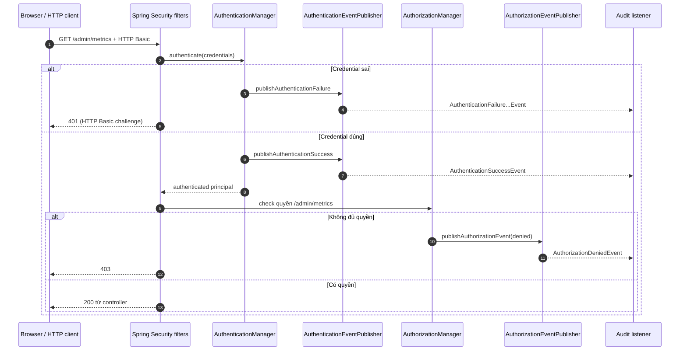
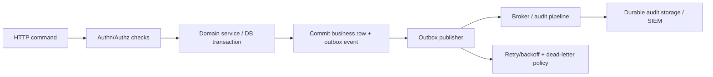

# AuthenticationEventPublisher, sự kiện phân quyền và nhật ký kiểm toán

> **Ngữ cảnh:** Spring Security **Servlet** (Spring MVC / Spring Boot 3.3.0 / Spring Security 6.x, Java 17+). Bài này tập trung vào **phát và lắng nghe sự kiện xác thực**, **sự kiện ra quyết định phân quyền**, và cách xây **audit trail** có ích cho vận hành mà không rò credential. Authentication event, authorization event và nhật ký kiểm toán **không phải một thứ**, và không phải mọi request HTTP đều tạo đủ các sự kiện đó.

## 1. Mục tiêu học tập

Sau bài học, bạn có thể:

1. Phân biệt `AuthenticationEventPublisher`, `DefaultAuthenticationEventPublisher`, `AuthenticationSuccessEvent`, các `AuthenticationFailure*Event` và những sự kiện khác như `InteractiveAuthenticationSuccessEvent`.
2. Mô tả lúc nào `AuthenticationManager`/`ProviderManager` phát event, vì sao một số request không phát, và tác dụng của việc khai báo publisher bean.
3. Hiểu `AuthorizationEventPublisher`, `SpringAuthorizationEventPublisher` và `AuthorizationDeniedEvent`; phân biệt **authentication thất bại**, **phân quyền bị từ chối** và **CSRF filter từ chối**.
4. Viết Spring Boot Servlet demo có `SecurityFilterChain`, HTTP Basic, hai tài khoản in-memory, `@EventListener` và test MockMvc kiểm chứng event theo từng trường hợp.
5. Biết cách giữ log an toàn, chọn các trường audit, chống lộ `Authentication`/password/token, chống log injection và cân bằng retention với quyền riêng tư.
6. Thiết kế kiến trúc audit bền vững với queue/outbox/idempotency khi yêu cầu tuân thủ cần **bằng chứng lưu trữ**, thay vì nghĩ application event mặc định là giao hàng chắc chắn.
7. Viết ma trận test phát hiện event bị thiếu, bị nhân đôi, sai principal, không đúng nguyên nhân 401/403, hoặc bị ảnh hưởng bởi `@WithMockUser`/`with(user())`.

## 2. Ba khái niệm phải phân biệt

### 2.1. Authentication event — điều gì xảy ra khi kiểm tra credential?

**Authentication** trả lời câu hỏi: "Credential này có xác thực được principal không?" Ví dụ: mật khẩu HTTP Basic đúng/sai, authentication provider xác thực JWT, authentication request bị từ chối vì account locked hoặc bad credentials.

Trong Spring Security, một `AuthenticationManager` như `ProviderManager` có thể gọi `AuthenticationEventPublisher` khi xác thực **thành công hoặc thất bại**. Publisher thông dụng là `DefaultAuthenticationEventPublisher`, dùng Spring `ApplicationEventPublisher` để phát các application events tương ứng.

Điều quan trọng: việc có authentication object trong `SecurityContextHolder` **không tự chứng minh đã có một `AuthenticationSuccessEvent`**. Principal có thể được dựng từ test helper, session đã tồn tại hoặc một filter/flow không gọi manager/publisher theo đường bạn nghĩ.

### 2.2. Authorization event — đã xác thực rồi thì có được phép?

**Authorization** trả lời: "Đối với request/hành động/tài nguyên này, principal đã biết có quyền không?" Ví dụ người có `ROLE_READER` gọi `GET /admin/metrics` bị từ chối dù HTTP Basic authentication hợp lệ.

Spring Security hỗ trợ `AuthorizationEventPublisher` để công bố quyết định authorization. `SpringAuthorizationEventPublisher` thường phát **`AuthorizationDeniedEvent`** khi một quyết định là denied; **không mặc định phát mọi lần granted** để tránh flood, trừ khi ứng dụng chủ động thiết kế publisher riêng.

Authentication success và authorization denied có thể xảy ra **trong cùng một HTTP request**: tài khoản reader đăng nhập thành công nhưng truy cập trang admin bị 403.

### 2.3. Audit log — hồ sơ ai làm gì, khi nào, kết quả ra sao?

**Audit trail** là dữ liệu vận hành/tuân thủ có chủ đích: ai hoặc workload nào yêu cầu hành động nào trên tài nguyên nào, quyết định gì, thuộc tenant nào, xảy ra khi nào, từ request/correlation ID nào và kết quả nghiệp vụ cuối cùng.

Một application event là **tín hiệu**; nó chưa đảm bảo:
- đã được ghi vào kho bền vững;
- chỉ phát đúng một lần;
- còn lại sau process crash;
- đủ dữ liệu chuẩn hóa để điều tra;
- có giá trị làm bằng chứng không thể bị sửa;
- phản ánh thao tác nghiệp vụ **đã commit thành công**.

Muốn có audit bền vững, phải thiết kế thêm storage, schema, retention, quyền đọc, cảnh báo, delivery/idempotency và integrity controls.

### Bảng so sánh ngắn

| Cơ chế | Sinh khi nào? | Ý nghĩa | Có thể bị thiếu trong trường hợp nào? |
| --- | --- | --- | --- |
| `AuthenticationSuccessEvent` | Authentication manager/publisher công bố xác thực thành công. | Credential/identity được xác nhận ở một bước. | Session tái sử dụng; request public; test fake principal; flow không dùng publisher. |
| `AuthenticationFailureBadCredentialsEvent` và các failure events | Manager thất bại bằng exception được ánh xạ. | Credential thất bại theo nhóm nguyên nhân. | Chưa có authentication attempt; custom exception chưa mapped; filter chặn trước. |
| `AuthorizationDeniedEvent` | Authorization decision denied và publisher được gắn vào pipeline. | Principal/request không vượt qua policy. | CSRF/CORS/filter chặn trước authorization; publisher chưa được cấu hình; policy chưa đến bước quyết định. |
| Audit nghiệp vụ | Ứng dụng ghi nhận sự kiện domain theo contract. | Hành động tạo, sửa, xóa, duyệt, thu hồi... | Nếu chỉ dựa vào HTTP event trước transaction commit hoặc job xử lý async. |
| Access log | HTTP server/proxy ghi nhận request/response. | Quan sát lưu lượng và status. | Không biết reason/identity đáng tin, bị lộ token nếu log URL/header không kiểm soát. |

## 3. Vị trí event trong request Servlet

Giả sử request:

```http
GET /admin/metrics HTTP/1.1
Host: localhost:8080
Authorization: Basic <BASE64_REDACTED>
```

Mô hình luồng:



Đây là mô hình lý tưởng hóa của request HTTP Basic qua chain phù hợp. Thứ tự chính xác giữa filter, exception handling và publisher còn phụ thuộc cấu hình. Nếu request bị `CsrfFilter` chặn vì thiếu token, **authentication/authorization manager có thể chưa được gọi** — do vậy chỉ thấy 403 không đồng nghĩa đã có `AuthorizationDeniedEvent`.

### Ba tình huống nhìn giống nhau nhưng event khác nhau

1. **Không gửi credential tới URL cần authentication:** HTTP Basic có thể trả 401 vì anonymous bị chặn. Không bắt buộc có `AuthenticationFailureEvent`, vì có thể **chưa có một lần gọi authenticate thất bại** nào.
2. **Gửi password sai:** `BasicAuthenticationFilter` gửi một yêu cầu authenticate và manager trả lỗi. Nếu publisher được cấu hình, có thể có `AuthenticationFailureBadCredentialsEvent`; response thường 401.
3. **Gửi password đúng nhưng thiếu role:** có thể có `AuthenticationSuccessEvent` rồi `AuthorizationDeniedEvent`; response thường 403.

Ghi nhận cả category và reason theo policy, không dựa duy nhất vào `response.status`.

## 4. AuthenticationEventPublisher và DefaultAuthenticationEventPublisher

### 4.1. Giao diện publisher

`AuthenticationEventPublisher` có các thao tác lõi:

```java
void publishAuthenticationSuccess(Authentication authentication);

void publishAuthenticationFailure(
    AuthenticationException exception,
    Authentication authentication);
```

Đây là **chữ ký khái niệm** đặt cạnh nhau để học, không phải interface class có thể copy nguyên vào dự án. Một `ProviderManager` có publisher có thể gọi hai method đó khi authenticate thành công/thất bại.

`DefaultAuthenticationEventPublisher` chuyển các kết quả thành Spring application events, sau đó listener có thể nhận bằng `@EventListener`, `ApplicationListener` hoặc cơ chế khác phù hợp. Với Spring Boot thường có tự động cấu hình cho publisher nếu chưa có bean tương đương; trong demo chúng ta **khai báo bean rõ ràng** để mục tiêu test không phụ thuộc việc người đọc suy đoán fallback của môi trường.

### 4.2. Các loại authentication event cần biết

| Event | Ý nghĩa điển hình | Điểm cần chú ý |
| --- | --- | --- |
| `AuthenticationSuccessEvent` | Authentication manager công bố thành công. | Không đồng nghĩa người dùng đã hoàn thành một phiên browser login hoặc có mọi quyền. |
| `AuthenticationFailureBadCredentialsEvent` | Sai credential/password theo exception ánh xạ. | Không log raw password hoặc `Authentication` object. |
| `AuthenticationFailureLockedEvent` | Account locked trong cơ chế provider/exception tương ứng. | Không công khai chi tiết account locked cho anonymous caller nếu gây enumeration. |
| `AuthenticationFailureDisabledEvent` | Account disabled. | Có thể kết hợp cùng response 401 nhưng nội bộ audit tách reason. |
| `AuthenticationFailureExpiredEvent` | Account expired. | Kiểm tra mapping theo đúng authentication provider. |
| `AuthenticationFailureCredentialsExpiredEvent` | Credentials đã hết hạn. | Không tự gán user identity chắc chắn từ input chưa xác minh. |
| `AuthenticationFailureServiceExceptionEvent` | Một nhóm lỗi hệ thống xác thực được ánh xạ. | Phân biệt sự cố hạ tầng với bad password để đo lỗi chính xác. |
| `InteractiveAuthenticationSuccessEvent` | Sự kiện liên quan thành công qua filter kiểu interactive. | **Khác** với `AuthenticationSuccessEvent` do manager công bố, không mặc định có trong mọi HTTP Basic/JWT request. |

Không giả định rằng **mọi subtype của `AuthenticationException`** sẽ tạo một event failure cụ thể. `DefaultAuthenticationEventPublisher` ánh xạ exception classes theo cấu hình; custom provider/exception có thể cần cấu hình mapping bổ sung hoặc sử dụng `setDefaultAuthenticationFailureEvent` phù hợp. Đừng tạo event giả báo "password sai" cho lỗi token endpoint timeout chỉ để dashboard dễ đếm.

### 4.3. Vì sao event có thể không xuất hiện?

- Request được phục vụ từ `SecurityContext`/session đã xác thực trước đó; không gọi `AuthenticationManager.authenticate(...)` mới.
- Test dùng `@WithMockUser` hoặc `SecurityMockMvcRequestPostProcessors.user(...)` để đặt sẵn principal — không kiểm tra password qua manager.
- Anonymous bị `AuthorizationFilter` từ chối trước khi có credential; không có authentication failure từ một credential cụ thể.
- Servlet filter tự xử lý xác thực, một custom `AuthenticationManager`/`ProviderManager` không gắn publisher, hoặc publisher bean không được manager đang chạy sử dụng.
- Có hai manager khác nhau (ví dụ cho API và web), chỉ một manager có publisher.
- Lỗi xảy ra **ngoài** provider authentication (ví dụ CSRF, malformed HTTP, proxy, service không chạy).
- Event listener không nhận vì sai Spring application context hoặc được cấu hình async làm mất dữ liệu request.

Kiểm tra thực tế: đặt test gửi credential **thật** qua filter/provider, assert event cụ thể và phân biệt sự kiện trong context đang dùng với sự kiện chỉ có trong một test profile.

## 5. AuthorizationEventPublisher và sự kiện phân quyền

### 5.1. Đây không phải AuthenticationEventPublisher

`AuthorizationEventPublisher` nằm trong nhóm API authorization, không phải authentication. Một `AuthorizationManager` đưa ra quyết định dựa trên principal và target/request, rồi publisher có thể nhận quyết định đó. Trong Servlet, `AuthorizationFilter` và `authorizeHttpRequests` là một đường áp dụng phổ biến.

Ví dụ authorization rule:

```java
.authorizeHttpRequests(auth -> auth
    .requestMatchers("/public/ping").permitAll()
    .requestMatchers("/private/report").authenticated()
    .requestMatchers("/admin/metrics").hasRole("ADMIN")
    .anyRequest().denyAll())
```

Đây là **snippet** dành bên trong `HttpSecurity`, chưa phải toàn bộ class. Một user có `ROLE_READER` gọi `/admin/metrics` sau khi authenticate thành công sẽ không vượt qua `hasRole("ADMIN")`.

### 5.2. Đăng ký publisher cho quyết định bị từ chối

Có thể khai báo:

```java
@Bean
AuthorizationEventPublisher authorizationEventPublisher(
        ApplicationEventPublisher applicationEventPublisher) {
    return new SpringAuthorizationEventPublisher(
        applicationEventPublisher);
}
```

Đây là **snippet**; import đầy đủ xuất hiện ở ứng dụng demo phần 7. `SpringAuthorizationEventPublisher` ưu tiên phát `AuthorizationDeniedEvent`, **không phát mọi granted decision mặc định**. Điều này quan trọng về **performance/cardinality**: một ứng dụng có hàng triệu request thành công mỗi ngày không nên đẩy event cho mọi quyết định granted vào cùng một audit log không có lý do.

Với multi-chain hoặc method security, hãy kiểm tra **pipeline nào dùng publisher nào**, thay vì tin rằng chỉ thêm bean đồng nghĩa mọi quyết định ủy quyền ở mọi lớp đều được ghi. Test cần đi qua filter/method security thực tế.

### 5.3. Tại sao thiếu AuthorizationDeniedEvent dù response là 403?

- `CsrfFilter` chặn một POST chưa có CSRF token trước authorization.
- Exception xuất phát từ controller/business service, được handler map thành 403; không phải quyết định của `AuthorizationManager` đang dùng.
- Một custom filter tự gọi `response.sendError(403)`.
- Request đi vào một `SecurityFilterChain` khác không đăng publisher.
- Method-level authorization chưa bật `@EnableMethodSecurity` hoặc service được mock qua Mockito, không chạy proxy thật.
- Event listener không được quét vào test context.
- Một request có nhiều authorization decisions khác nhau; event xuất hiện nhưng listener lọc sai loại hoặc test đo nhầm context.

Tối thiểu hãy tách test **credential đúng + thiếu role + HTTP GET** khỏi test **POST thiếu CSRF**, rồi kiểm tra đúng event.

### 5.4. Có nên phát AuthorizationGrantedEvent?

Spring Security cũng có các dạng event cho granted decision, nhưng một audit trail muốn ghi mọi **hành động nghiệp vụ thành công** thường tốt hơn ở **domain/application service** sau khi hành động đã commit. Tràn ngập event "GET được phép" chưa khẳng định đã đọc dữ liệu, thay đổi resource hoặc hoàn tất transaction.

Nếu cần publish granted events để quan sát, hãy dùng một custom publisher có **sampling/rate limits**, chọn endpoints quan trọng, cùng quy tắc privacy. Không bật "log toàn bộ principal, authorities, HttpServletRequest" cho mọi request.

## 6. Event listener chạy lúc nào và có thể làm gì?

Spring `ApplicationEventPublisher` với multicaster mặc định thường gọi `@EventListener` **đồng bộ trên thread đang publish**, trừ khi cấu hình async listener/multicaster. Vì vậy một listener thực hiện network request đồng bộ tới SIEM có thể làm tăng latency của login hoặc authorization, thậm chí exception không được xử lý đúng có thể ảnh hưởng tới luồng request.

### Những việc phù hợp trong listener

- Phân loại event theo category (`authentication`/`authorization`), outcome (`success`/`failure`/`denied`) và reason **đã chuẩn hóa**.
- Lấy một principal identifier **đã tin cậy** nếu policy cho phép, rồi chuyển thành internal actor ID/băm theo chính sách.
- Ghi audit record nhẹ và có kiểm soát; đẩy vào outbox/buffer có backpressure nếu yêu cầu throughput lớn.
- Tăng counter/metric low-cardinality; phát cảnh báo cho chuỗi brute force, khóa tài khoản hoặc denied spike.
- Gắn correlation/request ID đã chuẩn hóa để nối log request với audit record.

### Những việc nên tránh

- Đọc `Authentication.getCredentials()` rồi log giá trị để "debug".
- In `event.getAuthentication()`, toàn bộ SecurityContext, raw Bearer JWT, access/refresh token, session cookie, user profile hoặc request headers.
- Gọi remote SIEM trên mỗi request không timeout/backoff; để event listener tạo vòng lặp khi chính SIEM bị lỗi.
- Ném runtime exception vào luồng authentication chỉ vì audit server đang down, nếu sản phẩm không có thiết kế **fail-closed** rõ ràng và được kiểm chứng.
- Tin rằng `@Async` giúp tránh mọi vấn đề: async listener có thể mất SecurityContext/request context, và event có thể vẫn thất lạc khi process crash.
- Nối tên event/username/HTTP path không được sanitize thành log line hoặc metric tag vô hạn khiến log injection/high cardinality.

**Nếu audit là kiểm soát tuân thủ bắt buộc**, không nên chỉ ghi "best effort" bằng `@EventListener` + logger. Cần một quyết định kiến trúc rõ ràng về durability, failure mode, ordering và retention.

## 7. Ví dụ Spring Boot 3.3.0: Authentication + Authorization events

Dự án Java 17+ này có:

- `GET /public/ping`: public.
- `GET /private/report`: yêu cầu đã xác thực.
- `GET /admin/metrics`: yêu cầu `ROLE_ADMIN`.
- `POST /private/change`: cần đã xác thực **và CSRF token** do cấu hình browser-style mặc định; minh họa vì sao CSRF rejection không phải authorization event.
- HTTP Basic cho demo có hai user `reader` và `admin`; không dùng account này cho production.
- `AuthenticationEventPublisher` và `AuthorizationEventPublisher` được khai báo thành bean.
- Listener chỉ ghi **loại event và outcome**, không ghi username/password/token.

### 7.1. Thư mục project

```text
security-events-demo/
├── pom.xml
└── src/
    ├── main/
    │   └── java/demo/events/
    │       ├── EventsApplication.java
    │       ├── SecurityConfig.java
    │       ├── EventController.java
    │       └── SecurityEventListener.java
    └── test/
        └── java/demo/events/
            └── SecurityEventsTest.java
```

### 7.2. pom.xml

```xml
<project xmlns="http://maven.apache.org/POM/4.0.0"
         xmlns:xsi="http://www.w3.org/2001/XMLSchema-instance"
         xsi:schemaLocation="http://maven.apache.org/POM/4.0.0 https://maven.apache.org/xsd/maven-4.0.0.xsd">
    <modelVersion>4.0.0</modelVersion>
    <parent>
        <groupId>org.springframework.boot</groupId>
        <artifactId>spring-boot-starter-parent</artifactId>
        <version>3.3.0</version>
        <relativePath/>
    </parent>
    <groupId>demo</groupId>
    <artifactId>security-events-demo</artifactId>
    <version>0.0.1-SNAPSHOT</version>
    <properties>
        <java.version>17</java.version>
    </properties>
    <dependencies>
        <dependency>
            <groupId>org.springframework.boot</groupId>
            <artifactId>spring-boot-starter-web</artifactId>
        </dependency>
        <dependency>
            <groupId>org.springframework.boot</groupId>
            <artifactId>spring-boot-starter-security</artifactId>
        </dependency>
        <dependency>
            <groupId>org.springframework.boot</groupId>
            <artifactId>spring-boot-starter-test</artifactId>
            <scope>test</scope>
        </dependency>
        <dependency>
            <groupId>org.springframework.security</groupId>
            <artifactId>spring-security-test</artifactId>
            <scope>test</scope>
        </dependency>
    </dependencies>
    <build>
        <plugins>
            <plugin>
                <groupId>org.springframework.boot</groupId>
                <artifactId>spring-boot-maven-plugin</artifactId>
            </plugin>
        </plugins>
    </build>
</project>
```

### 7.3. Application main

**`src/main/java/demo/events/EventsApplication.java`:**

```java
package demo.events;

import org.springframework.boot.SpringApplication;
import org.springframework.boot.autoconfigure.SpringBootApplication;

@SpringBootApplication
public class EventsApplication {
    public static void main(String[] args) {
        SpringApplication.run(EventsApplication.class, args);
    }
}
```

### 7.4. SecurityFilterChain, AuthenticationEventPublisher, AuthorizationEventPublisher

**`src/main/java/demo/events/SecurityConfig.java`:**

```java
package demo.events;

import org.springframework.context.ApplicationEventPublisher;
import org.springframework.context.annotation.Bean;
import org.springframework.context.annotation.Configuration;
import org.springframework.http.HttpMethod;
import org.springframework.security.authentication.AuthenticationEventPublisher;
import org.springframework.security.authentication.DefaultAuthenticationEventPublisher;
import org.springframework.security.authorization.AuthorizationEventPublisher;
import org.springframework.security.authorization.SpringAuthorizationEventPublisher;
import org.springframework.security.config.Customizer;
import org.springframework.security.config.annotation.web.builders.HttpSecurity;
import org.springframework.security.core.userdetails.User;
import org.springframework.security.core.userdetails.UserDetailsService;
import org.springframework.security.crypto.bcrypt.BCryptPasswordEncoder;
import org.springframework.security.crypto.password.PasswordEncoder;
import org.springframework.security.provisioning.InMemoryUserDetailsManager;
import org.springframework.security.web.SecurityFilterChain;

@Configuration
public class SecurityConfig {
    @Bean
    SecurityFilterChain securityFilterChain(HttpSecurity http)
            throws Exception {
        return http
            .authorizeHttpRequests(auth -> auth
                .requestMatchers("/public/ping").permitAll()
                .requestMatchers(HttpMethod.GET, "/private/report")
                    .authenticated()
                .requestMatchers(HttpMethod.GET, "/admin/metrics")
                    .hasRole("ADMIN")
                .requestMatchers(HttpMethod.POST, "/private/change")
                    .authenticated()
                .anyRequest().denyAll())
            .httpBasic(Customizer.withDefaults())
            // Giữ CSRF mặc định để test phân biệt chặn CSRF và authz.
            .build();
    }

    @Bean
    PasswordEncoder passwordEncoder() {
        return new BCryptPasswordEncoder();
    }

    @Bean
    UserDetailsService demoUsers(PasswordEncoder encoder) {
        return new InMemoryUserDetailsManager(
            User.withUsername("reader")
                .password(encoder.encode("reader-secret"))
                .roles("READER")
                .build(),
            User.withUsername("admin")
                .password(encoder.encode("admin-secret"))
                .roles("ADMIN")
                .build()
        );
    }

    @Bean
    AuthenticationEventPublisher authenticationEventPublisher(
            ApplicationEventPublisher publisher) {
        return new DefaultAuthenticationEventPublisher(publisher);
    }

    @Bean
    AuthorizationEventPublisher authorizationEventPublisher(
            ApplicationEventPublisher publisher) {
        return new SpringAuthorizationEventPublisher(publisher);
    }
}
```

**Đọc đúng semantics:**

1. Có `AuthenticationEventPublisher` bean **không đồng nghĩa** mọi custom AuthenticationManager đã được gắn publisher. Với manager do framework quản lý, xác minh event bằng test thực; với manager tự tạo, hãy thiết lập publisher trên manager đó theo API của nó.
2. `DefaultAuthenticationEventPublisher` tạo Spring application event từ quá trình manager xác thực. Đừng dùng nó để đếm tất cả HTTP requests.
3. `SpringAuthorizationEventPublisher` nhận các quyết định authorization ở nơi framework đã nối publisher và thường phát denied events. Kiểm thử sự kiện thật ở đúng SecurityFilterChain; không tin vào một bean chỉ vì có tên.
4. `hasRole("ADMIN")` tương đương yêu cầu authority `ROLE_ADMIN`; `roles("READER")` tạo `ROLE_READER`, nên reader không được vào `/admin/metrics`.
5. Cấu hình giữ CSRF mặc định. `POST /private/change` **không có token** sẽ bị từ chối; trong MockMvc cần `with(csrf())` để xét riêng authorization.
6. HTTP Basic có thể gửi credential trên mọi request. Đây là phương thức demo; production phải dùng TLS, password policy, rate limiting và bảo vệ secret; tuyệt đối không in HTTP Basic header (nó chỉ là Base64 của username:password).
7. `anyRequest().denyAll()` không cấp phép request ngoài đường đã định, kể cả khi đã authenticated.

### 7.5. Controller

**`src/main/java/demo/events/EventController.java`:**

```java
package demo.events;

import org.springframework.web.bind.annotation.GetMapping;
import org.springframework.web.bind.annotation.PostMapping;
import org.springframework.web.bind.annotation.RestController;

@RestController
public class EventController {
    @GetMapping("/public/ping")
    public String ping() {
        return "pong";
    }

    @GetMapping("/private/report")
    public String report() {
        return "private-report";
    }

    @GetMapping("/admin/metrics")
    public String metrics() {
        return "admin-metrics";
    }

    @PostMapping("/private/change")
    public String change() {
        return "changed";
    }
}
```

Controller cố ý không đọc SecurityContext hay request headers; event listener chỉ quan sát tín hiệu framework. Với hành động thực như thay đổi thông tin cá nhân, hãy phát **business audit event** riêng sau khi transaction thành công thay vì xem một authorization-granted event là "đã thay đổi dữ liệu".

### 7.6. Listener không ghi secret

**`src/main/java/demo/events/SecurityEventListener.java`:**

```java
package demo.events;

import org.slf4j.Logger;
import org.slf4j.LoggerFactory;
import org.springframework.context.event.EventListener;
import org.springframework.security.authentication.event.AbstractAuthenticationFailureEvent;
import org.springframework.security.authentication.event.AuthenticationSuccessEvent;
import org.springframework.security.authorization.event.AuthorizationDeniedEvent;
import org.springframework.stereotype.Component;

@Component
public class SecurityEventListener {
    private static final Logger log =
        LoggerFactory.getLogger(SecurityEventListener.class);

    @EventListener
    public void authenticationSucceeded(
            AuthenticationSuccessEvent event) {
        // Không log Authentication object: có thể chứa credentials.
        log.info("security_event=authentication outcome=success");
    }

    @EventListener
    public void authenticationFailed(
            AbstractAuthenticationFailureEvent event) {
        // Chỉ dùng loại event đã được framework chuẩn hóa.
        String category = event.getClass().getSimpleName();
        log.warn("security_event=authentication outcome=failure event_type={}",
            category);
    }

    @EventListener
    public void authorizationDenied(
            AuthorizationDeniedEvent<?> event) {
        // Không serialize event.getObject(), request, principal/token.
        log.warn("security_event=authorization outcome=denied");
    }
}
```

Tất cả log line ở demo dùng static/controlled values từ class; không có user input. Trong hệ thống thực, bạn có thể cần **actor ID**, tenant, request ID, action, resource type và reason code. Những field đó phải được lấy từ nguồn **đáng tin và sanitize**, không lấy raw `Authentication.toString()` hoặc tất cả HTTP headers.

**Cảnh báo về event object:** Spring application event thường chứa context/`Authentication` hoặc reference liên quan request. Dù listener không trực tiếp ghi credential, một framework tự serialize toàn bộ event sang JSON để đưa vào queue có thể làm lộ secret. Hãy tạo **AuditRecord DTO có allowlist các field** rồi mới đẩy ra hạ tầng ngoài process.

## 8. Chạy thử bằng HTTP

Dùng Java 17+ và Maven. Trong thư mục project:

```bash
mvn test
mvn spring-boot:run
```

Gọi public route:

```bash
curl -i http://localhost:8080/public/ping
```

Body:

```text
pong
```

Anonymous vào protected:

```bash
curl -i http://localhost:8080/private/report
```

Thường trả **401** và `WWW-Authenticate` từ HTTP Basic. Có thể **không có AuthenticationFailureEvent**, vì request không gửi credential để manager kiểm tra.

Sai mật khẩu:

```bash
curl -i -u reader:wrong-password http://localhost:8080/private/report
```

Thông thường 401; khi authentication publisher nối đúng vào manager, listener ghi đại loại:

```text
security_event=authentication outcome=failure event_type=AuthenticationFailureBadCredentialsEvent
```

Đây là **phần thông điệp** của log, không bao gồm timestamp, level, thread và logger name vì formatter của runtime có thể khác.

Đúng mật khẩu, đủ quyền:

```bash
curl -i -u reader:reader-secret http://localhost:8080/private/report
```

Trả **200** với body:

```text
private-report
```

Với mỗi authentication attempt qua manager, listener có thể ghi:

```text
security_event=authentication outcome=success
```

Reader vào admin:

```bash
curl -i -u reader:reader-secret http://localhost:8080/admin/metrics
```

Trả **403** do thiếu `ROLE_ADMIN`. Authentication manager có thể đã thành công, sau đó authorization bị denied — trong cùng một request có thể thấy **cả success authentication event và denied authorization event**.

Admin vào admin:

```bash
curl -i -u admin:admin-secret http://localhost:8080/admin/metrics
```

Trả **200** với body:

```text
admin-metrics
```

Trong cấu hình publisher denial mặc định, **không mặc nhiên có AuthorizationGrantedEvent** chỉ vì API trả 200.

POST thiếu CSRF:

```bash
curl -i -u admin:admin-secret -X POST \
  http://localhost:8080/private/change
```

Trả **403** từ `CsrfFilter` trong demo Servlet này. Không lấy việc không thấy `AuthorizationDeniedEvent` làm bằng chứng authorization publisher đã hỏng; CSRF có thể chặn request trước khi decision diễn ra. Trên ứng dụng thực, dùng browser session và CSRF token có nguồn gốc đúng; `with(csrf())` chỉ tồn tại trong Spring Security Test.

## 9. Kiểm thử MockMvc + ApplicationEvents

Mục tiêu test là quan sát **sự kiện được publish trong application context** khi request đi qua filter/provider thật, thay vì chỉ assert response status. Spring Test có `@RecordApplicationEvents` và `ApplicationEvents` để ghi nhận application events trong phạm vi test.

**`src/test/java/demo/events/SecurityEventsTest.java`:**

```java
package demo.events;

import org.junit.jupiter.api.Test;
import org.springframework.beans.factory.annotation.Autowired;
import org.springframework.boot.test.autoconfigure.web.servlet.AutoConfigureMockMvc;
import org.springframework.boot.test.context.SpringBootTest;
import org.springframework.security.authentication.event.AuthenticationFailureBadCredentialsEvent;
import org.springframework.security.authentication.event.AuthenticationSuccessEvent;
import org.springframework.security.authorization.event.AuthorizationDeniedEvent;
import org.springframework.test.context.event.ApplicationEvents;
import org.springframework.test.context.event.RecordApplicationEvents;
import org.springframework.test.web.servlet.MockMvc;

import static org.assertj.core.api.Assertions.assertThat;
import static org.springframework.security.test.web.servlet.request
    .SecurityMockMvcRequestPostProcessors.csrf;
import static org.springframework.security.test.web.servlet.request
    .SecurityMockMvcRequestPostProcessors.httpBasic;
import static org.springframework.security.test.web.servlet.request
    .SecurityMockMvcRequestPostProcessors.user;
import static org.springframework.test.web.servlet.request.MockMvcRequestBuilders.get;
import static org.springframework.test.web.servlet.request.MockMvcRequestBuilders.post;
import static org.springframework.test.web.servlet.result.MockMvcResultMatchers.content;
import static org.springframework.test.web.servlet.result.MockMvcResultMatchers.status;

@SpringBootTest
@AutoConfigureMockMvc
@RecordApplicationEvents
class SecurityEventsTest {
    @Autowired
    MockMvc mvc;

    @Autowired
    ApplicationEvents events;

    @Test
    void publicPingDoesNotRequireAuthentication() throws Exception {
        mvc.perform(get("/public/ping"))
            .andExpect(status().isOk())
            .andExpect(content().string("pong"));
    }

    @Test
    void correctBasicCredentialsCauseAuthenticationSuccess()
            throws Exception {
        mvc.perform(get("/private/report")
                .with(httpBasic("reader", "reader-secret")))
            .andExpect(status().isOk())
            .andExpect(content().string("private-report"));

        assertThat(events.stream(AuthenticationSuccessEvent.class).count())
            .isGreaterThan(0L);
    }

    @Test
    void badBasicPasswordCausesAuthenticationFailure()
            throws Exception {
        mvc.perform(get("/private/report")
                .with(httpBasic("reader", "wrong")))
            .andExpect(status().isUnauthorized());

        assertThat(events.stream(
            AuthenticationFailureBadCredentialsEvent.class).count())
            .isGreaterThan(0L);
    }

    @Test
    void validReaderCannotEnterAdminAndPublishesDenial()
            throws Exception {
        mvc.perform(get("/admin/metrics")
                .with(httpBasic("reader", "reader-secret")))
            .andExpect(status().isForbidden());

        assertThat(events.stream(AuthorizationDeniedEvent.class).count())
            .isGreaterThan(0L);
    }

    @Test
    void validAdminMayEnterAdmin() throws Exception {
        mvc.perform(get("/admin/metrics")
                .with(httpBasic("admin", "admin-secret")))
            .andExpect(status().isOk())
            .andExpect(content().string("admin-metrics"));
    }

    @Test
    void missingCsrfProducesForbiddenResponse() throws Exception {
        mvc.perform(post("/private/change")
                .with(httpBasic("admin", "admin-secret")))
            .andExpect(status().isForbidden());
    }

    @Test
    void validCsrfAllowsAdminPost() throws Exception {
        mvc.perform(post("/private/change")
                .with(httpBasic("admin", "admin-secret"))
                .with(csrf()))
            .andExpect(status().isOk())
            .andExpect(content().string("changed"));
    }

    @Test
    void fakePrincipalIsNotProofOfPasswordAuthentication()
            throws Exception {
        mvc.perform(get("/private/report")
                .with(user("reader").roles("READER")))
            .andExpect(status().isOk());

        // MockMvc user() đặt SecurityContext trực tiếp.
        // Test này KHÔNG khẳng định AuthenticationSuccessEvent xảy ra.
    }
}
```

**Cách đọc test:**

- `@SpringBootTest` nạp **full context**; `@AutoConfigureMockMvc` cho phép HTTP requests giả lập chạy qua Servlet filters.
- `httpBasic(...)` tạo header Basic; Spring Security dùng user details và encoder của demo để kiểm tra. **Khác** `with(user(...))`: user() bypass quá trình xác minh password.
- `@RecordApplicationEvents` ghi nhận events trong test context; `ApplicationEvents.stream(...)` cho test tìm đúng event class. Test nhận ít nhất một event thay vì cố khẳng định số lượng tuyệt đối; các filter/provider có thể thêm event tùy flow và cấu hình.
- Test 403 sau GET /admin/metrics với reader có credential hợp lệ chứng minh một **authorization denial**, không nhầm với lỗi CSRF.
- Test 403 sau POST thiếu CSRF **chỉ assert status**; không nên assert chắc chắn có denied authorization event.
- Test với mock principal giúp kiểm tra đường authorization nhưng **không chứng minh** authentication publisher chạy.
- Những test trên là test Spring application events trong process, **chưa chứng minh** một SIEM/queue/DB audit store nhận được bản ghi bền vững.

Nếu test event assertion thất bại trong dự án thực, kiểm tra **publisher bean đã được gắn vào manager/authorization pipeline thực sự hay chưa**, các chain/matcher, loại exception, mock thay thế và phạm vi test context. Không sửa bằng cách tạo event giả trong test để ép assertion pass.

### Các trường hợp test bổ sung

1. Request anonymous bị từ chối vì chưa xác thực: xác nhận 401 hoặc redirect phù hợp, nhưng **không ép** phải có bad-credential event khi không có credential.
2. User authenticated nhưng thiếu role: kiểm tra denied event, body không bị trả trước khi authorization.
3. POST với CSRF không hợp lệ: 403; kiểm tra đây là quyết định của `CsrfFilter`, không phải authentication manager.
4. Thử hai chain khác nhau: test matching/order cho API và web; chain nào có publisher?
5. Test custom AuthenticationManager riêng: có gọi publisher khi success/failure?
6. Test account locked/disabled/custom AuthenticationException: mapping event hợp lệ, response public không làm lộ user enumeration.
7. Test nhiều request HTTP Basic: event có thể xảy ra nhiều lần; dashboard không suy ra số lượng **unique logins** từ số success event.
8. Test request có role thỏa nhưng business layer từ chối vì tenant/resource: đây có thể là business auth denial không qua `AuthorizationEventPublisher` của filter.
9. Test method security khi bật `@EnableMethodSecurity` và không mock service: xem event ra sao với method-level authorization.
10. Test audit sink bị tắt, timeout, queue đầy, retry, duplicate delivery và failover; quyết định fail-open/fail-closed theo policy.

## 10. Thiết kế audit log có cấu trúc

Để vận hành có ích, tách log access, authentication, authorization và business audit. Thay vì chỉ ghi text tự do "Login failed", xây một schema có version và key chuẩn.

### 10.1. Schema gợi ý

Một record khái niệm:

```json
{
  "schema_version": 1,
  "event_id": "evt-unique-id",
  "occurred_at": "2026-11-06T10:15:30Z",
  "category": "authorization",
  "action": "read_admin_metrics",
  "outcome": "denied",
  "reason_code": "insufficient_authority",
  "actor_id": "user-internal-42",
  "tenant_id": "tenant-17",
  "resource_type": "admin_metrics",
  "resource_id": null,
  "request_id": "req-7f3a",
  "service": "report-api",
  "environment": "production"
}
```

Đây là **dạng cấu trúc minh họa** với ID giả và timestamp giả, không phải dữ liệu có thật hoặc một schema bắt buộc của Spring Security. `event_id` phải được tạo và xử lý idempotency theo thiết kế; `actor_id` là internal ID đã xác minh, không phải raw user input trong Authentication token chưa tin cậy.

### 10.2. Phân loại các field

| Nhóm | Field nên có | Lưu ý |
| --- | --- | --- |
| Định danh event | `event_id`, `schema_version`, `occurred_at` | UTC, nguồn thời gian đáng tin, version hóa schema để downstream đọc lâu dài. |
| Loại sự kiện | `category`, `action`, `outcome`, `reason_code` | Controlled vocabulary, tránh high-cardinality random reason text. |
| Actor | `actor_id`, `service_principal_id` | Chỉ ghi sau khi xác thực/identity binding đáng tin, phù hợp privacy policy. |
| Phạm vi | `tenant_id`, `resource_type`, `resource_id` khi cần | Không tự tin tenant ID trong header request hoặc URL. |
| Trace | `request_id`, `correlation_id`, `trace_id` | Normalize/sanitize; bảo đảm không đưa token/raw path chứa secret. |
| Môi trường | `service`, `deployment`, `environment`, `region` | Giúp điều tra multi-instance và phân biệt staging/prod. |
| Vận hành | `policy_version`, `auth_method`, `decision_source` | Chỉ ghi nếu thực sự đáng tin và có ý nghĩa. |

Các field **không nên lưu**: raw password, OTP, session cookie, access/refresh/ID token, Authorization header, raw recovery code, secret key, toàn bộ claim payload, full `HttpServletRequest`, `Authentication.toString()` hoặc PII không cần thiết.

### 10.3. Bảo vệ audit khỏi giả mạo và log injection

Bất kỳ dữ liệu đến từ client — username nhập lúc login thất bại, path, User-Agent, forwarded headers — đều có thể chứa ký tự xuống dòng, ký tự điều khiển, chuỗi cực dài hoặc giá trị cố tình làm dashboard hiểu sai. Hãy:

- Dùng **structured logging** với encoder/serializer chuẩn thay vì nối chuỗi trực tiếp vào log line.
- Chuẩn hóa/escape đầu vào và giới hạn độ dài; không đưa user-controlled value vào metric tag có cardinality vô hạn.
- Dùng allowlist reason codes; không để exception message chưa sanitized thành public audit reason.
- Phân quyền đọc audit và kiểm soát việc sửa/xóa: lưu trữ append-only/WORM/tamper-evident khi nghĩa vụ cần, kèm monitoring truy cập audit.
- Đặt retention, minimization, masking và xóa/anonymization theo yêu cầu pháp lý và chính sách nội bộ; audit không phải cớ lưu PII vô hạn.
- Xem xét khóa/role riêng cho audit writer, auditor và operator; tránh một service vừa tạo vừa có quyền chỉnh sửa lịch sử không dấu vết.

**Không đồng nhất "hash email" với ẩn danh tuyệt đối**. Email có entropy thấp, hash không key có thể bị dò dictionary; nếu cần liên kết audit theo người dùng, ưu tiên internal actor ID và kiểm soát truy cập, hoặc keyed pseudonym theo policy.

## 11. Sự kiện framework không thay business audit

### Trường hợp sai thường gặp

Bạn ghi lại `AuthenticationSuccessEvent` và `AuthorizationDeniedEvent`, nhưng hệ thống có endpoint chuyển tiền. Có một request authenticated và authorized, rồi database transaction rollback sau khi kiểm tra số dư. Nếu audit dựa trên authorization granted, log có thể nói "chuyển tiền thành công" mặc dù giao dịch **không commit**.

Hãy tách:

1. **Authentication audit:** credential attempt / identity verification.
2. **Authorization audit:** policy decision allowed/denied ở nơi policy thực thi.
3. **Business audit:** hành động domain thực tế đã chấp nhận, đang xử lý, completed hoặc failed; gắn với transaction/state machine.

Nếu cần bằng chứng "payment settled", sự kiện đó phải đến từ domain transaction/event nghiệp vụ đã commit hoặc từ hệ thống settlement, **không suy ra từ AuthenticationSuccessEvent**.

### Mốc commit và TransactionalEventListener

`@TransactionalEventListener(phase = AFTER_COMMIT)` hữu ích cho domain event phát trong transaction thích hợp. Nhưng authentication/authorization events trong security filter **không nhất thiết được phát khi có một transaction Spring đang mở**. Vì vậy chỉ thêm `@TransactionalEventListener` vào listener security có thể khiến listener **không chạy** nếu không có transaction phù hợp.

Với audit bền vững của hành động nghiệp vụ, dùng **transactional outbox** hoặc một cơ chế có cùng guarantee: ghi business state và outbox record trong **cùng DB transaction**; một worker riêng đẩy sự kiện ra message broker/SIEM với retry và idempotency; consumer có thể cần deduplicate. Không có kiến trúc nào đảm bảo "exactly once" ở mọi hop chỉ nhờ `@EventListener`.

### Mô hình outbox



Đường này dành cho domain audit cần gắn với commit. Authentication failures xảy ra trước business transaction có thể cần một tuyến riêng (audit writer/buffer có độ bền phù hợp) với failure policy rõ ràng.

## 12. Reliability: synchronous, async và chiến lược lỗi

### 12.1. Listener đồng bộ và tác động tới latency

Với multicaster mặc định, listener có thể chạy đồng bộ trong lời gọi publish. Nếu listener ghi database 500 ms trên mỗi authentication attempt, endpoint login chịu thêm latency. Nếu audit DB chết, request authentication có thể bị ảnh hưởng.

Hướng xử lý:

- Giữ event listener mỏng, trích các **field allowlist**, enqueue vào hạ tầng có timeout/backpressure.
- Nếu cần đảm bảo log bền vững trước khi cho phép một hành động cực nhạy cảm, định nghĩa **gating policy** rõ ràng, test fail-closed và trải nghiệm khi sink hỏng.
- Với luồng bình thường, quyết định fail-open/fail-closed phải dựa vào yêu cầu bảo mật/tuân thủ, không để exception ngẫu nhiên của listener quyết định.
- Giám sát queue depth, dropped events, failed writes, retry count, consumer lag, alert thresholds và retention.

### 12.2. Async listener không tự giải quyết bảo đảm delivery

Gắn `@Async` vào `@EventListener` có thể đẩy xử lý sang thread khác, nhưng cần `@EnableAsync`, executor, exception handler và hiểu lifecycle. Event vẫn là dữ liệu trong bộ nhớ process; nếu process chết trước khi worker chạy, event chưa chắc đã được ghi.

Trong async thread, `SecurityContextHolder` thường **không tự có principal** của request thread; đừng gọi holder và coi đó là actor của event. Hãy **trích xuất actor ID đã xác minh trong thread phát event**, tạo AuditRecord immutable, rồi chuyển bản ghi sang worker. Nếu dùng `DelegatingSecurityContext*`, nó chỉ propagate context theo ranh giới submit, không biến event thành durable message hay làm quyền cũ luôn còn hiệu lực.

### 12.3. Tính đơn nhất và idempotency

Mỗi HTTP request có thể tạo nhiều authentication attempts hoặc nhiều authorization checks; retry từ browser/HTTP client còn làm số lượng event tăng. Vì vậy:

- Không dùng số `AuthenticationSuccessEvent` như số người dùng duy nhất đăng nhập.
- Không coi một event ID tự sinh ở consumer là bằng chứng event chỉ xử lý một lần.
- Đặt event ID/idempotency key và policy de-duplication phù hợp ở nơi tạo sự kiện nghiệp vụ.
- Audit sinks cần xử lý được **at-least-once delivery**, thứ tự có thể khác nhau giữa partitions, timeout/retry và duplicated events.
- Không xóa các sự kiện hợp lệ chỉ vì có cùng actor + action + timestamp gần nhau; hai hành động thực sự khác nhau có thể xảy ra trong một giây.

## 13. Một ví dụ Java 17 thuần: phân loại sự kiện trước khi ghi audit

Để nhìn thấy vì sao một HTTP status không thể thay cho event type, dưới đây là chương trình **độc lập**, không phụ thuộc Spring. Nó chuyển nhóm kết quả đã được phân loại thành reason code ngắn dùng cho audit. Đây là ví dụ **value mapping**; nó **không** xác thực credential, không tự xuất bản Spring events và không chứng minh quan hệ với controller.

Lưu file **`AuditReasonDemo.java`**:

```java
public class AuditReasonDemo {
    enum Stage {
        AUTHN_SUCCESS,
        AUTHN_BAD_CREDENTIALS,
        AUTHZ_DENIED,
        CSRF_REJECTED
    }

    static String reason(Stage stage) {
        return switch (stage) {
            case AUTHN_SUCCESS -> "authentication_success";
            case AUTHN_BAD_CREDENTIALS -> "bad_credentials";
            case AUTHZ_DENIED -> "insufficient_authority";
            case CSRF_REJECTED -> "csrf_rejected";
        };
    }

    public static void main(String[] args) {
        System.out.println(reason(Stage.AUTHN_SUCCESS));
        System.out.println(reason(Stage.AUTHN_BAD_CREDENTIALS));
        System.out.println(reason(Stage.AUTHZ_DENIED));
        System.out.println(reason(Stage.CSRF_REJECTED));
    }
}
```

Chạy với Java 17+:

```bash
javac AuditReasonDemo.java
java AuditReasonDemo
```

**Stdout chính xác:**

```text
authentication_success
bad_credentials
insufficient_authority
csrf_rejected
```

Sự khác biệt quan trọng: cùng là HTTP 403, nhưng authorization denial và CSRF rejection được gắn reason code riêng khi pipeline đã biết nguyên nhân. Không suy đoán reason chỉ từ status ở reverse proxy.

## 14. Event nào nên đưa vào dashboard/alert?

Thường hữu ích để quan sát:

| Tín hiệu | Có thể là dấu hiệu | Không nên kết luận vội |
| --- | --- | --- |
| Bad credentials tăng | Brute force, credential stuffing, nhập nhầm mật khẩu, bot. | Không tự khẳng định tài khoản đã bị chiếm. |
| Locked/disabled tăng | Abuse, account lifecycle change, lỗi đồng bộ user store. | Không công bố user status chi tiết ra client. |
| Authorization denied tăng | User sai role, rule deploy sai, probing endpoint. | Không mặc định coi mọi 403 là authorization denied. |
| 401 tăng sau deploy | Provider/config/mật khẩu/token hết hạn, upstream failure. | Không mặc định coi 401 là bad password; kiểm tra source. |
| Log audit giảm đột ngột | Listener/publisher thiếu bean, queue hỏng, traffic giảm. | Không xem ít event là luôn ít tấn công. |
| Số event và access logs lệch lớn | Missing event instrumentation, retry, multi-hop, sampling. | Không kỳ vọng 1 request = 1 event cho mọi path. |
| Event duplicated | Nhiều publisher/listener, retry và delivery at-least-once. | Không xóa duplicate theo heuristic có thể mất audit hợp lệ. |

Đo lường nên có controlled metric dimensions như `category`, `outcome`, `event_type`, `service`, `environment`; tránh tag theo raw username, email, IP, token, arbitrary request path hoặc `kid` chưa chuẩn hóa.

### Correlation ID và trace

Một request có thể đi qua gateway, Servlet filter, controller, DB và broker. Với correlation ID:
- Tạo/chuẩn hóa ở **trusted edge**, giới hạn ký tự và độ dài.
- Sử dụng đồng nhất trong access log, security audit và domain audit.
- Khi cross-thread hoặc async, truyền correlation ID theo context propagation phù hợp, không mặc định `SecurityContext` làm việc đó.
- Không dùng trace ID như bằng chứng xác thực principal.
- Khi cần phân tích incident, có thể nối request ID và audit event ID nhưng phải có quyền truy cập theo RBAC.

## 15. Phân biệt 401/403 ở nhiều cơ chế xác thực

### HTTP Basic

- Không có Basic credentials mà URL yêu cầu authenticated: 401/challenge; có thể không có failure event vì chưa có attempt.
- Basic password sai: authentication failure event khi publisher được nối; response 401.
- Basic password đúng nhưng role thiếu: success authentication event + authorization denied event; response 403.

### Form login và session

- Người dùng gửi username/password sai tới login processing URL: có thể sinh failure event và redirect tới `/login?error`.
- Người dùng login thành công: có thể có `AuthenticationSuccessEvent` từ manager **và** `InteractiveAuthenticationSuccessEvent` từ interactive authentication filter, tùy flow.
- Request sau đó dùng session đã authenticated: có thể **không có authentication-success event mới** cho mỗi request.
- Thử POST không có CSRF token: `CsrfFilter` có thể chặn trước khi đi tới username/password authentication. Không kết luận có failure event từ password.

### OAuth2/OIDC login

- Browser authorization code callback lỗi `state`/token/provider có thể thất bại ở nhiều tầng, không nhất thiết ánh xạ vào cùng một event failure như password sai.
- Success redirect không chứng minh audit đã được lưu; filter hoặc custom success handler có thể cần business/session audit riêng.
- Đừng lấy thông tin profile/JWT thô và serialize vào log.

### JWT Resource Server

- Token JWT sai chữ ký, sai issuer/audience/expired có thể bị `JwtDecoder` từ chối; cách event xuất hiện phụ thuộc pipeline/provider/publisher cụ thể.
- Test `with(jwt())` mô phỏng JwtAuthenticationToken, không chạy chữ ký hay phát một authentication event tương đương việc token thật đi qua Bearer filter.
- Quyết định thiếu scope có thể cho 403 và authorization denied event nếu publisher được nối; credential invalid thường là authentication failure/401.
- Đừng coi số JWT signature failures và `AuthenticationFailureBadCredentialsEvent` là một metric có nghĩa tương đương.

## 16. Kiểm thử âm tính quan trọng và các bẫy

### 16.1. Test chỉ assert status chưa đủ

Hai cấu hình khác nhau có thể đều trả 403:
- User đã xác thực nhưng thiếu authority;
- Có đủ authority nhưng POST thiếu CSRF;
- Filter custom tự chặn request;
- Controller chủ động trả 403.

Nên ghi rõ trong test **đầu vào, stage lỗi, event mong đợi**, và ghi rõ những event không được suy đoán. Nếu cần chắc chắn không có authorization event cho CSRF, instrument vị trí filter và quyết định thực tế thay vì chỉ dựa vào class event count.

### 16.2. Listener event thiếu trong @WebMvcTest

MVC slice thường **không nạp toàn bộ service/config/component scan** và có thể không có listener/publisher custom của ứng dụng. `@WebMvcTest` thuận tiện kiểm tra controller, nhưng nếu muốn test sự kiện production ở filter/provider thì dùng:
- `@SpringBootTest` + `@AutoConfigureMockMvc` làm baseline mạnh hơn;
- hoặc import rõ `SecurityConfig`, publisher, listener và dependency cần thiết, rồi kiểm tra đúng chain;
- **không** tạo publisher giả trong test rồi tuyên bố production pipeline được kiểm chứng.

### 16.3. Mock principal không phải authentication attempt

`@WithMockUser` và `with(user("reader"))` dựng SecurityContext test. Chúng rất tốt để test rule `hasRole("ADMIN")` nhưng không đi qua BCrypt password verification. Test event authentication phải dùng một đường credential/provider thật như `httpBasic(...)` hoặc test IdP theo flow cần kiểm chứng.

### 16.4. Listener ném lỗi

Cần test audit backend unavailable hoặc listener throw exception trong môi trường test. Không cấu hình listener throw trong production để "fail closed" một cách vô thức. Đối với hệ thống yêu cầu audit bất biến trước khi cho phép thao tác, policy phải mô tả rõ khi sink unavailable, transaction nào rollback và thông báo gì cho user.

### 16.5. Đa phiên, đa instance và retry

Trong hệ phân tán, event cùng ý nghĩa có thể được tạo từ nhiều node hoặc message bị gửi lại sau timeout. Test cần xem:
- Có event ID/correlation ID đủ để trace?
- Hệ nhận có dedupe/idempotency không?
- Event bị lưu thiếu khi pod restart?
- Thứ tự giữa `authentication_success` và `business_action_completed` có bị đảo?
- Clock skew giữa nodes có làm diễn giải timeline sai?
- Có giữ riêng tenant trong audit query và phân quyền người xem không?

## 17. Runbook: khi audit đột nhiên biến mất

1. **Xác minh traffic:** request authentication có còn diễn ra hay client sử dụng session/token cache khác?
2. **Kiểm tra filter chain:** request đang đi qua chain nào? `securityMatcher` và `@Order` thay đổi sau deploy?
3. **Kiểm tra AuthenticationManager:** publisher bean có thực sự được gắn vào manager đang xử lý credential không? Có custom manager bị khởi tạo thủ công?
4. **Kiểm tra AuthorizationEventPublisher:** bean đúng context và pipeline có hỗ trợ publish authorization decisions không? Event denied có được trigger bởi policy hay request đã bị CSRF/filter chặn trước?
5. **Kiểm tra listener:** class có được component-scan, có cấu hình async hoặc exception handler mới? Có filter các event subtype sai?
6. **Kiểm tra sink:** structured logger/agent, queue, outbox poller, broker, consumer, SIEM có lỗi, chậm, hết quota hoặc retention bị thay không?
7. **Đối chiếu:** access logs, authentication service logs, request metrics và audit records bằng request IDs; chấp nhận rằng không có tỷ lệ 1:1 mặc định.
8. **Khôi phục:** xử lý backlog/retry/dedupe có kiểm soát; đừng replay toàn bộ audit events vào domain services tạo tác dụng phụ.
9. **Ngăn tái diễn:** test sự kiện thật trong CI; dashboard cảnh báo "audit pipeline unhealthy", SLO và kiểm tra failover.
10. **Bảo vệ dữ liệu khi debug:** không bật log raw headers/token, không gửi mật khẩu hoặc security context đầy đủ vào kênh hỗ trợ.

## 18. Checklist production

- [ ] Định nghĩa chính xác sự kiện cần đo: authentication attempts, authorization denied, business actions hay cả ba; không gom thành "login logs".
- [ ] Có `AuthenticationEventPublisher` gắn với **mọi authentication manager liên quan**, bao gồm custom manager trong chain đặc biệt.
- [ ] Có `AuthorizationEventPublisher` ở những điểm dùng `AuthorizationManager` cần audit; đã test deny theo path/role thực.
- [ ] Không giả định mọi successful authorization đều tự phát event hay mỗi 403 đều là `AuthorizationDeniedEvent`.
- [ ] Listener không log `Authentication` object, credentials, tokens, cookie, request body chứa secret hoặc bất kỳ PII ngoài allowlist.
- [ ] Phân biệt "authentication failed" và "không authentication attempt"; phân biệt CSRF rejection và authorization denial.
- [ ] Schema audit được version hóa, event ID có thể đối soát, time theo UTC, reason code chuẩn hóa và trusted actor/tenant mapping.
- [ ] Structured logging chống injection/high cardinality; audit storage có quyền đọc/ghi/xóa phù hợp và retention policy.
- [ ] Nếu compliance yêu cầu bền vững, có queue/outbox/retry/idempotency và policy khi sink unavailable; không chỉ dựa application event trong RAM.
- [ ] Test full context với real credential path, negative path, role deny, CSRF, multi-chain và method security (nếu dùng).
- [ ] Có quan sát dropped/duplicated events, queue lag, audit latency, SIEM failure và thay đổi traffic.
- [ ] Audit nghiệp vụ chỉ kết luận "completed" khi dữ liệu/transaction thực sự hoàn tất; không nhầm authorization granted với commit.
- [ ] Có runbook bảo mật khi cần điều tra và không tiết lộ dữ liệu nhạy cảm qua logs.

## 19. Câu hỏi ôn tập

**1. AuthenticationSuccessEvent có nghĩa là request đã được phép đọc tài nguyên không?**

**Không.** Nó cho thấy một bước xác thực qua manager/publisher thành công. Request vẫn có thể bị authorization từ chối vì thiếu role, CSRF hoặc business policy.

**2. Vì sao POST thiếu CSRF có thể trả 403 mà không có AuthorizationDeniedEvent?**

Vì `CsrfFilter` có thể chặn request trước `AuthorizationManager`. HTTP status không đủ cho biết filter nào ra quyết định.

**3. @WithMockUser có tạo AuthenticationSuccessEvent của một lần kiểm tra mật khẩu không?**

**Không.** Nó mô phỏng authenticated principal, không đi qua credential validation của authentication provider.

**4. Một AuthenticationEventPublisher bean trong Spring context có bảo đảm mọi login method đều phát event không?**

**Không.** Cần kiểm tra manager/filter đang dùng và cách nối publisher, nhất là custom managers và các flow không gọi authenticate như kỳ vọng.

**5. Vì sao không serialize nguyên event AuthenticationFailure sang SIEM?**

Event có thể giữ `Authentication` và exception details, chứa principal thô, credentials hoặc dữ liệu nhạy cảm. Chỉ chuyển một DTO audit với field allowlist đã kiểm soát.

**6. Có nên đếm mọi AuthorizationGrantedEvent thành số giao dịch thành công không?**

**Không.** Được phép thực hiện request không có nghĩa business transaction đã commit. Dùng domain audit ở điểm cam kết nghiệp vụ.

**7. @EventListener mặc định có phải audit message queue bảo đảm delivery không?**

**Không.** Đây là in-process application event; muốn durable audit cần kiến trúc riêng về storage, retries và idempotency.

**8. Khi Basic password sai và account không tồn tại, nên trả thông báo chi tiết "user missing" ra browser không?**

Không nên, vì có thể gây account enumeration. Có thể ghi reason nội bộ theo chính sách mà không tiết lộ cho caller chưa xác thực.

## 20. Ghi nhớ

- `AuthenticationEventPublisher` và `DefaultAuthenticationEventPublisher` phát các Spring events cho **kết quả xác thực** ở những đường gọi manager có publisher; `AuthenticationSuccessEvent` không đồng nghĩa authorization success.
- `AuthorizationEventPublisher`/`SpringAuthorizationEventPublisher` cung cấp **authorization decision events**, thường tập trung vào `AuthorizationDeniedEvent`; không coi mọi 403 là denied event của AuthorizationManager.
- `@EventListener` là công cụ quan sát sự kiện trong **application context**, không phải mặc định một **audit log bền vững, đầy đủ hoặc không thể sửa**.
- Sự kiện authentication/authorization và **domain audit sau commit** phải có trách nhiệm riêng.
- Để test đáng tin, dùng `@SpringBootTest` + MockMvc gửi credential qua filter thật, kết hợp `@RecordApplicationEvents`; đừng chỉ dùng `@WithMockUser`/`with(user())` rồi tuyên bố đã thử authentication events.
- Khi vận hành, dùng audit records có allowlist trường, UTC time, event ID, actor/tenant đáng tin, correlation ID, retention, access control, SIEM/outbox policy và log-safety.

**Nguyên tắc cuối:** *một HTTP status chỉ là kết quả quan sát ở bề mặt; event chỉ là tín hiệu tại một điểm trong pipeline; audit là bằng chứng phải được thiết kế và bảo vệ có chủ đích*. Hãy ghi rõ **cái gì được xác minh**, **chính sách nào ra quyết định**, và **hành động nào thực sự hoàn tất** trước khi xây dashboard, cảnh báo hay báo cáo kiểm toán.