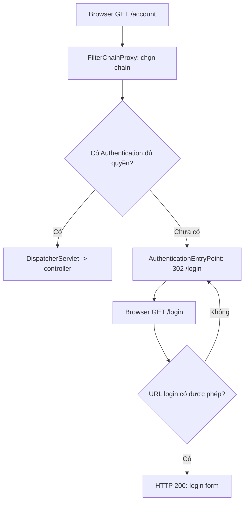
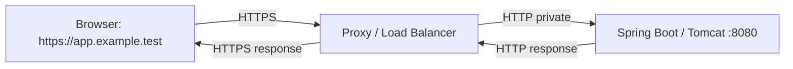

# Vòng lặp đăng nhập do matcher, cookie, proxy hoặc trang lỗi

> **Phạm vi:** chẩn đoán Spring Security **Servlet** trong Spring Boot 3.x, Spring Security 6.x, Java 17+. Tình huống: user mở tài nguyên cần xác thực, ứng dụng chuyển đến `/login`; sau khi nhập tài khoản vẫn về login, hoặc trình duyệt báo `ERR_TOO_MANY_REDIRECTS`. Bài tập trung vào bốn nhóm nguyên nhân: **request matcher**, **session/cookie**, **reverse proxy/HTTPS** và **trang lỗi/ERROR dispatch**. Mọi kết luận phải dựa trên HTTP status, `Location`, `Set-Cookie`/`Cookie` và filter chain thực, không phải suy đoán từ giao diện.

## 1. Nhận diện vòng lặp đăng nhập

### 1.1. Chuyển đến trang login một lần là bình thường

Trong web form-login truyền thống:

```text
GET /account  → HTTP 302 Location: /login
GET /login    → HTTP 200 (trang đăng nhập)
```

Đây là quá trình bảo vệ tài nguyên, không phải bug. Vòng lặp là khi request liên tục quay về điểm cũ mà không tới trang cuối:

```text
GET /login → HTTP 302 Location: /login
GET /login → HTTP 302 Location: /login
GET /login → HTTP 302 Location: /login
...
```

Hoặc:

```text
GET  /account → 302 /login
GET  /login   → 200
POST /login   → 302 /account
GET  /account → 302 /login
GET  /login   → 200
... user đăng nhập lại nhưng vẫn bị chuyển về login
```

Mẫu thứ nhất nghiêng về **matcher/route login**; mẫu thứ hai nghiêng về **cookie, session persistence, chain hoặc success handler**. Tuy nhiên có thể có nhiều lỗi đồng thời nên vẫn phải đọc trace.

### 1.2. Các triệu chứng dễ nhầm

| Chuỗi HTTP quan sát được | Nhóm nguyên nhân nên kiểm tra đầu tiên |
| --- | --- |
| `GET /login → 302 /login` | `loginPage`/`permitAll`/request matcher/multiple chains |
| `POST /login → 302 /login?error` | Sai credential hoặc authentication provider thất bại |
| `POST /login → 403` | CSRF token thiếu/sai; đôi khi access rule chặn |
| `POST /login → 302 /account`, rồi `GET /account → 302 /login` | Session cookie, auth chưa lưu, multi-node, chain match |
| `https://site/login → http://site/login → https://site/login` | Proxy, forwarded headers, HTTPS redirect |
| `GET /account → /error → /login → /error` | Error page hoặc ERROR dispatch bị bảo vệ |
| `GET /account → 401` | API/Basic entry point; không phải redirect loop |
| `GET /admin → 403` dù đăng nhập rồi | Authenticated nhưng thiếu quyền; không nhất thiết có loop |

**Bài học:** HTTP 302, 401, 403, 404 và 500 không mang cùng ý nghĩa. Đặc biệt, **403 sau POST** không thể được chữa bằng cách tắt CSRF nếu chưa phân tích bằng chứng.

## 2. Spring Security Servlet xử lý request như thế nào?

Request vào container đi qua `DelegatingFilterProxy` và `FilterChainProxy`. Spring Security chọn `SecurityFilterChain` phù hợp (nếu có nhiều chain, **chain đầu tiên match** theo `securityMatcher` và `@Order`). Trong chain đã chọn, các authentication filters, `SecurityContextHolderFilter`, `ExceptionTranslationFilter` và `AuthorizationFilter` phối hợp xử lý.



Vòng ở nhánh `GET /login` bị chặn xuất hiện **trước khi người dùng kịp nhập mật khẩu**.

### 2.1. securityMatcher và requestMatchers rất khác nhau

- `http.securityMatcher("/api/**")`: xác định **những request đi vào toàn bộ chain này**.
- `authorizeHttpRequests(auth -> auth.requestMatchers("/public").permitAll())`: chỉ áp dụng policy **bên trong chain đã được chọn**.
- `formLogin().loginProcessingUrl("/login")`: yêu cầu processing URL được **authentication filter trong chain thực sự match**.
- `permitAll("/login")` trong một chain có `securityMatcher("/api/**")` không làm request `/login` thuộc chain đó.
- `web.ignoring()` bỏ security filters cho route được ignore; thường **không thích hợp cho login processing URL**. Dùng `permitAll` khi cần URL công khai nhưng vẫn qua chain.

Hãy tránh tình huống người phát triển chỉ nhìn `requestMatchers` mà quên rằng request bị loại từ `securityMatcher` trước đó.

## 3. Nguyên nhân thứ nhất: matcher chặn chính trang login

### 3.1. Custom login page không được cho phép

Cấu hình cố ý **sai**:

```java
@Bean
SecurityFilterChain incorrect(HttpSecurity http) throws Exception {
    return http
            .authorizeHttpRequests(auth -> auth
                    .anyRequest().authenticated())
            .formLogin(form -> form.loginPage("/login"))
            .build();
}
```

Khi khai báo `loginPage("/login")`, bạn tự chịu trách nhiệm có trang `GET /login` (controller/template) và policy cho anonymous truy cập. Nếu mọi request đều cần authentication, `GET /login` có thể bị redirect về chính nó.

Cách sửa đúng ngữ cảnh:

```java
@Bean
SecurityFilterChain web(HttpSecurity http) throws Exception {
    return http
            .authorizeHttpRequests(auth -> auth
                    .requestMatchers("/", "/login", "/error",
                            "/css/**", "/js/**", "/images/**")
                    .permitAll()
                    .anyRequest().authenticated())
            .formLogin(form -> form
                    .loginPage("/login")
                    .loginProcessingUrl("/login")
                    .permitAll())
            .build();
}
```

Vẫn cần một controller/template phục vụ `GET /login`. `loginProcessingUrl("/login")` được filter xử lý cho form POST; hai đường GET/POST có thể cùng path nhưng khác trách nhiệm. Không mở toàn bộ `/**` để thoát vòng lặp.

Nếu không cần custom login page, cấu hình ngắn hơn:

```java
return http
        .authorizeHttpRequests(auth -> auth
                .requestMatchers("/").permitAll()
                .anyRequest().authenticated())
        .formLogin(Customizer.withDefaults())
        .build();
```

Spring Security tạo trang login mặc định. Không cần tự dựng controller `GET /login` và không tùy chỉnh `loginPage` khi không có yêu cầu UX cụ thể.

### 3.2. Hai SecurityFilterChain nhưng /login đi sai chain

Ví dụ dễ gặp:

```java
@Bean
@Order(1)
SecurityFilterChain api(HttpSecurity http) throws Exception {
    return http
            .securityMatcher("/api/**")
            .authorizeHttpRequests(auth -> auth.anyRequest().authenticated())
            .formLogin(form -> form.loginProcessingUrl("/login"))
            .build();
}
```

Request `POST /login` **không match `/api/**`**, nên form-login processing filter trong API chain không chạy cho URL đó. Có thể request bị chain khác bắt hoặc không có filter nào xử lý nó như login.

Phương án rõ ràng hơn: API chain chuyên API, web chain chuyên form login.

```java
@Bean
@Order(1)
SecurityFilterChain api(HttpSecurity http) throws Exception {
    return http
            .securityMatcher("/api/**")
            .authorizeHttpRequests(auth -> auth
                    .anyRequest().authenticated())
            .httpBasic(Customizer.withDefaults())
            .build();
}

@Bean
@Order(2)
SecurityFilterChain browserWeb(HttpSecurity http) throws Exception {
    return http
            .authorizeHttpRequests(auth -> auth
                    .requestMatchers("/", "/error").permitAll()
                    .anyRequest().authenticated())
            .formLogin(Customizer.withDefaults())
            .build();
}
```

Đây là hai beans thay thế cho cấu hình một chain, không phải yêu cầu phải dùng HTTP Basic ở mọi API. Trong hệ thống có JWT/opaque token, API có thể stateless và dùng Resource Server; trình duyệt vẫn cần chain riêng cho form/session. Đừng bật form login trong API chain khi processing endpoint nằm ngoài phạm vi của chain.

### 3.3. Context path và saved request

Nếu ứng dụng chạy dưới `/portal`, external login URL có thể là `/portal/login`. Trong cấu hình Spring Security, matcher thường dựa trên đường dẫn bên trong ứng dụng/Servlet path; browser lại nhìn URL public bao gồm context path. Phải kiểm tra ứng dụng và proxy có thống nhất prefix hay không.

Sau khi truy cập resource bảo vệ, `RequestCache` có thể lưu saved request, rồi success handler trả user về đó. Nếu saved URL không còn khả dụng, thiếu quyền hoặc thuộc host/path sai, browser có thể lại đến login. `defaultSuccessUrl` và custom `AuthenticationSuccessHandler` cũng có thể tự tạo loop nếu redirect về một endpoint đang bị bảo vệ sai.

**Kiểm chứng:** sau `POST /login`, ghi lại `Location`, rồi GET chính URL đó bằng cùng cookie jar. Nếu vẫn 302 tới login, đừng chỉ xem thông báo “login success”; kiểm tra session và chain của request tiếp theo.

## 4. Nguyên nhân thứ hai: cookie hoặc session không bền giữa request

### 4.1. Cookie session và SecurityContext

Đối với ứng dụng Spring Security Servlet dùng session, container có thể trả:

```http
HTTP/1.1 200 OK
Set-Cookie: JSESSIONID=opaque-session-id; Path=/; HttpOnly; SameSite=Lax
```

Browser phải lưu cookie hợp lệ và gửi lại:

```http
GET /account HTTP/1.1
Host: app.example.test
Cookie: JSESSIONID=opaque-session-id
```

Spring Security có thể lưu `SecurityContext` vào `HttpSession` qua `SecurityContextRepository`. Nếu client không gửi cookie đúng, server không nhận diện được session. Nếu cookie được gửi nhưng session đã invalid, không lưu context hoặc nằm trên node khác không dùng shared session store, user vẫn bị coi là anonymous.

**Cookie có trong `Set-Cookie` không chứng minh browser đã lưu; cookie có trong request cũng không chứng minh server còn authentication.** Phải kiểm tra hai phía.

### 4.2. Cookie attributes quan trọng

| Thuộc tính | Ý nghĩa | Lỗi gây loop |
| --- | --- | --- |
| `Path` | Browser gửi cookie cho request path thuộc phạm vi | Cookie `Path=/portal` nhưng redirect sang `/account` |
| `Domain` | Host/domain cookie áp dụng; bỏ Domain là host-only | Login tại app.example.test, resource ở api.example.test |
| `Secure` | Cookie chỉ được gửi qua HTTPS theo browser policy | Truy cập HTTP sau khi server đặt Secure |
| `HttpOnly` | JavaScript không đọc `document.cookie` | Không phải nguyên nhân browser không gửi cookie |
| `SameSite=Lax` | Chính sách gửi cookie theo site context | Cross-site flows không phù hợp mode navigation |
| `SameSite=Strict` | Hạn chế cross-site nghiêm ngặt hơn | External callback/navigation có thể mất cookie |
| `SameSite=None` | Cho phép cross-site context khi browser cho phép, cần `Secure` | Thiếu Secure hoặc third-party privacy restrictions |
| `Max-Age`/`Expires` | Thời hạn cookie | Cookie hết hạn hoặc bị ghi đè bởi server/proxy |
| `JSESSIONID` | Thường là tên session cookie Servlet | Xung đột giữa app/path/domain khác nhau |

**Đừng tắt HttpOnly để “trình duyệt nhận cookie”.** HttpOnly không cấm browser tự gửi cookie; nó chỉ bảo vệ khỏi JavaScript đọc cookie, giảm rủi ro bị lộ qua XSS.

### 4.3. Same-origin không đồng nghĩa same-site

Origin gồm scheme + host + port. `https://app.example.test` và `https://api.example.test` khác origin, nhưng có thể same-site tùy registrable domain/scheme. `SameSite` chủ yếu áp dụng theo site, còn `fetch` cross-origin vẫn chịu CORS.

Nếu frontend gọi API bằng:

```javascript
const response = await fetch("https://api.example.test/account", {
  credentials: "include"
});
```

thì cần đánh giá đồng thời:

1. Cookie `Domain`/`Path` có đúng host/path không?
2. `SameSite`/`Secure` có cho phép gửi không?
3. Browser có chính sách chặn third-party cookies không?
4. API có CORS policy cho origin và credentials đúng không?
5. Request đổi trạng thái có CSRF protection không?

`Access-Control-Allow-Origin: *` không thể dùng như một allowlist phù hợp cho credentialed cross-origin browser requests. Đừng nới CORS, SameSite hoặc CSRF toàn cục để chỉ khiến một test pass.

### 4.4. Session fixation: JSESSIONID thay sau khi login

Spring Security có session fixation protection. Sau khi login thành công, session ID **có thể được đổi**, tùy container/cấu hình:

```text
GET /login       Set-Cookie: JSESSIONID=before
POST /login      Cookie: JSESSIONID=before
                 Set-Cookie: JSESSIONID=after
                 Location: /account
GET /account     Cookie: JSESSIONID=after
```

Nếu test client cố gửi ID `before` thay vì cập nhật cookie `after`, request sau login có thể về login dù authentication filter chạy thành công. Đừng log ID thật; chỉ kiểm tra cookie jar có cập nhật theo `Set-Cookie` của POST.

### 4.5. SessionCreationPolicy và việc lưu SecurityContext

`SessionCreationPolicy.STATELESS` phù hợp một số API bearer-token nhưng **không phù hợp** nếu web form-login trông chờ HTTP session để giữ authentication:

```java
// Cấu hình dễ sai khi áp dụng cho form login cần session:
.sessionManagement(session ->
        session.sessionCreationPolicy(SessionCreationPolicy.STATELESS))
```

Dấu hiệu: mỗi request tới `/account` trở thành anonymous dù user vừa login. Hãy kiểm tra policy ở **chain thực sự match** và tách API/web nếu khác yêu cầu session.

Trong các custom authentication flows, chỉ gọi:

```java
SecurityContextHolder.getContext().setAuthentication(authentication);
```

không tự đảm bảo authentication tồn tại ở request sau. Với cấu hình sử dụng `SecurityContextHolderFilter` và explicit save, flow custom cần lưu context thông qua `SecurityContextRepository#saveContext(...)` đúng hợp đồng/lifecycle. Với `formLogin()` chuẩn, Spring Security đã có đường xử lý phù hợp. Không tự dựng login controller chỉ để thay flow chuẩn.

### 4.6. Hai server instances và session store

Nếu browser login tới node A nhưng request tiếp theo tới node B, session in-memory ở A không tự xuất hiện trên B. Các phương án phụ thuộc kiến trúc:

- Shared session store như Spring Session + Redis/JDBC.
- Sticky session ở load balancer theo chính sách được quản lý.
- Token-based stateless authentication cho API đúng mục tiêu, **không coi đổi sang stateless là cách chữa form-login session loop miễn phí**.
- Health/readiness để loại node không có shared session hoặc cấu hình sai.

**Test** gửi liên tiếp request vào các node hoặc qua load balancer; không chỉ thử bằng một local server.

## 5. Nguyên nhân thứ ba: proxy tạo sai Location, scheme hoặc host

### 5.1. HTTPS phía ngoài, HTTP phía trong

Mô hình điển hình:



Backend có thể thấy `http://app:8080` nhưng browser đang dùng `https://app.example.test`. Nếu Spring sinh redirect tuyệt đối dựa trên backend scheme/host, có thể trả:

```http
Location: http://app:8080/login
```

Hoặc trả `http://app.example.test/login`, bị edge ép HTTPS rồi lặp. URL backend có thể không truy cập được từ browser, cookie Secure không được gửi trên HTTP, callback OIDC bị lệch base URL.

### 5.2. Forwarded headers và độ tin cậy

Proxy thường set:

```http
X-Forwarded-Proto: https
X-Forwarded-Host: app.example.test
X-Forwarded-Port: 443
X-Forwarded-For: 198.51.100.10
```

Spring Boot có `server.forward-headers-strategy` (ví dụ `none`, `native`, `framework` tùy stack/container). Khi dùng `framework`, Spring có cơ chế xử lý forwarded headers như `ForwardedHeaderFilter`. Tuy nhiên **chỉ tin các headers do reverse proxy đáng tin ghi đè/sanitize**, không tin dữ liệu user gửi trực tiếp từ Internet.

Mẫu cấu hình ứng dụng **phía sau proxy TLS được kiểm soát**:

```yaml
server:
  forward-headers-strategy: framework
  servlet:
    session:
      cookie:
        secure: true
        http-only: true
        same-site: lax
```

`secure:true` hợp lý khi browser kết nối qua HTTPS public, dù backend hop là HTTP nội bộ. Không bỏ Secure chỉ vì Tomcat không trực tiếp terminate TLS.

Ví dụ Nginx minh họa:

```nginx
server {
    listen 443 ssl;
    server_name app.example.test;

    ssl_certificate /etc/nginx/tls/fullchain.pem;
    ssl_certificate_key /etc/nginx/tls/privkey.pem;

    location / {
        proxy_pass http://app:8080;
        proxy_set_header Host app.example.test;
        proxy_set_header X-Forwarded-Proto https;
        proxy_set_header X-Forwarded-Host app.example.test;
        proxy_set_header X-Forwarded-Port 443;
        proxy_set_header X-Forwarded-For $remote_addr;
        proxy_set_header Forwarded "";
    }
}
```

Đây **không phải** file Nginx hoàn chỉnh cho production; đường dẫn certificate/domain là mô hình. Proxy phải sanitize đầy đủ mọi forwarded headers mà backend sẽ tin và chặn direct backend access. Nếu không, attacker có thể giả `X-Forwarded-Host`, tạo open redirect, link sai host hoặc gây login loop.

### 5.3. Context path và prefix rewrite

Ví dụ public URL là `https://app.example.test/portal` nhưng Nginx strip `/portal` trước khi chuyển tới backend. Nếu app tạo `Location: /login`, browser đến sai path thay vì `/portal/login`. Cookie `Path=/portal` cũng không được gửi tới `/login`.

Cần chọn một chiến lược nhất quán:

- App hiểu `server.servlet.context-path=/portal` và proxy chuyển path tương ứng.
- Hoặc proxy strip prefix, truyền `X-Forwarded-Prefix` đáng tin và framework xử lý prefix theo thiết kế.
- Không đồng thời nhân đôi prefix ở proxy và app.
- Kiểm tra `loginPage`, `loginProcessingUrl`, logout URL, static assets, session cookie `Path` và saved requests theo **URL public**.

Không chỉ thêm header rồi đoán đã sửa. Hãy kiểm tra `Location` thực tế, Request-URI và browser cookie scope.

## 6. Nguyên nhân thứ tư: trang lỗi/ERROR dispatch bị bảo vệ

### 6.1. Lỗi ứng dụng có thể bị che thành login loop

Khi một controller ném exception, Servlet container/Spring MVC có thể thực hiện **ERROR dispatch** tới `/error`. Nếu `/error` hoặc error dispatcher bị Spring Security bắt xác thực, client có thể bị redirect tới `/login`, rồi xảy ra lỗi tiếp hoặc lặp.

```text
GET /report       → exception
ERROR /error      → redirect /login
GET /login        → lỗi render hoặc security chặn
ERROR /error      → redirect /login
...
```

Nguồn gốc có thể là database down, template lỗi, thiếu biến, lỗi bean, chứ không liên quan mật khẩu.

### 6.2. Cấu hình rõ quyền cho error dispatch

```java
import jakarta.servlet.DispatcherType;

http.authorizeHttpRequests(auth -> auth
        .dispatcherTypeMatchers(DispatcherType.ERROR).permitAll()
        .requestMatchers("/", "/login", "/error").permitAll()
        .anyRequest().authenticated()
);
```

Đây là **snippet chèn trong method cấu hình HttpSecurity**, không phải class Java độc lập. Nếu ứng dụng có custom error page như `/failure`, cần cho phép đúng path. Không mở toàn app hay tắt Spring Security.

Lưu ý:

- `permitAll("/error")` không sửa exception gốc; nó chỉ giúp response lỗi không bị một authentication redirect mới che đi.
- `@ControllerAdvice` thường chỉ bao các exception thuộc MVC handler, không bao mọi exception security filter.
- `ExceptionTranslationFilter` xử lý authentication/access denied exceptions theo cơ chế Spring Security, không thay cho lỗi 500 của controller.
- Không mặc định permit mọi `DispatcherType.FORWARD` nếu chưa rõ các forward nội bộ; phân quyền ERROR/FORWARD theo phạm vi thực.
- Error page nên che stack trace/secret, nhưng ghi log kỹ thuật đã lọc và correlation ID.

### 6.3. Phân biệt lỗi

| HTTP status | Diễn giải thường gặp trong web form/login | Hướng điều tra |
| --- | --- | --- |
| 302 `Location: /login` | Authentication entry point | Loop hay chỉ chuyển hướng hợp lệ? |
| 302 `Location: /login?error` | Authentication thất bại | User/password/provider và login error |
| 401 | API/Basic entry point | Không phải form redirect loop |
| 403 | CSRF hoặc AccessDenied | Kiểm tra CSRF token, role/authority, filter |
| 404 | Không có route/template hoặc proxy prefix sai | Kiểm tra controller/resource/URL |
| 500 | Controller/template/downstream exception | Kiểm tra exception gốc và error dispatch |
| 502/503/504 | Proxy/backend không khả dụng | Kiểm tra network/service/health |

Một lỗi 403 trên POST login chưa chắc do role; form login bảo vệ CSRF và token phải thuộc **cùng session** với browser gửi form.

## 7. Checklist chẩn đoán theo thứ tự hiệu quả

1. Bật **Preserve log** ở Browser DevTools → Network, tái hiện từ request đầu.
2. Ghi **method, URL, status, Location** từng response, phân biệt loop ngay `GET /login` hay sau `POST /login`.
3. Kiểm tra `GET /login` trả 200 hay 302; nếu 302 về chính nó, ưu tiên matcher/loginPage/chain.
4. Kiểm tra POST có status 302 success, 302 error, 403 hay 404; không gộp chúng.
5. Xem browser có nhận `Set-Cookie` không; có chặn cookie do `Secure`/`SameSite`/`Domain`/`Path` không.
6. Xem request sau login có gửi `Cookie` không và server còn session/context không.
7. Kiểm tra cookie/session ID có đổi sau login, đặc biệt session fixation protection.
8. Xác định request đi vào chain nào, context persistence có stateless không, node A/B có shared session store không.
9. Nếu Location sai scheme/host/port/prefix, đối chiếu public HTTPS URL và proxy forwarded headers.
10. Nếu chuỗi có `/error`/ERROR dispatch, xem exception gốc, custom error page và dispatcher rule.
11. Kiểm tra CSRF token và cookie jar cho POST, không dùng `csrf.disable()` làm giải pháp.
12. Sau khi sửa, chạy **negative tests**: user anonymous không được xem tài nguyên, user thiếu quyền vẫn 403, CSRF thiếu vẫn bị từ chối.

### 7.1. curl: giới hạn redirect

```bash
# Đọc response đầu tiên, không tự follow redirect
curl -i http://localhost:8080/account
curl -i http://localhost:8080/login

# Theo dõi redirect nhưng dừng sau 5 lần
curl -sS -v -L --max-redirs 5 \
  -o /dev/null http://localhost:8080/account

# Lưu cookie jar local cho các request tiếp theo
curl -sS -i -c cookies-debug.txt \
  -b cookies-debug.txt http://localhost:8080/login
```

`curl -L` có thể che chi tiết các response trung gian nếu bạn chỉ xem kết quả cuối; dùng `-v`/`-i` và `--max-redirs` để không chạy vòng vô hạn. File cookie có thể chứa session credential; **không commit hoặc chia sẻ file này**.

### 7.2. Log có kiểm soát

```yaml
logging:
  level:
    org.springframework.security: DEBUG
    org.springframework.web: INFO
```

Dùng DEBUG cho dev/staging trong thời gian cần thiết để nhìn filter chain, entry point và authorization. Không bật TRACE diện rộng trong production; lọc log tránh raw password, session ID, `Authorization`, `Cookie`, OAuth codes/token. Dùng correlation ID và request metadata đã lọc để nối trace giữa Nginx, Spring và session store.

## 8. Demo chạy được bằng Java 17 và Spring Boot 3.x

Dự án mẫu dùng **Spring Boot 3.4.2 / Spring Security 6.4.x**, generated form-login, session và error dispatch được phép. Mục đích: có baseline **không loop** trước khi so sánh với cấu hình bị lỗi. Đây là Java Spring app, không chạy được bằng `javac` thuần; cần Gradle Wrapper/JDK17 và dependencies.

### 8.1. Gradle và cấu trúc

```text
login-loop-demo/
├── settings.gradle
├── build.gradle
└── src/
    ├── main/
    │   ├── java/com/example/loginloop/
    │   │   ├── LoginLoopApplication.java
    │   │   ├── SecurityConfig.java
    │   │   └── PageController.java
    │   └── resources/application.yml
    └── test/java/com/example/loginloop/
        └── LoginFlowHttpTest.java
```

`settings.gradle`:

```groovy
rootProject.name = 'login-loop-demo'
```

`build.gradle`:

```groovy
plugins {
    id 'java'
    id 'org.springframework.boot' version '3.4.2'
    id 'io.spring.dependency-management' version '1.1.7'
}

group = 'com.example'
version = '0.0.1-SNAPSHOT'

java {
    toolchain {
        languageVersion = JavaLanguageVersion.of(17)
    }
}

repositories {
    mavenCentral()
}

dependencies {
    implementation 'org.springframework.boot:spring-boot-starter-web'
    implementation 'org.springframework.boot:spring-boot-starter-security'
    testImplementation 'org.springframework.boot:spring-boot-starter-test'
}

tasks.named('test') {
    useJUnitPlatform()
}
```

Dùng BOM của Spring Boot để đồng bộ Spring Security/Spring MVC. Nếu dự án có version khác, điều chỉnh cùng hệ dependency management, không ép chồng một version Security tùy ý.

### 8.2. Boot application

Tệp `src/main/java/com/example/loginloop/LoginLoopApplication.java`:

```java
package com.example.loginloop;

import org.springframework.boot.SpringApplication;
import org.springframework.boot.autoconfigure.SpringBootApplication;

@SpringBootApplication
public class LoginLoopApplication {
    public static void main(String[] args) {
        SpringApplication.run(LoginLoopApplication.class, args);
    }
}
```

### 8.3. SecurityConfig

Tệp `src/main/java/com/example/loginloop/SecurityConfig.java`:

```java
package com.example.loginloop;

import jakarta.servlet.DispatcherType;
import org.springframework.context.annotation.Bean;
import org.springframework.context.annotation.Configuration;
import org.springframework.security.config.Customizer;
import org.springframework.security.config.annotation.web.builders.HttpSecurity;
import org.springframework.security.core.userdetails.User;
import org.springframework.security.core.userdetails.UserDetails;
import org.springframework.security.core.userdetails.UserDetailsService;
import org.springframework.security.crypto.PasswordEncoder;
import org.springframework.security.crypto.factory.PasswordEncoderFactories;
import org.springframework.security.provisioning.InMemoryUserDetailsManager;
import org.springframework.security.web.SecurityFilterChain;

@Configuration
public class SecurityConfig {
    @Bean
    PasswordEncoder passwordEncoder() {
        return PasswordEncoderFactories.createDelegatingPasswordEncoder();
    }

    @Bean
    UserDetailsService users(PasswordEncoder encoder) {
        UserDetails alice = User.withUsername("alice")
                .password(encoder.encode("alice-pass"))
                .roles("USER")
                .build();
        return new InMemoryUserDetailsManager(alice);
    }

    @Bean
    SecurityFilterChain securityFilterChain(HttpSecurity http)
            throws Exception {

        return http
                .authorizeHttpRequests(auth -> auth
                        .dispatcherTypeMatchers(DispatcherType.ERROR)
                        .permitAll()
                        .requestMatchers("/", "/error").permitAll()
                        .anyRequest().authenticated()
                )
                .formLogin(Customizer.withDefaults())
                .build();
    }
}
```

- Generated login page xử lý URL `/login` theo cấu hình mặc định, không cần custom `@GetMapping("/login")`.
- `/account` protected; `/` public.
- `/error` và ERROR dispatcher được phép để không che lỗi 500 bằng redirect login.
- Form login dùng session; không đặt `STATELESS`.
- CSRF không tắt; form login phải có token `_csrf`.
- User/password là **dữ liệu giả cho test**, không dùng ở môi trường ngoài localhost.

### 8.4. Controller

Tệp `src/main/java/com/example/loginloop/PageController.java`:

```java
package com.example.loginloop;

import java.util.Map;
import org.springframework.security.core.Authentication;
import org.springframework.web.bind.annotation.GetMapping;
import org.springframework.web.bind.annotation.RestController;

@RestController
public class PageController {
    @GetMapping("/")
    public Map<String, String> home() {
        return Map.of("message", "public");
    }

    @GetMapping("/account")
    public Map<String, String> account(Authentication auth) {
        return Map.of("user", auth.getName());
    }

    @GetMapping("/broken")
    public Map<String, String> broken() {
        throw new IllegalStateException("Simulated failure");
    }
}
```

`/broken` chỉ dùng để kiểm thử rằng một lỗi được phản hồi như lỗi ứng dụng (ví dụ 500), không bị biến thành login loop. Không in stack trace và bí mật vào response trong production.

### 8.5. Local HTTP profile

`src/main/resources/application.yml`:

```yaml
server:
  port: 8080
  servlet:
    session:
      cookie:
        http-only: true
        same-site: lax
        secure: false
```

Đây là cấu hình **chỉ chạy HTTP localhost**. Public HTTPS deployment phải bảo đảm Secure cookie và trusted proxy forwarding; không đưa `secure:false` lên production.

## 9. Real HTTP test: POST login thành công phải giữ session

`MockMvc` rất hữu ích để kiểm tra security filters/matcher nhưng không mở socket và không mô phỏng đầy đủ cookie jar/browser. `@SpringBootTest(webEnvironment = RANDOM_PORT)` chạy embedded Servlet container thật, cho phép kiểm qua Java 17 `HttpClient` và `CookieManager`.

### 9.1. LoginFlowHttpTest.java

`src/test/java/com/example/loginloop/LoginFlowHttpTest.java`:

```java
package com.example.loginloop;

import java.net.CookieManager;
import java.net.CookiePolicy;
import java.net.URI;
import java.net.URLEncoder;
import java.net.http.HttpClient;
import java.net.http.HttpRequest;
import java.net.http.HttpResponse;
import java.nio.charset.StandardCharsets;
import java.util.regex.Matcher;
import java.util.regex.Pattern;

import org.junit.jupiter.api.Test;
import org.springframework.boot.test.context.SpringBootTest;
import org.springframework.boot.test.web.server.LocalServerPort;

import static org.assertj.core.api.Assertions.assertThat;

@SpringBootTest(webEnvironment = SpringBootTest.WebEnvironment.RANDOM_PORT)
class LoginFlowHttpTest {

    @LocalServerPort
    int port;

    private String url(String path) {
        return "http://localhost:" + port + path;
    }

    private HttpClient client() {
        CookieManager jar =
                new CookieManager(null, CookiePolicy.ACCEPT_ALL);
        return HttpClient.newBuilder()
                .cookieHandler(jar)
                .followRedirects(HttpClient.Redirect.NEVER)
                .build();
    }

    private HttpResponse<String> get(
            HttpClient browser, String path) throws Exception {

        HttpRequest req = HttpRequest.newBuilder(
                URI.create(url(path))).GET().build();
        return browser.send(req,
                HttpResponse.BodyHandlers.ofString());
    }

    private String csrfFromForm(String html) {
        Matcher tags = Pattern.compile(
                "<input\\b[^>]*>", Pattern.CASE_INSENSITIVE)
                .matcher(html);
        while (tags.find()) {
            String tag = tags.group();
            if (tag.contains("name=\"_csrf\"")) {
                Matcher value = Pattern.compile(
                        "value=\"([^\"]+)\"").matcher(tag);
                if (value.find()) {
                    return value.group(1);
                }
            }
        }
        throw new IllegalStateException("CSRF field missing");
    }

    @Test
    void loginPageIsPublic() throws Exception {
        HttpResponse<String> page = get(client(), "/login");
        assertThat(page.statusCode()).isEqualTo(200);
        assertThat(page.body()).contains("name=\"username\"");
        assertThat(page.body()).contains("name=\"password\"");
    }

    @Test
    void validLoginKeepsSessionAcrossHttpRequests() throws Exception {
        HttpClient browser = client();
        HttpResponse<String> page = get(browser, "/login");
        assertThat(page.statusCode()).isEqualTo(200);

        String form = "username=alice"
                + "&password=alice-pass"
                + "&_csrf=" + URLEncoder.encode(
                        csrfFromForm(page.body()), StandardCharsets.UTF_8);

        HttpRequest loginRequest = HttpRequest.newBuilder(
                        URI.create(url("/login")))
                .header("Content-Type",
                        "application/x-www-form-urlencoded")
                .POST(HttpRequest.BodyPublishers.ofString(form))
                .build();

        HttpResponse<String> login = browser.send(
                loginRequest,
                HttpResponse.BodyHandlers.ofString());
        assertThat(login.statusCode()).isEqualTo(302);

        HttpResponse<String> account = get(browser, "/account");
        assertThat(account.statusCode()).isEqualTo(200);
        assertThat(account.body()).contains("\"user\":\"alice\"");
    }

    @Test
    void anonymousGetsOneRedirectToLogin() throws Exception {
        HttpResponse<String> response = get(client(), "/account");
        assertThat(response.statusCode()).isEqualTo(302);
        assertThat(response.headers().firstValue("location").orElse(""))
                .contains("/login");
    }

    @Test
    void loginWithoutCsrfIsRejected() throws Exception {
        HttpClient browser = client();
        HttpRequest req = HttpRequest.newBuilder(
                        URI.create(url("/login")))
                .header("Content-Type",
                        "application/x-www-form-urlencoded")
                .POST(HttpRequest.BodyPublishers.ofString(
                        "username=alice&password=alice-pass"))
                .build();
        HttpResponse<String> response = browser.send(
                req, HttpResponse.BodyHandlers.ofString());
        assertThat(response.statusCode()).isEqualTo(403);
    }
}
```

**Giải thích test:**

1. `loginPageIsPublic` kiểm trực tiếp `GET /login → 200`, bắt lỗi matcher tự redirect login.
2. `validLoginKeepsSessionAcrossHttpRequests` giữ cùng cookie jar, lấy CSRF từ form, POST login, rồi GET tài nguyên bảo vệ. Đây mới là bằng chứng thực rằng login tạo session sử dụng được.
3. `anonymousGetsOneRedirectToLogin` xác minh entry point cho client chưa có session.
4. `loginWithoutCsrfIsRejected` chứng minh không vô tình tắt bảo vệ CSRF.
5. `followRedirects(NEVER)` giúp nhìn chính xác 302 thay vì bị HttpClient tự follow và che chuỗi.
6. Regex đọc form phù hợp generated login form đơn giản, không phải HTML parser tổng quát. Custom page có thể cần parser khác hoặc CSRF endpoint rõ ràng.

Chạy khi dự án có Gradle Wrapper:

```bash
./gradlew test
```

Kỳ vọng 4 tests pass với đúng code/dependencies. Đây **không phải tuyên bố đã thực thi** trên máy người học. Test dùng HTTP local, không xác nhận proxy HTTPS hay cookie SameSite của browser thật.

## 10. Kiểm thử proxy/browser khi local đã pass

Nếu HTTP test trên local không loop nhưng browser ở staging vẫn loop, đừng cố sửa `@PreAuthorize` hoặc password encoder một cách ngẫu nhiên. Hãy tái hiện topology production.

### 10.1. Browser DevTools

- Network → Preserve log: quan sát **từng status/Location**.
- Application/Storage → Cookies: xem cookie bị block bởi Path/Domain/SameSite/Secure hay policy browser.
- Network → login POST: xem request có cookie session và form field `_csrf` không (không copy giá trị bí mật).
- Network → request protected: cookie sau login có gửi không?
- Console/Issues: mixed content, third-party cookie restrictions, CORS.
- Xem redirect chain đi qua HTTPS ↔ HTTP hay thay đổi host.
- `document.cookie` rỗng không chứng minh `HttpOnly` cookie bị mất; HttpOnly được thiết kế để JS không đọc được.

### 10.2. Proxy/TLS test

Một test qua Nginx/Traefik/load balancer thật cần xác nhận:

- Public URL là HTTPS và certificate hợp lệ (không dùng `curl -k` trong test xác minh trust).
- Absolute `Location` không chứa `http://app:8080` hay host nội bộ.
- Cookie phiên có `Secure` trên HTTPS, scope Domain/Path phù hợp.
- Header forwarded do proxy kiểm soát; không cho attacker tự set host/proto.
- Có thể login và truy cập `/account` qua cùng **public URL** và cookie jar.
- Context path/prefix không bị rewrite hai lần hoặc mất prefix.
- OAuth2/OIDC callback, state/session cookie đúng nếu app có SSO.

### 10.3. Test matrix và expected behavior

| Trường hợp | Nơi test | Kỳ vọng |
| --- | --- | --- |
| `GET /login` anonymous | Real HTTP / MockMvc | 200, không loop |
| `GET /account` anonymous | Real HTTP | 302 /login một lần |
| POST login đúng + CSRF + cookie | Real HTTP | 302 success và GET account 200 |
| POST login thiếu CSRF | Real HTTP | 403 |
| Client không giữ cookie | Real HTTP | Request sau vẫn cần login |
| User sai password | Real HTTP | Redirect login?error hoặc failure response cấu hình |
| URL login custom không permit | MockMvc/config negative | Phát hiện 302 tự lặp |
| App web dùng STATELESS nhầm | Real HTTP/config negative | Không giữ session; test phải bắt lỗi |
| Proxy TLS mất forwarded proto | Proxy real | Location sai scheme/host; fix trước release |
| Cookie Secure/SameSite sai | Browser real | Browser block hoặc không gửi cookie |
| ERROR dispatch bị bảo vệ | Servlet container real | Error không được biến thành login loop |
| Resource thật không tồn tại | Servlet container real | 404 hoặc error policy rõ, không tự login loop |
| User đã login nhưng thiếu role | Real HTTP/MockMvc | 403, không phải bắt user login lại |
| Multi-node thiếu session store | Load balancer integration | Request node B không còn auth; phải phát hiện |

Không cần mọi ca chạy trong PR unit suite; phân tầng nhanh/chậm, nhưng mỗi rủi ro phải có **kiểm chứng ở lớp phù hợp**.

## 11. Các sai lầm khi “sửa” vòng đăng nhập

| Thay đổi sai | Vì sao không đúng? | Phương án an toàn |
| --- | --- | --- |
| `anyRequest().permitAll()` | Mở toàn bộ protected resources | Permit đúng login/public/error URLs |
| `csrf.disable()` cho form login | Mất CSRF protection của session app | Gửi token đúng cùng cookie/session |
| `web.ignoring("/login")` không hiểu hệ quả | Có thể bỏ luôn authentication processing filter | Giữ URL trong chain bằng `permitAll()` |
| `STATELESS` cho web form | Không lưu auth như mong đợi | Tách web session và stateless API |
| Bỏ `HttpOnly` vì JS không thấy cookie | Tăng nguy cơ XSS đánh cắp cookie | Dùng Storage/Network để kiểm tra |
| Bỏ `Secure` vì backend là HTTP | Hạ cấp bảo vệ cookie ngoài HTTPS | Secure cookie với TLS-terminating proxy |
| `SameSite=None` cho mọi cookie | Tăng exposure cross-site, chưa chắc hết loop | Thiết kế đúng site/cross-origin |
| Tin mọi forwarded headers | Host spoofing/open redirect | Trusted proxy sanitize và backend private |
| Bảo vệ `/error` như URL nhạy cảm | Che exception gốc bằng login redirect | ERROR dispatch policy phù hợp |
| Chỉ test POST trả 302 | Chưa chứng minh request sau có authentication | GET tài nguyên bảo vệ bằng cùng cookie jar |
| Chỉ test `with(user("alice"))` | Không test login/cookie thật | Real Servlet HTTP + browser/proxy khi cần |
| In raw session ID vào logs | Session là bearer credential | Correlation ID và log đã lọc |

## 12. Câu hỏi tự kiểm tra

**1.** `GET /login` liên tục trả `302 Location: /login`. Bạn kiểm tra gì trước?  
**Đáp án:** route login có permitAll đúng không, loginPage custom có controller/template không, securityMatcher/multiple chains có bắt URL sai không. Chưa phải lỗi password.

**2.** `POST /login` trả 302 /account, nhưng GET /account lại 302 /login. Vì sao?  
**Đáp án:** có thể browser không giữ `JSESSIONID`, session ID đổi sau login, context chưa được lưu, node khác không có session, cookie scope sai hoặc chain đang stateless.

**3.** Cookie có `HttpOnly`, JavaScript không thấy trong `document.cookie`. Có phải cookie đã mất?  
**Đáp án:** không. HttpOnly chỉ ngăn JS đọc; xem Network/Storage để xác minh browser lưu/gửi cookie.

**4.** Backend HTTP phía sau HTTPS proxy có nên đặt cookie không Secure?  
**Đáp án:** không. Browser kết nối public HTTPS; cookie phiên nên có `Secure` phù hợp, kết hợp forwarded scheme/host được xác minh.

**5.** `permitAll("/login")` trong chain chỉ match `/api/**` có làm `POST /login` được xử lý không?  
**Đáp án:** không. URL `/login` không vào chain đó; phải sửa chain matcher hoặc loginProcessingUrl.

**6.** Khi `POST /login` trả 403, có nên tắt CSRF để hết loop?  
**Đáp án:** không. Hãy kiểm tra token `_csrf` và session cookie, xác nhận 403 do CSRF hay authorization.

**7.** Vì sao lỗi controller có thể khiến user bị gửi về login?  
**Đáp án:** error dispatch tới `/error`/custom error page có thể bị security chặn rồi kích hoạt entry point, che lỗi gốc.

**8.** Tại sao `curl -L` một lần không đủ điều tra?  
**Đáp án:** tự follow nhiều redirects có thể che response đầu; cần giới hạn số lần và xem status/Location từng hop.

**9.** Test `@SpringBootTest(RANDOM_PORT)` chứng minh browser đã chấp nhận SameSite cookie chưa?  
**Đáp án:** chưa. Nó dùng Servlet container thật và HttpClient, không thay thế kiểm thử cookie policy trên Chrome/Firefox/WebKit.

**10.** Sau khi sửa, cần xác nhận điều gì ngoài chuyện “không còn loop”?  
**Đáp án:** authentication/authorization/CSRF vẫn giữ nguyên; anonymous không đọc được resource, user thiếu quyền vẫn bị từ chối và cookie/redirect đúng với public URL.

## Kết luận

Vòng lặp đăng nhập trong Spring Security Servlet là **triệu chứng của đường đi HTTP**, không phải một exception duy nhất:

- **Loop ngay GET /login:** kiểm tra matcher, loginPage, permitAll và security chain.
- **Login POST thành công nhưng request sau anonymous:** kiểm cookie, session fixation, security context persistence, stateless policy và multi-node sessions.
- **Chuyển vòng HTTP/HTTPS/host/prefix:** kiểm reverse proxy, forwarded headers và external URL.
- **Loop qua trang lỗi:** kiểm error dispatch, error page và exception gốc.

**Phương pháp đúng** là ghi chuỗi redirect, đối chiếu `Location`, `Set-Cookie`/`Cookie`, kiểm định trên Servlet container thật và browser/proxy khi cần. Sửa đúng lớp, **không tắt CSRF, không mở toàn bộ URL và không tin header proxy không được xác minh**.
