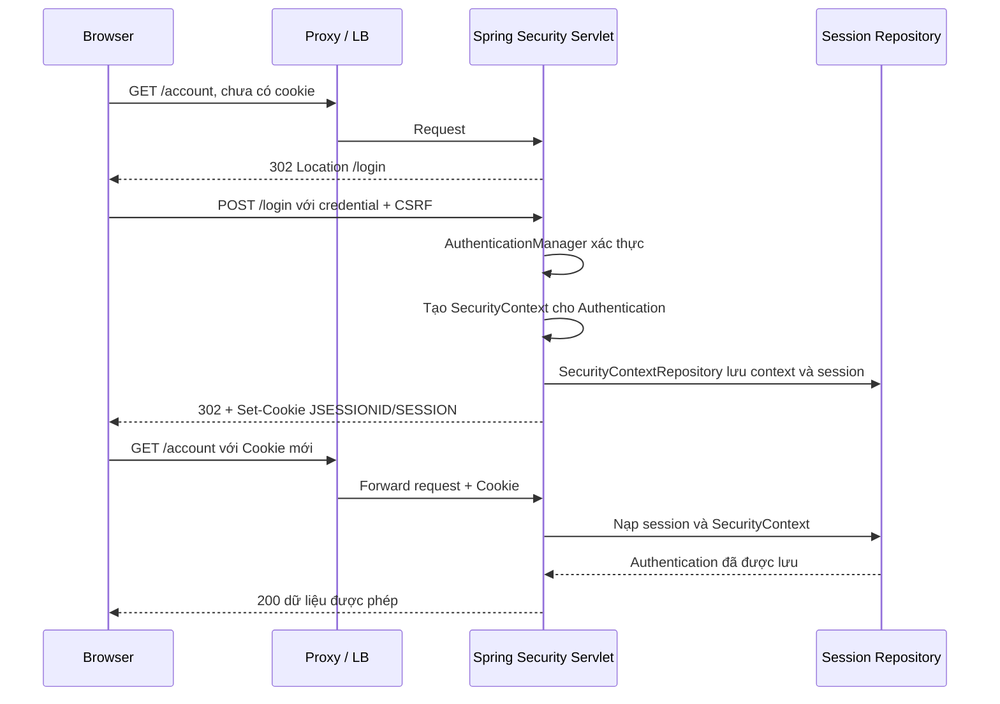

# Mất đăng nhập do không lưu ngữ cảnh, cookie sai hoặc phiên không tồn tại — Chẩn đoán Spring Security Servlet

## 1. Mục tiêu và các tình huống cần phân biệt

Trong ứng dụng **Spring Boot 3.x, Spring Security 6.x, Java 17+ dùng Servlet/Spring MVC**, người dùng vừa đăng nhập thành công nhưng request kế tiếp lại bị chuyển về `/login`, nhận `401 Unauthorized` hoặc trông như bị đăng xuất. Có hệ thống chỉ lỗi khi đi qua proxy, khi đổi node/pod, sau một lần logout, khi OAuth2/OIDC/SAML callback, hoặc chỉ với một số API.

Ba nguyên nhân của đề bài nằm ở ba lớp khác nhau:

1. **SecurityContext chưa được lưu:** code xác thực đã tạo `Authentication` trên luồng request nhưng không persist qua `SecurityContextRepository`. Trên request hiện tại `SecurityContextHolder` thấy user; request tiếp theo không thấy.
2. **Cookie sai hoặc bị browser bỏ qua:** server có session hợp lệ nhưng browser không lưu/gửi ID vì `Secure`, `SameSite`, `Domain`, `Path`, host, HTTPS, fetch credentials hoặc cross-site policy.
3. **HttpSession không tồn tại/không đọc được:** browser gửi ID nhưng session hết hạn, bị invalidate, bị đổi ID sau login, nằm ở node khác hoặc Spring Session/Redis bị lỗi, namespace hay serialization không tương thích.

Còn một nhóm dễ bị nhầm: **người dùng vẫn đăng nhập nhưng request bị từ chối vì thiếu quyền hoặc CSRF**, hoặc API dùng Bearer token stateless không sử dụng session cookie. Không gọi tất cả `401/403/302` là “mất SecurityContext”.

Sau bài này, bạn có thể lần theo chuỗi:

```text
Authentication thành công
  -> tạo SecurityContext
  -> lưu SecurityContext qua repository
  -> tạo/duy trì session server-side
  -> response phát Set-Cookie có session ID
  -> browser gửi lại Cookie theo đúng origin/path/policy
  -> node nhận request tìm được session
  -> SecurityContextHolder được nạp Authentication
  -> authorization quyết định 200 / 403 / redirect
```

**Chỉ sửa đúng mắt xích hỏng.** Tắt CSRF, bỏ `Secure`, chuyển `SecurityContextHolder` thành `MODE_GLOBAL` hoặc tăng timeout vô hạn là những “cách sửa” nguy hiểm.

## 2. Luồng hoạt động bình thường sau đăng nhập



Sơ đồ khái niệm này tương ứng mô hình **server-side session**. Trong Spring Security Servlet, context thường được lấy từ một repository và đặt vào `SecurityContextHolder` trên đúng request thread. Cuối request, framework clear ThreadLocal; đó là cleanup bình thường. Request sau sẽ nạp lại từ repository nếu context thực sự được lưu.

| Thành phần | Nhiệm vụ | Sai lầm thường gặp |
| --- | --- | --- |
| `Authentication` | Principal, trạng thái xác thực và GrantedAuthority | Thấy object trên request login và kết luận phiên đã persist |
| `SecurityContext` | Chứa Authentication hiện hành | Tạo context rồi chỉ set vào ThreadLocal |
| `SecurityContextHolder` | Context của luồng request | Tưởng là kho xác thực toàn cục cho mọi request |
| `SecurityContextRepository` | Đọc/lưu context khi đi qua ranh giới request | Dùng repository khác nhau ở save và load |
| `HttpSession` | Phiên server-side tham chiếu bởi ID | Tạo session rỗng rồi tưởng đã có user |
| `JSESSIONID`/`SESSION` | Session cookie của container hoặc Spring Session | Browser gửi sai tên/ID/path/host |
| `SecurityFilterChain` | Xác thực và phân quyền theo matcher | API stateless dùng chain khác với login web |
| Redis / Spring Session | Kho session dùng chung khi nhiều node | A và B dùng namespace/serializer khác nhau |

**Điểm quan trọng:** cookie là bearer reference tới phiên. Không ghi Authentication hay mật khẩu trực tiếp vào cookie `JSESSIONID`/`SESSION` trong mô hình này. Không bao giờ log hoặc chia sẻ ID session thật.

## 3. Quy trình chẩn đoán nhanh: bốn câu hỏi

Với một tài khoản thử nghiệm, mở DevTools → Network → **Preserve log**, giữ login request và request đầu tiên bị mất đăng nhập.

**Câu hỏi A — response login có Set-Cookie đúng không?** Nếu không, kiểm tra flow có cần session không, custom login đã save context chưa, session policy và thời điểm response commit.

**Câu hỏi B — browser có gửi cookie ấy ở request kế tiếp không?** Nếu không, tra Domain/Path/Secure/SameSite/host/scheme, blocked reasons, credentials của fetch và proxy. Chưa cần đụng tới Redis.

**Câu hỏi C — backend nhận cookie có tìm được HttpSession không?** Nếu không, tra expire/invalidate/session ID rotation, node A/B, Spring Session, Redis TTL, namespace, serialization. Không cần tắt SecurityFilterChain.

**Câu hỏi D — session có nhưng có Authentication không?** Nếu không, tra `SecurityContextRepository`, `saveContext`, custom auth/logout filter và `SessionCreationPolicy.STATELESS`.

| Quan sát | Nơi điều tra ưu tiên |
| --- | --- |
| Login response không phát cookie, flow phải dùng session | Context persistence / session creation |
| Có Set-Cookie, request sau không gửi Cookie | Browser cookie policy, request origin, proxy |
| Có Cookie, server không tìm thấy session | TTL, invalidation, node/store, cookie ID cũ |
| Có session, SecurityContext không có principal | SecurityContextRepository hoặc custom handler |
| GET có principal, POST 403 | CSRF/authorization, không phải mặc định mất login |
| API `/api/**` trả 401 dù web đã login | Chain stateless/Bearer token, kiểm tra matcher |

Thu thập **status, `Location`, tên và thuộc tính cookie, backend node, timestamp, request ID**. Không paste giá trị cookie/token, username nhạy cảm hoặc serialized `SPRING_SECURITY_CONTEXT` vào log/ticket.

## 4. Nguyên nhân 1: có Authentication nhưng không lưu SecurityContext

### 4.1. Vì sao chỉ `setAuthentication` chưa đủ?

Code trong một custom login handler có thể làm:

```java
Authentication verified = authenticationManager.authenticate(
    UsernamePasswordAuthenticationToken.unauthenticated(
        username, password));

SecurityContextHolder.getContext()
    .setAuthentication(verified);

// Request hiện tại có thể đọc được verified.
// Nhưng request sau có thể anonymous nếu context chưa được persist.
```

Đoạn trên chỉ là **trích đoạn minh họa**, cần biến/import và quy trình authentication đã kiểm soát. `SecurityContextHolder` thường dùng ThreadLocal; khi request kết thúc, Spring Security xóa context trong luồng. Nếu nó chưa lưu vào session repository, request sau không có dữ liệu để nạp.

Với Spring Security 6, cấu hình Servlet phổ biến sử dụng **`SecurityContextHolderFilter` và explicit-save**. Filter này nạp và clear context nhưng **không tự persist mọi thay đổi**. Custom authentication cần chủ động gọi `SecurityContextRepository.saveContext(...)`. Standard `formLogin()` thực hiện lưu context qua authentication success flow; tự viết endpoint chỉ set ThreadLocal dễ bỏ sót bước này.

### 4.2. Mẫu lưu context khi tự xác thực

Mẫu tối thiểu **bên trong custom authentication success handler**:

```java
// verified đã do AuthenticationManager.authenticate(...) trả về.
// request/response là HttpServletRequest/HttpServletResponse.
// repository là SecurityContextRepository dùng cùng SecurityFilterChain.

SecurityContext context = SecurityContextHolder.createEmptyContext();
context.setAuthentication(verified);
SecurityContextHolder.setContext(context);
repository.saveContext(context, request, response);
```

**Đây không phải toàn bộ endpoint login có thể copy chạy độc lập.** Ngoài bốn dòng này, flow sản xuất còn cần xác minh credential, CSRF, session-fixation strategy, session concurrency, failure handling, events, remember-me, rate limiting, cookie và response commit timing.

Trong custom flow có session fixation protection, phải thực hiện `SessionAuthenticationStrategy.onAuthentication(...)` thích hợp và save context đúng thứ tự. Không tự coi `getSession(true)` là thay thế `saveContext`: một session rỗng vẫn có thể không chứa Authentication.

### 4.3. Chọn repository đúng với cách đăng nhập

| Repository | Ý nghĩa |
| --- | --- |
| `HttpSessionSecurityContextRepository` | Lưu context trong HttpSession, thường dưới key `SPRING_SECURITY_CONTEXT` |
| `RequestAttributeSecurityContextRepository` | Lưu trong request attributes, hữu ích cho dispatch/error trong **một request** |
| `DelegatingSecurityContextRepository` | Kết hợp nhiều repository, thường request attributes + HttpSession |
| `NullSecurityContextRepository` | Không persist qua requests, phù hợp stateless authentication |

Spring Security Servlet 6 thường dùng `DelegatingSecurityContextRepository` trong cấu hình mặc định, nhưng hãy kiểm tra **repository thực tế của từng chain** khi có custom config. Nếu custom login ghi `HttpSessionSecurityContextRepository` còn request sau đọc `NullSecurityContextRepository`, session vẫn có thể tồn tại mà người gọi anonymous.

Một cấu hình **minh họa bên trong `SecurityFilterChain`**:

```java
SecurityContextRepository repository =
    new DelegatingSecurityContextRepository(
        new RequestAttributeSecurityContextRepository(),
        new HttpSessionSecurityContextRepository()
    );

http.securityContext(context -> context
    .requireExplicitSave(true)
    .securityContextRepository(repository)
);
```

Cần imports thuộc `org.springframework.security.web.context`; snippet không phải chương trình Java độc lập. Không cần override repo mặc định nếu standard login đã hoạt động.

### 4.4. `SecurityContextPersistenceFilter` và migration

Trong một số ứng dụng cũ, `SecurityContextPersistenceFilter` có thể tự save trong lifecycle; Spring Security 6 hướng tới explicit save qua `SecurityContextHolderFilter`. Khi upgrade, một custom login controller vốn dựa vào auto-save có thể bắt đầu “login rồi mất”.

Đừng sửa bằng cách vô hiệu security filters; hãy test request thứ hai, sửa custom authentication để lưu đúng repository theo version đang chạy, hoặc dùng chuẩn `formLogin`/OAuth2 Login/SAML Login của framework.

### 4.5. `SessionCreationPolicy` có thể phủ định mục tiêu

| Policy | Hành vi chủ yếu |
| --- | --- |
| `IF_REQUIRED` | Tạo session khi authentication/cơ chế khác cần. Thường hợp lý cho form login web |
| `ALWAYS` | Chủ động tạo session; không tự sửa lỗi thiếu save |
| `NEVER` | Không tự tạo session; có thể sử dụng session đã có |
| `STATELESS` | Spring Security không tạo và không dùng session để lấy SecurityContext; thích hợp API Bearer-token stateless |

Ví dụ:

```java
http.sessionManagement(session -> session
    .sessionCreationPolicy(SessionCreationPolicy.STATELESS));
```

Nếu form login web cần cookie session mà chain đang `STATELESS`, không thể kỳ vọng Authentication của request login tự tồn tại sang request sau. Khi có API stateless và web stateful, thiết kế **hai `SecurityFilterChain` có `securityMatcher` và `@Order` nhất quán**.

### 4.6. Những dấu hiệu của lỗi không lưu context

- Ngay trong success handler thấy `authentication.getName()`, nhưng request sau anonymous.
- Browser vẫn gửi đúng cookie, session còn, song `SPRING_SECURITY_CONTEXT` không được lưu hoặc không thể nạp.
- Standard `formLogin` test chạy, custom login endpoint thì không.
- Sự cố xuất hiện khi nâng cấp Spring Security 6 hoặc đổi `SecurityContextRepository`.
- Có code custom `clearContext`, `invalidate` hoặc response commit xảy ra **trước khi save**.

Điều tra bằng integration test **hai request thật**, không chỉ gọi controller bằng Mockito hay `.with(user("alice"))` ở request thứ hai (vì cách đó đưa principal giả vào request và che lỗi persistence).

## 5. Nguyên nhân 2: cookie không quay lại server

Ví dụ **response minh họa**:

```http
HTTP/1.1 302 Found
Location: /account
Set-Cookie: JSESSIONID=opaque-id; Path=/; Secure; HttpOnly; SameSite=Lax
```

Cookie thật phải do server tạo ngẫu nhiên; không hard-code ID. Với Spring Session Redis, tên thường là `SESSION`; với container sessions có thể là `JSESSIONID`. **Tìm tên thật trong response**, đừng suy đoán.

### 5.1. `Secure` và HTTPS

Cookie `Secure` được browser giới hạn gửi trong ngữ cảnh HTTPS (có những xử lý đặc biệt đối với localhost tùy browser). Nếu login tại `https://app.example.test` mà redirect đến `http://service:8080` hoặc hostname khác, cookie sẽ không đi đúng nơi.

**Không tắt `Secure` trên production** để “giải quyết” một redirect HTTP sai. Sửa URL công khai, TLS offload và forwarded headers của proxy.

### 5.2. `HttpOnly`

Cookie `HttpOnly` **vẫn được browser tự gửi** trong request đúng chính sách, nhưng `document.cookie` không đọc được. Nếu JavaScript không đọc thấy session cookie mà login vẫn thành công, đó có thể là **cấu hình an toàn đúng**.

Không vô hiệu `HttpOnly` để frontend đọc ID và tự chèn vào header. Session cookie là credential, không nên chuyển vào localStorage hoặc log.

### 5.3. `SameSite` trong login bình thường và SSO

| Giá trị | Hệ quả cần test |
| --- | --- |
| `Lax` | Thường phù hợp top-level navigation GET, bao gồm nhiều OAuth2 Authorization Code callback |
| `Strict` | Có thể chặn cookie trong một số chuyển hướng từ trang IdP ngoài site |
| `None; Secure` | Có thể cần cho cross-site POST/iframe/fetch có credential; vẫn chịu chính sách browser chặn third-party cookies |

**SAML2 HTTP-POST binding** hoặc OIDC `response_mode=form_post` có thể gửi callback bằng cross-site POST: cookie correlation không đến do `SameSite=Lax`, dẫn tới lỗi trước khi login thực sự hoàn tất. Cách xử lý là thiết kế callback + cookie policy + protocol validation phù hợp, **không tắt state, nonce hay SAML signature validation**.

`SameSite` giúp giảm một số rủi ro CSRF, nhưng **không thay token CSRF** cho những thao tác thay đổi trạng thái dùng cookie session.

### 5.4. `Domain`, `Path`, host-only và trùng tên

Cookie chỉ được gửi đến host/path phù hợp. Ví dụ:

- Login `app.example.test` nhưng redirect/callback về `www.example.test`: cookie host-only không đi cùng.
- Cookie `Path=/portal` không được gửi cho endpoint `/api/me`.
- App sau proxy có context-path khác public path.
- Có hai cookie `JSESSIONID` cùng tên với Domain/Path khác nhau; server nhận cookie khác với ID do login vừa tạo.
- Login qua `localhost` nhưng request tiếp theo qua IP hoặc DNS name khác.

Ưu tiên **không đặt `Domain`** khi không cần chia subdomain. `Domain` rộng khiến nhiều subdomain nhận cookie hơn, tăng rủi ro session cookie collision.

### 5.5. Frontend SPA khác origin

Với `fetch` cross-origin:

```javascript
const response = await fetch("https://api.example.test/account", {
    method: "GET",
    credentials: "include"
});
console.log(response.status);
```

`credentials: "include"` yêu cầu browser gửi/nhận credentials theo policy, **không vượt** `Secure`/SameSite/Domain/Path/chặn third-party cookie. Backend cần CORS với **origin cụ thể** và `Access-Control-Allow-Credentials: true` khi cho phép, không dùng `Access-Control-Allow-Origin: *` cho credentialed responses.

CORS kiểm soát JavaScript đọc response cross-origin, không phải cơ chế xác thực hay thay CSRF. Nếu login dựa cookie, kiểm tra CSRF cho POST/PUT/PATCH/DELETE riêng.

### 5.6. Proxy TLS termination

Browser truy cập `https://app.example.test`, nhưng app xử lý HTTP nội bộ. Nếu app tạo redirect sai public scheme/host, cookie sẽ lỗi. Spring Boot có tùy chọn:

```yaml
server:
  forward-headers-strategy: framework
```

**Chỉ dùng khi reverse proxy tin cậy gỡ forwarded headers do client tự gửi và thiết lập lại đúng.** Tin trực tiếp `X-Forwarded-Host`/`X-Forwarded-Proto` từ internet tạo rủi ro host injection/open redirect. Xem thực tế `Location`, `Set-Cookie`, `Cookie`, không kết luận chỉ từ YAML.

## 6. Nguyên nhân 3: cookie có nhưng phiên không tồn tại

### 6.1. Hết hạn/invalidated là hành vi đúng

Một HTTP session có thể hết hạn do **idle timeout**, logout invalidate, session eviction hoặc chính sách quản lý phiên đồng thời. Cookie vẫn có thể còn trên browser khi session ở server đã expired.

`server.servlet.session.timeout` và kho phiên (nếu có Spring Session) ảnh hưởng hiệu lực timeout. Không suy luận một cookie có `Expires` trong tương lai là bảo đảm session server còn. Ngược lại, cookie bị browser xóa không chứng minh server session đã bị invalidate.

`request.getSession(false)` hữu ích để quan sát session hiện hữu mà **không tạo session rỗng**:

```java
HttpSession existing = request.getSession(false);
boolean present = existing != null;
```

Đây là đoạn **minh họa trong method có `HttpServletRequest request`**, không phải class riêng. Tránh gọi `request.getSession(true)` trong một probe chẩn đoán vì nó có thể tạo phiên mới và che mất chứng cứ.

### 6.2. Session ID rotation sau login

Spring Security hỗ trợ bảo vệ **session fixation** bằng cách đổi ID khi xác thực. Nếu một HTTP client hoặc frontend tiếp tục gửi cookie **trước login** thay vì cookie mới trong response login, server không nhận được Authentication đã xác thực.

Không tắt `changeSessionId()` chỉ để tiếp tục dùng ID cũ. Kiểm tra response login có Set-Cookie ID mới và browser đã cập nhật đúng cookie.

### 6.3. Mất login khi load balancer đổi node

```text
Browser -> Load Balancer -> Node A: login -> session nằm trong RAM A
Browser -> Load Balancer -> Node B: GET /account -> B không có session
Browser -> Load Balancer -> Node A: GET /account -> A vẫn thấy login
```

Nếu mỗi node dùng session **in-memory riêng**, cùng ID có thể chỉ hợp lệ tại A. Sticky session giảm hiện tượng nhưng không xử lý restart/failover. Khi cần phiên bền vững qua node, dùng **shared session repository** như Spring Session Redis hoặc một kiến trúc khác có khả năng chia sẻ và failover.

### 6.4. Spring Session Redis: những điều phải đồng nhất

- Cùng Redis backend/cluster, **namespace**, timeout và serialization policy giữa các node cùng deployment.
- Cùng cookie name (`SESSION` khi dùng Spring Session mặc định thông thường), Domain, Path, HTTPS và security chain.
- Redis ACL/credential/TLS/private networking, memory/eviction/replication và readiness được giám sát.
- Không trộn một node dùng container `JSESSIONID` và node khác dùng Spring Session Redis `SESSION`.
- Rolling upgrades phải tương thích khi deserializing `Authentication`/principal/session attributes.

Ví dụ dependency (trong Gradle Spring Boot 3.x project, plugin/version do Initializr quản lý):

```groovy
dependencies {
    implementation 'org.springframework.boot:spring-boot-starter-web'
    implementation 'org.springframework.boot:spring-boot-starter-security'
    implementation 'org.springframework.boot:spring-boot-starter-data-redis'
    implementation 'org.springframework.session:spring-session-data-redis'
}
```

Cấu hình **minh họa cho test environment**:

```yaml
server:
  servlet:
    session:
      timeout: 30m

spring:
  data:
    redis:
      host: ${REDIS_HOST:localhost}
      port: ${REDIS_PORT:6379}
  session:
    redis:
      namespace: login-diagnostics:sessions
```

Hệ thống thật phải bảo vệ Redis, dùng namespace riêng cho môi trường khác nhau và test serializer compatibility. Nếu Redis unavailable, ứng dụng **không được cấp quyền chỉ dựa trên cookie ID**; có thể trả 503 hoặc yêu cầu authentication lại tùy thiết kế, nhưng không fail-open.

### 6.5. Session vẫn có nhưng context trống

Ngay cả khi `HttpSession` tồn tại, `SecurityContextHolder` có thể không có Authentication vì:

- Flow custom chưa `saveContext`.
- Save vào request-attribute repo nhưng load từ HTTP session repo.
- SecurityFilterChain `/api/**` dùng `STATELESS`/`NullSecurityContextRepository`.
- Session bị tạo lại, lưu sai attribute, logout/custom filter clear context.
- Serializer của principal không tương thích sau deploy, hoặc save bị race/ghi đè.

**Một `HttpSession` rỗng không chứng minh user đã được xác thực.** Phải kiểm tra context được load qua repository nhất quán.

## 7. Baseline runnable: Spring Boot 3 form login và session

Dự án nhỏ này dùng **Spring Security form login chuẩn**, vì flow chuẩn giúp xác định hệ thống có thể persist Authentication giữa hai request. Sau khi baseline chạy, so với custom login, proxy, Redis và filter chains của ứng dụng đang lỗi.

### 7.1. Dependencies và cấu trúc

Tạo Spring Initializr project: Spring Boot 3.x, Java 17+, Spring Web, Spring Security, Gradle Groovy. Trong `build.gradle`:

```groovy
dependencies {
    implementation 'org.springframework.boot:spring-boot-starter-web'
    implementation 'org.springframework.boot:spring-boot-starter-security'
    testImplementation 'org.springframework.boot:spring-boot-starter-test'
    testImplementation 'org.springframework.security:spring-security-test'
}
```

Các file:

```text
src/main/java/com/example/loginprobe/
  LoginProbeApplication.java
  SecurityConfig.java
  AccountController.java
src/test/java/com/example/loginprobe/
  LoginPersistenceTest.java
```

### 7.2. `LoginProbeApplication.java`

```java
package com.example.loginprobe;

import org.springframework.boot.SpringApplication;
import org.springframework.boot.autoconfigure.SpringBootApplication;

@SpringBootApplication
public class LoginProbeApplication {
    public static void main(String[] args) {
        SpringApplication.run(LoginProbeApplication.class, args);
    }
}
```

### 7.3. `SecurityConfig.java`

```java
package com.example.loginprobe;

import org.springframework.context.annotation.Bean;
import org.springframework.context.annotation.Configuration;
import org.springframework.security.config.Customizer;
import org.springframework.security.config.annotation.web.builders.HttpSecurity;
import org.springframework.security.config.http.SessionCreationPolicy;
import org.springframework.security.core.userdetails.User;
import org.springframework.security.core.userdetails.UserDetailsService;
import org.springframework.security.crypto.bcrypt.BCryptPasswordEncoder;
import org.springframework.security.crypto.password.PasswordEncoder;
import org.springframework.security.provisioning.InMemoryUserDetailsManager;
import org.springframework.security.web.SecurityFilterChain;

@Configuration
public class SecurityConfig {

    @Bean
    PasswordEncoder passwordEncoder() {
        return new BCryptPasswordEncoder();
    }

    @Bean
    UserDetailsService users(PasswordEncoder encoder) {
        return new InMemoryUserDetailsManager(
            User.withUsername("alice")
                .password(encoder.encode("test-only-password"))
                .roles("USER")
                .build()
        );
    }

    @Bean
    SecurityFilterChain web(HttpSecurity http) throws Exception {
        http
            .authorizeHttpRequests(auth -> auth
                .requestMatchers("/", "/error").permitAll()
                .anyRequest().authenticated()
            )
            .formLogin(Customizer.withDefaults())
            .logout(Customizer.withDefaults())
            .sessionManagement(session -> session
                .sessionCreationPolicy(SessionCreationPolicy.IF_REQUIRED)
                .sessionFixation(fixation -> fixation.changeSessionId())
            );

        return http.build();
    }
}
```

- `formLogin()` dùng filter đăng nhập chuẩn; không có custom handler quên `saveContext`.
- `IF_REQUIRED` cho phép HTTP session được tạo khi cần. Không dùng `STATELESS` cho mô hình web session này.
- `changeSessionId()` chống session fixation.
- CSRF vẫn bật (không có `.csrf().disable()`). Spring Security login form chuẩn cung cấp token; test gửi token.
- User/mật khẩu chỉ dùng **môi trường học tập**, không đưa test account vào production. BCrypt giúp demo password hash nhưng in-memory users không thay database/IdP.

### 7.4. `AccountController.java`

```java
package com.example.loginprobe;

import java.util.Map;

import jakarta.servlet.http.HttpServletRequest;
import jakarta.servlet.http.HttpSession;
import org.springframework.security.core.Authentication;
import org.springframework.web.bind.annotation.GetMapping;
import org.springframework.web.bind.annotation.RestController;

@RestController
public class AccountController {

    @GetMapping("/")
    Map<String, String> home() {
        return Map.of("status", "public");
    }

    @GetMapping("/account")
    Map<String, Object> account(
            Authentication authentication,
            HttpServletRequest request) {

        HttpSession existing = request.getSession(false);
        return Map.of(
            "principal", authentication.getName(),
            "sessionPresent", existing != null,
            "idleSeconds",
            existing == null ? 0 : existing.getMaxInactiveInterval()
        );
    }
}
```

`/account` yêu cầu authenticated qua SecurityFilterChain, nên Authentication hợp lệ của current request có thể được dùng. Endpoint không xuất `getId()` hoặc raw cookie. Các thông tin chẩn đoán như idle timeout chỉ nên công khai ở môi trường và phạm vi thích hợp.

### 7.5. Chạy

```bash
./gradlew bootRun
```

Windows PowerShell: `.\gradlew.bat bootRun`.

Thử local form login ở `/login` với account test. Trên production phải dùng HTTPS và user store/IdP thật. Nếu thử browser dưới HTTP local trong khi cookie được cấu hình `Secure`, hành vi browser có thể khác production; không suy luận chỉ từ local localhost.

## 8. MockMvc test hai request: bằng chứng persistence thật

File `src/test/java/com/example/loginprobe/LoginPersistenceTest.java`:

```java
package com.example.loginprobe;

import org.junit.jupiter.api.Test;
import org.springframework.beans.factory.annotation.Autowired;
import org.springframework.boot.test.autoconfigure.web.servlet.AutoConfigureMockMvc;
import org.springframework.boot.test.context.SpringBootTest;
import org.springframework.mock.web.MockHttpSession;
import org.springframework.test.web.servlet.MockMvc;
import org.springframework.test.web.servlet.MvcResult;

import static org.junit.jupiter.api.Assertions.assertNotNull;
import static org.springframework.security.test.web.servlet.request.SecurityMockMvcRequestPostProcessors.csrf;
import static org.springframework.test.web.servlet.request.MockMvcRequestBuilders.get;
import static org.springframework.test.web.servlet.request.MockMvcRequestBuilders.post;
import static org.springframework.test.web.servlet.result.MockMvcResultMatchers.jsonPath;
import static org.springframework.test.web.servlet.result.MockMvcResultMatchers.status;

@SpringBootTest
@AutoConfigureMockMvc
class LoginPersistenceTest {

    @Autowired
    MockMvc mvc;

    @Test
    void loginPersistsBetweenTwoRequests() throws Exception {
        MvcResult login = mvc.perform(post("/login")
                .param("username", "alice")
                .param("password", "test-only-password")
                .with(csrf()))
            .andExpect(status().is3xxRedirection())
            .andReturn();

        MockHttpSession session =
            (MockHttpSession) login.getRequest().getSession(false);
        assertNotNull(session);

        // Đây là request thứ hai, mang cùng session của login.
        mvc.perform(get("/account").session(session))
            .andExpect(status().isOk())
            .andExpect(jsonPath("$.principal").value("alice"))
            .andExpect(jsonPath("$.sessionPresent").value(true));

        // Không mang session: phải yêu cầu login.
        mvc.perform(get("/account"))
            .andExpect(status().is3xxRedirection());
    }

    @Test
    void loginWithoutCsrfIsForbidden() throws Exception {
        mvc.perform(post("/login")
                .param("username", "alice")
                .param("password", "test-only-password"))
            .andExpect(status().isForbidden());
    }
}
```

Chạy:

```bash
./gradlew test
```

Các test **dự kiến pass** trong project mẫu đúng dependencies. Chúng kiểm tra filter chain/HTTP session ở MockMvc, không tự kiểm tra browser cookie `SameSite`, reverse proxy hoặc Redis đa node. Với các phần đó cần integration/e2e test khác.

Nếu custom login chỉ set ThreadLocal mà không lưu, request login có thể thấy `alice`, nhưng request thứ hai dùng session sẽ không có Authentication. **Không sửa test bằng `.with(user("alice"))` hoặc `@WithMockUser` trên request thứ hai**: nó trực tiếp cấp Authentication test và che mất lỗi session persistence.

## 9. Cấu hình nhiều SecurityFilterChain và biểu hiện “web login OK, API 401”

Ví dụ hai chain (đoạn Java **minh họa trong class @Configuration**, cần imports cho các API):

```java
@Bean
@Order(1)
SecurityFilterChain api(HttpSecurity http) throws Exception {
    http
        .securityMatcher("/api/**")
        .sessionManagement(s -> s
            .sessionCreationPolicy(SessionCreationPolicy.STATELESS))
        .authorizeHttpRequests(a -> a.anyRequest().authenticated())
        .oauth2ResourceServer(o -> o.jwt(Customizer.withDefaults()));
    return http.build();
}

@Bean
@Order(2)
SecurityFilterChain web(HttpSecurity http) throws Exception {
    http
        .authorizeHttpRequests(a -> a.anyRequest().authenticated())
        .formLogin(Customizer.withDefaults());
    return http.build();
}
```

API `/api/**` đòi Bearer access token từng request; cookie login của web chain **không mặc nhiên** xác thực API stateless. Đây có thể là hành vi thiết kế đúng, không phải dữ liệu session bị mất.

Kiểm tra **`securityMatcher` (chọn chain)** khác với `requestMatchers` (quy tắc trong chain). Nếu `/login/oauth2/code/**`, `/login/saml2/sso/**` hoặc `/logout` bị chain API bắt nhầm, flow login/callback/cleanup có thể sai.

## 10. OAuth2/OIDC/SAML: lỗi mất correlation khác mất SecurityContext

OAuth2 Authorization Code thường cần lưu authorization request + `state` trong session trước khi chuyển browser sang IdP. OIDC có thêm `nonce` khi dùng, SAML2 có message/correlation và signature validation.

Nếu browser không gửi cookie ở callback:

- OAuth2 có thể lỗi `authorization_request_not_found` **trước khi** tạo Authentication.
- OIDC có thể không khớp nonce/session, hoặc callback `response_mode=form_post` bị SameSite chặn.
- SAML HTTP-POST binding có thể thiếu session/correlation, dẫn tới validation error; cũng có thể bị binding/issuer/signature mismatch không liên quan cookie.

Phân biệt:

1. Callback chưa xác thực xong → kiểm tra **cookie correlation, IdP redirect/binding/state**.
2. Login/callback đã thành công, request sau anonymous → kiểm tra **SecurityContext save, cookie sau login và session store**.
3. Đã xác thực web nhưng gọi API JWT trả 401 → kiểm tra API token và security chain.
4. Chỉ lỗi khi callback qua node khác → session correlation chưa được shared.

**Không bỏ kiểm tra `state`, `nonce`, SAML signature hay InResponseTo** để làm callback hết lỗi; các kiểm tra đó chống giả mạo và replay.

## 11. Java 17 độc lập: phân loại bằng chứng

Chương trình sau không phụ thuộc Spring; nó chỉ thể hiện logic triage theo bốn quan sát. File `LoginFailureTriage.java`:

```java
public class LoginFailureTriage {

    record Evidence(
        boolean cookieIssued,
        boolean cookieReturned,
        boolean sessionFound,
        boolean contextLoaded
    ) {}

    static String diagnose(Evidence e) {
        if (!e.cookieIssued()) {
            return "check-context-save-or-stateless-flow";
        }
        if (!e.cookieReturned()) {
            return "check-browser-cookie-policy";
        }
        if (!e.sessionFound()) {
            return "check-session-store-or-expiry";
        }
        if (!e.contextLoaded()) {
            return "check-security-context-repository";
        }
        return "check-authorization-or-csrf";
    }

    public static void main(String[] args) {
        System.out.println(diagnose(
            new Evidence(false, false, false, false)));
        System.out.println(diagnose(
            new Evidence(true, false, false, false)));
        System.out.println(diagnose(
            new Evidence(true, true, false, false)));
        System.out.println(diagnose(
            new Evidence(true, true, true, false)));
        System.out.println(diagnose(
            new Evidence(true, true, true, true)));
    }
}
```

Biên dịch và chạy:

```bash
javac LoginFailureTriage.java
java LoginFailureTriage
```

**Stdout chính xác:**

```text
check-context-save-or-stateless-flow
check-browser-cookie-policy
check-session-store-or-expiry
check-security-context-repository
check-authorization-or-csrf
```

Đây là **công cụ học tư duy chẩn đoán**, không thể khẳng định nguyên nhân thực từ bốn cờ đơn giản. Ví dụ API stateless hoàn toàn có thể không có Set-Cookie, và đó là đúng thiết kế.

## 12. Chẩn đoán thực tế bằng DevTools, curl và log

### 12.1. DevTools checklist

1. Bật Preserve log, dùng test browser profile sạch, khởi tạo login.
2. Xem response của `POST /login`/callback: status, `Location`, tên/thuộc tính `Set-Cookie` và blocked reason.
3. Xem request `/account` kế tiếp: cookie có được **gửi** không; đúng host/scheme/path/cookie name không?
4. Nếu cookie có: trên server (không log ID thô), ghi nhận session found/not found, session timeout và node nhận request.
5. Nếu session có: xác định `SecurityContextRepository` đọc được Authentication không.
6. Nếu Authentication có: xem 403 do CSRF hoặc authority, không quy thành session loss.

### 12.2. curl cookie jar chỉ cho tài khoản thử nghiệm

```bash
curl -i -b test-cookies.txt -c test-cookies.txt \
  https://app.example.test/account
```

`test-cookies.txt` là cookie jar **đã được tạo hợp lệ trong môi trường test**. Curl không thực thi cookie policy giống browser trong mọi trường hợp (SameSite/CORS), nên việc curl thành công nhưng browser thất bại có thể chỉ tới browser policy. Không dùng `curl -k` như giải pháp production; không đưa cookie thật vào command line/log.

### 12.3. Logging tạm thời (môi trường có kiểm soát)

```yaml
logging:
  level:
    org.springframework.security: DEBUG
    org.springframework.session: DEBUG
```

DEBUG có thể tạo log nhạy cảm và lưu lượng lớn. Chỉ bật trong môi trường/tình huống được duyệt, thiết lập redaction và thời gian tắt. Không log `Cookie`, `Set-Cookie`, Bearer token, password, session ID hoặc serialized SecurityContext.

Ghi nhận request ID/trace ID, endpoint, backend instance, status, cookie **thuộc tính**, session tồn tại hay không, `saveContext` được gọi hay chưa, lỗi Redis và security chain match. Session ID là credential; dùng correlation ID an toàn thay cho ghi nguyên ID.

## 13. Ma trận kiểm thử hai node và timeout

| Test | Bước | Kết quả đúng |
| --- | --- | --- |
| Login cùng node | Login A, GET A với cookie mới | Authenticated |
| Chuyển node | Login A, GET B cùng public origin/cookie | Authenticated nếu shared session đúng |
| Pod restart | Login A, restart A, GET B | Session sống nếu Redis healthy |
| Logout | Logout B rồi GET A với ID cũ | Không authenticated |
| Idle expiry | Vượt idle timeout rồi GET | Không authenticated |
| ID giả | Gửi cookie với ID không tồn tại | Không nhận Authentication |
| Redis outage | Cắt Redis ở môi trường test | Không trả protected data bằng ID chưa xác minh |
| Name/namespace khác nhau | A ghi Redis namespace X, B đọc Y | B không tìm thấy session; phải sửa config |
| Serializer không tương thích | Mix version node A/B | Fail deserialization; rollout/migration cần xử lý |
| SameSite callback | Login qua cross-site POST | Phải xử lý cookie/correlation đúng binding |
| CSRF | POST thiếu token trong web chain | 403 dù session có |
| Different chains | Web cookie tới `/api/**` stateless | Có thể 401 đúng thiết kế nếu thiếu Bearer |

Dùng router thử nghiệm có thể ép request qua A/B **dưới cùng public host**. Nếu gửi qua hai hostname khác nhau, browser host-only cookie có thể không đi tới B; đó là test cookie domain chứ không chứng minh session store chia sẻ.

## 14. Bảng lỗi và cách sửa

| Triệu chứng | Nguyên nhân khả dĩ | Cách xử lý |
| --- | --- | --- |
| Login controller thấy alice, request sau anonymous | Custom login chưa `saveContext` | Explicit save bằng đúng repository, test hai requests |
| Có HttpSession nhưng không Authentication | Repo/key/chain không nhất quán | Kiểm tra load/save của `SecurityContextRepository` |
| Không có Set-Cookie sau custom login | Không tạo session, stateless, commit sớm | Xem auth success flow, session policy và response |
| Có Set-Cookie, không có Cookie sau đó | Secure/SameSite/Domain/Path/proxy/fetch | Xem browser blocked reasons, public URL |
| Login qua HTTPS rồi redirect HTTP | Reverse proxy forwarded headers sai | Sửa trust proxy và public scheme |
| Cookie ID cũ sau login không còn hợp lệ | Session fixation đổi ID | Dùng ID mới; không tắt fixation protection |
| GET A hoạt động, GET B mất login | Local sessions hoặc Redis mismatch | Spring Session shared store, serializer/namespace |
| Sau rolling deploy bị logout | Principal/session serialization không tương thích | Kiểm thử dual-version/migration |
| Sau idle timeout mất login | Session expired theo policy | Reauthentication; không tăng TTL vô hạn |
| OAuth2 callback lỗi state | Không có session correlation | Cookie, SameSite, redirect, shared session |
| SAML POST callback lỗi | Cookie/IdP binding/signature/correlation | Kiểm tra protocol và cookie; không bỏ validation |
| API 401 nhưng web account 200 | API stateless chain khác | Yêu cầu Bearer token đúng audience |
| GET 200 nhưng POST 403 | CSRF thiếu hoặc authority khác | Kiểm tra token/policy |
| Async task không thấy user | ThreadLocal không propagate | Dùng security-aware executor |
| Session store down, protected API vẫn trả data | Fail-open authentication | Sửa để fail closed, alert sự cố |
| Cookie cùng tên giữa nhiều app | Domain/Path collision | Dùng scope/tên cookie riêng |
| Không có user nhưng authentication != null | AnonymousAuthenticationToken | Phân biệt anonymous với người dùng thật |

## 15. Những cách “sửa” phải tránh

- Không bỏ `Secure`/`HttpOnly` production chỉ để trình duyệt gửi hoặc JavaScript đọc session cookie.
- Không tắt CSRF toàn bộ ứng dụng dùng cookie khi POST lỗi 403.
- Không đổi cookie thành `SameSite=None` cùng CORS wildcard/thiếu CSRF.
- Không đặt `SecurityContextHolder.MODE_GLOBAL` để chia context của mọi user.
- Không coi `request.getSession(true)` là bằng chứng Authentication đã được persist.
- Không loại bỏ session fixation ID rotation chỉ vì client vẫn gửi cookie cũ.
- Không lưu session ID vào URL/query/localStorage để vượt Domain/Path/third-party cookie policy.
- Không bỏ OAuth2 state, OIDC nonce, SAML signature/correlation để callback hết lỗi.
- Không cho phép protected data khi Redis down và chưa xác minh session.
- Không dùng `@WithMockUser` trên request thứ hai để “chứng minh” login đã lưu.
- Không log session ID hoặc serialized SecurityContext để dễ đối chiếu.
- Không đặt session TTL vô hạn thay cho chẩn đoán root cause.

## 16. Checklist nghiệm thu

- [ ] Xác định web session hay token API stateless và security chain nào match.
- [ ] Xem login response có `Set-Cookie`, đúng name/flags/path/domain/scheme.
- [ ] Xem request kế tiếp có gửi cookie tương ứng không (không lưu giá trị cookie).
- [ ] Nếu cookie có, node có load session được không; timeout/Redis/namespace/serializer phù hợp không.
- [ ] Nếu session có, `SecurityContextRepository` có nạp Authentication không; custom login có `saveContext` đúng lúc không.
- [ ] `SessionCreationPolicy` đúng mục tiêu: `IF_REQUIRED` khi dùng cookie session, `STATELESS` khi xác thực từng request bằng Bearer token.
- [ ] Session fixation protection hoạt động; client giữ cookie mới, cookie cũ không cấp quyền.
- [ ] Phân biệt anonymous, missing authentication, missing authority, missing CSRF.
- [ ] SSO callback được thử với SameSite/binding/state/nonce và session correlation phù hợp.
- [ ] MockMvc test hai requests và e2e test browser/proxy/multi-node có đủ.
- [ ] Redis failover, TTL, node rotation, rolling upgrade và logout đều được kiểm tra.
- [ ] HTTPS, redaction, cookie flags, CSRF, authorization và fail-closed vẫn được giữ.

**Kết luận:** khi “mất đăng nhập”, điều tra theo **save SecurityContext → tạo/tìm session → phát cookie → browser gửi cookie → backend nạp context → phân quyền**. Mỗi mắt xích có dấu hiệu và phép thử riêng. Một request trả 401/302 không tự chứng minh SecurityContext sai; 403 lại có thể chỉ là CSRF hoặc authorization. Chẩn đoán đúng tầng cho phép khôi phục login ổn định mà không làm yếu bảo mật.
