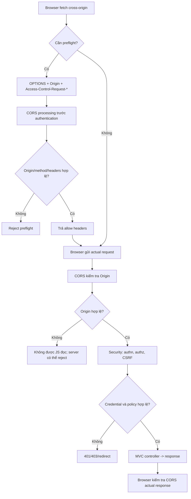

# CORS bị trình duyệt chặn dù endpoint trả thành công khi gọi trực tiếp

> **Chủ đề:** Chẩn đoán lỗi CORS trên **Spring Security Servlet** (Spring MVC, Spring Boot 3.x, Spring Security 6.x). Hiện tượng: gọi cùng URL bằng `curl`, Postman hoặc mở trực tiếp trong thanh địa chỉ cho response thành công, nhưng JavaScript chạy từ một trang khác origin lại bị browser từ chối đọc, hoặc `OPTIONS` preflight nhận 401/403/redirect. Bài hướng dẫn đọc đúng luồng request, cấu hình CORS trước Spring Security authentication và kiểm chứng bằng Java 17+, Spring Boot 3.3, MockMvc, DevTools và curl.

## 1. Mục tiêu

Bạn sẽ hiểu và tự xử lý được:

1. **Same-origin policy**, thành phần `scheme + host + port` của origin; vì sao thành công qua HTTP client trực tiếp không chứng minh browser fetch thành công.
2. **Actual request** khác **CORS preflight OPTIONS** như thế nào; điều kiện nào thường kích hoạt preflight.
3. Đọc `Origin`, `Access-Control-Request-Method`, `Access-Control-Request-Headers` và các response headers `Access-Control-Allow-Origin`, `-Methods`, `-Headers`, `-Credentials`, `-Max-Age`, `Access-Control-Expose-Headers`.
4. Tìm nguyên nhân 401/403/redirect trước preflight, actual response thiếu ACAO, mismatch origin, method/header không được phép, wildcard sai khi gửi credentials, proxy/CDN can thiệp.
5. Tạo `SecurityFilterChain` cùng `CorsConfigurationSource` ở đúng nơi trong ứng dụng Spring Security Servlet.
6. Tách CORS khỏi **authentication**, **authorization**, **CSRF**, **SameSite cookie**, TLS/mixed content và browser third-party cookie policy.
7. Viết test tự động cho origin hợp lệ/không hợp lệ, OPTIONS không có credential, actual request có/không có credential, các header được expose.
8. Áp dụng runbook production mà không tắt security hay phản chiếu Origin bừa bãi.

## 2. Vì sao curl được 200 nhưng fetch không được dữ liệu?

Một frontend mở tại:

```text
https://app.example.test
```

gọi API:

```text
https://api.example.test/api/public/ping
```

Hai địa chỉ cùng HTTPS nhưng **khác hostname**, nên là hai **origin** khác nhau. Origin = **scheme + host + effective port**. Path, query hoặc fragment không nằm trong origin.

| Frontend | Endpoint | Cùng origin? |
| --- | --- | --- |
| `https://app.example.test` | `https://app.example.test/api/ping` | Có. |
| `https://app.example.test` | `https://api.example.test/api/ping` | Không: khác host. |
| `http://localhost:5173` | `http://localhost:8080/api/ping` | Không: khác port. |
| `http://localhost:8080` | `https://localhost:8080/api/ping` | Không: khác scheme. |
| `https://app.example.test` | `https://app.example.test:443/api/ping` | Có: 443 là port HTTPS mặc định. |
| `https://app.example.test` | `https://app.example.test:8443/api/ping` | Không: khác port. |

Browser thực thi **same-origin policy** để hạn chế JavaScript đọc dữ liệu từ origin khác. **CORS (Cross-Origin Resource Sharing)** cho phép server tuyên bố những origin nào được phép sử dụng response trong JavaScript.

Trong khi đó, `curl` và Postman **không chịu chính sách chặn đọc của JavaScript trong browser**. Chúng có thể gửi request và xem HTTP status/body dù response không có bất cứ CORS header nào. Mở URL API ở address bar là **navigation**, không giống `fetch` cross-origin từ một script; nhìn thấy JSON trên tab không đủ để kết luận CORS hoạt động.

### Hiểu thông báo lỗi CORS

Một lỗi trong DevTools có thể là:

```text
Access to fetch at 'https://api.example.test/api/public/ping'
from origin 'https://app.example.test' has been blocked by
CORS policy: No 'Access-Control-Allow-Origin' header is present
on the requested resource.
```

Thông báo này **không chứng minh controller không chạy**. Có thể request thực tế đã tới API, trả `200`, nhưng browser không cho JavaScript lấy body. JS đôi khi chỉ thấy `TypeError: Failed to fetch` và không đọc được status/body của response bị chặn. DevTools Network có thể hiển thị thêm chứng cứ.

**CORS không phải authentication:** người dùng không được cấp quyền chỉ vì origin đúng. Cũng không phải cơ chế ngăn `curl`/bot; HTTP clients có thể tự đặt header `Origin`.

## 3. Actual request không cần preflight

Một cross-origin `GET` chỉ dùng method/headers CORS-safelisted có thể gửi thẳng **actual request**:

```http
GET /api/public/ping HTTP/1.1
Host: api.example.test
Origin: https://app.example.test
Accept: */*
```

Nếu API đồng ý cho origin đọc, response có thể là:

```http
HTTP/1.1 200 OK
Content-Type: text/plain
Access-Control-Allow-Origin: https://app.example.test
Vary: Origin

pong
```

Nếu response này thiếu `Access-Control-Allow-Origin`, dù HTTP status `200` và body `pong`, browser vẫn không trao body cho JavaScript của `https://app.example.test`. Lỗi có thể xuất hiện **sau khi server đã làm việc**.

Một `GET` cross-origin không đồng nghĩa luôn có OPTIONS trước. Preflight xảy ra theo method, headers, content-type và những điều kiện Fetch khác; không nên mặc định "một request cross-origin = hai HTTP requests".

## 4. CORS preflight OPTIONS là gì?

Khi frontend định gọi API với một method/header không thuộc danh sách CORS-safelisted, browser thường hỏi server **trước** bằng `OPTIONS`.

Ví dụ JavaScript định gọi:

```javascript
fetch("https://api.example.test/api/private/profile", {
  method: "GET",
  headers: {
    Authorization: "Bearer <access-token>"
  }
});
```

Giá trị `<access-token>` chỉ là ký hiệu minh họa; không đưa token thật vào source/log. Vì `Authorization` không phải safelisted request header, browser thường gửi:

```http
OPTIONS /api/private/profile HTTP/1.1
Host: api.example.test
Origin: https://app.example.test
Access-Control-Request-Method: GET
Access-Control-Request-Headers: authorization
```

Server có thể trả:

```http
HTTP/1.1 200 OK
Access-Control-Allow-Origin: https://app.example.test
Access-Control-Allow-Methods: GET
Access-Control-Allow-Headers: authorization
Access-Control-Allow-Credentials: true
Access-Control-Max-Age: 1800
Vary: Origin, Access-Control-Request-Method, Access-Control-Request-Headers
```

Status 200 hoặc 204 đều có thể hợp lệ nếu đáp ứng CORS policy đúng. Thứ tự và tập giá trị trong `Allow-Methods`/`Allow-Headers` tùy processor; các dòng trên là ví dụ.

Nếu browser chấp nhận preflight response, nó **mới gửi actual GET** có header `Authorization`. Preflight không phải login, không cấp token và **thông thường không mang session cookie/HTTP authentication của người dùng**. Vì vậy **không nên bắt OPTIONS preflight phải qua Basic/JWT authentication như actual request**.

### Các điều kiện hay gây preflight

- Request có `Authorization`, `X-Client-Trace` hoặc custom request headers.
- Method `PUT`, `PATCH`, `DELETE`.
- `POST` với `Content-Type: application/json`.
- Các Fetch constraints khác tùy browser/API.

GET, HEAD, POST là những method CORS-safelisted thông thường; `application/x-www-form-urlencoded`, `multipart/form-data`, `text/plain` nằm trong nhóm content types có thể safelisted nếu thỏa điều kiện liên quan. Không suy ra mọi POST đều preflight, cũng không suy ra mọi GET đều không preflight.

### OPTIONS không tự động là preflight

Một lệnh:

```bash
curl -i -X OPTIONS https://api.example.test/api/private/profile
```

**chưa mô phỏng CORS preflight**, vì thiếu ít nhất `Origin` và `Access-Control-Request-Method`. Test preflight phải gửi đủ bộ header giống browser thực tế; nếu không, 401/403/405 của OPTIONS trần có thể không liên quan đến lỗi người dùng.

## 5. CORS trong Spring Security Servlet: thứ tự xử lý quan trọng

Trong Spring MVC Servlet, request đi qua một hoặc nhiều servlet filters, Spring Security `FilterChainProxy`/`SecurityFilterChain`, rồi tới `DispatcherServlet`. Nếu preflight bị filter xác thực từ chối **trước khi CORS được xử lý**, browser dừng ở OPTIONS và không gửi actual request.



Cấu hình điển hình:

```java
return http
    .cors(Customizer.withDefaults())
    .authorizeHttpRequests(auth -> auth
        .requestMatchers("/api/public/**").permitAll()
        .requestMatchers("/api/private/**").authenticated()
        .anyRequest().denyAll())
    .httpBasic(Customizer.withDefaults())
    .build();
```

Đây chỉ là snippet trong `SecurityFilterChain`; ví dụ đầy đủ ở phần 8. `http.cors(...)` tích hợp CORS processing với Spring Security. Cần có nguồn CORS policy phù hợp, chẳng hạn bean `CorsConfigurationSource`.

### Vì sao chỉ thêm permitAll cho OPTIONS chưa đủ?

```java
// KHÔNG đủ nếu không có CORS response headers thích hợp.
.requestMatchers(HttpMethod.OPTIONS, "/**").permitAll()
```

Rule này thay đổi authorization nhưng **không tự sinh** `Access-Control-Allow-Origin`, `Allow-Methods` và `Allow-Headers`. Preflight có thể đi qua authentication rồi controller nhận OPTIONS, nhưng browser vẫn từ chối vì server chưa trả đúng CORS handshake. Ưu tiên một CORS processor ở biên filter và test behavior.

### @CrossOrigin trên controller có đủ không?

`@CrossOrigin` hoạt động trong Spring MVC và có giá trị cho phạm vi controller. Nhưng nếu Security chặn OPTIONS **trước khi request vào MVC**, annotation trên controller không giúp filter tự biết origin policy. Spring Security có thể dùng MVC CORS configuration khi được thiết lập phù hợp, song trong dự án có nhiều source/chain/proxy, để chẩn đoán dễ hơn nên dùng **một nguồn cấu hình rõ ràng**. Không chồng `@CrossOrigin`, `WebMvcConfigurer`, custom `CorsFilter`, security `cors` và gateway headers mà không hiểu precedence.

## 6. CORS, authentication, authorization và CSRF không thay thế nhau

| Lớp | Câu hỏi | Triệu chứng nếu thất bại |
| --- | --- | --- |
| CORS | JS từ origin nào được quyền sử dụng cross-origin response? | Browser chặn đọc/actual bị từ chối; DevTools báo CORS. |
| Authentication | User/client cung cấp credential hợp lệ? | 401 hoặc redirect login theo security entrypoint. |
| Authorization | Principal có quyền endpoint/resource? | 403 khi authenticated nhưng không đủ quyền. |
| CSRF | Unsafe action qua browser cookie/session có token chống giả mạo? | Có thể 403 trước khi tới authorization/controller. |
| TLS/network | Kết nối, certificate, DNS, redirect có an toàn và tới được không? | Browser network/mixed-content/certificate errors; không giải quyết bằng ACAO. |

Một OPTIONS 401 không có nghĩa password sai; có thể preflight bị yêu cầu đăng nhập. Một GET actual 401 sau OPTIONS 200 không chứng minh CORS sai; có thể frontend không gửi credential hoặc token hết hạn. Một POST 403 không chứng minh origin sai; có thể do CSRF.

**CORS không chống CSRF:** simple cross-origin requests vẫn có thể được gửi tới server và tạo side effect dù browser không cho JS đọc body. Với cookie/session authentication, Spring Security CSRF cần được đánh giá và giữ đúng policy cho POST/PUT/PATCH/DELETE. Ngược lại, một API Bearer token thuần túy không dựa vào ambient credentials có threat model CSRF khác; không copy `csrf.disable()` mù quáng vào web app trộn session.

### Credentials và cookies

Nếu frontend gọi `fetch(url, { credentials: "include" })`, response CORS phải có `Access-Control-Allow-Credentials: true` cùng **Access-Control-Allow-Origin là origin cụ thể**, không phải wildcard. Nhưng CORS hợp lệ **không đảm bảo cookie được gửi**: `SameSite`, `Secure`, loại cookie, browser third-party cookie restrictions và HTTPS đều còn tác động. `credentials: "same-origin"` mặc định không tự gửi cookie cross-origin theo cách `include` cho phép. Không dùng CORS như công cụ "sửa" credential policy.

**Không đặt raw Basic password/token trong JavaScript production chỉ để qua CORS.** Demo phía dưới dùng HTTP Basic cho phép kiểm thử độc lập về authorization filter, không đề xuất frontend thật hardcode Basic credentials.

## 7. Đọc CORS headers đúng mục đích

| Header | Nằm ở | Ý nghĩa |
| --- | --- | --- |
| `Origin` | Request | Origin của trang gọi; đừng tin nó là danh tính client. |
| `Access-Control-Request-Method` | Preflight request | Method mà browser dự định dùng trong actual request. |
| `Access-Control-Request-Headers` | Preflight request | Các header không safelisted mà browser muốn gửi. |
| `Access-Control-Allow-Origin` | Response | Origin được cho phép đọc response, hoặc wildcard khi hợp lệ. |
| `Access-Control-Allow-Methods` | Preflight response | Các method được policy cho phép. |
| `Access-Control-Allow-Headers` | Preflight response | Các request headers được policy cho phép. |
| `Access-Control-Allow-Credentials` | Response | Cho credentialed CORS response khi phù hợp, giá trị `true`. |
| `Access-Control-Max-Age` | Preflight response | Gợi ý thời gian cache preflight, subject to browser limits. |
| `Access-Control-Expose-Headers` | Actual response | Các response header ngoài safelisted được JavaScript đọc. |
| `Vary` | Response/cache | Báo kết quả có phụ thuộc Origin/method/request headers để cache xử lý. |

**Phân biệt:** `Access-Control-Allow-Headers` cho phép client **gửi request headers**; `Access-Control-Expose-Headers` cho phép JavaScript **đọc response headers**. Hai header khác chức năng.

Không được trả `Access-Control-Allow-Origin` là một chuỗi chứa nhiều origins cách nhau bằng dấu phẩy. Với credentialed response, server phải trả đúng **origin cụ thể khớp request**, không phải `*`.

### Wildcard đi cùng credentials là lỗi phổ biến

```java
// SAI cho credentialed cross-origin requests:
cors.setAllowedOrigins(List.of("*"));
cors.setAllowCredentials(true);
```

Spring Framework có thể từ chối cấu hình này, và browser không cho JS đọc credentialed response có ACAO wildcard. Nên dùng allowlist chính xác:

```java
cors.setAllowedOrigins(List.of(
    "https://app.example.test",
    "https://admin.example.test"));
cors.setAllowCredentials(true);
```

`allowedOriginPatterns` có thể hỗ trợ patterns cùng credentials nếu phù hợp, nhưng pattern quá rộng mở rộng trust boundary nguy hiểm; chỉ dùng sau khi đánh giá domain ownership và subdomain takeover/tenant isolation.

## 8. Demo chạy được: Spring Boot 3.3 + Spring Security 6

Có một API công khai và một API private, kèm CORS policy chỉ chấp nhận `https://app.example.test`. Dự án dùng **Java 17+, Maven, Spring Boot 3.3.0**, không cần DB hay identity provider thật. Domain `example.test` là ví dụ, **không phải server thật**. Khi chạy local API lắng nghe `http://localhost:8080`; có thể kiểm thử header `Origin` bằng curl/MockMvc trước khi cấu hình frontend thật.

### 8.1. Cấu trúc project

```text
cors-security-lab/
├── pom.xml
└── src/
    ├── main/
    │   ├── java/demo/cors/
    │   │   ├── CorsApplication.java
    │   │   ├── SecurityConfig.java
    │   │   └── DemoController.java
    │   └── resources/application.properties
    └── test/
        └── java/demo/cors/
            └── CorsSecurityTest.java
```

### 8.2. Maven pom.xml

```xml
<project xmlns="http://maven.apache.org/POM/4.0.0"
         xmlns:xsi="http://www.w3.org/2001/XMLSchema-instance"
         xsi:schemaLocation="http://maven.apache.org/POM/4.0.0 https://maven.apache.org/xsd/maven-4.0.0.xsd">
    <modelVersion>4.0.0</modelVersion>
    <parent>
        <groupId>org.springframework.boot</groupId>
        <artifactId>spring-boot-starter-parent</artifactId>
        <version>3.3.0</version>
        <relativePath/>
    </parent>
    <groupId>demo</groupId>
    <artifactId>cors-security-lab</artifactId>
    <version>0.0.1-SNAPSHOT</version>
    <properties>
        <java.version>17</java.version>
    </properties>
    <dependencies>
        <dependency>
            <groupId>org.springframework.boot</groupId>
            <artifactId>spring-boot-starter-web</artifactId>
        </dependency>
        <dependency>
            <groupId>org.springframework.boot</groupId>
            <artifactId>spring-boot-starter-security</artifactId>
        </dependency>
        <dependency>
            <groupId>org.springframework.boot</groupId>
            <artifactId>spring-boot-starter-test</artifactId>
            <scope>test</scope>
        </dependency>
        <dependency>
            <groupId>org.springframework.security</groupId>
            <artifactId>spring-security-test</artifactId>
            <scope>test</scope>
        </dependency>
    </dependencies>
    <build>
        <plugins>
            <plugin>
                <groupId>org.springframework.boot</groupId>
                <artifactId>spring-boot-maven-plugin</artifactId>
            </plugin>
        </plugins>
    </build>
</project>
```

**`src/main/resources/application.properties`:**

```properties
server.port=8080
```

**`src/main/java/demo/cors/CorsApplication.java`:**

```java
package demo.cors;

import org.springframework.boot.SpringApplication;
import org.springframework.boot.autoconfigure.SpringBootApplication;

@SpringBootApplication
public class CorsApplication {
    public static void main(String[] args) {
        SpringApplication.run(CorsApplication.class, args);
    }
}
```

### 8.3. SecurityFilterChain và CorsConfigurationSource

**`src/main/java/demo/cors/SecurityConfig.java`:**

```java
package demo.cors;

import java.util.List;
import org.springframework.context.annotation.Bean;
import org.springframework.context.annotation.Configuration;
import org.springframework.security.config.Customizer;
import org.springframework.security.config.annotation.web.builders.HttpSecurity;
import org.springframework.security.core.userdetails.User;
import org.springframework.security.core.userdetails.UserDetailsService;
import org.springframework.security.crypto.bcrypt.BCryptPasswordEncoder;
import org.springframework.security.crypto.password.PasswordEncoder;
import org.springframework.security.provisioning.InMemoryUserDetailsManager;
import org.springframework.security.web.SecurityFilterChain;
import org.springframework.web.cors.CorsConfiguration;
import org.springframework.web.cors.CorsConfigurationSource;
import org.springframework.web.cors.UrlBasedCorsConfigurationSource;

@Configuration
public class SecurityConfig {
    @Bean
    SecurityFilterChain securityFilterChain(HttpSecurity http)
            throws Exception {
        return http
            .cors(Customizer.withDefaults())
            .authorizeHttpRequests(auth -> auth
                .requestMatchers("/api/public/ping").permitAll()
                .requestMatchers("/api/private/profile").authenticated()
                .anyRequest().denyAll())
            .httpBasic(Customizer.withDefaults())
            // CSRF vẫn bật mặc định; ví dụ chỉ có GET.
            .build();
    }

    @Bean
    CorsConfigurationSource corsConfigurationSource() {
        CorsConfiguration config = new CorsConfiguration();
        config.setAllowedOrigins(
            List.of("https://app.example.test"));
        config.setAllowedMethods(List.of("GET", "OPTIONS"));
        config.setAllowedHeaders(List.of(
            "Authorization", "Content-Type", "X-Client-Trace"));
        config.setExposedHeaders(List.of("X-Request-Id"));
        config.setAllowCredentials(true);
        config.setMaxAge(1800L);

        UrlBasedCorsConfigurationSource source =
            new UrlBasedCorsConfigurationSource();
        source.registerCorsConfiguration("/api/**", config);
        return source;
    }

    @Bean
    PasswordEncoder passwordEncoder() {
        return new BCryptPasswordEncoder();
    }

    @Bean
    UserDetailsService demoUsers(PasswordEncoder encoder) {
        return new InMemoryUserDetailsManager(
            User.withUsername("reader")
                .password(encoder.encode("reader-pass"))
                .roles("READER")
                .build());
    }
}
```

**Đọc cấu hình đúng:**

- `.cors(Customizer.withDefaults())` bật xử lý CORS phù hợp với Spring Security Servlet chain.
- `CorsConfigurationSource` tạo policy riêng cho `/api/**`. Nếu frontend gọi path khác hoặc gateway rewrite path, phải kiểm tra **path mà CORS source thật sự thấy**.
- `allowedOrigins` chứa **origin** không có trailing slash/path. Thay vì mở `*`, chỉ cho những frontend tin cậy.
- `allowedMethods` và `allowedHeaders` mô tả điều kiện preflight. Method/header được phép **không cấp authorization** để truy cập tài nguyên.
- `allowCredentials(true)` kết hợp origin cụ thể. Không phải mọi API đều cần credentials cross-origin; chỉ bật khi hợp đồng xác thực cần.
- `exposedHeaders` cho JS đọc `X-Request-Id`; không giúp frontend gửi header này trong request (đó là `allowedHeaders`).
- HTTP Basic và in-memory user chỉ dành cho demo. Production dùng auth provider phù hợp và TLS; không chứa mật khẩu demo trong frontend.
- Security chain vẫn giữ authentication cho `/api/private/profile`; preflight thành công không làm private GET trở thành public.

### 8.4. Controller

**`src/main/java/demo/cors/DemoController.java`:**

```java
package demo.cors;

import org.springframework.http.ResponseEntity;
import org.springframework.security.core.Authentication;
import org.springframework.web.bind.annotation.GetMapping;
import org.springframework.web.bind.annotation.RestController;

@RestController
public class DemoController {
    @GetMapping("/api/public/ping")
    public ResponseEntity<String> ping() {
        return ResponseEntity.ok()
            .header("X-Request-Id", "req-demo-42")
            .body("pong");
    }

    @GetMapping("/api/private/profile")
    public String profile(Authentication authentication) {
        return "profile:" + authentication.getName();
    }
}
```

Controller không xử lý preflight thủ công. CORS processor chạy trước, Spring Security chặn request private thiếu credential trước khi controller nhận request.

## 9. Test MockMvc: cùng lúc CORS và security

**`src/test/java/demo/cors/CorsSecurityTest.java`:**

```java
package demo.cors;

import org.junit.jupiter.api.Test;
import org.springframework.beans.factory.annotation.Autowired;
import org.springframework.boot.test.autoconfigure.web.servlet.AutoConfigureMockMvc;
import org.springframework.boot.test.context.SpringBootTest;
import org.springframework.http.HttpHeaders;
import org.springframework.test.web.servlet.MockMvc;

import static org.hamcrest.Matchers.containsString;
import static org.springframework.security.test.web.servlet.request
    .SecurityMockMvcRequestPostProcessors.httpBasic;
import static org.springframework.test.web.servlet.request
    .MockMvcRequestBuilders.get;
import static org.springframework.test.web.servlet.request
    .MockMvcRequestBuilders.options;
import static org.springframework.test.web.servlet.result.MockMvcResultMatchers.content;
import static org.springframework.test.web.servlet.result.MockMvcResultMatchers.header;
import static org.springframework.test.web.servlet.result.MockMvcResultMatchers.status;

@SpringBootTest
@AutoConfigureMockMvc
class CorsSecurityTest {
    private static final String ORIGIN =
        "https://app.example.test";

    @Autowired
    MockMvc mvc;

    @Test
    void directGetWithoutOriginWorks() throws Exception {
        mvc.perform(get("/api/public/ping"))
            .andExpect(status().isOk())
            .andExpect(content().string("pong"))
            .andExpect(header().doesNotExist(
                HttpHeaders.ACCESS_CONTROL_ALLOW_ORIGIN));
    }

    @Test
    void allowedActualGetHasCorsHeaders() throws Exception {
        mvc.perform(get("/api/public/ping")
                .header(HttpHeaders.ORIGIN, ORIGIN))
            .andExpect(status().isOk())
            .andExpect(content().string("pong"))
            .andExpect(header().string(
                HttpHeaders.ACCESS_CONTROL_ALLOW_ORIGIN, ORIGIN))
            .andExpect(header().string(
                HttpHeaders.ACCESS_CONTROL_ALLOW_CREDENTIALS, "true"))
            .andExpect(header().string(
                HttpHeaders.ACCESS_CONTROL_EXPOSE_HEADERS,
                containsString("X-Request-Id")))
            .andExpect(header().string(
                "X-Request-Id", "req-demo-42"));
    }

    @Test
    void preflightSucceedsWithoutLogin() throws Exception {
        mvc.perform(options("/api/private/profile")
                .header(HttpHeaders.ORIGIN, ORIGIN)
                .header(HttpHeaders.ACCESS_CONTROL_REQUEST_METHOD, "GET")
                .header(HttpHeaders.ACCESS_CONTROL_REQUEST_HEADERS,
                    "authorization"))
            .andExpect(status().isOk())
            .andExpect(header().string(
                HttpHeaders.ACCESS_CONTROL_ALLOW_ORIGIN, ORIGIN))
            .andExpect(header().string(
                HttpHeaders.ACCESS_CONTROL_ALLOW_CREDENTIALS, "true"))
            .andExpect(header().string(
                HttpHeaders.ACCESS_CONTROL_ALLOW_METHODS,
                containsString("GET")))
            .andExpect(header().exists(
                HttpHeaders.ACCESS_CONTROL_ALLOW_HEADERS));
    }

    @Test
    void preflightFromUntrustedOriginDenied() throws Exception {
        mvc.perform(options("/api/private/profile")
                .header(HttpHeaders.ORIGIN,
                    "https://untrusted.example.test")
                .header(HttpHeaders.ACCESS_CONTROL_REQUEST_METHOD, "GET")
                .header(HttpHeaders.ACCESS_CONTROL_REQUEST_HEADERS,
                    "authorization"))
            .andExpect(status().isForbidden())
            .andExpect(header().doesNotExist(
                HttpHeaders.ACCESS_CONTROL_ALLOW_ORIGIN));
    }

    @Test
    void preflightWithUnknownHeaderDenied() throws Exception {
        mvc.perform(options("/api/public/ping")
                .header(HttpHeaders.ORIGIN, ORIGIN)
                .header(HttpHeaders.ACCESS_CONTROL_REQUEST_METHOD, "GET")
                .header(HttpHeaders.ACCESS_CONTROL_REQUEST_HEADERS,
                    "X-Not-Allowed"))
            .andExpect(status().isForbidden());
    }

    @Test
    void actualGetFromUntrustedOriginDenied() throws Exception {
        mvc.perform(get("/api/public/ping")
                .header(HttpHeaders.ORIGIN,
                    "https://untrusted.example.test"))
            .andExpect(status().isForbidden());
    }

    @Test
    void privateActualGetStillRequiresLogin() throws Exception {
        mvc.perform(get("/api/private/profile")
                .header(HttpHeaders.ORIGIN, ORIGIN))
            .andExpect(status().isUnauthorized())
            .andExpect(header().string(
                HttpHeaders.ACCESS_CONTROL_ALLOW_ORIGIN, ORIGIN));
    }

    @Test
    void privateGetWithValidCredentialWorks() throws Exception {
        mvc.perform(get("/api/private/profile")
                .header(HttpHeaders.ORIGIN, ORIGIN)
                .with(httpBasic("reader", "reader-pass")))
            .andExpect(status().isOk())
            .andExpect(content().string("profile:reader"))
            .andExpect(header().string(
                HttpHeaders.ACCESS_CONTROL_ALLOW_ORIGIN, ORIGIN));
    }

    @Test
    void wrongCredentialIsAuthenticationFailure() throws Exception {
        mvc.perform(get("/api/private/profile")
                .header(HttpHeaders.ORIGIN, ORIGIN)
                .with(httpBasic("reader", "wrong")))
            .andExpect(status().isUnauthorized());
    }
}
```

Đây là `@SpringBootTest` đầy đủ cùng `@AutoConfigureMockMvc`, nên test dùng application security config; `httpBasic` gửi header Basic qua filter/provider thật, không dùng `@WithMockUser` giả lập. Test kiểm tra:

1. Request không có Origin vẫn truy cập public endpoint như HTTP client trực tiếp; không bắt buộc ACAO.
2. Actual request từ origin đúng nhận ACAO và exposed response header.
3. **Preflight không có Basic Authorization** vẫn thành công — bằng chứng CORS xử lý trước authentication.
4. Origin sai/header chưa được phép bị CORS processor từ chối.
5. Private actual GET vẫn đòi credential — **CORS không vô hiệu authentication**.
6. Wrong password vẫn 401, không biến thành vấn đề CORS.

MockMvc kiểm chứng **server-side policy/filter behavior**. Nó **không chạy một browser thật**, không kiểm tra cookie blocking, TLS, ingress redirects hay CDN cache. Các vấn đề chỉ phát sinh tại public edge cần một lượt test từ browser/HTTP thực tế ngoài phạm vi MockMvc.

### Chạy project

Trong thư mục `cors-security-lab`:

```bash
mvn test
mvn spring-boot:run
```

Thử request public:

```bash
curl -i http://localhost:8080/api/public/ping
curl -i http://localhost:8080/api/public/ping \
  -H "Origin: https://app.example.test"
```

Cả hai có thể trả `200` và `pong`, nhưng chỉ request có Origin được phép mới cần/nhận CORS headers. Thử preflight:

```bash
curl -i -X OPTIONS http://localhost:8080/api/private/profile \
  -H "Origin: https://app.example.test" \
  -H "Access-Control-Request-Method: GET" \
  -H "Access-Control-Request-Headers: authorization"
```

Kỳ vọng status thành công (trong demo với Spring CorsFilter thường 200) và các headers tương thích:

```text
Access-Control-Allow-Origin: https://app.example.test
Access-Control-Allow-Methods: GET
Access-Control-Allow-Headers: authorization
Access-Control-Allow-Credentials: true
```

Giá trị `Allow-Methods` có thể bao gồm thêm method theo cấu hình, không yêu cầu chuỗi chính xác như ví dụ trên. Thử actual private GET:

```bash
curl -i http://localhost:8080/api/private/profile \
  -H "Origin: https://app.example.test"
curl -i -u reader:reader-pass \
  http://localhost:8080/api/private/profile \
  -H "Origin: https://app.example.test"
```

Request đầu 401, request hai 200 và body:

```text
profile:reader
```

`curl -i` giúp xem response headers, nhưng **không tự thực thi CORS policy** như browser.

## 10. Chẩn đoán bằng Chrome/Firefox DevTools

Khi người dùng báo CORS, trình tự đáng tin:

### Bước 1 — xác định origin thật của frontend

Trong Console của tab ứng dụng:

```javascript
console.log(window.location.origin);
```

Ví dụ kết quả:

```text
https://app.example.test
```

So với `allowedOrigins` bằng scheme, hostname và port. Đừng đưa slash cuối hoặc path vào origin; `https://app.example.test/` là một URL có slash, không phải giá trị Origin header.

### Bước 2 — mở Network và xem request thực

Quan sát:
- Request `OPTIONS` có xảy ra không? (Nếu browser đã cache preflight, có thể không thấy trong lần gọi hiện tại.)
- OPTIONS có đúng `Origin`, `Access-Control-Request-Method` và `Access-Control-Request-Headers`?
- OPTIONS trả 200/204 hay 301/302/401/403/404/405?
- Có **actual request** xuất hiện sau OPTIONS không? Nếu không, lỗi có thể nằm ở preflight/network.
- Actual request trả 200/401/403/500? Response headers thực có ACAO/ACAC/Expose?
- Request headers của actual có Authorization/cookie mà ứng dụng kỳ vọng hay không?
- Request có bị redirect giữa HTTP/HTTPS, www/non-www hoặc tới login UI?

Nếu Console chỉ ghi `TypeError: Failed to fetch`, không kết luận backend không chạy; Network có thể hiển thị status và response headers mà JavaScript không được phép truy cập.

### Bước 3 — tái hiện preflight chính xác bằng curl

Thử đúng public URL mà browser gọi:

```bash
curl -i -X OPTIONS "https://api.example.test/api/private/profile" \
  -H "Origin: https://app.example.test" \
  -H "Access-Control-Request-Method: GET" \
  -H "Access-Control-Request-Headers: authorization"
```

Không chỉ dùng `curl -X OPTIONS` thiếu CORS headers. Với **Copy as cURL** của DevTools, phải xóa credentials, cookies, Authorization, token, PII trước khi chia sẻ/log.

### Bước 4 — so với effective CORS policy

Kiểm tra có thứ tự:
1. Server xử lý URL/path nào (có proxy rewrite/context path không)?
2. Origin có **khớp tuyệt đối** allowlist?
3. Requested method có được phép?
4. Requested headers có được phép (ví dụ `authorization`, `content-type`, `x-client-trace`)?
5. Nếu credentials mode include, ACAO có cụ thể và ACAC true?
6. Actual response và response lỗi có ACAO không?

### Bước 5 — tìm tầng thực sự trả response

```text
Browser
  └─ CDN / WAF / reverse proxy
       └─ API gateway (auth, routing, rewrite)
            └─ Spring Boot Servlet filters
                 └─ Spring Security / MVC controller
```

Nếu OPTIONS bị ingress trả 401/404, Spring Security trong app **chưa nhận request**; sửa `http.cors` ở app sẽ không chữa public URL. Nếu cả gateway và app thêm ACAO, có thể tạo **hai header cùng tên** hoặc giá trị không hợp lệ. Chọn owner rõ ràng cho CORS policy; kiểm tra public edge.

### Bước 6 — kiểm chứng lại bằng browser

Sau sửa, chạy frontend từ **origin thật**, kiểm tra preflight và actual. API trả 200 qua curl chỉ là một phần bằng chứng; chính browser mới xác nhận dữ liệu có đến được JS, `credentials`/cookies có hoạt động và các response headers cần đọc đã được expose.

## 11. Frontend fetch: tạo preflight có kiểm soát

Ví dụ này gọi **public endpoint** và thêm header `X-Client-Trace` để browser tạo preflight (không dùng mật khẩu/token thật):

```javascript
async function checkApi() {
  const response = await fetch(
    "https://api.example.test/api/public/ping",
    {
      method: "GET",
      mode: "cors",
      headers: { "X-Client-Trace": "demo" }
    }
  );

  if (!response.ok) {
    throw new Error("HTTP " + response.status);
  }

  const body = await response.text();
  const requestId = response.headers.get("X-Request-Id");
  console.log(body, requestId);
}

checkApi().catch(error => console.error(error));
```

Khi script chạy từ `https://app.example.test`, browser thường gửi preflight:

```http
OPTIONS /api/public/ping HTTP/1.1
Origin: https://app.example.test
Access-Control-Request-Method: GET
Access-Control-Request-Headers: x-client-trace
```

CORS policy trong demo cho phép header này, nên actual GET chạy và JS có thể đọc `pong` cùng `X-Request-Id` nhờ `Access-Control-Expose-Headers`.

**Không dùng `mode: "no-cors"` để “sửa” lỗi:** request có thể thành opaque response, JS vẫn không thể đọc body/status/headers như mong muốn. Cách sửa là response server đáp ứng CORS policy.

## 12. Những lỗi khó: khi OPTIONS đúng nhưng vẫn bị chặn

### 12.1. Actual response thiếu ACAO

Gateway có thể trả OPTIONS tốt nhưng GET/POST thiếu header CORS. Browser gửi actual request, API trả 200, JS vẫn không đọc được. Phải kiểm tra **cả response của actual request**, không chỉ preflight.

### 12.2. 401/403/500 mất header CORS

Một custom filter hoặc gateway có thể trả error response **trước CORS processor**; browser chỉ báo CORS thay vì lộ status. Sửa thứ tự filter hoặc cấu hình CORS ở tầng tạo lỗi. Không giảm authentication/authorization để biến lỗi thành 200.

### 12.3. ACAO trùng lặp hoặc nhiều origins trong một header

```http
Access-Control-Allow-Origin: https://app.example.test
Access-Control-Allow-Origin: https://another.example.test
```

Hoặc một header có hai origin phân cách bằng dấu phẩy. Browser có thể từ chối. Không trả danh sách origins; khi phù hợp, **phản hồi một origin tương ứng** được phép. Kiểm tra app, proxy và CDN có đang cùng ghi header không.

### 12.4. CORS cookie và third-party cookie restrictions

Preflight 200, actual GET 401 vì browser không gửi cookie do `SameSite=Lax/Strict` hoặc third-party cookie blocking. Bật ACAO/ACAC thêm không bảo đảm cookie đến server. Nếu thiết kế cross-site cookie cần `SameSite=None; Secure` và CSRF protection, kiểm chứng hành vi browser/identity provider/gateway thật.

### 12.5. Redirect và URL canonical

OPTIONS 302 tới trang login, domain khác hoặc HTTP→HTTPS có thể khiến preflight thất bại theo browser/network constraints. Hãy gọi trực tiếp endpoint HTTPS/canonical URL; xử lý preflight trước auth và tránh redirect không cần thiết. Đừng dựa vào cookie login để cho phép OPTIONS.

### 12.6. CDN cache sai theo Origin

Kết quả ACAO có thể phụ thuộc Origin; cần xử lý `Vary: Origin`, `Access-Control-Request-Method` và `Access-Control-Request-Headers` phù hợp, đồng thời kiểm tra **cache key của CDN**. Nếu origin A được cache rồi trả cho origin B, browser có thể fail hoặc leak policy. `Access-Control-Max-Age` là preflight cache, **không phải cache user authentication**.

### 12.7. HTTPS và mixed content

Trang HTTPS gọi API HTTP có thể bị mixed-content block trước CORS. Certificate invalid/DNS failure/connection reset cũng có thể khiến JS thấy lỗi network tương tự. Không “chữa” bằng cách mở Origin wildcard; sửa HTTPS/certificate/URL.

### 12.8. Không đọc được custom response header

Nếu body đọc được nhưng `response.headers.get("X-Request-Id")` trả `null`, có thể do header chưa nằm trong `Access-Control-Expose-Headers`. Đây **không phải** lý do mở `Access-Control-Allow-Headers` cho mọi request.

## 13. Các phản-pattern cần tránh

| Cách sửa sai | Vì sao sai | Cách đúng |
| --- | --- | --- |
| `allowedOrigins("*")` + `allowCredentials(true)` | Không hợp lệ với credentialed CORS; framework/browser từ chối. | Exact origin allowlist + ACAC khi cần. |
| Phản chiếu `Origin` bất kỳ về ACAO | Cho trang attacker đọc cross-origin data nếu session/cookie policy cho phép. | Origin allowlist server-side, kiểm soát tenant/resource. |
| `anyRequest().permitAll()` để OPTIONS hoạt động | Làm private endpoint mất auth. | CORS xử lý preflight trước authentication; actual vẫn auth. |
| `OPTIONS /** permitAll` nhưng không trả ACAO | Browser vẫn không nhận CORS allow response. | Bật `http.cors`, cấu hình policy. |
| Tắt CSRF cho mọi URL | Tăng rủi ro với web cookie/session. | Đánh giá CSRF theo từng security chain/credential model. |
| `fetch(..., {mode:"no-cors"})` | Response opaque, JS không đọc body. | Sửa CORS đúng nguồn. |
| `@CrossOrigin("*")` trên từng controller | Không đảm bảo filter/gateway/401 paths; mở trust quá rộng. | Policy tập trung, test filter chain. |
| Chỉ test curl GET không có Origin | Không tái hiện browser preflight/actual CORS. | curl có Origin + ACR headers, browser test. |
| Copy response ACAO thủ công trong controller | OPTIONS/error có thể bị chặn trước controller; header trùng lặp. | CORS processor trước security; một owner policy. |
| Cho phép mọi subdomain không kiểm soát | Có thể có subdomain takeover/tenant-origin không tin cậy. | Exact allowlist; patterns với review domain ownership. |
| Coi 403 đều là CORS | CSRF/authorization/gateway cũng 403. | Xác định filter/response stage. |
| Bật debug log raw HTTP headers | Lộ credential, token, cookie, PII. | Ghi request ID/outcome đã sanitize, tắt debug sau điều tra. |

### Origin không phải URL đầy đủ

```text
Sai: https://app.example.test/
Sai: https://app.example.test/dashboard
Sai: http://app.example.test (nếu frontend thật dùng https)
Đúng: https://app.example.test
```

Khi local frontend chạy `http://localhost:5173`, server phải allow đúng origin đó (tùy môi trường), không phải `http://localhost:8080` chỉ vì API ở port 8080.

## 14. Kiểm thử nâng cao: negative path và nhiều security chains

Nếu có hai chains:

```text
@Order(1) securityMatcher("/api/**") -> API Bearer
@Order(2) securityMatcher("/web/**") -> session/form login
```

thì mỗi path cần CORS policy/CSRF policy đúng chain thực sự chọn. Một `CorsConfigurationSource` chỉ đăng ký `/api/**` không áp dụng cho `/web/**`; điều này có thể đúng theo thiết kế nhưng phải test. `securityMatcher` chọn **chain**, `authorizeHttpRequests` chọn **quyền trong chain**.

Test matrix:

| Request | Kỳ vọng |
| --- | --- |
| GET public không Origin | 200; không cần ACAO. |
| GET public với allowed Origin | 200 + ACAO khớp. |
| OPTIONS đúng Origin/method/header | 200/204 + CORS allow headers; không bắt login. |
| OPTIONS Origin sai | CORS reject; không cho JS gửi actual. |
| OPTIONS method/header sai | CORS reject/không cho method/header. |
| GET private thiếu credential | 401 nhưng CORS headers thích hợp cho Origin hợp lệ. |
| GET private credential đúng | 200 + ACAO. |
| GET private credential sai | 401; không phải CORS thành công = auth thành công. |
| POST browser dùng cookie nhưng thiếu CSRF | CSRF có thể chặn 403 ngay cả khi CORS hợp lệ. |
| Response 500 từ proxy | Điều tra upstream và CORS headers của proxy error response. |
| Origin được phép, request qua CDN | ACAO không bị cache nhầm, không trùng header. |
| Frontend JS đọc custom header | Header nằm trong Expose-Headers. |

Khi security filters bị tắt trong MockMvc (`@AutoConfigureMockMvc(addFilters=false)`), test có thể trả 200 và bỏ qua CORS/authentication. **Không dùng test đó để chứng minh CORS security pipeline đúng**. Sử dụng `@SpringBootTest` với `@AutoConfigureMockMvc` như demo hoặc thiết lập filter chain rõ ràng.

## 15. Quy trình debug production theo thứ tự

1. **Thu thập tối thiểu:** frontend origin, API URL, method, requested headers, browser/network error, request ID. Không thu raw Authorization/cookie/token.
2. **Kiểm tra DevTools Network:** OPTIONS trước hay actual; response status, headers, redirect; có actual không?
3. **Tái hiện preflight chuẩn:** curl với `Origin`, `Access-Control-Request-Method` và `-Headers` trên **public URL**.
4. **Đọc actual response:** ACAO/ACAC/Expose-Headers có mặt trên 200 và error response khi policy cho phép?
5. **So effective config:** origin/method/headers, URL pattern, active Spring Security chain, `http.cors`, custom filter registrations.
6. **Xác nhận nơi chặn:** app, WAF, ingress, gateway, CDN; OPTIONS có tới app không?
7. **Phân biệt auth với CORS:** preflight 200 nhưng actual 401 → credential/session; POST 403 → kiểm tra CSRF hoặc authorization; network fail → TLS/DNS/redirect.
8. **Sửa tại đúng tầng:** không tắt security hoặc phản chiếu Origin; chỉ mở những origin/method/header cần thiết.
9. **Chạy regression tests:** allowed/disallowed origin, preflight, actual auth 401/200, error paths và exposed headers.
10. **Xác nhận với browser thật:** từ frontend origin được phép, kiểm tra response JS đọc được sau deploy, preflight cache và cookie restrictions.

Trong môi trường test có thể bật logging tạm thời:

```properties
logging.level.org.springframework.security=DEBUG
logging.level.org.springframework.web.cors=DEBUG
```

Dùng để định vị filter/decision nhưng **không** in raw Authorization headers, cookies, password, token hoặc PII vào log/issue tracker. Khi CORS reject trước controller, application business logs có thể không xuất hiện; cần nhìn filter/edge logs.

## 16. Câu hỏi tự kiểm tra

**1. Tại sao Postman trả 200 nhưng JavaScript bị chặn?**

Postman không áp dụng browser same-origin policy. CORS cần response headers đúng cho script của frontend origin; endpoint trả 200 không đủ.

**2. OPTIONS 401 có chứng minh user sai password không?**

Không. CORS preflight thường không có credentials, nên lỗi có thể do security yêu cầu authenticated trước CORS. Đưa CORS processing lên trước authentication.

**3. Có thể thêm `OPTIONS /** permitAll` và dừng lại?**

Không. Browser vẫn cần ACAO/ACAM/ACAH trên preflight; authorization rule không sinh những headers đó.

**4. `credentials: include` đi với ACAO `*` có hợp lệ không?**

Không. Cần ACAO là origin cụ thể và `Access-Control-Allow-Credentials: true` khi được phép.

**5. Preflight 200 có làm API private thành public không?**

Không. Actual request vẫn phải qua authentication và authorization. CORS là điều kiện browser, không thay auth.

**6. OPTIONS có phải lúc nào cũng xuất hiện trước GET cross-origin?**

Không. GET với safelisted headers có thể không cần preflight. Authorization/custom header thường kích hoạt OPTIONS.

**7. POST không có CSRF token trả 403, có phải CORS sai?**

Không nhất thiết. CSRF filter và CORS là lớp riêng; phải xem đã có preflight/actual CORS hợp lệ chưa và filter nào tạo 403.

**8. `mode:"no-cors"` có giải quyết việc đọc JSON?**

Không. Response có thể opaque, JS không đọc được JSON/status/headers mong muốn.

**9. Server trả hai ACAO từ app và gateway có tốt hơn không?**

Không. Nhiều giá trị ACAO có thể làm browser reject. Xác định một owner policy và bảo đảm response hợp lệ.

**10. Vì sao nên kiểm tra 401/403/500 responses?**

Vì error response do filter/gateway tạo có thể thiếu ACAO dù success 200 có đủ. Browser sẽ báo CORS thay vì cho JS thấy lỗi gốc.

## 17. Kết luận và checklist ngắn

- Origin là scheme + host + port. **curl/Postman/browser navigation không kiểm tra CORS như `fetch`.**
- Browser có thể gửi **preflight OPTIONS trước actual** nếu method/headers/content-type yêu cầu; OPTIONS thường không chứa user credentials.
- **Spring Security Servlet:** tích hợp `http.cors(Customizer.withDefaults())` với `CorsConfigurationSource` hoặc nguồn MVC CORS rõ ràng, để preflight được xử lý trước authentication.
- So `Origin`, requested method/headers, ACAO/ACAM/ACAH/ACAC của **preflight và actual response**; kiểm tra URL/port/scheme/path và proxy rewrite.
- CORS không thay authentication, authorization, CSRF, TLS hoặc cookies. Không “sửa lỗi CORS” bằng cách permitAll private endpoint hay tắt browser security.
- Với credentialed cross-origin response, **ACAO phải là origin cụ thể**, ACAC phải đúng khi policy cho phép; không dùng `*` và không phản chiếu Origin không kiểm soát.
- Test tối thiểu: public GET không Origin, actual GET đúng/sai Origin, OPTIONS đúng/sai Origin/method/header, private GET 401/200, header exposed, test qua public gateway/browser.
- Cần nhớ **MockMvc kiểm tra server-side**, còn browser DevTools mới xác minh người dùng thật có thể đọc response theo chính sách CORS.

**Mô hình chẩn đoán:** xác định **request nào lỗi** → kiểm tra **Origin/method/request headers/credential mode** → tìm **tầng tạo response** → đọc **CORS headers cả preflight lẫn actual** → sửa **policy/ordering/URL chính xác**, không nới quyền truy cập dữ liệu ngoài chủ đích.