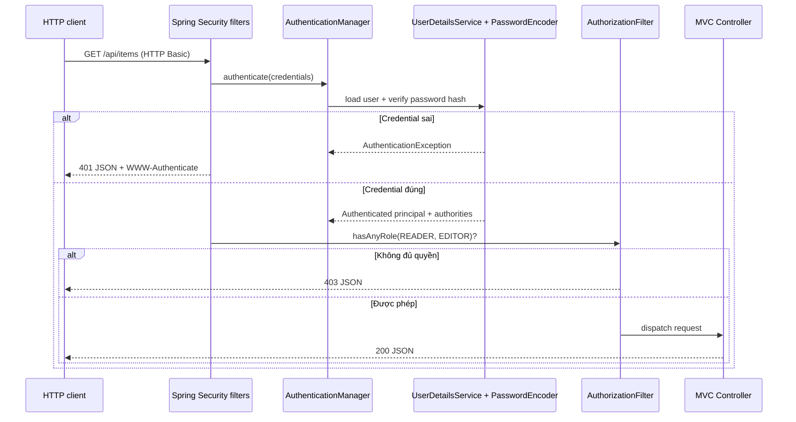
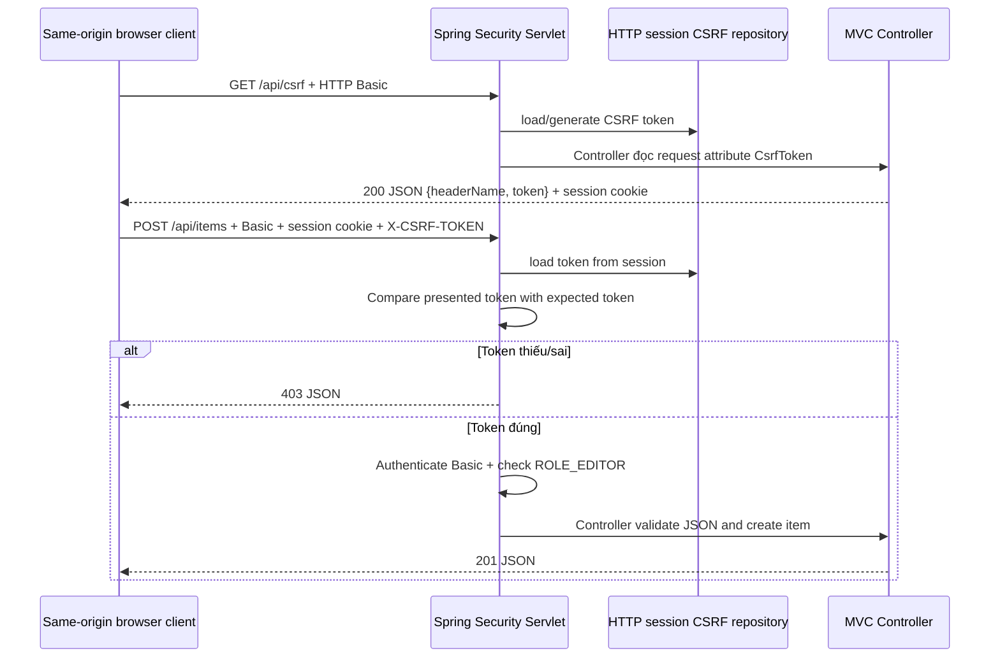

# REST API dùng HTTP Basic với phản hồi JSON và chính sách CSRF được giải thích

> **Module:** Spring Security — Servlet. **Bài thực hành tổng hợp:** xây dựng một REST API Spring Boot 3.3.0 / Spring Security 6.x / Java 17+ dùng **HTTP Basic**, trả **JSON** nhất quán ở cả tình huống thành công và lỗi bảo mật (401, 403), có **role-based authorization**, validation và chính sách **CSRF minh bạch**. Bài dùng Maven, MockMvc và `curl`, không cần cơ sở dữ liệu hay máy chủ danh tính bên ngoài.

## 1. Kết quả học tập

Sau khi hoàn thành, bạn có thể:

1. Trình bày cơ chế HTTP Basic: header `Authorization: Basic ...`, Base64 không phải mã hóa, `WWW-Authenticate`, HTTPS bắt buộc, kiểm tra credential qua `AuthenticationManager`/`UserDetailsService` và cách Spring Security thiết lập `SecurityContext`.
2. Thiết kế contract REST trả JSON: `200/201` cho thành công, `400` cho validation, `401` khi chưa/không được xác thực, `403` khi thiếu quyền hoặc CSRF thất bại; không làm rò mật khẩu, token hay thông tin nhạy cảm trong thông điệp lỗi.
3. Giải thích vì sao `permitAll()`, `authenticated()`, `hasRole(...)` và `SecurityFilterChain` có vai trò khác nhau.
4. Giải thích **CSRF** dựa trên việc browser có tự động gửi credential hay không; HTTP Basic trong browser cũng có thể là **ambient credential** được trình duyệt nhớ và gửi lại. Không nhầm "API trả JSON" với "tự động miễn CSRF".
5. Giữ CSRF bật trong ví dụ có người dùng truy cập qua browser, cung cấp endpoint cấp token, thực hiện POST với CSRF token từ session, và kiểm thử cả trường hợp thiếu/sai token.
6. Biết khi nào **có thể cân nhắc** miễn CSRF cho API thuần non-browser, stateless, dùng credential chủ động gắn vào từng request; hiểu rủi ro khi copy `csrf.disable()` vô điều kiện.
7. Dùng `AuthenticationEntryPoint`, `AccessDeniedHandler` và cấu hình `CsrfFilter` để có **response JSON nhất quán** kể cả khi filter chặn trước controller.
8. Viết test MockMvc sử dụng `httpBasic()` để kiểm tra **credential thật của demo**, `csrf()` để kiểm thử CSRF và các assertion response JSON/headers.

## 2. Bối cảnh và hợp đồng HTTP của ví dụ

API có hai tài khoản demo:
- `reader` / `reader-pass` với `ROLE_READER`.
- `editor` / `editor-pass` với `ROLE_EDITOR`.

Dùng các endpoint:

| Method/path | Chính sách | Thành công |
| --- | --- | --- |
| `GET /api/public/ping` | Public | `200` và JSON `{"message":"pong"}`. |
| `GET /api/items` | Đã xác thực, role `READER` hoặc `EDITOR` | `200`, danh sách items dạng JSON. |
| `POST /api/items` | Role `EDITOR` **và CSRF token hợp lệ** | `201`, item mới ở dạng JSON. |
| `GET /api/csrf` | Đã xác thực | `200`, JSON chứa tên header và token CSRF dùng trong session hiện tại. |
| Các path khác | `denyAll` | Bị chặn theo security policy. |

Các tài khoản/mật khẩu là **dữ liệu lab**, không phải phương pháp triển khai người dùng production. Dùng TLS/HTTPS cho mọi request Basic ngoài máy local; không hardcode credential trong frontend production.

### Ma trận kỳ vọng

| Tình huống | HTTP status | JSON error/body |
| --- | --- | --- |
| Public ping, anonymous | 200 | `{"message":"pong"}` |
| GET items, không credential | 401 | `error=unauthorized` |
| GET items, Basic password sai | 401 | `error=unauthorized` |
| GET items, Basic reader đúng | 200 | JSON danh sách |
| POST items, reader, **CSRF hợp lệ** | 403 | `error=forbidden` (thiếu role) |
| POST items, editor, **thiếu CSRF** | 403 | `error=forbidden` (CSRF) |
| POST items, editor, **CSRF sai** | 403 | `error=forbidden` (CSRF) |
| POST items, editor, **CSRF hợp lệ** | 201 | JSON item mới |
| POST items, editor, CSRF hợp lệ nhưng `name` trống | 400 | `error=bad_request` |
| GET CSRF, authenticated editor | 200 | JSON gồm `headerName` và `token` |

Không gán mọi `403` cho "thiếu role": `CsrfFilter` có thể trả 403 **trước khi** rule `hasRole` được đánh giá.

## 3. Cơ chế HTTP Basic

HTTP Basic định nghĩa cách client gửi một credential pair có tên người dùng và mật khẩu:

```http
GET /api/items HTTP/1.1
Host: localhost:8080
Authorization: Basic <base64(username:password)>
```

Phần sau chữ `Basic` là Base64 của `username:password`, **không phải mã hóa** và **không phải token đã ký**. Ai lấy được header đều có thể giải mã ngược ra credential. **Chỉ dùng Basic qua HTTPS** khi truyền qua mạng thật. Không đưa header Basic/cookie/token vào application logs, reverse-proxy access logs, bug reports hoặc screenshots.

Nếu endpoint yêu cầu auth mà không có credential hợp lệ, server thường trả:

```http
HTTP/1.1 401 Unauthorized
WWW-Authenticate: Basic realm="demo-api", charset="UTF-8"
Content-Type: application/json;charset=UTF-8
Cache-Control: no-store

{"status":401,"error":"unauthorized","message":"Authentication required"}
```

Header `WWW-Authenticate` mô tả challenge HTTP Basic. Nó có thể khiến một số browser hiện hộp thoại đăng nhập khi gọi URL trực tiếp; với SPA thường nên chọn cách xác thực phù hợp hơn thay vì cố tránh UI bằng cách bỏ an ninh.

Khi client gửi credential, `BasicAuthenticationFilter` đưa request xác thực qua `AuthenticationManager`/provider. Với `DaoAuthenticationProvider`, provider dùng `UserDetailsService` để tìm user và `PasswordEncoder` để kiểm tra password hash; sau đó SecurityContext của request chứa `Authentication` đã xác thực. Phần authorization quyết định user có role phù hợp hay không.



Đây là sơ đồ khái niệm của request Basic. Một request public không phải lúc nào cũng có authentication attempt; filter, CSRF, nhiều chains hoặc các entry point khác có thể thay đổi đường đi.

### 401 và 403 khác nhau

**401 Unauthorized** trong HTTP thực tế là tình huống không có hoặc thất bại authentication. Server gửi Basic challenge nếu muốn client cung cấp credential. **403 Forbidden** thường là user đã được xác thực nhưng thiếu quyền, hoặc request bị một filter như CSRF từ chối. Đừng biến mọi lỗi thành 200 với JSON `{"success":false}`: điều đó làm sai contract của HTTP clients, reverse proxy, monitoring và security tests.

## 4. JSON response nên được tạo ở đúng tầng

Bài mẫu trả JSON cho:

- Thành công: Jackson serialize `Map`, `record` và `List` từ MVC controller.
- Validation input (`400`): `@RestControllerAdvice`/`@ExceptionHandler`.
- Authentication failure (`401`): `AuthenticationEntryPoint` trong filter chain.
- Authorization denied (`403`): `AccessDeniedHandler`.
- CSRF failure (`403`): `CsrfFilter` với custom `AccessDeniedHandler`.

### Vì sao @RestControllerAdvice không đủ cho 401/403?

`@RestControllerAdvice` xử lý exceptions được đưa vào **Spring MVC exception resolution**. Các security filters chạy **trước DispatcherServlet** và có thể tự chặn request, không chuyển exception tới MVC advice. Vì thế viết một `@ExceptionHandler(AccessDeniedException.class)` trong controller advice **không đảm bảo** mọi HTTP 403/401 của filter sẽ có JSON.

Cần cài handler tại **vị trí security filter tương ứng**. Ví dụ này tạo cùng định dạng JSON nhưng giữ nguyên status 401/403. Nội dung response cố tình **không trả message của exception**, vì message có thể rò thông tin nhận dạng tài khoản, details của authentication provider hoặc policy nội bộ.

### Mẫu JSON lỗi

```json
{
  "status": 403,
  "error": "forbidden",
  "message": "Access denied"
}
```

Khi thiếu CSRF, cùng status JSON có thể được trả vì mục tiêu API contract nhất quán. Nội bộ server nên ghi reason code phù hợp và metrics để phân biệt `csrf_missing`, `csrf_invalid`, `insufficient_authority`; không nhất thiết tiết lộ reason chi tiết cho anonymous client.

## 5. CSRF: vì sao REST JSON + HTTP Basic không được mặc định miễn?

**Cross-Site Request Forgery (CSRF)** xảy ra khi attacker lừa browser của người dùng tạo request tới một trang/ứng dụng mà browser **tự thêm thông tin xác thực**. Server nhìn thấy credential hợp lệ nhưng hành động không phải do chủ tài khoản chủ ý.

Một tình huống:

1. Người dùng đã đăng nhập/đã gửi HTTP Basic tới `https://api.example.test` và browser có thể lưu/truyền lại Basic credentials theo protection space hoặc cache authentication của browser.
2. Người dùng truy cập trang attacker ở `https://untrusted.example.test`.
3. Trang attacker tạo một request thay đổi state tới API; tùy loại request, browser có thể tự kèm credential của API.
4. Nếu server chỉ kiểm tra user đã đăng nhập và không có cơ chế chống CSRF thích hợp, thao tác có thể thực hiện dù attacker không đọc được response.

**HTTP Basic không tự miễn CSRF chỉ vì không dùng cookie.** Với browser-managed authentication state, Basic credential có thể là ambient credential. Tương tự, một SPA dùng JSON không tự nhiên an toàn hơn nếu ứng dụng dựa vào cookie/session.

### CORS có giải quyết CSRF không?

**Không.** CORS kiểm soát việc JavaScript cross-origin có được đọc response, cùng một số điều kiện preflight; nó không tự bảo đảm rằng một cross-site state-changing request đã được chủ tài khoản cho phép. Một số request cross-site có thể **được gửi** dù attacker không đọc được response. Vì vậy CORS, SameSite và CSRF token là các biện pháp khác nhau cần đánh giá độc lập.

### Hai bối cảnh phải phân biệt

| Bối cảnh | Nguồn credential | Rủi ro CSRF cần xem xét | Hướng tiếp cận |
| --- | --- | --- | --- |
| Browser, session cookie | Browser tự đính cookie | Cao nếu unsafe action không có chống CSRF. | Bật CSRF + token phù hợp, SameSite/Secure, kiểm soát origin. |
| Browser, HTTP Basic được cache | Browser có thể tự gửi Basic | Vẫn có CSRF surface tùy hoạt động browser. | Không tắt CSRF chỉ vì dùng Basic; kiểm thử browser thực tế. |
| Backend-to-backend, HTTP Basic mỗi request | Client program gắn Authorization có chủ đích | Không có "người dùng bị lừa" theo cơ chế browser thông thường. | Có thể tách chain API thuần non-browser với CSRF policy được chứng minh và threat model rõ. |
| API dùng Bearer token từ JS, chỉ trong Authorization header do app đặt | Không tự gửi token như cookie nếu app không đặt | CSRF thường ít liên quan hơn; XSS/token theft là rủi ro khác. | Có thể cân nhắc stateless và miễn CSRF đúng chain; vẫn phải bảo vệ XSS và credential storage. |
| Ứng dụng dùng cả cookie session và bearer | Có cả ambient và explicit credentials | Không thể suy ra toàn API an toàn khỏi CSRF. | Phân chain/path, bắt token ở flow cookie, test tất cả đường vào. |

**Quyết định của bài demo:** giữ **CSRF mặc định BẬT** cho `POST /api/items`, dùng `HttpSessionCsrfTokenRepository` mặc định của Spring Security để lưu CSRF token trong HTTP session. `GET /api/csrf` buộc tạo token và trả JSON để client cùng origin lấy token. Đây là ví dụ rõ ràng cho browser-usable Basic API, **không phải** mẫu API hoàn toàn stateless.

## 6. CSRF token, session và request flow



Lược đồ này đơn giản hóa thứ tự một số filters. Trong thực tế `CsrfFilter` có thể chặn POST thiếu token **trước** Basic authentication; vì thế POST anonymous thiếu token cũng có thể nhận 403. Để test role/credential riêng, hãy gửi CSRF token hợp lệ trước rồi kiểm tra status.

**Tính ràng buộc:** với default HttpSession-based CSRF repository, token dựa trên session. Gửi token lấy từ session A cùng cookie/session B có thể không hợp lệ. Spring Security 6 có deferred CSRF token và cơ chế bảo vệ BREACH qua request attribute token handler, nên không tự so JSON value với database token trong test; hãy đi đúng flow do framework cung cấp.

### SameSite cookie không thay CSRF token

`SameSite=Lax` hoặc `Strict` giúp hạn chế một số kiểu cross-site cookie sending, nhưng không phải lá chắn tổng quát trong mọi bối cảnh, đặc biệt với các luồng chuyển hướng, cùng-site khác origin, browser behavior hoặc các thay đổi cấu hình. CSRF token cho unsafe methods là biện pháp độc lập. Nếu dùng `SameSite=None; Secure` cho cross-site cookie, phải cân nhắc CSRF kỹ hơn.

### Khi nào csrf().disable() có thể hợp lý?

Chỉ với **security chain giới hạn rõ**, ví dụ một API backend-to-backend không dùng cookie/session và **không** hỗ trợ browser-managed ambient credentials, credential chỉ được gửi có chủ đích bởi client thực sự. Quyết định dựa vào threat model, không dựa vào file tên "RestController" hay response JSON. Với HTTP Basic được browser sử dụng, **stateless không tự xóa rủi ro CSRF** nếu browser gửi lại Basic credential.

Phần 14 trình bày một biến thể có điều kiện. Ví dụ chính **không tắt CSRF**.

## 7. Cấu trúc project Java 17 + Spring Boot 3.3

```text
basic-json-csrf-lab/
├── pom.xml
└── src/
    ├── main/
    │   ├── java/demo/basic/
    │   │   ├── BasicApiApplication.java
    │   │   ├── SecurityConfig.java
    │   │   ├── JsonErrors.java
    │   │   ├── ApiError.java
    │   │   ├── ItemService.java
    │   │   ├── ItemController.java
    │   │   └── JsonValidationAdvice.java
    │   └── resources/application.properties
    └── test/
        └── java/demo/basic/
            └── BasicApiSecurityTest.java
```

Tất cả files có package `demo.basic` để component scan của `@SpringBootApplication` tìm được bean. Nội dung chạy bằng Maven khi dependency đã tải; không yêu cầu DB ngoài, nhưng có embedded HTTP server phục vụ local lab.

### 7.1. pom.xml

```xml
<project xmlns="http://maven.apache.org/POM/4.0.0"
         xmlns:xsi="http://www.w3.org/2001/XMLSchema-instance"
         xsi:schemaLocation="http://maven.apache.org/POM/4.0.0 https://maven.apache.org/xsd/maven-4.0.0.xsd">
    <modelVersion>4.0.0</modelVersion>
    <parent>
        <groupId>org.springframework.boot</groupId>
        <artifactId>spring-boot-starter-parent</artifactId>
        <version>3.3.0</version>
        <relativePath/>
    </parent>
    <groupId>demo</groupId>
    <artifactId>basic-json-csrf-lab</artifactId>
    <version>0.0.1-SNAPSHOT</version>
    <properties>
        <java.version>17</java.version>
    </properties>
    <dependencies>
        <dependency>
            <groupId>org.springframework.boot</groupId>
            <artifactId>spring-boot-starter-web</artifactId>
        </dependency>
        <dependency>
            <groupId>org.springframework.boot</groupId>
            <artifactId>spring-boot-starter-security</artifactId>
        </dependency>
        <dependency>
            <groupId>org.springframework.boot</groupId>
            <artifactId>spring-boot-starter-validation</artifactId>
        </dependency>
        <dependency>
            <groupId>org.springframework.boot</groupId>
            <artifactId>spring-boot-starter-test</artifactId>
            <scope>test</scope>
        </dependency>
        <dependency>
            <groupId>org.springframework.security</groupId>
            <artifactId>spring-security-test</artifactId>
            <scope>test</scope>
        </dependency>
    </dependencies>
    <build>
        <plugins>
            <plugin>
                <groupId>org.springframework.boot</groupId>
                <artifactId>spring-boot-maven-plugin</artifactId>
            </plugin>
        </plugins>
    </build>
</project>
```

`spring-security-test` cần cho `httpBasic()` và `csrf()` trong MockMvc. `spring-boot-starter-validation` cho `@NotBlank` và `@Valid`.

### 7.2. Application và cấu hình port

**`src/main/resources/application.properties`**

```properties
server.port=8080
```

**`src/main/java/demo/basic/BasicApiApplication.java`**

```java
package demo.basic;

import org.springframework.boot.SpringApplication;
import org.springframework.boot.autoconfigure.SpringBootApplication;

@SpringBootApplication
public class BasicApiApplication {
    public static void main(String[] args) {
        SpringApplication.run(BasicApiApplication.class, args);
    }
}
```

## 8. JSON error contract: tạo đối tượng và writer chung

**`src/main/java/demo/basic/ApiError.java`**

```java
package demo.basic;

public record ApiError(int status, String error, String message) {
}
```

Record cho Jackson serialize thành JSON có các fields `status`, `error` và `message`. Không đưa stacktrace/exception details vào response công khai.

**`src/main/java/demo/basic/JsonErrors.java`**

```java
package demo.basic;

import com.fasterxml.jackson.databind.ObjectMapper;
import jakarta.servlet.http.HttpServletResponse;
import java.io.IOException;
import java.nio.charset.StandardCharsets;
import org.springframework.http.HttpHeaders;
import org.springframework.http.MediaType;

public final class JsonErrors {
    private JsonErrors() {
    }

    public static void write(
            HttpServletResponse response,
            ObjectMapper mapper,
            int status,
            String error,
            String message) throws IOException {
        response.setStatus(status);
        response.setCharacterEncoding(StandardCharsets.UTF_8.name());
        response.setContentType(MediaType.APPLICATION_JSON_VALUE);
        response.setHeader(HttpHeaders.CACHE_CONTROL, "no-store");
        mapper.writeValue(
            response.getOutputStream(),
            new ApiError(status, error, message));
    }
}
```

**Lý do dùng ObjectMapper:** không tự tạo JSON bằng nối chuỗi, hạn chế escape bugs và đảm bảo contract nhất quán. Client nên dựa vào `status`/`error`, còn `message` có thể đổi giữa phiên bản. `Cache-Control: no-store` trên lỗi bảo mật làm giảm nguy cơ response nhạy cảm bị cache; endpoint CSRF bên dưới cũng đặt no-store.

## 9. Cấu hình SecurityFilterChain: Basic, 401 JSON, 403 JSON, CSRF

**`src/main/java/demo/basic/SecurityConfig.java`**

```java
package demo.basic;

import com.fasterxml.jackson.databind.ObjectMapper;
import org.springframework.context.annotation.Bean;
import org.springframework.context.annotation.Configuration;
import org.springframework.http.HttpHeaders;
import org.springframework.http.HttpMethod;
import org.springframework.security.config.Customizer;
import org.springframework.security.config.annotation.ObjectPostProcessor;
import org.springframework.security.config.annotation.web.builders.HttpSecurity;
import org.springframework.security.core.userdetails.User;
import org.springframework.security.core.userdetails.UserDetailsService;
import org.springframework.security.crypto.bcrypt.BCryptPasswordEncoder;
import org.springframework.security.crypto.password.PasswordEncoder;
import org.springframework.security.provisioning.InMemoryUserDetailsManager;
import org.springframework.security.web.AuthenticationEntryPoint;
import org.springframework.security.web.SecurityFilterChain;
import org.springframework.security.web.access.AccessDeniedHandler;
import org.springframework.security.web.csrf.CsrfFilter;

@Configuration
public class SecurityConfig {
    @Bean
    SecurityFilterChain securityFilterChain(
            HttpSecurity http,
            ObjectMapper mapper) throws Exception {

        AuthenticationEntryPoint unauthorized =
            (request, response, exception) -> {
                response.setHeader(HttpHeaders.WWW_AUTHENTICATE,
                    "Basic realm=\"demo-api\", charset=\"UTF-8\"");
                JsonErrors.write(response, mapper, 401,
                    "unauthorized", "Authentication required");
            };

        AccessDeniedHandler forbidden =
            (request, response, exception) ->
                JsonErrors.write(response, mapper, 403,
                    "forbidden", "Access denied");

        return http
            .authorizeHttpRequests(auth -> auth
                .requestMatchers(
                    HttpMethod.GET, "/api/public/ping").permitAll()
                .requestMatchers(
                    HttpMethod.GET, "/api/csrf").authenticated()
                .requestMatchers(
                    HttpMethod.GET, "/api/items")
                    .hasAnyRole("READER", "EDITOR")
                .requestMatchers(
                    HttpMethod.POST, "/api/items")
                    .hasRole("EDITOR")
                .anyRequest().denyAll())
            .httpBasic(basic ->
                basic.authenticationEntryPoint(unauthorized))
            .exceptionHandling(ex -> ex
                .authenticationEntryPoint(unauthorized)
                .accessDeniedHandler(forbidden))
            .csrf(csrf -> csrf
                .withObjectPostProcessor(
                    new ObjectPostProcessor<CsrfFilter>() {
                        @Override
                        public <O extends CsrfFilter> O postProcess(
                                O filter) {
                            filter.setAccessDeniedHandler(forbidden);
                            return filter;
                        }
                    }))
            .build();
    }

    @Bean
    PasswordEncoder passwordEncoder() {
        return new BCryptPasswordEncoder();
    }

    @Bean
    UserDetailsService demoUsers(PasswordEncoder encoder) {
        return new InMemoryUserDetailsManager(
            User.withUsername("reader")
                .password(encoder.encode("reader-pass"))
                .roles("READER")
                .build(),
            User.withUsername("editor")
                .password(encoder.encode("editor-pass"))
                .roles("EDITOR")
                .build());
    }
}
```

**Phân tích từng bước:**

1. `requestMatchers` xác định policy rõ theo **method + path**. `GET /api/public/ping` public; `GET /api/items` yêu cầu reader/editor; `POST /api/items` yêu cầu editor. Method khác không tự được phép vì GET cùng path được phép.
2. `httpBasic(...)` bật HTTP Basic và gắn JSON entry point cho **credential sai**; `exceptionHandling(...)` dùng cùng entry point cho anonymous access bị chặn và access-denied handler khi thiếu role.
3. Khi trả 401, JSON writer **không đưa exception.getMessage()** ra client. Header `WWW-Authenticate` giữ HTTP Basic challenge.
4. `.csrf(...)` **không disable** CSRF. Nó gắn `ObjectPostProcessor<CsrfFilter>` để thay access-denied handler của chính `CsrfFilter`, giúp response thiếu/sai CSRF cũng trả **403 JSON**, thay vì phụ thuộc vào default `sendError`.
5. `CsrfFilter` có thể chạy trước Basic authentication filter; với POST vừa thiếu CSRF vừa thiếu credential, lý do 403 có thể là CSRF, không phải "user đã đăng nhập nhưng thiếu role".
6. `BCryptPasswordEncoder` băm password của hai user demo trước khi lưu vào in-memory user store. Không lưu plaintext hashless passwords trong ứng dụng thật. Production nên dùng cấu hình user store/identity provider phù hợp và secret management.
7. Không có `SessionCreationPolicy.STATELESS` vì **CSRF token cần session** trong policy demo. Đặt stateless một cách máy móc có thể làm hỏng token flow hoặc tạo hành vi khó đoán.
8. `anyRequest().denyAll()` ngăn những route chưa được design vô tình public. URL ngoài API (kể cả `/error`) có thể cũng bị chặn; trong project production cần thiết kế error dispatch, health endpoints và security matchers phù hợp.

### Về ObjectPostProcessor<CsrfFilter>

Đây là kỹ thuật có chủ đích cho demo Spring Security 6 nhằm can thiệp vào **handler của CsrfFilter**. Không sử dụng một `@RestControllerAdvice` để hy vọng bắt exception mà filter đã xử lý xong. Khi nâng Spring Security version, cần chạy test riêng cho 403 JSON thiếu CSRF, vì hành vi/extension point có thể thay đổi theo phiên bản. Phần authorization `AccessDeniedHandler` vẫn xử lý deny theo rule khi security đã tới giai đoạn authorization.

Không cần đọc `SecurityContextHolder` trong JSON error writer; trả thông tin công khai ổn định là đủ. Logger/audit nội bộ nếu cần ghi lý do phải tách khỏi response, không ghi password/Authorization headers.

## 10. Business service và JSON DTO

**`src/main/java/demo/basic/ItemService.java`**

```java
package demo.basic;

import java.util.List;
import java.util.concurrent.CopyOnWriteArrayList;
import java.util.concurrent.atomic.AtomicLong;
import org.springframework.stereotype.Service;

@Service
public class ItemService {
    private final AtomicLong nextId = new AtomicLong(1);
    private final CopyOnWriteArrayList<ItemResponse> items =
        new CopyOnWriteArrayList<>();

    public ItemService() {
        items.add(new ItemResponse(
            nextId.getAndIncrement(), "guide", "system"));
    }

    public List<ItemResponse> findAll() {
        return List.copyOf(items);
    }

    public ItemResponse create(String name, String owner) {
        ItemResponse item =
            new ItemResponse(nextId.getAndIncrement(), name, owner);
        items.add(item);
        return item;
    }

    public record ItemResponse(long id, String name, String owner) {
    }
}
```

Bản demo dùng in-memory list; khi server restart dữ liệu mất, không phù hợp multi-instance hoặc production. `CopyOnWriteArrayList` phù hợp cho lab số lượt ghi thấp, không đề xuất cho workload ghi lớn. Thao tác `create` không thay thế transaction, repository, validation business, tenant-based access control hoặc rate limiting.

**`src/main/java/demo/basic/ItemController.java`**

```java
package demo.basic;

import demo.basic.ItemService.ItemResponse;
import jakarta.servlet.http.HttpServletRequest;
import jakarta.validation.Valid;
import jakarta.validation.constraints.NotBlank;
import java.util.List;
import java.util.Map;
import org.springframework.http.CacheControl;
import org.springframework.http.HttpStatus;
import org.springframework.http.ResponseEntity;
import org.springframework.security.core.Authentication;
import org.springframework.security.web.csrf.CsrfToken;
import org.springframework.web.bind.annotation.GetMapping;
import org.springframework.web.bind.annotation.PostMapping;
import org.springframework.web.bind.annotation.RequestBody;
import org.springframework.web.bind.annotation.RestController;

@RestController
public class ItemController {
    private final ItemService items;

    public ItemController(ItemService items) {
        this.items = items;
    }

    @GetMapping("/api/public/ping")
    public Map<String, String> ping() {
        return Map.of("message", "pong");
    }

    @GetMapping("/api/items")
    public List<ItemResponse> all() {
        return items.findAll();
    }

    public record CreateItemRequest(@NotBlank String name) {
    }

    @PostMapping("/api/items")
    public ResponseEntity<ItemResponse> create(
            @Valid @RequestBody CreateItemRequest input,
            Authentication authentication) {
        ItemResponse created =
            items.create(input.name(), authentication.getName());
        return ResponseEntity.status(HttpStatus.CREATED).body(created);
    }

    @GetMapping("/api/csrf")
    public ResponseEntity<Map<String, String>> csrf(
            HttpServletRequest request) {
        CsrfToken token = (CsrfToken)
            request.getAttribute(CsrfToken.class.getName());

        if (token == null) {
            throw new IllegalStateException(
                "CSRF token not available in this security chain");
        }

        return ResponseEntity.ok()
            .cacheControl(CacheControl.noStore())
            .body(Map.of(
                "headerName", token.getHeaderName(),
                "parameterName", token.getParameterName(),
                "token", token.getToken()));
    }
}
```

- `@Valid` + `@NotBlank` kiểm tra request body JSON; lỗi sẽ được advice chuyển thành 400.
- `Authentication` là principal **đã được filter xác thực**, không lấy `owner` từ request body do client tự gửi. Vẫn cần resource/tenant authorization nếu dữ liệu gắn tổ chức khác nhau.
- `/api/csrf` chỉ cho authenticated client; `CsrfToken` được truy cập từ request attribute mà `CsrfFilter`/request handler đã tạo. Gọi `getToken()` kích hoạt token deferred khi cần. Response no-store tránh cache token.
- Endpoint CSRF phải được bảo vệ khỏi lộ qua CORS cấu hình quá rộng. Không coi nó là "API công khai lấy secret"; token chống CSRF cần đúng session và phải được xử lý qua kênh frontend đã tin cậy.

### 10.1. JSON validation error

**`src/main/java/demo/basic/JsonValidationAdvice.java`**

```java
package demo.basic;

import org.springframework.http.HttpStatus;
import org.springframework.http.ResponseEntity;
import org.springframework.web.bind.MethodArgumentNotValidException;
import org.springframework.web.bind.annotation.ExceptionHandler;
import org.springframework.web.bind.annotation.RestControllerAdvice;

@RestControllerAdvice
public class JsonValidationAdvice {
    @ExceptionHandler(MethodArgumentNotValidException.class)
    ResponseEntity<ApiError> invalid(
            MethodArgumentNotValidException ex) {
        return ResponseEntity.status(HttpStatus.BAD_REQUEST)
            .body(new ApiError(
                400, "bad_request", "Invalid request body"));
    }
}
```

Thông điệp không chứa nguyên `rejectedValue` hay field data người dùng gửi, giúp tránh phản chiếu secrets/PII vào errors. Chỉ `MethodArgumentNotValidException` được xử lý bởi class này; các lỗi JSON parse/mapping khác có thể nhận response mặc định của Spring Boot/MVC và cần xử lý riêng nếu contract của ứng dụng đòi thống nhất mọi loại 400.

## 11. Kiểm thử tích hợp đầy đủ với MockMvc

**`src/test/java/demo/basic/BasicApiSecurityTest.java`**

```java
package demo.basic;

import com.fasterxml.jackson.databind.JsonNode;
import com.fasterxml.jackson.databind.ObjectMapper;
import org.junit.jupiter.api.Test;
import org.springframework.beans.factory.annotation.Autowired;
import org.springframework.boot.test.autoconfigure.web.servlet.AutoConfigureMockMvc;
import org.springframework.boot.test.context.SpringBootTest;
import org.springframework.http.MediaType;
import org.springframework.mock.web.MockHttpSession;
import org.springframework.test.web.servlet.MockMvc;
import org.springframework.test.web.servlet.MvcResult;

import static org.springframework.security.test.web.servlet.request
    .SecurityMockMvcRequestPostProcessors.csrf;
import static org.springframework.security.test.web.servlet.request
    .SecurityMockMvcRequestPostProcessors.httpBasic;
import static org.springframework.test.web.servlet.request
    .MockMvcRequestBuilders.get;
import static org.springframework.test.web.servlet.request
    .MockMvcRequestBuilders.post;
import static org.springframework.test.web.servlet.result.MockMvcResultMatchers
    .content;
import static org.springframework.test.web.servlet.result.MockMvcResultMatchers
    .header;
import static org.springframework.test.web.servlet.result.MockMvcResultMatchers
    .jsonPath;
import static org.springframework.test.web.servlet.result.MockMvcResultMatchers
    .status;

@SpringBootTest
@AutoConfigureMockMvc
class BasicApiSecurityTest {
    @Autowired
    MockMvc mvc;

    @Autowired
    ObjectMapper mapper;

    @Test
    void publicPingIsJsonWithoutAuthentication() throws Exception {
        mvc.perform(get("/api/public/ping"))
            .andExpect(status().isOk())
            .andExpect(content().contentTypeCompatibleWith(
                MediaType.APPLICATION_JSON))
            .andExpect(jsonPath("$.message").value("pong"));
    }

    @Test
    void missingCredentialsReturns401JsonAndBasicChallenge()
            throws Exception {
        mvc.perform(get("/api/items"))
            .andExpect(status().isUnauthorized())
            .andExpect(header().string(
                "WWW-Authenticate",
                "Basic realm=\"demo-api\", charset=\"UTF-8\""))
            .andExpect(jsonPath("$.status").value(401))
            .andExpect(jsonPath("$.error").value("unauthorized"));
    }

    @Test
    void wrongPasswordReturns401WithoutDetails() throws Exception {
        mvc.perform(get("/api/items")
                .with(httpBasic("reader", "wrong")))
            .andExpect(status().isUnauthorized())
            .andExpect(jsonPath("$.error").value("unauthorized"))
            .andExpect(jsonPath("$.message").value(
                "Authentication required"));
    }

    @Test
    void realReaderCanFetchItems() throws Exception {
        mvc.perform(get("/api/items")
                .with(httpBasic("reader", "reader-pass")))
            .andExpect(status().isOk())
            .andExpect(jsonPath("$[0].name").value("guide"));
    }

    @Test
    void readerPostWithValidCsrfStillHasNoEditorRole()
            throws Exception {
        mvc.perform(post("/api/items")
                .with(httpBasic("reader", "reader-pass"))
                .with(csrf())
                .contentType(MediaType.APPLICATION_JSON)
                .content("{\"name\":\"reader-attempt\"}"))
            .andExpect(status().isForbidden())
            .andExpect(jsonPath("$.status").value(403))
            .andExpect(jsonPath("$.error").value("forbidden"));
    }

    @Test
    void editorPostWithoutCsrfGets403Json()
            throws Exception {
        mvc.perform(post("/api/items")
                .with(httpBasic("editor", "editor-pass"))
                .contentType(MediaType.APPLICATION_JSON)
                .content("{\"name\":\"should-not-exist\"}"))
            .andExpect(status().isForbidden())
            .andExpect(jsonPath("$.status").value(403))
            .andExpect(jsonPath("$.error").value("forbidden"));
    }

    @Test
    void editorPostWithInvalidCsrfGets403Json()
            throws Exception {
        mvc.perform(post("/api/items")
                .with(httpBasic("editor", "editor-pass"))
                .with(csrf().useInvalidToken())
                .contentType(MediaType.APPLICATION_JSON)
                .content("{\"name\":\"should-not-exist\"}"))
            .andExpect(status().isForbidden())
            .andExpect(jsonPath("$.error").value("forbidden"));
    }

    @Test
    void editorPostWithValidCsrfReturns201Json()
            throws Exception {
        mvc.perform(post("/api/items")
                .with(httpBasic("editor", "editor-pass"))
                .with(csrf())
                .contentType(MediaType.APPLICATION_JSON)
                .content("{\"name\":\"new-item\"}"))
            .andExpect(status().isCreated())
            .andExpect(jsonPath("$.name").value("new-item"))
            .andExpect(jsonPath("$.owner").value("editor"));
    }

    @Test
    void invalidJsonFieldReturns400Json() throws Exception {
        mvc.perform(post("/api/items")
                .with(httpBasic("editor", "editor-pass"))
                .with(csrf())
                .contentType(MediaType.APPLICATION_JSON)
                .content("{\"name\":\"   \"}"))
            .andExpect(status().isBadRequest())
            .andExpect(jsonPath("$.status").value(400))
            .andExpect(jsonPath("$.error").value("bad_request"));
    }

    @Test
    void csrfTokenRoundTripWithinOneSession() throws Exception {
        MvcResult started = mvc.perform(get("/api/csrf")
                .with(httpBasic("editor", "editor-pass")))
            .andExpect(status().isOk())
            .andExpect(jsonPath("$.headerName").value("X-CSRF-TOKEN"))
            .andExpect(jsonPath("$.token").isNotEmpty())
            .andReturn();

        JsonNode payload = mapper.readTree(
            started.getResponse().getContentAsString());
        String csrfHeader = payload.get("headerName").asText();
        String csrfToken = payload.get("token").asText();
        MockHttpSession session = (MockHttpSession)
            started.getRequest().getSession(false);

        mvc.perform(post("/api/items")
                .session(session)
                .header(csrfHeader, csrfToken)
                .with(httpBasic("editor", "editor-pass"))
                .contentType(MediaType.APPLICATION_JSON)
                .content("{\"name\":\"session-csrf-item\"}"))
            .andExpect(status().isCreated())
            .andExpect(jsonPath("$.owner").value("editor"));
    }
}
```

### 11.1. Vì sao dùng httpBasic() thay cho user()?

`with(httpBasic("reader","reader-pass"))` đưa **Authorization header** vào request MockMvc. Filter/provider thật đọc header, tìm user trong `InMemoryUserDetailsManager` và dùng BCrypt password encoder, nên test kiểm chứng **authentication pipeline** của ứng dụng demo. `with(user("reader"))` hoặc `@WithMockUser` gắn authentication giả trực tiếp, thích hợp để test policy nhưng **không kiểm tra credential** hoặc HTTP Basic entry point.

`@SpringBootTest + @AutoConfigureMockMvc` nạp application context và servlet filters thật trong **mock servlet environment**, không phải network socket. Test này chưa kiểm tra HTTPS, reverse proxy, load balancer, real browser credential cache hoặc cookie SameSite của môi trường triển khai.

### 11.2. Hai nhánh 403 phải tách

- **Thiếu role:** reader POST có `with(csrf())` hợp lệ → CSRF pass rồi `hasRole("EDITOR")` deny → 403.
- **Thiếu CSRF:** editor POST không có `csrf()` → `CsrfFilter` deny → 403 ngay cả khi credential đúng.

Nếu test reader POST **không** gửi CSRF, 403 có thể chỉ chứng minh CSRF hoạt động, **không chứng minh authorization rule thiếu role được đánh giá**. Đây là lỗi thiết kế test rất thường gặp.

### 11.3. csrf() test helper có phải token thật cho browser?

Không. `SecurityMockMvcRequestPostProcessors.csrf()` là công cụ tạo CSRF token hợp lệ trong request test, giúp kiểm tra filter policy có/không token. Để chứng minh workflow browser/session, test `csrfTokenRoundTripWithinOneSession` yêu cầu token qua endpoint GET, giữ cùng `MockHttpSession` và đặt header thật ở POST — gần với hợp đồng client hơn.

Đối với browser thật, cần cùng session cookie qua các requests, CSRF token đúng được đưa vào request header theo chính sách. Không copy token từ stdout/log hoặc gửi CSRF token lên third-party analytics.

## 12. Chạy bằng Maven và kiểm tra response JSON

Tại thư mục `basic-json-csrf-lab`:

```bash
mvn test
mvn spring-boot:run
```

Cần JDK 17+ và Maven với dependency đã tải. Kết quả Maven test thành công kỳ vọng là build pass; chi tiết số tests có thể thay đổi nếu bạn bổ sung test. Dùng trình duyệt hoặc HTTP client gọi:

```bash
curl -i http://localhost:8080/api/public/ping
```

Ví dụ response (bỏ bớt headers không liên quan):

```http
HTTP/1.1 200
Content-Type: application/json

{"message":"pong"}
```

Gọi private mà không có credential:

```bash
curl -i http://localhost:8080/api/items
```

Kỳ vọng `401`, `WWW-Authenticate` và body `ApiError` dạng JSON. Dùng Basic đúng:

```bash
curl -i -u reader:reader-pass \
  http://localhost:8080/api/items
```

Kỳ vọng `200`, JSON array có item `guide`. Không nên chụp request với raw credential/password hoặc bật verbose logs trong môi trường thật.

Thử POST khi **chưa có CSRF**:

```bash
curl -i -u editor:editor-pass \
  -X POST http://localhost:8080/api/items \
  -H "Content-Type: application/json" \
  -d '{"name":"demo"}'
```

Kỳ vọng `403` và `{"status":403,"error":"forbidden","message":"Access denied"}` theo JSON handler, vì CSRF còn bật. **Đừng "sửa" bằng cách thêm `.csrf(AbstractHttpConfigurer::disable)` mà chưa xác minh client/browser threat model.**

### 12.1. Kịch bản curl đầy đủ: lấy token + giữ session

Nếu muốn gọi POST thật từ shell với session-based CSRF, hãy dùng cookie jar để giữ session giữa hai requests. Hai bước:

```bash
curl -i -c cookies.txt -u editor:editor-pass \
  http://localhost:8080/api/csrf
```

Response JSON gồm `headerName` và `token`. Sao chép giá trị token trong môi trường local lab vào một biến shell an toàn (không chia sẻ với người khác). Ví dụ minh họa sử dụng biến `CSRF_TOKEN` đã được cấp thực, không phải chuỗi giả:

```bash
curl -i -b cookies.txt -u editor:editor-pass \
  -X POST http://localhost:8080/api/items \
  -H "Content-Type: application/json" \
  -H "X-CSRF-TOKEN: <token-from-api-csrf>" \
  -d '{"name":"from-curl"}'
```

**Thay** `<token-from-api-csrf>` bằng token thật từ response GET, dùng **cùng cookie jar**. Trong môi trường shell tự động hóa, tránh ghi token/password vào shell history hay log; ở thực tế có thể parse JSON bằng tool phù hợp rồi gửi qua standard input/secret store bảo vệ. `-u` cũng có thể để lại credential trong process arguments/history, nên ví dụ `curl` chỉ dùng trong lab an toàn.

Với đúng token và role editor, status `201` và body có `id`, `name`, `owner`. Nếu cố dùng token thuộc session khác, backend phải từ chối theo repository semantics. Nếu bạn chỉ gọi GET CSRF mà không gửi lại cookie session, token có thể không khớp ở POST.

### 12.2. Có thể dùng curl mà không mang session không?

Có thể với GET Basic hoặc một API đã chọn policy stateless phù hợp. Nhưng **ví dụ chính** lưu CSRF token trong session; POST cần giữ session. Việc HTTP Basic phải gửi lại username/password mỗi request không ngăn một session được tạo **chỉ để quản lý CSRF token**. Không đồng nhất "Basic auth mỗi request" với "bắt buộc không có HttpSession".

## 13. Client JavaScript cùng origin và token CSRF

Giả sử frontend cùng origin với API (để không lẫn CORS) và app cho phép người dùng xác thực Basic theo cách phù hợp. Sau khi user đã có credential session/challenge, client có thể lấy CSRF token:

```javascript
async function createItem(name) {
  const tokenResponse = await fetch("/api/csrf", {
    credentials: "same-origin"
  });
  if (!tokenResponse.ok) {
    throw new Error("Cannot load CSRF token: HTTP " +
      tokenResponse.status);
  }
  const tokenData = await tokenResponse.json();

  const response = await fetch("/api/items", {
    method: "POST",
    credentials: "same-origin",
    headers: {
      "Content-Type": "application/json",
      [tokenData.headerName]: tokenData.token
    },
    body: JSON.stringify({ name })
  });

  const payload = await response.json();
  if (!response.ok) {
    throw new Error(payload.error || "Request failed");
  }
  return payload;
}
```

Đây là **mẫu minh họa token flow**, không phải cơ chế login frontend trọn vẹn. `credentials: "same-origin"` chỉ quy định cách browser xét gửi credentials; nó không tự tạo Basic credential hoặc thay user sign-in. Với SPA thực, nên cân nhắc auth architecture riêng (OIDC, secure session cookie, BFF...), tránh lưu password/Basic token trong localStorage hoặc hardcode vào JS.

**Không xuất CSRF token cho origin không tin cậy qua CORS.** CSRF token là bằng chứng chống cross-site action và cần gắn đúng session; `Access-Control-Allow-Origin: *` trên endpoint token cộng với credentialed CORS có thể tạo vấn đề lớn. Nếu UI và API khác origin, phải thiết kế CORS, cookie, CSRF request handler và credential mode thống nhất, không chỉ copy đoạn fetch này.

## 14. Biến thể stateless API: khi nào miễn CSRF?

Có hệ thống thuần M2M hoặc mobile/backend clients chỉ gửi header `Authorization` chủ động, **không dựa trên cookie hoặc browser Basic auth cache**, được bảo vệ bởi TLS và authentication/authorization thích hợp. Ở những trường hợp đã được chứng minh như vậy, CSRF token không nhất thiết có lợi vì không có browser tự mang credential theo cùng cơ chế tấn công. Một chain **được tách riêng theo matcher** có thể dùng:

```java
// SNIPPET MANG TÍNH THAM KHẢO:
// Chỉ áp dụng sau khi xác định API KHÔNG dùng ambient browser credentials.
// Cần import AbstractHttpConfigurer, SessionCreationPolicy, ...
http.securityMatcher("/service/**")
    .sessionManagement(session -> session
        .sessionCreationPolicy(SessionCreationPolicy.STATELESS))
    .csrf(AbstractHttpConfigurer::disable)
    .authorizeHttpRequests(auth -> auth
        .anyRequest().authenticated())
    .httpBasic(Customizer.withDefaults());
```

**Không copy snippet vào chain của bài demo.** Đây **không phải** nguyên một class chạy độc lập và không tự tạo auth provider/JSON handlers. `STATELESS` khiến Spring Security không quản lý session dùng cho authentication, nhưng **không ngăn browser tự gắn Basic credentials đã lưu**. Một URL mà browser vẫn có thể gọi bằng Basic cache có thể vẫn bị CSRF; chỉ áp dụng policy stateless/no-CSRF khi kiến trúc bảo đảm không có ambient browser credential hoặc có kiểm soát khác tương đương.

Với API token-based (Bearer token do frontend tự gắn header, không tự được gửi trong cross-site form), `csrf.disable()` thường được cân nhắc hơn. Tuy nhiên, nếu cùng domain vẫn có cookie session, login/logout/session endpoints hoặc endpoint dùng credentials tự động, cần security chains riêng và test từng path. Không dùng tên "REST API" làm điều kiện logic để miễn CSRF.

### Đừng bật CORS để thay CSRF

CORS kiểm soát browser có được đọc response từ origin khác và điều kiện preflight; không bảo đảm user đã chủ ý POST. Nếu client cần cross-origin browser requests, hãy cấu hình origin cụ thể, credentials/cookie chính xác, CSRF token và authentication. Không phản chiếu mọi Origin, không kết hợp wildcard ACAO với credentialed requests.

## 15. Tích hợp nhiều SecurityFilterChain và những đường dễ lọt

Một ứng dụng lớn có thể có:
- `@Order(1)` chain API non-browser, Bearer token hoặc M2M credential, CSRF policy riêng.
- `@Order(2)` chain web UI dùng session, login/form và CSRF.
- Fallback chain từ chối hoặc quyết định rõ những URL không thuộc hai nhóm.

`securityMatcher(...)` chọn **chain trước**, `authorizeHttpRequests(...)` quyết định **quyền bên trong chain**. Nếu chỉ tắt CSRF trong chain `/service/**`, nó không cần ảnh hưởng tới `/web/**`. Đổi path/rewrite proxy hoặc order có thể làm request vào sai chain; phải có regression tests.

Một lỗi phổ biến là:
```java
// PHẢN VÍ DỤ: vô hiệu CSRF toàn bộ web app
http.csrf(AbstractHttpConfigurer::disable);
```

được thêm chỉ vì một mobile API báo 403. Nếu cùng app có form login/cookie-based mutation, thay đổi này có thể bỏ bảo vệ CSRF toàn hệ thống. Hãy phân tích **request đang bị 403 vì thiếu token hay thiếu role**, rồi sửa tại đúng phạm vi.

## 16. Checklist kiểm thử thực tế

| Test | Điều bạn cần chứng minh | Tránh kết luận sai |
| --- | --- | --- |
| Anonymous GET public | Public rule cho 200 JSON. | Không chứng minh private endpoints an toàn. |
| Anonymous GET private | 401 JSON + Basic challenge. | Không suy ra account nào tồn tại. |
| Basic password sai | 401, không trả chi tiết. | Không log raw credential. |
| Reader GET items | Xác thực thành công và role read đủ. | Không suy ra role admin/mutation. |
| Reader POST với CSRF đúng | 403 do thiếu editor role. | Nếu CSRF thiếu, 403 có thể do CsrfFilter. |
| Editor POST thiếu CSRF | 403 JSON ở CsrfFilter. | Không nói mọi editor POST đều bị deny. |
| Editor POST sai CSRF | 403 JSON, không có side effect. | Không chỉ assert status mà bỏ kiểm tra body/state. |
| Editor POST CSRF đúng | 201 JSON, owner từ authenticated principal. | Không lấy owner từ client JSON. |
| Validation name rỗng | 400 JSON. | Không trả exception raw/rejected value. |
| GET /api/csrf | Có headerName/token, no-store. | Không mở endpoint cho anonymous origin bất kỳ. |
| Token session A dùng session B | Bị từ chối. | Không tin token là global secret không gắn session. |
| HTTP response header | 401 có WWW-Authenticate; 403 không bị đổi thành 200. | Không đánh đồng 401 và 403. |
| Cross-origin frontend | Kiểm tra CORS/credentials/cookie + CSRF riêng. | MockMvc không thay browser/network test. |
| Multi-chain | API/web đúng matcher/order/CSRF policy. | Không bỏ sót POST ngoài `/api/**`. |
| Proxy/TLS | HTTPS, no Basic credential leakage. | MockMvc không kiểm tra transport. |

Test còn nên thử HTTP Basic có tên user lạ, locked/disabled account, rate limiting, brute force prevention, session timeout và concurrent mutation nếu sản phẩm thực có các tính năng đó. Đừng giả định Spring Boot demo đã có sẵn account lockout, MFA hoặc token revocation.

## 17. Phân tích 403: trình tự debug đúng

Khi POST `/api/items` trả 403:

1. Kiểm tra method/path có đúng route POST không.
2. Kiểm tra request đang vào security chain nào, filter có bật CSRF không.
3. Kiểm tra có session và token CSRF đúng header/parameter name không.
4. Gửi một test **với CSRF hợp lệ** để xem role có đủ; tách hai nguyên nhân.
5. Kiểm tra Authentication: user nào, authority thực tế là `ROLE_READER` hay `ROLE_EDITOR`.
6. Kiểm tra `hasRole("EDITOR")` tương đương yêu cầu `ROLE_EDITOR`; đừng cấp authority `EDITOR` rồi kỳ vọng `hasRole` nhận ngay.
7. Nếu không có credential và request bị CSRF chặn trước, 403 chưa phải bằng chứng user authenticated.
8. Kiểm tra JSON 403 có đến từ `CsrfFilter`/`AccessDeniedHandler` đúng không; business controller/advice không phải nguồn của mọi lỗi.
9. Xem test response body + server log đã sanitize; tuyệt đối không log password, Authorization header hoặc raw CSRF token.
10. Sau khi sửa, chạy cả positive **và** negative tests; không chỉ giữ một lệnh POST thành công.

### Không hiểu sai 401

- Không Basic credential: `401` với Basic challenge; đây là yêu cầu xác thực.
- Credential sai: `401`, ứng dụng không nên công khai user tồn tại/không tồn tại.
- Đã authenticated nhưng thiếu role: `403`, không trả 401 để client cố nhập mật khẩu vô hạn.
- POST vừa thiếu CSRF vừa thiếu Basic: `CsrfFilter` có thể trả **403 trước** authentication, tùy filter order. Không ép một status 401 trong mọi trạng thái chồng lỗi.

## 18. Những lỗi cấu hình dễ gặp

| Lỗi | Hậu quả | Cách xử lý |
| --- | --- | --- |
| Gửi Basic qua HTTP không TLS | Credential Base64 dễ bị đọc trên đường truyền. | Dùng HTTPS và hạn chế logs. |
| Lưu password plain text trong DB | Lộ dữ liệu trực tiếp khi DB bị xâm nhập. | BCrypt/Argon2id/PBKDF2 theo policy và hashing config. |
| Dùng `{noop}` password cho production | Không có password hashing. | PasswordEncoder an toàn, quản lý migration. |
| `.anyRequest().permitAll()` để fix 403 | Endpoint private trở thành public. | Giữ request matcher/role đúng, tìm root cause CSRF/auth. |
| `.csrf().disable()` chỉ vì client nhận 403 | Browser form/session có thể mất chống CSRF. | Xác định client credential model, tách chain và test. |
| `@RestControllerAdvice` để bắt mọi 401/403 | Filter lỗi trước MVC, advice không nhận. | AuthenticationEntryPoint/AccessDeniedHandler/CsrfFilter handler. |
| Không cấu hình JSON Basic entrypoint | 401 có thể là challenge/HTML/empty body tùy defaults. | Custom entrypoint trả JSON và WWW-Authenticate. |
| Cho reader POST mà không có token | 403 đến từ CSRF, không chứng minh role rule. | Trong role test, cung cấp token hợp lệ. |
| Gửi CSRF token không cùng session | 403 mặc dù chuỗi token có vẻ đúng. | Cookie/session continuity, token repository đúng. |
| Tưởng `STATELESS` xóa mọi CSRF | Browser có thể cache và gửi Basic tự động. | Đánh giá ambient credentials, không kết luận theo flag. |
| Dùng `with(user())` để test password | Bỏ qua Basic header và password provider. | `with(httpBasic())` trong full-context MockMvc. |
| Gửi password/raw token trong response error | Rò bí mật qua client/log/telemetry. | Error contract allowlist, opaque public messages. |
| CORS wildcard với cookie credentials | Browser từ chối đọc, có thể lộ dữ liệu nếu reflect origin. | Exact origins và kiểm soát browser CSRF. |
| Không validate request body | Dữ liệu rỗng/lỗi đi vào service. | `@Valid`, Bean Validation và error handler. |
| MockMvc tắt filters | Test 200 giả, không kiểm chứng security. | `@AutoConfigureMockMvc` với filters bật. |

## 19. Vận hành: logs, audit và credential hygiene

Khi API dùng HTTP Basic, một số proxy/access logs có thể vô tình ghi `Authorization` header. Hãy **redact** và kiểm soát logging ở proxy, application, APM/tracing và HTTP clients. Không ghi `HttpServletRequest` hoặc `Authentication` nguyên object vào log; authentication có thể giữ principal và credential details.

Nên ghi: request/correlation ID, HTTP method, path chuẩn hóa, principal ID đáng tin (nếu chính sách cho phép), response status, elapsed time, reason code đã chuẩn hóa (authentication failed, csrf missing, access denied), service/env. Không ghi: raw password, Basic token, session cookie, CSRF token, recovery codes hoặc dữ liệu cá nhân không cần thiết.

Một response 401/403 có thể là tín hiệu vận hành. Theo dõi tần suất sai mật khẩu, rate limit, brute force, CSRF denials và 403 do role nhưng đừng tiết lộ chi tiết reason cho attacker. HTTP Basic không cung cấp logout/credential rotation tương đương bearer revoke; đổi password có thể giảm quyền truy cập sau khi credential cũ không còn hợp lệ, nhưng browser caches và những request đã xác thực trong quá khứ cần đánh giá riêng.

Với session-based CSRF, scale multi-instance cần session repository/load-balancing policy phù hợp; không cấu hình sticky session như một giả định ngầm nếu hệ thống đã phân tán session. Test failover và session expiry với CSRF token flow thực tế.

## 20. Câu hỏi ôn tập

**Câu 1: HTTP Basic có phải mã hóa mật khẩu không?**

Không. Base64 chỉ encode credential, có thể giải mã dễ dàng. HTTPS/TLS bảo vệ trên đường truyền; server vẫn phải băm password đúng trong user store.

**Câu 2: Vì sao Spring Security trả 401 nhưng `@RestControllerAdvice` của tôi không chạy?**

Vì lỗi có thể xảy ra trong filter chain trước Spring MVC. Cần `AuthenticationEntryPoint` để tạo response 401 JSON đúng tại filter.

**Câu 3: Reader POST nhận 403; làm sao biết do role?**

Gửi CSRF token hợp lệ trước, rồi xem user reader có `ROLE_EDITOR` hay không. Nếu token thiếu, `CsrfFilter` có thể chặn trước authorization và cho cùng status 403.

**Câu 4: API trả JSON có tự miễn CSRF không?**

Không. CSRF dựa trên **ambient credentials** của browser và khả năng cross-site gửi request, không dựa vào content type của response.

**Câu 5: HTTP Basic có hoàn toàn stateless không?**

Basic kiểm tra credential trên request nhưng ứng dụng vẫn có thể tạo `HttpSession` cho CSRF token hoặc dữ liệu khác. Trong demo, session dùng cho token CSRF, không tuyên bố ứng dụng hoàn toàn stateless.

**Câu 6: `with(user("editor"))` có kiểm tra mật khẩu editor không?**

Không. Nó đặt authentication giả. `httpBasic("editor","editor-pass")` kiểm tra Basic filter/provider của demo khi được gửi vào MockMvc có security filters.

**Câu 7: CSRF token hợp lệ có thay authorization không?**

Không. Token giúp chống cross-site request forgery theo policy; role `EDITOR` vẫn cần để tạo item. Đối chiếu test reader với CSRF hợp lệ trả 403.

**Câu 8: Vì sao cần `WWW-Authenticate` trong JSON 401?**

Đó là HTTP Basic challenge theo protocol, cho client biết phương thức xác thực. Response vẫn có thể trả JSON body để máy đọc; body không thay status/header.

**Câu 9: Tại sao không dùng `csrf.disable()` để xử lý lỗi POST?**

Vì có thể vô hiệu lớp bảo vệ cần thiết cho browser/session/Basic credential cache. Phải hiểu client, credential model và policy, sau đó cấu hình theo chain cụ thể.

**Câu 10: Endpoint `GET /api/csrf` có nên public cho mọi origin?**

Không. Token cần gắn session và không được lộ cross-origin không tin cậy. Trong demo endpoint cần authentication và không mở CORS tùy tiện.

## 21. Checklist hoàn thiện

- [ ] Java 17+, Spring Boot 3.x, dependencies Web/Security/Validation/Test đầy đủ.
- [ ] `SecurityFilterChain` có HTTP Basic, request matchers theo method/path, `denyAll` fallback.
- [ ] PasswordEncoder được dùng; không hardcode credential production hoặc cho mật khẩu vào logs.
- [ ] `GET` public/private có JSON body với status đúng; `POST` có `201` khi thành công.
- [ ] 401 JSON từ Basic/exception entrypoint với `WWW-Authenticate`; 403 JSON từ authz handler **và** CSRF filter handler.
- [ ] Validation errors được map thành 400 JSON, không echo dữ liệu nhạy cảm.
- [ ] CSRF policy ghi rõ browser/basic credential và session-based token flow; không tắt global chỉ vì API JSON.
- [ ] `GET /api/csrf` trả đúng headerName/token với `Cache-Control: no-store`; token không lộ cho origin không tin cậy.
- [ ] MockMvc test anonymous, wrong Basic password, role reader/editor, CSRF thiếu/sai/đúng, 400 validation và 401/403 JSON.
- [ ] Tối thiểu một test GET-CSRF → POST cùng session, không dựa hoàn toàn vào `csrf()` helper.
- [ ] Khi có nhiều chains, đã test matcher/order và không vô tình cho bypass CSRF từ URL khác.
- [ ] Khi deploy, bảo vệ TLS, cookies, proxy logs, brute force, account lifecycle, rate limits và audit.

## 22. Kết luận

**HTTP Basic + JSON là một cách xây REST API dễ hiểu**, nhưng Base64 không phải mã hóa, response JSON không đồng nghĩa miễn CSRF và một endpoint trả 403 có nhiều nguyên nhân. Hãy phân biệt đúng:
- **Authentication:** Basic credentials hợp lệ? Nếu không, trả `401` JSON và challenge.
- **Authorization:** role/authority cho phép hành động? Nếu không, trả `403` JSON.
- **CSRF:** request thay đổi state từ browser có chứng cứ chống giả mạo đúng session? Nếu không, cũng có thể `403` trước authorization.
- **MVC validation/business:** input hợp lệ và thao tác thành công? Nếu lỗi validation, trả `400` JSON; thành công POST, trả `201`.

Trong Spring Security Servlet, hãy đặt JSON handlers ở **đúng vị trí filter**, giữ mô hình CSRF theo **threat model** và kiểm thử riêng từng nhánh với HTTP Basic thật cùng token CSRF hợp lệ. Một API "đúng" là API có HTTP contract rõ, bảo mật không bị vô tình nới lỏng và các test chứng minh được nguyên nhân thành công/thất bại — không chỉ có response đẹp.