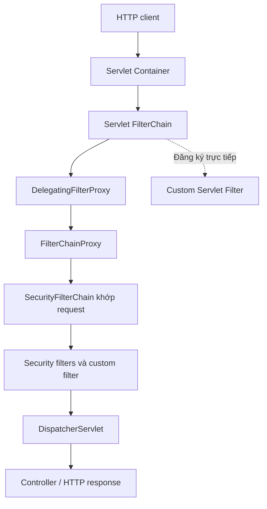

# Tránh đăng ký bộ lọc hai lần qua Servlet Container và SecurityFilterChain

> **Phạm vi:** Spring Boot 3.x, Spring MVC, Spring Security 6.x, Jakarta Servlet và Java 17+. Bài học tập trung vào tình huống cùng một custom Servlet Filter vừa được container đăng ký, vừa được chèn vào `SecurityFilterChain`. Mục tiêu là hiểu cơ chế, phát hiện triệu chứng, sửa tận gốc và kiểm chứng sau khi sửa. Ứng dụng Spring WebFlux dùng cơ chế filter reactive riêng.

## 1. Hai chuỗi Filter khác nhau

Trong ứng dụng Servlet, Tomcat (hoặc một Servlet Container khác) nhận HTTP request trước. Container duyệt các Servlet Filter của nó và đưa request đến `DispatcherServlet` của Spring MVC. Spring Security tham gia chuỗi Servlet Filter qua một `DelegatingFilterProxy` trỏ đến bean `springSecurityFilterChain`. Bean này thường là `FilterChainProxy`, chọn một `SecurityFilterChain` phù hợp rồi chạy các security filters bên trong.



| Thành phần | Ai đăng ký/gọi? | Ý nghĩa |
|---|---|---|
| **Servlet FilterChain** | Servlet Container | Gồm các `jakarta.servlet.Filter` được container đăng ký, có URL pattern, order và dispatcher type |
| **SecurityFilterChain** | `FilterChainProxy` của Spring Security | Gồm các filter bảo mật; `FilterChainProxy` chọn chain khớp đầu tiên theo thứ tự |
| **DelegatingFilterProxy** | Container gọi, proxy ủy quyền cho Spring bean | Cầu nối giữa hai hệ thống; hiện diện bình thường khi dùng Spring Security |
| **HandlerInterceptor** | Spring MVC | Chạy quanh handler sau khi request tới `DispatcherServlet`; không phải Servlet Filter |

**Điều dễ nhầm:** `FilterChain` của Jakarta Servlet và `SecurityFilterChain` của Spring Security là **hai tầng**, không phải hai tên của cùng một registry. Lệnh `http.addFilterBefore(...)` chỉ thêm filter vào tầng Security; nó không đảm bảo một Spring bean kiểu Filter sẽ ngừng được container đăng ký độc lập.

## 2. Lỗi double-registration hình thành như thế nào?

Khi Spring Boot chạy trên servlet stack, bean triển khai `jakarta.servlet.Filter` do `@Component` hoặc `@Bean` tạo có thể được Boot **auto-register** thành Servlet Filter trong embedded container. Một `FilterRegistrationBean` do ứng dụng khai báo cũng có thể đăng ký Filter trực tiếp.

Trong khi đó, developer thường thêm cùng Filter vào Security:

```java
http.addFilterBefore(traceFilter, AuthorizationFilter.class);
```

Nếu `traceFilter` đồng thời là một bean được Boot đưa vào Servlet Container thì có **hai đường gọi**:

1. Servlet Container gọi Filter như một thành viên độc lập trong danh sách container filters.
2. `DelegatingFilterProxy` chuyển tiếp vào `FilterChainProxy`; Spring Security lại gọi cùng Filter bên trong `SecurityFilterChain`.

Ngay cả **cùng một instance** cũng có thể được gọi theo cả hai đường. Việc inject bean một lần không đảm bảo logic xử lý chỉ thực hiện một lần. Tên thường dùng cho tình trạng này là *double registration* hoặc *double invocation* của custom Filter.

Một cấu hình đáng nghi:

```java
@Component
public class TraceFilter extends GenericFilterBean {
    // doFilter(...) ở phần thực hành
}
```

```java
@Bean
SecurityFilterChain securityFilterChain(HttpSecurity http, TraceFilter traceFilter)
        throws Exception {
    return http
            .authorizeHttpRequests(auth -> auth.anyRequest().authenticated())
            .addFilterBefore(traceFilter, AuthorizationFilter.class)
            .build();
}
```

Hai đoạn ở đây là mã minh họa ý tưởng, chưa phải một ứng dụng độc lập. Trong cấu hình trên, `@Component` tạo Filter bean mà Boot có thể auto-register với container; `addFilterBefore` đưa đúng bean đó vào Security.

**Lưu ý về quan sát:** Hai registration không có nghĩa *mọi* HTTP request đều chắc chắn in hai dòng log. Một request bị Security chặn sớm có thể không đi hết Servlet FilterChain; dispatcher types có thể khác nhau. Dùng endpoint public được phép đi tiếp để thử và xác minh registry của container.

## 3. Những hậu quả thực tế

- **Audit/log/metrics nhân đôi:** một request gây hai lần ghi log, đếm request, xuất event, ghi database hoặc gửi notification nếu Filter có side effect.
- **Sai vị trí security context:** Filter ở container có thể chạy trước khi Spring Security xác thực, khiến `SecurityContextHolder.getContext().getAuthentication()` chưa phản ánh người dùng đã đăng nhập như kỳ vọng.
- **Header bị chỉnh lặp:** Filter tạo correlation ID, thêm response header hoặc thao tác response wrapper có thể ghi đè hoặc lặp nội dung.
- **Phạm vi URL rộng hơn dự định:** Filter độc lập của container có thể chạy cho URL không khớp `http.securityMatcher("/api/**")` của Security chain.
- **Debug khó:** controller vẫn trả HTTP 200, nhưng logic ở Filter lại thực thi hai lần; test chỉ assert response có thể bỏ sót.
- **Thứ tự khó dự đoán:** container Filter order và Security internal filter order là hai cơ chế khác nhau; việc điều chỉnh một bên không giải quyết việc đăng ký ở cả hai.

Đừng vội kết luận double-registration chỉ vì thấy hai dòng log. Browser có thể gửi `/favicon.ico`, proxy có thể retry, request có `ASYNC`/`ERROR` dispatch, CORS có preflight `OPTIONS`, hoặc frontend có thể gọi hai lần. Khi kiểm tra cần đối chiếu **một HTTP request**, URI, method, dispatcher type và correlation ID.

## 4. Chọn đúng nơi sở hữu Filter

Nếu custom Filter liên quan authentication/authorization, cần chạy theo security matcher hoặc phải đứng ở một vị trí xác định trong security filter order, nên để **SecurityFilterChain sở hữu**. Nếu nó cần là Spring bean để inject dependency, dùng hai phần cấu hình rõ ràng:

```java
http.addFilterBefore(traceFilter, AuthorizationFilter.class);
```

```java
@Bean
FilterRegistrationBean<TraceFilter> disableDirectServletRegistration(
        TraceFilter traceFilter) {
    FilterRegistrationBean<TraceFilter> registration =
            new FilterRegistrationBean<>(traceFilter);
    registration.setEnabled(false);
    return registration;
}
```

`setEnabled(false)` ở **FilterRegistrationBean của chính custom Filter** ngăn nó đăng ký độc lập với Servlet Container. Filter vẫn là Spring bean, vẫn được `FilterChainProxy` gọi khi request khớp `SecurityFilterChain`.

**Không vô hiệu hóa `DelegatingFilterProxy`** chỉ để giảm log trùng. Proxy là cầu nối cần thiết để Spring Security kiểm soát HTTP request. Mục tiêu là tắt registration *trực tiếp* của custom Filter, giữ nguyên cơ chế Security.

Nếu Filter đơn giản, không cần là Spring bean, bạn cũng có thể chỉ tạo nó trong Security configuration:

```java
http.addFilterBefore(new TraceFilter(), AuthorizationFilter.class);
```

Điều kiện là không đồng thời tạo Filter khác qua `@Component`, `@Bean` hoặc `@WebFilter`. Nếu Filter cần inject service, giải pháp bean + disabled registration thường tường minh và dễ bảo trì hơn.

Ngược lại, nếu Filter phải giám sát tất cả Servlet traffic độc lập với bảo mật, hãy **đăng ký tại container** (có order, URL patterns, dispatcher types phù hợp) và **không thêm cùng Filter lần nữa vào SecurityFilterChain**.

## 5. Ví dụ Spring Boot 3.x chạy được

Tạo project Spring Boot 3.x / Java 17+ bằng Spring Initializr, chọn **Spring Web** và **Spring Security**; thêm **Spring Boot Starter Test** cho bài kiểm chứng runtime. Ví dụ dùng Gradle và package `com.example.demo`. Block `dependencies` trong `build.gradle` như sau:

```groovy
dependencies {
    implementation 'org.springframework.boot:spring-boot-starter-web'
    implementation 'org.springframework.boot:spring-boot-starter-security'
    testImplementation 'org.springframework.boot:spring-boot-starter-test'
}
```

Đây chỉ là block dependencies, không phải `build.gradle` đầy đủ; project do Initializr tạo phải có plugins, repositories và phiên bản tương thích.

Cấu trúc:

```text
src/
├── main/java/com/example/demo/
│   ├── FilterOwnershipApplication.java
│   ├── TraceFilter.java
│   ├── SecurityConfig.java
│   └── DemoController.java
└── test/java/com/example/demo/
    └── TraceFilterRegistrationTest.java
```

### 5.1. Lớp Spring Boot

**`src/main/java/com/example/demo/FilterOwnershipApplication.java`**

```java
package com.example.demo;

import org.springframework.boot.SpringApplication;
import org.springframework.boot.autoconfigure.SpringBootApplication;

@SpringBootApplication
public class FilterOwnershipApplication {
    public static void main(String[] args) {
        SpringApplication.run(FilterOwnershipApplication.class, args);
    }
}
```

### 5.2. Filter để nhìn rõ từng lần doFilter

**`src/main/java/com/example/demo/TraceFilter.java`**

```java
package com.example.demo;

import java.io.IOException;
import jakarta.servlet.FilterChain;
import jakarta.servlet.ServletException;
import jakarta.servlet.ServletRequest;
import jakarta.servlet.ServletResponse;
import jakarta.servlet.http.HttpServletRequest;

import org.springframework.stereotype.Component;
import org.springframework.web.filter.GenericFilterBean;

@Component
public class TraceFilter extends GenericFilterBean {
    @Override
    public void doFilter(ServletRequest request, ServletResponse response,
                         FilterChain chain)
            throws IOException, ServletException {
        HttpServletRequest http = (HttpServletRequest) request;

        System.out.println("TRACE " + http.getDispatcherType()
                + " " + http.getMethod()
                + " " + http.getRequestURI());

        chain.doFilter(request, response);
    }
}
```

Dùng `GenericFilterBean` vì mỗi lần gọi `doFilter` đều in một dòng. Trong production, nên dùng logger và correlation ID, tránh ghi token/password. Đoạn code ở đây cố tình không thêm chức năng bảo mật nghiệp vụ để phép thử tập trung vào **số đường đăng ký**.

### 5.3. SecurityConfig với cách sửa đúng

**`src/main/java/com/example/demo/SecurityConfig.java`**

```java
package com.example.demo;

import org.springframework.boot.web.servlet.FilterRegistrationBean;
import org.springframework.context.annotation.Bean;
import org.springframework.context.annotation.Configuration;
import org.springframework.http.HttpMethod;
import org.springframework.security.config.Customizer;
import org.springframework.security.config.annotation.web.builders.HttpSecurity;
import org.springframework.security.core.userdetails.User;
import org.springframework.security.core.userdetails.UserDetailsService;
import org.springframework.security.crypto.factory.PasswordEncoderFactories;
import org.springframework.security.crypto.password.PasswordEncoder;
import org.springframework.security.provisioning.InMemoryUserDetailsManager;
import org.springframework.security.web.SecurityFilterChain;
import org.springframework.security.web.access.intercept.AuthorizationFilter;

@Configuration
public class SecurityConfig {
    @Bean
    SecurityFilterChain securityFilterChain(
            HttpSecurity http, TraceFilter traceFilter
    ) throws Exception {
        return http
                .authorizeHttpRequests(auth -> auth
                        .requestMatchers(HttpMethod.GET, "/public").permitAll()
                        .anyRequest().authenticated())
                .httpBasic(Customizer.withDefaults())
                .addFilterBefore(traceFilter, AuthorizationFilter.class)
                .build();
    }

    @Bean
    FilterRegistrationBean<TraceFilter> disableDirectServletRegistration(
            TraceFilter traceFilter
    ) {
        FilterRegistrationBean<TraceFilter> registration =
                new FilterRegistrationBean<>(traceFilter);
        registration.setEnabled(false);
        return registration;
    }

    @Bean
    PasswordEncoder passwordEncoder() {
        return PasswordEncoderFactories.createDelegatingPasswordEncoder();
    }

    @Bean
    UserDetailsService userDetailsService(PasswordEncoder encoder) {
        var learner = User.withUsername("learner")
                .password(encoder.encode("demo-pass"))
                .roles("USER")
                .build();
        return new InMemoryUserDetailsManager(learner);
    }
}
```

- `addFilterBefore(traceFilter, AuthorizationFilter.class)` đặt Filter ở vị trí xác định **bên trong Security**, trước bước quyết định HTTP authorization. Với logic cần đọc `SecurityContext`, chọn vị trí dựa vào cơ chế authentication thực tế.
- Bean `disableDirectServletRegistration(...)` tham chiếu **chính instance `TraceFilter`** đã được inject vào Security và tắt đường đăng ký độc lập của container.
- `httpBasic(...)` giúp gửi credential bằng `curl -u`, tạo kết quả 401/200 dễ quan sát.
- `UserDetailsService` trong bộ nhớ chỉ phục vụ bài học; password ví dụ và HTTP Basic không phù hợp production nếu không có HTTPS/identity management đúng cách.

### 5.4. Controller

**`src/main/java/com/example/demo/DemoController.java`**

```java
package com.example.demo;

import java.security.Principal;
import org.springframework.web.bind.annotation.GetMapping;
import org.springframework.web.bind.annotation.RestController;

@RestController
public class DemoController {
    @GetMapping("/public")
    public String publicEndpoint() {
        return "PUBLIC_OK";
    }

    @GetMapping("/private")
    public String privateEndpoint(Principal principal) {
        return "PRIVATE_OK: " + principal.getName();
    }
}
```

`GET /public` anonymous được phép đi tiếp tới MVC. `GET /private` cần authentication; nếu không có Basic credentials hợp lệ, Security thường trả 401 trước khi controller chạy. Security quyết định quyền, MVC quyết định handler và response body.

## 6. Thực nghiệm kiểm tra double-registration

### Bước A — Quan sát cấu hình đúng

Tại thư mục project có Gradle wrapper:

```bash
# macOS / Linux
./gradlew bootRun

# Windows PowerShell
.\gradlew.bat bootRun
```

Sau khi server khởi động và lắng nghe trên port mặc định 8080, dùng terminal khác:

```bash
curl -i http://localhost:8080/public

# Windows PowerShell:
curl.exe -i http://localhost:8080/public
```

**Kỳ vọng:** HTTP 200, body:

```text
PUBLIC_OK
```

Console ứng dụng in **một** dòng cho một request `GET /public` (dispatcher `REQUEST`):

```text
TRACE REQUEST GET /public
```

Các dòng ở đây là **kết quả dự kiến khi chạy ứng dụng mẫu**, không phải kết quả được thực thi sẵn trong tài liệu.

### Bước B — Cố tình tái hiện lỗi

Tạm comment hoặc xóa **duy nhất bean `disableDirectServletRegistration(...)`** trong `SecurityConfig.java`. Giữ `@Component` ở `TraceFilter` và `addFilterBefore(traceFilter, AuthorizationFilter.class)`. Khởi động lại server, gửi **một** request:

```bash
curl -i http://localhost:8080/public
```

Với Filter bean được Boot auto-register vào container **và** đã thêm vào Security, `GenericFilterBean` thường in hai lần cho request public đi hết pipeline:

```text
TRACE REQUEST GET /public
TRACE REQUEST GET /public
```

HTTP response vẫn có thể là 200, body `PUBLIC_OK`. Đây là ví dụ điển hình cho lý do **response đúng chưa chắc filter ownership đúng**. Nếu thứ tự container filter thay đổi hoặc có thêm filter khác chặn request, số lần nhìn thấy trong log có thể thay đổi.

### Bước C — Khôi phục

Thêm lại bean `disableDirectServletRegistration(...)` với `registration.setEnabled(false)` và khởi động lại. Gửi `GET /public` lần nữa; kỳ vọng chỉ một dòng TRACE. Chạy test runtime ở mục 8 để kiểm chứng cấu hình từ registry, không chỉ dựa trên log.

| Cấu hình | Đăng ký ở Servlet Container | Trong SecurityFilterChain | Quan sát thường gặp cho public REQUEST |
|---|---|---|---|
| `@Component` + `addFilterBefore`; chưa disabled registration | Có | Có | Hai invocation của `GenericFilterBean#doFilter` |
| `@Component` + `addFilterBefore` + disabled `FilterRegistrationBean` | Không | Có | Một invocation |
| Chỉ dùng Filter tại Servlet Container | Có | Không | Một invocation |
| Chỉ dùng `new TraceFilter()` trong Security; không tạo bean/registration khác | Không | Có | Một invocation |

Bảng mô tả request `REQUEST` được phép đi hết chain, không bao gồm lỗi, retry hoặc dispatch thứ hai.

## 7. Thử response 200/401 và quan hệ với Filter

Sau khi khôi phục cấu hình đúng:

```bash
# Public anonymous
curl -i http://localhost:8080/public

# Private anonymous
curl -i http://localhost:8080/private

# Private với HTTP Basic hợp lệ
curl -i -u learner:demo-pass http://localhost:8080/private
```

| Request | Status kỳ vọng | Cơ chế |
|---|---:|---|
| `GET /public` | **200** | Security cho qua `permitAll()`, MVC trả `PUBLIC_OK` |
| `GET /private` không có credentials | **401** | HTTP Basic cần xác thực, MVC chưa gọi controller |
| `GET /private` với `learner:demo-pass` | **200** | Security xác thực, MVC trả `PRIVATE_OK: learner` |

**Không dùng duy nhất log từ request 401 để kết luận số registrations.** Khi Security từ chối sớm, các filter bên ngoài hoặc phía sau proxy có thể chưa được gọi. Request `permitAll()` giúp quan sát đường đi đầy đủ; kiểm tra registry còn chắc hơn.

`permitAll()` khác “bỏ qua filter”: URL công khai vẫn chạy `SecurityFilterChain` đã chọn. `web.ignoring()` mới là cơ chế bỏ qua một số Security filters, và phải cân nhắc vì bỏ qua luôn những bảo vệ HTTP của chain.

## 8. Test registration với embedded Servlet Container thật

`MockMvc` thường có thể thực thi Security trong một test context mà không khởi động Servlet Container như production. Test chỉ `andExpect(status().isOk())` không kiểm chứng việc một custom Filter bị auto-register vào Tomcat. Để kiểm tra **cả hai tầng**, dùng `@SpringBootTest(webEnvironment = RANDOM_PORT)` và `ServletContext.getFilterRegistrations()`.

**`src/test/java/com/example/demo/TraceFilterRegistrationTest.java`**

```java
package com.example.demo;

import jakarta.servlet.ServletContext;

import org.junit.jupiter.api.Test;
import org.springframework.beans.factory.annotation.Autowired;
import org.springframework.boot.test.context.SpringBootTest;
import org.springframework.security.web.SecurityFilterChain;

import static org.junit.jupiter.api.Assertions.assertFalse;
import static org.junit.jupiter.api.Assertions.assertTrue;

@SpringBootTest(webEnvironment = SpringBootTest.WebEnvironment.RANDOM_PORT)
class TraceFilterRegistrationTest {

    @Autowired
    private ServletContext servletContext;

    @Autowired
    private SecurityFilterChain securityFilterChain;

    @Autowired
    private TraceFilter traceFilter;

    @Test
    void traceFilterOnlyBelongsToSecurity() {
        boolean inSecurity =
                securityFilterChain.getFilters().stream()
                        .anyMatch(filter -> filter == traceFilter);

        boolean registeredDirectly =
                servletContext.getFilterRegistrations().values().stream()
                        .anyMatch(registration ->
                                TraceFilter.class.getName()
                                        .equals(registration.getClassName()));

        assertTrue(inSecurity, "TraceFilter must be in SecurityFilterChain");
        assertFalse(registeredDirectly,
                "TraceFilter must not also be a Servlet Container filter");
    }
}
```

Chạy từ root project:

```bash
# macOS / Linux
./gradlew test

# Windows PowerShell
.\gradlew.bat test
```

**Kỳ vọng:** test PASS ở cấu hình đã sửa. Nếu bỏ disabled registration, assertion về Servlet registration được kỳ vọng FAIL. Đây là kết quả kỳ vọng trên project mẫu; bài viết không khẳng định đã chạy test trong môi trường hiện tại.

Test kiểm tra class name của registration phù hợp với ví dụ `TraceFilter` được đăng ký trực tiếp. Nếu ứng dụng dùng wrapper/proxy, nhiều instances hoặc cơ chế registration khác, hãy điều chỉnh cách kiểm chứng. Quan sát một request thật và registry vẫn cần được xem cùng nhau.

## 9. Những cách sửa không giải quyết đúng nguyên nhân

### Chỉ thêm @Order hoặc đổi addFilterBefore/addFilterAfter

`@Order` hoặc `FilterRegistrationBean#setOrder(...)` chỉnh **thứ tự container filters**. `addFilterBefore`/`addFilterAfter` chỉnh **vị trí security filter**. Chúng không loại bỏ registration còn lại. Có thể khiến lỗi xuất hiện sớm/muộn hơn nhưng vẫn có hai đường gọi.

### Chỉ chuyển sang OncePerRequestFilter

`OncePerRequestFilter` có cơ chế request attribute để tránh xử lý lặp trong `doFilterInternal` ở một số trường hợp của cùng dispatch. Tuy nhiên nó **không xóa double-registration**. Nếu có hai instance khác tên/attribute, hoặc có ERROR/ASYNC dispatch, hành vi có thể khác. Một dòng log không chứng minh duy nhất một nơi đăng ký.

### Xóa @Component nhưng vẫn injection Filter

Nếu Filter chỉ được tạo từ `@Component` mà bạn xóa annotation, cấu hình Security inject `TraceFilter` sẽ gặp lỗi thiếu bean. Với Filter cần dependency, giữ bean và tắt Servlet registration là cách rõ ràng. Nếu chọn tạo `new TraceFilter()` trong Security, đừng đồng thời có các registrations khác.

### Trộn @WebFilter, @Component và FilterRegistrationBean

`@WebFilter` khi có `@ServletComponentScan` là một đường đăng ký container riêng. `@Component`/`@Bean` và `FilterRegistrationBean` là những đường khác; bật nhiều cơ chế có thể tạo nhiều registrations hoặc instances khác nhau. Disabled `FilterRegistrationBean` cho một bean không tự động gỡ một `@WebFilter` được quét độc lập.

### Tự đăng ký DelegatingFilterProxy lần nữa

Spring Boot/Spring Security Servlet thông thường đã tạo cầu nối cần thiết tới `springSecurityFilterChain`. Đăng ký thêm proxy trùng có thể làm cả security pipeline chạy lặp. Không vô hiệu hóa Security proxy để chữa lỗi của custom Filter.

### Cho rằng mọi filter trong Security chạy mọi endpoint

Nếu cấu hình nhiều `SecurityFilterChain` với `securityMatcher("/api/**")`, chỉ chain khớp đầu tiên được chọn. Custom Filter trong chain API không mặc nhiên chạy ngoài `/api/**`, nhưng Filter trực tiếp ở container có thể chạy rộng hơn. Điều này quan trọng khi thiết kế chain riêng cho API, admin hoặc health endpoint.

## 10. Cách điều tra hệ thống hiện có

1. Xác định class, bean name và cách tạo Filter (`@Component`, `@Bean`, `@WebFilter` hoặc `new`).
2. Tìm mọi `FilterRegistrationBean`, `@ServletComponentScan` và lệnh `http.addFilterBefore/After/At` liên quan đến Filter đó.
3. Quyết định nơi sở hữu: Servlet Container cho nghiệp vụ chung hay SecurityFilterChain cho tác vụ gắn với bảo mật.
4. Nếu Filter là Spring bean **chỉ dành cho Security**, khai báo disabled `FilterRegistrationBean` cho **đúng instance** đó.
5. Gửi một `curl` request tới endpoint public, nhìn URI và dispatcher type, tránh nhầm với retry, preflight hoặc request khác.
6. Kiểm tra filter list trong `SecurityFilterChain` và registration list trong `ServletContext`.
7. Kiểm tra lại response 200/401/403, log và các side effects: không được phát sự kiện hai lần hoặc thay đổi thứ tự authorization ngoài ý định.
8. Xét `ASYNC`/`ERROR` dispatch nếu ứng dụng sử dụng; một dispatch riêng có thể làm Filter chạy thêm hợp lệ.

Không nên đặt xử lý dữ liệu có side effect không idempotent vào Filter nếu chưa xác định rõ request lifecycle và số lần gọi. Trong sản phẩm thật, một audit entry nhân đôi có thể nghiêm trọng hơn dòng console lặp.

## 11. Bài tập củng cố

**Bài 1.** Bỏ phương thức `disableDirectServletRegistration(...)`, giữ `@Component` và `addFilterBefore`. Chạy `GET /public`, quan sát TRACE, rồi khôi phục phương thức và so sánh.

**Bài 2.** Đổi ví dụ sang `OncePerRequestFilter`. Vì sao số lần `doFilterInternal` không đủ chứng minh Filter chỉ có một registration? Dùng `ServletContext` trả lời.

**Bài 3.** Đưa Filter chỉ vào một Security chain áp dụng `/api/**`. Giải thích vì sao URL khác không đi qua Filter Security ấy, và vì sao một bản container registration có thể vẫn chạy.

**Bài 4.** Filter cần đọc `SecurityContextHolder.getContext().getAuthentication()`. Xác định vì sao phiên bản chạy ở container có thể thấy trạng thái khác với phiên bản trong Security, và cần chọn vị trí filter dựa theo authentication mechanism nào.

## 12. Điều cần nhớ

- **Servlet FilterChain** và **SecurityFilterChain** là hai tầng riêng; `DelegatingFilterProxy` là cầu nối chuẩn của Spring Security.
- Spring Boot Servlet có thể tự đăng ký một bean kiểu `Filter` vào Servlet Container, kể cả khi bạn cũng thêm cùng bean vào Security.
- Khi Filter là Spring bean **nhưng chỉ chạy trong Security**, dùng `FilterRegistrationBean<CustomFilter>` với `setEnabled(false)` và thêm đúng bean vào `SecurityFilterChain`.
- `@Order`, `permitAll()` hoặc chuyển sang `OncePerRequestFilter` không xóa nguyên nhân double-registration.
- Kiểm chứng bằng **HTTP request qua Servlet Container thật** và **runtime registration**, không chỉ bởi HTTP 200 hoặc test MVC đơn giản.

**Nguyên tắc:** Hãy xác định rõ một nơi sở hữu cho từng custom Filter và chỉ tạo những registration thực sự cần thiết.