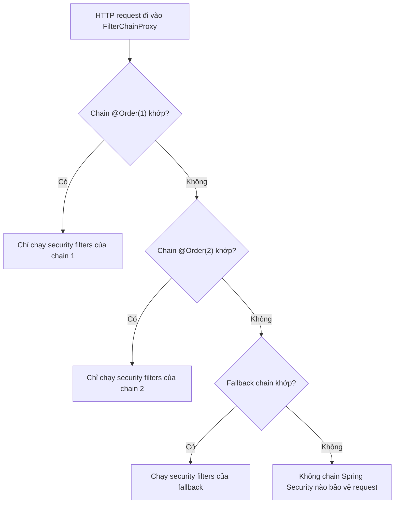

# Vị trí endpoint đăng nhập, đăng xuất trong phạm vi của từng `SecurityFilterChain`

**Module:** Spring Security – Servlet · **Chủ đề cha:** Cấu hình bảo mật  
**Mục tiêu:** Hiểu chính xác vì sao `GET /login`, `POST /login` hoặc `POST /logout` đôi khi không hoạt động khi dùng nhiều `SecurityFilterChain`, và cách đặt URL đăng nhập/đăng xuất trong phạm vi chain phù hợp.

Bài viết dùng **Java 17**, **Spring Boot 3.3.5**, **Spring Security 6.x**, **Spring MVC/Servlet**. Những kiến thức này áp dụng cho `HttpSecurity` và `SecurityFilterChain` của Servlet stack; WebFlux dùng `ServerHttpSecurity` và `SecurityWebFilterChain` với cơ chế khác.

## 1. Quy tắc gốc: endpoint chỉ hoạt động khi request đi vào đúng chain

Trong ứng dụng Servlet, `FilterChainProxy` của Spring Security có thể chứa nhiều bean `SecurityFilterChain`. Mỗi chain gồm:

1. **Request matcher của chain**, cấu hình qua `http.securityMatcher(...)`.
2. **Những security filter** được tạo từ `HttpSecurity`: authentication, authorization, form login, logout, CSRF, exception handling…
3. **Các rule authorization**, thường cấu hình bằng `http.authorizeHttpRequests(...requestMatchers(...))`.

Khi một HTTP request đi vào `FilterChainProxy`, Spring Security **xét các chain theo thứ tự và sử dụng chain đầu tiên có matcher khớp**. Nó không ghép tất cả chain khớp thành một chain duy nhất. Các filter tạo bởi cấu hình form login/logout nằm trong chain đã cấu hình chúng; chúng chỉ nhận request nếu **chain đó được chọn**.



**Điểm cần phân biệt:**

| Cấu hình | Trả lời câu hỏi | Ảnh hưởng |
| --- | --- | --- |
| `http.securityMatcher("/web/**")` | Request này **có được chọn vào chain** không? | Quyết định toàn bộ filter của chain có cơ hội chạy. |
| `authorizeHttpRequests(a -> a.requestMatchers("/web/login").permitAll())` | Khi request **đã vào chain**, URL này có cần phân quyền không? | Cho phép hoặc từ chối; không mở rộng matcher của chain. |
| `formLogin(f -> f.loginProcessingUrl("/web/login"))` | `UsernamePasswordAuthenticationFilter` xử lý **POST tới URL nào**? | Cung cấp xử lý đăng nhập *bên trong chain*, không tự thêm URL vào `securityMatcher`. |
| `logout(l -> l.logoutUrl("/web/logout"))` | `LogoutFilter` nhận yêu cầu logout ở đâu? | Chỉ hữu hiệu nếu request được định tuyến vào chain có filter đó. |

Một URL được `permitAll()` không tự trở thành URL có sẵn để xử lý. `permitAll()` là **quyền truy cập**; endpoint còn cần một controller hoặc security filter xử lý.

## 2. Vì sao cấu hình mặc định dễ làm login/logout “biến mất”?

Xét đoạn cấu hình chỉ mang tính **minh họa lỗi**, không phải chương trình đầy đủ:

```java
@Bean
SecurityFilterChain privateChain(HttpSecurity http) throws Exception {
    http.securityMatcher("/private/**")
        .authorizeHttpRequests(a -> a.anyRequest().authenticated())
        .formLogin(Customizer.withDefaults())
        .logout(Customizer.withDefaults());
    return http.build();
}
```

Với form login mặc định, Spring Security cung cấp đường dẫn thông dụng `GET /login` (trang đăng nhập do filter tạo) và `POST /login` (xử lý credentials). Logout mặc định dùng URL `/logout`; khi bật CSRF, hành động logout thực sự được yêu cầu bằng **POST có CSRF token hợp lệ**, còn `GET /logout` có thể hiển thị trang xác nhận theo cấu hình mặc định.

Nhưng `securityMatcher("/private/**")` **không khớp** với `/login` hoặc `/logout`:

- Request chưa xác thực tới `/private/report` được chain này xử lý, rồi có thể bị redirect sang `/login`.
- Khi trình duyệt truy cập `/login`, request lại **không nằm trong chain `/private/**`**, nên filter tạo login page và filter xử lý đăng nhập của chain đó không chạy.
- Tương tự, `POST /logout` không đi qua `LogoutFilter` của chain này.
- Chain khác hoặc Spring MVC có thể xử lý những URL đó theo cách riêng: `404`, `403`, redirect hoặc trang khác. **Không thể khẳng định một status chung** nếu chưa biết các chain còn lại.

Đây là vấn đề **phạm vi endpoint**, không chỉ là thiếu `permitAll()`. Nếu đổi rule thành `requestMatchers("/login").permitAll()` nhưng vẫn giữ `securityMatcher("/private/**")`, request `/login` vẫn không chọn chain đó.

## 3. Phân biệt các loại endpoint đăng nhập/đăng xuất

### 3.1. Đăng nhập bằng form

| URL + method điển hình | Ai xử lý? | Điều kiện |
| --- | --- | --- |
| `GET /login` | Filter tạo trang mặc định, **hoặc** controller nếu dùng trang tùy chỉnh | Request phải vào chain phù hợp; với custom page phải có MVC handler/view. |
| `POST /login` | `UsernamePasswordAuthenticationFilter` | Request vào chain có `formLogin`, đúng login processing URL, credentials và CSRF hợp lệ nếu CSRF bật. |
| `GET /login?error` | Trang đăng nhập hiển thị lỗi | Query chỉ thay đổi cách trình bày; vẫn phải có GET handler/page. |
| `POST /logout` | `LogoutFilter` | Request vào chain có logout filter, đúng matcher và CSRF hợp lệ nếu bật. |
| `GET /logout` | Có thể là trang xác nhận logout trong cấu hình mặc định | **Không coi GET là thao tác logout** khi CSRF đang bật. |

Đây là **giá trị mặc định phổ biến**; ứng dụng có thể thay đổi `loginPage`, `loginProcessingUrl`, `logoutUrl`, entry point và logout success URL.

### 3.2. URL của trang và URL xử lý không phải cùng khái niệm

- `form.loginPage("/web/login")` chỉ định **trang đăng nhập**. Khi khai báo trang riêng, ứng dụng cần triển khai handler/view cho `GET /web/login`; Spring Security không tự tạo HTML tùy chỉnh.
- `form.loginProcessingUrl("/web/login")` tạo matcher cho **POST /web/login** được security filter xử lý; **không cần controller `@PostMapping`** cho URL đó.
- `form.failureUrl("/web/login?error")` và `form.defaultSuccessUrl("/web/home", true)` chỉ định **điểm đến sau khi xử lý**. Các URL điểm đến cũng phải được chain nào đó cho phép/giải quyết.
- `logout.logoutUrl("/web/logout")` chỉ định điểm xử lý logout của `LogoutFilter`. Với CSRF bật, gửi `POST` mang CSRF token. Không cần viết `@PostMapping("/web/logout")`.
- `logout.logoutSuccessUrl("/web/login?logout")` chỉ định điểm đến sau khi logout; browser phát sinh một **GET mới** tới trang login. URL đó cũng cần truy cập được.

Đặt trùng `loginProcessingUrl` và `logoutUrl` là lựa chọn sai: cùng một POST có thể bị filter đứng trước xử lý trước, gây hành vi khó đoán. Chọn các endpoint có mục đích riêng.

### 3.3. HTTP Basic và API không cần một form login endpoint

Một chain chỉ cấu hình `httpBasic(...)` có thể trả `401` kèm `WWW-Authenticate` để client gửi `Authorization` header. **HTTP Basic không tự tạo `GET /login`/`POST /login`**. API dùng token/Bearer authentication cũng không tự nhiên có servlet form login endpoint. Chỉ cấu hình trang đăng nhập khi luồng xác thực cần nó.

## 4. Các chiến lược thiết kế URL an toàn

### Cách A — Đặt toàn bộ endpoint do chain quản lý cùng prefix của chain

Ví dụ:

| Chain | `securityMatcher` | Endpoint bên trong |
| --- | --- | --- |
| API | `/api/**` | `GET /api/me`, HTTP Basic; không có form login/logout HTML. |
| Web | `/web/**` | `GET/POST /web/login`, `GET /web/home`, `POST /web/logout`. |
| Fallback | Tất cả request còn lại | Chủ động từ chối URL chưa thiết kế. |

Vì `/web/login` và `/web/logout` đều khớp `/web/**`, request có thể chạy đúng `UsernamePasswordAuthenticationFilter` hoặc `LogoutFilter`. Đây là cách dễ kiểm tra bằng mắt và dễ viết integration test.

### Cách B — Giữ URL mặc định nhưng thêm chúng vào phạm vi chain

Nếu nhất định muốn một chain bảo vệ `/private/**` đồng thời dùng `/login` và `/logout` ở root, hãy để chain đó chọn cả ba nhóm path:

```java
// Fragment minh họa, đặt trong một @Bean SecurityFilterChain thích hợp.
http.securityMatcher("/private/**", "/login", "/logout")
    .authorizeHttpRequests(auth -> auth
        .requestMatchers("/login", "/logout").permitAll()
        .anyRequest().authenticated())
    .formLogin(Customizer.withDefaults())
    .logout(Customizer.withDefaults());
```

`securityMatcher(String...)` kết hợp các pattern theo kiểu **OR**. Với cấu hình mặc định hỗ trợ form login, các endpoint `/login` và `/logout` giờ có cơ hội được security filter tương ứng tiếp nhận. Bảo vệ CSRF vẫn có hiệu lực cho POST. Cần đảm bảo không có chain có ưu tiên cao hơn đã bắt `/login` hoặc `/logout` trước.

Đoạn code này là **fragment `HttpSecurity`** chứ không phải class Java tự biên dịch độc lập; ví dụ chạy đầy đủ phía dưới dùng cách A.

### Cách C — Dùng chain catch-all chứa cơ chế login chung

Một chain cuối không đặt `securityMatcher` riêng có thể giữ trang/login processing URL chung cho các request chưa khớp chain khác. Tuy nhiên, các request protected ở chain **đã được chọn trước đó** không tự chuyển sang chain khác để xác thực. Cần thiết kế entry point, nơi xử lý login và chính sách session/security context tương ứng; đừng nghĩ các chain tự động gọi tiếp nhau. Với dự án mới, thường dễ hiểu hơn khi đặt login/logout URL ngay trong chain cần chúng.

## 5. Ví dụ hoàn chỉnh: một ứng dụng, ba security chain

Dự án ví dụ chứa **API chain** (`/api/**`), **web chain** (`/web/**`) và **fallback chain**. Web chain sở hữu `GET/POST /web/login` và `POST /web/logout`. Form login dùng session và CSRF token; API chain chỉ minh họa Basic authentication cho GET.

Tạo project với các file:

```text
chain-endpoints/
├── pom.xml
└── src/
    ├── main/
    │   ├── java/demo/chains/
    │   │   ├── ChainEndpointsApplication.java
    │   │   ├── SecurityConfig.java
    │   │   ├── ApiController.java
    │   │   └── WebController.java
    │   └── resources/templates/
    │       ├── login.html
    │       └── home.html
    └── test/
        └── java/demo/chains/
            └── ChainEndpointsApplicationTests.java
```

### 5.1. `pom.xml`

```xml
<?xml version="1.0" encoding="UTF-8"?>
<project xmlns="http://maven.apache.org/POM/4.0.0"
         xmlns:xsi="http://www.w3.org/2001/XMLSchema-instance"
         xsi:schemaLocation="http://maven.apache.org/POM/4.0.0 https://maven.apache.org/xsd/maven-4.0.0.xsd">
    <modelVersion>4.0.0</modelVersion>

    <parent>
        <groupId>org.springframework.boot</groupId>
        <artifactId>spring-boot-starter-parent</artifactId>
        <version>3.3.5</version>
        <relativePath/>
    </parent>

    <groupId>demo</groupId>
    <artifactId>chain-endpoints</artifactId>
    <version>0.0.1-SNAPSHOT</version>

    <properties>
        <java.version>17</java.version>
    </properties>

    <dependencies>
        <dependency>
            <groupId>org.springframework.boot</groupId>
            <artifactId>spring-boot-starter-web</artifactId>
        </dependency>
        <dependency>
            <groupId>org.springframework.boot</groupId>
            <artifactId>spring-boot-starter-security</artifactId>
        </dependency>
        <dependency>
            <groupId>org.springframework.boot</groupId>
            <artifactId>spring-boot-starter-thymeleaf</artifactId>
        </dependency>
        <dependency>
            <groupId>org.springframework.boot</groupId>
            <artifactId>spring-boot-starter-test</artifactId>
            <scope>test</scope>
        </dependency>
        <dependency>
            <groupId>org.springframework.security</groupId>
            <artifactId>spring-security-test</artifactId>
            <scope>test</scope>
        </dependency>
    </dependencies>

    <build>
        <plugins>
            <plugin>
                <groupId>org.springframework.boot</groupId>
                <artifactId>spring-boot-maven-plugin</artifactId>
            </plugin>
        </plugins>
    </build>
</project>
```

Version Spring Security, Thymeleaf và các thư viện khác được BOM của Spring Boot quản lý. Không cần ghi version rời cho từng starter. `spring-boot-starter-thymeleaf` chỉ dùng để render trang login/home trong ví dụ web; bản thân security filter không đòi Thymeleaf.

### 5.2. `src/main/java/demo/chains/ChainEndpointsApplication.java`

```java
package demo.chains;

import org.springframework.boot.SpringApplication;
import org.springframework.boot.autoconfigure.SpringBootApplication;

@SpringBootApplication
public class ChainEndpointsApplication {
    public static void main(String[] args) {
        SpringApplication.run(ChainEndpointsApplication.class, args);
    }
}
```

Đặt `SecurityConfig`, controller và test cùng package `demo.chains` để `@SpringBootApplication` quét các bean theo cơ chế mặc định.

### 5.3. `src/main/java/demo/chains/SecurityConfig.java`

```java
package demo.chains;

import org.springframework.context.annotation.Bean;
import org.springframework.context.annotation.Configuration;
import org.springframework.core.annotation.Order;
import org.springframework.security.config.Customizer;
import org.springframework.security.config.annotation.web.builders.HttpSecurity;
import org.springframework.security.core.userdetails.User;
import org.springframework.security.core.userdetails.UserDetails;
import org.springframework.security.core.userdetails.UserDetailsService;
import org.springframework.security.crypto.bcrypt.BCryptPasswordEncoder;
import org.springframework.security.crypto.password.PasswordEncoder;
import org.springframework.security.provisioning.InMemoryUserDetailsManager;
import org.springframework.security.web.SecurityFilterChain;

@Configuration
public class SecurityConfig {

    @Bean
    @Order(1)
    SecurityFilterChain apiChain(HttpSecurity http) throws Exception {
        http.securityMatcher("/api/**")
            .authorizeHttpRequests(auth -> auth
                .anyRequest().authenticated())
            .httpBasic(Customizer.withDefaults());

        // Mẫu này chỉ dùng GET API. Không suy ra HTTP Basic tự tắt CSRF.
        return http.build();
    }

    @Bean
    @Order(2)
    SecurityFilterChain webChain(HttpSecurity http) throws Exception {
        http.securityMatcher("/web/**")
            .authorizeHttpRequests(auth -> auth
                .requestMatchers("/web/login").permitAll()
                .anyRequest().authenticated())
            .formLogin(form -> form
                .loginPage("/web/login")
                .loginProcessingUrl("/web/login")
                .defaultSuccessUrl("/web/home", true)
                .failureUrl("/web/login?error")
                .permitAll())
            .logout(logout -> logout
                .logoutUrl("/web/logout")
                .logoutSuccessUrl("/web/login?logout")
                .permitAll());

        // CSRF mặc định vẫn bật: POST login/logout cần token hợp lệ.
        return http.build();
    }

    @Bean
    @Order(3)
    SecurityFilterChain fallbackChain(HttpSecurity http) throws Exception {
        http.authorizeHttpRequests(auth -> auth
            .requestMatchers("/error").permitAll()
            .anyRequest().denyAll());
        return http.build();
    }

    @Bean
    PasswordEncoder passwordEncoder() {
        return new BCryptPasswordEncoder();
    }

    @Bean
    UserDetailsService users(PasswordEncoder encoder) {
        UserDetails learner = User.withUsername("learner")
            .password(encoder.encode("demo-secret"))
            .roles("USER")
            .build();

        return new InMemoryUserDetailsManager(learner);
    }
}
```

**Giải thích theo từng chain:**

- **`apiChain`** ở `@Order(1)` chỉ khớp `/api/**`, yêu cầu authenticated và cho phép HTTP Basic. Không cấu hình form login/logout tại đây nên những URL `/web/login`, `/web/logout` **không phải endpoint của API chain**. Ví dụ không tuyên bố API stateless: Basic authentication tự nó không bảo đảm không có session, và CSRF mặc định chưa bị tắt.
- **`webChain`** ở `@Order(2)` chỉ khớp `/web/**`, nhưng mọi URL login, login processing, logout và redirect đều nằm bên trong prefix này. `requestMatchers("/web/login").permitAll()` cho phép GET trang login; `formLogin(...permitAll())` còn cho phép các URL liên quan do configurer quản lý. CSRF vẫn bảo vệ POST.
- **`fallbackChain`** ở `@Order(3)` không có `securityMatcher` giới hạn nên khớp các request chưa vào hai chain đầu. Nó chủ động từ chối endpoint ngoài thiết kế; `/error` được phép để MVC có thể xử lý lỗi. Nếu đặt fallback có thứ tự **cao hơn** API/web, nó sẽ bắt hết request trước các chain chuyên biệt.
- **Tài khoản `learner/demo-secret`** được tạo trong bộ nhớ và hash bằng BCrypt **chỉ để học**; ứng dụng thật cần user store, secret management và chính sách xác thực phù hợp.

Một điểm tinh tế: Dù khai báo ba chain riêng, chúng vẫn thuộc cùng ứng dụng Servlet và có thể cùng sử dụng các tài nguyên như session cookie hoặc user store. **Tách chain không mặc nhiên tạo ba kho session hoàn toàn độc lập.** Đăng xuất khỏi web session có thể ảnh hưởng authentication trong session dùng chung; logout không mặc nhiên revoke mọi bearer token ở client khác.

### 5.4. `src/main/java/demo/chains/ApiController.java`

```java
package demo.chains;

import org.springframework.http.MediaType;
import org.springframework.security.core.Authentication;
import org.springframework.web.bind.annotation.GetMapping;
import org.springframework.web.bind.annotation.RestController;

@RestController
public class ApiController {

    @GetMapping(value = "/api/me", produces = MediaType.TEXT_PLAIN_VALUE)
    public String me(Authentication authentication) {
        return "api:" + authentication.getName();
    }
}
```

Không có controller xử lý `/api/login` hoặc `/api/logout`: API minh họa chỉ cần HTTP Basic cho `GET /api/me`.

### 5.5. `src/main/java/demo/chains/WebController.java`

```java
package demo.chains;

import org.springframework.security.core.Authentication;
import org.springframework.stereotype.Controller;
import org.springframework.ui.Model;
import org.springframework.web.bind.annotation.GetMapping;

@Controller
public class WebController {

    @GetMapping("/web/login")
    public String loginPage() {
        return "login";
    }

    @GetMapping("/web/home")
    public String home(Authentication authentication, Model model) {
        model.addAttribute("username", authentication.getName());
        return "home";
    }
}
```

Controller **chỉ cung cấp GET trang login/home**. Không khai báo `@PostMapping("/web/login")` hoặc `@PostMapping("/web/logout")` vì hai POST đó do **security filters** xử lý trước khi request tới Spring MVC.

### 5.6. `src/main/resources/templates/login.html`

```html
<!DOCTYPE html>
<html lang="vi" xmlns:th="http://www.thymeleaf.org">
<head>
    <meta charset="UTF-8">
    <title>Đăng nhập</title>
</head>
<body>
    <h1>Đăng nhập khu vực Web</h1>
    <p th:if="${param.error}">Tên đăng nhập hoặc mật khẩu không đúng.</p>
    <p th:if="${param.logout}">Bạn đã đăng xuất.</p>

    <form action="/web/login" method="post">
        <label>
            Tài khoản
            <input type="text" name="username" autocomplete="username">
        </label>
        <label>
            Mật khẩu
            <input type="password" name="password" autocomplete="current-password">
        </label>
        <input type="hidden"
               th:name="${_csrf.parameterName}"
               th:value="${_csrf.token}">
        <button type="submit">Đăng nhập</button>
    </form>
</body>
</html>
```

Các trường `username`, `password` dùng tên tham số mặc định mà `UsernamePasswordAuthenticationFilter` đọc. Biến `_csrf` được Spring Security gắn với request để template có thể tạo hidden field mang **CSRF token hợp lệ**. Vì form dùng `action` tuyệt đối dưới root `/web/login`, ví dụ giả định ứng dụng chạy ở context path `/`; nếu triển khai dưới context path khác, cần tạo action tương ứng bằng URL builder của view.

### 5.7. `src/main/resources/templates/home.html`

```html
<!DOCTYPE html>
<html lang="vi" xmlns:th="http://www.thymeleaf.org">
<head>
    <meta charset="UTF-8">
    <title>Trang chủ Web</title>
</head>
<body>
    <h1>Khu vực đã đăng nhập</h1>
    <p th:text="|Xin chào ${username}|">Xin chào</p>

    <form action="/web/logout" method="post">
        <input type="hidden"
               th:name="${_csrf.parameterName}"
               th:value="${_csrf.token}">
        <button type="submit">Đăng xuất</button>
    </form>
</body>
</html>
```

Nhấn **Đăng xuất** gửi `POST /web/logout` có token, được `LogoutFilter` của `webChain` xử lý và redirect về `/web/login?logout`. Không dùng liên kết `<a href="/web/logout">` như một lệnh logout khi CSRF bật, vì liên kết thông thường phát sinh **GET**.

## 6. Trace các request qua ba chain

Theo cấu hình ở phần 5, lần lượt có:

| Request | Chain đầu tiên khớp | Thành phần xử lý | Kết quả dự kiến |
| --- | --- | --- | --- |
| `GET /api/me` không credentials | `apiChain` | HTTP Basic entry point | `401 Unauthorized`, không vào controller. |
| `GET /api/me` với Basic đúng | `apiChain` | Security → `ApiController` | `200 OK`, body `api:learner`. |
| `GET /web/login` | `webChain` | Authorization `permitAll` → `WebController` → Thymeleaf | `200 OK`, form có CSRF token. |
| `GET /web/home` khi chưa đăng nhập | `webChain` | Form login entry point | Redirect `302` tới `/web/login`. |
| `POST /web/login` thiếu CSRF | `webChain` | `CsrfFilter` | `403 Forbidden`, chưa xử lý username/password. |
| `POST /web/login` có CSRF và credentials đúng | `webChain` | `UsernamePasswordAuthenticationFilter` | Redirect `302` tới `/web/home`. |
| `POST /web/logout` thiếu CSRF | `webChain` | `CsrfFilter` | `403 Forbidden`, chưa logout. |
| `POST /web/logout` có CSRF | `webChain` | `LogoutFilter` | Xóa ngữ cảnh xác thực/session theo cấu hình logout và redirect `302` tới `/web/login?logout`. |
| `GET /login` | `fallbackChain` | Fallback authorization | Không phải trang login của `webChain`; request bị từ chối trong ví dụ. |
| `POST /logout` | `fallbackChain` | Fallback authorization/CSRF | Không phải lệnh logout của `webChain`. |

**Không suy ra từ bảng rằng mọi `GET /logout` trong mọi ứng dụng đều trả `404` hoặc `403`:** default logout confirmation page và cách xử lý GET phụ thuộc cấu hình. Với ví dụ này, URL logout chủ động là `/web/logout` và form chỉ gửi POST.

## 7. Chạy ứng dụng và quan sát HTTP

Trong thư mục có `pom.xml`:

```bash
mvn clean test
mvn spring-boot:run
```

Khi Tomcat chạy ở `localhost:8080`, kiểm tra bằng các lệnh sau trong terminal khác (với PowerShell trên Windows, dùng `curl.exe` nếu `curl` là alias):

```bash
# Không xác thực: API từ chối.
curl -s -o /dev/null -w '%{http_code}\n' \
  -H 'Accept: application/json' \
  http://localhost:8080/api/me

# HTTP Basic hợp lệ: API trả thông tin principal.
curl -s -u learner:demo-secret http://localhost:8080/api/me

# GET trang đăng nhập trong đúng web chain.
curl -s -o /dev/null -w '%{http_code}\n' http://localhost:8080/web/login

# GET trang bảo vệ khi chưa đăng nhập: redirect tới form login.
curl -s -o /dev/null -w '%{http_code}\n' \
  -H 'Accept: text/html' http://localhost:8080/web/home

# POST form login nhưng không có CSRF token: từ chối.
curl -s -o /dev/null -w '%{http_code}\n' \
  -d 'username=learner&password=demo-secret' \
  http://localhost:8080/web/login
```

Đối chiếu từng lệnh theo thứ tự, kết quả **body hoặc status được in** là:

```text
401
api:learner
200
302
403
```

Đây là **năm kết quả riêng**; `GET /api/me` có Basic trả body `api:learner` không tự thêm newline. Với `curl -i` có thêm HTTP status line và headers, nên không lấy khối trên làm output đầy đủ của `curl -i`.

Để đăng nhập end-to-end bằng trình duyệt, mở `http://localhost:8080/web/login`, nhập `learner` / `demo-secret`, bấm **Đăng nhập**, quan sát `/web/home`; bấm **Đăng xuất** để chuyển lại `/web/login?logout`. Trình duyệt gửi session cookie cùng form CSRF token. Nếu tự viết client `curl` cho POST login/logout, phải quản lý cả cookie jar **và** CSRF token lấy từ trang/form hoặc repository đã cấu hình; chỉ gửi username/password chưa đủ.

## 8. Kiểm thử tích hợp: chứng minh endpoint thuộc chain nào

### `src/test/java/demo/chains/ChainEndpointsApplicationTests.java`

```java
package demo.chains;

import org.junit.jupiter.api.Test;
import org.springframework.beans.factory.annotation.Autowired;
import org.springframework.boot.test.autoconfigure.web.servlet.AutoConfigureMockMvc;
import org.springframework.boot.test.context.SpringBootTest;
import org.springframework.http.MediaType;
import org.springframework.test.web.servlet.MockMvc;

import static org.hamcrest.Matchers.containsString;
import static org.springframework.security.test.web.servlet.request.SecurityMockMvcRequestPostProcessors.csrf;
import static org.springframework.security.test.web.servlet.request.SecurityMockMvcRequestPostProcessors.httpBasic;
import static org.springframework.security.test.web.servlet.request.SecurityMockMvcRequestPostProcessors.user;
import static org.springframework.test.web.servlet.request.MockMvcRequestBuilders.get;
import static org.springframework.test.web.servlet.request.MockMvcRequestBuilders.post;
import static org.springframework.test.web.servlet.result.MockMvcResultMatchers.content;
import static org.springframework.test.web.servlet.result.MockMvcResultMatchers.header;
import static org.springframework.test.web.servlet.result.MockMvcResultMatchers.status;

@SpringBootTest
@AutoConfigureMockMvc
class ChainEndpointsApplicationTests {

    @Autowired
    MockMvc mvc;

    @Test
    void apiWithoutCredentialsReturns401() throws Exception {
        mvc.perform(get("/api/me").accept(MediaType.APPLICATION_JSON))
            .andExpect(status().isUnauthorized());
    }

    @Test
    void apiWithBasicWorks() throws Exception {
        mvc.perform(get("/api/me")
                .with(httpBasic("learner", "demo-secret")))
            .andExpect(status().isOk())
            .andExpect(content().string("api:learner"));
    }

    @Test
    void webLoginPageExistsInsideWebChain() throws Exception {
        mvc.perform(get("/web/login"))
            .andExpect(status().isOk())
            .andExpect(content().string(containsString("name=\"username\"")));
    }

    @Test
    void webHomeRedirectsAnonymousToLoginPage() throws Exception {
        mvc.perform(get("/web/home").accept(MediaType.TEXT_HTML))
            .andExpect(status().is3xxRedirection())
            .andExpect(header().string("Location", containsString("/web/login")));
    }

    @Test
    void loginPostWithoutCsrfIsForbidden() throws Exception {
        mvc.perform(post("/web/login")
                .param("username", "learner")
                .param("password", "demo-secret"))
            .andExpect(status().isForbidden());
    }

    @Test
    void loginPostWithCsrfUsesWebAuthenticationFilter() throws Exception {
        mvc.perform(post("/web/login")
                .with(csrf())
                .param("username", "learner")
                .param("password", "demo-secret"))
            .andExpect(status().is3xxRedirection())
            .andExpect(header().string("Location", containsString("/web/home")));
    }

    @Test
    void logoutPostWithoutCsrfIsForbidden() throws Exception {
        mvc.perform(post("/web/logout")
                .with(user("learner")))
            .andExpect(status().isForbidden());
    }

    @Test
    void logoutPostWithCsrfUsesWebLogoutFilter() throws Exception {
        mvc.perform(post("/web/logout")
                .with(user("learner"))
                .with(csrf()))
            .andExpect(status().is3xxRedirection())
            .andExpect(header().string("Location",
                    containsString("/web/login?logout")));
    }
}
```

Chạy:

```bash
mvn test
```

Với đúng file/config, **tám test dự kiến PASS**. Các helper `.with(csrf())`, `.with(httpBasic(...))` và `.with(user(...))` đến từ `spring-security-test`. Test gửi request qua MockMvc có tích hợp Spring Security filters, nhờ đó kiểm tra thật sự các security chain, thay vì chỉ gọi controller method trực tiếp.

`user("learner")` ở test logout mô phỏng một security principal đã xác thực; nó không thực hiện đăng nhập form trước đó. Để kiểm chứng session xuyên nhiều request, cần test bổ sung duy trì `MockHttpSession` giữa POST login, GET home và POST logout hoặc thực hiện một browser/integration test.

## 9. Chẩn đoán lỗi theo từng lớp

### Lỗi A — Login page trả `404` hoặc `403`

**Câu hỏi thứ nhất:** `GET` trang login có thuộc `securityMatcher` của chain đang cấu hình form login không?

- Nếu `securityMatcher("/admin/**")` nhưng `loginPage("/login")`, URL trang nằm ngoài `/admin/**`.
- Nếu chọn `loginPage("/admin/login")`, phải có handler/template cho `GET /admin/login` và rule cho phép anonymous truy cập.
- Nếu dùng trang mặc định và muốn `/login`, phải đảm bảo `/login` được một chain **thực sự có filter tạo trang login mặc định** tiếp nhận.
- Kiểm tra chain có ưu tiên cao hơn đang chiếm `/login` hay không.

Không chữa lỗi phạm vi bằng cách thêm `permitAll("/login")` vào một chain vốn chỉ khớp `/admin/**`.

### Lỗi B — GET login hiển thị nhưng POST login không xác thực

**Kiểm tra URL xử lý:** form HTML `action`, HTTP method `POST`, `loginProcessingUrl`, các trường `username` và `password` phải khớp. GET handler của controller chỉ render trang; POST cần đi tới `UsernamePasswordAuthenticationFilter` của **đúng chain**. Nếu POST URL nằm ngoài `securityMatcher`, filter này không được gọi. Nếu thiếu CSRF, `403` có thể xảy ra trước khi authentication filter có cơ hội chạy.

### Lỗi C — Logout có vẻ không chạy, nhưng không có exception

Kiểm tra form/logout button đang gửi **POST đúng `logoutUrl`** và kèm CSRF token. Một link GET thông thường không thay thế POST logout khi CSRF bật. Xem request có rơi vào web chain hay bị API/fallback chain bắt trước. Xác minh sau logout client không còn được vào endpoint bảo vệ bằng session cũ; chỉ nhìn thấy redirect không đủ kết luận mọi token đã bị thu hồi.

### Lỗi D — `302`, `401`, `403` bị hiểu lẫn nhau

| Hiện tượng | Điều cần đối chiếu |
| --- | --- |
| `302` tới login | Form login entry point hoặc success/failure redirect; URL đích có được một chain cho phép không? |
| `401` kèm Basic challenge | API chain đang dùng HTTP Basic; credentials còn thiếu/sai hay entry point không đúng? |
| `403` ở POST | CSRF token thiếu/sai, hoặc authorization/access denied; kiểm tra filter nào từ chối. |
| `404` ở GET login | Có controller/custom page hoặc default login page generating filter trong chain đã chọn không? |
| Sau login vẫn redirect vòng lặp | Login processing URL có vào đúng chain không; session/cookie/context có được duy trì; URL đích có match và được phân quyền không? |

### Lỗi E — Đảo thứ tự chain

Nếu đặt catch-all chain ở `@Order(1)`, matcher của nó khớp **mọi request** trước các chain dành cho `/api/**` hoặc `/web/**`. Kết quả là filter login/logout được cấu hình trong web chain không còn cơ hội xử lý request. Đặt chain cụ thể trước, catch-all sau; dùng test cho từng method + URL.

### Lỗi F — Tưởng mỗi chain có một phiên đăng nhập độc lập

Multiple chains giúp tách **cách xác thực và rule cho từng nhóm URL**, nhưng session cookie, security context repository, remember-me hoặc user store có thể là thành phần dùng chung. Nếu cần cách ly thực sự giữa nhiều vùng hoặc identity provider, phải thiết kế session/authentication repository và logout semantics có chủ đích. `logout()` trong web chain cũng không tự revoke JWT/Bearer token phía client hoặc ở authorization server.

## 10. Checklist thiết kế endpoint trong một hệ thống có nhiều chain

Trước khi coi login/logout là hoàn tất, trả lời tuần tự:

1. Liệt kê rõ từng `SecurityFilterChain` với `@Order` và `securityMatcher`. Có fallback không? Có URL nào không được chain nào match không?
2. Với **từng** `GET login page`, `POST login processing`, `POST logout`, failure redirect và logout success redirect: URL đó chọn chain nào? Chọn **đúng chain có filter/handler cần thiết** chưa?
3. `loginPage` có controller/view render GET không, trừ khi đang sử dụng trang mặc định do Spring Security tạo?
4. `loginProcessingUrl` và `logoutUrl` có nằm trong `securityMatcher` của chain chứa `UsernamePasswordAuthenticationFilter`/`LogoutFilter` không?
5. Những endpoint cho anonymous có được `permitAll` không? Nhớ rằng `permitAll` không mở rộng phạm vi chain.
6. Với CSRF bật, form POST login/logout có truyền token hợp lệ không? Có vô tình dùng GET link làm logout không?
7. Có integration test cho `GET login`, `POST login` (thiếu/đúng CSRF), `POST logout` (thiếu/đúng CSRF), redirect sau login/logout và API entry point không?
8. Session, cookie, HTTPS, secret và logout behavior có đáp ứng mô hình xác thực thực tế không?

**Quy tắc dễ nhớ:** Trước hết kiểm tra request **có đi vào `SecurityFilterChain` sở hữu endpoint đó hay không** (`securityMatcher` và `@Order`); sau đó mới kiểm tra quyền truy cập (`requestMatchers`/`permitAll`), URL xử lý (`loginProcessingUrl`/`logoutUrl`) và CSRF. Nếu đặt endpoint login/logout trùng prefix của chain, thiết kế và kiểm thử sẽ dễ dự đoán hơn.