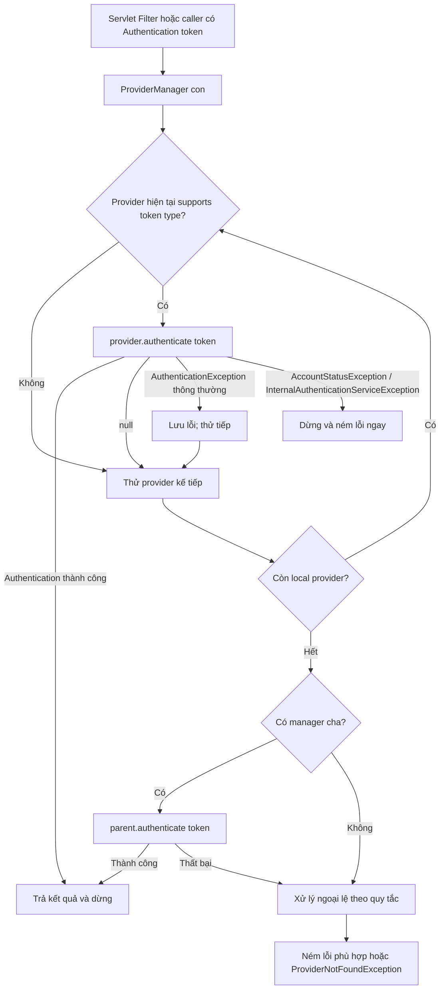
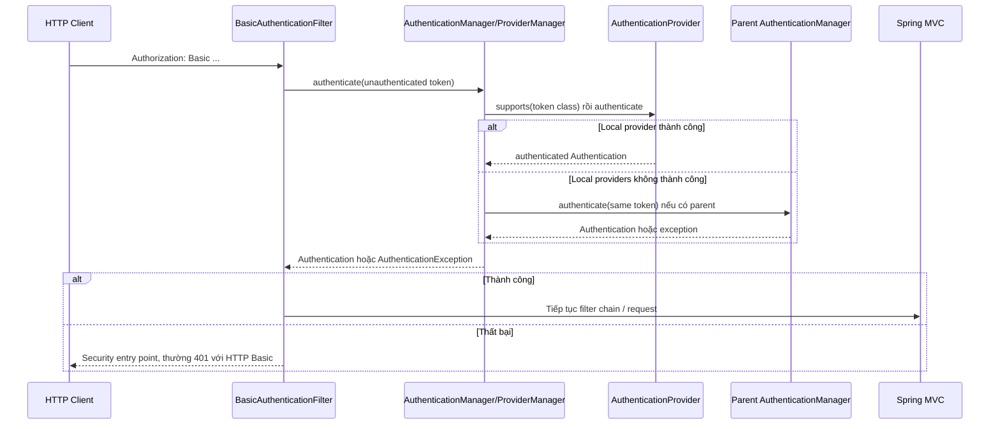

# ProviderManager: chọn AuthenticationProvider và chuyển tiếp tới manager cha

> **Bối cảnh:** Spring Security 6.x với ứng dụng Spring Boot 3.x trên Servlet stack, Java 17 trở lên. Bài này giải thích cách `ProviderManager` điều phối các `AuthenticationProvider`, điều kiện chọn theo `supports(...)`, lúc nào thử provider tiếp theo, lúc nào gọi `AuthenticationManager` cha và những ngoại lệ làm dừng xử lý. Ví dụ runnable ở phần thực hành dùng lõi Spring Security để quan sát chính xác thuật toán; phần cuối nối kết quả đó với HTTP filter trong ứng dụng Servlet.

## 1. Vai trò trong luồng xác thực

**Authentication** là đối tượng biểu diễn thông tin liên quan đến việc xác thực (principal, credentials, authorities, trạng thái `authenticated`). Ví dụ một Servlet filter xử lý HTTP Basic có thể tạo `UsernamePasswordAuthenticationToken` với username/password chưa xác thực.

**AuthenticationManager** là giao diện tiếp nhận một `Authentication` và cố gắng xác thực:

```java
Authentication authenticate(Authentication authentication)
        throws AuthenticationException;
```

**ProviderManager** là một implementation phổ biến của `AuthenticationManager`. Nó **không tự so sánh password** và không trực tiếp query database. Thay vào đó, nó giữ danh sách `AuthenticationProvider` và điều phối từng provider phù hợp với kiểu `Authentication`.

**AuthenticationProvider** là nơi thực hiện một cơ chế xác thực cụ thể hoặc ủy quyền cho dependency thích hợp (ví dụ `DaoAuthenticationProvider` phối hợp `UserDetailsService` và `PasswordEncoder`). Mỗi provider có hai phương thức cốt lõi:

```java
Authentication authenticate(Authentication authentication)
        throws AuthenticationException;

boolean supports(Class<?> authentication);
```

- `supports(type) == false`: provider không xử lý **loại token** này, nên `ProviderManager` bỏ qua mà không gọi `authenticate(...)`.
- `supports(type) == true`: provider *có thể* xử lý loại token; `ProviderManager` thử gọi `authenticate(...)`.
- `authenticate(...)` trả `Authentication` khác `null`: xác thực thành công và dừng việc tìm provider.
- `authenticate(...)` trả `null`: provider không quyết định được hoặc từ chối xử lý trường hợp cụ thể; manager tiếp tục tìm provider khác.
- `authenticate(...)` ném `AuthenticationException`: một thất bại xác thực; hành vi tiếp tục hoặc dừng ngay tùy **loại exception** (chi tiết mục 3).

**Phân biệt quan trọng:** `supports(...)` kiểm tra **kiểu class của token**, không phải username có tồn tại trong database hay password có đúng không. Hai provider có thể cùng trả true cho `UsernamePasswordAuthenticationToken` nhưng chỉ xử lý các tập tài khoản riêng.

## 2. Hình dung thứ tự chọn provider và manager cha



Trong ví dụ nhiều providers, `ProviderManager` duyệt chúng **theo thứ tự đã cấu hình**. Nó không sắp xếp lại theo “độ mạnh”, tên bean, username hay dự đoán provider nào sẽ thành công.

Khi tất cả provider nội bộ đều không tạo được `Authentication` hợp lệ, manager **có thể** gọi `parent.authenticate(authentication)` nếu đã cấu hình parent. **Parent** chỉ là một `AuthenticationManager` khác; nó có thể là `ProviderManager` khác hoặc implementation khác. Parent **không bắt buộc** tồn tại.

Nếu có parent, việc chuyển tiếp chỉ xảy ra khi manager con chưa có kết quả xác thực thành công, trừ các lỗi nghiêm trọng có chính sách dừng ngay. Parent **không được gọi thêm sau một kết quả thành công** ở local provider.

## 3. Cách ProviderManager xử lý từng tình huống

| Kết quả ở provider hiện tại | Điều gì xảy ra tiếp theo? | Ý nghĩa |
|---|---|---|
| `supports(token.getClass()) == false` | Bỏ qua provider, thử provider kế tiếp | Provider không hỗ trợ loại token |
| `supports(...) == true` và `authenticate(...)` trả `null` | Thử provider kế tiếp; cuối danh sách có thể gọi parent | Provider chọn không xử lý trường hợp này |
| Trả `Authentication` thành công | Dừng ngay, trả kết quả; không gọi provider tiếp theo/parent | Đã xác thực thành công |
| Ném `BadCredentialsException` hoặc `AuthenticationException` thông thường | Lưu exception gần nhất, tiếp tục thử providers còn lại; có thể thử parent | Một provider thất bại chưa nhất thiết kết thúc toàn bộ chuỗi |
| Ném `AccountStatusException`, ví dụ `DisabledException` | Dừng ngay và ném lỗi; không tiếp tục các providers/parent | Trạng thái tài khoản không hợp lệ cần chặn fallback |
| Ném `InternalAuthenticationServiceException` | Dừng ngay và ném lỗi; không tiếp tục/không fallback parent | Lỗi nội bộ của dịch vụ xác thực |
| Hết providers, không có kết quả, có parent | Thử `parent.authenticate(...)` | Cho cơ chế cha cơ hội xác thực |
| Không provider/parent nào xác thực và cũng không có AuthenticationException có giá trị | Ném `ProviderNotFoundException` | Không có provider đưa ra kết quả cho token |
| Parent ném `ProviderNotFoundException` | Manager con có thể bỏ qua lỗi “không tìm thấy provider” này và giữ lỗi local trước đó | Không che mất lỗi xác thực cụ thể ở local |

**Chi tiết dễ bị bỏ qua:** Nếu provider thứ nhất ném `BadCredentialsException` nhưng provider thứ hai (cũng hỗ trợ kiểu token) xác thực thành công, `ProviderManager` trả thành công của provider thứ hai. Ngược lại, với `DisabledException` thuộc `AccountStatusException`, manager dừng ngay; provider khác và manager cha không được thử tiếp. Tùy cơ chế, đây là quyết định bảo mật có chủ đích để tránh bypass tài khoản bị khóa hoặc vô hiệu hóa.

Trong trường hợp cuối cùng thất bại, exception được ném thường là **exception gần nhất có ý nghĩa**. Nếu không có exception nào và mọi provider đều trả `null` hoặc `supports == false`, `ProviderNotFoundException` mô tả việc không tìm được cách xác thực token. Không nên viết logic sản phẩm giả định mọi thất bại đều là `BadCredentialsException`.

## 4. Parent là fallback authentication, không phải “cấp trên luôn chạy”

Ví dụ có hai manager:

- **Manager con:** thử `LocalAccountProvider` và `PartnerAccountProvider`; phục vụ các tài khoản nội bộ/đối tác.
- **Manager cha:** thử `ParentAccountProvider`; phục vụ một danh mục tài khoản chung.

Khi request dùng token `UsernamePasswordAuthenticationToken("parent-user", "...")`:

1. Local provider đầu tiên có `supports(UsernamePasswordAuthenticationToken.class) == true`, nhưng username không thuộc danh mục nó quản lý nên trả `null`.
2. Partner provider cũng supports kiểu token nhưng không nhận tài khoản đó nên trả `null`.
3. Hết local providers mà chưa thành công, manager con gọi `parent.authenticate(sameToken)`.
4. Provider của parent nhận đúng tài khoản và trả `Authentication` đã xác thực.
5. Manager con nhận kết quả của parent và trả lại caller. Không gọi thêm local provider nào.

**Khi nào không gọi parent?** Ngay khi có local success, hoặc khi một provider ném `AccountStatusException`/`InternalAuthenticationServiceException` thuộc nhóm dừng tức thì. Với lỗi thông thường như sai password, parent vẫn có thể được thử. Điều này đòi hỏi chính sách rõ ràng: nếu muốn **cấm** mọi fallback khi sai mật khẩu của một danh mục tài khoản, không thể chỉ trông đợi `BadCredentialsException` tự động ngăn parent.

Parent không tự “kế thừa” providers của child; đó là một manager riêng. Đừng tạo parent/child vòng lặp. Với nhiều `SecurityFilterChain`, có thể có nhiều manager ở các cấp hoặc phạm vi riêng; cần xác định đúng manager đang được một filter sử dụng.

## 5. Ví dụ Java 17+ chạy được: ba provider và một manager cha

Ví dụ sau cố ý đặt thuật toán vào một chương trình Spring Boot console để loại bỏ yếu tố HTTP. Nó sử dụng **Spring Security Core**; khi nắm vững kết quả, bạn sẽ hiểu dễ hơn cách các Servlet authentication filters gọi `AuthenticationManager`.

### 5.1. Chuẩn bị project

Tạo project Gradle với Spring Boot 3.x và Java 17+ bằng Spring Initializr, giữ plugin Java/Boot và repositories do Initializr tạo. Trong `build.gradle` thêm phần dependencies này (đây là *một phần* file, không phải file Gradle độc lập):

```groovy
dependencies {
    implementation 'org.springframework.boot:spring-boot-starter'
    implementation 'org.springframework.security:spring-security-core'
}
```

Spring Boot dependency management chọn bản Spring Security Core phù hợp với Boot 3.x. Ví dụ không cần embedded Tomcat vì tập trung vào `ProviderManager`.

### 5.2. Mã nguồn đầy đủ

Tạo **`src/main/java/com/example/demo/ProviderManagerLabApplication.java`**:

```java
package com.example.demo;

import java.util.List;

import org.springframework.boot.CommandLineRunner;
import org.springframework.boot.SpringApplication;
import org.springframework.boot.WebApplicationType;
import org.springframework.boot.autoconfigure.SpringBootApplication;
import org.springframework.context.annotation.Bean;
import org.springframework.security.authentication.AuthenticationProvider;
import org.springframework.security.authentication.BadCredentialsException;
import org.springframework.security.authentication.ProviderManager;
import org.springframework.security.authentication.TestingAuthenticationToken;
import org.springframework.security.authentication.UsernamePasswordAuthenticationToken;
import org.springframework.security.core.Authentication;
import org.springframework.security.core.AuthenticationException;
import org.springframework.security.core.GrantedAuthority;
import org.springframework.security.core.authority.SimpleGrantedAuthority;

@SpringBootApplication
public class ProviderManagerLabApplication {

    public static void main(String[] args) {
        SpringApplication app = new SpringApplication(ProviderManagerLabApplication.class);
        app.setWebApplicationType(WebApplicationType.NONE);
        app.run(args).close();
    }

    @Bean
    CommandLineRunner runLab() {
        return args -> {
            ProviderManager parent = new ProviderManager(List.of(
                    new NamedAccountProvider(
                            "parent", "parent-user", "parent-pass", "ROLE_PARENT")
            ));

            ProviderManager child = new ProviderManager(List.of(
                    new NamedAccountProvider(
                            "local", "alice", "alice-pass", "ROLE_USER"),
                    new NamedAccountProvider(
                            "partner", "bob", "bob-pass", "ROLE_PARTNER")
            ), parent);

            attempt(child, "alice", "alice-pass");
            attempt(child, "bob", "bob-pass");
            attempt(child, "parent-user", "parent-pass");
            attempt(child, "alice", "wrong-pass");
            attempt(child, "guest", "unknown-pass");

            System.out.println("--- unsupported token type ---");
            try {
                child.authenticate(new TestingAuthenticationToken("alice", "alice-pass"));
            } catch (AuthenticationException ex) {
                System.out.println("FAIL type=" + ex.getClass().getSimpleName());
            }
        };
    }

    private static void attempt(ProviderManager manager, String username,
                                String password) {
        System.out.println("--- " + username + " ---");

        Authentication request =
                UsernamePasswordAuthenticationToken.unauthenticated(
                        username, password);
        try {
            Authentication result = manager.authenticate(request);
            List<String> roles = result.getAuthorities().stream()
                    .map(GrantedAuthority::getAuthority)
                    .toList();
            System.out.println("OK " + result.getName() + " " + roles);
        } catch (AuthenticationException ex) {
            System.out.println("FAIL " + username + " "
                    + ex.getClass().getSimpleName());
        }
    }

    private static final class NamedAccountProvider
            implements AuthenticationProvider {

        private final String label;
        private final String expectedUser;
        private final String expectedPassword;
        private final String authority;

        private NamedAccountProvider(String label, String expectedUser,
                                     String expectedPassword, String authority) {
            this.label = label;
            this.expectedUser = expectedUser;
            this.expectedPassword = expectedPassword;
            this.authority = authority;
        }

        @Override
        public boolean supports(Class<?> authenticationType) {
            return UsernamePasswordAuthenticationToken.class
                    .isAssignableFrom(authenticationType);
        }

        @Override
        public Authentication authenticate(Authentication authentication)
                throws AuthenticationException {
            System.out.println("TRY " + label + " " + authentication.getName());

            if (!expectedUser.equals(authentication.getName())) {
                return null; // Tài khoản không thuộc phạm vi provider này
            }

            if (!expectedPassword.equals(authentication.getCredentials())) {
                throw new BadCredentialsException("Bad credentials");
            }

            return UsernamePasswordAuthenticationToken.authenticated(
                    authentication.getName(),
                    null,
                    List.of(new SimpleGrantedAuthority(authority))
            );
        }
    }
}
```

**Vì sao có ba provider?** Hai provider nằm trong manager con và một provider nằm ở manager cha; thứ tự trong `List.of(...)` thể hiện đúng thứ tự thử. Cả ba **đều** trả `supports(...) == true` đối với `UsernamePasswordAuthenticationToken`; từng provider tự quyết định chỉ xử lý một username nhất định. Nếu username không thuộc phạm vi, provider trả `null` để provider khác có cơ hội xử lý.

**Vì sao return token đã authenticated?** Provider đã kiểm tra điều kiện xác thực nên trả object có trạng thái `authenticated=true` cùng authorities. Token request ban đầu được tạo bằng factory `unauthenticated(...)`, không mang quyền truy cập. Đây là pattern minh họa core API.

**Giới hạn của demo:** password được so sánh trực tiếp chỉ để quan sát thuật toán, không dùng cho production. Trong ứng dụng thật, sử dụng `DaoAuthenticationProvider` + `PasswordEncoder`, identity provider hoặc cơ chế phù hợp; tránh hard-code mật khẩu, log credentials hay xây hệ thống xác thực thủ công không được đánh giá bảo mật.

### 5.3. Chạy chương trình

Trong thư mục dự án có Gradle wrapper:

```bash
# Linux/macOS
./gradlew bootRun

# Windows PowerShell
.\gradlew.bat bootRun
```

Các dòng **do chính `System.out.println` trong mã tạo ra**, sau khi bỏ qua log banner/khởi động và đóng ứng dụng của Boot, có thứ tự dự kiến sau:

```text
--- alice ---
TRY local alice
OK alice [ROLE_USER]
--- bob ---
TRY local bob
TRY partner bob
OK bob [ROLE_PARTNER]
--- parent-user ---
TRY local parent-user
TRY partner parent-user
TRY parent parent-user
OK parent-user [ROLE_PARENT]
--- alice ---
TRY local alice
TRY partner alice
TRY parent alice
FAIL alice BadCredentialsException
--- guest ---
TRY local guest
TRY partner guest
TRY parent guest
FAIL guest ProviderNotFoundException
--- unsupported token type ---
FAIL type=ProviderNotFoundException
```

Đây là **output kỳ vọng khi chạy mã nguồn**; chương trình không được tuyên bố là đã thực thi trong môi trường của người đọc. Thứ tự này minh họa quy trình rõ nhất:

| Input | Local provider 1 | Local provider 2 | Parent provider | Kết quả |
|---|---|---|---|---|
| `alice / alice-pass` | Thành công | Không gọi | Không gọi | `ROLE_USER` |
| `bob / bob-pass` | Trả `null` | Thành công | Không gọi | `ROLE_PARTNER` |
| `parent-user / parent-pass` | Trả `null` | Trả `null` | Thành công | `ROLE_PARENT` |
| `alice / wrong-pass` | Ném `BadCredentialsException` | Trả `null` | Trả `null` | Ném `BadCredentialsException` |
| `guest / unknown-pass` | Trả `null` | Trả `null` | Trả `null` | `ProviderNotFoundException` |
| `TestingAuthenticationToken` | `supports == false` | `supports == false` | `supports == false` | `ProviderNotFoundException` |

**Quan sát then chốt:** Dù provider `local` ném `BadCredentialsException` cho `alice` sai mật khẩu, manager vẫn thử `partner` và parent, vì đây là exception thông thường. Parent nhận một token **cùng principal/credentials** ban đầu; việc chuyển tiếp không tự biến token thành loại khác.

## 6. Trường hợp phải dừng ngay: tài khoản bị vô hiệu hóa

Ví dụ trên xử lý `BadCredentialsException`. Bây giờ xét một provider xác định user `alice` bị vô hiệu hóa và ném:

```java
throw new DisabledException("Account disabled");
```

`DisabledException` kế thừa `AccountStatusException`. Khi provider ném ngoại lệ thuộc nhóm này, `ProviderManager` **không tiếp tục** sang provider kế tiếp hoặc manager cha. Điều tương tự áp dụng cho `InternalAuthenticationServiceException`, nhằm tránh vòng fallback khi dịch vụ xác thực đang lỗi nghiêm trọng.

Trong một ứng dụng nhiều nhà cung cấp danh tính, đừng để một provider thiếu tính nhất quán về trạng thái tài khoản khiến người dùng bị khóa có thể được xác thực lại qua provider khác. Nếu muốn chính sách “tài khoản thuộc miền local mà sai mật khẩu thì cấm fallback”, phải **thiết kế rõ phạm vi token/provider và quy tắc lựa chọn manager**, chứ không giả định `BadCredentialsException` đã chặn fallback tự động.

Một provider nên trả `null` khi nó thực sự không xử lý trường hợp đó. Nếu provider chịu trách nhiệm tài khoản nhưng password sai, thông thường nên ném `BadCredentialsException`. Không dùng `null` để che giấu lỗi hạ tầng hoặc trạng thái disabled, vì việc đó có thể mở ra đường xác thực qua provider khác.

## 7. Gắn vào luồng Spring Security Servlet

Với request HTTP Basic trên Servlet stack, luồng khái quát như sau:



Điều kiện trong sơ đồ giả định filter không bị chặn trước đó và cơ chế HTTP Basic được bật. Cụ thể:

1. `BasicAuthenticationFilter` đọc HTTP Basic header, tạo một `UsernamePasswordAuthenticationToken` chưa xác thực và gọi manager mà nó được cấu hình sử dụng.
2. Nếu manager là `ProviderManager`, nó chọn provider theo `supports`, thứ tự và xử lý ngoại lệ như các mục trên.
3. Manager trả `Authentication` thành công; filter có thể thiết lập ngữ cảnh bảo mật (`SecurityContext`) và tiếp tục `FilterChain`. Các filter authorization sau đó quyết định quyền truy cập.
4. Nếu quá trình xác thực thất bại, Security xử lý exception qua entry point/handler phù hợp (HTTP Basic thường trả 401), request không đến controller.
5. Sau khi xác thực, **authorization** mới kiểm tra roles/authorities theo cấu hình. `ProviderManager` trả danh tính đã xác thực nhưng không tự quyết định endpoint nào được gọi.

**Đừng nhầm trách nhiệm:** `ProviderManager` không tự parse HTTP Authorization header, không tự viết HTTP response, không tự chọn `@GetMapping` của MVC, và không mặc nhiên lưu `Authentication` vào session. Nó là bộ điều phối ở tầng xác thực, được những filter/service khác gọi.

### Cấu hình manager trong ứng dụng Servlet

Trong hệ thống thật, `HttpSecurity` và các authentication filters được wiring bằng Spring Security. Với custom providers, bạn có thể cấu hình chúng để tham gia authentication manager của chain tương ứng, hoặc cấp một manager cụ thể cho filter. Hãy xác nhận **manager mà filter thực sự dùng**; chỉ khai báo một `@Bean ProviderManager` không bảo đảm mọi security chain và mọi authentication filter đều tự đổi sang manager đó.

Một đoạn **minh họa**, đặt trong phương thức cấu hình `SecurityFilterChain` khi manager đã được tạo:

```java
http.authenticationManager(childProviderManager)
    .authorizeHttpRequests(auth -> auth
        .anyRequest().authenticated())
    .httpBasic(Customizer.withDefaults());
```

Đây là **đoạn cấu hình**, chưa phải class độc lập; hãy dùng các import `HttpSecurity`, `Customizer` và `AuthenticationManager` thích hợp. Tránh lắp thêm provider trùng hoặc không tương thích với token mà filter tạo. Spring Boot có những auto-configuration và cơ chế parent manager riêng tùy wiring; đừng suy đoán thứ tự chỉ từ tên bean.

## 8. Lưu ý về credentials, events và context

### 8.1. Xóa credentials sau thành công

`ProviderManager` mặc định đặt `eraseCredentialsAfterAuthentication = true`. Nếu `Authentication` kết quả triển khai `CredentialsContainer`, manager gọi `eraseCredentials()` sau khi xác thực thành công. Điều này giảm khả năng credentials tồn tại lâu trong memory. Ví dụ trả `UsernamePasswordAuthenticationToken` với credentials `null` ngay từ đầu nên không cần in password để quan sát.

Nếu principal hoặc credentials là một object dùng chung qua cache và object đó bị erase, cần hiểu tác động tới cache: lần xác thực sau có thể thiếu dữ liệu cần thiết. Giải pháp nên là thiết kế object/caching phù hợp; không vội tắt erase trên toàn hệ thống chỉ để chữa triệu chứng.

### 8.2. Authentication events

`ProviderManager` có cơ chế `AuthenticationEventPublisher` để phát success/failure events. Khi khai báo một manager bằng `new ProviderManager(...)` ngoài cơ chế auto-configuration, bạn phải chú ý wiring event publisher nếu cần event lắng nghe được. Nếu parent cũng là một `ProviderManager`, cấu hình event publishers thiếu nhất quán có thể gây bỏ sót hoặc trùng events.

Trong implementation thông thường, nếu parent là manager tạo kết quả thành công, child không phát success event lần nữa cho chính kết quả parent đó. Việc observability/audit phải được kiểm chứng tại runtime theo topology thật, không nên giả định mọi manager cùng phát sự kiện.

### 8.3. SecurityContext và người gọi

Một `Authentication` trả về thành công **chưa tự được lưu vào `SecurityContextHolder` chỉ vì bạn gọi `ProviderManager.authenticate(...)` trực tiếp trong Java**. Caller chịu trách nhiệm cập nhật context phù hợp. Trong HTTP request flow, filter hỗ trợ xác thực thường làm việc này theo lifecycle của Security. Trong console lab, ví dụ cố ý chỉ kiểm tra return value và exception, không có Servlet request/session.

## 9. Debug lỗi xác thực theo lớp

| Triệu chứng | Kiểm tra trước | Nguyên nhân thường gặp |
|---|---|---|
| `ProviderNotFoundException` | Kiểu thực của token và `supports(Class)` của từng provider | Không provider nào hỗ trợ hoặc tất cả trả `null` |
| Provider mong đợi không chạy | Thứ tự list providers; provider trước đó có trả success không | Đã dừng ở provider trước hoặc supports false |
| Manager cha không được gọi | Local provider có trả Authentication? Có ngoại lệ short-circuit? | Local success hoặc `AccountStatusException`/`InternalAuthenticationServiceException` |
| Manager cha được gọi dù local báo sai mật khẩu | Exception type và policy fallback | `BadCredentialsException` thường không dừng cả chain |
| Nhận 401 trên HTTP nhưng code controller không chạy | Authentication filter, manager, entry point, header Basic | Xác thực thất bại trước MVC |
| Đã xác thực nhưng nhận 403 | Authorities và HTTP/method authorization | Có danh tính nhưng thiếu quyền; không phải lỗi chọn provider |
| Xác thực thành công khi không mong đợi | Nhiều providers hỗ trợ cùng token, parent có provider dễ tính hơn | Một provider sau đã chấp nhận dù provider trước thất bại |
| Không có authentication events | Publisher và cách các manager được tạo/wiring | Custom manager không có publisher phù hợp |

**Nguyên tắc điều tra:** log những dữ liệu an toàn như token class, provider label, outcome, exception class và chain name; **không log password, Basic Authorization value hoặc Bearer token**. Dùng Spring Security DEBUG/TRACE phù hợp khi phát triển, tắt mức log nhạy cảm ở production.

Nếu dùng nhiều `SecurityFilterChain` (ví dụ `/api/**` và `/admin/**`), phải kiểm tra cả **chain nào được chọn** và **manager nào được filter trong chain dùng**. Một provider có mặt trong application context chưa đủ chứng minh nó được manager đang chạy sử dụng.

## 10. Những hiểu nhầm thường gặp

1. **“`supports(...)` đúng thì bắt buộc provider xác thực thành công.”** Không: nó chỉ nói provider hỗ trợ kiểu token; `authenticate(...)` vẫn có thể trả `null` hoặc ném exception.
2. **“Sai password ở provider đầu tiên thì manager dừng ngay.”** Không đúng cho `BadCredentialsException` thông thường; provider sau và parent có thể được thử.
3. **“Bất kỳ exception nào cũng dẫn đến parent fallback.”** Không: `AccountStatusException` và `InternalAuthenticationServiceException` thuộc trường hợp dừng ngay.
4. **“Parent được gọi trước hoặc gọi sau mọi local success để kiểm tra lại.”** Không: parent là fallback khi local chưa tạo success.
5. **“ProviderManager tự tìm user trong database.”** Không: logic đó thuộc provider và dependency của provider.
6. **“Tên provider quyết định ưu tiên.”** Không: thứ tự providers trong manager và cấu hình của filter/chain quyết định đường đi.
7. **“Không tìm thấy provider đồng nghĩa password sai.”** Không: `ProviderNotFoundException` thường liên quan loại token hoặc không provider nào nhận xử lý.
8. **“Chỉ cần có bean AuthenticationProvider thì mọi filter tự dùng.”** Không: cần đúng wiring trong `AuthenticationManager` được filter sử dụng.
9. **“Authentication thành công đồng nghĩa có thể truy cập mọi endpoint.”** Không: bước authorization có thể tiếp tục từ chối vì thiếu authority.
10. **“Gọi authenticate tự cập nhật session/SecurityContext.”** Không: manager cung cấp result/exception; caller xử lý lifecycle tiếp theo.

## 11. Câu hỏi tự kiểm tra

**Câu 1.** Hai provider đều `supports(UsernamePasswordAuthenticationToken.class) == true`. Provider thứ nhất trả `null`; provider thứ hai trả Authentication thành công. Điều gì xảy ra?  
**Đáp án:** Manager thử provider thứ hai và trả thành công, không gọi parent.

**Câu 2.** Provider thứ nhất ném `BadCredentialsException`, provider thứ hai thành công. Kết quả?  
**Đáp án:** Có thể thành công ở provider thứ hai vì loại exception này thông thường chỉ được lưu để thử tiếp.

**Câu 3.** Provider thứ nhất ném `DisabledException`; parent có tài khoản cùng username. Parent có được gọi không?  
**Đáp án:** Không. `DisabledException` là `AccountStatusException`, khiến `ProviderManager` dừng ngay.

**Câu 4.** Tất cả local providers trả `null`, parent thành công. Ai cung cấp Authentication cuối cùng?  
**Đáp án:** Parent manager; child trả lại kết quả đó cho caller.

**Câu 5.** Tất cả providers (cả parent) không hỗ trợ loại token. Exception nào có thể xuất hiện?  
**Đáp án:** `ProviderNotFoundException`, vì không có cơ chế xử lý token phù hợp.

**Câu 6.** Trong ứng dụng Servlet dùng HTTP Basic, thành phần nào tạo token từ request và thành phần nào chọn provider?  
**Đáp án:** Filter xác thực HTTP Basic tạo token và gọi AuthenticationManager; `ProviderManager` chọn provider; Security filter tiếp tục cập nhật context và xử lý luồng HTTP.

**Ghi nhớ:** **ProviderManager chọn theo kiểu token → duyệt providers theo thứ tự → dừng khi có Authentication thành công → thử manager cha nếu local chưa thành công và không gặp lỗi buộc dừng → trả result hoặc ném AuthenticationException.** Đây là cơ chế điều phối xác thực; HTTP Servlet filters và bước authorization đảm nhiệm phần còn lại của request.