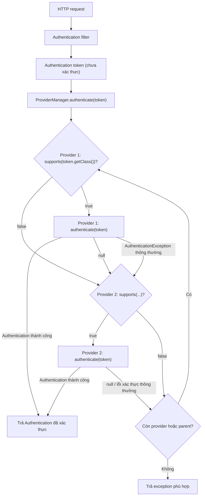

# `AuthenticationProvider.supports()` và kết quả trả về khi không hỗ trợ

**Chủ đề:** Spring Security – Servlet · **Nhóm:** Luồng xác thực.  
**Mục tiêu:** Giải thích chính xác cách `ProviderManager` lựa chọn `AuthenticationProvider`, ý nghĩa của `supports(Class<?>)`, khác biệt giữa `false`, `null` và ngoại lệ, cùng hành vi khi không provider nào xử lý được một `Authentication`.

Ví dụ sử dụng **Java 17**, **Spring Boot 3.3.5** và Spring Security 6.x. Phần lõi được minh họa bằng `ProviderManager` chạy độc lập trong một chương trình Java; phần cuối liên hệ tới HTTP filter chain trong ứng dụng Servlet.

## 1. Đặt `AuthenticationProvider` đúng vị trí trong luồng xác thực

Trong ứng dụng Spring Security Servlet, bộ lọc xác thực tiếp nhận dữ liệu từ HTTP request, tạo một đối tượng `Authentication` thể hiện yêu cầu xác thực và gọi `AuthenticationManager.authenticate(authentication)`. Triển khai phổ biến của `AuthenticationManager` là **`ProviderManager`**, nơi chứa danh sách các `AuthenticationProvider`.



*Sơ đồ mô tả đường đi khái niệm; trong thực tế, `ProviderManager` đi theo danh sách provider đúng thứ tự, lưu lỗi xác thực gần nhất và có các ngoại lệ khiến quá trình dừng ngay (xem phần 3). Không có vòng lặp quay lại provider đã duyệt.*

Điều cần phân biệt là **hai tầng lựa chọn khác nhau**:

- **`FilterChainProxy`** chọn một `SecurityFilterChain` theo HTTP request/path/dispatcher và thứ tự chain. Một request thường chạy qua **chain khớp đầu tiên**.
- **`ProviderManager`** chọn các `AuthenticationProvider` theo **kiểu Java của đối tượng `Authentication`** (và khả năng xử lý tại runtime), không chọn dựa trực tiếp vào URL hoặc thứ tự controller.

Ví dụ, một filter xử lý form login có thể tạo `UsernamePasswordAuthenticationToken`; một provider xử lý username/password thường chấp nhận kiểu token này. Nếu request dùng cơ chế khác, filter có thể tạo kiểu token khác, cần provider thích hợp.

## 2. Hợp đồng của hai phương thức

`AuthenticationProvider` có hai phương thức chính:

```java
public interface AuthenticationProvider {
    Authentication authenticate(Authentication authentication)
            throws AuthenticationException;

    boolean supports(Class<?> authentication);
}
```

Đây là **chữ ký API để giải thích**, không phải một file source cần tự khai báo lại trong dự án. Trong Spring Security, interface thật có package `org.springframework.security.authentication.AuthenticationProvider`.

### 2.1. `supports(Class<?>)`: sàng lọc theo kiểu token

`supports()` nhận một đối tượng `Class<?>` đại diện **kiểu `Authentication`** và báo provider có thể xem xét kiểu đó hay không:

```java
@Override
public boolean supports(Class<?> authentication) {
    return UsernamePasswordAuthenticationToken.class
            .isAssignableFrom(authentication);
}
```

Đoạn này là phương thức minh họa dùng **bên trong một class `AuthenticationProvider`**; import cần thiết là `org.springframework.security.authentication.UsernamePasswordAuthenticationToken`.

- Trả `false`: `ProviderManager` **bỏ qua provider**, không gọi `authenticate()` của provider đó cho token hiện tại.
- Trả `true`: provider **được phép thử** `authenticate()`; **không bảo đảm** username/password đúng hoặc provider sẽ xử lý thành công.
- Giá trị `true` chỉ xác nhận khả năng xử lý **loại token**, không phải khẳng định mọi đối tượng thuộc loại đó đều hợp lệ.

`Class.isAssignableFrom(...)` cho phép nhận cả class con của `UsernamePasswordAuthenticationToken` nếu thích hợp. Nếu dùng `authentication == UsernamePasswordAuthenticationToken.class`, các subclass sẽ bị loại bỏ; chỉ dùng so sánh đúng class khi thật sự cần giới hạn như vậy.

**Sai lầm thường gặp:** truyền vào `supports()` `User.class`, DTO login, `HttpServletRequest.class` hoặc `String.class`. ProviderManager dùng **`authentication.getClass()`**, tức kiểu của đối tượng token được truyền vào `authenticate()`, không phải kiểu của principal hay credentials.

### 2.2. `authenticate(Authentication)`: kết quả thực tế

Theo hợp đồng Spring Security, phương thức này có ba nhóm kết quả:

| Kết quả | Ý nghĩa | Hành vi thông thường của `ProviderManager` |
| --- | --- | --- |
| Trả một `Authentication` khác `null` | Provider đã xác thực thành công và cung cấp principal/authorities | **Dừng** thử các provider còn lại, trả kết quả thành công. |
| Trả `null` | Provider không thể đưa ra kết quả xác thực cho token đó và **nhường cho provider khác** | Thử provider tiếp theo (nếu có); không coi là thành công. |
| Ném `AuthenticationException` | Provider đã đánh giá và phát hiện lỗi xác thực (sai credentials, tài khoản bị khóa, lỗi dịch vụ...) | Tùy loại exception: có thể nhớ lỗi và thử provider sau, hoặc dừng ngay. |

Các ví dụ ngoại lệ:

- `BadCredentialsException`: thông tin xác thực không đúng, là một `AuthenticationException`.
- `DisabledException`, `LockedException`: trạng thái tài khoản không cho phép xác thực; chúng thuộc nhánh `AccountStatusException`.
- `InternalAuthenticationServiceException`: lỗi nội bộ dịch vụ xác thực cần được xử lý như lỗi hạ tầng.

Không trả `Authentication` đã đánh dấu `authenticated=true` nếu chưa kiểm tra credentials/chính sách. Không dùng `null` để âm thầm biến một mật khẩu sai thành thành công ở provider tiếp theo mà thiếu ý định thiết kế rõ ràng.

## 3. Khi không hỗ trợ: `false` khác `null` và khác exception

Xét `ProviderManager` có ba provider được liệt kê theo thứ tự:

```text
Provider A → Provider B → Provider C
```

### Trường hợp A — `supports(...)` trả `false`

Nếu A không hỗ trợ class của token, `ProviderManager` **không gọi `A.authenticate(...)`**. Nó chuyển sang B, rồi C theo thứ tự.

Ví dụ A chuyên xử lý `UsernamePasswordAuthenticationToken`, nhưng filter gửi một `TestingAuthenticationToken` hoặc token Bearer khác kiểu. A được bỏ qua hoàn toàn. Đó là lý do không nên gọi `authenticate()` thủ công rồi suy ra kết quả giống `ProviderManager`: manager còn kiểm tra `supports()`.

### Trường hợp B — `supports(...)` trả `true`, nhưng `authenticate(...)` trả `null`

A nói “tôi có thể xem xét loại token này”, nhưng sau khi xem instance cụ thể, A từ chối quyết định. `ProviderManager` thử B. Đây là một kiểu **abstain** (không nhận xử lý), hữu ích khi nhiều provider hỗ trợ chung một loại `Authentication`, nhưng mỗi provider nhận một loại tài khoản hoặc miền danh tính riêng.

```java
@Override
public Authentication authenticate(Authentication token) {
    if (!isAccountInMyRealm(token.getName())) {
        return null; // Provider khác có thể xử lý.
    }
    return verifyCredentialsAndBuildAuthentication(token);
}
```

Hai hàm `isAccountInMyRealm` và `verifyCredentialsAndBuildAuthentication` trong đoạn trên là **pseudocode**, không thuộc Java/Spring Security API. Đây là ví dụ để hiểu **ngữ nghĩa trả `null`**, còn chương trình hoàn chỉnh ở phần 5 có class và phương thức thật.

Không nên dùng `return null` như một cách bỏ qua mọi lỗi credentials. Nếu provider **đã xác định** tài khoản của mình nhưng mật khẩu sai, thường nên ném `BadCredentialsException`, tránh tạo đường xác thực vòng qua provider khác ngoài dự định.

### Trường hợp C — `authenticate(...)` ném `AuthenticationException`

Provider A có thể ném `BadCredentialsException`; `ProviderManager` thường **lưu exception và thử B**. Nếu B thành công, kết quả thành công được trả về. Nếu không provider nào thành công và parent manager cũng không xử lý được, exception xác thực được lưu sẽ được ném ra (thường là exception cuối cùng thích hợp).

**Ngoại lệ quan trọng:** `AccountStatusException` (ví dụ tài khoản bị khóa/vô hiệu) và `InternalAuthenticationServiceException` được `ProviderManager` xử lý bằng cách **dừng ngay**, không tiếp tục hỏi các provider tiếp theo. Đừng phát biểu giản lược rằng *mọi* `AuthenticationException` đều cho fallback.

### Trường hợp D — Tất cả provider đều không hỗ trợ hoặc trả `null`

Nếu toàn bộ provider bị bỏ qua do `supports(...) == false`, hoặc các provider được thử đều trả `null`, và không có parent manager xử lý thành công, `ProviderManager` ném:

```text
ProviderNotFoundException
```

`ProviderNotFoundException` là một loại `AuthenticationException`. Nó báo **không có provider nào tạo được kết quả xác thực cho loại/yêu cầu token**; không đồng nghĩa mật khẩu sai. Thông báo chi tiết của exception có thể chứa tên class token và phụ thuộc phiên bản, vì vậy khi kiểm thử nên so sánh **loại exception** thay vì cố định toàn văn message.

### Bảng quyết định nhanh

| Tình huống | Có gọi `authenticate()`? | Có thử provider kế tiếp? | Kết quả nếu không ai thành công |
| --- | --- | --- | --- |
| `supports()` = `false` | Không | Có | `ProviderNotFoundException` nếu tất cả đều bỏ qua. |
| `supports()` = `true`, `authenticate()` = `null` | Có | Có | `ProviderNotFoundException` nếu tất cả đều abstain. |
| `supports()` = `true`, trả token thành công | Có | Không | Trả `Authentication` được xác thực. |
| `supports()` = `true`, ném `BadCredentialsException` | Có | Thường có | Lỗi xác thực được giữ lại nếu không có thành công. |
| Ném `AccountStatusException` hoặc `InternalAuthenticationServiceException` | Có | Không (dừng) | Ném ngay exception tương ứng. |

Nếu có **parent `AuthenticationManager`**, `ProviderManager` còn có thể hỏi parent khi các provider cục bộ không cho kết quả. Khi đó phải xét kết quả/exception từ parent trước khi kết luận lỗi cuối.

## 4. Cách `ProviderManager` thực hiện lựa chọn

Pseudocode sau cố ý lược bỏ event publishing, chi tiết parent/exception và xóa credentials, nhằm nhấn mạnh vị trí của `supports()`:

```java
// Pseudocode, không phải source nguyên văn của Spring Security.
Authentication result = null;

for (AuthenticationProvider provider : providers) {
    if (!provider.supports(authentication.getClass())) {
        continue;
    }

    try {
        result = provider.authenticate(authentication);
        if (result != null) {
            break;
        }
    } catch (AuthenticationException ex) {
        // Có loại phải dừng ngay; các lỗi thông thường
        // có thể được ghi nhớ để thử provider tiếp theo.
    }
}
```

**Bốn điểm cần nhớ khi thiết kế:**

1. Thứ tự `AuthenticationProvider` trong `ProviderManager` quan trọng khi nhiều provider hỗ trợ cùng một loại token: provider đầu tiên trả thành công sẽ thắng. Provider cuối có thể không bao giờ được gọi.
2. `supports(true)` không xác thực người dùng; đây chỉ là câu trả lời về **khả năng xử lý class**. Nên triển khai nhẹ và ổn định, không gọi database/network để kiểm tra password trong `supports()`.
3. `authenticate(null)` không phải một lời gọi hợp lệ mang nghĩa “bỏ qua”. Trong `authenticate(Authentication)`, **giá trị trả về `null`** mới mang nghĩa nhường quyền cho provider tiếp theo. Không nhầm đối số với kết quả.
4. Khi xác thực thành công, `ProviderManager` có thể sao chép thông tin request (details) sang kết quả và xóa credentials của kết quả nếu nó triển khai `CredentialsContainer`. Logic xóa credentials cũng phải được cân nhắc nếu bạn tự viết `AuthenticationManager`/provider.

## 5. Ví dụ Java 17 chạy được: đủ bốn kết quả

Ví dụ sau chạy **trực tiếp `ProviderManager`** để chứng minh thứ tự lựa chọn provider, không cần tạo server hay browser. Ở phần 7 sẽ liên hệ cách các servlet filter sử dụng cơ chế này.

### 5.1. Cấu trúc project

```text
provider-supports-demo/
├── pom.xml
└── src/
    ├── main/java/demo/
    │   └── ProviderSelectionDemo.java
    └── test/java/demo/
        └── ProviderSelectionDemoTest.java
```

### 5.2. `pom.xml`

```xml
<?xml version="1.0" encoding="UTF-8"?>
<project xmlns="http://maven.apache.org/POM/4.0.0"
         xmlns:xsi="http://www.w3.org/2001/XMLSchema-instance"
         xsi:schemaLocation="http://maven.apache.org/POM/4.0.0 https://maven.apache.org/xsd/maven-4.0.0.xsd">
    <modelVersion>4.0.0</modelVersion>

    <parent>
        <groupId>org.springframework.boot</groupId>
        <artifactId>spring-boot-starter-parent</artifactId>
        <version>3.3.5</version>
        <relativePath/>
    </parent>

    <groupId>demo</groupId>
    <artifactId>provider-supports-demo</artifactId>
    <version>1.0.0</version>

    <properties>
        <java.version>17</java.version>
    </properties>

    <dependencies>
        <dependency>
            <groupId>org.springframework.boot</groupId>
            <artifactId>spring-boot-starter-security</artifactId>
        </dependency>
        <dependency>
            <groupId>org.springframework.boot</groupId>
            <artifactId>spring-boot-starter-test</artifactId>
            <scope>test</scope>
        </dependency>
    </dependencies>

    <build>
        <plugins>
            <plugin>
                <groupId>org.codehaus.mojo</groupId>
                <artifactId>exec-maven-plugin</artifactId>
                <version>3.5.0</version>
            </plugin>
        </plugins>
    </build>
</project>
```

Spring Boot BOM cung cấp các phiên bản dependency Spring Security tương thích. `exec-maven-plugin` cho phép gọi class `main` qua Maven. Starter Security trong ví dụ phục vụ **API xác thực**; vì không có `spring-boot-starter-web`, chương trình này **không khởi động Servlet container**. Điều đó giúp quan sát logic `ProviderManager` riêng biệt.

### 5.3. `src/main/java/demo/ProviderSelectionDemo.java`

```java
package demo;

import java.util.List;
import java.util.Objects;

import org.springframework.security.authentication.AuthenticationProvider;
import org.springframework.security.authentication.BadCredentialsException;
import org.springframework.security.authentication.ProviderManager;
import org.springframework.security.authentication.ProviderNotFoundException;
import org.springframework.security.authentication.TestingAuthenticationToken;
import org.springframework.security.authentication.UsernamePasswordAuthenticationToken;
import org.springframework.security.core.Authentication;
import org.springframework.security.core.authority.SimpleGrantedAuthority;

public final class ProviderSelectionDemo {

    // Hỗ trợ kiểu username/password nhưng nhường cho provider khác.
    public static final class AbstainingProvider
            implements AuthenticationProvider {

        @Override
        public boolean supports(Class<?> type) {
            return UsernamePasswordAuthenticationToken.class
                    .isAssignableFrom(type);
        }

        @Override
        public Authentication authenticate(Authentication token) {
            return null;
        }
    }

    // Xác thực thực sự username/password.
    public static final class PasswordProvider
            implements AuthenticationProvider {

        @Override
        public boolean supports(Class<?> type) {
            return UsernamePasswordAuthenticationToken.class
                    .isAssignableFrom(type);
        }

        @Override
        public Authentication authenticate(Authentication token) {
            boolean userMatches = "lan".equals(token.getName());
            boolean passwordMatches =
                    Objects.equals("s3cr3t", token.getCredentials());

            if (!userMatches || !passwordMatches) {
                throw new BadCredentialsException("Invalid credentials");
            }

            return UsernamePasswordAuthenticationToken.authenticated(
                    token.getName(),
                    null,
                    List.of(new SimpleGrantedAuthority("ROLE_USER"))
            );
        }
    }

    public static void main(String[] args) {
        AuthenticationProvider abstain = new AbstainingProvider();
        AuthenticationProvider password = new PasswordProvider();
        ProviderManager manager =
                new ProviderManager(List.of(abstain, password));

        System.out.println("supports UsernamePassword: "
                + password.supports(UsernamePasswordAuthenticationToken.class));
        System.out.println("supports TestingAuthentication: "
                + password.supports(TestingAuthenticationToken.class));

        Authentication authenticated = manager.authenticate(
                UsernamePasswordAuthenticationToken.unauthenticated(
                        "lan", "s3cr3t"));

        System.out.println("success: " + authenticated.getName()
                + " authenticated=" + authenticated.isAuthenticated());

        try {
            manager.authenticate(
                    UsernamePasswordAuthenticationToken.unauthenticated(
                            "lan", "wrong"));
        } catch (BadCredentialsException exception) {
            System.out.println("wrong password: "
                    + exception.getClass().getSimpleName());
        }

        try {
            manager.authenticate(
                    new TestingAuthenticationToken("lan", "s3cr3t"));
        } catch (ProviderNotFoundException exception) {
            System.out.println("wrong token type: "
                    + exception.getClass().getSimpleName());
        }

        ProviderManager onlyAbstains =
                new ProviderManager(List.of(abstain));

        try {
            onlyAbstains.authenticate(
                    UsernamePasswordAuthenticationToken.unauthenticated(
                            "lan", "s3cr3t"));
        } catch (ProviderNotFoundException exception) {
            System.out.println("all abstain: "
                    + exception.getClass().getSimpleName());
        }
    }
}
```

**Vì sao ví dụ có hai provider cùng `supports(true)`?** `AbstainingProvider` chấp nhận xem xét loại token nhưng luôn trả `null`, nên provider kế tiếp vẫn có cơ hội. `PasswordProvider` chỉ đánh dấu xác thực thành công khi tên người dùng/mật khẩu hợp lệ và trả token với `ROLE_USER`; nếu sai, nó ném `BadCredentialsException`.

`TestingAuthenticationToken` thuộc Spring Security Core và được dùng ở ví dụ này như một **kiểu token khác**. Hai provider chỉ hỗ trợ `UsernamePasswordAuthenticationToken`, vì vậy không provider nào được gọi để xác thực `TestingAuthenticationToken`.

**Lưu ý bảo mật:** user và mật khẩu trong ví dụ được hardcode chỉ để giải thích. Đây không phải cơ chế lưu mật khẩu production: ứng dụng thực tế cần `UserDetailsService`/identity provider, `PasswordEncoder` phù hợp, transport HTTPS và cách quản lý secret. Không log giá trị `getCredentials()`.

### 5.4. Chạy và output

Yêu cầu máy có JDK 17+, Maven và khả năng tải dependency. Trong thư mục `provider-supports-demo`:

```bash
mvn -q test
mvn -q compile exec:java -Dexec.mainClass=demo.ProviderSelectionDemo
```

Output **do `main` in ra**, không tính thông báo phụ của công cụ build, là:

```text
supports UsernamePassword: true
supports TestingAuthentication: false
success: lan authenticated=true
wrong password: BadCredentialsException
wrong token type: ProviderNotFoundException
all abstain: ProviderNotFoundException
```

Đối chiếu từng dòng:

1. `PasswordProvider.supports(UsernamePasswordAuthenticationToken.class)` là `true`.
2. `PasswordProvider.supports(TestingAuthenticationToken.class)` là `false`.
3. Với thông tin đúng, `AbstainingProvider.authenticate()` trả `null`, `PasswordProvider` xác thực thành công và manager trả token có `isAuthenticated() == true`.
4. Với mật khẩu sai, provider cuối ném `BadCredentialsException`; không còn provider khác nên manager báo lỗi này.
5. Token kiểu không được hỗ trợ tạo `ProviderNotFoundException` dù dữ liệu bên trong giống username/password đúng.
6. Manager chỉ có provider luôn abstain cũng tạo `ProviderNotFoundException`, **dù `supports()` trả `true`**.

Không có trường hợp nào dùng mật khẩu sai để kiểm tra xem có “rơi vào controller” hay không, vì ví dụ này chưa có Servlet/HTTP server.

### 5.5. `src/test/java/demo/ProviderSelectionDemoTest.java`

```java
package demo;

import java.util.List;

import org.junit.jupiter.api.Test;
import org.springframework.security.authentication.BadCredentialsException;
import org.springframework.security.authentication.ProviderManager;
import org.springframework.security.authentication.ProviderNotFoundException;
import org.springframework.security.authentication.TestingAuthenticationToken;
import org.springframework.security.authentication.UsernamePasswordAuthenticationToken;
import org.springframework.security.core.Authentication;

import static org.junit.jupiter.api.Assertions.assertEquals;
import static org.junit.jupiter.api.Assertions.assertFalse;
import static org.junit.jupiter.api.Assertions.assertThrows;
import static org.junit.jupiter.api.Assertions.assertTrue;

class ProviderSelectionDemoTest {

    private ProviderManager managerWithFallback() {
        return new ProviderManager(List.of(
                new ProviderSelectionDemo.AbstainingProvider(),
                new ProviderSelectionDemo.PasswordProvider()));
    }

    @Test
    void supportsChecksAuthenticationTokenClass() {
        var provider = new ProviderSelectionDemo.PasswordProvider();
        assertTrue(provider.supports(UsernamePasswordAuthenticationToken.class));
        assertFalse(provider.supports(TestingAuthenticationToken.class));
    }

    @Test
    void nullFromFirstProviderLetsSecondSucceed() {
        Authentication result = managerWithFallback().authenticate(
                UsernamePasswordAuthenticationToken.unauthenticated(
                        "lan", "s3cr3t"));

        assertTrue(result.isAuthenticated());
        assertEquals("lan", result.getName());
        assertEquals("ROLE_USER", result.getAuthorities()
                .iterator().next().getAuthority());
    }

    @Test
    void badPasswordIsAuthenticationFailure() {
        assertThrows(BadCredentialsException.class, () ->
                managerWithFallback().authenticate(
                        UsernamePasswordAuthenticationToken.unauthenticated(
                                "lan", "wrong")));
    }

    @Test
    void allUnsupportedProvidersCauseProviderNotFound() {
        assertThrows(ProviderNotFoundException.class, () ->
                managerWithFallback().authenticate(
                        new TestingAuthenticationToken("lan", "s3cr3t")));
    }

    @Test
    void allAbstainingProvidersCauseProviderNotFound() {
        ProviderManager manager = new ProviderManager(List.of(
                new ProviderSelectionDemo.AbstainingProvider()));

        assertThrows(ProviderNotFoundException.class, () ->
                manager.authenticate(
                        UsernamePasswordAuthenticationToken.unauthenticated(
                                "lan", "s3cr3t")));
    }
}
```

Chạy `mvn test` để Spring Boot Maven parent cấu hình Surefire/JUnit 5 và chạy **năm test**. Các test kiểm chứng giá trị `supports`, kết quả thành công sau khi provider đầu trả `null`, sự khác nhau giữa `BadCredentialsException` và `ProviderNotFoundException`. Trong phần này, những test không đánh giá Servlet filter chain hoặc response HTTP.

## 6. Khi có parent `AuthenticationManager`

Một `ProviderManager` có thể được thiết kế với **parent manager**. Nếu không provider cục bộ nào xác thực thành công, nó có thể ủy quyền sang parent. Vì vậy:

- “Mọi provider cục bộ trả `null`” **chưa đủ** kết luận request cuối cùng nhận `ProviderNotFoundException` nếu parent có thể xử lý.
- Parent có thể xác thực thành công với token mà provider cục bộ không xử lý.
- Nếu cả parent cũng không xác thực được, exception cuối phụ thuộc quá trình thử và loại exception đã gặp.

Không nên dựa vào parent như một “cứu hộ” ngẫu nhiên: khi cấu hình, cần biết chính xác provider nào được cài và thứ tự fallback. Một hệ thống có nhiều `SecurityFilterChain` cũng có thể dùng cùng hoặc khác `AuthenticationManager` tùy cấu hình; **không đồng nhất** mỗi chain với đúng một provider.

## 7. Liên hệ Spring Security Servlet: lỗi xuất hiện ở đâu?

Một luồng form login hoặc HTTP Basic thường có mô hình:

```text
HttpServletRequest
   ↓
UsernamePasswordAuthenticationFilter / BasicAuthenticationFilter
   ↓
UsernamePasswordAuthenticationToken
   ↓
AuthenticationManager (thường ProviderManager)
   ↓
AuthenticationProvider.supports(UsernamePasswordAuthenticationToken.class)
   ├─ false → thử provider khác
   ├─ true  → provider.authenticate(token)
   │           ├─ Authentication thành công
   │           ├─ null → thử provider khác
   │           └─ AuthenticationException → xử lý theo loại
   ↓
Thành công: authentication/security context được xử lý bởi filter
Thất bại: security filter gọi cơ chế failure/entry point tương ứng
```

`AuthenticationProvider` **không trực tiếp quyết định HTTP status**. Nó trả kết quả hoặc ném exception ở lớp xác thực. Bộ lọc và các thành phần như `AuthenticationEntryPoint`, `AuthenticationFailureHandler` mới quyết định phản hồi HTTP: `401` với HTTP Basic, redirect đến trang login/form failure, hoặc kiểu lỗi phù hợp với cấu hình. Đừng đồng nhất `ProviderNotFoundException` với một mã HTTP cố định ở mọi ứng dụng.

Ví dụ đối chiếu các tình huống:

| Tình huống Servlet | Điều có thể đang sai | Cách kiểm tra |
| --- | --- | --- |
| Thêm custom `AuthenticationProvider` nhưng `authenticate()` không bao giờ chạy | `supports()` trả `false` cho token do filter tạo, hoặc provider chưa đăng ký vào manager thực sự được filter dùng | Log kiểu `authentication.getClass()`, kiểm tra provider list/manager và boolean `supports`. |
| Form login hợp lệ nhưng trả lỗi provider not found | Manager nhận token mà không provider nào hỗ trợ hoặc mọi provider trả `null` | Kiểm tra `UsernamePasswordAuthenticationToken`, bean `DaoAuthenticationProvider`/custom provider và parent manager. |
| Custom provider luôn trả `null` cho password sai | Thiết kế fallback có thể cho provider khác thử credentials đó | Phân biệt “không thuộc miền xác thực” với “đã kiểm tra và sai mật khẩu”. |
| Provider đầu ném `BadCredentialsException`, provider sau vẫn chạy | Manager cho phép thử provider khác sau lỗi xác thực thông thường | Xem thứ tự provider và chính sách dự định. |
| Tài khoản đã khóa mà provider sau không chạy | `AccountStatusException` chặn fallback | Tìm nguyên nhân trạng thái tài khoản, không giải bằng thay đổi `supports`. |
| Đổi filter chain nhưng lỗi vẫn còn | Chain khác dùng `AuthenticationManager`/provider khác hoặc đang match URL trước | Kiểm tra `securityMatcher`, `@Order`, filter và manager của **chain được chọn**. |

### Chọn kiểu token đúng

`supports()` thường so sánh `Authentication` subtype, chẳng hạn:

- `UsernamePasswordAuthenticationToken`: dùng phổ biến ở form login hoặc HTTP Basic; những provider hỗ trợ username/password có thể xử lý.
- `BearerTokenAuthenticationToken`: xuất hiện trong luồng OAuth2 Resource Server bearer authentication khi dependency/configuration tương ứng tồn tại. Provider JWT hoặc opaque token của resource server xử lý theo cơ chế liên quan.
- `AnonymousAuthenticationToken`: biểu diễn authentication anonymous trong security context; không nên coi nó như một username/password login request.
- Custom `Authentication` type: cần provider khai báo `supports()` cho đúng class nếu xây dựng một cơ chế xác thực mới.

Đừng mở rộng `supports()` thành `return true` cho mọi class rồi ép kiểu cứng sang `UsernamePasswordAuthenticationToken`: những filter khác có thể tạo token không tương thích, khiến bạn gặp `ClassCastException` hoặc xử lý sai cơ chế xác thực.

## 8. Cấu hình provider vào ứng dụng: điều cần chú ý

Trong Spring Security hiện đại, có thể cấu hình `AuthenticationProvider` thông qua `HttpSecurity.authenticationProvider(...)`, hoặc xây `AuthenticationManager` với danh sách provider/parent theo kiến trúc của ứng dụng. Đoạn sau **chỉ là fragment** trong một bean cấu hình Servlet (cần có custom provider bean, các import và ứng dụng Spring Boot/MVC phù hợp):

```java
@Bean
SecurityFilterChain webSecurity(
        HttpSecurity http,
        AuthenticationProvider customProvider) throws Exception {

    http.authenticationProvider(customProvider);

    http.authorizeHttpRequests(auth -> auth
            .requestMatchers("/public").permitAll()
            .anyRequest().authenticated());

    http.formLogin(Customizer.withDefaults());

    return http.build();
}
```

Ý nghĩa: thêm custom provider vào manager được dựng cho cấu hình `HttpSecurity` tương ứng. Đây **không phải** cách thay tất cả provider ở mọi chain một cách tự động; với nhiều `SecurityFilterChain` cần xác minh manager nào thực sự được dùng. `Customizer` thuộc `org.springframework.security.config.Customizer`; đây là fragment để minh họa vị trí cấu hình chứ không phải chương trình chạy độc lập.

Một provider custom không nên tự thực hiện logic HTTP (redirect, set cookie, viết `HttpServletResponse`). Để filter và failure/success handlers lo phần Servlet. Provider tập trung kiểm tra `Authentication`, xác thực credentials và trả về principal/authorities đã được xác minh.

## 9. Lỗi triển khai thường gặp và cách sửa

### Lỗi 1 — `supports()` luôn trả `false` vì kiểm tra sai class

```java
// Sai nếu manager nhận UsernamePasswordAuthenticationToken:
return authentication.equals(String.class);
```

Đúng hơn là so với class của **token** mà filter tạo, thường dùng `isAssignableFrom` nếu cần hỗ trợ subclass.

### Lỗi 2 — `supports()` trả `true`, rồi `authenticate()` ép kiểu không kiểm tra

Đây là điểm dễ gây `ClassCastException` khi xử lý nhiều loại authentication. Hãy đảm bảo hợp đồng của `supports()` và `authenticate()` nhất quán. Nếu dùng token tùy chỉnh, test class cha/class con và các token không liên quan.

### Lỗi 3 — Trả `null` cho mọi trường hợp sai mật khẩu

Nếu một provider đã nhận trách nhiệm kiểm tra account mà xác thực thất bại, hãy báo lỗi bằng `AuthenticationException` phù hợp. `null` nên diễn đạt “provider không thể quyết định cho request này”. Fallback giữa các provider hỗ trợ cùng token type phải được thiết kế có chủ đích.

### Lỗi 4 — Ném `ProviderNotFoundException` thủ công cho mật khẩu sai

Thông thường hãy ném `BadCredentialsException` cho credentials không hợp lệ. `ProviderNotFoundException` phản ánh **không provider nào tạo được kết quả** sau quá trình lựa chọn và thường do manager tạo ra. Một exception sai loại sẽ làm chẩn đoán khó hơn.

### Lỗi 5 — Xem `supports(true)` như phép kiểm tra password

`supports()` chỉ nhận `Class<?>`, không có username/password. Không thể dựa vào `supports()` để kiểm tra credentials của từng user. Logic đó thuộc `authenticate(Authentication)` hoặc dịch vụ được nó gọi.

### Lỗi 6 — Quên xử lý tài khoản bị khóa/vô hiệu hóa

Không dùng `return null` để bỏ qua trạng thái tài khoản đã xác định bị khóa. Provider nên ném exception trạng thái phù hợp; `ProviderManager` sẽ dừng theo hợp đồng đối với `AccountStatusException`.

### Lỗi 7 — Chỉ test class provider, không test manager/filter

Unit test trực tiếp `provider.authenticate()` **không chứng minh** `ProviderManager` có gọi provider hay không. Cần test `supports`, thứ tự fallback và trường hợp không provider nào xử lý. Với ứng dụng web thực, dùng MockMvc/integration test để kiểm tra cả route, authentication filter, entry point và response. Đừng suy ra status HTTP từ đơn vị core Java.

## 10. Checklist khi debug `ProviderNotFoundException`

1. **Xác định chính xác token class:** đọc `authentication.getClass().getName()` ở lớp code an toàn hoặc log cấu trúc; không log credentials, `Authorization` header, cookie hay token thô.
2. **Xác định filter/manager thực tế:** request thuộc `SecurityFilterChain` nào và filter gọi `AuthenticationManager` nào?
3. **Kiểm tra từng `supports(token.getClass())`:** có provider nào trả `true` không? Nếu không, cần đăng ký đúng provider hoặc tạo đúng token type.
4. **Nếu có `true`, kiểm tra `authenticate()` có trả `null`:** provider có đang abstain hợp lệ do khác realm/account type không?
5. **Kiểm tra thứ tự và parent manager:** provider nào được gọi trước? Có nơi nhận thành công hoặc ném exception dừng sớm không?
6. **Kiểm thử cả bốn đường:** thành công, sai credentials, không hỗ trợ token class, và hỗ trợ type nhưng tất cả trả `null`.
7. **Bảo mật:** không in credentials/secret, không dùng `return true` cho mọi token class, không dựng `Authentication` thành công trước khi thực sự xác minh thông tin.

## 11. Câu hỏi tự luyện

**Câu 1.** A trả `supports(false)`, B trả `supports(true)` và `authenticate(null)`, C trả kết quả thành công. Ai được gọi?  
**Đáp án:** Chỉ B và C có cơ hội chạy `authenticate()`. A bị bỏ qua. C thành công nên manager trả kết quả của C.

**Câu 2.** A và B đều trả `supports(false)`, không có parent. Kết quả?  
**Đáp án:** Không có provider xử lý token → `ProviderNotFoundException`.

**Câu 3.** A `supports(true)` nhưng trả `null`; B `supports(true)` nhưng cũng trả `null`. Có phải xác thực thành công?  
**Đáp án:** Không. Nếu không có parent xử lý, `ProviderNotFoundException`.

**Câu 4.** A ném `BadCredentialsException`, B có thể xác thực thành công. ProviderManager dừng ngay tại A?  
**Đáp án:** Không nhất thiết. Với lỗi xác thực thông thường, nó có thể tiếp tục tới B. Riêng các lỗi kiểu `AccountStatusException` hoặc `InternalAuthenticationServiceException` khiến nó dừng ngay.

**Câu 5.** Có phải `supports(false)` tự tạo HTTP `403`?  
**Đáp án:** Không. Nó chỉ làm provider bị bỏ qua. Manager có thể thử provider khác; chỉ khi thất bại, ngoại lệ được lớp xác thực/Servlet filter xử lý theo cấu hình mới hình thành phản hồi HTTP.

**Ghi nhớ:** `supports(false)` = *bỏ qua provider trước khi gọi*; `authenticate()` trả `null` = *đã xem nhưng nhường lượt*; `AuthenticationException` = *báo lỗi xác thực*; `Authentication` hợp lệ = *thành công*. Khi không có provider nào tạo kết quả và không có parent xử lý, `ProviderManager` báo `ProviderNotFoundException`.