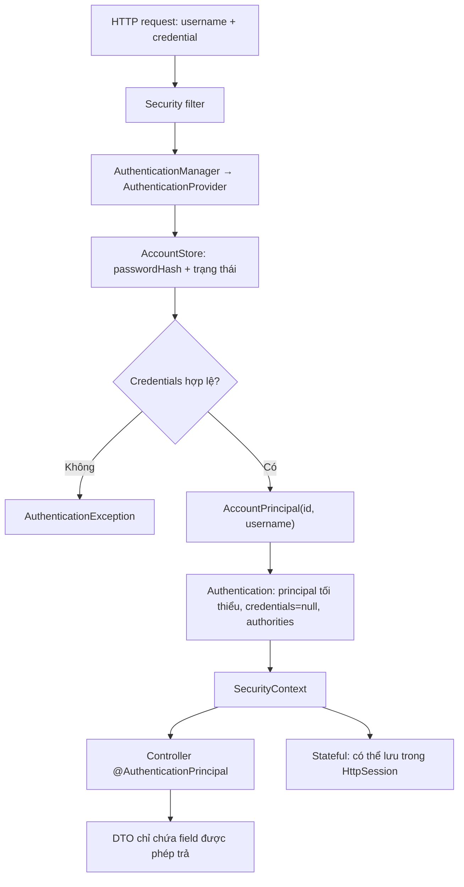

# Thiết kế principal riêng và giới hạn dữ liệu nhạy cảm được lưu

**Module:** Spring Security – Servlet · **Nhóm:** Tài khoản  
**Mục tiêu:** Thiết kế `Authentication.getPrincipal()` chỉ chứa danh tính cần thiết, tách thông tin xác thực khỏi dữ liệu tài khoản, tránh lộ password, password hash, token và PII qua `SecurityContext`, session, cache, log hay JSON.

Bài dùng **Java 17, Spring Boot 3.3.5, Spring Security 6.x**. Ví dụ chạy được sử dụng HTTP Basic và `AuthenticationProvider` riêng để chứng minh nguyên tắc; cuối bài giải thích thêm tác động của form login và `HttpSession`.

## 1. Phân biệt principal với tài khoản trong database

`Authentication` đại diện cho yêu cầu xác thực hoặc kết quả xác thực. Sau khi xác thực thành công, nó có các phần quan trọng:

| API | Chức năng | Rủi ro nếu thiết kế sai |
| --- | --- | --- |
| `getPrincipal()` | Danh tính của người gọi; có thể là `UserDetails`, tên, `Jwt` hoặc kiểu riêng | Mang nguyên entity chứa password hash/PII vào context, session, log |
| `getCredentials()` | Chứng thực, ví dụ password từ request; thường cần làm sạch sau xác thực | Secret tồn tại lâu hoặc bị serialize |
| `getAuthorities()` | Quyền đã được cấp, chẳng hạn `ROLE_USER` | Quyền cũ có thể còn trong session sau khi bị thu hồi |
| `getDetails()` | Metadata bổ sung về lời gọi xác thực | Vô tình lưu request headers hoặc token vào context |
| `isAuthenticated()` | Trạng thái xác thực của token | Tạo token “đã xác thực” trước khi kiểm tra mật khẩu là lỗ hổng |

Với Servlet stack, security filter lấy credential từ HTTP request, chuyển token chưa xác thực tới `AuthenticationManager`, thường là `ProviderManager`, và provider kiểm tra nguồn tài khoản. Kết quả có thể được giữ trong `SecurityContext` của request. Nếu ứng dụng dùng session, kết quả đó có thể được lưu để khôi phục ở các request tiếp theo.



**Nguyên tắc:** Principal là **định danh được tin cậy sau xác thực**, không phải bản sao đầy đủ của hàng `users`. Việc đọc email, địa chỉ, số điện thoại, hợp đồng hay các dữ liệu nghiệp vụ cần đi qua service và kiểm tra quyền phù hợp.

## 2. Chọn các field tối thiểu

| Dữ liệu | Đặt ở đâu? | Giải thích |
| --- | --- | --- |
| ID tài khoản bất biến, ví dụ `42` | Có thể ở principal | ID phục vụ tra cứu và audit, tránh phụ thuộc tên có thể đổi |
| Username dạng bí danh `learner` | Có thể ở principal nếu thật sự cần | Nếu username chính là email/điện thoại thì đó là PII, nên cân nhắc chỉ giữ opaque ID |
| Authorities như `ROLE_USER` | `Authentication.getAuthorities()` | Không cần sao chép thêm một danh sách role vào principal |
| Raw password | Chỉ trong giai đoạn xác thực | Không đưa vào principal, session, logs, DTO, exception |
| Encoded password hash | Kho tài khoản/tầng authentication | Hash vẫn là secret có thể bị thử đoán offline; không là field của principal |
| Access/refresh token, API key, OTP seed | Secret/token storage với phạm vi và vòng đời riêng | Không nhúng vào principal, không ghi log |
| Email, số điện thoại, giấy tờ, ngày sinh, địa chỉ | Business service có phân quyền | Chỉ đọc khi cần, không tự động cache vào context |
| JPA entity chứa lazy relations | Trong persistence layer | Không gắn entity/collection vào principal vì session serialization, lộ field và coupling |
| Session ID, CSRF token, request body | Context/request storage phù hợp | Không biến thành thuộc tính principal |

Principal nên có **ít field, bất biến và kiểu đơn giản**. Việc “ẩn” field bằng `@JsonIgnore` hoặc ghi đè `toString()` không xóa nó khỏi heap, Java serialization, debugger hay session store.

### 2.1. `UserDetails` khác với principal sau xác thực

Một `DaoAuthenticationProvider` thông thường gọi `UserDetailsService.loadUserByUsername` để lấy `UserDetails`; `UserDetails.getPassword()` cung cấp **encoded password** cho việc so khớp. Sau xác thực, kết quả có thể dùng chính `UserDetails` làm principal. Do vậy, nếu custom `UserDetails` chứa hash, cần hiểu cơ chế xóa credentials, caching và đối tượng nào thực sự còn trong `SecurityContext`.

`ProviderManager` mặc định có thể `eraseCredentialsAfterAuthentication` đối với kết quả hỗ trợ `CredentialsContainer`; tuy nhiên **không nên dựa vào giả định mọi custom token/provider đều hỗ trợ**. Với cache dùng chung `UserDetails`, việc xóa credentials trên cùng object còn có thể khiến lần xác thực sau thiếu hash. Cần quản lý vòng đời object và cache rõ ràng.

Một cách giảm rủi ro là **tách đối tượng lưu account/hash** khỏi **principal trên token thành công**, như ví dụ phần 4. Không đặt `getPassword() == null` trong `UserDetails` rồi kỳ vọng `DaoAuthenticationProvider` mặc định vẫn có thể xác minh password; provider đó cần hash tại giai đoạn xác thực.

## 3. Viết custom principal bằng Java 17

Đối tượng dưới đây là một record không có password/hash. Nó implement `java.security.Principal` để `Authentication.getName()` trả đúng username:

```java
package demo.principal;

import java.io.Serial;
import java.io.Serializable;
import java.security.Principal;

public record AccountPrincipal(long id, String username)
        implements Principal, Serializable {

    @Serial
    private static final long serialVersionUID = 1L;

    @Override
    public String getName() {
        return username;
    }
}
```

- `record` cung cấp component accessors `id()`, `username()`, `equals`, `hashCode` và `toString`, không có setters. Tính bất biến giúp object khó bị đổi danh tính giữa lúc xử lý.
- `Principal.getName()` trả tên rõ ràng. Với một record thường không implement `Principal`/`UserDetails`/`AuthenticatedPrincipal`, `AbstractAuthenticationToken.getName()` có thể dùng `toString()`; đây là cách đặt tên và audit không tốt.
- `Serializable` chỉ hữu ích nếu ứng dụng phải serialize principal ở session. Nó **không** tự tạo session hoặc thay đổi chính sách lưu `SecurityContext`.
- `toString()` của record sẽ bao gồm cả `id` và `username`. Vì vậy chỉ đưa những field chấp nhận được vào record; ngay cả username cũng cần kiểm soát khi nó là PII.

**Định danh ổn định:** Một số dự án chỉ cần `record AccountPrincipal(long id)` và tự định nghĩa `getName()` theo policy. Tránh dùng email làm khóa liên kết dữ liệu nếu email có thể đổi.

## 4. Ví dụ chạy được: principal tối thiểu trong ứng dụng Servlet

Ví dụ tạo API `/public/ping` (công khai) và `/api/me` (cần HTTP Basic). `AccountStore` giữ một hash BCrypt trong bộ nhớ; custom provider kiểm tra password rồi trả principal mới với `credentials=null`. Controller dựng DTO riêng, không serialize `Authentication` hay entity.

**Cấu trúc:**

```text
minimal-principal-demo/
├── pom.xml
└── src/
    ├── main/java/demo/principal/
    │   ├── MinimalPrincipalApplication.java
    │   ├── AccountPrincipal.java
    │   ├── AccountStore.java
    │   ├── AccountAuthenticationProvider.java
    │   ├── SecurityConfig.java
    │   └── ApiController.java
    └── test/java/demo/principal/
        └── MinimalPrincipalApplicationTests.java
```

### 4.1. `pom.xml`

```xml
<?xml version="1.0" encoding="UTF-8"?>
<project xmlns="http://maven.apache.org/POM/4.0.0"
         xmlns:xsi="http://www.w3.org/2001/XMLSchema-instance"
         xsi:schemaLocation="http://maven.apache.org/POM/4.0.0 https://maven.apache.org/xsd/maven-4.0.0.xsd">
    <modelVersion>4.0.0</modelVersion>
    <parent>
        <groupId>org.springframework.boot</groupId>
        <artifactId>spring-boot-starter-parent</artifactId>
        <version>3.3.5</version>
        <relativePath/>
    </parent>
    <groupId>demo</groupId>
    <artifactId>minimal-principal-demo</artifactId>
    <version>0.0.1-SNAPSHOT</version>
    <properties>
        <java.version>17</java.version>
    </properties>
    <dependencies>
        <dependency>
            <groupId>org.springframework.boot</groupId>
            <artifactId>spring-boot-starter-web</artifactId>
        </dependency>
        <dependency>
            <groupId>org.springframework.boot</groupId>
            <artifactId>spring-boot-starter-security</artifactId>
        </dependency>
        <dependency>
            <groupId>org.springframework.boot</groupId>
            <artifactId>spring-boot-starter-test</artifactId>
            <scope>test</scope>
        </dependency>
        <dependency>
            <groupId>org.springframework.security</groupId>
            <artifactId>spring-security-test</artifactId>
            <scope>test</scope>
        </dependency>
    </dependencies>
    <build>
        <plugins>
            <plugin>
                <groupId>org.springframework.boot</groupId>
                <artifactId>spring-boot-maven-plugin</artifactId>
            </plugin>
        </plugins>
    </build>
</project>
```

Spring Boot BOM quản lý version các thư viện tương thích. Ví dụ dùng Spring MVC/Servlet chứ không phải WebFlux.

### 4.2. `src/main/java/demo/principal/MinimalPrincipalApplication.java`

```java
package demo.principal;

import org.springframework.boot.SpringApplication;
import org.springframework.boot.autoconfigure.SpringBootApplication;

@SpringBootApplication
public class MinimalPrincipalApplication {
    public static void main(String[] args) {
        SpringApplication.run(MinimalPrincipalApplication.class, args);
    }
}
```

### 4.3. `src/main/java/demo/principal/AccountPrincipal.java`

```java
package demo.principal;

import java.io.Serial;
import java.io.Serializable;
import java.security.Principal;

public record AccountPrincipal(long id, String username)
        implements Principal, Serializable {
    @Serial
    private static final long serialVersionUID = 1L;

    @Override
    public String getName() {
        return username;
    }
}
```

### 4.4. `src/main/java/demo/principal/AccountStore.java`

```java
package demo.principal;

import java.util.Map;
import java.util.Optional;

import org.springframework.security.crypto.password.PasswordEncoder;
import org.springframework.stereotype.Component;

@Component
public class AccountStore {
    private final Map<String, StoredAccount> byUsername;

    public AccountStore(PasswordEncoder encoder) {
        byUsername = Map.of(
                "learner",
                new StoredAccount(
                        42L, "learner", encoder.encode("demo-pass"), true)
        );
    }

    public Optional<StoredAccount> findByUsername(String username) {
        return Optional.ofNullable(byUsername.get(username));
    }

    // Nội bộ tầng xác thực; không trả StoredAccount cho API.
    public record StoredAccount(
            long id, String username, String passwordHash, boolean enabled) {}
}
```

`StoredAccount` **có hash** để xác minh, nhưng được quản lý riêng. Kho dữ liệu giả trong RAM chỉ phục vụ học tập. Ứng dụng thật thay bằng repository/identity provider; mật khẩu lưu bằng password hashing có salt và work factor phù hợp (BCrypt/Argon2id), không dùng SHA-256 thô.

### 4.5. `src/main/java/demo/principal/AccountAuthenticationProvider.java`

```java
package demo.principal;

import java.util.List;

import org.springframework.security.authentication.AuthenticationProvider;
import org.springframework.security.authentication.BadCredentialsException;
import org.springframework.security.authentication.DisabledException;
import org.springframework.security.authentication.UsernamePasswordAuthenticationToken;
import org.springframework.security.core.Authentication;
import org.springframework.security.core.authority.SimpleGrantedAuthority;
import org.springframework.security.crypto.password.PasswordEncoder;
import org.springframework.stereotype.Component;

@Component
public class AccountAuthenticationProvider implements AuthenticationProvider {
    private final AccountStore accounts;
    private final PasswordEncoder encoder;

    public AccountAuthenticationProvider(AccountStore accounts,
                                         PasswordEncoder encoder) {
        this.accounts = accounts;
        this.encoder = encoder;
    }

    @Override
    public boolean supports(Class<?> type) {
        return UsernamePasswordAuthenticationToken.class
                .isAssignableFrom(type);
    }

    @Override
    public Authentication authenticate(Authentication input) {
        String supplied = input.getCredentials() instanceof String value
                ? value : "";

        AccountStore.StoredAccount stored = accounts
                .findByUsername(input.getName())
                .orElseThrow(() ->
                        new BadCredentialsException("Invalid credentials"));

        if (!encoder.matches(supplied, stored.passwordHash())) {
            throw new BadCredentialsException("Invalid credentials");
        }
        if (!stored.enabled()) {
            throw new DisabledException("Account disabled");
        }

        AccountPrincipal principal =
                new AccountPrincipal(stored.id(), stored.username());

        return UsernamePasswordAuthenticationToken.authenticated(
                principal, null,
                List.of(new SimpleGrantedAuthority("ROLE_USER")));
    }
}
```

**Giải thích kết quả:** Nếu credentials sai, provider ném `BadCredentialsException`, không tạo principal được tin cậy. Nếu đúng, provider tạo **object mới** `AccountPrincipal(42,"learner")`, cấp `ROLE_USER` demo và trả `Authentication` có `credentials == null`. Raw password và password hash không là field của principal. Trong production, authorities phải lấy từ nguồn quyền thực của mỗi account.

Ví dụ rút gọn chưa giải quyết chống user enumeration theo thời gian phản hồi, lockout/rate limit, credential stuffing và secret management; nên kiểm soát chúng riêng khi triển khai thật. Không log `input` hoặc `getCredentials()`.

### 4.6. `src/main/java/demo/principal/SecurityConfig.java`

```java
package demo.principal;

import org.springframework.context.annotation.Bean;
import org.springframework.context.annotation.Configuration;
import org.springframework.http.HttpMethod;
import org.springframework.security.config.Customizer;
import org.springframework.security.config.annotation.web.builders.HttpSecurity;
import org.springframework.security.config.http.SessionCreationPolicy;
import org.springframework.security.crypto.bcrypt.BCryptPasswordEncoder;
import org.springframework.security.crypto.password.PasswordEncoder;
import org.springframework.security.web.SecurityFilterChain;

@Configuration
public class SecurityConfig {
    @Bean
    PasswordEncoder passwordEncoder() {
        return new BCryptPasswordEncoder();
    }

    @Bean
    SecurityFilterChain securityFilterChain(
            HttpSecurity http,
            AccountAuthenticationProvider provider) throws Exception {
        http.authenticationProvider(provider);

        http.authorizeHttpRequests(auth -> auth
                .requestMatchers(HttpMethod.GET, "/public/ping").permitAll()
                .anyRequest().authenticated());

        http.httpBasic(Customizer.withDefaults());

        http.sessionManagement(session -> session
                .sessionCreationPolicy(SessionCreationPolicy.STATELESS));

        return http.build();
    }
}
```

Với custom `AuthenticationProvider` bean, Boot không cần tạo generated user `user` cho ứng dụng ví dụ. HTTP Basic cung cấp phương thức demo gửi credentials; `SessionCreationPolicy.STATELESS` tránh dùng session làm kho `SecurityContext` cho request tiếp theo. Code **không tắt CSRF**; các endpoint demo chỉ dùng GET, khi bổ sung POST/PUT/DELETE hãy đánh giá CSRF tùy cơ chế client.

**Stateless không đồng nghĩa secret biến mất:** Basic gửi credentials lại trên mỗi request, nên phải dùng TLS cho môi trường ngoài localhost và tránh log header `Authorization`.

### 4.7. `src/main/java/demo/principal/ApiController.java`

```java
package demo.principal;

import org.springframework.security.core.annotation.AuthenticationPrincipal;
import org.springframework.web.bind.annotation.GetMapping;
import org.springframework.web.bind.annotation.RestController;

@RestController
public class ApiController {

    @GetMapping("/public/ping")
    public String ping() {
        return "pong";
    }

    @GetMapping("/api/me")
    public MeResponse me(@AuthenticationPrincipal AccountPrincipal principal) {
        return new MeResponse(principal.id(), principal.username());
    }

    public record MeResponse(long id, String username) {}
}
```

`@AuthenticationPrincipal` nhận **principal được xác thực** của request, không lấy `StoredAccount`. Dù principal hiện chỉ có hai field, vẫn chọn trả `MeResponse` để hợp đồng API không phụ thuộc trực tiếp vào class bảo mật. Nếu sau này principal thêm field nội bộ, DTO không tự lộ thêm field đó.

## 5. Chạy ứng dụng và đọc phản hồi

Cài JDK 17+ và Maven, trong thư mục `minimal-principal-demo/`:

```bash
mvn clean test
mvn spring-boot:run
```

Trong terminal khác (PowerShell cũ nên dùng `curl.exe`):

```bash
# GET công khai:
curl -s http://localhost:8080/public/ping

# GET private không credentials:
curl -s -o /dev/null -w '%{http_code}\n' \
  -H 'Accept: application/json' http://localhost:8080/api/me

# GET private với HTTP Basic đúng:
curl -s -u learner:demo-pass http://localhost:8080/api/me

# GET private với password sai:
curl -s -o /dev/null -w '%{http_code}\n' \
  -u learner:wrong http://localhost:8080/api/me
```

Giá trị body/status do **từng lệnh** trả về, theo thứ tự:

```text
pong
401
{"id":42,"username":"learner"}
401
```

Lệnh `curl -s` không tự thêm newline sau body; JSON có thể khác thứ tự thuộc tính nhưng phải chỉ chứa hai field được định nghĩa. Dùng `curl -i` khi muốn xem response headers và status line. Credentials `learner/demo-pass` là tài khoản giả lập, không dùng trong dự án thật; khi nhập password thật bằng command line, lưu ý shell history và process listing.

## 6. Kiểm thử an toàn dữ liệu và luồng HTTP

### `src/test/java/demo/principal/MinimalPrincipalApplicationTests.java`

```java
package demo.principal;

import org.junit.jupiter.api.Test;
import org.springframework.beans.factory.annotation.Autowired;
import org.springframework.boot.test.autoconfigure.web.servlet.AutoConfigureMockMvc;
import org.springframework.boot.test.context.SpringBootTest;
import org.springframework.http.MediaType;
import org.springframework.security.authentication.BadCredentialsException;
import org.springframework.security.authentication.UsernamePasswordAuthenticationToken;
import org.springframework.security.core.Authentication;
import org.springframework.test.web.servlet.MockMvc;

import static org.junit.jupiter.api.Assertions.assertEquals;
import static org.junit.jupiter.api.Assertions.assertFalse;
import static org.junit.jupiter.api.Assertions.assertInstanceOf;
import static org.junit.jupiter.api.Assertions.assertNull;
import static org.junit.jupiter.api.Assertions.assertThrows;
import static org.springframework.security.test.web.servlet.request.SecurityMockMvcRequestPostProcessors.httpBasic;
import static org.springframework.test.web.servlet.request.MockMvcRequestBuilders.get;
import static org.springframework.test.web.servlet.result.MockMvcResultMatchers.content;
import static org.springframework.test.web.servlet.result.MockMvcResultMatchers.jsonPath;
import static org.springframework.test.web.servlet.result.MockMvcResultMatchers.status;

@SpringBootTest
@AutoConfigureMockMvc
class MinimalPrincipalApplicationTests {
    @Autowired
    MockMvc mvc;

    @Autowired
    AccountAuthenticationProvider provider;

    @Test
    void publicEndpointWorksWithoutCredentials() throws Exception {
        mvc.perform(get("/public/ping"))
                .andExpect(status().isOk())
                .andExpect(content().string("pong"));
    }

    @Test
    void privateEndpointRequiresCredentials() throws Exception {
        mvc.perform(get("/api/me").accept(MediaType.APPLICATION_JSON))
                .andExpect(status().isUnauthorized());
    }

    @Test
    void responseContainsOnlyWhitelistedFields() throws Exception {
        mvc.perform(get("/api/me")
                .with(httpBasic("learner", "demo-pass")))
                .andExpect(status().isOk())
                .andExpect(jsonPath("$.id").value(42))
                .andExpect(jsonPath("$.username").value("learner"))
                .andExpect(jsonPath("$.password").doesNotExist())
                .andExpect(jsonPath("$.passwordHash").doesNotExist())
                .andExpect(jsonPath("$.credentials").doesNotExist());
    }

    @Test
    void wrongCredentialsAreRejected() throws Exception {
        mvc.perform(get("/api/me")
                .with(httpBasic("learner", "wrong")))
                .andExpect(status().isUnauthorized());
    }

    @Test
    void providerBuildsSafePrincipalAndErasesCredentialOnResult() {
        Authentication result = provider.authenticate(
                UsernamePasswordAuthenticationToken.unauthenticated(
                        "learner", "demo-pass"));

        AccountPrincipal p = assertInstanceOf(
                AccountPrincipal.class, result.getPrincipal());

        assertEquals(42L, p.id());
        assertEquals("learner", p.getName());
        assertEquals("learner", result.getName());
        assertNull(result.getCredentials());
        assertFalse(p.toString().contains("demo-pass"));
        assertFalse(p.toString().contains("passwordHash"));
    }

    @Test
    void providerRejectsIncorrectPassword() {
        assertThrows(BadCredentialsException.class, () ->
                provider.authenticate(
                        UsernamePasswordAuthenticationToken.unauthenticated(
                                "learner", "wrong")));
    }
}
```

Với đúng cấu hình, **6 test dự kiến PASS** khi chạy `mvn test`. `MockMvc` trong `@SpringBootTest` + `@AutoConfigureMockMvc` gọi qua Spring Security filters để kiểm tra HTTP 200/401 và JSON. Test provider trực tiếp kiểm tra **object trong Authentication**, bổ sung cho test JSON: JSON không chứa hash **chưa đủ** chứng minh security context không giữ hash.

Không cần thêm test “chỉ assert getter trùng field” không có ý nghĩa; ở đây việc kiểm tra cả HTTP pipeline lẫn credential trong kết quả xác thực bảo vệ hai ranh giới khác nhau.

## 7. Nếu ứng dụng lưu `SecurityContext` qua `HttpSession`

Ví dụ phía trên dùng `SessionCreationPolicy.STATELESS`, nhưng nhiều ứng dụng Servlet sử dụng form login với session. Sau khi login, Spring Security có thể lưu `SecurityContext` và principal vào session thông qua `SecurityContextRepository` theo cơ chế/cấu hình đang dùng.

Điều này thay đổi rủi ro:

- Principal có thể tồn tại lâu hơn một request và bị serialize vào distributed session store hoặc replication. Nếu nó giữ `UserEntity` chứa passwordHash, rủi ro dữ liệu lan sang session infrastructure.
- Những role đã cấp có thể **cũ** khi quyền ở database thay đổi. Cần chính sách refresh, session invalidation, permission version hoặc kiểm tra lại cho hành động nhạy cảm.
- `Serializable` chỉ nói object có thể được serialize theo cơ chế Java; nó không xác nhận mọi object lồng nhau an toàn. Giữ record nhỏ với `long`/`String` giúp giảm phụ thuộc vào Hibernate proxies và graphs.
- Logout phải xử lý đúng invalidation/session cleanup theo thiết kế; token JWT/refresh token riêng không tự bị thu hồi chỉ bởi logout của session.
- Cookie session cần HTTPS và các thuộc tính như `HttpOnly`, `Secure`, `SameSite` tùy mô hình. Không log cookie, session IDs, CSRF token.

`@JsonIgnore` chỉ kiểm soát JSON tại một số serialization paths; nó không xóa field trong memory/session. Tương tự, `transient` chỉ ảnh hưởng một số cơ chế serialize, không thay thế nguyên tắc **không chứa secret trong principal**.

### Vậy `CredentialsContainer.eraseCredentials()` có tác dụng gì?

Spring Security hỗ trợ loại bỏ credentials sau thành công, ví dụ qua `ProviderManager.eraseCredentialsAfterAuthentication`. Các kết quả tùy chỉnh muốn xóa credentials phải hỗ trợ đúng hợp đồng; đối tượng con như principal/details nếu cũng implement `CredentialsContainer` có thể được xóa tương ứng. Tuy nhiên, nếu một object `UserDetails` đồng thời đang được cache để xác thực lần tới, xóa hash trên chính object cache có thể gây lỗi. Vì thế hãy thiết kế cách lưu account, credentials và kết quả authentication tách rời, hoặc đảm bảo clone/lifecycle phù hợp.

Trong ví dụ, custom provider chủ động trả credentials `null` nên không phụ thuộc việc xóa password ở đối tượng principal.

## 8. Các lỗi thiết kế thường gặp

### A. Dùng entity JPA trực tiếp làm principal

```java
// Anti-pattern minh họa, không phải chương trình chạy độc lập:
return UsernamePasswordAuthenticationToken.authenticated(
        userEntity, null, userEntity.getAuthorities());
```

`userEntity` thường có password hash, email, quan hệ lazy và state ORM. Khi nó xuất hiện trong SecurityContext, logs hoặc session, bất kỳ serializer/debugger nào cũng có thể nhìn thấy nhiều dữ liệu hơn nhu cầu xác thực. **Sửa:** ánh xạ sang `AccountPrincipal` chỉ có định danh cần thiết.

### B. Lưu raw password để service “dùng lại”

Không có lý do hợp lệ để một principal mang raw password sau khi xác thực thành công. Nếu hệ thống cần giao tiếp external service, dùng token chuyên biệt có scope và hạn dùng riêng, lưu theo secret-management policy, không tái sử dụng mật khẩu user.

### C. Nghĩ password hash không cần bảo vệ

Hash mật khẩu vẫn có thể bị brute-force offline. Lưu hash bằng thuật toán password hashing thích hợp; không gửi trong JSON, audit, principal hay token claims. Không dùng message digest SHA-256 thô làm password hashing scheme.

### D. Trả trực tiếp `Authentication` từ controller

`Authentication` có thể chứa principal, `details`, authorities và fields implementation-specific; JSON serialization hay lỗi logging có thể lộ nội dung ngoài ý định. Trả DTO riêng, kiểm tra quyền và chọn đúng field mỗi endpoint.

### E. Chỉ dùng `@JsonIgnore` để “bảo vệ” field trong principal

Annotation này không thay đổi dữ liệu có trong `SecurityContext`, heap dump, Java serialization hoặc log. Bước an toàn nhất là **không đặt field nhạy cảm vào principal** ngay từ đầu.

### F. Dựa vào `getName()` sinh từ `toString()`

Một record không implement `Principal`/`UserDetails`/`AuthenticatedPrincipal` có thể khiến `AbstractAuthenticationToken.getName()` dựa vào `toString()`; nếu `toString()` có email/PII, audit và log cũng lộ theo. Implement rõ `Principal.getName()` hoặc dạng interface tương thích.

### G. Giữ role đã hết hiệu lực

Authorities trong session hoặc token có thể sống lâu hơn chính sách quyền hiện hành. Khi quyền cần thu hồi ngay, cân nhắc revalidation hoặc session/token invalidation. Không coi principal là nguồn dữ liệu nghiệp vụ luôn mới.

### H. Bỏ qua kênh nhập credential

Ngay cả khi response không chứa password, HTTP Basic gửi credentials lặp lại. Dùng HTTPS, không log `Authorization`/cookies, giới hạn thử sai và kiểm tra secrets trong error traces. `STATELESS` không phải biện pháp thay thế TLS.

## 9. Checklist review và bài tự luyện

1. Mỗi field trong principal có thật sự cần cho authentication/authorization/current request không? Nếu là PII, có phương án chỉ lưu opaque account ID không?
2. Raw password chỉ đi vào `PasswordEncoder.matches` và không được ghi log chứ? Hash chỉ ở nguồn account phía server chứ?
3. `Authentication.getCredentials()` sau thành công còn dữ liệu không? Test kết quả từ provider và behavior của manager/filter thực tế.
4. Principal có immutable không, có tham chiếu JPA entity/lazy proxy/cache chứa secrets không?
5. `Authentication.getName()` có rõ ràng, ổn định và không in nhầm object `toString()` không?
6. REST API có dùng DTO chọn field thay cho principal/entity không? Các field PII đã qua authorization chưa?
7. Session store, cache, JWT claims, audit logs, APM/tracing có lộ dữ liệu không cần thiết không?
8. Khi account bị khóa hoặc quyền thay đổi, cơ chế làm mới/thu hồi `Authentication` cũ là gì?
9. Đã test cả request chưa xác thực, sai credential, kết quả đúng và JSON không có dữ liệu cấm chưa?
10. Có bảo vệ HTTPS, session cookie, CSRF (khi phù hợp), logout, rate limit và quản lý secret không?

**Bài tập:** (1) Thêm `email` vào `StoredAccount` nhưng giữ `AccountPrincipal` như cũ; kiểm tra JSON và `toString` không chứa email. (2) Bỏ `implements Principal`, quan sát `Authentication.getName()` có thể thay đổi thành biểu diễn record; khôi phục `getName()`. (3) Đổi sang form login stateful, xác định principal/session được lưu ở đâu và test serializability. (4) Thêm field riêng tư vào principal rồi dùng test phát hiện rủi ro, sau đó chuyển field về service và DTO đúng phạm vi.

**Ghi nhớ:** Principal là định danh tin cậy **tối thiểu sau xác thực**. Password/hash thuộc tầng xác thực; quyền nằm trong `Authentication` với chính sách refresh; dữ liệu trả client thuộc DTO đã được kiểm soát. Thiết kế như vậy làm giảm dữ liệu nhạy cảm nằm trong `SecurityContext`, session, logs và response.