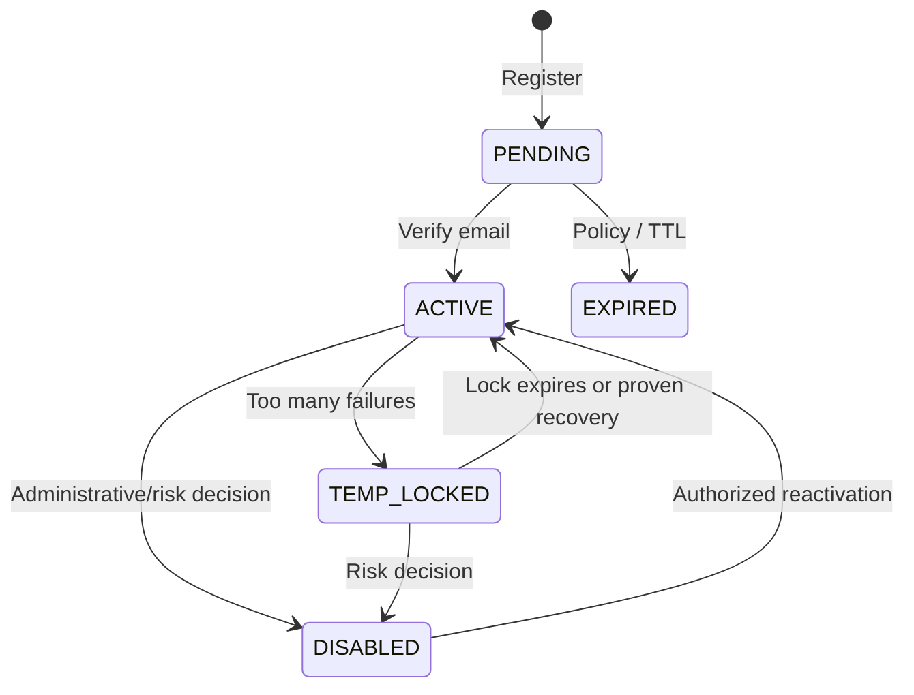
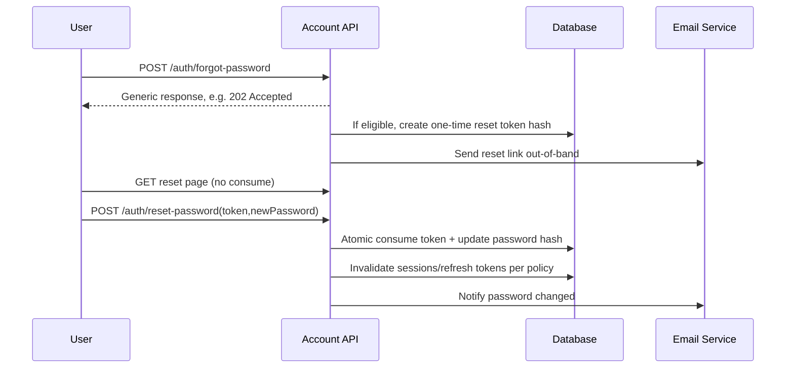

# Đăng ký, khôi phục tài khoản và khóa tạm thời: trách nhiệm của ứng dụng

> **Ngữ cảnh:** Spring Boot 3.x, Spring Security 6.x, Spring MVC/Servlet stack, Java 17+. Bài này phân biệt khả năng sẵn có của Spring Security với nghiệp vụ do ứng dụng phải tự xây dựng trong **vòng đời tài khoản**: đăng ký, xác minh email, khôi phục mật khẩu và khóa đăng nhập tạm thời. Ví dụ chạy được bên dưới minh họa bằng bộ nhớ/console, không phải hệ thống danh tính dùng ngay trong production.

## 1. Ranh giới trách nhiệm

Spring Security cung cấp những **primitive** cho xác thực/phân quyền: servlet filters, `AuthenticationManager`/`AuthenticationProvider`, `DaoAuthenticationProvider`, `UserDetailsService`, `PasswordEncoder`, `SecurityContext`, kiểm tra trạng thái account, session integration và hooks cho authentication thành công/thất bại.

Nhưng **chỉ thêm Spring Security starter không tự tạo chức năng signup, kích hoạt email, forgot password, tạo reset token, gửi email, đếm số lần sai và khóa 15 phút**. Những quy trình đó phải do **ứng dụng** triển khai hoặc ủy quyền rõ ràng cho identity provider (IdP).

| Bài toán | Spring Security cung cấp | Ứng dụng hoặc IdP phải làm |
|---|---|---|
| Đăng nhập bằng password | Provider, PasswordEncoder, filters | Nguồn user/hash; policy tài khoản và phát hiện lạm dụng |
| Đăng ký | Primitive encoder và HTTP security | API, validation, unique, hồ sơ pending, email verification |
| Xác minh email | Có thể hỗ trợ kiểm tra account flags | Token verify, gửi link, TTL, single-use, cập nhật `emailVerifiedAt` |
| Quên/đặt lại password | PasswordEncoder, session/token hooks | Token reset riêng, giao nhận, cập nhật hash, thông báo, thu hồi truy cập |
| Khóa do sai password | `isAccountNonLocked()`, `LockedException` | Failed-login counter, `lockedUntil`, unlock policy, rate limiting |
| Vô hiệu hóa tài khoản | `isEnabled()`, `DisabledException` | Lý do/quy trình disable, ai có quyền mở lại |
| Thu hồi phiên và token | Session/logout features | Refresh token revocation, invalidation, JWT versioning |

**Phân biệt:** Spring Security kiểm soát request đến controller; ứng dụng chịu trách nhiệm tính đúng đắn của account lifecycle và state persist. Nếu dùng OIDC/IdP, các bước signup/reset có thể nằm ở IdP; ứng dụng vẫn phải hiểu ranh giới, quyền tài nguyên và xử lý phiên.

## 2. Mô hình trạng thái và dữ liệu



**PENDING** không nên được coi là tài khoản đã chứng minh quyền sở hữu email. **TEMP_LOCKED** do sai password có thời hạn; **DISABLED** do gian lận/quản trị có thể cần xử lý riêng. Đặt lại password có thể được phép xóa khóa tạm, nhưng không nên tự khôi phục disabled do rủi ro.

### Các trường dữ liệu nên có

| Trường | Mục đích | Ràng buộc |
|---|---|---|
| `id`, `emailNormalized`, `emailVerifiedAt` | Danh tính và xác minh | **UNIQUE tại database**, không chỉ `existsByEmail` |
| `passwordHash`, `passwordChangedAt` | Đăng nhập và đổi password | Không lưu plaintext hay mã hóa đảo ngược |
| `enabled`/`status`, `disabledReason` | Trạng thái account | Không gộp tất cả lý do thành một boolean khó hiểu |
| `failedLoginCount`, `lockedUntil` | Tạm khóa | Atomic update khi có nhiều threads/replicas |
| `tokenHash`, `purpose`, `expiresAt`, `consumedAt` | Verify/reset | Token có entropy cao, TTL, purpose và single-use |
| `securityVersion`/`passwordChangedAt` | Thu hồi quyền truy cập cũ | Phối hợp session và bearer/refresh tokens |

Ví dụ migration minh họa (điều chỉnh theo DBMS):

```sql
CREATE TABLE app_users (
    id BIGINT GENERATED ALWAYS AS IDENTITY PRIMARY KEY,
    email_normalized VARCHAR(320) NOT NULL UNIQUE,
    password_hash VARCHAR(255) NOT NULL,
    email_verified_at TIMESTAMP NULL,
    enabled BOOLEAN NOT NULL DEFAULT TRUE,
    failed_login_count INTEGER NOT NULL DEFAULT 0,
    locked_until TIMESTAMP NULL,
    password_changed_at TIMESTAMP NOT NULL,
    security_version BIGINT NOT NULL DEFAULT 0
);

CREATE TABLE account_grants (
    id BIGINT GENERATED ALWAYS AS IDENTITY PRIMARY KEY,
    user_id BIGINT NOT NULL REFERENCES app_users(id),
    purpose VARCHAR(32) NOT NULL,
    token_hash CHAR(64) NOT NULL UNIQUE,
    expires_at TIMESTAMP NOT NULL,
    consumed_at TIMESTAMP NULL
);
```

Đây là DDL ý tưởng, không phải migration production hoàn chỉnh. Email normalization phải theo chính sách rõ ràng và nhất quán; không tự động xóa dấu chấm/alias theo một nhà cung cấp mail bất kỳ. UNIQUE index là tuyến phòng thủ chống hai request đăng ký cùng email cùng lúc.

## 3. Đăng ký và xác minh email

### Quy trình khuyến nghị

1. `POST /auth/register` nhận email/password qua **HTTPS**. Kiểm tra format, body size, password policy, breach screening phù hợp và rate limit. Không bỏ qua server-side validation.
2. Chuẩn hóa email; tạo account **PENDING**, lưu `PasswordEncoder.encode(password)`. Không cấp quyền nghiệp vụ nhạy cảm trước khi email verified.
3. Sinh verification token bằng `SecureRandom` (thường **256 bit entropy**), lưu **hash token** cùng `VERIFY_EMAIL`, account ID và `expiresAt`. Raw token chỉ dùng để tạo link/OTP gửi đúng email.
4. Gửi email qua provider. Dùng transaction kết hợp queue/outbox và retry phù hợp để tránh đã ghi token nhưng không gửi được email. Không log token.
5. Người dùng mở trang xác minh và chủ động xác nhận bằng **POST**; backend kiểm tra purpose, TTL, single-use, trạng thái rồi atomic consume token và cập nhật `emailVerifiedAt`.
6. Token sai, hết hạn hoặc đã dùng thì từ chối mà không làm thay đổi account. Gửi lại token theo policy, có cooldown/rate limiting.
7. Khi email đã verify, trạng thái account có thể chuyển ACTIVE; từ đây provider xác thực mới cho đăng nhập như policy định nghĩa.

**Tại sao GET link không nên tự consume?** Email scanners, browser prefetch và gateway bảo mật có thể “click” URL trước người dùng. GET nên hiển thị form xác nhận, POST mới thay đổi state. Không đưa raw token vào logs, analytics, Referer của third-party; dùng `Referrer-Policy: no-referrer` khi thích hợp.

### Chống user enumeration

Nếu đăng ký email đã tồn tại hoặc yêu cầu gửi lại email, response có thể dùng thông điệp chung như “Nếu hợp lệ, hướng dẫn sẽ được gửi”. Một hệ thống trả status/message giống nhau nhưng timing/rate limit khác biệt vẫn có thể làm lộ sự tồn tại tài khoản. Cân nhắc UX, chống abuse và threat model đồng thời.

**Vai trò `UserDetails.isEnabled()`:** ứng dụng có thể trả true khi account được enabled **và** đã xác minh email. `DaoAuthenticationProvider` kiểm tra trạng thái này, nhưng không tự gửi email, phát token hay cập nhật DB.

## 4. Khôi phục mật khẩu: không gửi password cũ



Các yêu cầu cốt lõi:

- `POST /auth/forgot-password` trả **cùng lớp response** cho email tồn tại và không tồn tại, chẳng hạn `202 Accepted`, không tiết lộ account.
- Token reset phải **khác** verification token/access token, đủ ngẫu nhiên, gắn `RESET_PASSWORD`, account ID, TTL ngắn (ví dụ 20 phút), single-use. Chỉ lưu digest của token trong DB.
- Giới hạn số email reset theo IP/email/device/account; không gửi mật khẩu mới, mật khẩu cũ hoặc token qua log.
- GET có thể mở form, nhưng **POST** mới consume token và đổi password. Đối với flow cookie/session, cần CSRF phù hợp.
- **Trong một transaction/atomic operation**, kiểm tra token còn hạn/chưa dùng/đúng purpose, đánh dấu đã dùng và đổi `passwordHash` + `passwordChangedAt`. Hai requests đồng thời dùng cùng token không được cùng thành công.
- Sau reset, thu hồi session/refresh token theo policy, tăng `securityVersion` nếu hệ thống kiểm tra version; gửi thông báo không chứa secret tới kênh đã xác minh.
- Reset có thể mở khóa **tạm thời vì sai password** nếu policy cho phép; không tự kích hoạt account disabled do rủi ro.
- Với account quan trọng, recovery qua email đơn lẻ có thể chưa đủ: cần MFA/recovery codes, step-up, chứng minh sở hữu bổ sung hoặc quy trình hỗ trợ.

**Vì sao SHA-256 cho reset token nhưng bcrypt/Argon2 cho password?** Reset token là secret 256-bit entropy do server sinh; hash nhanh của token ngẫu nhiên giúp DB không lưu plaintext token. Password do con người chọn thường dễ đoán hơn và cần password KDF chậm + salt. Không dùng SHA-256 thuần cho password. Token mục đích này không được dùng ở endpoint mục đích khác.

## 5. Khóa tài khoản tạm thời sau đăng nhập sai

Một chính sách ví dụ: sau **5 lần password sai liên tiếp**, đặt `lockedUntil = now + 15 phút`. Trong thời gian `now < lockedUntil`, từ chối login ngay cả khi người dùng nhập password đúng. Hết hạn thì được thử lại theo policy. Thành công reset failed count; reset password hợp lệ có thể xóa khóa nếu được phép.

Spring Security chỉ cung cấp các trạng thái và cách thi hành chúng:

```java
boolean isEnabled();
boolean isAccountNonLocked();
boolean isAccountNonExpired();
boolean isCredentialsNonExpired();
```

`DaoAuthenticationProvider` kiểm tra `isAccountNonLocked()` và có thể ném `LockedException`. **Nó không tự đếm failed logins hay đặt thời điểm mở khóa.** Ứng dụng sở hữu `failedLoginCount`/`lockedUntil` và cách cập nhật chúng.

### Nối trạng thái với Servlet authentication

- Form login: có thể dùng `AuthenticationFailureHandler`/`AuthenticationSuccessHandler` hoặc `AuthenticationEventPublisher`/listener được cấu hình đúng.
- HTTP Basic/custom auth: có thể dùng hooks khác, tùy filter và manager; phải đo đúng **một authentication attempt**.
- Đừng đếm mọi `401`: thiếu Authorization header, token hết hạn hay scheme khác không nhất thiết là lần sai password.
- `403` có thể do thiếu role/CSRF; không phải password thất bại.
- `LockedException`/`DisabledException` không nên tự tăng failed-password counter.
- Nếu đã dùng failure handler, không vô tình đếm lần nữa bằng event listener.
- Với username không tồn tại, cần rate limiting/monitoring theo nguồn và chống enumeration chứ không có account ID để khóa.

### Chống lợi dụng lockout thành DoS

Nếu attacker có thể khóa bất kỳ người dùng chỉ bằng 5 request sai, ứng dụng bị account-lockout DoS. Kết hợp adaptive rate limit theo IP, tài khoản, thiết bị/mạng, risk signals, CAPTCHA/MFA ở ngưỡng phù hợp, telemetry và con đường recovery đáng tin. Cân nhắc không tiết lộ chính xác account có tồn tại/đang locked qua response.

`401` thường phù hợp credential sai/thiếu, `429 Too Many Requests` cho hạn mức API; `423 Locked` có thể làm lộ account status. Chọn HTTP contract theo threat model chứ không đồng nhất “locked” với HTTP status.

## 6. Thiết kế các endpoint Servlet

| Endpoint minh họa | Yêu cầu authentication trước | Bổ sung cần thiết |
|---|---|---|
| `POST /auth/register` | Public | Validate, uniqueness, hash, pending, rate limit |
| `POST /auth/resend-verification` | Public hoặc session giới hạn | Generic response, cooldown, token TTL |
| `GET /auth/verify-email` | Public | Chỉ hiển thị form, không consume token |
| `POST /auth/verify-email` | One-time token | Purpose/TTL/atomic consume |
| `POST /auth/forgot-password` | Public | Anti-enumeration, token reset, throttle |
| `GET /auth/reset-password` | Public | Trang đổi password, no-referrer |
| `POST /auth/reset-password` | One-time token | Atomic reset và revoke sessions |
| `POST /auth/login` | Public | Authenticate, count failures, lockout |
| `POST /auth/logout` | Session/auth theo cơ chế | Invalidate/revoke |
| `GET /me` | Authenticated | Authorization và lọc dữ liệu nhạy cảm |

Public **không** có nghĩa bỏ qua bảo vệ CSRF, rate limit, input validation hay HTTP security filters. Nếu dùng cookie-based browser login, giữ CSRF; API bearer thuần có threat model riêng. Đừng tắt CSRF toàn ứng dụng chỉ để các POST công khai “chạy được”.

Đoạn cấu hình authorization sau **chỉ minh họa trong một method của `SecurityFilterChain`**, không phải ứng dụng độc lập:

```java
@Bean
SecurityFilterChain securityFilterChain(HttpSecurity http) throws Exception {
    return http
            .authorizeHttpRequests(auth -> auth
                    .requestMatchers(HttpMethod.POST,
                            "/auth/register",
                            "/auth/resend-verification",
                            "/auth/verify-email",
                            "/auth/forgot-password",
                            "/auth/reset-password").permitAll()
                    .requestMatchers(HttpMethod.GET,
                            "/auth/verify-email",
                            "/auth/reset-password").permitAll()
                    .anyRequest().authenticated())
            .formLogin(Customizer.withDefaults())
            .build();
}
```

Cần các imports của `@Bean`, `HttpSecurity`, `SecurityFilterChain`, `HttpMethod`, `Customizer`. `permitAll()` không tự tạo controller, không thực hiện đăng ký hoặc khôi phục. `formLogin` mặc định xử lý `POST /login`; nếu chọn `POST /auth/login` thì cấu hình `loginProcessingUrl("/auth/login")` và hooks tương ứng, không tưởng rằng permitAll tạo ra endpoint đó.

## 7. Ví dụ Java 17+ chạy được: lifecycle trong một JVM

Ví dụ dùng **Spring Boot 3.x console** và `spring-security-crypto`. Ta quan sát: hash password bằng BCrypt, đăng ký chờ verify, token verify/reset 256-bit, token hash/TTL/single-use, khóa tạm sau 3 lần sai và mở khóa khi reset hợp lệ. Không có email thật, DB, HTTP server hay session.

### 7.1. Chuẩn bị

Tạo Spring Boot 3.x Java 17+ Gradle project từ Spring Initializr. Giữ plugins/repositories/Boot version do Initializr tạo; block `dependencies` của `build.gradle`:

```groovy
dependencies {
    implementation 'org.springframework.boot:spring-boot-starter'
    implementation 'org.springframework.security:spring-security-crypto'
}
```

Không cần Spring Web vì `WebApplicationType.NONE`. Tạo một file **`src/main/java/com/example/demo/AccountLifecycleLabApplication.java`** như dưới đây.

### 7.2. Mã nguồn hoàn chỉnh

```java
package com.example.demo;

import java.nio.charset.StandardCharsets;
import java.security.MessageDigest;
import java.security.NoSuchAlgorithmException;
import java.security.SecureRandom;
import java.time.Clock;
import java.time.Duration;
import java.time.Instant;
import java.util.ArrayList;
import java.util.Base64;
import java.util.HashMap;
import java.util.HexFormat;
import java.util.List;
import java.util.Locale;
import java.util.Map;

import org.springframework.boot.CommandLineRunner;
import org.springframework.boot.SpringApplication;
import org.springframework.boot.WebApplicationType;
import org.springframework.boot.autoconfigure.SpringBootApplication;
import org.springframework.context.annotation.Bean;
import org.springframework.security.crypto.bcrypt.BCryptPasswordEncoder;
import org.springframework.security.crypto.password.PasswordEncoder;

@SpringBootApplication
public class AccountLifecycleLabApplication {
    public static void main(String[] args) {
        SpringApplication app =
                new SpringApplication(AccountLifecycleLabApplication.class);
        app.setWebApplicationType(WebApplicationType.NONE);
        app.run(args).close();
    }

    @Bean
    CommandLineRunner exercise() {
        return args -> {
            DemoInbox inbox = new DemoInbox();
            AccountService accounts = new AccountService(
                    new BCryptPasswordEncoder(), new SecureRandom(),
                    Clock.systemUTC(), inbox);
            String email = "learner@example.test";

            System.out.println("register=" +
                    accounts.register(email, "StartPassword#2026"));
            System.out.println("loginBeforeVerify=" +
                    accounts.login(email, "StartPassword#2026"));

            String verifyToken = inbox.latest(Kind.VERIFY);
            System.out.println("verify=" + accounts.verify(verifyToken));
            System.out.println("verifyReuse=" + accounts.verify(verifyToken));
            System.out.println("loginCorrect=" +
                    accounts.login(email, "StartPassword#2026"));

            for (int n = 1; n <= 3; n++) {
                System.out.println("wrong" + n + "=" +
                        accounts.login(email, "wrong-pass"));
            }
            System.out.println("locked=" + accounts.isLocked(email));
            System.out.println("correctDuringLock=" +
                    accounts.login(email, "StartPassword#2026"));

            System.out.println("forgot=" + accounts.forgot(email));
            String resetToken = inbox.latest(Kind.RESET);
            System.out.println("reset=" +
                    accounts.reset(resetToken, "ChangedPassword#2026"));
            System.out.println("resetReuse=" +
                    accounts.reset(resetToken, "AnotherPassword#2026"));
            System.out.println("lockedAfterReset=" +
                    accounts.isLocked(email));
            System.out.println("oldPassword=" +
                    accounts.login(email, "StartPassword#2026"));
            System.out.println("newPassword=" +
                    accounts.login(email, "ChangedPassword#2026"));
            System.out.println("forgotUnknown=" +
                    accounts.forgot("unknown@example.test"));
        };
    }

    enum Kind { VERIFY, RESET }
    record Grant(String email, Kind purpose, Instant expiresAt) {}
    record Mail(String email, Kind purpose, String rawToken) {}

    static final class DemoInbox {
        private final List<Mail> messages = new ArrayList<>();

        void send(String email, Kind purpose, String rawToken) {
            messages.add(new Mail(email, purpose, rawToken));
        }

        String latest(Kind purpose) {
            for (int i = messages.size() - 1; i >= 0; i--) {
                if (messages.get(i).purpose() == purpose) {
                    return messages.get(i).rawToken();
                }
            }
            throw new IllegalStateException("No message in demo inbox");
        }
    }

    static final class Account {
        final String email;
        String passwordHash;
        boolean verified;
        boolean enabled = true;
        int failedAttempts;
        Instant lockedUntil;

        Account(String email, String passwordHash) {
            this.email = email;
            this.passwordHash = passwordHash;
        }
    }

    static final class AccountService {
        private final Map<String, Account> users = new HashMap<>();
        private final Map<String, Grant> grants = new HashMap<>();
        private final PasswordEncoder encoder;
        private final SecureRandom random;
        private final Clock clock;
        private final DemoInbox inbox;

        AccountService(PasswordEncoder encoder, SecureRandom random,
                       Clock clock, DemoInbox inbox) {
            this.encoder = encoder;
            this.random = random;
            this.clock = clock;
            this.inbox = inbox;
        }

        synchronized String register(String rawEmail, String password) {
            String email = normalize(rawEmail);
            if (!users.containsKey(email)) {
                Account account = new Account(email, encoder.encode(password));
                users.put(email, account);
                issue(account, Kind.VERIFY, Duration.ofHours(24));
            }
            return "accepted";
        }

        synchronized boolean verify(String rawToken) {
            Grant grant = consume(rawToken, Kind.VERIFY);
            if (grant == null) return false;

            Account account = users.get(grant.email());
            if (account == null || !account.enabled) return false;
            account.verified = true;
            return true;
        }

        synchronized String forgot(String rawEmail) {
            Account account = users.get(normalize(rawEmail));
            if (account != null && account.enabled && account.verified) {
                issue(account, Kind.RESET, Duration.ofMinutes(20));
            }
            return "accepted";
        }

        synchronized boolean reset(String rawToken, String newPassword) {
            Grant grant = consume(rawToken, Kind.RESET);
            if (grant == null) return false;

            Account account = users.get(grant.email());
            if (account == null || !account.enabled || !account.verified) {
                return false;
            }
            account.passwordHash = encoder.encode(newPassword);
            account.failedAttempts = 0;
            account.lockedUntil = null;
            // Production: revoke sessions/refresh tokens transactionally.
            return true;
        }

        synchronized boolean login(String rawEmail, String password) {
            Account account = users.get(normalize(rawEmail));
            if (account == null || !account.enabled || !account.verified) {
                return false;
            }
            if (lockedNow(account)) return false;

            if (account.lockedUntil != null) {
                account.lockedUntil = null; // Lock expired
                account.failedAttempts = 0;
            }
            if (encoder.matches(password, account.passwordHash)) {
                account.failedAttempts = 0;
                return true;
            }
            account.failedAttempts++;
            if (account.failedAttempts >= 3) {
                account.lockedUntil =
                        clock.instant().plus(Duration.ofMinutes(15));
            }
            return false;
        }

        synchronized boolean isLocked(String rawEmail) {
            Account account = users.get(normalize(rawEmail));
            return account != null && lockedNow(account);
        }

        private boolean lockedNow(Account account) {
            return account.lockedUntil != null &&
                    clock.instant().isBefore(account.lockedUntil);
        }

        private void issue(Account account, Kind purpose, Duration ttl) {
            // One live token per account and purpose in this demo.
            grants.entrySet().removeIf(entry ->
                    entry.getValue().email().equals(account.email) &&
                    entry.getValue().purpose() == purpose);

            byte[] randomBytes = new byte[32]; // 256-bit token
            random.nextBytes(randomBytes);
            String rawToken = Base64.getUrlEncoder()
                    .withoutPadding().encodeToString(randomBytes);
            grants.put(digest(rawToken), new Grant(account.email, purpose,
                    clock.instant().plus(ttl)));
            inbox.send(account.email, purpose, rawToken);
        }

        private Grant consume(String rawToken, Kind expectedPurpose) {
            if (rawToken == null || rawToken.length() > 200) return null;
            String tokenHash = digest(rawToken);
            Grant grant = grants.get(tokenHash);
            if (grant == null || grant.purpose() != expectedPurpose ||
                    !clock.instant().isBefore(grant.expiresAt())) {
                return null;
            }
            grants.remove(tokenHash); // single-use within a JVM
            return grant;
        }

        private static String normalize(String email) {
            return email.trim().toLowerCase(Locale.ROOT);
        }

        private static String digest(String rawToken) {
            try {
                byte[] hash = MessageDigest.getInstance("SHA-256")
                        .digest(rawToken.getBytes(StandardCharsets.UTF_8));
                return HexFormat.of().formatHex(hash);
            } catch (NoSuchAlgorithmException ex) {
                throw new IllegalStateException(ex);
            }
        }
    }
}
```

**Giải thích ngắn các hàm:**

- `register` hash password bằng BCrypt, tạo pending và issue token verify; cùng thông điệp trả về cho email đã tồn tại.
- `verify` chỉ dùng được token `VERIFY` chưa hết hạn, một lần; `verifyReuse=false` chứng minh single-use.
- `forgot` chỉ tạo token reset cho account có email verified và enabled nhưng trả `"accepted"` cho cả email tồn tại/không tồn tại.
- `reset` consume token `RESET`, hash password mới và xóa khóa tạm **theo policy demo**. Không tự mở disabled.
- `login` từ chối khi chưa verified, disabled hoặc đang locked. Sau ba password sai liên tiếp, khóa 15 phút; password đúng trong thời gian này vẫn bị từ chối.
- `SecureRandom` tạo token 256 bit và `digest` lưu SHA-256 token hash; token thô chỉ ở `DemoInbox` phục vụ học tập. **Không tạo endpoint/public logs hiển thị token** trong hệ thống thật.

Trong ứng dụng Servlet thực tế, để đăng nhập hãy dùng `AuthenticationManager`/`DaoAuthenticationProvider` và gắn lifecycle hooks; **đừng sao chép phương thức `login` của demo như một hệ thống auth cạnh tranh với Spring Security**. Kho `HashMap` + `synchronized` chỉ phù hợp một JVM; production cần DB/Redis atomic updates, real mail provider, token revocation, audit, validation, rate limits và CSRF/session design.

### 7.3. Chạy và kiểm tra stdout

Từ thư mục chứa Gradle wrapper:

```bash
# macOS / Linux
./gradlew bootRun

# Windows PowerShell
.\gradlew.bat bootRun
```

Bỏ qua banner và log của Spring Boot, các dòng do `System.out.println` trong demo tạo ra **được kỳ vọng**:

```text
register=accepted
loginBeforeVerify=false
verify=true
verifyReuse=false
loginCorrect=true
wrong1=false
wrong2=false
wrong3=false
locked=true
correctDuringLock=false
forgot=accepted
reset=true
resetReuse=false
lockedAfterReset=false
oldPassword=false
newPassword=true
forgotUnknown=accepted
```

Đây là **output dự kiến**, không phải kết quả chạy thực tế trong môi trường tài liệu. Thứ tự thể hiện: không thể login trước verify; verify token và reset token dùng một lần; sai 3 lần thì khóa; password đúng không bypass lock; reset hợp lệ đổi password và xử lý lock; password cũ hết hiệu lực.

## 8. Đưa demo vào ứng dụng Servlet production: checklist

1. **Persistence và atomicity:** account unique index, token grants table với TTL/purpose/consumedAt, transaction hoặc compare-and-set. Hai reset requests đồng thời chỉ một request được consume token.
2. **Email service:** delivery/retry, verified sender, queue/outbox, không log raw token, không gửi password.
3. **Input validation:** request size, email normalization, password policy, breached password screening, account uniqueness.
4. **Abuse prevention:** rate limit signup/resend/forgot/login theo nhiều chiều, detection/challenge khi có rủi ro, tránh lockout DoS.
5. **Security integration:** `UserDetailsService` lấy account, `PasswordEncoder`/provider kiểm tra password, `isEnabled()` và `isAccountNonLocked()` phản ánh state mới nhất.
6. **Authentication event handling:** đếm đúng password attempts một lần, không đếm 401 thiếu credentials hay 403 CSRF; tránh trùng handler/event listener.
7. **Revoke access:** sau reset thay đổi `passwordChangedAt`/`securityVersion`, invalidation sessions, refresh tokens, logout-all-devices theo policy. JWT tự chứa không tự hết hạn chỉ vì đổi hash.
8. **Browser security:** HTTPS, CSRF cho cookie/session, `Secure`/`HttpOnly`/`SameSite` phù hợp, Referrer-Policy, chống clickjacking.
9. **Audit/notifications:** password changed, reset requested, account verified/locked/unlocked, retention an toàn, không ghi secrets.
10. **High-risk recovery:** MFA, recovery codes, step-up hoặc hỗ trợ thủ công khi email bị chiếm quyền hay account disabled bởi fraud policy.

## 9. Bảng kiểm thử quan trọng

| Tình huống | Kỳ vọng |
|---|---|
| Hai đăng ký cùng normalized email đồng thời | UNIQUE DB ngăn hai bản ghi |
| User chưa verify thử đăng nhập | Từ chối hoặc chỉ quyền onboarding hạn chế theo policy |
| Verify token hết hạn / sai / dùng lại | Không cập nhật emailVerifiedAt |
| Email scanner tự mở GET verify link | Không tự consume token |
| Forgot password với email có/không có | Generic response, không lộ account existence |
| Token verify dùng tại reset | Bị từ chối vì purpose khác |
| Hai POST reset đồng thời | Chỉ một atomic consume thành công |
| Password reset hợp lệ | Hash mới, token mất hiệu lực, xử lý sessions/tokens |
| Password sai liên tiếp | Counter tăng đúng, đạt ngưỡng tạo `lockedUntil` |
| Password đúng khi còn khóa | Vẫn từ chối theo policy |
| Hết khóa | Có thể thử lại theo policy; counter được xử lý nhất quán |
| Account disabled | Không tự mở lại qua TTL hoặc reset password |
| Multi-instance login failure | Counter đúng dù request chạy trên hai replicas |
| 401 / 403 / 429 | Không đếm sai password attempt và không gây enumeration |

Inject `Clock` trong service để test expiration/unlock, tránh `Thread.sleep` lâu. Kiểm tra transactions dưới concurrency thật, không suy ra một unit test trên `HashMap` bảo đảm tính đúng trên cluster.

## 10. Những hiểu nhầm phổ biến

- “Spring Security starter tự có API signup/forgot-password.” **Sai:** đó là workflow của ứng dụng hoặc IdP.
- “`PasswordEncoder` kiểm tra password mạnh hay yếu.” **Sai:** nó encode/matches; password policy là phần riêng.
- “`isAccountNonLocked()` tự đếm sai và mở khóa.” **Sai:** app cập nhật counter và deadline.
- “Mọi 401/403 đều là failed-login.” **Sai:** 403 thường liên quan authorization/CSRF; 401 có thể do thiếu credentials.
- “Email verification token có thể dùng làm reset password token.” **Sai:** tách purpose và kiểm tra rõ.
- “Password hash nên SHA-256 vì reset token cũng SHA-256.” **Sai:** password cần password KDF chậm; token ngẫu nhiên entropy cao có thể dùng digest.
- “GET verification link tự thay đổi state luôn.” **Không nên:** link scanners có thể prefetch.
- “Reset password tự vô hiệu hóa mọi JWT.” **Sai:** cần session/token revocation hoặc versioning.
- “Khóa cứng sau 5 lần sai luôn an toàn.” **Chưa đủ:** dễ bị kẻ xấu biến thành account-lockout DoS.
- “`synchronized`/Map đủ cho production.” **Sai:** không bảo vệ nhiều tiến trình/replicas.

## 11. Tự kiểm tra

**Câu 1.** Sau khi user đăng ký, Spring Security có tự gửi verification mail không?  
**Đáp án:** Không. Ứng dụng/IdP phải phát token, gửi mail, quản lý thời hạn, tiêu thụ một lần và xác minh.

**Câu 2.** Vì sao lưu reset token hash nhưng password dùng BCrypt?  
**Đáp án:** Token 256-bit do server sinh rất khó đoán; password người dùng có thể yếu nên cần KDF chậm, salt và policy.

**Câu 3.** Nếu password đúng nhưng `lockedUntil` chưa hết thì sao?  
**Đáp án:** Theo chính sách khóa tạm, vẫn từ chối. Unlock bằng TTL hoặc recovery đủ tin cậy.

**Câu 4.** Vì sao không đếm mọi response 403 vào `failedLoginCount`?  
**Đáp án:** 403 có thể là thiếu quyền/CSRF, không phải kiểm tra password thất bại.

**Câu 5.** Sau reset, còn refresh tokens/JWT cũ thì sao?  
**Đáp án:** Ứng dụng phải có cơ chế thu hồi/version/expiration; thay password hash không tự hủy tất cả tokens.

**Câu 6.** Hai requests reset đồng thời dùng cùng token?  
**Đáp án:** Database cần atomic consume, chỉ cho một thành công.

## 12. Tổng kết

**Registration:** validate → account pending + password hash → verify token riêng → email verification → active.  
**Recovery:** public response chung → reset token entropy cao, TTL, single-use → atomic password update → revoke/notify.  
**Lockout:** count đúng password failures → `lockedUntil` → unlock theo policy → kết hợp rate limiting, monitoring và recovery.

**Nguyên tắc:** Spring Security cung cấp cơ chế xác thực/ủy quyền; **ứng dụng phải chịu trách nhiệm thiết kế và vận hành an toàn toàn bộ vòng đời tài khoản**.