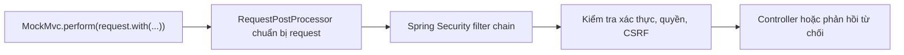

# SecurityMockMvcRequestPostProcessors và phạm vi tác động

Trong Spring Security Testing, **danh tính trên yêu cầu** (request identity) là danh tính mà hệ thống bảo mật nhìn thấy khi xử lý **một HTTP request cụ thể**. `SecurityMockMvcRequestPostProcessors` thuộc thư viện `spring-security-test` giúp chuẩn bị danh tính, thông tin xác thực hoặc các giá trị bảo mật ngay tại lời gọi `MockMvc.perform(...)`. Nhờ đó, ta có thể kiểm chứng quy tắc xác thực, phân quyền và bảo vệ HTTP của ứng dụng Servlet mà không phải đi qua toàn bộ quá trình đăng nhập thật ở mỗi ca kiểm thử.

Bài này tập trung vào **`SecurityMockMvcRequestPostProcessors` và phạm vi tác động của từng cách giả lập**. Đây là công cụ dành cho `MockMvc`/Servlet; với ứng dụng Reactive sử dụng `WebTestClient`, Spring Security cung cấp bộ hỗ trợ kiểm thử khác. Hiểu đúng điểm này giúp tránh những ca kiểm thử xanh nhưng không thực sự kiểm tra điều người viết kỳ vọng.

## 1. RequestPostProcessor thay đổi điều gì?

`RequestPostProcessor` là giao diện của Spring MVC Test, được `MockMvc` gọi để điều chỉnh `MockHttpServletRequest` trước khi request đi qua bộ lọc và controller. Spring Security bổ sung các bộ xử lý chuyên dụng, có thể sử dụng bằng `.with(...)`:

```java
import static org.springframework.security.test.web.servlet.request.SecurityMockMvcRequestPostProcessors.*;
import static org.springframework.test.web.servlet.request.MockMvcRequestBuilders.*;
import static org.springframework.test.web.servlet.result.MockMvcResultMatchers.*;

mockMvc.perform(get("/api/profile").with(user("alice").roles("USER")))
       .andExpect(status().isOk());
```

Ở ví dụ này, `user("alice").roles("USER")` chuẩn bị một người dùng **đã được xác thực trong ngữ cảnh kiểm thử**, để filter chain và controller có thể thấy danh tính `alice`. Điều đó **không có nghĩa** Spring Security vừa nhận mật khẩu của Alice, kiểm tra cơ sở dữ liệu người dùng hoặc thực hiện đăng nhập HTTP thật.

Mô hình xử lý có thể hình dung như sau:



**Điều kiện quan trọng:** cơ chế đưa `SecurityContext` giả lập vào quá trình xử lý cần tích hợp Spring Security với `MockMvc`. Trong Spring Boot, `@AutoConfigureMockMvc` thường tự cấu hình filter chain từ ứng dụng; khi dựng `MockMvc` thủ công, phải áp dụng `springSecurity()` hoặc cấu hình bộ lọc thích hợp. Việc thêm `.with(user(...))` vào một `MockMvc` không chạy security filter **không** chứng minh rằng endpoint được bảo vệ.

## 2. Phân loại API theo phạm vi tác động

Các phương thức dưới đây là thành viên thường dùng của `SecurityMockMvcRequestPostProcessors` (package `org.springframework.security.test.web.servlet.request`). Chúng cùng xuất hiện trong `.with(...)`, nhưng không mô phỏng cùng một bước bảo mật.

| Bộ xử lý | Tác động chính đối với request | Không chứng minh được điều gì? |
| --- | --- | --- |
| `user("alice")`, `user(UserDetails)` | Tạo danh tính người dùng với `Authentication` giả lập; tùy chỉnh `roles(...)`, `authorities(...)` | Không kiểm tra mật khẩu, `UserDetailsService` hoặc luồng đăng nhập thật |
| `anonymous()` | Biểu diễn request vô danh, kể cả khi bài test có danh tính mặc định | Không mô phỏng đăng xuất hoặc xóa phiên đăng nhập trên máy chủ |
| `authentication(authentication)` | Dùng trực tiếp một đối tượng `Authentication` do test tạo | Không chứng minh đối tượng đó được sinh ra từ cơ chế xác thực thực tế |
| `securityContext(context)` | Đưa một `SecurityContext` do test cung cấp vào request | Không tự kiểm tra vòng đời lưu/khôi phục context trong phiên HTTP |
| `httpBasic(username, password)` | Thêm header HTTP `Authorization: Basic ...` | Không tự xác thực; cần filter chain và cấu hình HTTP Basic thực sự xử lý header |
| `csrf()` | Thêm CSRF token hợp lệ theo hỗ trợ của môi trường test; có `asHeader()`, `useInvalidToken()` | Không thay thế kiểm tra thực tế của `CsrfFilter`; chỉ có ý nghĩa khi CSRF được bật và áp dụng cho request |
| `jwt()` | Chuẩn bị `JwtAuthenticationToken` giả lập, có thể chỉ định claims và authorities | Không kiểm tra chữ ký JWT, issuer, audience hay quy trình giải mã token thật |
| `opaqueToken()` | Chuẩn bị danh tính dạng opaque bearer token đã được xác thực | Không gọi dịch vụ introspection thực tế |
| `oauth2Login()` | Giả lập người dùng đã đăng nhập bằng OAuth2 Login | Không chạy redirect, authorization code flow hoặc trao đổi token với provider |
| `oidcLogin()` | Giả lập người dùng OpenID Connect và thông tin ID Token | Không chứng minh ID Token đã được provider ký và kiểm chứng |
| `oauth2Client()` | Chuẩn bị dữ liệu OAuth2 authorized client cho request | Không kiểm chứng luồng cấp phát hoặc làm mới access token |
| `x509()` | Cung cấp chứng chỉ X.509 cho request phục vụ kiểm thử xác thực chứng chỉ | Không kiểm tra toàn bộ TLS handshake hoặc niềm tin của hạ tầng mạng |

Hai nhóm cần phân biệt:

- **Giả lập trạng thái đã xác thực:** `user`, `authentication`, `securityContext`, `jwt`, `opaqueToken`, `oauth2Login`, `oidcLogin`. Phù hợp để kiểm tra **quy tắc truy cập sau xác thực** theo principal, role, authority hoặc claim.
- **Tạo đầu vào để cơ chế bảo mật xử lý:** `httpBasic` cung cấp header Basic; `csrf` cung cấp CSRF token. Với những trường hợp này, kết quả còn phụ thuộc vào filter chain và cấu hình bảo mật tương ứng.

`anonymous()` là công cụ để kiểm tra hành vi khi **không có danh tính đăng nhập**; `oauth2Client()` phục vụ ngữ cảnh OAuth2 client và không đồng nghĩa một người dùng đã đăng nhập.

## 3. Chuẩn bị MockMvc để kiểm tra bảo mật thật trong ứng dụng Servlet

Với dự án sử dụng Maven, dependency phục vụ test thường là:

```xml
<dependency>
    <groupId>org.springframework.security</groupId>
    <artifactId>spring-security-test</artifactId>
    <scope>test</scope>
</dependency>
```

Trong Spring Boot đã sử dụng `spring-boot-starter-security`, có thể inject `MockMvc` như sau:

```java
@SpringBootTest
@AutoConfigureMockMvc
class DocumentSecurityTests {
    @Autowired MockMvc mockMvc;
}
```

Nếu tạo `MockMvc` bằng builder để kiểm soát việc ghép security vào test:

```java
@Autowired WebApplicationContext webContext;

MockMvc mockMvc = MockMvcBuilders.webAppContextSetup(webContext)
        .apply(springSecurity())
        .build();
```

Import tĩnh cho cấu hình này:

```java
import static org.springframework.security.test.web.servlet.setup.SecurityMockMvcConfigurers.springSecurity;
```

`springSecurity()` ghép `FilterChainProxy` cùng hỗ trợ truyền `SecurityContext` từ test vào request. Khi chỉ dùng `standaloneSetup(controller)` mà không gắn security filter phù hợp, test vẫn có thể trả `200` dù endpoint lẽ ra cần xác thực. Tương tự, `@AutoConfigureMockMvc(addFilters = false)` loại các servlet filter ra khỏi quá trình kiểm thử, nên không thích hợp để kết luận về HTTP security.

**Phạm vi một lời gọi:** `.with(...)` áp dụng lên request được xây dựng cho lần `perform(...)` đó. Nó không mặc nhiên đăng nhập toàn cục, sửa user trong database, lưu token trình duyệt hoặc đảm bảo request kế tiếp còn cùng danh tính. Có thể cấu hình danh tính mặc định bằng `MockMvcBuilders.defaultRequest(...)` cho nhiều request, nhưng đó là một lựa chọn của bộ test, không phải một phiên đăng nhập vừa được tạo ra ở hệ thống. Không suy diễn về khả năng lưu `SecurityContext` giữa các request nếu chưa kiểm tra riêng cơ chế session và context repository.

## 4. Một ví dụ đầy đủ: xác thực, role và CSRF

Giả sử ứng dụng có endpoint đọc tên người dùng và một endpoint xóa tài liệu. Cấu hình sau yêu cầu đã đăng nhập để xem hồ sơ, quyền `ADMIN` để xóa và bật HTTP Basic. CSRF vẫn được giữ theo cấu hình mặc định của Spring Security.

```java
@Configuration
@EnableWebSecurity
class ApiSecurityConfig {
    @Bean
    SecurityFilterChain securityFilterChain(HttpSecurity http) throws Exception {
        return http
            .authorizeHttpRequests(auth -> auth
                .requestMatchers(HttpMethod.GET, "/api/documents/me").authenticated()
                .requestMatchers(HttpMethod.DELETE, "/api/documents/**").hasRole("ADMIN")
                .anyRequest().denyAll())
            .httpBasic(Customizer.withDefaults())
            .build();
    }
}

@RestController
class DocumentController {
    @GetMapping("/api/documents/me")
    String currentUser(Authentication authentication) {
        return authentication.getName();
    }

    @DeleteMapping("/api/documents/{id}")
    ResponseEntity<Void> deleteDocument(@PathVariable long id) {
        return ResponseEntity.noContent().build();
    }
}
```

Ở đây controller xóa chỉ là ví dụ, chưa thao tác cơ sở dữ liệu. Các bài test dùng `@SpringBootTest` và `@AutoConfigureMockMvc` trên ứng dụng có hai thành phần này:

```java
@SpringBootTest
@AutoConfigureMockMvc
class DocumentSecurityTests {
    @Autowired MockMvc mockMvc;

    @Test
    void anonymousUserCannotReadProfile() throws Exception {
        mockMvc.perform(get("/api/documents/me").with(anonymous()))
            .andExpect(status().isUnauthorized()); // 401 với HTTP Basic
    }

    @Test
    void knownUserCanReadOwnIdentity() throws Exception {
        mockMvc.perform(get("/api/documents/me")
                    .with(user("alice").roles("USER")))
            .andExpect(status().isOk())
            .andExpect(content().string("alice"));
    }

    @Test
    void ordinaryUserCannotDeleteEvenWithValidCsrf() throws Exception {
        mockMvc.perform(delete("/api/documents/42")
                    .with(user("alice").roles("USER"))
                    .with(csrf()))
            .andExpect(status().isForbidden()); // 403 vì thiếu ROLE_ADMIN
    }

    @Test
    void adminWithoutCsrfCannotDelete() throws Exception {
        mockMvc.perform(delete("/api/documents/42")
                    .with(user("admin").roles("ADMIN")))
            .andExpect(status().isForbidden()); // 403 do CSRF
    }

    @Test
    void adminWithCsrfCanDelete() throws Exception {
        mockMvc.perform(delete("/api/documents/42")
                    .with(user("admin").roles("ADMIN"))
                    .with(csrf()))
            .andExpect(status().isNoContent()); // 204
    }
}
```

Các import thường dùng cho ví dụ:

```java
import static org.springframework.security.test.web.servlet.request.SecurityMockMvcRequestPostProcessors.*;
import static org.springframework.test.web.servlet.request.MockMvcRequestBuilders.*;
import static org.springframework.test.web.servlet.result.MockMvcResultMatchers.*;

import org.junit.jupiter.api.Test;
import org.springframework.beans.factory.annotation.Autowired;
import org.springframework.boot.test.autoconfigure.web.servlet.AutoConfigureMockMvc;
import org.springframework.boot.test.context.SpringBootTest;
import org.springframework.security.core.Authentication;
import org.springframework.test.web.servlet.MockMvc;
```

Đọc ma trận kết quả theo **nguyên nhân**, không chỉ theo mã HTTP:

| Request | Danh tính | CSRF | Kết quả mong đợi trong ví dụ |
| --- | --- | --- | --- |
| `GET /api/documents/me` | `anonymous()` | Không cần | `401` do chưa đăng nhập, HTTP Basic yêu cầu xác thực |
| `GET /api/documents/me` | `user("alice")` | Không cần | `200`, trả tên `alice` |
| `DELETE /api/documents/42` | `USER` | Hợp lệ | `403` do thiếu role |
| `DELETE /api/documents/42` | `ADMIN` | Thiếu | `403` do CSRF |
| `DELETE /api/documents/42` | `ADMIN` | Hợp lệ | `204`, được phép xóa |

Mã `401` **không phải** kết quả cố định cho mọi ứng dụng có request vô danh: nếu cấu hình form login, request có thể nhận redirect đến trang đăng nhập (`302`); chi tiết còn phụ thuộc `AuthenticationEntryPoint`. Hai trường hợp `403` trong bảng có nguyên nhân khác nhau, vì thế cần thay đổi **một điều kiện tại một thời điểm** khi xác định quy tắc đang được kiểm tra.

## 5. `user`, `authentication`, `securityContext` và `@WithMockUser`

### `user(...)`: lựa chọn ngắn gọn cho kiểm tra role/authority

```java
mockMvc.perform(get("/api/reports")
        .with(user("analyst").roles("REPORT_VIEWER")));

mockMvc.perform(get("/api/reports")
        .with(user("analyst")
                .authorities(new SimpleGrantedAuthority("reports:read"))));
```

`roles("REPORT_VIEWER")` tạo authority `ROLE_REPORT_VIEWER` theo quy ước Spring Security; **không** thêm tiền tố `ROLE_` vào giá trị truyền cho `roles(...)`. Ngược lại, `authorities(...)` dùng nguyên chuỗi đã cung cấp, vì vậy `hasRole("REPORT_VIEWER")` và `hasAuthority("reports:read")` là hai quy tắc khác nhau.

`user(UserDetails)` có thể sử dụng principal với các trường tùy chỉnh khi endpoint truy xuất thông tin người dùng, nhưng vẫn là **đặt sẵn danh tính để test**. Nó không gọi dịch vụ tải user hoặc so khớp mật khẩu trên request đó.

### `authentication(...)` và `securityContext(...)`: kiểm soát chi tiết

Khi cần một loại `Authentication` riêng (ví dụ có principal đặc thù), có thể tự tạo và gắn vào request:

```java
Authentication auth = new TestingAuthenticationToken(
        "service-account", "unused", "ROLE_ADMIN");

mockMvc.perform(get("/api/documents/me").with(authentication(auth)))
       .andExpect(status().isOk())
       .andExpect(content().string("service-account"));
```

Khi test cần nhiều thuộc tính trong cùng một `SecurityContext`:

```java
SecurityContext context = SecurityContextHolder.createEmptyContext();
context.setAuthentication(new UsernamePasswordAuthenticationToken(
        "operator", "unused",
        List.of(new SimpleGrantedAuthority("ROLE_ADMIN"))));

mockMvc.perform(get("/api/documents/me").with(securityContext(context)))
       .andExpect(content().string("operator"));
```

Các cách này hữu ích khi kiểm thử logic dựa trên kiểu hoặc thuộc tính của principal. Tuy nhiên, vì test đã cấp một `Authentication` trực tiếp nên không thể kết luận rằng endpoint đăng nhập thật sinh ra được cùng loại `Authentication` đó.

### So với `@WithMockUser`

```java
@Test
@WithMockUser(username = "alice", roles = "ADMIN")
void canReadWithAnnotation() throws Exception {
    mockMvc.perform(get("/api/documents/me"))
           .andExpect(content().string("alice"));
}
```

`@WithMockUser` chuẩn bị `SecurityContext` ở **phạm vi phương thức hoặc lớp test** thông qua Spring Security Test execution listener. `.with(user(...))` chuẩn bị danh tính ở **phạm vi một request**. Chọn annotation khi nhiều request trong một test dùng cùng danh tính; chọn `.with(...)` khi một test cần đối chiếu nhiều vai trò/vô danh hoặc override danh tính của từng request. Cả hai đều cần tích hợp phù hợp để `MockMvc` sử dụng được context giả lập; cả hai đều không kiểm tra password login thực tế.

## 6. Bộ xử lý tạo đầu vào cho bộ lọc: HTTP Basic và CSRF

### `httpBasic(...)` kiểm tra đường đi xác thực bằng header

```java
mockMvc.perform(get("/api/documents/me")
        .with(httpBasic("alice", "correct-password")))
       .andExpect(status().isOk());
```

Khác với `user(...)`, `httpBasic(...)` chỉ mã hóa cặp username/password thành header HTTP Basic. Kết quả `200` ở đây **đòi hỏi** ứng dụng bật HTTP Basic và có `AuthenticationProvider`/`UserDetailsService` chấp nhận thông tin tương ứng. Nếu mật khẩu sai hoặc provider từ chối, kết quả thường là `401` trong cấu hình HTTP Basic. Dùng `user(...)` để kiểm tra quyết định phân quyền sau xác thực; dùng `httpBasic(...)` để kiểm tra đường vào xác thực Basic trong filter chain.

### `csrf()` kiểm tra bảo vệ request thay đổi trạng thái

```java
// Token hợp lệ trong tham số request.
mockMvc.perform(post("/api/items").with(csrf()));

// Token hợp lệ trong HTTP header.
mockMvc.perform(post("/api/items").with(csrf().asHeader()));

// Token cố ý không hợp lệ để kiểm tra bị chặn.
mockMvc.perform(post("/api/items").with(csrf().useInvalidToken()))
       .andExpect(status().isForbidden());
```

Thông thường, Spring Security áp dụng CSRF cho các phương thức có khả năng thay đổi trạng thái (`POST`, `PUT`, `PATCH`, `DELETE`) khi tính năng được bật; các phương thức an toàn như `GET` không cần token. `csrf()` không gán danh tính người dùng và không tự cho phép request vượt qua kiểm tra role. Nếu ứng dụng đã tắt CSRF hoặc loại trừ đường dẫn bằng matcher, test với token sai có thể **không** bị chặn vì CSRF; đó là kết quả của chính cấu hình cần được xác minh.

## 7. Danh tính JWT, opaque token, OAuth2 Login và OIDC

Các API này đặc biệt hữu ích khi mục tiêu là kiểm tra endpoint xử lý **quyền sau khi token hoặc đăng nhập đã được chấp nhận**.

### JWT cho OAuth2 Resource Server

Giả sử một endpoint `/api/reports` được bảo vệ bằng `hasAuthority("SCOPE_reports.read")`, và application có cấu hình `oauth2ResourceServer(...jwt...)` tương ứng:

```java
mockMvc.perform(get("/api/reports")
        .with(jwt()
            .jwt(token -> token.subject("alice")
                               .claim("tenant", "acme"))
            .authorities(new SimpleGrantedAuthority("SCOPE_reports.read"))))
       .andExpect(status().isOk());

mockMvc.perform(get("/api/reports")
        .with(jwt().authorities(
                new SimpleGrantedAuthority("SCOPE_reports.write"))))
       .andExpect(status().isForbidden());
```

Trong test này, `jwt()` đặt một `JwtAuthenticationToken` đã được chuẩn bị vào request. Nó cho phép kiểm tra quy tắc dựa trên `Authentication`, scope/authority và claims; **không** chứng minh chuỗi JWT đầu vào thật được giải mã, kiểm chữ ký hay chuyển scope thành authority đúng cách trong production. Nếu cần kiểm tra việc chuyển claims thành authorities, hãy test riêng `JwtAuthenticationConverter` hoặc luồng bearer token qua decoder phù hợp.

### Opaque token

```java
mockMvc.perform(get("/api/reports")
        .with(opaqueToken()
            .attributes(attributes -> attributes.put("sub", "alice"))
            .authorities(new SimpleGrantedAuthority("SCOPE_reports.read"))))
       .andExpect(status().isOk());
```

`opaqueToken()` mô phỏng một principal đã được xác thực qua opaque token; không liên lạc với máy chủ introspection. Khi cần kiểm tra lỗi introspection, cache hoặc tính hợp lệ token, phải kiểm thử đường xác thực thật với introspector được cấu hình cho bài test.

### OAuth2 Login và OIDC

```java
mockMvc.perform(get("/account")
        .with(oauth2Login()
            .attributes(attributes -> attributes.put("name", "Alice"))));

mockMvc.perform(get("/account")
        .with(oidcLogin()
            .idToken(token -> token.claim("email", "alice@example.test"))));
```

`oauth2Login()` chuẩn bị `OAuth2AuthenticationToken` của người dùng đăng nhập qua OAuth2; `oidcLogin()` chuẩn bị danh tính có thông tin OpenID Connect. Hai cách này phù hợp để kiểm tra controller và luật truy cập dựa trên OAuth2/OIDC principal. Chúng không kiểm tra redirect đến nhà cung cấp, callback, mã `authorization_code` hoặc việc xác minh ID Token thật. Nếu nghiệp vụ phụ thuộc OAuth2 authorized client để gọi API khác, `oauth2Client()` cung cấp ngữ cảnh client cho request; cần kiểm tra riêng luồng cấp/refresh token khi đó là mục tiêu.

**Lưu ý về cấu hình:** các ví dụ JWT/OAuth2/OIDC minh họa các ứng dụng có endpoint và cấu hình bảo mật tương ứng. Không thể thêm chúng vào bài test chỉ có cấu hình HTTP Basic ở mục 4 rồi mặc định mong đợi cùng kết quả. Bộ xử lý tạo đầu vào cho request; **quy tắc thực tế của ứng dụng** mới quyết định được phép hay bị từ chối.

## 8. Khi nào kiểm thử chưa đủ tin cậy?

Một ca test dùng request post-processor chủ yếu trả lời câu hỏi: *“Nếu request mang danh tính/thẩm quyền này và chạy qua cấu hình Spring Security của ứng dụng, hệ thống cho phép hay từ chối đúng chưa?”* Nó chưa chắc trả lời được: *“Người dùng có đăng nhập thật được không, token có hợp lệ không, phiên có được bảo vệ không?”*

| Dấu hiệu | Nguy cơ | Cách bổ sung kiểm chứng |
| --- | --- | --- |
| Tất cả test đều dùng `with(user("admin"))` | Không biết request vô danh hoặc thiếu quyền có bị từ chối không | Thêm `anonymous()` và vai trò không đủ quyền |
| Chỉ kiểm tra `status().isForbidden()` cho `POST`/`DELETE` | `403` có thể đến từ CSRF, không phải phân quyền | Thêm `with(csrf())` vào test phân quyền; test thiếu/sai CSRF riêng |
| `MockMvc` không chạy security filter | Response của controller có thể khiến test cho kết luận sai | Dùng `@AutoConfigureMockMvc` có filter hoặc `.apply(springSecurity())` |
| `jwt()` xanh nhưng token thật bị lỗi | Decoder/validator/converter chưa được test | Kiểm tra riêng decoder, converter, hoặc request Bearer thực qua filter |
| `httpBasic(...)` bị từ chối dù `user(...)` thành công | Đường vào xác thực thực tế bị cấu hình sai hoặc không có tài khoản hợp lệ | Kiểm tra `UserDetailsService`, `AuthenticationProvider`, encoding và filter |
| Endpoint có `@PreAuthorize` nhưng test không chạy method security | Test HTTP không kiểm tra được toàn bộ chính sách phân quyền | Bật `@EnableMethodSecurity` trong ngữ cảnh test và kiểm tra cả logic method |
| Một test gán nhiều danh tính mà không kiểm soát request | Có thể nhầm request nào sử dụng principal nào | Truyền `.with(...)` tường minh cho từng `perform(...)` |

Ngoài ra, Spring Security Test có các **result matchers** để kiểm tra trạng thái sau xử lý, như `authenticated()` và `unauthenticated()` trong `SecurityMockMvcResultMatchers`. Chúng có nhiệm vụ **xác nhận** kết quả; không phải `RequestPostProcessor` dùng để **gán** danh tính. Trong bài này, `status()` và `content()` là matcher của Spring MVC Test.

### Ranh giới Servlet và Reactive

`SecurityMockMvcRequestPostProcessors` hoạt động với `MockHttpServletRequest` của Servlet/`MockMvc`. Với Reactive WebFlux, sử dụng `WebTestClient` và các cấu hình giả lập dành cho nó, chẳng hạn `SecurityMockServerConfigurers.springSecurity()`, `mockUser()` hoặc `mockJwt()` trong `mutateWith(...)`. Không sao chép `.with(user(...))` của `MockMvc` sang `WebTestClient`: hai API có mô hình request và bộ kiểm thử khác nhau.

## 9. Quy trình chọn bộ xử lý trong thực hành

1. **Xác định điều cần chứng minh.** Nếu là *ai được phép truy cập*, ưu tiên `user()`, `anonymous()`, `jwt()` hoặc kiểu principal phù hợp. Nếu là *cơ chế đăng nhập HTTP Basic có hoạt động*, dùng `httpBasic()` với thông tin đăng nhập mà provider test nhận diện.
2. **Chạy request qua security filter chain thực sự.** Với `MockMvc` cần cấu hình Spring Security đúng, đồng thời giữ các quy tắc `authorizeHttpRequests`, CSRF và method security có liên quan.
3. **Phân tách các điều kiện.** Tạo các ca vô danh, thiếu authority, đủ authority và CSRF thiếu/sai/hợp lệ. Kiểm tra HTTP status cùng nội dung hoặc tác động nghiệp vụ khi cần.
4. **Không đánh đồng giả lập với tích hợp ngoài.** Dùng test riêng cho `UserDetailsService`, JWT decoder, OAuth2/OIDC login flow, introspection hoặc TLS client certificate nếu dự án cần đảm bảo các hành vi đó.
5. **Đối chiếu kết quả với cấu hình hiện hành.** Cùng request có thể nhận `401`, `302` hay `403` tùy `AuthenticationEntryPoint`, CSRF và cách ứng dụng xử lý truy cập bị từ chối.

Khi hiểu rõ **bộ xử lý nào đặt sẵn danh tính và bộ xử lý nào chỉ tạo dữ liệu đầu vào**, người học có thể viết những bài test Spring Security vừa nhanh vừa có giá trị: kiểm chứng đúng ranh giới xác thực, phân quyền và bảo vệ HTTP mà `MockMvc` thực sự đi qua, đồng thời biết lúc nào cần bổ sung kiểm thử tích hợp đầy đủ.
