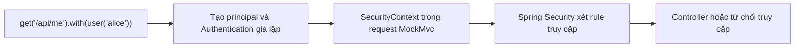

# `user()` với tên người dùng, mật khẩu giả lập và vai trò

Trong Spring Security Testing, nhiều bài kiểm thử cần trả lời một câu hỏi rất cụ thể: **nếu HTTP request được gửi bởi người dùng Alice có quyền `USER` hoặc `ADMIN`, ứng dụng sẽ cho phép hay từ chối?** Với ứng dụng Servlet dùng `MockMvc`, `SecurityMockMvcRequestPostProcessors.user(...)` giúp tạo danh tính đã xác thực ngay trên từng request. Ta chủ động đặt tên người dùng, mật khẩu giả lập và các vai trò để kiểm tra quy tắc truy cập mà không cần thực hiện đăng nhập thật cho mỗi kịch bản.

Đây là một phần quan trọng của module `SPRING_SECURITY_TESTING`: dùng `spring-security-test` để kiểm chứng xác thực, phân quyền và bảo vệ HTTP. Bài này tập trung vào `user(...)` của `MockMvc`; JWT/OAuth2/OIDC và kiểm thử Reactive bằng `WebTestClient` sử dụng các cơ chế giả lập phù hợp với từng kiểu ứng dụng.

## 1. `user(...)` hoạt động ở lớp nào?

`user(...)` là phương thức của lớp `SecurityMockMvcRequestPostProcessors`, thuộc package:

```java
org.springframework.security.test.web.servlet.request.SecurityMockMvcRequestPostProcessors
```

Nó trả về một `RequestPostProcessor` để cấu hình `MockHttpServletRequest` trước khi `MockMvc` thực thi request. Một ví dụ đơn giản:

```java
import static org.springframework.security.test.web.servlet.request.SecurityMockMvcRequestPostProcessors.user;
import static org.springframework.test.web.servlet.request.MockMvcRequestBuilders.get;
import static org.springframework.test.web.servlet.result.MockMvcResultMatchers.status;

mockMvc.perform(get("/api/me")
        .with(user("alice")))
    .andExpect(status().isOk());
```

Đoạn code trên **giả định `/api/me` tồn tại và chấp nhận người dùng đã đăng nhập**. `user("alice")` tạo một danh tính được coi là đã xác thực cho request đó, thay vì gửi username/password tới cơ chế xác thực của ứng dụng. Lớp bảo mật và controller có thể đọc danh tính này qua `SecurityContext`/`Authentication` nếu `MockMvc` đã được tích hợp Spring Security đúng cách.



**Giới hạn cần ghi nhớ:** `user(...)` không gọi `AuthenticationManager`, không tìm người dùng trong `UserDetailsService`, không so sánh mật khẩu và không tạo phiên đăng nhập thật. Công cụ này phù hợp để kiểm chứng **hành vi sau khi người dùng đã được xác thực**.

## 2. Cú pháp cơ bản, tên người dùng và giá trị mặc định

Ta sử dụng `.with(user(...))` trên request builder:

```java
mockMvc.perform(get("/api/me").with(user("alice")));

mockMvc.perform(get("/api/me")
        .with(user("bob")
            .password("mock-password")
            .roles("USER")));
```

Các tùy chọn cốt lõi là:

| Cú pháp | Ý nghĩa trong request kiểm thử |
| --- | --- |
| `user("alice")` | Tạo principal có username `alice` |
| `.password("mock-password")` | Đặt giá trị password cho `UserDetails` giả lập; không xác thực password |
| `.roles("USER")` | Gán authority `ROLE_USER` theo quy ước của Spring Security |
| `.roles("USER", "ADMIN")` | Gán cả `ROLE_USER` và `ROLE_ADMIN` |
| `.authorities(new SimpleGrantedAuthority("report:read"))` | Gán authority cụ thể, không tự thêm `ROLE_` |
| `user(existingUserDetails)` | Dùng `UserDetails` do bài test chuẩn bị làm principal |

Với `user("alice")` mà không tùy chỉnh thêm, Spring Security Test sử dụng password mặc định là `"password"` và role mặc định là `"USER"` (authority tương ứng `ROLE_USER`). `alice` vẫn là username mà ta truyền vào, không phải tên tài khoản phải tồn tại trong database.

Phần lớn test nên chỉ rõ vai trò khi vai trò quyết định kết quả, vì người đọc sẽ nhìn thấy ngay mục đích của ca kiểm thử:

```java
// Tường minh vai trò người gửi request.
mockMvc.perform(get("/api/reports")
        .with(user("alice").roles("REPORT_VIEWER")));
```

## 3. Tên người dùng được đọc như thế nào?

Trong mô hình bảo mật Servlet, thành phần phổ biến là `SecurityContextHolder` chứa `SecurityContext`, bên trong có `Authentication` và principal. Với `user("alice")`, principal mặc định là một đối tượng `UserDetails` của Spring Security mang username `alice`.

Controller có thể nhận danh tính từ một số API chuẩn:

```java
@RestController
class ProfileController {

    @GetMapping("/api/me")
    String currentUsername(Authentication authentication) {
        return authentication.getName();
    }

    @GetMapping("/api/principal")
    String principalName(@AuthenticationPrincipal UserDetails userDetails) {
        return userDetails.getUsername();
    }
}
```

Các bài test tương ứng:

```java
@Test
void getUsernameFromAuthentication() throws Exception {
    mockMvc.perform(get("/api/me").with(user("alice")))
           .andExpect(status().isOk())
           .andExpect(content().string("alice"));
}

@Test
void getUsernameFromUserDetails() throws Exception {
    mockMvc.perform(get("/api/principal").with(user("bob")))
           .andExpect(status().isOk())
           .andExpect(content().string("bob"));
}
```

Những assertions này kiểm tra được rằng principal đã được đưa vào luồng xử lý HTTP và controller đọc đúng username. Chúng **không** xác minh rằng Alice/Bob có tài khoản thật hoặc credentials hợp lệ trong hệ thống.

**Lưu ý khi dùng principal tùy chỉnh:** nếu ứng dụng ép kiểu principal sang một lớp domain riêng, chẳng hạn `CurrentAccount`, `user("alice")` với principal kiểu `UserDetails` mặc định có thể không phù hợp. Hãy dùng `user(customUserDetails)` nếu custom principal triển khai `UserDetails`, hoặc dùng `authentication(...)` với đúng loại principal mà hệ thống mong đợi.

## 4. Mật khẩu trong `user(...).password(...)` chỉ là dữ liệu giả lập

Tên `password(...)` rất dễ gây hiểu nhầm. Đoạn sau vẫn đặt một người dùng **đã xác thực** vào request dù chuỗi password hoàn toàn sai so với mật khẩu thực:

```java
mockMvc.perform(get("/api/me")
        .with(user("alice")
            .password("a-password-that-was-never-validated")
            .roles("USER")))
    .andExpect(status().isOk());
```

Kết quả `200` ở đây chỉ hợp lý nếu `/api/me` cho phép người dùng đã xác thực. Nó không chứng minh password trên hợp lệ vì **không có bước so khớp mật khẩu** nào do `user(...)` thực hiện.

Hãy phân biệt hai tình huống:

| Mục tiêu kiểm thử | Cách tạo request | Thành phần được kiểm tra |
| --- | --- | --- |
| Đã đăng nhập thì được xem hồ sơ? | `.with(user("alice").roles("USER"))` | Quy tắc `authenticated()`/role và controller |
| Username/password gửi qua HTTP Basic có hợp lệ? | `.with(httpBasic("alice", "correct-password"))` | `BasicAuthenticationFilter` và cơ chế xác thực được cấu hình |
| Sai password có bị HTTP Basic từ chối? | `.with(httpBasic("alice", "wrong-password"))` | Đường xác thực thật của HTTP Basic trong môi trường test |

Ví dụ với HTTP Basic:

```java
import static org.springframework.security.test.web.servlet.request.SecurityMockMvcRequestPostProcessors.httpBasic;

mockMvc.perform(get("/api/me")
        .with(httpBasic("alice", "wrong-password")))
    .andExpect(status().isUnauthorized());
```

Assertion `401` ở trên **phụ thuộc cấu hình**: ứng dụng phải bật HTTP Basic và có provider/user test không chấp nhận mật khẩu đã cho. Nếu chỉ dùng `user(...)`, test không thể phát hiện lỗi `PasswordEncoder`, tài khoản bị khóa, sai thông tin đăng nhập hoặc lỗi truy vấn `UserDetailsService`.

Không nên đặt mật khẩu thật của người dùng vào fixture. Với `user(...).password(...)`, một giá trị bất kỳ không nhạy cảm đã đủ để kiểm tra hành vi sau xác thực. Nếu nghiệp vụ cần xác minh xác thực thực tế, hãy xây dựng test riêng cho `AuthenticationProvider` hoặc luồng HTTP Basic/form login tương ứng.

## 5. Vai trò (`roles`) và quyền (`authorities`) không đồng nghĩa

Spring Security thường lưu các quyền được cấp dưới dạng `GrantedAuthority`. Một role theo quy ước được biểu diễn bằng authority có tiền tố `ROLE_`:

```java
// Sinh GrantedAuthority có tên ROLE_ADMIN.
user("manager").roles("ADMIN");

// Sinh hai GrantedAuthority: ROLE_USER và ROLE_ADMIN.
user("manager").roles("USER", "ADMIN");

// Authority tường minh, giữ nguyên tên report:read.
user("analyst").authorities(
    new SimpleGrantedAuthority("report:read"));
```

Vì `.roles(...)` tự thêm tiền tố `ROLE_`, cách viết `.roles("ROLE_ADMIN")` là **sai** trong API này. Khi đã có authority tên `ROLE_ADMIN` hoặc `report:read`, truyền trực tiếp nó vào `.authorities(...)` nếu muốn giữ nguyên chuỗi.

| Cấu hình request | Authority thực tế | Quy tắc phù hợp |
| --- | --- | --- |
| `user("alice").roles("USER")` | `ROLE_USER` | `hasRole("USER")` hoặc `hasAuthority("ROLE_USER")` |
| `user("alice").roles("ADMIN")` | `ROLE_ADMIN` | `hasRole("ADMIN")` hoặc `hasAuthority("ROLE_ADMIN")` |
| `user("alice").roles("USER", "ADMIN")` | `ROLE_USER`, `ROLE_ADMIN` | `hasAnyRole("USER", "ADMIN")` |
| `user("alice").authorities(new SimpleGrantedAuthority("report:read"))` | `report:read` | `hasAuthority("report:read")` |

`hasRole("ADMIN")` theo quy ước mặc định kiểm tra authority `ROLE_ADMIN`, trong khi `hasAuthority("ADMIN")` tìm chính xác authority `ADMIN`. Nếu hệ thống có cấu hình prefix vai trò riêng, hãy thống nhất quy ước trong test với cấu hình ứng dụng, thay vì giả định mọi dự án đều sử dụng `ROLE_`.

Một lỗi thường gặp là test chỉ với `ADMIN` và thấy `200`, rồi kết luận endpoint được bảo vệ. Muốn xác nhận quy tắc phân quyền, phải thử ít nhất một request **không có quyền cần thiết** và kiểm tra kết quả bị từ chối.

## 6. Ví dụ thực tế với MockMvc: `USER`, `ADMIN` và request vô danh

Giả sử ứng dụng Spring Boot có hai endpoint: `/api/me` yêu cầu đăng nhập; `/api/admin/reports` chỉ cho phép role `ADMIN`. Cấu hình Spring Security cho Servlet:

```java
@Configuration
@EnableWebSecurity
class HttpSecurityConfiguration {

    @Bean
    SecurityFilterChain securityFilterChain(HttpSecurity http) throws Exception {
        return http
            .authorizeHttpRequests(auth -> auth
                .requestMatchers("/api/admin/**").hasRole("ADMIN")
                .requestMatchers("/api/me").authenticated()
                .anyRequest().denyAll())
            .httpBasic(Customizer.withDefaults())
            .build();
    }
}

@RestController
class IdentityController {

    @GetMapping("/api/me")
    String me(Authentication authentication) {
        return authentication.getName();
    }

    @GetMapping("/api/admin/reports")
    String adminReport() {
        return "admin-allowed";
    }
}
```

Với Spring Boot, ta chạy ứng dụng thử nghiệm và để Spring Security filter chain tham gia các request:

```java
@SpringBootTest
@AutoConfigureMockMvc
class IdentitySecurityTest {

    @Autowired MockMvc mockMvc;

    @Test
    void anonymousCannotReadProfile() throws Exception {
        mockMvc.perform(get("/api/me").with(anonymous()))
            .andExpect(status().isUnauthorized());
    }

    @Test
    void normalUserCanReadProfile() throws Exception {
        mockMvc.perform(get("/api/me")
                    .with(user("alice").password("unused").roles("USER")))
            .andExpect(status().isOk())
            .andExpect(content().string("alice"));
    }

    @Test
    void normalUserCannotReadAdminReports() throws Exception {
        mockMvc.perform(get("/api/admin/reports")
                    .with(user("alice").roles("USER")))
            .andExpect(status().isForbidden());
    }

    @Test
    void adminCanReadAdminReports() throws Exception {
        mockMvc.perform(get("/api/admin/reports")
                    .with(user("root").roles("ADMIN")))
            .andExpect(status().isOk())
            .andExpect(content().string("admin-allowed"));
    }
}
```

Để sử dụng các đoạn test trên, cần các import phù hợp:

```java
import static org.springframework.security.test.web.servlet.request.SecurityMockMvcRequestPostProcessors.anonymous;
import static org.springframework.security.test.web.servlet.request.SecurityMockMvcRequestPostProcessors.user;
import static org.springframework.test.web.servlet.request.MockMvcRequestBuilders.get;
import static org.springframework.test.web.servlet.result.MockMvcResultMatchers.content;
import static org.springframework.test.web.servlet.result.MockMvcResultMatchers.status;

import org.junit.jupiter.api.Test;
import org.springframework.beans.factory.annotation.Autowired;
import org.springframework.boot.test.autoconfigure.web.servlet.AutoConfigureMockMvc;
import org.springframework.boot.test.context.SpringBootTest;
import org.springframework.test.web.servlet.MockMvc;
```

Kết quả dự kiến với **cấu hình HTTP Basic trong ví dụ**:

| Request | Danh tính gửi vào | Kết quả | Lý do |
| --- | --- | --- | --- |
| `GET /api/me` | Vô danh | `401` | Chưa xác thực, HTTP Basic yêu cầu đăng nhập |
| `GET /api/me` | Alice, `ROLE_USER` | `200`, body `alice` | Đã xác thực |
| `GET /api/admin/reports` | Alice, `ROLE_USER` | `403` | Đã xác thực nhưng thiếu `ROLE_ADMIN` |
| `GET /api/admin/reports` | Root, `ROLE_ADMIN` | `200`, body `admin-allowed` | Có quyền truy cập |

**Phân biệt `401` và `403`:** request chưa đăng nhập thường nhận `401` với HTTP Basic. Request đã xác thực nhưng thiếu quyền thường nhận `403`. Nếu ứng dụng dùng form login hoặc `AuthenticationEntryPoint` khác, request vô danh có thể được chuyển hướng (`302`) thay vì `401`. Không nên áp dụng một mã phản hồi cố định cho mọi cấu hình.

Ví dụ sử dụng `GET` để tập trung vào danh tính và vai trò. Nếu đổi thành `POST`, `PUT`, `PATCH` hoặc `DELETE`, cần xét thêm CSRF: ngay cả người dùng có `ROLE_ADMIN` vẫn có thể nhận `403` vì thiếu CSRF token. Khi đó, dùng `.with(csrf())` trong test phân quyền và xây thêm ca thiếu token để kiểm tra riêng bảo vệ CSRF.

### Điều kiện để test phản ánh cấu hình Spring Security

Trong project Maven, thêm dependency kiểm thử:

```xml
<dependency>
    <groupId>org.springframework.security</groupId>
    <artifactId>spring-security-test</artifactId>
    <scope>test</scope>
</dependency>
```

`@AutoConfigureMockMvc` trong Spring Boot thường cấu hình `MockMvc` cùng các filter của ứng dụng. Nếu tự tạo `MockMvc`, cách phổ biến là:

```java
MockMvc mockMvc = MockMvcBuilders.webAppContextSetup(webApplicationContext)
        .apply(springSecurity())
        .build();
```

`springSecurity()` nằm trong `SecurityMockMvcConfigurers`, có thể import tĩnh từ `org.springframework.security.test.web.servlet.setup.SecurityMockMvcConfigurers.springSecurity`. Nếu chỉ dựng controller bằng `standaloneSetup(...)` mà không tích hợp security filter, response `200` không đủ chứng minh rằng ứng dụng đã kiểm tra xác thực và quyền. Tương tự, cấu hình `@AutoConfigureMockMvc(addFilters = false)` không phù hợp để đánh giá quy tắc HTTP security qua filter chain.

## 7. Dùng `user(UserDetails)` khi cần thuộc tính principal cụ thể

Không phải endpoint nào cũng chỉ đọc `Authentication.getName()`. Có ứng dụng dùng principal để lấy trạng thái tài khoản hoặc dữ liệu phục vụ phân quyền. Khi muốn kiểm soát cụ thể `UserDetails` truyền vào, hãy tạo fixture trong test:

```java
UserDetails reportViewer = User.withUsername("minh")
        .password("test-only-password")
        .authorities("report:read")
        .build();

mockMvc.perform(get("/api/reports")
        .with(user(reportViewer)));
```

Ở đây `User` là `org.springframework.security.core.userdetails.User`, không phải thực thể database của ứng dụng. `user(reportViewer)` **không gọi** `UserDetailsService.loadUserByUsername("minh")` và không kiểm tra password trong fixture. Nó dùng các giá trị đã cho để tạo danh tính cho request.

Nếu `UserDetails` do dự án tự định nghĩa có thêm các trường như `accountId`, controller có thể đọc chúng qua `@AuthenticationPrincipal`. Để test hợp lệ, lớp principal giả lập phải có cùng kiểu mà controller mong đợi. Khi cần kiểm tra một `Authentication` tùy biến không thể mô tả bằng `UserDetails`, sử dụng `authentication(authentication)` hoặc `securityContext(context)` sẽ phù hợp hơn.

**Điểm riêng của `user(UserDetails)`:** đây là một cách kiểm soát principal được tiêm vào request, không phải lời đảm bảo những thuộc tính đó đã được tải hoặc kiểm chứng qua cơ chế đăng nhập thật của ứng dụng.

## 8. Phạm vi của `user(...)` và khác biệt với `@WithMockUser`

Khi cùng một test cần đối chiếu các vai trò, `.with(user(...))` diễn đạt ý định rõ ràng ngay tại từng request:

```java
@Test
void compareUserAndAdmin() throws Exception {
    mockMvc.perform(get("/api/admin/reports")
                .with(user("alice").roles("USER")))
            .andExpect(status().isForbidden());

    mockMvc.perform(get("/api/admin/reports")
                .with(user("root").roles("ADMIN")))
            .andExpect(status().isOk());
}
```

Danh tính từ `.with(user(...))` được chuẩn bị cho **request tương ứng**, không tự thay đổi cấu hình global của mọi test, không tạo session đăng nhập lâu dài và không ghi người dùng vào cơ sở dữ liệu. Nếu cấu hình `MockMvc.defaultRequest(...)` chứa một post-processor mặc định, danh tính có thể xuất hiện trên nhiều request theo **cấu hình của bộ test**; không nên suy luận đó là kết quả của cơ chế duy trì session production.

Spring Security Test còn có annotation `@WithMockUser`:

```java
@Test
@WithMockUser(username = "alice", roles = "USER")
void useMethodLevelIdentity() throws Exception {
    mockMvc.perform(get("/api/me"))
           .andExpect(status().isOk())
           .andExpect(content().string("alice"));
}
```

`@WithMockUser` tạo `SecurityContext` mặc định ở phạm vi **test method** hoặc **test class** nhờ Spring Security Test execution listener. `.with(user(...))` tạo danh tính trực tiếp trên **một request**; rất tiện để dùng các người dùng khác nhau trong cùng một phương thức test. Cả hai đều tạo dữ liệu giả lập cho ngữ cảnh bảo mật, nên đều không kiểm tra mật khẩu thật.

| Tình huống | Lựa chọn thường phù hợp |
| --- | --- |
| Cả phương thức test dùng một danh tính | `@WithMockUser` |
| Cần test Alice và Admin trong cùng một phương thức | `.with(user(...))` trên từng `perform(...)` |
| Controller cần `UserDetails` tùy chỉnh | `.with(user(customUserDetails))` nếu phù hợp kiểu principal |
| Cần kiểm tra `AuthenticationProvider` và password encoder | Gửi thông tin đăng nhập thực sự qua cơ chế xác thực đang bật |

`anonymous()` giúp kiểm tra hành vi không đăng nhập, kể cả trong những test có danh tính mặc định. Khi muốn kiểm tra trạng thái vô danh, phải chắc chắn request thực sự không được cấp danh tính bởi cấu hình mặc định, session hoặc security context đã chuẩn bị trước đó.

## 9. Sai lầm thường gặp và cách kiểm chứng

### Sai lầm 1: Coi `password("wrong")` là test mật khẩu sai

```java
// Không phải bài test đăng nhập sai mật khẩu!
mockMvc.perform(get("/api/me")
        .with(user("alice").password("wrong").roles("USER")))
    .andExpect(status().isOk());
```

`200` chỉ phản ánh request được cấp danh tính đã xác thực và endpoint cho phép. Để kiểm tra mật khẩu sai, phải gửi credentials qua form login, HTTP Basic hoặc cơ chế xác thực ứng dụng thực sự sử dụng.

### Sai lầm 2: Nhầm `roles` với `authorities`

```java
// Quy tắc hasRole("ADMIN") sẽ xét ROLE_ADMIN.
user("alice").roles("ADMIN");

// Quy tắc hasAuthority("report:read") sẽ xét report:read.
user("alice").authorities(
    new SimpleGrantedAuthority("report:read"));
```

Trường hợp `hasRole("ADMIN")` bị từ chối dù fixture chứa `"ADMIN"` thường liên quan cách biểu diễn `GrantedAuthority` hoặc cấu hình prefix. Hãy kiểm tra chuỗi authority thực tế thay vì thêm hoặc bỏ `ROLE_` theo cảm tính.

### Sai lầm 3: Chỉ test trường hợp được phép

Nếu chỉ có test `ADMIN` nhận `200`, ta chưa biết `USER` hoặc request vô danh có bị chặn không. Mỗi quy tắc quan trọng nên có ít nhất một ca **được phép** và một ca **bị từ chối**, với danh tính/role được chỉ rõ.

### Sai lầm 4: Bỏ qua filter chain hoặc method security

`@PreAuthorize`, `@PostAuthorize` và các quy tắc ở tầng method chỉ được kiểm tra khi test bật method security và thực thi qua cơ chế AOP phù hợp. `@EnableMethodSecurity` cần hiện diện trong cấu hình test khi ứng dụng phụ thuộc các annotation này. Với HTTP security, đảm bảo filter chain chạy trong `MockMvc` trước khi tin cậy kết quả.

### Sai lầm 5: Dùng `user()` để kết luận về JWT/OIDC hoặc Reactive

`user(...)` của `SecurityMockMvcRequestPostProcessors` tạo `UsernamePasswordAuthenticationToken` dựa trên `UserDetails`. Nó không biểu diễn mọi đặc điểm của `JwtAuthenticationToken` hay `OAuth2AuthenticationToken`. Nếu endpoint dựa trên JWT claims/scopes hoặc OIDC principal, dùng công cụ giả lập tương ứng (`jwt()`, `oauth2Login()`, `oidcLogin()`) khi kiểm thử Servlet. Với WebFlux/`WebTestClient`, dùng bộ hỗ trợ Reactive, ví dụ `mockUser()` và `mockJwt()` qua `mutateWith(...)`, thay vì cú pháp của `MockMvc`.

## 10. Tự luyện tập: thiết kế ma trận kiểm thử

Cho endpoint `GET /api/reports/monthly` yêu cầu `hasRole("ANALYST")`, hãy thực hiện các bước sau trong ứng dụng có tích hợp Spring Security:

1. Dùng `.with(user("lan").roles("ANALYST"))`; mong đợi endpoint trả dữ liệu thành công.
2. Dùng `.with(user("nam").roles("USER"))`; mong đợi `403` khi người dùng đã xác thực nhưng thiếu quyền.
3. Dùng `.with(anonymous())`; xác định mã phản hồi theo `AuthenticationEntryPoint` thực tế (`401` với HTTP Basic hoặc redirect nếu dùng form login).
4. Thay password giả lập của Lan bằng một chuỗi khác; giải thích vì sao quyết định phân quyền không thay đổi chỉ do giá trị đó.
5. Nếu nghiệp vụ chuyển sang quyền tường minh `hasAuthority("report:monthly:read")`, thay `.roles("ANALYST")` bằng `.authorities(new SimpleGrantedAuthority("report:monthly:read"))` và cập nhật test bị từ chối.

Một kiểm thử tốt cần cho thấy **username nào**, **authority nào**, **request nào** và **quy tắc nào** đã quyết định kết quả. `user(...)` hỗ trợ rất hiệu quả các ca kiểm thử sau xác thực này; còn tính hợp lệ của mật khẩu và luồng đăng nhập thực tế phải được chứng minh bằng các kiểm thử xác thực riêng.
