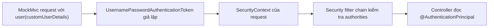

# `user(UserDetails)` với `UserDetails` tùy chỉnh

Trong kiểm thử Spring Security cho ứng dụng Servlet, `SecurityMockMvcRequestPostProcessors.user(...)` thường được dùng để đặt sẵn danh tính đã xác thực lên một request của `MockMvc`. Với trường hợp đơn giản, ta có thể gọi `user("alice")`. Nhưng ứng dụng thực tế thường cần nhiều thông tin hơn tên người dùng: mã tài khoản, mã tổ chức (`tenantId`), loại người dùng hoặc các quyền (`GrantedAuthority`) đặc thù. Khi đó, **`user(customUserDetails)`** cho phép kiểm tra controller và cơ chế phân quyền với principal có đúng kiểu và dữ liệu mà hệ thống sử dụng.

Bài học thuộc chương **Danh tính trên yêu cầu** của module `SPRING_SECURITY_TESTING`. Trọng tâm là kiểm chứng xác thực, phân quyền và bảo vệ HTTP bằng `spring-security-test`, đặc biệt cách đưa một `UserDetails` tùy chỉnh vào request Servlet. Bài cũng chỉ ra ranh giới của việc giả lập so với xác thực mật khẩu thực tế và so với JWT/OAuth2/OIDC hay `WebTestClient` trong ứng dụng Reactive.

## 1. Vì sao cần `UserDetails` tùy chỉnh?

`UserDetails` là một giao diện của Spring Security dùng để biểu diễn thông tin về tài khoản cho cơ chế xác thực dựa trên username/password. Những thuộc tính chuẩn thường gặp gồm:

- `getUsername()`: tên người dùng.
- `getPassword()`: thông tin mật khẩu được lưu trong principal; thông thường là chuỗi mật khẩu đã mã hóa khi tải từ hệ thống thực.
- `getAuthorities()`: các quyền đã được cấp.
- `isEnabled()`, `isAccountNonLocked()`, `isAccountNonExpired()`, `isCredentialsNonExpired()`: các cờ trạng thái tài khoản.

Một ứng dụng đa tổ chức có thể bổ sung `accountId` và `tenantId`; ứng dụng thương mại điện tử có thể cần `customerId`; một hệ thống nội bộ có thể cần `employeeId`. Các trường này không thuộc giao diện `UserDetails` chuẩn, nên chúng ta tạo lớp triển khai riêng.

Ví dụ, endpoint đọc hồ sơ cần biết **ai đang gửi request** và **người đó thuộc tổ chức nào**. Nếu test chỉ có username `alice`, controller kỳ vọng `AccountPrincipal` có thể nhận sai kiểu hoặc không đọc được `tenantId`. Dùng principal tùy chỉnh khiến dữ liệu test phản ánh chính xác hợp đồng của controller.

| Cách chuẩn bị request | Principal có sẵn | Trường hợp phù hợp |
| --- | --- | --- |
| `user("alice")` | `org.springframework.security.core.userdetails.User` do test tạo | Endpoint chỉ cần username và authority thông thường |
| `user(accountPrincipal)` | Đối tượng triển khai `UserDetails` do test cung cấp | Endpoint cần thêm `accountId`, `tenantId` hoặc thuộc tính nghiệp vụ |
| `authentication(customAuthentication)` | Principal theo đối tượng `Authentication` được cung cấp | Ứng dụng dùng loại authentication riêng, không biểu diễn được chỉ với `UserDetails` |
| `jwt()`, `oidcLogin()` | Principal và loại authentication tương ứng | Controller dựa trên JWT claims, scope hoặc OIDC principal |

## 2. Cách `user(customUserDetails)` gắn danh tính vào request

Cách gọi dành cho `MockMvc`:

```java
import static org.springframework.security.test.web.servlet.request
        .SecurityMockMvcRequestPostProcessors.user;
import static org.springframework.test.web.servlet.request.MockMvcRequestBuilders.get;

mockMvc.perform(get("/api/profile")
        .with(user(accountPrincipal)));
```

Ở đây `accountPrincipal` phải là một đối tượng triển khai `UserDetails`. Spring Security Test tạo một `UsernamePasswordAuthenticationToken` đã được đánh dấu xác thực, trong đó **principal mang thông tin từ `UserDetails`**, credentials lấy từ `getPassword()` và authorities lấy từ `getAuthorities()`. Context kiểm thử được liên kết với request khi `MockMvc` và Spring Security tích hợp đúng cách.



**Phạm vi tác động là request được tạo bởi `perform(...)`.** Thao tác này không tự đăng nhập Alice, không ghi session hoặc tài khoản vào cơ sở dữ liệu, không gọi `UserDetailsService` để tải người dùng và không so khớp mật khẩu. Do đó, đây là cách kiểm tra **hành vi sau khi danh tính đã được chấp nhận**, chứ không phải bài test của endpoint đăng nhập.

Để Spring Security Test gắn và khôi phục context phù hợp, cần tích hợp bộ lọc bảo mật với `MockMvc`; cấu hình này sẽ được trình bày ở phần ví dụ thực hành.

## 3. Tạo lớp `AccountPrincipal` triển khai `UserDetails`

Ta xây dựng một principal bất biến bằng Java `record`. Nó chứa UUID tài khoản, tên tổ chức, username, password dành cho test và danh sách authority:

```java
import java.util.Collection;
import java.util.List;
import java.util.UUID;

import org.springframework.security.core.GrantedAuthority;
import org.springframework.security.core.userdetails.UserDetails;

public record AccountPrincipal(
        UUID accountId,
        String tenantId,
        String username,
        String password,
        List<GrantedAuthority> authorities
) implements UserDetails {

    public AccountPrincipal {
        // Giữ bản sao danh sách quyền, tránh chỉnh sửa fixture ngoài ý muốn.
        authorities = List.copyOf(authorities);
    }

    @Override
    public Collection<? extends GrantedAuthority> getAuthorities() {
        return authorities;
    }

    @Override
    public String getUsername() {
        return username;
    }

    @Override
    public String getPassword() {
        return password;
    }

    @Override
    public boolean isAccountNonExpired() {
        return true;
    }

    @Override
    public boolean isAccountNonLocked() {
        return true;
    }

    @Override
    public boolean isCredentialsNonExpired() {
        return true;
    }

    @Override
    public boolean isEnabled() {
        return true;
    }

    @Override
    public String toString() {
        // Không đưa password vào log khi in thông tin principal.
        return "AccountPrincipal[accountId=" + accountId
                + ", tenantId=" + tenantId
                + ", username=" + username + "]";
    }
}
```

Các accessor sinh sẵn bởi `record`, như `accountId()` và `tenantId()`, phục vụ logic nghiệp vụ. Ba phương thức `getUsername()`, `getPassword()`, `getAuthorities()` cung cấp hợp đồng Spring Security. Bốn phương thức trạng thái được triển khai tường minh để ví dụ dễ hiểu khi làm việc với nhiều phiên bản Spring Security. Compact constructor sao chép danh sách authorities để tránh sửa đổi ngoài ý muốn; `toString()` được ghi đè vì cách sinh mặc định của `record` sẽ in cả trường password.

Trong ứng dụng thật, không nên để password dạng văn bản thuần và không trả nó về response. Ở fixture kiểm thử dưới đây, password chỉ là dữ liệu giả lập, ví dụ `"unused-in-this-test"`, vì `user(...)` không xác minh credentials.

Tạo fixture dùng lại trong test:

```java
import java.util.List;
import java.util.UUID;

import org.springframework.security.core.authority.SimpleGrantedAuthority;

private static AccountPrincipal account(
        String username, String tenantId, String authority) {

    return new AccountPrincipal(
            UUID.fromString("00000000-0000-0000-0000-000000000001"),
            tenantId,
            username,
            "unused-in-this-test",
            List.of(new SimpleGrantedAuthority(authority))
    );
}
```

Ví dụ `account("alice", "acme", "profile:read")` mang ba thông tin riêng biệt: username `alice`, tenant `acme` và authority `profile:read`. UUID dùng cố định để assertions có thể dự đoán được; trong các test nghiệp vụ có nhiều tài khoản, hãy dùng các UUID khác nhau nếu sự khác biệt về tài khoản ảnh hưởng đến kết quả.

## 4. Dùng `@AuthenticationPrincipal` để đọc đúng kiểu principal

Spring MVC có annotation `@AuthenticationPrincipal` để đưa `Authentication.getPrincipal()` vào tham số controller. Với principal tùy chỉnh, controller có thể đọc trường nghiệp vụ mà không cần ép kiểu thủ công:

```java
import java.util.Map;

import org.springframework.http.HttpStatus;
import org.springframework.http.ResponseEntity;
import org.springframework.security.core.annotation.AuthenticationPrincipal;
import org.springframework.web.bind.annotation.GetMapping;
import org.springframework.web.bind.annotation.PathVariable;
import org.springframework.web.bind.annotation.RestController;

@RestController
class TenantProfileController {

    @GetMapping("/api/tenants/{tenantId}/profile")
    ResponseEntity<Map<String, String>> profile(
            @PathVariable String tenantId,
            @AuthenticationPrincipal(errorOnInvalidType = true)
            AccountPrincipal account) {

        if (!tenantId.equals(account.tenantId())) {
            return ResponseEntity.status(HttpStatus.FORBIDDEN).build();
        }

        return ResponseEntity.ok(Map.of(
                "username", account.getUsername(),
                "accountId", account.accountId().toString(),
                "tenantId", account.tenantId()
        ));
    }
}
```

Ở đây controller kiểm tra **tenant trong URL** trùng với tenant của principal. Đây là quy tắc nghiệp vụ của ví dụ; chúng ta còn cần cấu hình Spring Security để yêu cầu authority `profile:read` cho endpoint.

`errorOnInvalidType = true` khiến test bộc lộ lỗi khi principal không phải `AccountPrincipal` thay vì âm thầm nhận một giá trị `null` do không khớp kiểu. Với API thật, cần xác định chính sách từ chối truy cập khi principal sai hoặc thiếu; các phương thức controller ở ví dụ được gọi sau bước kiểm tra quyền trong filter chain.

Nếu chỉ muốn kiểm tra tên người dùng, controller có thể nhận `Authentication` và gọi `getName()`. Khi cần `tenantId`, `accountId` hoặc dữ liệu riêng, `@AuthenticationPrincipal AccountPrincipal` diễn đạt yêu cầu rõ ràng hơn.

## 5. Cấu hình HTTP Security để kiểm tra quyền đọc hồ sơ

Giả sử ứng dụng Servlet có endpoint trên và áp dụng quy tắc: chỉ người dùng đã xác thực với authority `profile:read` được đi vào controller.

```java
import org.springframework.context.annotation.Bean;
import org.springframework.context.annotation.Configuration;
import org.springframework.http.HttpMethod;
import org.springframework.security.config.Customizer;
import org.springframework.security.config.annotation.web.builders.HttpSecurity;
import org.springframework.security.config.annotation.web.configuration.EnableWebSecurity;
import org.springframework.security.web.SecurityFilterChain;

@Configuration
@EnableWebSecurity
class ProfileSecurityConfig {

    @Bean
    SecurityFilterChain securityFilterChain(HttpSecurity http)
            throws Exception {

        return http
                .authorizeHttpRequests(authorize -> authorize
                    .requestMatchers(
                        HttpMethod.GET,
                        "/api/tenants/*/profile"
                    ).hasAuthority("profile:read")
                    .anyRequest().denyAll())
                .httpBasic(Customizer.withDefaults())
                .build();
    }
}
```

Cấu hình trên sử dụng HTTP Basic để xác định cách phản hồi request chưa đăng nhập; các test với `user(accountPrincipal)` vẫn **bỏ qua quá trình kiểm tra username/password**. Bởi vì controller chỉ dùng `GET`, CSRF không phải điều kiện của các request này trong cấu hình mặc định. Khi thêm endpoint `POST`, `PUT` hoặc `DELETE`, cần xét cả CSRF nếu ứng dụng bật bảo vệ CSRF.

Đảm bảo thư viện kiểm thử có dependency:

```xml
<dependency>
    <groupId>org.springframework.security</groupId>
    <artifactId>spring-security-test</artifactId>
    <scope>test</scope>
</dependency>
```

Với Spring Boot, cách đơn giản để chạy security filter chain là:

```java
@SpringBootTest
@AutoConfigureMockMvc
class TenantProfileSecurityTest {
    @Autowired
    MockMvc mockMvc;
}
```

Nếu tự tạo `MockMvc`, tích hợp Spring Security tường minh:

```java
MockMvc mockMvc = MockMvcBuilders
        .webAppContextSetup(webApplicationContext)
        .apply(springSecurity())
        .build();
```

`springSecurity()` được import tĩnh từ `org.springframework.security.test.web.servlet.setup.SecurityMockMvcConfigurers.springSecurity`. Nếu `MockMvc` thiếu security filter chain (hoặc dùng `@AutoConfigureMockMvc(addFilters = false)`), kết quả test có thể không phản ánh quy tắc truy cập của ứng dụng.

## 6. Bộ ca kiểm thử: principal đúng, thiếu quyền và sai tenant

Dùng controller, `SecurityFilterChain` và `AccountPrincipal` đã định nghĩa ở trên, các bài test dưới đây kiểm tra ba ranh giới độc lập: **có xác thực hay không**, **có đúng authority hay không**, và **có đúng tenant hay không**.

```java
import static org.springframework.security.test.web.servlet.request
        .SecurityMockMvcRequestPostProcessors.anonymous;
import static org.springframework.security.test.web.servlet.request
        .SecurityMockMvcRequestPostProcessors.user;
import static org.springframework.test.web.servlet.request.MockMvcRequestBuilders.get;
import static org.springframework.test.web.servlet.result.MockMvcResultMatchers.jsonPath;
import static org.springframework.test.web.servlet.result.MockMvcResultMatchers.status;

import java.util.List;
import java.util.UUID;

import org.junit.jupiter.api.Test;
import org.springframework.beans.factory.annotation.Autowired;
import org.springframework.boot.test.autoconfigure.web.servlet.AutoConfigureMockMvc;
import org.springframework.boot.test.context.SpringBootTest;
import org.springframework.security.core.authority.SimpleGrantedAuthority;
import org.springframework.test.web.servlet.MockMvc;

@SpringBootTest
@AutoConfigureMockMvc
class TenantProfileSecurityTest {

    @Autowired
    MockMvc mockMvc;

    private static AccountPrincipal account(
            String username, String tenantId, String authority) {
        return new AccountPrincipal(
                UUID.fromString("00000000-0000-0000-0000-000000000001"),
                tenantId,
                username,
                "unused-in-this-test",
                List.of(new SimpleGrantedAuthority(authority))
        );
    }

    @Test
    void userWithPermissionAndMatchingTenantCanReadProfile()
            throws Exception {

        mockMvc.perform(get("/api/tenants/acme/profile")
                .with(user(account("alice", "acme", "profile:read"))))
            .andExpect(status().isOk())
            .andExpect(jsonPath("$.username").value("alice"))
            .andExpect(jsonPath("$.tenantId").value("acme"))
            .andExpect(jsonPath("$.accountId").value(
                    "00000000-0000-0000-0000-000000000001"));
    }

    @Test
    void userWithoutReadPermissionIsForbidden() throws Exception {
        mockMvc.perform(get("/api/tenants/acme/profile")
                .with(user(account("bob", "acme", "profile:write"))))
            .andExpect(status().isForbidden());
    }

    @Test
    void userCannotReadProfileOfAnotherTenant() throws Exception {
        mockMvc.perform(get("/api/tenants/acme/profile")
                .with(user(account("alice", "other", "profile:read"))))
            .andExpect(status().isForbidden());
    }

    @Test
    void anonymousRequestMustAuthenticate() throws Exception {
        mockMvc.perform(get("/api/tenants/acme/profile")
                .with(anonymous()))
            .andExpect(status().isUnauthorized());
    }
}
```

Đọc kết quả theo nguyên nhân:

| Ca kiểm thử | Principal | Quyền | Tenant URL / principal | Kết quả dự kiến |
| --- | --- | --- | --- | --- |
| Đủ quyền, cùng tenant | Alice tùy chỉnh | `profile:read` | `acme / acme` | `200`, JSON đúng dữ liệu |
| Không đủ quyền | Bob tùy chỉnh | `profile:write` | `acme / acme` | `403` từ Spring Security |
| Đủ quyền, khác tenant | Alice tùy chỉnh | `profile:read` | `acme / other` | `403` từ kiểm tra tenant trong controller |
| Vô danh | `anonymous()` | Không có | `acme / —` | `401` với HTTP Basic |

Hai mã `403` đến từ **hai tầng khác nhau**: thiếu quyền được filter chain chặn trước controller; sai tenant được controller chủ động từ chối sau khi Spring Security cho phép. Việc tách ca test giúp xác định đúng lỗi cần sửa.

Mã `401` phụ thuộc `AuthenticationEntryPoint`. Ở cấu hình HTTP Basic minh họa, người dùng chưa đăng nhập nhận `401`; với form login, có thể nhận chuyển hướng `302` đến trang đăng nhập. Đừng mặc định cùng một mã cho mọi cơ chế xác thực.

## 7. `roles(...)` và `authorities` của principal tùy chỉnh

`UserDetails.getAuthorities()` trả về một tập `GrantedAuthority`. Spring Security dùng chúng để quyết định các luật `hasAuthority(...)`, `hasRole(...)`, `hasAnyAuthority(...)` và tương tự.

Ví dụ:

```java
AccountPrincipal admin = new AccountPrincipal(
    UUID.fromString("00000000-0000-0000-0000-000000000002"),
    "acme",
    "root",
    "unused",
    List.of(
        new SimpleGrantedAuthority("ROLE_ADMIN"),
        new SimpleGrantedAuthority("profile:read")
    )
);

mockMvc.perform(get("/api/tenants/acme/profile")
        .with(user(admin)))
    .andExpect(status().isOk());
```

Khi truyền `user(admin)`, authorities được lấy từ `admin.getAuthorities()`. Spring Security không tự đổi `profile:read` thành `ROLE_profile:read`. Quy ước mặc định là `hasRole("ADMIN")` kiểm tra authority `ROLE_ADMIN`, còn `hasAuthority("profile:read")` kiểm tra đúng chuỗi `profile:read`.

Khác với `user("alice").roles("ADMIN")` vốn thêm prefix `ROLE_` cho role đã khai báo, đối tượng `UserDetails` của ta chứa danh sách authority tường minh. Vì vậy, phải tạo fixture có authority **đúng với quy tắc thực tế**. Nếu ứng dụng tùy chỉnh role prefix, test cũng phải nhất quán với cấu hình đó.

Đặc biệt, nếu các quyền được chuyển đổi từ role trong database hoặc từ claims của token khi đăng nhập, `user(customUserDetails)` chỉ kiểm tra kết quả **sau khi đã tạo danh sách authority**. Nó không kiểm chứng logic chuyển đổi ấy; hãy viết test riêng cho mapper, converter hoặc cơ chế xác thực tương ứng.

## 8. Trạng thái tài khoản và mật khẩu: những điều `user(UserDetails)` không kiểm chứng

Một principal tùy chỉnh có thể triển khai `isEnabled()`, `isAccountNonLocked()` hoặc `isCredentialsNonExpired()` để phản ánh trạng thái của tài khoản. Dù vậy, `user(customUserDetails)` **không gửi principal qua `AuthenticationProvider` để kiểm tra các cờ đó**. Nó tạo `Authentication` dùng cho request kiểm thử.

Chẳng hạn, nếu một biến thể `AccountPrincipal` trả về `false` từ `isEnabled()`:

- Bài test có thể vẫn đi qua rule `authenticated()` bởi `Authentication` đã được tạo và đánh dấu xác thực.
- Những logic ứng dụng **chủ động đọc** `isEnabled()` từ principal vẫn có thể kiểm tra được.
- Để chứng minh tài khoản bị khóa, bị vô hiệu hóa hoặc sai mật khẩu **không thể đăng nhập**, phải kiểm tra đường xác thực thật (`AuthenticationManager`, `AuthenticationProvider`, `UserDetailsService`, HTTP Basic hoặc form login tùy ứng dụng).

Đặt `password("wrong")` hay đưa password bất kỳ vào `AccountPrincipal` đều không phải phép thử đăng nhập sai mật khẩu. Chỉ gửi credentials qua cơ chế đăng nhập đang sử dụng và chạy qua bộ lọc/provider liên quan mới trả lời được câu hỏi đó.

| Mục tiêu | Cách kiểm thử đáng dùng |
| --- | --- |
| Controller lấy đúng `accountId`, `tenantId` | `user(customUserDetails)` và assert response |
| Người dùng có authority X được truy cập | `user(customUserDetails)` có authority X |
| Người dùng thiếu authority X bị từ chối | `user(customUserDetails)` thiếu authority X |
| Sai password, tài khoản khóa, bị vô hiệu hóa | Test provider hoặc request đăng nhập thật qua filter chain |
| `UserDetailsService` tải đúng thuộc tính từ database | Test `UserDetailsService` hoặc tích hợp với persistence |
| Principal đúng kiểu sau đăng nhập thực tế | Test luồng đăng nhập thật và đối chiếu `Authentication.getPrincipal()` |

## 9. So sánh với `@WithMockUser`, `@WithUserDetails` và `@WithSecurityContext`

Spring Security Test còn cung cấp các cách khác để tạo danh tính. Chúng khác nhau về nguồn principal và phạm vi tác động.

### `@WithMockUser`: tiện nhưng dùng principal chuẩn

```java
@Test
@WithMockUser(username = "alice", roles = "USER")
void testWithDefaultPrincipal() throws Exception {
    mockMvc.perform(get("/api/me"))
           .andExpect(status().isOk());
}
```

`@WithMockUser` chuẩn bị `SecurityContext` ở phạm vi test method/class, thường với principal kiểu `org.springframework.security.core.userdetails.User`. Nó phù hợp khi endpoint chỉ yêu cầu username hoặc quyền chuẩn. Nếu controller đòi `AccountPrincipal`, annotation này không tự bổ sung `accountId` và `tenantId`; dùng nó có thể khiến kiểu principal không khớp.

### `@WithUserDetails`: tải principal từ `UserDetailsService` của test

```java
@Test
@WithUserDetails("alice")
void testWithUserDetailsService() throws Exception {
    mockMvc.perform(get("/api/tenants/acme/profile"))
           .andExpect(status().isOk());
}
```

`@WithUserDetails` yêu cầu ngữ cảnh test có `UserDetailsService` trả về principal thích hợp cho tên người dùng đã cho. Annotation này **có gọi dịch vụ để tải `UserDetails`**, khác với `user(customUserDetails)` dùng đối tượng dựng sẵn. Tuy vậy, nó vẫn chuẩn bị `SecurityContext` của test, không chứng minh mật khẩu của Alice đã qua xác thực HTTP. Trường hợp nhiều bean `UserDetailsService`, có thể chỉ định bean qua thuộc tính `userDetailsServiceBeanName` khi cần.

### `@WithSecurityContext`: factory cho ngữ cảnh tùy biến

Nếu mọi test cần một principal hoặc authentication không biểu diễn dễ dàng bằng `UserDetails`, có thể tạo annotation riêng bằng `@WithSecurityContext` và một `WithSecurityContextFactory`. Cách này thích hợp khi phải dùng lặp lại một dạng `SecurityContext` đặc biệt ở phạm vi phương thức/lớp test, nhưng cần thêm mã hỗ trợ.

| Tiêu chí | `.with(user(customUserDetails))` | `@WithMockUser` | `@WithUserDetails` |
| --- | --- | --- | --- |
| Phạm vi chủ yếu | Từng request `MockMvc.perform(...)` | Phương thức/lớp test | Phương thức/lớp test |
| Principal | Dữ liệu từ `UserDetails` truyền vào | `User` chuẩn do test tạo | `UserDetails` do service tải |
| Gọi `UserDetailsService` | Không | Không | Có |
| Kiểm chứng password thật | Không | Không | Không |
| Thuận tiện đổi tenant/quyền từng request | Rất phù hợp | Kém trực tiếp hơn | Phụ thuộc fixture/service |

Nếu test thực hiện liên tiếp request từ Alice và Bob, cách tường minh nhất thường là truyền `.with(user(alice))` hoặc `.with(user(bob))` ngay tại mỗi `perform(...)`. Điều đó giúp tránh nhầm danh tính giữa các ca.

## 10. Các giới hạn bảo mật và lỗi thường gặp

### Lỗi: controller yêu cầu `AccountPrincipal` nhưng test dùng `user("alice")`

```java
// Principal mặc định là UserDetails của Spring Security,
// không phải AccountPrincipal của ứng dụng.
mockMvc.perform(get("/api/tenants/acme/profile")
        .with(user("alice")));
```

Nếu controller dùng `@AuthenticationPrincipal AccountPrincipal`, principal mặc định không đúng kiểu. Hãy tạo và truyền `user(account(...))`, hoặc chủ động thay đổi cách controller đọc principal theo đúng hợp đồng của ứng dụng.

### Lỗi: chỉ kiểm tra ca được phép

Một request với `profile:read` nhận `200` chưa đủ khẳng định endpoint được bảo vệ. Phải có ca thiếu authority nhận `403` và ca vô danh bị từ chối. Nếu ứng dụng phân vùng dữ liệu theo tenant, thêm ca đúng quyền nhưng sai tenant như ví dụ.

### Lỗi: nhầm mã `403` do CSRF với thiếu quyền

Trong các request thay đổi trạng thái (`POST`, `PUT`, `DELETE`), thiếu CSRF token cũng có thể dẫn đến `403`. Để chứng minh lỗi do thiếu authority, cần truyền CSRF token hợp lệ bằng `.with(csrf())` nếu CSRF đang được bật; kiểm tra thiếu/sai token ở những ca riêng.

### Lỗi: `MockMvc` không thực thi bộ lọc bảo mật

Trong test dùng `standaloneSetup(...)` mà không gắn security filter phù hợp, controller có thể trả `200` dù filter chain production lẽ ra từ chối request. Hãy dùng ngữ cảnh có `FilterChainProxy`, chẳng hạn `@AutoConfigureMockMvc` với filters bật hoặc `webAppContextSetup(...).apply(springSecurity())`.

### Lỗi: dùng principal tùy chỉnh để kết luận về JWT/OIDC hoặc Reactive

`user(customUserDetails)` thường tạo `UsernamePasswordAuthenticationToken`; nó không sinh ra `JwtAuthenticationToken`, không kiểm chứng JWT signature và không mô phỏng OAuth2/OIDC authorization code flow. Với ứng dụng Servlet cần JWT, OAuth2 Login hoặc OIDC, nên dùng các request post-processor như `jwt()`, `oauth2Login()` hoặc `oidcLogin()` phù hợp loại principal thực tế.

Với ứng dụng Reactive dùng `WebTestClient`, các công cụ tương đương đến từ cấu hình kiểm thử WebFlux, chẳng hạn `SecurityMockServerConfigurers.mockUser()` và `mockJwt()` qua `mutateWith(...)`. Không áp dụng trực tiếp request post-processor của `MockMvc` lên `WebTestClient`.

## 11. Bài tập thực hành và tiêu chí tự kiểm tra

Hãy mở rộng ví dụ bằng cách thêm trường `region` vào `AccountPrincipal`, sau đó viết endpoint `GET /api/tenants/{tenantId}/invoices`. Chỉ người dùng có authority `invoice:read` và đúng tenant mới được xem danh sách hóa đơn. Tạo các ca kiểm thử:

1. Alice thuộc tenant `acme`, có `invoice:read`, nhận `200`.
2. Bob thuộc `acme`, chỉ có `invoice:write`, nhận `403`.
3. Carol có `invoice:read` nhưng thuộc tenant `other`, nhận `403`.
4. Request `anonymous()` bị yêu cầu xác thực theo `AuthenticationEntryPoint` của ứng dụng.
5. Đổi giá trị password giả lập của Alice và giải thích vì sao quyết định phân quyền không thay đổi.
6. Thêm assertion kiểm tra đúng `region` trong response, đồng thời đảm bảo password không bao giờ xuất hiện ở JSON trả về.

Đối chiếu từng kết quả với ba nguồn dữ liệu: **`getAuthorities()` quyết định quyền**, **thuộc tính tùy chỉnh quyết định quy tắc nghiệp vụ**, và **cấu hình security filter chain quyết định cách từ chối request**. Với cơ chế kiểm thử này, `user(UserDetails)` là lựa chọn thích hợp khi cần xác minh rằng danh tính ứng dụng thực sự trông đợi được sử dụng chính xác trong controller và các quy tắc truy cập HTTP, đồng thời vẫn phân biệt rõ các hành vi cần kiểm thử đăng nhập hoặc token thật ở bước riêng.
