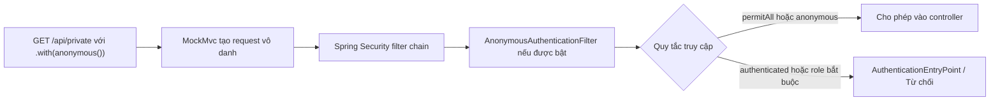

# `anonymous()` để biểu diễn request chưa đăng nhập theo cơ chế anonymous

Trong kiểm thử bảo mật HTTP, câu hỏi quan trọng không chỉ là **người dùng có quyền gì**, mà còn là **điều gì xảy ra khi request không có người đăng nhập**. Với ứng dụng Servlet, `SecurityMockMvcRequestPostProcessors.anonymous()` của `spring-security-test` giúp gửi một request `MockMvc` dưới danh tính **vô danh**. Công cụ này đặc biệt hữu ích khi toàn bộ test đã được gán một người dùng mặc định nhưng một ca kiểm thử cần xác nhận endpoint từ chối hoặc cho phép khách chưa đăng nhập.

Bài học nằm trong chương **Danh tính trên yêu cầu** của module `SPRING_SECURITY_TESTING`, nơi người học kiểm chứng xác thực, phân quyền và bảo vệ HTTP bằng `MockMvc`, `WebTestClient`, `@WithMockUser`, `SecurityContext` và các danh tính JWT/OAuth2/OIDC giả lập. Phạm vi bài này là cơ chế **anonymous authentication** trong Spring Security Servlet, cách dùng `anonymous()` ở cấp request, sự khác nhau giữa khách vô danh và người dùng đã xác thực, cùng các ca được phép/bị từ chối. Với ứng dụng Reactive, phần cuối trình bày hướng tiếp cận bằng `WebTestClient`.

## 1. Request vô danh trong Spring Security nghĩa là gì?

Trong ngôn ngữ nghiệp vụ, *anonymous request* là request đến từ khách **chưa đăng nhập**. Nó có thể cần truy cập một trang công khai, xem thông tin sản phẩm, hoặc bị chặn khi gọi API riêng tư. Spring Security có cơ chế *anonymous authentication* để biểu diễn loại request này một cách nhất quán trong luồng xử lý bảo mật.

Trên Servlet stack, khi request không có `Authentication` từ cơ chế xác thực khác, `AnonymousAuthenticationFilter` thường đặt một `AnonymousAuthenticationToken` vào `SecurityContext`. Mặc định, token này thường có principal `anonymousUser` và authority `ROLE_ANONYMOUS`. Những giá trị đó là **biểu diễn nội bộ của khách chưa đăng nhập**, không phải chứng cứ người dùng đã xác minh danh tính.

Điểm dễ gây nhầm lẫn: `AnonymousAuthenticationToken.isAuthenticated()` có thể trả về `true` vì token được khởi tạo dưới dạng đã xác thực về mặt kỹ thuật. Tuy nhiên, các quy tắc `authenticated()`, `fullyAuthenticated()` và `anonymous()` sử dụng cách nhận diện anonymous của Spring Security, nên **anonymous vẫn không thỏa điều kiện người dùng đã đăng nhập**.

| Khái niệm | Ý nghĩa |
| --- | --- |
| Không có đăng nhập | Request không mang một danh tính người dùng được chấp nhận |
| `AnonymousAuthenticationFilter` | Cấp biểu diễn anonymous trong `SecurityContext` khi phù hợp |
| `AnonymousAuthenticationToken` | Token nội bộ đại diện khách vô danh, thường mang `ROLE_ANONYMOUS` |
| `authenticated()` | Yêu cầu danh tính đã xác thực thực sự; anonymous không đạt |
| `anonymous()` trong quy tắc truy cập | Chỉ cho phép khách được nhận diện là anonymous |
| `anonymous()` trong `MockMvc.with(...)` | Chuẩn bị **request thử nghiệm** dưới trạng thái vô danh |

Cần phân biệt hai API cùng tên `anonymous()`: `authorizeHttpRequests(...).requestMatchers(...).anonymous()` là **quy tắc cấp quyền**; còn `SecurityMockMvcRequestPostProcessors.anonymous()` là **cách tạo request để thử quy tắc đó**.

## 2. Cú pháp `SecurityMockMvcRequestPostProcessors.anonymous()`

API nằm trong package `org.springframework.security.test.web.servlet.request`:

```java
import static org.springframework.security.test.web.servlet.request
        .SecurityMockMvcRequestPostProcessors.anonymous;
import static org.springframework.test.web.servlet.request.MockMvcRequestBuilders.get;
import static org.springframework.test.web.servlet.result.MockMvcResultMatchers.status;

// Giả định /api/public là endpoint được phép truy cập công khai.
mockMvc.perform(get("/api/public").with(anonymous()))
       .andExpect(status().isOk());
```

`anonymous()` là một `RequestPostProcessor` được áp dụng bằng `.with(...)` khi tạo `MockMvc` request. Nó bảo đảm request được xử lý **không theo người dùng đã đăng nhập** của các cấu hình test mặc định. Trong luồng có Spring Security filter chain, hệ thống có thể tạo `AnonymousAuthenticationToken` cho request đó bằng cơ chế anonymous đang bật.

Điểm quan trọng của phạm vi tác động:

- `.with(anonymous())` tác động lên **request được tạo cho lần `perform(...)` ấy**; không đăng xuất người dùng thật, không xóa tài khoản và không ghi session production.
- Nó hữu ích khi `MockMvc` có `defaultRequest(...with(user(...)))` hoặc test đã có `@WithMockUser` nhưng muốn một request cố ý vô danh.
- Nếu request không được gán sẵn danh tính nào và không có session/context lưu trước đó, việc không thêm `.with(user(...))` có thể đã đủ để thử anonymous. Viết `.with(anonymous())` giúp ý định rõ ràng và tránh phụ thuộc ngầm vào fixture.
- Nó **không** gọi endpoint logout và cũng không kiểm chứng việc vô hiệu hóa cookie, session hay token sau logout; các hành vi đó cần ca kiểm thử riêng.

Luồng xử lý điển hình:



Đây là mô hình cho một ứng dụng được cấu hình đúng, không phải cam kết mọi dự án sẽ có cùng mã HTTP hay chính xác cùng một chuỗi filter.

## 3. Khác biệt giữa anonymous và người dùng có tên `anonymousUser`

Không nên dùng `user("anonymousUser")` để giả lập khách chưa đăng nhập:

```java
// ĐÚNG: request vô danh theo Spring Security Test.
mockMvc.perform(get("/api/private").with(anonymous()));

// SAI nếu mục đích là khách chưa đăng nhập:
// tạo danh tính đã xác thực, username chỉ tình cờ là "anonymousUser".
mockMvc.perform(get("/api/private").with(user("anonymousUser")));
```

`user("anonymousUser")` của Spring Security Test thường sinh một `UsernamePasswordAuthenticationToken` đã xác thực (với quyền mặc định `ROLE_USER`). Chính **kiểu authentication và việc Spring Security nhận diện anonymous**, chứ không phải chuỗi username, quyết định request có được xem là khách vô danh hay không.

Tương tự, một người đã đăng nhập nhưng có authority tên `ROLE_ANONYMOUS` không tự động trở thành anonymous. Hãy ưu tiên dùng quy tắc `anonymous()` thay vì dựa vào chuỗi authority hoặc tên principal để mô tả chính sách “chỉ khách chưa đăng nhập”.

Trong thực tế, ở một số điểm kiểm tra, `SecurityContextHolder.getContext().getAuthentication()` của anonymous request **không nhất thiết bằng `null`**. Do đó, đoạn kiểm tra `authentication != null` trong mã nghiệp vụ không đủ để kết luận đã đăng nhập. Hãy dùng chính sách authorization của Spring Security hoặc `AuthenticationTrustResolver` khi cần phân biệt anonymous với authentication thực sự.

## 4. Các chính sách truy cập cần kiểm chứng

Khi thiết kế ma trận kiểm thử, nên phân biệt các trường hợp sau:

| Quy tắc | Khách vô danh | Người dùng đã đăng nhập | Mục đích điển hình |
| --- | --- | --- | --- |
| `permitAll()` | Được phép | Được phép | Trang công khai, tài liệu hướng dẫn |
| `authenticated()` | Bị yêu cầu xác thực | Được phép nếu không có hạn chế khác | Hồ sơ cá nhân |
| `hasRole("ADMIN")` | Bị yêu cầu xác thực | Chỉ người có `ROLE_ADMIN` được phép | Quản trị |
| `anonymous()` | Được phép | Bị từ chối | Một số trang chỉ dành cho khách chưa đăng nhập |
| `denyAll()` | Bị từ chối | Bị từ chối | Đường dẫn chưa mở |

Các kết quả *được phép/bị từ chối* là kết luận về chính sách; chúng **không tự xác định mã HTTP**. Với HTTP Basic, anonymous gọi endpoint yêu cầu đăng nhập thường nhận `401 Unauthorized`; với form login thường có thể nhận `302 Redirect` đến trang đăng nhập. Người dùng đã đăng nhập nhưng thiếu quyền thường nhận `403 Forbidden`. `AuthenticationEntryPoint` và `AccessDeniedHandler` của ứng dụng quyết định phản hồi cụ thể.

Một trang chỉ cho anonymous truy cập không đồng nghĩa một trang công khai: `permitAll()` cho phép cả khách và người đã đăng nhập; `anonymous()` chủ động từ chối người đã xác thực.

## 5. Ví dụ ứng dụng: trang công khai, hồ sơ, quản trị và trang dành cho khách

Giả sử ứng dụng Spring Boot Servlet có bốn endpoint:

- `GET /api/public`: mọi người đều được xem.
- `GET /api/guest-only`: chỉ khách chưa đăng nhập được xem.
- `GET /api/me`: yêu cầu đăng nhập.
- `GET /api/admin`: chỉ người dùng có role `ADMIN` được xem.

Một cấu hình Spring Security 6 có thể viết như sau:

```java
import org.springframework.context.annotation.Bean;
import org.springframework.context.annotation.Configuration;
import org.springframework.http.HttpMethod;
import org.springframework.security.config.Customizer;
import org.springframework.security.config.annotation.web.builders.HttpSecurity;
import org.springframework.security.config.annotation.web.configuration.EnableWebSecurity;
import org.springframework.security.web.SecurityFilterChain;

@Configuration
@EnableWebSecurity
class AnonymousDemoSecurityConfig {

    @Bean
    SecurityFilterChain securityFilterChain(HttpSecurity http)
            throws Exception {

        return http
            .authorizeHttpRequests(auth -> auth
                .requestMatchers(HttpMethod.GET, "/api/public").permitAll()
                .requestMatchers(HttpMethod.GET, "/api/guest-only").anonymous()
                .requestMatchers(HttpMethod.GET, "/api/me").authenticated()
                .requestMatchers(HttpMethod.GET, "/api/admin").hasRole("ADMIN")
                .anyRequest().denyAll())
            .httpBasic(Customizer.withDefaults())
            .build();
    }
}
```

Các controller đơn giản để quan sát kết quả:

```java
import org.springframework.security.core.Authentication;
import org.springframework.web.bind.annotation.GetMapping;
import org.springframework.web.bind.annotation.RestController;

@RestController
class AnonymousDemoController {

    @GetMapping("/api/public")
    String publicPage() {
        return "public";
    }

    @GetMapping("/api/guest-only")
    String guestPage() {
        return "guest";
    }

    @GetMapping("/api/me")
    String me(Authentication authentication) {
        return authentication.getName();
    }

    @GetMapping("/api/admin")
    String adminPage() {
        return "admin";
    }
}
```

Ở ví dụ này, ta chủ động bật HTTP Basic nên request vô danh tới endpoint riêng tư dự kiến nhận `401`. Controller `me(...)` chỉ chạy nếu filter chain chấp nhận request; việc đọc `Authentication.getName()` ở đó không phải cách kiểm tra password.

Để viết test cần dependency `spring-security-test` trong test scope:

```xml
<dependency>
    <groupId>org.springframework.security</groupId>
    <artifactId>spring-security-test</artifactId>
    <scope>test</scope>
</dependency>
```

## 6. Kiểm thử bằng `MockMvc`: kết quả cho anonymous và người dùng đã xác thực

Với Spring Boot và lớp cấu hình/controller đã được đăng ký trong application context, dùng `@SpringBootTest` và `@AutoConfigureMockMvc` để tạo `MockMvc` có Spring Security filter chain.

```java
import static org.springframework.security.test.web.servlet.request
        .SecurityMockMvcRequestPostProcessors.anonymous;
import static org.springframework.security.test.web.servlet.request
        .SecurityMockMvcRequestPostProcessors.user;
import static org.springframework.test.web.servlet.request.MockMvcRequestBuilders.get;
import static org.springframework.test.web.servlet.result.MockMvcResultMatchers.content;
import static org.springframework.test.web.servlet.result.MockMvcResultMatchers.status;

import org.junit.jupiter.api.Test;
import org.springframework.beans.factory.annotation.Autowired;
import org.springframework.boot.test.autoconfigure.web.servlet.AutoConfigureMockMvc;
import org.springframework.boot.test.context.SpringBootTest;
import org.springframework.test.web.servlet.MockMvc;

@SpringBootTest
@AutoConfigureMockMvc
class AnonymousRequestSecurityTest {

    @Autowired
    MockMvc mockMvc;

    @Test
    void anonymousCanReadPublicEndpoint() throws Exception {
        mockMvc.perform(get("/api/public").with(anonymous()))
            .andExpect(status().isOk())
            .andExpect(content().string("public"));
    }

    @Test
    void anonymousCanReadGuestOnlyEndpoint() throws Exception {
        mockMvc.perform(get("/api/guest-only").with(anonymous()))
            .andExpect(status().isOk())
            .andExpect(content().string("guest"));
    }

    @Test
    void anonymousCannotReadAuthenticatedEndpoint() throws Exception {
        mockMvc.perform(get("/api/me").with(anonymous()))
            .andExpect(status().isUnauthorized()); // HTTP Basic: 401
    }

    @Test
    void anonymousCannotReadAdminEndpoint() throws Exception {
        mockMvc.perform(get("/api/admin").with(anonymous()))
            .andExpect(status().isUnauthorized()); // Yêu cầu xác thực trước
    }

    @Test
    void loggedInUserCannotReadGuestOnlyEndpoint() throws Exception {
        mockMvc.perform(get("/api/guest-only")
                .with(user("alice").roles("USER")))
            .andExpect(status().isForbidden());
    }

    @Test
    void loggedInUserCanReadOwnUsername() throws Exception {
        mockMvc.perform(get("/api/me")
                .with(user("alice").roles("USER")))
            .andExpect(status().isOk())
            .andExpect(content().string("alice"));
    }

    @Test
    void ordinaryUserCannotReadAdminEndpoint() throws Exception {
        mockMvc.perform(get("/api/admin")
                .with(user("alice").roles("USER")))
            .andExpect(status().isForbidden());
    }

    @Test
    void adminCanReadAdminEndpoint() throws Exception {
        mockMvc.perform(get("/api/admin")
                .with(user("root").roles("ADMIN")))
            .andExpect(status().isOk())
            .andExpect(content().string("admin"));
    }
}
```

Ma trận kết quả dự kiến **với chính cấu hình HTTP Basic ở trên**:

| Request | Danh tính test | Kết quả | Vì sao? |
| --- | --- | --- | --- |
| `GET /api/public` | `anonymous()` | `200` | `permitAll()` |
| `GET /api/guest-only` | `anonymous()` | `200` | Phù hợp chính sách `anonymous()` |
| `GET /api/me` | `anonymous()` | `401` | Cần xác thực |
| `GET /api/admin` | `anonymous()` | `401` | Cần xác thực trước khi xét role |
| `GET /api/guest-only` | `user("alice")` | `403` | Chỉ khách vô danh được truy cập |
| `GET /api/me` | `user("alice").roles("USER")` | `200` | Đã xác thực |
| `GET /api/admin` | `user("alice").roles("USER")` | `403` | Thiếu `ROLE_ADMIN` |
| `GET /api/admin` | `user("root").roles("ADMIN")` | `200` | Có `ROLE_ADMIN` |

Lưu ý cách phân tích nguyên nhân: một request anonymous tới trang quản trị nhận `401` trong cấu hình HTTP Basic vì **chưa xác thực**, trong khi một người dùng đã xác thực thiếu role nhận `403` vì **không đủ quyền**. Sự khác biệt này là trọng tâm của kiểm thử các trường hợp được phép hoặc bị từ chối.

Nếu thêm form login hay một `AuthenticationEntryPoint` tùy chỉnh, cần cập nhật assertions theo phản hồi thực tế, thay vì mặc định mọi anonymous request đều trả `401`.

## 7. Vì sao cần tích hợp security filter chain với `MockMvc`?

Một điều kiện quan trọng của bài kiểm thử là request phải đi qua cấu hình bảo mật dự định áp dụng. `@AutoConfigureMockMvc` trong Spring Boot thường bật các filter của ứng dụng, nhưng nếu tự khởi tạo `MockMvc` cần gắn Spring Security rõ ràng:

```java
import static org.springframework.security.test.web.servlet.setup
        .SecurityMockMvcConfigurers.springSecurity;

MockMvc mockMvc = MockMvcBuilders
    .webAppContextSetup(webApplicationContext)
    .apply(springSecurity())
    .build();
```

Nếu chỉ sử dụng `MockMvcBuilders.standaloneSetup(controller)` mà không gắn security filter chain, kết quả `200` của trang riêng tư có thể chỉ phản ánh controller đã chạy mà chưa kiểm chứng bảo mật HTTP. Tương tự, `@AutoConfigureMockMvc(addFilters = false)` không phù hợp để khẳng định rule `authenticated()` hoặc `hasRole(...)` đang hoạt động.

`anonymous()` giúp chuẩn bị trạng thái request; **filter chain và authorization rules mới quyết định cho phép hay từ chối**. Khi cần xác minh toàn bộ cơ chế anonymous trong ứng dụng, giữ cấu hình filter chain tương đương production, bao gồm cả cách xử lý exception và entry point.

## 8. Dùng `anonymous()` để ghi đè danh tính đã chuẩn bị sẵn trong test

Đây là một trong những lý do thực tế nhất để gọi `.with(anonymous())`. Giả sử phần lớn test của một controller dùng người dùng mặc định, nhưng vẫn cần một ca xác nhận khách chưa đăng nhập không được gọi API riêng tư.

### Ghi đè người dùng mặc định trong `MockMvc` builder

```java
MockMvc mockMvc = MockMvcBuilders
    .webAppContextSetup(webApplicationContext)
    .defaultRequest(get("/").with(user("default-user").roles("USER")))
    .apply(springSecurity())
    .build();

// Dùng người dùng được gán mặc định.
mockMvc.perform(get("/api/me"))
       .andExpect(status().isOk());

// Riêng request này chủ động là khách chưa đăng nhập.
mockMvc.perform(get("/api/me").with(anonymous()))
       .andExpect(status().isUnauthorized());
```

Ở đây `defaultRequest(...)` chỉ là fixture của `MockMvc`; không chứng minh một session đăng nhập có tồn tại trên trình duyệt. `.with(anonymous())` cho phép kiểm thử phản hồi khi request không có danh tính từ fixture đó.

### Ghi đè `@WithMockUser` của phương thức test

```java
import org.springframework.security.test.context.support.WithMockUser;

@Test
@WithMockUser(username = "alice", roles = "USER")
void testBothAuthenticatedAndAnonymousRequests() throws Exception {

    // Request sử dụng SecurityContext được @WithMockUser thiết lập.
    mockMvc.perform(get("/api/me"))
           .andExpect(status().isOk());

    // Request kế tiếp chủ động ở trạng thái anonymous.
    mockMvc.perform(get("/api/me").with(anonymous()))
           .andExpect(status().isUnauthorized());
}
```

`@WithMockUser` chuẩn bị `SecurityContext` ở **cấp phương thức/lớp test** thông qua Spring Security Test, còn `.with(anonymous())` diễn đạt chủ đích ở **cấp request**. Điều này giúp cùng một phương thức kiểm tra cả kết quả được phép và bị từ chối. Cần tích hợp `MockMvc` và Spring Security đúng cách để context giả lập được sử dụng trong từng request.

Ngoài ra còn có `@WithAnonymousUser` dành cho trường hợp muốn đặt trạng thái vô danh ở **cấp test method/class** thay vì mỗi lần gọi `perform(...)`:

```java
import org.springframework.security.test.context.support.WithAnonymousUser;

@Test
@WithAnonymousUser
void guestCannotReadProfile() throws Exception {
    mockMvc.perform(get("/api/me"))
           .andExpect(status().isUnauthorized());
}
```

`@WithAnonymousUser` và `.with(anonymous())` có mục đích gần nhau nhưng khác **phạm vi cấu hình**. Chọn cách diễn đạt rõ nhất tình huống cần kiểm chứng.

## 9. Những hiểu lầm thường gặp về anonymous authentication

### Hiểu lầm 1: “Có `AnonymousAuthenticationToken` tức là người dùng đã đăng nhập”

Token anonymous là biểu diễn kỹ thuật để các thành phần Spring Security có thể xử lý nhất quán. Không thể lấy `Authentication.isAuthenticated() == true` làm tiêu chí duy nhất cho đăng nhập nếu token có thể là anonymous. Các rule `authenticated()` và `anonymous()` đã xử lý khác biệt này bằng cơ chế nhận diện anonymous của framework.

### Hiểu lầm 2: “Không gọi `with(user(...))` luôn chắc chắn là anonymous”

Nếu test có `@WithMockUser`, `@WithUserDetails`, `defaultRequest(...)`, session hoặc cấu hình khôi phục `SecurityContext`, một request không có `.with(user(...))` vẫn có thể nhận danh tính đã chuẩn bị sẵn. Dùng `.with(anonymous())` ở request muốn kiểm tra sẽ cho người đọc thấy chủ đích và giảm rủi ro phụ thuộc vào fixture.

### Hiểu lầm 3: “`user("anonymousUser")` tương đương `anonymous()`”

Sai. `user("anonymousUser")` gán một principal đã xác thực có tên đúng bằng chuỗi đó. Muốn request vô danh, dùng `.with(anonymous())` hoặc một cấu hình test anonymous phù hợp.

### Hiểu lầm 4: “Anonymous bị `403` thì chắc chắn rule phân quyền hoạt động”

`403` cũng có thể do **CSRF** ở các phương thức thay đổi trạng thái như `POST`, `PUT`, `PATCH` và `DELETE`. Nếu đang kiểm tra role/authority, cung cấp CSRF token hợp lệ khi cấu hình yêu cầu, ví dụ `.with(anonymous()).with(csrf())`, rồi phân biệt rõ lý do từ chối. Một endpoint công khai cho phép `permitAll()` cũng **không tự động miễn kiểm tra CSRF**.

```java
import static org.springframework.security.test.web.servlet.request
        .SecurityMockMvcRequestPostProcessors.csrf;

// Minh họa: chỉ áp dụng khi endpoint POST được cấu hình trong ứng dụng.
// Tách riêng kiểm tra chính sách truy cập và kiểm tra CSRF.
mockMvc.perform(post("/api/feedback")
        .with(anonymous())
        .with(csrf()));
```

Nếu ứng dụng tắt CSRF hoặc loại trừ endpoint đó khỏi bảo vệ, thêm hoặc thiếu token có thể không làm thay đổi kết quả. Cần dựa vào cấu hình thực tế để diễn giải kết quả.

### Hiểu lầm 5: “`anonymous()` đã kiểm chứng được chức năng đăng xuất”

`anonymous()` tạo điều kiện đầu vào cho một request. Nó không kiểm tra endpoint logout có invalidate session, xóa cookie, xóa `SecurityContext` khỏi repository hoặc thu hồi token hay không. Với nghiệp vụ logout, cần mô phỏng quá trình đăng nhập, gọi logout, rồi kiểm tra request tiếp theo không còn được phép dùng trạng thái xác thực cũ.

### Hiểu lầm 6: “Mã HTTP luôn cố định cho mọi ứng dụng”

Mã phản hồi phụ thuộc security configuration: HTTP Basic thường `401` với khách chưa đăng nhập, form login thường chuyển hướng `302`, API có entry point tùy chỉnh có thể trả JSON lỗi. Với request đã xác thực nhưng bị chặn bởi authorization rule, `403` là kết quả điển hình. Một số endpoint có chính sách xử lý lỗi riêng; test phải kiểm tra hợp đồng thực tế của hệ thống.

## 10. Anonymous ở Servlet khác gì Reactive?

`SecurityMockMvcRequestPostProcessors.anonymous()` dành cho `MockHttpServletRequest` trong `MockMvc`. Với ứng dụng WebFlux, `WebTestClient` sử dụng một bộ hỗ trợ kiểm thử khác, chẳng hạn `SecurityMockServerConfigurers.springSecurity()`, `mockUser()` và `mockJwt()` thông qua `mutateWith(...)`.

Ví dụ chủ yếu để phân biệt API:

```java
// Servlet / MockMvc:
mockMvc.perform(get("/api/me").with(anonymous()));

// Reactive / WebTestClient: cấu hình Spring Security cho client;
// thực hiện request không có mockUser()/mockJwt() khi cần mô phỏng khách vô danh.
WebTestClient securedClient = WebTestClient
    .bindToApplicationContext(context)
    .apply(SecurityMockServerConfigurers.springSecurity())
    .configureClient()
    .build();

securedClient.get()
    .uri("/api/me")
    .exchange()
    .expectStatus().isUnauthorized(); // Tùy cơ chế entry point
```

Ở WebFlux, hãy đảm bảo client không được gắn danh tính giả lập mặc định hoặc context xác thực từ setup trước đó, rồi gửi request qua WebFlux security chain. Chú ý cấu hình security và cách xử lý phản hồi thực tế cũng quyết định mã `401`/`403` hoặc redirect.

Các kiểm thử JWT/OAuth2/OIDC cũng có khác biệt tương tự: `jwt()`, `oauth2Login()` và `oidcLogin()` của Servlet mô phỏng **người dùng đã xác thực** thuộc các loại principal đặc thù. Chúng không thay thế ca vô danh để khẳng định endpoint được bảo vệ trước request **không có danh tính**.

## 11. Bài luyện tập: ma trận anonymous và role

Cho hệ thống có bốn endpoint `GET /catalog` (`permitAll`), `GET /welcome/guest` (`anonymous`), `GET /orders` (`authenticated`) và `GET /admin/orders` (`hasRole("ADMIN")`). Hãy thiết kế test với ba loại request: `anonymous()`, `user("customer").roles("USER")` và `user("admin").roles("ADMIN")`.

1. Viết ma trận cho phép/bị từ chối của **12 tổ hợp** endpoint và danh tính; sau đó ghi mã HTTP dự kiến với cấu hình HTTP Basic.
2. Viết assertions cho trường hợp anonymous được xem catalog và trang guest, nhưng phải xác thực trước khi xem orders.
3. Kiểm chứng người dùng `USER` đã đăng nhập không được xem guest-only và không được mở admin orders.
4. Thiết lập `defaultRequest(...with(user("customer")))` rồi dùng `with(anonymous())` để chứng minh ca kiểm thử anonymous vẫn bị từ chối ở `/orders`.
5. Thay HTTP Basic bằng form login; cập nhật kỳ vọng response của anonymous ở endpoint riêng tư và giải thích vai trò của `AuthenticationEntryPoint`.
6. Nếu thêm `POST /orders`, tách ca thiếu CSRF và ca thiếu role/authority để biết chính xác vì sao có `403`.

Khi đánh giá kết quả, hãy xác định rõ **request đang vô danh hay đã xác thực**, **rule nào được áp dụng**, và **bộ lọc/entry point nào tạo phản hồi**. `anonymous()` là công cụ đơn giản nhưng quan trọng để kiểm chứng ranh giới này; nó giúp bài test phản ánh khách chưa đăng nhập ngay cả khi môi trường test đã chuẩn bị một principal mặc định.
