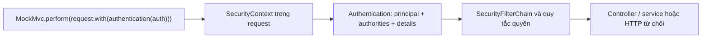

# `authentication()` với một `Authentication` cụ thể

Trong kiểm thử Spring Security, đôi khi một tên người dùng và role đơn giản không đủ để tái hiện tình huống cần kiểm tra. Ứng dụng có thể dùng principal của riêng mình, một loại `Authentication` do cơ chế xác thực tạo ra, hoặc các thuộc tính bổ sung mà controller và tầng phân quyền đọc trực tiếp. Với `MockMvc` trên Servlet stack, `SecurityMockMvcRequestPostProcessors.authentication(authentication)` cho phép **đưa một đối tượng `Authentication` do bài test chuẩn bị vào đúng request đang kiểm thử**.

Bài này thuộc chương **Danh tính trên yêu cầu** của module `SPRING_SECURITY_TESTING`: kiểm chứng xác thực, phân quyền và bảo vệ HTTP bằng `spring-security-test` trên ứng dụng Servlet và Reactive. Trọng tâm ở đây là cách tạo, truyền và kiểm chứng một `Authentication` cụ thể bằng `MockMvc`. Các kỹ thuật với `@WithMockUser`, `SecurityContext`, JWT/OAuth2/OIDC và `WebTestClient` được đối chiếu để người học chọn đúng công cụ cho từng loại danh tính và hiểu rõ giới hạn của việc giả lập.

## 1. `Authentication` biểu diễn những thông tin nào?

Trong Spring Security, `Authentication` là giao diện vừa mô tả yêu cầu xác thực, vừa có thể biểu diễn kết quả xác thực đã thành công. Nó mở ra các thông tin sau:

| Thuộc tính/phương thức | Ý nghĩa trong kiểm thử |
| --- | --- |
| `getPrincipal()` | Đối tượng đại diện chủ thể: username, `UserDetails`, principal nghiệp vụ, `Jwt`... |
| `getCredentials()` | Thông tin chứng thực (mật khẩu, token...); nhiều tình huống đã xác thực có thể để `null` |
| `getAuthorities()` | Danh sách `GrantedAuthority` dùng cho quyết định phân quyền |
| `isAuthenticated()` | Cờ cho biết đối tượng được đánh dấu đã xác thực; riêng anonymous cần cách nhận diện phù hợp |
| `getName()` | Tên chủ thể theo giao diện `Principal` |
| `getDetails()` | Thông tin đi kèm tùy loại authentication, ví dụ dữ liệu của request hoặc metadata tùy chỉnh |

Một `Authentication` thường nằm trong `SecurityContext`, được truy xuất từ `SecurityContextHolder` khi Spring Security xử lý request:



**`Authentication` cụ thể là gì?** Đó là một instance thực sự của một kiểu triển khai, chẳng hạn `UsernamePasswordAuthenticationToken`, `TestingAuthenticationToken` hoặc `JwtAuthenticationToken`, có principal và danh sách quyền do bài test quyết định. Test không cần dựa vào tài khoản có sẵn trong database để chuẩn bị instance này.

Điều quan trọng là phân biệt **chuẩn bị trạng thái đã xác thực** và **thực hiện quy trình xác thực**. Khi dùng `authentication(auth)`, Spring Security Test không tự kiểm tra password, giải mã token, xác minh chữ ký JWT hay gọi OAuth2 provider. Đối tượng được test cung cấp chính là đầu vào cho quyết định truy cập.

## 2. Cú pháp `authentication(...)` của `SecurityMockMvcRequestPostProcessors`

Hàm `authentication(Authentication)` nằm trong package:

```java
org.springframework.security.test.web.servlet.request
    .SecurityMockMvcRequestPostProcessors
```

Cách gọi trên `MockMvc` dùng `.with(...)`:

```java
import static org.springframework.security.test.web.servlet.request
        .SecurityMockMvcRequestPostProcessors.authentication;
import static org.springframework.test.web.servlet.request.MockMvcRequestBuilders.get;

Authentication auth = UsernamePasswordAuthenticationToken.authenticated(
        "alice",
        null,
        List.of(new SimpleGrantedAuthority("ROLE_USER"))
);

mockMvc.perform(get("/api/me").with(authentication(auth)));
```

Ở đây, `UsernamePasswordAuthenticationToken.authenticated(...)` tạo token có trạng thái đã xác thực và `ROLE_USER`. Thông tin đó được đưa vào `SecurityContext` của request test khi `MockMvc` tích hợp đúng Spring Security. Nó **không gửi** username/password qua HTTP header, không làm phát sinh quá trình login và không đăng ký Alice trong hệ thống.

### Các cách tạo token cần phân biệt

```java
// Đã xác thực: thích hợp kiểm tra phân quyền sau khi đăng nhập.
Authentication signedIn = UsernamePasswordAuthenticationToken.authenticated(
        "alice", null,
        List.of(new SimpleGrantedAuthority("ROLE_ADMIN"))
);

// Chưa được xác thực: chỉ là một yêu cầu chứa username/password.
Authentication rawCredentials =
        UsernamePasswordAuthenticationToken.unauthenticated(
                "alice", "test-password");
```

`authentication(rawCredentials)` **không tự gọi `AuthenticationManager` để chuyển nó thành token đã xác thực**. Vì vậy đừng dùng một token chưa xác thực rồi mặc định rằng chỉ cần `.with(authentication(...))` là controller được phép truy cập.

Với các loại token khác, hãy kiểm tra cách khởi tạo của chính loại đó. Tránh tùy tiện dùng `setAuthenticated(true)` trên token chưa xác thực để mô phỏng đăng nhập; một số implementation cố tình ngăn thao tác này nhằm tránh nâng quyền sai cách. Khi kiểm thử sau xác thực, ưu tiên constructor/factory dành cho trạng thái đã xác thực với danh sách quyền rõ ràng.

## 3. Khi nào chọn `authentication(...)` thay vì `user(...)`?

Hai API có điểm chung: đều đặt thông tin danh tính giả lập vào request `MockMvc`. Khác biệt là **mức độ kiểm soát đối tượng**.

| Cách làm | Thứ ta chủ động cung cấp | Trường hợp phù hợp |
| --- | --- | --- |
| `user("alice").roles("ADMIN")` | Username, password giả lập và role | Kiểm tra quyền truy cập đơn giản với principal kiểu `UserDetails` |
| `user(customUserDetails)` | `UserDetails` tùy chỉnh | Controller cần thông tin tài khoản từ custom `UserDetails` |
| `authentication(authentication)` | **Toàn bộ `Authentication` instance**, bao gồm kiểu, principal, authorities, details | Cần một authentication đặc thù, principal không triển khai `UserDetails`, hoặc kiểm tra logic dựa trên kiểu token |
| `securityContext(context)` | Cả `SecurityContext` đã được dựng sẵn | Cần kiểm soát trực tiếp context đưa vào request |
| `@WithMockUser` | Security context mặc định của test method/class | Nhiều request trong cùng test dùng chung username và roles |

Ví dụ, nếu controller đọc một `AuthenticatedPrincipal`/`Principal` tùy chỉnh không triển khai `UserDetails`, `user("alice")` không tạo đúng kiểu. `authentication(...)` có thể mang chính principal đó mà vẫn đi qua security filter chain.

Nếu bài test phải kiểm chứng token thực được **tạo ra như thế nào** từ HTTP Basic, form login, bearer token hoặc OIDC authorization code, hãy gửi dữ liệu xác thực qua đường HTTP thực sự và cho cơ chế bảo mật ứng dụng xử lý. `authentication(...)` phù hợp để kiểm thử **sau bước xác thực**, đặc biệt là quyền và thông tin principal ở các tầng phía sau.

## 4. Ví dụ principal nghiệp vụ và `Authentication` rõ ràng

Giả sử hệ thống nhiều tổ chức (`tenant`) cần biết người dùng nào đang gửi yêu cầu và họ thuộc tổ chức nào. Ta định nghĩa một principal nhỏ, triển khai `java.security.Principal`:

```java
import java.security.Principal;

public record ActorPrincipal(
        String username,
        String tenantId
) implements Principal {

    @Override
    public String getName() {
        return username;
    }
}
```

`ActorPrincipal` không triển khai `UserDetails`. Ta có thể đặt nó vào một `UsernamePasswordAuthenticationToken` đã xác thực:

```java
import java.util.List;

import org.springframework.security.authentication.UsernamePasswordAuthenticationToken;
import org.springframework.security.core.Authentication;
import org.springframework.security.core.authority.SimpleGrantedAuthority;

private static Authentication actor(
        String username, String tenantId, String... authorities) {

    List<SimpleGrantedAuthority> granted = java.util.Arrays.stream(authorities)
            .map(SimpleGrantedAuthority::new)
            .toList();

    return UsernamePasswordAuthenticationToken.authenticated(
            new ActorPrincipal(username, tenantId),
            null,
            granted
    );
}
```

Ví dụ `actor("alice", "acme", "reports:read")` chứa:

- Principal đúng kiểu `ActorPrincipal`, username `alice` và `tenantId` là `acme`.
- Authority **`reports:read`** viết đúng chuỗi nghiệp vụ.
- `isAuthenticated() == true` nhờ factory cho token đã xác thực.
- Credentials là `null` vì test không cần hay không nên giữ mật khẩu thật.

Nếu controller yêu cầu `@AuthenticationPrincipal ActorPrincipal`, việc truyền đúng principal giúp phát hiện lỗi ánh xạ danh tính thay vì chỉ kiểm tra response status.

## 5. Một ứng dụng Servlet mẫu để kiểm tra xác thực và phân quyền

Ví dụ cung cấp ba endpoint:

- `GET /api/me`: người dùng đã đăng nhập được đọc danh tính.
- `GET /api/tenants/{tenantId}/reports`: yêu cầu authority `reports:read`; trong controller kiểm tra thêm tenant của principal có trùng URL.
- `GET /api/admin`: yêu cầu role `ADMIN`, tương ứng authority `ROLE_ADMIN` mặc định.

Cấu hình Spring Security 6:

```java
import org.springframework.context.annotation.Bean;
import org.springframework.context.annotation.Configuration;
import org.springframework.http.HttpMethod;
import org.springframework.security.config.Customizer;
import org.springframework.security.config.annotation.web.builders.HttpSecurity;
import org.springframework.security.config.annotation.web.configuration.EnableWebSecurity;
import org.springframework.security.web.SecurityFilterChain;

@Configuration
@EnableWebSecurity
class RequestAuthenticationSecurityConfig {

    @Bean
    SecurityFilterChain filterChain(HttpSecurity http) throws Exception {
        return http
            .authorizeHttpRequests(authorize -> authorize
                .requestMatchers(HttpMethod.GET, "/api/me")
                    .authenticated()
                .requestMatchers(HttpMethod.GET, "/api/tenants/*/reports")
                    .hasAuthority("reports:read")
                .requestMatchers(HttpMethod.GET, "/api/admin")
                    .hasRole("ADMIN")
                .anyRequest().denyAll())
            .httpBasic(Customizer.withDefaults())
            .build();
    }
}
```

Controller mẫu:

```java
import java.util.Map;

import org.springframework.http.HttpStatus;
import org.springframework.http.ResponseEntity;
import org.springframework.security.core.annotation.AuthenticationPrincipal;
import org.springframework.web.bind.annotation.GetMapping;
import org.springframework.web.bind.annotation.PathVariable;
import org.springframework.web.bind.annotation.RestController;

@RestController
class RequestAuthenticationController {

    @GetMapping("/api/me")
    Map<String, String> me(
            @AuthenticationPrincipal(errorOnInvalidType = true)
            ActorPrincipal actor) {

        return Map.of(
                "username", actor.username(),
                "tenantId", actor.tenantId());
    }

    @GetMapping("/api/tenants/{tenantId}/reports")
    ResponseEntity<String> reports(
            @PathVariable String tenantId,
            @AuthenticationPrincipal(errorOnInvalidType = true)
            ActorPrincipal actor) {

        if (!tenantId.equals(actor.tenantId())) {
            return ResponseEntity.status(HttpStatus.FORBIDDEN)
                    .body("forbidden-tenant");
        }

        return ResponseEntity.ok("report-for-" + tenantId);
    }

    @GetMapping("/api/admin")
    String admin() {
        return "admin-allowed";
    }
}
```

Trong ví dụ này, `SecurityFilterChain` kiểm tra quyền HTTP trước khi controller chạy. Quy tắc đối chiếu tenant được controller thực hiện khi người dùng đã có authority `reports:read`. Đây là hai cơ chế độc lập nhưng cùng cần được kiểm tra.

Vì các endpoint dùng `GET` nên CSRF không phải điều kiện mặc định của những request này. Nếu chuyển sang `POST`/`PUT`/`PATCH`/`DELETE`, cần kiểm tra bảo vệ CSRF riêng khi cấu hình yêu cầu, tránh nhầm `403` do thiếu CSRF với `403` do thiếu quyền.

## 6. Cấu hình `MockMvc` cùng Spring Security filter chain

Để biên soạn và thực thi ví dụ, dự án cần `spring-security-test` trong test dependencies:

```xml
<dependency>
    <groupId>org.springframework.security</groupId>
    <artifactId>spring-security-test</artifactId>
    <scope>test</scope>
</dependency>
```

Trong Spring Boot, test có thể được khai báo như sau:

```java
@SpringBootTest
@AutoConfigureMockMvc
class RequestAuthenticationSecurityTest {
    @Autowired
    MockMvc mockMvc;
}
```

`@AutoConfigureMockMvc` thông thường tự tích hợp những servlet filter mà ứng dụng khai báo, bao gồm Spring Security nếu được cấu hình. Nếu tự tạo builder:

```java
import static org.springframework.security.test.web.servlet.setup
        .SecurityMockMvcConfigurers.springSecurity;

MockMvc mockMvc = MockMvcBuilders
        .webAppContextSetup(webApplicationContext)
        .apply(springSecurity())
        .build();
```

`springSecurity()` kết hợp security filter chain và hỗ trợ `SecurityContext` của Spring Security Test. Chỉ chạy `standaloneSetup(controller)` mà thiếu security filter, hoặc dùng `@AutoConfigureMockMvc(addFilters = false)`, có thể khiến các assertions về xác thực và phân quyền không phản ánh cơ chế bảo mật HTTP của ứng dụng.

Cấu hình cần **phù hợp ngữ cảnh test**: controller, security configuration và các bean liên quan phải hiện diện trong `ApplicationContext`. Các đoạn ví dụ là thành phần để ghép vào một ứng dụng Spring Boot Servlet sử dụng Spring Security, không phải các class có thể chạy độc lập không cần project.

## 7. Bộ ca kiểm thử bằng `authentication(auth)`

Sau khi đã định nghĩa `ActorPrincipal`, hai controller và security configuration, test tạo các loại `Authentication` theo từng request:

```java
import static org.springframework.security.test.web.servlet.request
        .SecurityMockMvcRequestPostProcessors.anonymous;
import static org.springframework.security.test.web.servlet.request
        .SecurityMockMvcRequestPostProcessors.authentication;
import static org.springframework.test.web.servlet.request.MockMvcRequestBuilders.get;
import static org.springframework.test.web.servlet.result.MockMvcResultMatchers.content;
import static org.springframework.test.web.servlet.result.MockMvcResultMatchers.jsonPath;
import static org.springframework.test.web.servlet.result.MockMvcResultMatchers.status;

import java.util.Arrays;
import java.util.List;

import org.junit.jupiter.api.Test;
import org.springframework.beans.factory.annotation.Autowired;
import org.springframework.boot.test.autoconfigure.web.servlet.AutoConfigureMockMvc;
import org.springframework.boot.test.context.SpringBootTest;
import org.springframework.security.authentication.UsernamePasswordAuthenticationToken;
import org.springframework.security.core.Authentication;
import org.springframework.security.core.authority.SimpleGrantedAuthority;
import org.springframework.test.web.servlet.MockMvc;

@SpringBootTest
@AutoConfigureMockMvc
class RequestAuthenticationSecurityTest {

    @Autowired
    MockMvc mockMvc;

    private static Authentication actor(
            String username, String tenantId, String... authorities) {

        List<SimpleGrantedAuthority> granted = Arrays.stream(authorities)
                .map(SimpleGrantedAuthority::new)
                .toList();

        return UsernamePasswordAuthenticationToken.authenticated(
                new ActorPrincipal(username, tenantId), null, granted);
    }

    @Test
    void authenticatedUserCanReadIdentity() throws Exception {
        Authentication alice = actor("alice", "acme", "reports:read");

        mockMvc.perform(get("/api/me").with(authentication(alice)))
            .andExpect(status().isOk())
            .andExpect(jsonPath("$.username").value("alice"))
            .andExpect(jsonPath("$.tenantId").value("acme"));
    }

    @Test
    void userWithoutPermissionCannotReadReports() throws Exception {
        Authentication alice = actor("alice", "acme", "reports:write");

        mockMvc.perform(get("/api/tenants/acme/reports")
                .with(authentication(alice)))
            .andExpect(status().isForbidden());
    }

    @Test
    void authorizedUserCanReadOwnTenantReports() throws Exception {
        Authentication alice = actor("alice", "acme", "reports:read");

        mockMvc.perform(get("/api/tenants/acme/reports")
                .with(authentication(alice)))
            .andExpect(status().isOk())
            .andExpect(content().string("report-for-acme"));
    }

    @Test
    void authorizedUserCannotReadOtherTenantReports() throws Exception {
        Authentication alice = actor("alice", "other", "reports:read");

        mockMvc.perform(get("/api/tenants/acme/reports")
                .with(authentication(alice)))
            .andExpect(status().isForbidden())
            .andExpect(content().string("forbidden-tenant"));
    }

    @Test
    void ordinaryUserCannotAccessAdmin() throws Exception {
        Authentication alice = actor("alice", "acme", "ROLE_USER");

        mockMvc.perform(get("/api/admin").with(authentication(alice)))
            .andExpect(status().isForbidden());
    }

    @Test
    void administratorCanAccessAdmin() throws Exception {
        Authentication admin = actor("root", "acme", "ROLE_ADMIN");

        mockMvc.perform(get("/api/admin").with(authentication(admin)))
            .andExpect(status().isOk())
            .andExpect(content().string("admin-allowed"));
    }

    @Test
    void anonymousCannotReadIdentity() throws Exception {
        mockMvc.perform(get("/api/me").with(anonymous()))
            .andExpect(status().isUnauthorized());
    }
}
```

Kết quả theo cấu hình HTTP Basic minh họa:

| Tình huống | Principal và quyền | Kết quả | Nguyên nhân |
| --- | --- | --- | --- |
| Đọc `/api/me` | Alice, `reports:read` | `200` | Token đã xác thực, endpoint yêu cầu `authenticated()` |
| Xem reports, thiếu quyền | Alice, `reports:write` | `403` | Security filter chain chặn |
| Xem reports, đúng tenant | Alice, `reports:read`, tenant `acme` | `200` | Đủ quyền và tenant khớp |
| Xem reports, sai tenant | Alice, `reports:read`, tenant `other` | `403` | Controller từ chối theo quy tắc nghiệp vụ |
| Đọc `/api/admin`, thiếu role | Alice, `ROLE_USER` | `403` | Thiếu `ROLE_ADMIN` |
| Đọc `/api/admin`, đủ role | Root, `ROLE_ADMIN` | `200` | Có authority yêu cầu |
| Đọc `/api/me` khi vô danh | `anonymous()` | `401` | HTTP Basic yêu cầu xác thực |

Hai test cùng trả `403` vẫn có thể đang xác minh **những hành vi khác nhau**. Nếu thiếu authority, controller không được gọi. Nếu đủ authority nhưng sai tenant, controller mới quyết định từ chối. Cần tách chúng để tránh nhầm hiệu lực của security rule và logic nghiệp vụ.

**Mã `401` phụ thuộc cấu hình.** Với form login, khách vô danh có thể nhận redirect `302`; với API tùy biến có thể nhận JSON lỗi. Mã `403` của người dùng đã xác thực thiếu authority là điển hình, nhưng cần đối chiếu `AccessDeniedHandler` thực tế.

## 8. `Authentication` tùy chỉnh: kiểm tra đúng principal, name, details và authorities

Mục tiêu quan trọng của `authentication(...)` là kiểm chứng **đúng loại `Authentication`** mà ứng dụng mong đợi. Không nhất thiết principal phải triển khai `UserDetails`. Nó có thể triển khai `Principal` như ví dụ `ActorPrincipal`, hoặc là một đối tượng của domain được một `Authentication` riêng chứa bên trong.

Với `ActorPrincipal` implements `Principal`, `UsernamePasswordAuthenticationToken.getName()` lấy tên từ `principal.getName()`. Điều này giúp các endpoint nhận `Authentication` qua method parameter hoặc qua `SecurityContextHolder` có thể sử dụng username chính xác.

Ví dụ controller nhận cả authentication:

```java
@GetMapping("/api/authentication-info")
Map<String, Object> info(Authentication authentication) {
    return Map.of(
        "name", authentication.getName(),
        "authenticated", authentication.isAuthenticated(),
        "authorities", authentication.getAuthorities().stream()
                .map(GrantedAuthority::getAuthority)
                .toList()
    );
}
```

Để chạy ví dụ này, cần khai báo mapping trong controller và mở quyền tương ứng trong `SecurityFilterChain`. Không lấy `Authentication.getCredentials()` để trả về client; nhiều implementation có thể chứa secret hoặc dữ liệu không nên xuất hiện trong response/log.

### Một đối tượng `TestingAuthenticationToken` đơn giản

Spring Security có `TestingAuthenticationToken`, thuận tiện khi chỉ muốn gán principal và authorities trong test:

```java
import org.springframework.security.authentication.TestingAuthenticationToken;

Authentication testAuth =
        new TestingAuthenticationToken("alice", "unused", "ROLE_USER");

mockMvc.perform(get("/api/authentication-info")
        .with(authentication(testAuth)));
```

`TestingAuthenticationToken` ở đây có principal kiểu `String`. Nó **không** tương thích với controller yêu cầu `@AuthenticationPrincipal ActorPrincipal`, và không có ý nghĩa kiểm chứng username/password đã qua provider thật. Nếu endpoint dựa trên loại principal cụ thể, hãy tạo đúng loại và sử dụng một `Authentication` phù hợp.

### Kiểm tra `details` khi nghiệp vụ phụ thuộc metadata

Một số ứng dụng tự đặt metadata vào `Authentication.setDetails(...)` để lưu thông tin nguồn xác thực hoặc request. Với một implementation cho phép đặt details:

```java
var testAuth = new TestingAuthenticationToken(
        "alice", "unused", "ROLE_USER");

testAuth.setDetails(Map.of("source", "internal-sso"));

mockMvc.perform(get("/api/authentication-info")
        .with(authentication(testAuth)));
```

Đây chỉ là ví dụ về dữ liệu test chủ động cung cấp. `authentication(...)` không tự sinh metadata như remote address hoặc session ID; nếu ứng dụng thực sự dựa vào những dữ liệu đó, cần mô hình hóa chúng nhất quán với implementation đang dùng và có assertions tương ứng.

## 9. Gắn trực tiếp một `JwtAuthenticationToken` đã chuẩn bị

Với OAuth2 Resource Server, danh tính sau xác thực thường có kiểu `JwtAuthenticationToken`. Khi cần kiểm tra hành vi dựa trên JWT principal/authorities đã được chuẩn bị, ta có thể truyền trực tiếp token đó:

```java
import java.util.List;

import org.springframework.security.core.Authentication;
import org.springframework.security.core.authority.SimpleGrantedAuthority;
import org.springframework.security.oauth2.jwt.Jwt;
import org.springframework.security.oauth2.server.resource.authentication.JwtAuthenticationToken;

Jwt jwt = Jwt.withTokenValue("token-for-test-only")
        .header("alg", "none")
        .subject("alice")
        .claim("tenant_id", "acme")
        .build();

Authentication jwtAuth = new JwtAuthenticationToken(
        jwt,
        List.of(new SimpleGrantedAuthority("SCOPE_reports.read"))
);

mockMvc.perform(get("/api/reports")
        .with(authentication(jwtAuth)));
```

Ví dụ giả định ứng dụng có endpoint `GET /api/reports` phù hợp với `JwtAuthenticationToken` và rule như `hasAuthority("SCOPE_reports.read")`. Nó minh họa cách giữ chính xác loại authentication của Resource Server. Quyền `SCOPE_reports.read` đã được test **đặt sẵn**, không phải kết quả một `JwtAuthenticationConverter` vừa chạy.

Trong `spring-security-test` còn có `jwt()` và `opaqueToken()` dành riêng cho `MockMvc` để chuẩn bị các loại bearer authentication thuận tiện hơn. Chọn `authentication(jwtAuth)` khi cần chủ động dựng sẵn toàn bộ instance; chọn `jwt()` khi chỉ muốn quy định các claims và authorities bằng API dễ đọc.

**Giới hạn:** cả `authentication(jwtAuth)` lẫn `jwt()` đều không chứng minh token thật có chữ ký hợp lệ, chưa hết hạn, đúng issuer/audience hoặc được decoder chấp nhận. Để kiểm chứng những bước này, cần test khác gửi Bearer token thực qua security filter, dùng decoder/validator được cấu hình cho mục tiêu test.

Tương tự, nếu ứng dụng sử dụng `OAuth2AuthenticationToken` hoặc `OidcUser`, việc chuẩn bị một `Authentication` tương ứng cho test chỉ xác minh logic **sau khi đăng nhập**. Luồng OAuth2 authorization code, redirect, trao đổi token và xác minh ID Token phải được kiểm chứng riêng nếu nằm trong yêu cầu chất lượng.

## 10. `authentication(...)` khác gì `securityContext(...)` và `@WithMockUser`?

### So sánh với `securityContext(...)`

`authentication(auth)` nhận một `Authentication` và chuẩn bị ngữ cảnh thích hợp cho request. Khi cần kiểm soát trực tiếp một `SecurityContext` được dựng sẵn, có thể dùng `securityContext(context)`:

```java
SecurityContext context = SecurityContextHolder.createEmptyContext();
context.setAuthentication(actor("alice", "acme", "reports:read"));

mockMvc.perform(get("/api/me").with(securityContext(context)))
    .andExpect(status().isOk());
```

Cách này hữu ích khi test đã có sẵn một `SecurityContext` từ factory hoặc helper. Nếu chỉ cần đưa **một authentication cụ thể**, `authentication(auth)` ngắn gọn, thể hiện đúng ý định.

### So sánh với `@WithMockUser`

`@WithMockUser` tạo một `SecurityContext` mặc định cho **toàn bộ phương thức hoặc lớp test**:

```java
@Test
@WithMockUser(username = "alice", roles = "ADMIN")
void userFromAnnotation() throws Exception {
    mockMvc.perform(get("/api/admin"))
           .andExpect(status().isOk());
}
```

Đoạn trên hợp lệ vì endpoint `/api/admin` chỉ kiểm tra authority và không yêu cầu principal tùy chỉnh. Tuy nhiên, nếu đổi sang controller `/api/me` trong ví dụ này, nơi yêu cầu `ActorPrincipal` với `errorOnInvalidType = true`, principal thông thường từ `@WithMockUser` **không có đúng kiểu**. Annotation phù hợp hơn với endpoint chỉ đọc username/authorities thông thường. Khi controller cần `ActorPrincipal`, hãy cung cấp `Authentication` mang đúng principal, như `actor(...)`.

Chọn `.with(authentication(auth))` khi cần hai danh tính khác nhau trong cùng một phương thức:

```java
@Test
void comparePermissionsOnTwoRequests() throws Exception {
    mockMvc.perform(get("/api/admin")
            .with(authentication(actor("alice", "acme", "ROLE_USER"))))
        .andExpect(status().isForbidden());

    mockMvc.perform(get("/api/admin")
            .with(authentication(actor("root", "acme", "ROLE_ADMIN"))))
        .andExpect(status().isOk());
}
```

`.with(authentication(...))` là **danh tính của request được tạo**, không phải cam kết một session đăng nhập đã được lưu. Nếu test dùng `defaultRequest(...)`, session chung hoặc cấu hình lưu/khôi phục context, cần kiểm soát rõ các nguồn danh tính để tránh một request dùng principal ngoài ý muốn.

## 11. Những hiểu lầm khiến bài kiểm thử có kết luận sai

### Hiểu lầm 1: Chỉ cần gắn `Authentication` là đã kiểm tra login

Sai. `authentication(...)` không kiểm tra `AuthenticationManager`, `AuthenticationProvider`, `UserDetailsService`, `PasswordEncoder` hay quá trình Bearer token decoding. Muốn kiểm tra mật khẩu sai, hãy gửi credentials qua `httpBasic(...)` hoặc form login theo cấu hình thực tế; muốn kiểm tra JWT thật, hãy kiểm tra request Bearer đi qua decoder/validator.

### Hiểu lầm 2: Bất cứ token nào cũng có thể đại diện bất cứ principal nào

Ví dụ, `UsernamePasswordAuthenticationToken` chứa `ActorPrincipal` không thay thế hoàn toàn `JwtAuthenticationToken` khi controller ép kiểu hoặc kiểm tra claims JWT. Cần mô phỏng **đúng loại authentication mà endpoint kỳ vọng**. Một bài test với principal kiểu `String` không chứng minh controller dùng `@AuthenticationPrincipal ActorPrincipal` chạy được.

### Hiểu lầm 3: `isAuthenticated() == true` đồng nghĩa chắc chắn đã login thật

Một số token giả lập và cả anonymous authentication có thể có cờ `isAuthenticated()` là `true`. Spring Security phân biệt anonymous với authenticated thực sự bằng cơ chế chuyên biệt như `AuthenticationTrustResolver`. Trong kiểm thử phân quyền, dùng rules `authenticated()`/`anonymous()` và ca `anonymous()` tường minh, thay vì chỉ nhìn mỗi boolean.

### Hiểu lầm 4: `403` chắc chắn vì thiếu authority

`403` cũng có thể đến từ CSRF ở request thay đổi trạng thái hoặc từ logic tenant/business trong controller. Nếu kiểm tra rule quyền trên `POST`/`PUT`/`DELETE` và CSRF đang bật, hãy cung cấp token hợp lệ (`with(csrf())`) rồi viết ca CSRF lỗi riêng. Với các request `GET` ở ví dụ trên, nguyên nhân `403` được tách thành thiếu authority và sai tenant.

### Hiểu lầm 5: Không cần chạy filter chain trong `MockMvc`

Khi test bỏ qua Spring Security filter chain, việc controller trả `200` không khẳng định endpoint được bảo vệ. Dùng `@AutoConfigureMockMvc` với filters được bật hoặc `webAppContextSetup(...).apply(springSecurity())`. Đảm bảo method security có hiệu lực khi cần kiểm tra `@PreAuthorize`/`@PostAuthorize`.

### Hiểu lầm 6: `authentication(auth)` áp dụng cho mọi HTTP request tiếp theo

Nó được áp dụng ở **request mà `RequestPostProcessor` xử lý**. Nếu muốn nhiều request dùng chung mặc định, điều đó phải được thiết lập có chủ đích bằng fixture/builder hoặc session phù hợp; đừng suy luận từ một lần `perform(...)`. Để kiểm tra duy trì/đăng xuất session, cần một bài test riêng.

## 12. Ranh giới Servlet và Reactive

`SecurityMockMvcRequestPostProcessors.authentication(...)` là API dành cho `MockMvc` và `MockHttpServletRequest` trên Servlet stack. Ứng dụng WebFlux dùng `WebTestClient` và các bộ cấu hình từ `SecurityMockServerConfigurers`. Ví dụ kiểm thử một người dùng giả lập trong Reactive:

```java
WebTestClient securedClient = WebTestClient
        .bindToApplicationContext(applicationContext)
        .apply(SecurityMockServerConfigurers.springSecurity())
        .configureClient()
        .build();

securedClient.mutateWith(
        SecurityMockServerConfigurers.mockUser("alice")
                .roles("USER"))
    .get()
    .uri("/api/me")
    .exchange()
    .expectStatus().isOk();
```

Ví dụ chỉ áp dụng nếu ứng dụng Reactive có `GET /api/me` cho phép `ROLE_USER` và context WebFlux được cấu hình tương ứng. Với Reactive JWT có thể dùng `mockJwt()`; với Reactive OAuth2 Login/OIDC có các bộ hỗ trợ riêng tương ứng. Không truyền `RequestPostProcessor` của `MockMvc` trực tiếp vào `WebTestClient`.

## 13. Bài tập: tự dựng một `Authentication` có chủ đích

Giả sử API `GET /api/tenants/{tenantId}/orders` yêu cầu authority `orders:read` và chỉ cho phép xem dữ liệu của cùng tenant.

1. Tạo `ActorPrincipal("lan", "north")` và một `UsernamePasswordAuthenticationToken` đã xác thực có `orders:read`. Assert request đến `/api/tenants/north/orders` thành công.
2. Giữ nguyên principal nhưng đổi authority thành `orders:write`; mong đợi `403` từ filter chain.
3. Giữ `orders:read` nhưng gọi `/api/tenants/south/orders`; mong đợi `403` từ kiểm tra tenant trong controller.
4. Gửi cùng endpoint bằng `anonymous()`; xác định phản hồi theo `AuthenticationEntryPoint` thực tế, chẳng hạn `401` khi bật HTTP Basic.
5. Thay `ActorPrincipal` bằng một principal kiểu `String` nhưng vẫn giữ authorities. Quan sát điều gì xảy ra khi controller yêu cầu `@AuthenticationPrincipal ActorPrincipal`.
6. Tạo `Authentication` bằng factory `unauthenticated(...)` rồi giải thích vì sao `authentication(...)` không tự xác minh nó thành công.
7. Nếu endpoint được đổi sang `POST`, bổ sung CSRF token hợp lệ khi kiểm tra authority và thêm test CSRF bị thiếu/sai riêng.

Mỗi ca cần chỉ ra rõ **kiểu `Authentication`**, **principal**, **authorities**, **trạng thái đã xác thực**, **rule HTTP** và **nơi tạo response**. Khi những thành phần này được kiểm soát tường minh, `authentication(auth)` trở thành công cụ mạnh để kiểm chứng hành vi phân quyền và sử dụng danh tính sau xác thực, đồng thời giữ ranh giới rõ ràng với các kiểm thử đăng nhập và xác minh token thực tế.
