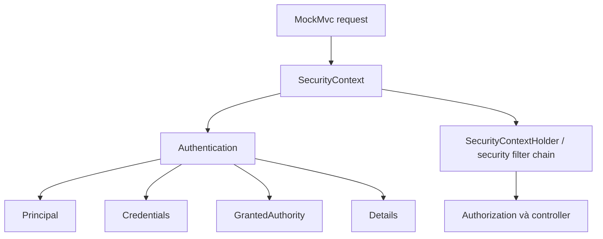

# `securityContext` với toàn bộ ngữ cảnh đã chuẩn bị

Trong Spring Security, một request được xử lý dựa trên ngữ cảnh bảo mật hiện hành. Ngữ cảnh này thường chứa đối tượng `Authentication` mô tả principal và các quyền của request. Khi bài kiểm thử cần chuẩn bị sẵn **cả một `SecurityContext`**, thay vì chỉ truyền một `Authentication` riêng lẻ, `SecurityMockMvcRequestPostProcessors.securityContext(context)` cung cấp cách đưa ngữ cảnh đó vào một request `MockMvc`.

Bài học thuộc chương **Danh tính trên yêu cầu** của module `SPRING_SECURITY_TESTING`, tập trung kiểm chứng xác thực, phân quyền và bảo vệ HTTP bằng `spring-security-test` trên ứng dụng Servlet và Reactive. Nội dung giải thích cấu trúc `SecurityContext`, cách tạo context rỗng rồi gắn `Authentication`, cách tái sử dụng helper tạo ngữ cảnh, phạm vi tác động theo request và những điểm cần kiểm tra khi ứng dụng lưu context qua session. Cuối bài đối chiếu với `user(...)`, `authentication(...)`, `@WithMockUser` và bộ công cụ Reactive.

## 1. `SecurityContext` giữ thông tin gì?

`SecurityContext` là giao diện của Spring Security đại diện cho **ngữ cảnh bảo mật hiện tại**. Thành phần cốt lõi mà giao diện này quản lý là một đối tượng `Authentication`:

- `getAuthentication()` trả về danh tính/xác thực đang được gắn với context; có thể là `null` nếu chưa có authentication.
- `setAuthentication(authentication)` đặt đối tượng `Authentication` cho context.
- `SecurityContextHolder` cung cấp context hiện hành cho code đang chạy trong luồng xử lý bảo mật.

Một `Authentication` có thể chứa principal, credentials, authorities và details. `SecurityContext` là lớp bao quanh nó để framework và ứng dụng trao đổi ngữ cảnh đó nhất quán. Vì vậy, cụm “toàn bộ context” trong bài có nghĩa là ta chuẩn bị và truyền **đối tượng `SecurityContext` hoàn chỉnh** thay vì chỉ đưa một `Authentication` cho request post-processor tự đặt vào context.



Ví dụ các loại context thường gặp:

| Thành phần | Vai trò |
| --- | --- |
| `SecurityContext` | Vùng chứa ngữ cảnh bảo mật hiện hành |
| `SecurityContextImpl` | Implementation thông dụng của `SecurityContext` |
| `Authentication` | Đối tượng mô tả danh tính và trạng thái xác thực |
| `SecurityContextHolder` | Điểm truy cập context hiện hành theo chiến lược lưu trữ của Spring Security |
| `SecurityContextRepository` | Cơ chế tải/lưu context giữa các request theo cấu hình ứng dụng |

Thông thường ta không cần tự triển khai `SecurityContext`. Dùng `SecurityContextHolder.createEmptyContext()` để tạo context mới theo strategy hiện hành rồi gắn authentication cần kiểm thử là đủ.

## 2. Cú pháp `securityContext(context)` trong MockMvc

Phương thức `securityContext(SecurityContext)` thuộc `SecurityMockMvcRequestPostProcessors` trong package:

```java
org.springframework.security.test.web.servlet.request
    .SecurityMockMvcRequestPostProcessors
```

Nó trả về một `RequestPostProcessor` để chuẩn bị request với context đã cung cấp:

```java
import static org.springframework.security.test.web.servlet.request
        .SecurityMockMvcRequestPostProcessors.securityContext;
import static org.springframework.test.web.servlet.request.MockMvcRequestBuilders.get;

SecurityContext context = SecurityContextHolder.createEmptyContext();
context.setAuthentication(authentication);

mockMvc.perform(get("/api/me").with(securityContext(context)));
```

Trong ví dụ, biến `context` đã chứa `Authentication` trước khi được truyền vào request. Request post-processor dùng chính context đó để Spring Security có thể sử dụng trong quá trình xử lý. Nó **không tự xác thực credentials**, không gọi `AuthenticationManager` và không tạo tài khoản trong database.

Một điểm cần phân biệt: `securityContext(context)` là API dành cho Servlet `MockMvc`. Nếu ứng dụng Reactive, context bảo mật nằm trong Reactor Context và được thiết lập bằng các công cụ WebFlux tương ứng; không truyền request post-processor của Servlet sang `WebTestClient`.

## 3. Tạo một context mới và gắn Authentication đã chuẩn bị

Cách an toàn, dễ đọc là tạo context rỗng cho mỗi request test:

```java
import java.util.List;

import org.springframework.security.core.Authentication;
import org.springframework.security.core.authority.SimpleGrantedAuthority;
import org.springframework.security.core.context.SecurityContext;
import org.springframework.security.core.context.SecurityContextHolder;
import org.springframework.security.authentication.UsernamePasswordAuthenticationToken;

private static SecurityContext contextFor(
        String username, String... authorities) {

    Authentication authentication =
            UsernamePasswordAuthenticationToken.authenticated(
                    username,
                    null,
                    java.util.Arrays.stream(authorities)
                            .map(SimpleGrantedAuthority::new)
                            .toList()
            );

    SecurityContext context = SecurityContextHolder.createEmptyContext();
    context.setAuthentication(authentication);
    return context;
}
```

Khi gọi `contextFor("alice", "ROLE_USER")`, ta thu được một context mới chứa authentication đã được đánh dấu xác thực với principal là chuỗi `alice` và authority `ROLE_USER`. Trong test này không có password thật; credentials được để `null` vì mục tiêu là kiểm tra quyết định truy cập sau xác thực.

Có thể dùng `TestingAuthenticationToken` nếu muốn fixture ngắn:

```java
import org.springframework.security.authentication.TestingAuthenticationToken;
import org.springframework.security.core.context.SecurityContext;
import org.springframework.security.core.context.SecurityContextHolder;

SecurityContext context = SecurityContextHolder.createEmptyContext();
context.setAuthentication(
        new TestingAuthenticationToken("alice", "unused", "ROLE_USER")
);
```

`TestingAuthenticationToken` tiện cho test nhưng principal của ví dụ là `String`. Nếu controller yêu cầu một lớp principal nghiệp vụ, hãy gắn đúng kiểu principal vào `Authentication`; context không tự chuyển đổi principal.

### Vì sao nên dùng `createEmptyContext()`?

`SecurityContextHolder.createEmptyContext()` tạo một context mới mà không sửa context đang hiện hành. Điều này tránh vô tình sửa đối tượng context được test khác hoặc code trước đó dùng chung. Sau đó, test gắn authentication vào context mới và đưa context vào đúng request.

Tránh viết helper chỉ gọi `SecurityContextHolder.getContext().setAuthentication(...)` để chuẩn bị danh tính cho nhiều request. Cách đó sửa context hiện hành của thread, có thể làm các test phụ thuộc thứ tự chạy hoặc rò rỉ trạng thái khi dọn dẹp không đúng. Với `MockMvc`, request post-processor giúp thể hiện dữ liệu đầu vào ngay tại `perform(...)`.

## 4. Ví dụ principal tùy chỉnh trong context

Giả sử ứng dụng quản lý dữ liệu theo tổ chức và cần principal chứa username cùng `tenantId`:

```java
import java.security.Principal;

public record TenantPrincipal(
        String username,
        String tenantId
) implements Principal {

    @Override
    public String getName() {
        return username;
    }
}
```

Tạo helper trả về context với principal này:

```java
import java.util.Arrays;
import java.util.List;

import org.springframework.security.authentication.UsernamePasswordAuthenticationToken;
import org.springframework.security.core.Authentication;
import org.springframework.security.core.authority.SimpleGrantedAuthority;
import org.springframework.security.core.context.SecurityContext;
import org.springframework.security.core.context.SecurityContextHolder;

private static SecurityContext tenantContext(
        String username, String tenantId, String... authorities) {

    List<SimpleGrantedAuthority> granted = Arrays.stream(authorities)
            .map(SimpleGrantedAuthority::new)
            .toList();

    Authentication authentication =
            UsernamePasswordAuthenticationToken.authenticated(
                    new TenantPrincipal(username, tenantId),
                    null,
                    granted
            );

    SecurityContext context = SecurityContextHolder.createEmptyContext();
    context.setAuthentication(authentication);
    return context;
}
```

Context kết quả mang cả loại principal, thông tin tenant và quyền. Khi controller nhận `@AuthenticationPrincipal TenantPrincipal`, test có thể kiểm tra hành vi phụ thuộc tenant mà không phải tạo tài khoản thật hoặc chạy quy trình đăng nhập.

## 5. Cấu hình ứng dụng Servlet để context đi qua filter chain

Ví dụ ứng dụng có hai endpoint:

- `GET /api/me` yêu cầu người dùng đã xác thực.
- `GET /api/tenants/{tenantId}/reports` yêu cầu authority `reports:read` và tenant trong URL phải khớp với tenant của principal.

Cấu hình Spring Security:

```java
import org.springframework.context.annotation.Bean;
import org.springframework.context.annotation.Configuration;
import org.springframework.http.HttpMethod;
import org.springframework.security.config.Customizer;
import org.springframework.security.config.annotation.web.builders.HttpSecurity;
import org.springframework.security.config.annotation.web.configuration.EnableWebSecurity;
import org.springframework.security.web.SecurityFilterChain;

@Configuration
@EnableWebSecurity
class ContextSecurityConfig {

    @Bean
    SecurityFilterChain securityFilterChain(HttpSecurity http)
            throws Exception {

        return http
            .authorizeHttpRequests(authorize -> authorize
                .requestMatchers(HttpMethod.GET, "/api/me")
                    .authenticated()
                .requestMatchers(HttpMethod.GET, "/api/tenants/*/reports")
                    .hasAuthority("reports:read")
                .anyRequest().denyAll())
            .httpBasic(Customizer.withDefaults())
            .build();
    }
}
```

Controller dùng principal:

```java
import java.util.Map;

import org.springframework.http.HttpStatus;
import org.springframework.http.ResponseEntity;
import org.springframework.security.core.annotation.AuthenticationPrincipal;
import org.springframework.security.core.Authentication;
import org.springframework.web.bind.annotation.GetMapping;
import org.springframework.web.bind.annotation.PathVariable;
import org.springframework.web.bind.annotation.RestController;

@RestController
class ContextController {

    @GetMapping("/api/me")
    Map<String, String> me(Authentication authentication) {
        return Map.of("username", authentication.getName());
    }

    @GetMapping("/api/tenants/{tenantId}/reports")
    ResponseEntity<String> reports(
            @PathVariable String tenantId,
            @AuthenticationPrincipal TenantPrincipal principal) {

        if (!tenantId.equals(principal.tenantId())) {
            return ResponseEntity.status(HttpStatus.FORBIDDEN)
                    .body("forbidden-tenant");
        }

        return ResponseEntity.ok("reports-for-" + tenantId);
    }
}
```

Filter chain quyết định request có đủ authentication/authority để vào controller hay không. Controller kiểm tra điều kiện tenant sau khi request đã vượt qua rule `reports:read`. Hai tầng này tạo ra hai nguyên nhân khác nhau cho kết quả `403`, vì vậy test nên tách riêng.

Các ví dụ dùng `GET` để tập trung vào context và authorization. Khi chuyển sang `POST`, `PUT`, `PATCH` hoặc `DELETE`, phải xét thêm CSRF nếu ứng dụng bật bảo vệ này.

## 6. Chuẩn bị MockMvc có Spring Security

Thêm dependency `spring-security-test` trong test scope:

```xml
<dependency>
    <groupId>org.springframework.security</groupId>
    <artifactId>spring-security-test</artifactId>
    <scope>test</scope>
</dependency>
```

Với Spring Boot, cấu hình `MockMvc` thường dùng:

```java
@SpringBootTest
@AutoConfigureMockMvc
class SecurityContextRequestTest {

    @Autowired
    MockMvc mockMvc;
}
```

`@AutoConfigureMockMvc` mặc định tích hợp servlet filter của application context. Không tắt filter nếu mục tiêu của bài test là xác minh security filter chain.

Nếu tự khởi tạo `MockMvc` bằng builder, hãy áp dụng Spring Security:

```java
import static org.springframework.security.test.web.servlet.setup
        .SecurityMockMvcConfigurers.springSecurity;

MockMvc mockMvc = MockMvcBuilders
        .webAppContextSetup(webApplicationContext)
        .apply(springSecurity())
        .build();
```

Nếu bỏ filter bằng `@AutoConfigureMockMvc(addFilters = false)` hoặc dựng controller bằng `standaloneSetup(...)` mà không tích hợp security filter, một response `200` có thể chỉ chứng minh controller đã chạy. Nó không chứng minh authorization rule trong ứng dụng đang hoạt động.

## 7. Dùng `securityContext(context)` cho từng request

Sau khi có helper `tenantContext(...)`, mỗi ca kiểm thử có thể cung cấp context khác nhau ngay tại request:

```java
import static org.springframework.security.test.web.servlet.request
        .SecurityMockMvcRequestPostProcessors.anonymous;
import static org.springframework.security.test.web.servlet.request
        .SecurityMockMvcRequestPostProcessors.securityContext;
import static org.springframework.test.web.servlet.request.MockMvcRequestBuilders.get;
import static org.springframework.test.web.servlet.result.MockMvcResultMatchers.content;
import static org.springframework.test.web.servlet.result.MockMvcResultMatchers.jsonPath;
import static org.springframework.test.web.servlet.result.MockMvcResultMatchers.status;

import org.junit.jupiter.api.Test;
import org.springframework.beans.factory.annotation.Autowired;
import org.springframework.boot.test.autoconfigure.web.servlet.AutoConfigureMockMvc;
import org.springframework.boot.test.context.SpringBootTest;
import org.springframework.test.web.servlet.MockMvc;

@SpringBootTest
@AutoConfigureMockMvc
class SecurityContextRequestTest {

    @Autowired
    MockMvc mockMvc;

    @Test
    void authenticatedContextCanReadIdentity() throws Exception {
        SecurityContext context =
                tenantContext("alice", "acme", "reports:read");

        mockMvc.perform(get("/api/me").with(securityContext(context)))
            .andExpect(status().isOk())
            .andExpect(content().string("alice"));
    }

    @Test
    void contextWithRequiredAuthorityCanReadOwnTenant() throws Exception {
        SecurityContext context =
                tenantContext("alice", "acme", "reports:read");

        mockMvc.perform(get("/api/tenants/acme/reports")
                .with(securityContext(context)))
            .andExpect(status().isOk())
            .andExpect(content().string("reports-for-acme"));
    }

    @Test
    void contextWithoutRequiredAuthorityIsForbidden() throws Exception {
        SecurityContext context =
                tenantContext("alice", "acme", "reports:write");

        mockMvc.perform(get("/api/tenants/acme/reports")
                .with(securityContext(context)))
            .andExpect(status().isForbidden());
    }

    @Test
    void contextWithWrongTenantIsForbiddenByController() throws Exception {
        SecurityContext context =
                tenantContext("alice", "other", "reports:read");

        mockMvc.perform(get("/api/tenants/acme/reports")
                .with(securityContext(context)))
            .andExpect(status().isForbidden())
            .andExpect(content().string("forbidden-tenant"));
    }

    @Test
    void anonymousRequestCannotReadIdentity() throws Exception {
        mockMvc.perform(get("/api/me").with(anonymous()))
            .andExpect(status().isUnauthorized());
    }
}
```

Ma trận kết quả dự kiến với cấu hình HTTP Basic ở trên:

| Request | Context được cung cấp | Kết quả | Nơi quyết định |
| --- | --- | --- | --- |
| `GET /api/me` | Alice đã xác thực | `200`, body `alice` | Controller |
| `GET /api/tenants/acme/reports` | Alice, tenant `acme`, `reports:read` | `200` | Filter chain cho phép, controller xác nhận tenant |
| `GET /api/tenants/acme/reports` | Alice, tenant `acme`, `reports:write` | `403` | Authorization rule chặn trước controller |
| `GET /api/tenants/acme/reports` | Alice, tenant `other`, `reports:read` | `403` | Controller từ chối tenant không khớp |
| `GET /api/me` | `anonymous()` | `401` | HTTP Basic entry point yêu cầu xác thực |

Mã `401` phụ thuộc `AuthenticationEntryPoint`. Nếu ứng dụng dùng form login, request anonymous có thể được chuyển hướng `302`. Người dùng đã xác thực nhưng thiếu authority thường nhận `403`. Không nên coi một mã HTTP là kết quả cố định cho mọi cấu hình.

## 8. Context rỗng, context có authentication và context anonymous

`SecurityContext` mới có thể chưa chứa authentication:

```java
SecurityContext emptyContext = SecurityContextHolder.createEmptyContext();

mockMvc.perform(get("/api/me")
        .with(securityContext(emptyContext)))
    .andExpect(status().isUnauthorized()); // Với HTTP Basic
```

Khi filter chain có anonymous authentication bật, request không có authentication có thể được `AnonymousAuthenticationFilter` bổ sung `AnonymousAuthenticationToken`. Điều này khác với việc tự tạo một `UsernamePasswordAuthenticationToken` mang tên `anonymousUser`; token đó có thể là một danh tính đã xác thực thông thường.

Để diễn đạt trực tiếp ý định “request vô danh”, `.with(anonymous())` thường rõ ràng hơn. Context rỗng hữu ích khi mục tiêu chính là kiểm tra cách hệ thống xử lý một context chưa được gắn authentication hoặc một context factory trả về trạng thái rỗng.

| Trạng thái context | Nội dung | Ý nghĩa kiểm thử |
| --- | --- | --- |
| Context rỗng | `getAuthentication() == null` | Chưa có authentication trong context đầu vào |
| Context đã xác thực | `Authentication` đã chuẩn bị | Kiểm tra authorization sau xác thực |
| Context chứa anonymous token | `AnonymousAuthenticationToken` | Kiểm tra chính sách cho khách vô danh |
| Context chứa token chưa xác thực | `Authentication.isAuthenticated() == false` | Không mặc định được coi là đăng nhập thành công |

Đừng chỉ nhìn `Authentication.isAuthenticated()` để kết luận một request anonymous hay authenticated. Hãy dùng các rule `authenticated()`/`anonymous()` hoặc các matcher kiểm tra trạng thái tương ứng, vì Spring Security có cách nhận diện anonymous riêng.

## 9. Khác biệt giữa `securityContext(...)`, `authentication(...)` và `user(...)`

Ba request post-processor này có quan hệ gần nhau nhưng mức độ kiểm soát khác nhau:

| API | Dữ liệu đầu vào | Khi nào chọn |
| --- | --- | --- |
| `user("alice").roles("USER")` | Username và role để tạo principal `UserDetails` chuẩn | Test đơn giản với username và quyền |
| `user(customUserDetails)` | Một `UserDetails` tùy chỉnh | Controller cần principal nghiệp vụ triển khai `UserDetails` |
| `authentication(auth)` | Một `Authentication` cụ thể | Cần chủ động loại token, principal, credentials, details và authorities |
| `securityContext(context)` | Một `SecurityContext` đã dựng sẵn | Cần tạo context qua helper/factory, giữ nguyên object context hoặc truyền context implementation riêng |

Nếu test chỉ cần đổi một principal và authority, `authentication(auth)` thường ngắn hơn. Nếu đã có helper tạo context dùng chung hoặc cần kiểm tra logic gắn context, `securityContext(context)` thể hiện rõ cấu trúc đó.

Ví dụ chuyển từ context sang authentication:

```java
Authentication authentication =
        UsernamePasswordAuthenticationToken.authenticated(
                "alice", null,
                List.of(new SimpleGrantedAuthority("ROLE_USER"))
        );

// Cách 1: đưa Authentication để post-processor tạo context phù hợp.
mockMvc.perform(get("/api/me").with(authentication(authentication)));

// Cách 2: tự tạo SecurityContext rồi gắn Authentication.
SecurityContext context = SecurityContextHolder.createEmptyContext();
context.setAuthentication(authentication);

mockMvc.perform(get("/api/me").with(securityContext(context)));
```

Hai cách có thể phục vụ cùng một mục tiêu khi chỉ có một authentication. Chọn cách thứ hai nếu việc chuẩn bị hoặc tái sử dụng chính đối tượng context là một phần của kịch bản.

### So sánh với `@WithMockUser`

`@WithMockUser` tạo `SecurityContext` mặc định cho phạm vi test method/class thông qua Spring Security Test listener:

```java
@Test
@WithMockUser(username = "alice", roles = "USER")
void userFromAnnotationCanReadProfile() throws Exception {
    mockMvc.perform(get("/api/me"))
           .andExpect(status().isOk());
}
```

Annotation này thuận tiện khi các request trong phương thức dùng chung một danh tính đơn giản. Nó không cho phép truyền trực tiếp một context instance do test dựng sẵn. Nếu controller đòi principal tùy chỉnh, `@WithMockUser` có thể không cung cấp đúng kiểu; khi đó hãy tạo `Authentication` hoặc `SecurityContext` chứa principal phù hợp.

## 10. Không nhầm context request với context lưu trong session

Một trong những điểm quan trọng nhất khi dùng `securityContext(context)` là **phạm vi của dữ liệu test**. Request post-processor chuẩn bị context cho request đang được xây dựng. Việc đó không tự chứng minh rằng Spring Security sẽ lưu context vào HTTP session và khôi phục nó cho request tiếp theo trong ứng dụng production.

Cần phân biệt:

1. **Context được gắn vào một request test:** dùng `.with(securityContext(context))` để kiểm tra controller/filter với trạng thái bảo mật đã chuẩn bị.
2. **Context được lưu và tải qua nhiều request:** phụ thuộc `SecurityContextRepository`, session policy, cách filter chain lưu context và cấu hình ứng dụng.
3. **Context của một thread:** `SecurityContextHolder` dùng strategy đã cấu hình (thường là thread-local ở Servlet); không nên tự chia sẻ hoặc sửa context mutable giữa các test chạy song song.
4. **Context sau logout:** cần kiểm tra logout handler, session invalidation, cookie và request tiếp theo; một lần `securityContext(context)` không mô phỏng quá trình logout.

Nếu mục tiêu là xác minh đăng nhập tạo session, có thể dùng `MockHttpSession` và thực hiện luồng login phù hợp rồi gửi request tiếp theo với cùng session. Nếu ứng dụng stateless, hãy kiểm tra request tiếp theo phải cung cấp credentials/token theo chính sách; không giả định session sẽ lưu context.

Ví dụ khái niệm về việc kiểm tra session phải dùng cơ chế xác thực thật của ứng dụng:

```java
// Pseudocode: thay URL, tham số form và assertions theo login thực tế.
MvcResult loginResult = mockMvc.perform(post("/login")
        .param("username", "alice")
        .param("password", "correct-password"))
    .andReturn();

MockHttpSession session =
        (MockHttpSession) loginResult.getRequest().getSession(false);

mockMvc.perform(get("/api/me").session(session))
    .andExpect(status().isOk());
```

Đây là một **luồng tích hợp login/session** riêng. Không thay nó bằng `securityContext(context)` nếu điều cần chứng minh là quá trình đăng nhập và duy trì session.

## 11. Các lỗi thường gặp khi chuẩn bị context

### Dùng lại một context mutable cho nhiều request

`SecurityContext` có thể thay đổi thông qua `setAuthentication(...)`. Nếu cùng một instance được dùng cho nhiều request rồi sửa giữa các test, kết quả có thể phụ thuộc thứ tự thực thi. Tạo context mới bằng `createEmptyContext()` trong mỗi helper/request sẽ làm dữ liệu test độc lập hơn.

### Đặt authentication chưa xác thực rồi mong request được phép

Một `UsernamePasswordAuthenticationToken.unauthenticated(...)` chứa username/password chỉ là credentials chờ xử lý. `securityContext(context)` không tự gửi nó qua `AuthenticationManager`. Nếu muốn test kết quả sau login, chuẩn bị authentication đã xác thực; nếu muốn test quá trình login, gửi credentials qua cơ chế xác thực thật.

### Tự đặt context toàn cục trên `SecurityContextHolder`

Gọi `SecurityContextHolder.getContext().setAuthentication(...)` trong setup có thể làm thay đổi trạng thái thread hiện tại và ảnh hưởng test khác nếu không dọn dẹp. Ưu tiên request post-processor để danh tính gắn rõ vào request. Nếu một test buộc phải thay context holder trực tiếp, phải lưu/khôi phục hoặc clear context trong `finally`/lifecycle phù hợp.

### Không chạy security filter chain

Một test dùng `standaloneSetup` hoặc `addFilters = false` có thể không kiểm tra được authorization. Hãy tích hợp filter chain, sau đó kiểm tra cả request được phép và request bị từ chối.

### Nhầm `403` do CSRF với `403` do quyền

Với request thay đổi trạng thái, CSRF có thể chặn trước authorization. Khi mục tiêu là kiểm tra quyền, thêm token hợp lệ bằng `.with(csrf())` nếu CSRF đang bật; kiểm tra thiếu hoặc sai token trong test riêng.

### Nhầm principal trong context với người dùng được tải từ database

`securityContext(context)` dùng đúng dữ liệu test cung cấp. Nó không gọi `UserDetailsService`, không xác nhận trạng thái tài khoản và không chứng minh dữ liệu principal được ánh xạ chính xác từ database. Nếu cần xác minh quá trình tải tài khoản, viết test cho service hoặc dùng `@WithUserDetails` trong test context phù hợp.

## 12. Ranh giới Servlet và Reactive

`securityContext(context)` của `SecurityMockMvcRequestPostProcessors` là API dành cho Servlet `MockMvc`. Với WebFlux, Spring Security lưu security context trong Reactor Context và cung cấp `SecurityMockServerConfigurers` cho `WebTestClient`.

Ví dụ kiểm tra request Reactive có người dùng giả lập:

```java
WebTestClient securedClient = WebTestClient
        .bindToApplicationContext(applicationContext)
        .apply(SecurityMockServerConfigurers.springSecurity())
        .configureClient()
        .build();

securedClient
    .mutateWith(SecurityMockServerConfigurers.mockUser("alice")
            .roles("USER"))
    .get()
    .uri("/api/me")
    .exchange()
    .expectStatus().isOk();
```

Nếu cần một context hoặc principal tùy chỉnh trong Reactive, dùng các API Reactive tương ứng và bảo đảm chúng được ghi vào Reactor Context của request. Không lấy `SecurityContext` gắn với Servlet thread-local rồi giả định WebFlux sẽ tự đọc nó. Tương tự, `mockJwt()` trong WebTestClient phục vụ bearer authentication giả lập; nó không kiểm tra chữ ký hay decoder của token thật.

## 13. Bài tập: xây dựng context dùng chung cho nhiều loại request

Giả sử endpoint `GET /api/tenants/{tenantId}/invoices` yêu cầu `invoice:read` và tenant của principal phải khớp với URL. Hãy xây helper `invoiceContext(username, tenantId, authorities...)` trả về `SecurityContext` đã gắn `Authentication` phù hợp, sau đó viết các ca:

1. Alice thuộc tenant `north`, có `invoice:read`, truy cập `/api/tenants/north/invoices` và nhận `200`.
2. Bob cùng tenant nhưng chỉ có `invoice:write`, nhận `403` từ authorization rule.
3. Carol có `invoice:read` nhưng thuộc tenant `south`, gọi URL tenant `north` và nhận `403` từ controller.
4. Gửi request `anonymous()` và xác định phản hồi của `AuthenticationEntryPoint`.
5. Tạo một `SecurityContext` rỗng và quan sát cách anonymous filter xử lý request nếu cơ chế anonymous đang bật.
6. Dùng `authentication(auth)` để kiểm tra cùng principal; giải thích vì sao kết quả authorization có thể giống `securityContext(context)`.
7. Viết một test riêng cho session/login nếu yêu cầu nghiệp vụ là context phải được lưu và khôi phục qua nhiều HTTP request.

Khi đọc kết quả, hãy tách rõ **context đầu vào**, **authentication bên trong**, **authority được kiểm tra**, **quy tắc nghiệp vụ trong controller** và **cơ chế lưu context của ứng dụng**. `securityContext(context)` hữu ích khi test cần kiểm soát toàn bộ object ngữ cảnh đã chuẩn bị; các kiểm thử đăng nhập, session, token và vòng đời context vẫn phải đi qua cơ chế thực tế tương ứng.
