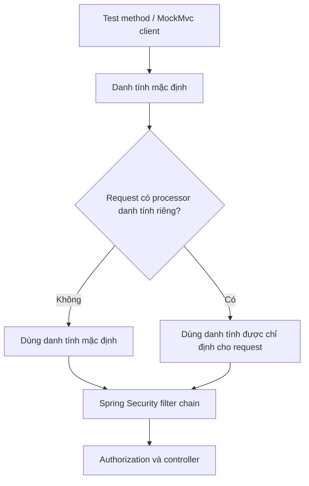

# Danh tính mặc định khác với danh tính riêng của một request

Trong một test method dùng `MockMvc`, ta có thể thiết lập một người dùng mặc định bằng `@WithMockUser` hoặc `@WithUserDetails`. Tuy nhiên, một kịch bản kiểm thử thường cần nhiều danh tính: người đọc được phép xem báo cáo, người viết không có quyền, quản trị viên được phép thao tác và khách chưa đăng nhập bị chặn. Spring Security Test cho phép kết hợp **danh tính mặc định của test** với **danh tính được chỉ định riêng cho từng request** bằng các request post-processor như `.with(user(...))`, `.with(anonymous())` hoặc `.with(authentication(...))`.

Bài học thuộc chương **Danh tính trên yêu cầu** của module `SPRING_SECURITY_TESTING`. Người học sử dụng `spring-security-test` để kiểm chứng xác thực, phân quyền và bảo vệ HTTP trên ứng dụng Servlet và Reactive. Trọng tâm ở đây là phân biệt phạm vi của danh tính mặc định và danh tính riêng của request, hiểu cách ghi đè có chủ ý, rồi kiểm tra các kết quả được phép hoặc bị từ chối mà không nhầm lẫn trạng thái giữa các request.

## 1. Hai câu hỏi khác nhau: test đang đại diện cho ai và request đang đại diện cho ai?

Một test method có thể bắt đầu với một danh tính chung. Ví dụ, mọi thao tác trong một kịch bản đều diễn ra khi người dùng `reader` đã đăng nhập. Đây là **danh tính mặc định của test**. Annotation `@WithMockUser` thường là cách ngắn gọn để thiết lập mặc định đó:

```java
@Test
@WithMockUser(username = "reader", roles = "READER")
void readerCanReadReports() throws Exception {
    mockMvc.perform(get("/api/reports"))
           .andExpect(status().isOk());
}
```

Nhưng trong cùng kịch bản, ta có thể muốn thử một request như thể người gửi là `admin`, `writer` hoặc khách vô danh. Khi đó, danh tính được khai báo ngay trên request:

```java
mockMvc.perform(get("/api/admin")
        .with(user("admin").roles("ADMIN")))
    .andExpect(status().isOk());

mockMvc.perform(get("/api/reports")
        .with(anonymous()))
    .andExpect(status().isUnauthorized());
```

Hai câu hỏi cần được tách riêng:

- **Danh tính mặc định:** test method/class được chuẩn bị với context nào nếu request không chỉ định danh tính riêng?
- **Danh tính request:** request cụ thể được gửi qua `perform(...)` với principal, authentication và authority nào?

Khi một request có request post-processor đặt danh tính rõ ràng, context của request đó được sử dụng cho quá trình xử lý request. Việc này không sửa annotation, không biến người dùng riêng của request thành mặc định mới cho các request tiếp theo, và không thay đổi tài khoản trong database.

## 2. Các nguồn danh tính mặc định thường gặp

Không phải mọi mặc định đều được thiết lập theo cùng một cách. Trong test Spring Security, thường gặp ba nguồn sau:

| Nguồn mặc định | Phạm vi | Dùng khi |
| --- | --- | --- |
| `@WithMockUser` | Test method hoặc class | Cần một username/role giả lập đơn giản |
| `@WithUserDetails` | Test method hoặc class | Cần principal được tải từ `UserDetailsService` của test context |
| `MockMvcBuilders.defaultRequest(...)` | Các request được tạo bởi một `MockMvc` instance | Cần đặt thuộc tính mặc định cho nhiều request của client test |

### `@WithMockUser`

`@WithMockUser` tạo context kiểm thử với principal chuẩn của Spring Security Test. Ví dụ:

```java
@Test
@WithMockUser(username = "reader", roles = "READER")
void defaultReader() throws Exception {
    mockMvc.perform(get("/api/reports"))
           .andExpect(status().isOk());
}
```

`roles = "READER"` tạo authority `ROLE_READER` theo quy ước mặc định. Annotation này không gọi quy trình login, không xác minh password và không tạo session người dùng thực tế.

### `@WithUserDetails`

Nếu ứng dụng có `UserDetailsService` tạo principal domain tùy chỉnh, có thể thiết lập mặc định từ service:

```java
@Test
@WithUserDetails("alice")
void defaultPrincipalComesFromUserDetailsService() throws Exception {
    mockMvc.perform(get("/api/profile"))
           .andExpect(status().isOk());
}
```

Annotation tải `UserDetails` từ bean `UserDetailsService` trong test context. Nó giúp test sử dụng principal giống cấu trúc ứng dụng hơn, nhưng vẫn không gửi mật khẩu qua HTTP và không thực hiện xác thực đăng nhập thật.

### `defaultRequest(...)` của MockMvc builder

Có thể đặt một request mặc định cho client `MockMvc`:

```java
MockMvc mockMvc = MockMvcBuilders
        .webAppContextSetup(webApplicationContext)
        .defaultRequest(get("/")
                .with(user("default-reader").roles("READER")))
        .apply(springSecurity())
        .build();
```

Request mặc định là fixture của `MockMvc` instance. Những request tạo từ client đó kế thừa các thuộc tính mặc định theo cơ chế merge của Spring MVC Test; request cụ thể có thể chỉ định các thuộc tính hoặc processor riêng để phục vụ kịch bản của nó. Đây không phải session đăng nhập được tạo trong trình duyệt hoặc trong production.

**Không nên trộn nhiều nguồn mặc định một cách vô thức.** Nếu test vừa có `@WithMockUser`, vừa cấu hình `defaultRequest(...with(user(...)))`, vừa tái sử dụng session có context, người đọc khó biết danh tính nào đang được kiểm tra. Hãy chọn một nguồn mặc định chính cho mỗi test hoặc client và đặt các override tại request cần thiết.

## 3. Request post-processor đặt danh tính riêng như thế nào?

Các API trong `SecurityMockMvcRequestPostProcessors` trả về `RequestPostProcessor` để điều chỉnh request trước khi chạy qua security filter chain.

| Processor | Danh tính/context được chuẩn bị | Mục đích |
| --- | --- | --- |
| `user("alice").roles("READER")` | Principal `UserDetails` giả lập và authority tương ứng | Một người dùng cụ thể trên request |
| `user(customUserDetails)` | Principal `UserDetails` tùy chỉnh | Controller cần thuộc tính nghiệp vụ |
| `authentication(auth)` | Một `Authentication` instance | Kiểm tra đúng loại token/principal |
| `securityContext(context)` | Một `SecurityContext` đã dựng sẵn | Kiểm soát trực tiếp context của request |
| `anonymous()` | Request vô danh | Kiểm tra khách chưa đăng nhập |
| `csrf()` | CSRF token hợp lệ | Bổ sung token cho request thay đổi trạng thái |

Ví dụ một request riêng dùng người dùng khác với mặc định:

```java
mockMvc.perform(get("/api/admin")
        .with(user("root").roles("ADMIN")))
    .andExpect(status().isOk());
```

Nếu method đang có `@WithMockUser(username = "reader", roles = "READER")`, request trên được kiểm tra với danh tính `root` và authority `ROLE_ADMIN`. Request tiếp theo không có processor danh tính riêng vẫn sử dụng context mặc định `reader` theo test context, miễn là không có nguồn context/session khác được cấu hình cho request đó.

Có thể biểu diễn quy tắc tư duy như sau:



Sơ đồ mô tả cách tổ chức test. Trong ứng dụng thực, session, `SecurityContextRepository` và cấu hình test có thể cung cấp context khác; vì thế cần giữ fixture đơn giản và xác nhận danh tính hiệu lực qua response/assertion phù hợp.

## 4. Ví dụ ứng dụng: reader mặc định, admin override và anonymous override

Giả sử API có hai endpoint:

- `GET /api/reports` cho phép `READER` hoặc `ADMIN`.
- `GET /api/admin` chỉ cho phép `ADMIN`.

Cấu hình Servlet:

```java
import org.springframework.context.annotation.Bean;
import org.springframework.context.annotation.Configuration;
import org.springframework.http.HttpMethod;
import org.springframework.security.config.Customizer;
import org.springframework.security.config.annotation.web.builders.HttpSecurity;
import org.springframework.security.config.annotation.web.configuration.EnableWebSecurity;
import org.springframework.security.web.SecurityFilterChain;

@Configuration
@EnableWebSecurity
class IdentityScopeSecurityConfig {

    @Bean
    SecurityFilterChain securityFilterChain(HttpSecurity http)
            throws Exception {
        return http
            .authorizeHttpRequests(auth -> auth
                .requestMatchers(HttpMethod.GET, "/api/reports")
                    .hasAnyRole("READER", "ADMIN")
                .requestMatchers(HttpMethod.GET, "/api/admin")
                    .hasRole("ADMIN")
                .anyRequest().denyAll())
            .httpBasic(Customizer.withDefaults())
            .build();
    }
}
```

Controller trả lại username để dễ quan sát danh tính hiệu lực:

```java
import org.springframework.security.core.Authentication;
import org.springframework.web.bind.annotation.GetMapping;
import org.springframework.web.bind.annotation.RestController;

@RestController
class IdentityScopeController {

    @GetMapping("/api/reports")
    String reports(Authentication authentication) {
        return "reports-for-" + authentication.getName();
    }

    @GetMapping("/api/admin")
    String admin(Authentication authentication) {
        return "admin-for-" + authentication.getName();
    }
}
```

Trong test scope, dự án cần dependency `spring-security-test`:

```xml
<dependency>
    <groupId>org.springframework.security</groupId>
    <artifactId>spring-security-test</artifactId>
    <scope>test</scope>
</dependency>
```

Spring Boot có thể tự cấu hình `MockMvc` cùng servlet filter của ứng dụng:

```java
@SpringBootTest
@AutoConfigureMockMvc
class IdentityScopeTests {

    @Autowired
    MockMvc mockMvc;
}
```

Nếu tự tạo `MockMvc` bằng `MockMvcBuilders`, tích hợp Spring Security với `.apply(springSecurity())`. Không tắt filter khi mục tiêu của test là kiểm tra authorization thực tế.

## 5. Một test method với nhiều danh tính riêng

Đây là ví dụ đầy đủ về danh tính mặc định và danh tính riêng. `reader` được thiết lập bằng annotation. Các request sau đó lần lượt sử dụng mặc định, ghi đè thành admin, ghi đè thành writer, ghi đè thành anonymous và cuối cùng trở về mặc định:

```java
import static org.springframework.security.test.web.servlet.request
        .SecurityMockMvcRequestPostProcessors.anonymous;
import static org.springframework.security.test.web.servlet.request
        .SecurityMockMvcRequestPostProcessors.user;
import static org.springframework.test.web.servlet.request.MockMvcRequestBuilders.get;
import static org.springframework.test.web.servlet.result.MockMvcResultMatchers.content;
import static org.springframework.test.web.servlet.result.MockMvcResultMatchers.status;

import org.junit.jupiter.api.Test;
import org.springframework.beans.factory.annotation.Autowired;
import org.springframework.boot.test.autoconfigure.web.servlet.AutoConfigureMockMvc;
import org.springframework.boot.test.context.SpringBootTest;
import org.springframework.security.test.context.support.WithMockUser;
import org.springframework.test.web.servlet.MockMvc;

@SpringBootTest
@AutoConfigureMockMvc
class IdentityScopeTests {

    @Autowired
    MockMvc mockMvc;

    @Test
    @WithMockUser(username = "reader", roles = "READER")
    void requestIdentityCanDifferFromTestDefault() throws Exception {

        // Không override: dùng reader từ @WithMockUser.
        mockMvc.perform(get("/api/reports"))
            .andExpect(status().isOk())
            .andExpect(content().string("reports-for-reader"));

        // Request này dùng admin, không dùng reader.
        mockMvc.perform(get("/api/admin")
                .with(user("root").roles("ADMIN")))
            .andExpect(status().isOk())
            .andExpect(content().string("admin-for-root"));

        // Request này dùng writer; đã xác thực nhưng thiếu role ADMIN.
        mockMvc.perform(get("/api/admin")
                .with(user("writer").roles("WRITER")))
            .andExpect(status().isForbidden());

        // Request này là khách vô danh.
        mockMvc.perform(get("/api/reports")
                .with(anonymous()))
            .andExpect(status().isUnauthorized());

        // Request mới không override: mặc định reader vẫn được sử dụng.
        mockMvc.perform(get("/api/reports"))
            .andExpect(status().isOk())
            .andExpect(content().string("reports-for-reader"));
    }
}
```

Kết quả theo cấu hình HTTP Basic:

| Request | Danh tính hiệu lực | Kết quả | Lý do |
| --- | --- | --- | --- |
| `GET /api/reports` | reader / `ROLE_READER` | `200` | Mặc định từ annotation, đủ quyền |
| `GET /api/admin` | root / `ROLE_ADMIN` | `200` | Request processor ghi đè mặc định |
| `GET /api/admin` | writer / `ROLE_WRITER` | `403` | Đã xác thực nhưng thiếu `ROLE_ADMIN` |
| `GET /api/reports` | anonymous | `401` | Request vô danh, HTTP Basic yêu cầu xác thực |
| `GET /api/reports` | reader / `ROLE_READER` | `200` | Request mới quay lại mặc định |

Mã `401` phụ thuộc `AuthenticationEntryPoint`. Với form login, anonymous có thể được chuyển hướng `302`. Người dùng đã xác thực nhưng thiếu role thường nhận `403`. Hãy xác nhận phản hồi theo cấu hình thực tế của ứng dụng.

## 6. Danh tính mặc định của MockMvc client bằng defaultRequest

`@WithMockUser` gắn mặc định vào test lifecycle. Một cách khác là đặt danh tính mặc định ở cấp `MockMvc` client:

```java
MockMvc mockMvc = MockMvcBuilders
        .webAppContextSetup(webApplicationContext)
        .defaultRequest(get("/")
                .with(user("baseline-reader").roles("READER")))
        .apply(springSecurity())
        .build();
```

Trong ví dụ này, `baseline-reader` là fixture mặc định của client. Khi request cần một danh tính khác, khai báo processor ngay tại request:

```java
// Dùng danh tính mặc định của client.
mockMvc.perform(get("/api/reports"))
    .andExpect(status().isOk());

// Chỉ request này dùng admin.
mockMvc.perform(get("/api/admin")
        .with(user("admin").roles("ADMIN")))
    .andExpect(status().isOk());

// Chỉ request này là anonymous.
mockMvc.perform(get("/api/reports")
        .with(anonymous()))
    .andExpect(status().isUnauthorized());
```

`defaultRequest(...)` có thể đặt nhiều thuộc tính chung cho client, không chỉ identity. Khi kết hợp với request builder riêng, hãy kiểm tra thuộc tính nào được kế thừa và thuộc tính nào được request cụ thể thay thế. Với danh tính, nên giữ đúng một nguồn mặc định và một processor override trên request cần kiểm tra.

Không nên dùng cùng lúc `defaultRequest(...with(user(...)))` và `@WithMockUser` trong cùng ví dụ nếu không có lý do cụ thể. Cả hai đều có thể đóng vai trò baseline; việc có hai baseline làm khó xác định nguồn context khi test thất bại.

## 7. Kết hợp danh tính riêng với CSRF và các processor độc lập

Một request thay đổi trạng thái có thể cần cả danh tính lẫn CSRF token. Hai processor này phục vụ hai mục tiêu khác nhau:

```java
mockMvc.perform(post("/api/reports")
        .with(user("admin").roles("ADMIN"))
        .with(csrf()))
    .andExpect(status().isCreated());
```

Nếu test method có `@WithMockUser(username = "reader", roles = "READER")`, processor `user("admin")` chuẩn bị danh tính riêng cho request POST; `csrf()` thêm token hợp lệ. Request không có `user(...)` nhưng có `csrf()` vẫn sử dụng danh tính mặc định `reader`. Do đó, nó có thể bị từ chối vì thiếu `ROLE_ADMIN` dù CSRF hợp lệ.

| Danh tính request | CSRF | Kết quả dự kiến | Nguyên nhân |
| --- | --- | --- | --- |
| admin | Hợp lệ | `201` | Đủ quyền và vượt qua CSRF |
| admin | Thiếu | `403` | CSRF filter từ chối |
| reader mặc định | Hợp lệ | `403` | Thiếu `ROLE_ADMIN` |
| anonymous | Hợp lệ | `401` với HTTP Basic | Chưa xác thực |

Để phân biệt hai loại `403`, giữ danh tính đủ quyền khi test thiếu CSRF; khi test thiếu quyền, cung cấp CSRF token hợp lệ. Không gộp các nguyên nhân từ chối vào một assertion duy nhất.

## 8. `authentication(...)` và `securityContext(...)` cũng là override theo request

Khi controller cần một loại principal hoặc token riêng, request có thể dùng `.with(authentication(auth))`:

```java
Authentication customAuth =
        UsernamePasswordAuthenticationToken.authenticated(
                new TenantPrincipal("alice", "acme"),
                null,
                List.of(new SimpleGrantedAuthority("reports:read"))
        );

mockMvc.perform(get("/api/tenant-reports")
        .with(authentication(customAuth)))
    .andExpect(status().isOk());
```

Hoặc nếu đã chuẩn bị cả context:

```java
SecurityContext requestContext = SecurityContextHolder.createEmptyContext();
requestContext.setAuthentication(customAuth);

mockMvc.perform(get("/api/tenant-reports")
        .with(securityContext(requestContext)))
    .andExpect(status().isOk());
```

Khi được áp dụng trên một request trong test có `@WithMockUser`, các processor này cung cấp danh tính/context riêng cho request đó. Request khác không có override tiếp tục theo baseline, nếu không có session hoặc nguồn context khác can thiệp.

Mỗi request chỉ nên dùng **một processor chính để đặt danh tính**. Không ghép `user(...)` với `authentication(...)` hoặc `securityContext(...)` trên cùng request rồi phụ thuộc vào thứ tự chạy để xác định ai là principal. Có thể ghép processor danh tính với processor độc lập như `csrf()`.

## 9. `@WithAnonymousUser` và override request-level

Nếu toàn bộ một test method cần bắt đầu ở trạng thái anonymous, có thể dùng `@WithAnonymousUser`:

```java
@Test
@WithAnonymousUser
void anonymousDefaultCanBeOverriddenForOneRequest() throws Exception {

    // Mặc định là khách vô danh.
    mockMvc.perform(get("/api/reports"))
        .andExpect(status().isUnauthorized());

    // Riêng request này được gán admin.
    mockMvc.perform(get("/api/admin")
            .with(user("admin").roles("ADMIN")))
        .andExpect(status().isOk());

    // Request tiếp theo quay về trạng thái anonymous mặc định.
    mockMvc.perform(get("/api/reports"))
        .andExpect(status().isUnauthorized());
}
```

`@WithAnonymousUser` có phạm vi test method/class, còn `.with(anonymous())` đặt trạng thái vô danh cho một request cụ thể. Nếu mặc định đã là anonymous và chỉ một request cần người dùng đã xác thực, dùng `.with(user(...))` hoặc `.with(authentication(...))` để mô tả ngoại lệ.

Không nhầm `user("anonymousUser")` với anonymous. `user("anonymousUser")` vẫn tạo một authentication người dùng giả lập; muốn khách chưa đăng nhập, dùng `@WithAnonymousUser` hoặc `.with(anonymous())`.

## 10. Phạm vi context, session và các nguồn danh tính khác

Danh tính mặc định của test không đồng nghĩa với một phiên đăng nhập thật. Cần phân biệt:

1. **Test context:** `@WithMockUser`/`@WithUserDetails` thiết lập context phục vụ test lifecycle.
2. **MockMvc default request:** `defaultRequest(...)` cung cấp thuộc tính mặc định cho các request từ client đó.
3. **Request-specific context:** `.with(user(...))`, `.with(authentication(...))` hoặc `.with(securityContext(...))` chuẩn bị danh tính riêng cho request.
4. **Session hoặc context repository:** cơ chế lưu/khôi phục `SecurityContext` giữa các request theo cấu hình ứng dụng.
5. **Credentials hoặc bearer token thực:** dữ liệu được gửi qua HTTP và được filter/provider/decoder xác minh.

Một request post-processor không chứng minh rằng context sẽ được lưu cho request kế tiếp. Tương tự, annotation không chứng minh quy trình login đã thành công. Nếu cần kiểm tra session, logout hoặc `SecurityContextRepository`, hãy chạy một luồng tích hợp phù hợp, dùng cùng `MockHttpSession` khi ứng dụng thực sự dựa vào session, rồi xác minh trạng thái của request kế tiếp.

Không tự sửa `SecurityContextHolder` để chuyển danh tính qua nhiều request trong cùng test nếu mục tiêu là kiểm tra request-specific identity. Cách đó thay đổi context của thread hiện tại và dễ làm các ca kiểm thử phụ thuộc thứ tự hoặc trạng thái dọn dẹp.

## 11. Các lỗi thường gặp và cách khắc phục

### Mặc định có quyền quá cao

Nếu method được gắn `@WithMockUser(roles = "ADMIN")`, request không override sẽ có quyền ADMIN. Một test kiểm tra người dùng thường có thể vô tình xanh vì fixture mặc định quá mạnh. Chọn mặc định sát tình huống thông thường, sau đó chỉ override khi cần.

### Nghĩ một request override làm thay đổi toàn bộ method

`.with(user(...))` chuẩn bị identity cho request hiện tại. Nó không thay đổi annotation hoặc mặc định của các request tiếp theo. Gửi thêm một request không override để xác nhận baseline vẫn như dự định.

### Để nhiều nguồn mặc định cạnh tranh

Kết hợp `@WithMockUser`, `defaultRequest(...)` và session có authentication làm cho nguồn danh tính khó xác định. Chọn một baseline chính và giữ những nguồn khác ở mức tối thiểu. Khi cần xác minh session, tách nó thành test tích hợp riêng.

### Dùng principal sai kiểu

`@WithMockUser` thường tạo principal chuẩn kiểu `User`. Nếu controller yêu cầu `@AuthenticationPrincipal CustomPrincipal`, hãy dùng `@WithUserDetails` khi service trả về đúng kiểu, hoặc request-level `user(customUserDetails)`/`authentication(customAuth)`.

### Dùng processor danh tính nhiều lần trên cùng request

Không ghép nhiều processor cùng sửa context để cố tạo “nhiều lớp danh tính”. Mỗi request chỉ nên có một nguồn danh tính tường minh. Ghép với `csrf()` được vì CSRF token có mục đích khác.

### Chỉ nhìn mã HTTP

`401` thường biểu thị request chưa xác thực và cần authentication theo entry point; `403` thường biểu thị request đã xác thực nhưng thiếu quyền, hoặc bị chặn bởi CSRF/logic nghiệp vụ. Kiểm tra body, principal hiệu lực và cấu hình filter chain để xác định chính xác nơi từ chối.

### Tắt filter chain

`@AutoConfigureMockMvc(addFilters = false)` hoặc `standaloneSetup(...)` không tích hợp filter bảo mật có thể làm test không kiểm tra được rule authorization. Hãy bảo đảm Spring Security filter chain chạy trước khi tin vào kết quả.

## 12. Ranh giới Servlet và Reactive

Các API `@WithMockUser` và `SecurityMockMvcRequestPostProcessors` trong ví dụ được dùng với Servlet `MockMvc`. Với ứng dụng WebFlux, dùng `WebTestClient` và các cấu hình kiểm thử Reactive qua `SecurityMockServerConfigurers`, ví dụ `mockUser()` hoặc `mockJwt()` trong `mutateWith(...)`.

```java
WebTestClient securedClient = WebTestClient
        .bindToApplicationContext(applicationContext)
        .apply(SecurityMockServerConfigurers.springSecurity())
        .configureClient()
        .build();

securedClient
    .mutateWith(SecurityMockServerConfigurers.mockUser("reader")
            .roles("READER"))
    .get()
    .uri("/api/reports")
    .exchange()
    .expectStatus().isOk();
```

Đoạn này minh họa một request Reactive có danh tính được giả lập. Nếu cần một baseline cho nhiều request, hãy tổ chức helper hoặc cấu hình client phù hợp với API Reactive; không giả định `SecurityContextHolder` thread-local của Servlet tự động được WebFlux sử dụng. Danh tính mặc định và danh tính riêng của request vẫn cần được kiểm soát rõ ràng trong từng test.

## 13. Bài tập: kiểm tra baseline và override

Giả sử `GET /api/invoices` cho phép `ACCOUNTANT` và `ADMIN`; `POST /api/invoices` chỉ cho phép `ADMIN` và CSRF được bật. Viết một test method có `@WithMockUser(username = "accountant", roles = "ACCOUNTANT")` rồi thực hiện:

1. GET không override: accountant được phép.
2. GET với `user("clerk").roles("CLERK")`: bị `403`.
3. GET với `user("admin").roles("ADMIN")`: được phép.
4. GET với `anonymous()`: bị yêu cầu xác thực theo entry point.
5. POST với admin nhưng thiếu CSRF: bị `403` do CSRF.
6. POST với admin và `csrf()` hợp lệ: được phép.
7. POST với CSRF hợp lệ nhưng không override danh tính: bị `403` do accountant thiếu ADMIN.
8. GET cuối cùng không override: vẫn dùng accountant mặc định.

Sau mỗi request, ghi rõ **baseline là ai**, **processor có override hay không**, **authority hiệu lực**, **CSRF có hợp lệ không** và **tầng tạo response**. Một test tốt thể hiện chính xác danh tính mà nó đang kiểm tra; kết hợp annotation và request post-processor đúng phạm vi giúp tái sử dụng fixture mà vẫn bao phủ các trường hợp được phép và bị từ chối.
