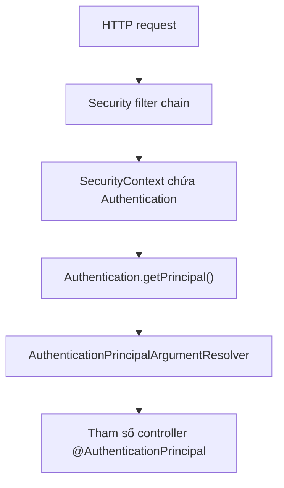

# Giữ đúng kiểu principal cho `@AuthenticationPrincipal`

Trong Spring Security, controller thường cần đọc danh tính hiện tại để biết người gửi request là ai, thuộc tổ chức nào hoặc có mã tài khoản nào. Annotation `@AuthenticationPrincipal` giúp lấy **principal nằm bên trong `Authentication` hiện tại** và đưa vào tham số handler. Điều kiện quan trọng là kiểu tham số phải phù hợp với kiểu principal mà cơ chế xác thực thực sự cung cấp.

Một test có thể trả về `200` nhưng vẫn không kiểm tra đúng principal nếu fixture tạo sai kiểu. Ví dụ, `@WithMockUser` thường tạo principal chuẩn kiểu `User` của Spring Security; nếu controller yêu cầu `AccountPrincipal` tùy chỉnh, test phải cung cấp đúng đối tượng đó. Bài này thuộc chương **Danh tính trên yêu cầu** của module `SPRING_SECURITY_TESTING`, tập trung vào hợp đồng kiểu dữ liệu giữa authentication, principal, controller và fixture kiểm thử.

## 1. `@AuthenticationPrincipal` lấy gì từ request?

`@AuthenticationPrincipal` nằm trong package `org.springframework.security.core.annotation`. Nó đánh dấu tham số handler để Spring Security lấy principal từ `Authentication.getPrincipal()` trong `SecurityContext` hiện hành.

Luồng xử lý khái quát:



Ví dụ controller nhận username theo principal chuẩn:

```java
@GetMapping("/api/me")
String me(@AuthenticationPrincipal UserDetails user) {
    return user.getUsername();
}
```

Ở đây tham số `user` là principal, không phải toàn bộ đối tượng `Authentication`. Nếu controller cần cả trạng thái xác thực hoặc danh sách authority, hãy nhận trực tiếp `Authentication`:

```java
@GetMapping("/api/auth-info")
Map<String, Object> authInfo(Authentication authentication) {
    return Map.of(
        "name", authentication.getName(),
        "authorities", authentication.getAuthorities()
    );
}
```

Phân biệt này quan trọng:

| Tham số handler | Giá trị được nhận |
| --- | --- |
| `@AuthenticationPrincipal UserDetails user` | `Authentication.getPrincipal()` nếu tương thích kiểu `UserDetails` |
| `@AuthenticationPrincipal Jwt jwt` | Principal là đối tượng `Jwt` khi dùng JWT Resource Server |
| `Authentication authentication` | Toàn bộ đối tượng authentication hiện hành |
| `Principal principal` (không có `@AuthenticationPrincipal`) | Đối tượng đại diện danh tính theo cơ chế argument resolution của Spring MVC; nếu cần principal bên trong authentication, dùng annotation tường minh |

`@AuthenticationPrincipal` không tự đăng nhập người dùng, không gọi `UserDetailsService` và không xác thực token. Nó chỉ đọc principal đã có trong context của request.

## 2. Kiểu tham số phải khớp kiểu principal

Principal không có một kiểu duy nhất cho mọi cơ chế xác thực. Nó phụ thuộc cách ứng dụng tạo `Authentication`:

| Cơ chế/dữ liệu xác thực | Kiểu principal thường gặp |
| --- | --- |
| `user("alice")` trong MockMvc test | `org.springframework.security.core.userdetails.User` |
| `user(customUserDetails)` | Đối tượng `UserDetails` tùy chỉnh đã truyền vào |
| `@WithMockUser` | `User` chuẩn do Spring Security Test tạo |
| `@WithUserDetails` | Đối tượng `UserDetails` do `UserDetailsService` trả về |
| `UsernamePasswordAuthenticationToken` tùy chỉnh | Principal do ứng dụng đặt vào token |
| OAuth2 Login | `OAuth2User` (thường là implementation như `DefaultOAuth2User`) |
| OpenID Connect Login | `OidcUser` |
| OAuth2 Resource Server với JWT | `Jwt` bên trong `JwtAuthenticationToken` |

Vì vậy, controller yêu cầu `AccountPrincipal` cần một authentication có principal đúng là `AccountPrincipal`. Chỉ đặt username giống nhau là chưa đủ; **kiểu Java của principal cũng là một phần của hợp đồng**.

## 3. Tạo một principal tùy chỉnh dùng trong ứng dụng

Giả sử ứng dụng đa tổ chức cần username, mã tài khoản và `tenantId`. Ta định nghĩa `AccountPrincipal` triển khai `UserDetails`:

```java
import java.util.Collection;
import java.util.List;
import java.util.UUID;

import org.springframework.security.core.GrantedAuthority;
import org.springframework.security.core.userdetails.UserDetails;

public final class AccountPrincipal implements UserDetails {

    private final UUID accountId;
    private final String tenantId;
    private final String username;
    private final String password;
    private final List<GrantedAuthority> authorities;

    public AccountPrincipal(
            UUID accountId,
            String tenantId,
            String username,
            String password,
            List<? extends GrantedAuthority> authorities) {
        this.accountId = accountId;
        this.tenantId = tenantId;
        this.username = username;
        this.password = password;
        this.authorities = List.copyOf(authorities);
    }

    public UUID getAccountId() {
        return accountId;
    }

    public String getTenantId() {
        return tenantId;
    }

    @Override
    public String getUsername() {
        return username;
    }

    @Override
    public String getPassword() {
        return password;
    }

    @Override
    public Collection<? extends GrantedAuthority> getAuthorities() {
        return authorities;
    }

    @Override
    public boolean isAccountNonExpired() {
        return true;
    }

    @Override
    public boolean isAccountNonLocked() {
        return true;
    }

    @Override
    public boolean isCredentialsNonExpired() {
        return true;
    }

    @Override
    public boolean isEnabled() {
        return true;
    }

    @Override
    public String toString() {
        // Không để password xuất hiện trong log từ principal.
        return "AccountPrincipal[accountId=" + accountId
                + ", tenantId=" + tenantId
                + ", username=" + username + "]";
    }
}
```

Các trường `accountId` và `tenantId` là dữ liệu nghiệp vụ bổ sung. `getUsername()`, `getPassword()`, `getAuthorities()` và các phương thức trạng thái đáp ứng hợp đồng `UserDetails`. Constructor sao chép danh sách quyền để fixture không bị thay đổi ngoài ý muốn; `toString()` được ghi đè để không in password.

Trong production, password phải được xử lý theo cơ chế bảo mật phù hợp và không được trả về response. Trong test dùng request post-processor, password có thể là giá trị giả lập vì test không thực hiện xác thực mật khẩu.

## 4. Controller yêu cầu đúng kiểu principal

Dùng `@AuthenticationPrincipal` với `errorOnInvalidType = true` để làm rõ hợp đồng:

```java
import java.util.Map;

import org.springframework.security.core.annotation.AuthenticationPrincipal;
import org.springframework.web.bind.annotation.GetMapping;
import org.springframework.web.bind.annotation.RestController;

@RestController
class AccountController {

    @GetMapping("/api/me")
    Map<String, String> me(
            @AuthenticationPrincipal(errorOnInvalidType = true)
            AccountPrincipal account) {

        return Map.of(
                "username", account.getUsername(),
                "accountId", account.getAccountId().toString(),
                "tenantId", account.getTenantId()
        );
    }
}
```

Khi tham số có kiểu `AccountPrincipal`, Spring Security lấy `Authentication.getPrincipal()` rồi kiểm tra khả năng gán vào kiểu tham số. Nếu principal đúng kiểu, controller nhận được đối tượng đầy đủ. Nếu sai kiểu, thuộc tính `errorOnInvalidType = true` yêu cầu resolver báo lỗi kiểu thay vì âm thầm trả về `null`.

### Mặc định khi kiểu không khớp

`errorOnInvalidType` mặc định là `false`. Nếu principal không tương thích kiểu tham số, resolver trả `null`. Điều đó có thể khiến controller phát sinh `NullPointerException` khi truy cập thuộc tính, hoặc tạo một response sai nếu code xử lý null không đúng.

Với `errorOnInvalidType = true`, resolver ném `ClassCastException` khi principal không tương thích kiểu. Đây là lỗi **hợp đồng principal giữa authentication và controller**, không phải kết quả authorization `401` hoặc `403`. Khi thiết kế test, nên kiểm tra riêng trường hợp principal sai kiểu để lỗi được nhận diện tại đúng ranh giới.

### Dùng expression khi chỉ cần một thuộc tính

Không phải lúc nào controller cũng cần nhận cả đối tượng principal. `@AuthenticationPrincipal` có thuộc tính `expression` để trích xuất một thuộc tính từ principal:

```java
@GetMapping("/api/my-tenant")
String myTenant(
        @AuthenticationPrincipal(expression = "tenantId")
        String tenantId) {
    return tenantId;
}
```

Với `AccountPrincipal` có getter `getTenantId()`, biểu thức `tenantId` đọc thuộc tính đó. Có thể dùng expression để lấy một phần dữ liệu, nhưng khi controller phụ thuộc nhiều trường hoặc cần type safety mạnh, nhận trực tiếp `AccountPrincipal` thường rõ ràng hơn.

## 5. Cấu hình security và MockMvc để kiểm tra controller

Ví dụ này yêu cầu người dùng đã xác thực có authority `profile:read` mới được gọi endpoint:

```java
import org.springframework.context.annotation.Bean;
import org.springframework.context.annotation.Configuration;
import org.springframework.http.HttpMethod;
import org.springframework.security.config.Customizer;
import org.springframework.security.config.annotation.web.builders.HttpSecurity;
import org.springframework.security.config.annotation.web.configuration.EnableWebSecurity;
import org.springframework.security.web.SecurityFilterChain;

@Configuration
@EnableWebSecurity
class AccountSecurityConfiguration {

    @Bean
    SecurityFilterChain securityFilterChain(HttpSecurity http)
            throws Exception {
        return http
            .authorizeHttpRequests(auth -> auth
                .requestMatchers(HttpMethod.GET, "/api/me")
                    .hasAuthority("profile:read")
                .anyRequest().denyAll())
            .httpBasic(Customizer.withDefaults())
            .build();
    }
}
```

Dependency kiểm thử Maven:

```xml
<dependency>
    <groupId>org.springframework.security</groupId>
    <artifactId>spring-security-test</artifactId>
    <scope>test</scope>
</dependency>
```

Với Spring Boot, dùng `@SpringBootTest` và `@AutoConfigureMockMvc` để request đi qua servlet filter chain:

```java
@SpringBootTest
@AutoConfigureMockMvc
class AccountControllerSecurityTest {

    @Autowired
    MockMvc mockMvc;
}
```

Nếu tự dựng `MockMvc` từ `WebApplicationContext`, áp dụng `springSecurity()`. Không tắt filter bằng `addFilters = false` khi mục tiêu là kiểm tra authorization HTTP.

## 6. Test phải cung cấp đúng principal type

Fixture có thể tạo một `AccountPrincipal` cho mỗi request:

```java
import java.util.List;
import java.util.UUID;

import org.springframework.security.core.authority.SimpleGrantedAuthority;

private static AccountPrincipal account(
        String username, String tenantId, String authority) {

    return new AccountPrincipal(
            UUID.fromString("00000000-0000-0000-0000-000000000001"),
            tenantId,
            username,
            "unused-test-password",
            List.of(new SimpleGrantedAuthority(authority))
    );
}
```

Dùng overload `user(UserDetails)` để đặt principal đúng kiểu:

```java
import static org.springframework.security.test.web.servlet.request
        .SecurityMockMvcRequestPostProcessors.user;

@Test
void customPrincipalIsInjectedIntoController() throws Exception {
    AccountPrincipal alice = account("alice", "acme", "profile:read");

    mockMvc.perform(get("/api/me").with(user(alice)))
        .andExpect(status().isOk())
        .andExpect(jsonPath("$.username").value("alice"))
        .andExpect(jsonPath("$.tenantId").value("acme"))
        .andExpect(jsonPath("$.accountId").value(
                "00000000-0000-0000-0000-000000000001"));
}
```

`user(alice)` dùng chính instance `AccountPrincipal` làm principal. Nhờ vậy `@AuthenticationPrincipal(errorOnInvalidType = true) AccountPrincipal` nhận được đúng kiểu và controller có thể đọc các trường nghiệp vụ.

### Vì sao `user("alice")` có thể không phù hợp?

`user("alice")` tạo principal `UserDetails` chuẩn của Spring Security Test. Dù principal đó cũng triển khai `UserDetails`, nó không phải `AccountPrincipal`. Nếu controller khai báo `AccountPrincipal`, test nên dùng `user(alice)` hoặc một `Authentication` có principal đúng kiểu.

Đây là khác biệt giữa kiểm tra “có người dùng đã xác thực” và kiểm tra “controller nhận đúng principal domain”. Test chỉ dùng username đơn giản không chứng minh rằng mapping principal tùy chỉnh đang hoạt động.

## 7. So sánh `@WithMockUser`, `@WithUserDetails` và `user(customUserDetails)`

| Cách chuẩn bị | Principal thường nhận được | Khi nào dùng |
| --- | --- | --- |
| `@WithMockUser(username = "alice")` | `org.springframework.security.core.userdetails.User` | Endpoint chỉ cần username/authorities chuẩn |
| `.with(user("alice"))` | `User` chuẩn | Danh tính riêng cho một request, không cần principal domain |
| `.with(user(accountPrincipal))` | `AccountPrincipal` tùy chỉnh | Request cần principal đúng kiểu domain |
| `@WithUserDetails("alice")` | Principal do `UserDetailsService` trả về | Muốn test dùng principal được tải từ service |
| `.with(authentication(auth))` | Principal nằm trong `Authentication` tự tạo | Principal không triển khai `UserDetails` hoặc cần loại token cụ thể |

### `@WithMockUser` không tự tạo custom principal

Ví dụ sau phù hợp với controller nhận `UserDetails` hoặc username thông thường:

```java
@Test
@WithMockUser(username = "alice", roles = "USER")
void standardPrincipalCanAccessEndpoint() throws Exception {
    mockMvc.perform(get("/api/standard-profile"))
           .andExpect(status().isOk());
}
```

Nếu dùng annotation đó cho controller yêu cầu `AccountPrincipal` với `errorOnInvalidType = true`, principal chuẩn không tương thích kiểu. Test phải chuyển sang một trong hai cách:

- `@WithUserDetails("alice")` nếu `UserDetailsService` trong test context trả về `AccountPrincipal`.
- `.with(user(accountPrincipal))` nếu muốn dựng principal trực tiếp cho request.

### `@WithUserDetails` khi muốn dùng dữ liệu do service tải

`@WithUserDetails` yêu cầu test context có `UserDetailsService` trả về principal phù hợp:

```java
@Test
@WithUserDetails("alice")
void principalLoadedByUserDetailsServiceHasDomainType() throws Exception {
    mockMvc.perform(get("/api/me"))
           .andExpect(status().isOk());
}
```

Trong ví dụ này, service phải trả về `AccountPrincipal` và principal đó phải có authority `profile:read`. Annotation gọi service để tải `UserDetails` và chuẩn bị context cho test; nó **không gửi password qua HTTP hoặc thực hiện login**. Nếu có nhiều bean `UserDetailsService`, annotation hỗ trợ chỉ định tên bean qua `userDetailsServiceBeanName`.

### `authentication(...)` khi principal không triển khai `UserDetails`

Nếu ứng dụng sử dụng principal chỉ triển khai `Principal` hoặc một kiểu domain riêng, có thể tạo `Authentication` trực tiếp:

```java
Authentication auth =
        UsernamePasswordAuthenticationToken.authenticated(
                new TenantActor("alice", "acme"),
                null,
                List.of(new SimpleGrantedAuthority("profile:read"))
        );

mockMvc.perform(get("/api/tenant-profile")
        .with(authentication(auth)))
    .andExpect(status().isOk());
```

Trong trường hợp này, `@AuthenticationPrincipal TenantActor` có thể nhận principal đúng kiểu. `authentication(...)` không đòi principal phải là `UserDetails`; nó sử dụng chính đối tượng `Authentication` mà test cung cấp.

## 8. Principal từ JWT, OAuth2 Login và OIDC có kiểu riêng

Một lỗi phổ biến là dùng `@AuthenticationPrincipal UserDetails` cho mọi cơ chế xác thực. Với OAuth2 và Resource Server, principal thường không phải `UserDetails`:

| Cơ chế | Kiểu principal phù hợp |
| --- | --- |
| OAuth2 Login | `OAuth2User` |
| OpenID Connect Login | `OidcUser` |
| JWT Resource Server | `Jwt` |
| Username/password với custom service | `AccountPrincipal` hoặc implementation `UserDetails` của ứng dụng |

### JWT Resource Server

Ví dụ controller nhận `Jwt`:

```java
@GetMapping("/api/jwt-profile")
Map<String, String> jwtProfile(
        @AuthenticationPrincipal Jwt jwt) {
    return Map.of(
            "subject", jwt.getSubject(),
            "tenantId", jwt.getClaimAsString("tenant_id")
    );
}
```

Trong test Servlet, `jwt()` tạo JWT authentication giả lập cho request:

```java
mockMvc.perform(get("/api/jwt-profile")
        .with(jwt().jwt(token -> token
                .subject("alice")
                .claim("tenant_id", "acme"))))
    .andExpect(status().isOk())
    .andExpect(jsonPath("$.subject").value("alice"))
    .andExpect(jsonPath("$.tenantId").value("acme"));
```

Ở đây principal là `Jwt`, không phải `UserDetails`. Test này kiểm tra controller đọc claims đúng cách sau khi authentication đã được chuẩn bị. Nó không kiểm tra chữ ký, issuer, audience hoặc decoder của JWT thật.

### OAuth2 Login

Controller có thể nhận `OAuth2User`:

```java
@GetMapping("/api/oauth-profile")
String oauthProfile(@AuthenticationPrincipal OAuth2User user) {
    return user.getAttribute("name");
}
```

Request post-processor `oauth2Login()` tạo một OAuth2 user đã đăng nhập cho test:

```java
mockMvc.perform(get("/api/oauth-profile")
        .with(oauth2Login().attributes(attributes ->
                attributes.put("name", "Alice"))))
    .andExpect(status().isOk())
    .andExpect(content().string("Alice"));
```

### OpenID Connect

Nếu controller cần `OidcUser`, dùng principal đúng kiểu:

```java
@GetMapping("/api/oidc-email")
String oidcEmail(@AuthenticationPrincipal OidcUser user) {
    return user.getEmail();
}
```

Trong MockMvc, `oidcLogin()` chuẩn bị principal OIDC cho test:

```java
mockMvc.perform(get("/api/oidc-email")
        .with(oidcLogin().idToken(token ->
                token.claim("email", "alice@example.test"))))
    .andExpect(status().isOk())
    .andExpect(content().string("alice@example.test"));
```

Các post-processor này giả lập principal sau đăng nhập. Chúng không chạy redirect, authorization code flow, trao đổi token hay xác minh chữ ký ID Token từ provider.

## 9. Dùng expression để lấy thuộc tính principal mà không lộ cả đối tượng

Nếu controller chỉ cần một thuộc tính, `@AuthenticationPrincipal(expression = "...")` có thể trích xuất giá trị:

```java
@GetMapping("/api/current-tenant")
String currentTenant(
        @AuthenticationPrincipal(expression = "tenantId")
        String tenantId) {
    return tenantId;
}
```

Với `AccountPrincipal` có getter `getTenantId()`, expression `tenantId` đọc giá trị tenant. Với JWT, có thể lấy claim:

```java
@GetMapping("/api/current-subject")
String currentSubject(
        @AuthenticationPrincipal(expression = "subject")
        String subject) {
    return subject;
}
```

Hoặc lấy claim theo map:

```java
@GetMapping("/api/current-tenant")
String currentTenantFromJwt(
        @AuthenticationPrincipal(expression = "claims['tenant_id']")
        String tenantId) {
    return tenantId;
}
```

Expression hữu ích khi controller chỉ cần một trường đơn giản, nhưng có một số lưu ý:

- Expression được đánh giá trên principal, không phải trên toàn bộ `Authentication`.
- Nếu principal không có thuộc tính/claim tương ứng, kết quả có thể là `null`.
- Kiểu kết quả expression cũng phải tương thích kiểu tham số.
- Với logic nghiệp vụ phụ thuộc nhiều thuộc tính, nhận principal có kiểu cụ thể thường dễ đọc và an toàn kiểu hơn.

Không dùng expression để che giấu một principal sai kiểu. Nếu endpoint bắt buộc nhận `AccountPrincipal`, hãy khai báo đúng kiểu và kiểm thử principal đó trực tiếp.

## 10. Kiểm tra trường hợp principal sai kiểu và anonymous

Có hai nhóm lỗi cần phân biệt:

1. **Không được phép truy cập:** filter chain từ chối vì request chưa xác thực hoặc thiếu authority; thường là `401` hoặc `403` tùy entry point/handler.
2. **Principal không đúng kiểu:** request đã qua authorization nhưng argument resolver không thể đưa principal vào tham số controller; với `errorOnInvalidType = true`, đây là lỗi kiểu trong bước resolve tham số, không phải lỗi quyền.

Ví dụ test cần tránh gán `@WithMockUser` cho endpoint bắt buộc `AccountPrincipal`. Thay vào đó, hãy kiểm tra rõ:

| Tình huống | Cách chuẩn bị | Kỳ vọng |
| --- | --- | --- |
| Principal đúng kiểu, đủ quyền | `user(accountPrincipal)` | Controller nhận được `AccountPrincipal` |
| Principal đúng kiểu, thiếu quyền | `user(accountPrincipalWithoutPermission)` | `403` từ authorization |
| Anonymous | `anonymous()` | `401` với HTTP Basic hoặc redirect theo entry point |
| Principal chuẩn nhưng controller yêu cầu custom type | `user("alice")` hoặc `@WithMockUser` | Lỗi type resolution nếu `errorOnInvalidType = true`; nếu mặc định false, resolver trả `null` |
| JWT principal | `jwt()` | Controller nhận `Jwt`, không phải `UserDetails` |

Đối với test principal sai kiểu, nên xác nhận exception cụ thể được ném ra ở tầng MVC theo cách test harness của ứng dụng xử lý; không gán một mã `401`/`403` cho lỗi kiểu nếu authorization đã thành công.

## 11. Đảm bảo Spring Security đăng ký argument resolver

`@AuthenticationPrincipal` cần `AuthenticationPrincipalArgumentResolver` của Spring Security tham gia xử lý tham số controller. Trong cấu hình ứng dụng Spring MVC/Spring Boot tích hợp Spring Security thông thường, resolver được đăng ký bởi phần tích hợp MVC của Spring Security.

Với `MockMvc`, hãy kiểm tra hai điều kiện:

- Spring Security filter chain được bật để request có `SecurityContext` đúng.
- Spring Security MVC integration có mặt để tham số `@AuthenticationPrincipal` được resolve.

Ví dụ test context tiêu chuẩn:

```java
@SpringBootTest
@AutoConfigureMockMvc
class PrincipalResolutionTests {
    @Autowired
    MockMvc mockMvc;
}
```

Nếu tự dựng `MockMvc` với `standaloneSetup(...)`, phải đăng ký các thành phần MVC cần thiết cho controller, bao gồm argument resolver Spring Security nếu cấu hình standalone không cung cấp resolver đó. Nếu không, test có thể thất bại ở bước resolve tham số dù authentication đã được chuẩn bị đúng.

Không tắt filter chain bằng `@AutoConfigureMockMvc(addFilters = false)` nếu mục tiêu là kiểm chứng principal trong luồng HTTP security thực tế.

## 12. Ranh giới Servlet và Reactive

`@AuthenticationPrincipal` cũng có thể được dùng trong handler WebFlux; điểm khác biệt là context xác thực Reactive được truyền qua Reactor Context, và test dùng `WebTestClient` cùng `SecurityMockServerConfigurers`. Không dùng `SecurityMockMvcRequestPostProcessors` trực tiếp trong WebFlux.

Ví dụ kiểm thử Reactive với người dùng giả lập:

```java
WebTestClient securedClient = WebTestClient
        .bindToApplicationContext(applicationContext)
        .apply(SecurityMockServerConfigurers.springSecurity())
        .configureClient()
        .build();

securedClient
    .mutateWith(SecurityMockServerConfigurers.mockUser("alice")
            .roles("USER"))
    .get()
    .uri("/api/me")
    .exchange()
    .expectStatus().isOk();
```

`mockUser("alice")` cung cấp principal chuẩn phù hợp với người dùng giả lập. Nếu handler Reactive cần principal domain hoặc JWT, hãy chọn configurer Reactive tạo đúng loại principal/token và xác nhận kiểu tham số tương ứng. Với JWT, dùng `mockJwt()`; không giả định principal JWT là `UserDetails`.

## 13. Bài tập: kiểm thử hợp đồng kiểu principal

Giả sử `GET /api/tenants/{tenantId}/profile` nhận `AccountPrincipal` qua `@AuthenticationPrincipal(errorOnInvalidType = true)` và chỉ cho phép authority `profile:read`. Hãy viết các ca:

1. Dùng `user(account("alice", "acme", "profile:read"))`; kiểm tra username, accountId và tenant trong response.
2. Dùng principal đúng kiểu nhưng chỉ có `profile:write`; xác nhận `403` từ authorization.
3. Dùng `user("alice").roles("USER")`; giải thích vì sao principal chuẩn không thỏa hợp đồng `AccountPrincipal`.
4. Dùng `@WithMockUser` trên test method rồi quan sát lỗi khi endpoint bắt buộc custom principal.
5. Dùng `@WithUserDetails("alice")` với `UserDetailsService` trả về `AccountPrincipal`; kiểm tra principal được tải đúng kiểu.
6. Tạo test JWT với `jwt()` cho một endpoint nhận `@AuthenticationPrincipal Jwt`; assert subject và claim tenant.
7. Thử `@AuthenticationPrincipal(expression = "tenantId") String tenantId` và xác nhận kết quả đúng.

Một test principal tốt phải kiểm chứng đồng thời **kiểu Java**, **dữ liệu principal**, **authority** và **quy tắc HTTP**. `@AuthenticationPrincipal` là điểm nối trực tiếp giữa danh tính đã có trong `SecurityContext` và tham số controller; giữ đúng kiểu principal giúp test phản ánh chính xác hợp đồng mà ứng dụng đang sử dụng.
