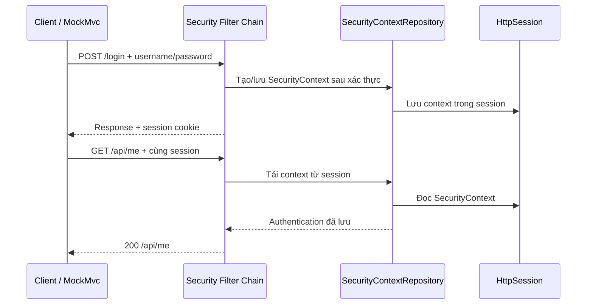

# Danh tính của request hiện tại khác với phiên đăng nhập đã được lưu

Một request có thể mang danh tính được gắn riêng trong lúc kiểm thử, nhưng điều đó không có nghĩa người dùng đã đăng nhập và phiên đăng nhập đã được lưu để dùng cho request kế tiếp. Đây là khác biệt quan trọng khi kiểm thử Spring Security: `.with(user(...))`, `.with(authentication(...))` hoặc `.with(securityContext(...))` giúp chuẩn bị trạng thái bảo mật cho một request `MockMvc`; một phiên đăng nhập stateful lại phụ thuộc vào cơ chế lưu và khôi phục `SecurityContext`, thường thông qua HTTP session.

Bài học thuộc chương **Danh tính trên yêu cầu** của module `SPRING_SECURITY_TESTING`, nơi người học kiểm chứng xác thực, phân quyền và bảo vệ HTTP thực tế bằng `spring-security-test` trên ứng dụng Servlet và Reactive. Nội dung tập trung phân biệt danh tính request với danh tính gắn trong session, thực hiện đăng nhập thật trong test, gửi lại `MockHttpSession`, kiểm tra logout, session policy và đối chiếu với API stateless dùng bearer token.

## 1. Danh tính của request và phiên đăng nhập là hai phạm vi khác nhau

Khi Spring Security xử lý một HTTP request, code ứng dụng thường đọc `Authentication` từ `SecurityContext` hiện hành. Nhưng context đó có thể đến từ nhiều nguồn:

- Một request post-processor của Spring Security Test đặt danh tính giả lập trực tiếp cho request.
- Cơ chế xác thực HTTP như HTTP Basic hoặc Bearer token tạo authentication trong quá trình xử lý request.
- `SecurityContextRepository` tải context đã lưu từ session hoặc một nguồn lưu trữ khác.
- Test annotation như `@WithMockUser` thiết lập context phục vụ test method/class.

**Phiên đăng nhập đã lưu** là trạng thái có thể được khôi phục ở request sau theo cơ chế của ứng dụng. Với ứng dụng Servlet stateful, `HttpSessionSecurityContextRepository` thường lưu `SecurityContext` vào `HttpSession`. Trình duyệt gửi cookie session (thường là `JSESSIONID`) ở request tiếp theo; máy chủ dùng session đó để khôi phục context.

| Khía cạnh | Danh tính riêng của request | Danh tính từ phiên đã lưu |
| --- | --- | --- |
| Nguồn | `.with(user(...))`, `authentication(...)`, `securityContext(...)`, token/header | `SecurityContextRepository` tải context từ session hoặc kho lưu |
| Phạm vi | Request đang được dựng/kiểm thử | Nhiều request gắn với cùng phiên theo cấu hình |
| Cần đăng nhập thật? | Không, thường là giả lập sau xác thực | Có nếu mục tiêu là chứng minh luồng login đã tạo phiên |
| `MockMvc` cần làm gì? | Gắn processor vào `perform(...)` | Lấy và gửi lại `MockHttpSession` trên request tiếp theo |
| Kiểm chứng được | Authorization với principal/authority đã chuẩn bị | Login, lưu context, khôi phục context, logout và session policy |

Một request trả về `200` khi dùng `.with(user("alice"))` chỉ cho thấy endpoint chấp nhận danh tính đã được test gắn vào request. Nó không chứng minh Alice đã đăng nhập, session đã được tạo hoặc request kế tiếp sẽ tự nhận diện Alice.

## 2. Request post-processor không tự tạo phiên đăng nhập

Ví dụ:

```java
mockMvc.perform(get("/api/me")
        .with(user("alice").roles("USER")))
    .andExpect(status().isOk());

// Request tiếp theo không tự động thừa hưởng user("alice").
mockMvc.perform(get("/api/me"))
    .andExpect(status().isUnauthorized()); // Ví dụ API dùng HTTP Basic
```

Request thứ nhất có danh tính riêng nhờ `user("alice")`. Processor này không thực hiện login và không yêu cầu `UserDetailsService` xác minh mật khẩu. Nó cũng không tạo một browser session có thể được dùng tự động ở request thứ hai.

Kết quả cụ thể của request không có danh tính phụ thuộc entry point. Với HTTP Basic, request chưa xác thực thường nhận `401`; với form login, nó thường được chuyển hướng `302` đến trang đăng nhập. Điều cần rút ra là **request thứ hai không tự có danh tính Alice chỉ vì request trước đã dùng `user("alice")`**.

Tương tự, các cách dưới đây đều là chuẩn bị dữ liệu test:

```java
mockMvc.perform(get("/api/me")
        .with(authentication(auth)));

mockMvc.perform(get("/api/me")
        .with(securityContext(context)));
```

Chúng cho phép kiểm tra authorization và controller với authentication/context đã chuẩn bị. Muốn chứng minh trạng thái được lưu qua request, cần kiểm tra cơ chế session/repository thực tế.

## 3. `SecurityContextRepository` và HTTP session

`SecurityContextRepository` là abstraction Spring Security dùng để tải và lưu `SecurityContext` giữa các request. Trong ứng dụng Servlet stateful, implementation thường gặp là `HttpSessionSecurityContextRepository`, lưu context trong HTTP session.

Luồng stateful có thể mô tả như sau:



Trong ứng dụng stateful dùng form login, filter xác thực thành công và cơ chế lưu context được cấu hình sẽ lưu trạng thái đăng nhập. Request sau phải gửi lại session tương ứng. Ở trình duyệt, cookie session thường làm nhiệm vụ này; trong `MockMvc`, ta cần chủ động gửi lại `MockHttpSession`.

**Lưu ý về phiên bản và cấu hình:** Spring Security hiện đại có thể dùng `SecurityContextHolderFilter` với chế độ yêu cầu lưu context tường minh. Cơ chế xác thực chuẩn được cấu hình sẽ xử lý việc lưu context theo cấu hình repository. Nếu tự viết authentication filter và chỉ gọi `SecurityContextHolder.setContext(...)`, đừng mặc định rằng context đã được lưu vào session; cần tích hợp `SecurityContextRepository` và gọi lưu context theo chế độ đang dùng.

## 4. Cấu hình ví dụ stateful với form login

Giả sử ứng dụng có hai endpoint:

- `GET /api/me` yêu cầu người dùng đã đăng nhập.
- `GET /api/admin` chỉ cho phép role `ADMIN`.

Ta cấu hình form login và một người dùng thử nghiệm trong bộ nhớ:

```java
import org.springframework.context.annotation.Bean;
import org.springframework.context.annotation.Configuration;
import org.springframework.security.config.Customizer;
import org.springframework.security.config.annotation.web.builders.HttpSecurity;
import org.springframework.security.core.userdetails.User;
import org.springframework.security.core.userdetails.UserDetails;
import org.springframework.security.core.userdetails.UserDetailsService;
import org.springframework.security.crypto.factory.PasswordEncoderFactories;
import org.springframework.security.crypto.password.PasswordEncoder;
import org.springframework.security.provisioning.InMemoryUserDetailsManager;
import org.springframework.security.web.SecurityFilterChain;

@Configuration
class StatefulSecurityConfiguration {

    @Bean
    PasswordEncoder passwordEncoder() {
        return PasswordEncoderFactories.createDelegatingPasswordEncoder();
    }

    @Bean
    UserDetailsService userDetailsService(PasswordEncoder encoder) {
        UserDetails alice = User.withUsername("alice")
                .password(encoder.encode("correct-password"))
                .roles("USER")
                .build();

        return new InMemoryUserDetailsManager(alice);
    }

    @Bean
    SecurityFilterChain securityFilterChain(HttpSecurity http)
            throws Exception {
        return http
            .authorizeHttpRequests(auth -> auth
                .requestMatchers("/api/me").authenticated()
                .requestMatchers("/api/admin").hasRole("ADMIN")
                .anyRequest().denyAll())
            .formLogin(Customizer.withDefaults())
            .build();
    }
}
```

Controller minh họa:

```java
import org.springframework.security.core.Authentication;
import org.springframework.web.bind.annotation.GetMapping;
import org.springframework.web.bind.annotation.RestController;

@RestController
class StatefulController {

    @GetMapping("/api/me")
    String me(Authentication authentication) {
        return authentication.getName();
    }

    @GetMapping("/api/admin")
    String admin() {
        return "admin";
    }
}
```

Ở đây Alice được tạo với role `USER`, nên có thể truy cập `/api/me` nhưng không được truy cập `/api/admin`. Password được mã hóa bằng `PasswordEncoder` trong cấu hình; test login sẽ gửi password gốc `correct-password` để filter xác thực thực hiện so khớp.

Cấu hình form login mặc định xử lý `POST /login` với tham số `username` và `password`. CSRF vẫn bật theo mặc định, vì vậy request login trong test cần có token CSRF hợp lệ.

## 5. Đăng nhập thật rồi gửi lại cùng MockHttpSession

Đây là phép thử quan trọng để chứng minh session đã lưu context. Đầu tiên, gửi credentials qua login filter. Sau khi xác thực thành công, lấy session từ request kết quả và gắn nó vào request kế tiếp:

```java
import static org.junit.jupiter.api.Assertions.assertNotNull;
import static org.springframework.security.test.web.servlet.request
        .SecurityMockMvcRequestPostProcessors.csrf;
import static org.springframework.test.web.servlet.request.MockMvcRequestBuilders.get;
import static org.springframework.test.web.servlet.request.MockMvcRequestBuilders.post;
import static org.springframework.test.web.servlet.result.MockMvcResultMatchers.content;
import static org.springframework.test.web.servlet.result.MockMvcResultMatchers.status;

import org.junit.jupiter.api.Test;
import org.springframework.beans.factory.annotation.Autowired;
import org.springframework.boot.test.autoconfigure.web.servlet.AutoConfigureMockMvc;
import org.springframework.boot.test.context.SpringBootTest;
import org.springframework.mock.web.MockHttpSession;
import org.springframework.test.web.servlet.MockMvc;
import org.springframework.test.web.servlet.MvcResult;

@SpringBootTest
@AutoConfigureMockMvc
class SavedLoginSessionTests {

    @Autowired
    MockMvc mockMvc;

    @Test
    void successfulLoginIsAvailableOnNextRequestWithSameSession()
            throws Exception {

        MvcResult loginResult = mockMvc.perform(post("/login")
                .param("username", "alice")
                .param("password", "correct-password")
                .with(csrf()))
            .andExpect(status().is3xxRedirection())
            .andReturn();

        MockHttpSession session =
                (MockHttpSession) loginResult.getRequest().getSession(false);

        assertNotNull(session, "Login phải tạo hoặc giữ session");

        mockMvc.perform(get("/api/me").session(session))
            .andExpect(status().isOk())
            .andExpect(content().string("alice"));

        mockMvc.perform(get("/api/admin").session(session))
            .andExpect(status().isForbidden());
    }
}
```

Test trên chứng minh ba điều:

1. Credentials đã đi qua `UsernamePasswordAuthenticationFilter` và được `AuthenticationManager` xử lý.
2. Request login thành công có session chứa trạng thái bảo mật được lưu theo cấu hình.
3. Request sau gửi cùng `MockHttpSession` có thể khôi phục danh tính Alice; authorization tiếp tục từ role `USER` nên endpoint admin trả `403`.

`status().is3xxRedirection()` phù hợp với success handler mặc định của form login, thường chuyển hướng về trang mặc định. Nếu ứng dụng có success handler hoặc URL tùy chỉnh, điều chỉnh assertion theo hợp đồng response thực tế.

**Không lấy session từ request login rồi bỏ qua bước `.session(session)`.** `MockMvc` không phải trình duyệt tự động duy trì cookie jar cho mọi request. Việc gắn lại session mô phỏng client gửi cookie session ở request kế tiếp.

## 6. Không gửi lại session thì điều gì xảy ra?

Một test riêng có thể chứng minh `MockMvc` không tự động dùng session vừa tạo ở request khác:

```java
@Test
void requestWithoutSavedSessionHasNoLoginIdentity() throws Exception {
    mockMvc.perform(get("/api/me"))
        .andExpect(status().is3xxRedirection()); // Form login entry point
}
```

Ở test này không có `@WithMockUser`, không có `.with(user(...))` và không có `.session(session)`. Vì ứng dụng dùng form login, request vô danh được chuyển hướng tới trang đăng nhập. Với API cấu hình HTTP Basic, kỳ vọng thường là `401`.

Điều này khác với tình huống trình duyệt thật vẫn gửi cookie `JSESSIONID`. Trong ứng dụng stateful, nếu client gửi đúng cookie của phiên còn hiệu lực, server có thể tải lại context và nhận diện người dùng. Trong test, ta phải thể hiện điều đó bằng `.session(session)` hoặc cơ chế cookie phù hợp.

## 7. Session policy ảnh hưởng cách khôi phục danh tính

`SessionCreationPolicy` quyết định Spring Security tạo và sử dụng HTTP session như thế nào:

| Chính sách | Ý nghĩa | Ảnh hưởng đến danh tính |
| --- | --- | --- |
| `IF_REQUIRED` | Tạo session khi cần | Phù hợp ứng dụng stateful; context có thể được lưu trong session |
| `ALWAYS` | Luôn tạo session | Session được tạo ngay cả khi chưa cần |
| `NEVER` | Không tạo session nhưng có thể dùng session đã tồn tại | Có thể khôi phục context từ session client gửi lên |
| `STATELESS` | Không tạo hoặc sử dụng session để lưu security context | Mỗi request phải mang credentials/token theo cơ chế xác thực |

Ứng dụng form login truyền thống thường sử dụng chính sách mặc định phù hợp với session khi cần. API stateless thường cấu hình `SessionCreationPolicy.STATELESS`.

Ví dụ cấu hình stateless:

```java
http
    .sessionManagement(session -> session
        .sessionCreationPolicy(SessionCreationPolicy.STATELESS))
    .oauth2ResourceServer(oauth2 -> oauth2
        .jwt(Customizer.withDefaults()));
```

Với cấu hình này, không nên viết test kỳ vọng một lần xác thực Bearer token sẽ tạo session và làm request tiếp theo tự đăng nhập. Mỗi request cần cung cấp bearer token theo chính sách. Trong test MVC, `.with(jwt())` chuẩn bị JWT authentication cho request; muốn kiểm tra decoder/validator thực, phải gửi bearer token qua filter chain theo cấu hình kiểm thử thích hợp.

## 8. Phân biệt request post-processor, session và bearer token

Ba cách sau có thể dẫn đến cùng một principal ở controller, nhưng chứng minh các hành vi khác nhau:

| Cách kiểm thử | Ví dụ | Điều được kiểm chứng |
| --- | --- | --- |
| Gắn danh tính trực tiếp | `get("/api/me").with(user("alice"))` | Authorization với danh tính test đã chuẩn bị |
| Khôi phục từ session | `get("/api/me").session(session)` | Repository/session tải context đã lưu từ login trước |
| Xác thực từng request bằng bearer | Header `Authorization: Bearer ...` hoặc `with(jwt())` | Đường bearer authentication; `jwt()` thường chỉ giả lập trạng thái sau xác thực |

Không nên dùng `.with(user("alice"))` thay cho bài test session nếu mục tiêu là xác nhận login đã lưu context. Ngược lại, không cần dựng toàn bộ login/session thật cho mỗi test controller đơn giản nếu chỉ muốn kiểm tra authorization với một principal cụ thể.

Một chiến lược test thực tế thường có hai lớp:

- **Test authorization tập trung:** dùng `user(...)`, `authentication(...)` hoặc `jwt()` để kiểm tra nhanh các quyền được phép/bị từ chối.
- **Test tích hợp xác thực và session/token:** gửi credentials hoặc bearer token qua đường xác thực thực tế, rồi xác minh context/session/request tiếp theo.

## 9. Logout phải làm mất hiệu lực phiên đăng nhập

Đăng xuất là hành vi khác với việc gửi một request anonymous. Trong ứng dụng dùng form login và logout mặc định, `POST /logout` có thể yêu cầu CSRF token. Khi logout thành công, Spring Security xóa context và thường invalidate session theo cấu hình logout.

Ví dụ test ở mức tích hợp:

```java
@Test
void logoutInvalidatesSavedLogin() throws Exception {
    MvcResult loginResult = mockMvc.perform(post("/login")
            .param("username", "alice")
            .param("password", "correct-password")
            .with(csrf()))
        .andExpect(status().is3xxRedirection())
        .andReturn();

    MockHttpSession session =
            (MockHttpSession) loginResult.getRequest().getSession(false);
    assertNotNull(session);

    mockMvc.perform(get("/api/me").session(session))
        .andExpect(status().isOk());

    mockMvc.perform(post("/logout")
            .session(session)
            .with(csrf()))
        .andExpect(status().is3xxRedirection());

    // Client không gửi lại session đã bị logout/invalidate.
    mockMvc.perform(get("/api/me"))
        .andExpect(status().is3xxRedirection());
}
```

Kỳ vọng redirect cuối cùng phù hợp với form login entry point. Nếu ứng dụng trả JSON hoặc status khác, cập nhật theo logout/entry point handler. Đừng dùng lại session đã bị invalidate cho request sau; trong trình duyệt, cookie session không còn đại diện một phiên đăng nhập hợp lệ.

Một test logout tốt cần chứng minh:
- Trước logout, session khôi phục được authentication.
- Logout được thực thi với CSRF hợp lệ khi CSRF bật.
- Request tiếp theo không còn danh tính đăng nhập được khôi phục từ phiên cũ.

Nếu ứng dụng có logout handler tùy chỉnh, token revocation hoặc cơ chế single sign-out, kiểm thử thêm các tác động đó riêng.

## 10. Session fixation và vòng đời session

Khi người dùng đăng nhập, Spring Security có thể áp dụng session fixation protection để thay đổi session ID hoặc tạo session mới nhằm ngăn kẻ tấn công tái sử dụng session ID trước xác thực. Vì vậy, test nên ưu tiên kiểm tra **context được lưu và khôi phục** thay vì phụ thuộc vào session ID cụ thể trước/sau login.

Trong MockMvc, session được biểu diễn bởi `MockHttpSession`. Nó mô phỏng session phía server trong test, không phải cookie trình duyệt đầy đủ. Khi ứng dụng thay đổi session ID, hành vi cụ thể còn phụ thuộc Servlet container mock và cơ chế session fixation đang cấu hình. Nếu nghiệp vụ cần kiểm tra chính sách session fixation, hãy viết test tập trung vào session migration/ID theo API và môi trường hỗ trợ; không suy ra từ việc `.with(user(...))` thành công.

Cũng cần lưu ý session có thể hết hạn, bị invalidate hoặc bị xóa bởi logout. Một session object cũ không còn là bằng chứng người dùng đang đăng nhập. Test phải xác định rõ trạng thái session tại từng request.

## 11. `SecurityContextHolderFilter` và lưu context tường minh

Trong các phiên bản Spring Security mới, cơ chế tải context có thể dùng `SecurityContextHolderFilter`. Với chế độ lưu tường minh, filter tải context từ repository nhưng không tự động lưu mọi thay đổi trong `SecurityContextHolder` ở cuối request. Các cơ chế xác thực chuẩn được tích hợp với repository để lưu context sau khi xác thực thành công.

Điều này có ý nghĩa khi ứng dụng tự viết filter hoặc code đăng nhập thủ công. Đoạn code chỉ gọi:

```java
SecurityContext context = SecurityContextHolder.createEmptyContext();
context.setAuthentication(authentication);
SecurityContextHolder.setContext(context);
```

chỉ đặt context hiện hành trong luồng xử lý. Nếu cần duy trì danh tính cho request tiếp theo, code xác thực tùy chỉnh phải lưu context qua `SecurityContextRepository` tương ứng theo chế độ save đang cấu hình. Ví dụ về ý tưởng:

```java
securityContextRepository.saveContext(context, request, response);
```

Đây là lời gọi khái niệm; trong filter thực tế cần inject repository đã cấu hình và thực hiện save đúng thời điểm sau khi xác thực thành công. Không thêm thao tác save thủ công một cách máy móc nếu authentication filter chuẩn của ứng dụng đã đảm nhiệm việc đó.

## 12. Kiểm tra các nguyên nhân 401, 403 và 302

Mã phản hồi là dấu hiệu hữu ích nhưng phải đọc cùng trạng thái danh tính:

| Tình huống | Cấu hình ví dụ | Phản hồi thường gặp | Nguyên nhân |
| --- | --- | --- | --- |
| Request không có session, gọi API cần đăng nhập | Form login | `302` | Entry point chuyển hướng đến trang login |
| Request không có session, gọi API cần đăng nhập | HTTP Basic | `401` | Entry point yêu cầu credentials |
| Session chứa user `USER` gọi endpoint `ADMIN` | Authorization role | `403` | Đã xác thực nhưng thiếu quyền |
| Session chứa user hợp lệ gọi endpoint yêu cầu đăng nhập | Stateful session | `200` | Repository khôi phục context |
| Admin POST thiếu CSRF | CSRF bật | `403` | CSRF filter từ chối |
| User đã logout gọi lại endpoint riêng tư | Form login | `302` | Context không còn được khôi phục |

Nếu chỉ thấy `403`, đừng kết luận ngay là thiếu role. Request có thể bị CSRF filter chặn trước authorization, hoặc controller từ chối vì tenant/ownership. Hãy cung cấp CSRF token hợp lệ khi test quyền trên POST/PUT/PATCH/DELETE và tạo test riêng cho CSRF.

## 13. Các lỗi thường gặp khi kiểm thử phiên đăng nhập

### Chỉ dùng `.with(user(...))` rồi kết luận session được lưu

Processor chỉ tạo danh tính test cho request hiện tại. Để chứng minh session, cần login qua cơ chế thật, lấy session và gửi lại session ở request tiếp theo.

### Quên gắn `.session(session)`

`MockMvc` không tự giữ session cookie như trình duyệt. Request tiếp theo phải được gắn session đã lấy từ kết quả login. Nếu không, request thường được xem là khách chưa đăng nhập.

### Giả định mọi ứng dụng đều stateful

API có thể cấu hình `SessionCreationPolicy.STATELESS`. Trong trường hợp đó, test cần gửi credentials/token cho mỗi request hoặc dùng processor tương ứng để kiểm tra authorization sau xác thực; không kỳ vọng context được lưu vào session.

### Tự đặt `SecurityContextHolder` nhưng không lưu repository

Trong chế độ lưu tường minh, đặt context vào holder không tự động chứng minh nó được lưu cho request kế tiếp. Custom authentication flow phải tích hợp repository theo cấu hình.

### Dùng lại session đã logout

Sau logout, session có thể đã bị invalidate và context bị xóa. Không dùng object session cũ như thể nó vẫn là một phiên hợp lệ.

### Nhầm session context với context của test annotation

`@WithMockUser` thiết lập context cho test lifecycle, không chứng minh session đã được tạo bởi form login. Nếu mục tiêu là session persistence, hãy viết test login/session riêng không gắn annotation người dùng mặc định.

## 14. Ranh giới Servlet và Reactive

Bài này dùng `MockHttpSession` và `SecurityContextRepository` trong Servlet stack. Với WebFlux, context được truyền qua Reactor Context và không dựa trên `HttpSession` theo cùng cách của ứng dụng Servlet. `WebTestClient` dùng `SecurityMockServerConfigurers` như `mockUser()` hoặc `mockJwt()` để chuẩn bị danh tính test cho request Reactive.

Ví dụ một request Reactive với user giả lập:

```java
WebTestClient securedClient = WebTestClient
        .bindToApplicationContext(applicationContext)
        .apply(SecurityMockServerConfigurers.springSecurity())
        .configureClient()
        .build();

securedClient
    .mutateWith(SecurityMockServerConfigurers.mockUser("alice")
            .roles("USER"))
    .get()
    .uri("/api/me")
    .exchange()
    .expectStatus().isOk();
```

Ví dụ này kiểm tra request Reactive với principal giả lập. Nếu muốn kiểm chứng session/cookie hoặc cơ chế lưu context của WebFlux, cần dùng cấu hình và repository tương ứng của ứng dụng Reactive; không chuyển nguyên khái niệm Servlet `MockHttpSession` sang WebFlux. Với API JWT stateless, kiểm tra bearer authentication trên từng request.

## 15. Bài tập: chứng minh request identity khác session identity

Với ứng dụng stateful ở phần ví dụ, hãy thực hiện:

1. Gọi `GET /api/me` với `.with(user("alice").roles("USER"))` và nhận `200`.
2. Gọi lại `GET /api/me` mà không có processor và không có session; xác định response theo form login entry point.
3. Gửi `POST /login` bằng username/password hợp lệ và CSRF token; lấy `MockHttpSession` từ kết quả.
4. Gửi `GET /api/me` với `.session(session)`; xác nhận server khôi phục danh tính Alice.
5. Gửi `GET /api/admin` cùng session; xác nhận Alice thiếu role ADMIN nên nhận `403`.
6. Logout với session và CSRF hợp lệ; request tiếp theo không còn được xác thực.
7. Chuyển cấu hình sang `SessionCreationPolicy.STATELESS` và giải thích vì sao test session persistence không còn phù hợp.
8. So sánh test session với test dùng `.with(jwt())`; nêu rõ test nào kiểm tra decoder/token thực và test nào chỉ giả lập authentication.

Khi đọc kết quả, luôn xác định **request có gửi session hay không**, **session có chứa context được lưu hay không**, **repository nào tải context**, **danh tính nào hiệu lực** và **chính sách authorization nào áp dụng**. Chỉ khi các yếu tố này được kiểm tra tách bạch, bài test mới chứng minh được sự khác nhau giữa danh tính của request hiện tại và phiên đăng nhập đã được lưu.
