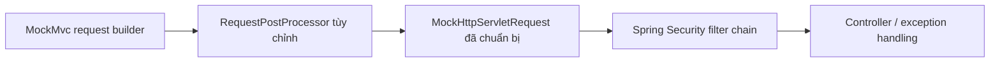

# Tạo post-processor riêng cho quy ước kiểm thử ứng dụng

Các request post-processor có sẵn của Spring Security Test như `user(...)`, `anonymous()`, `authentication(...)` và `csrf()` đáp ứng phần lớn tình huống kiểm thử HTTP. Tuy nhiên, ứng dụng thường có quy ước riêng: header tenant, mã tổ chức, correlation ID, principal domain, thông tin thiết bị hoặc metadata mà controller/filter cần đọc. Khi nhiều test phải lặp lại cùng cách chuẩn bị những dữ liệu đó, ta có thể tạo **`RequestPostProcessor` tùy chỉnh** để đóng gói fixture thành một API ngắn gọn, nhất quán và dễ bảo trì.

Bài học thuộc chương **Danh tính trên yêu cầu** của module `SPRING_SECURITY_TESTING`. Người học kiểm chứng xác thực, phân quyền và bảo vệ HTTP thực tế bằng `spring-security-test` trên ứng dụng Servlet và Reactive. Trọng tâm ở đây là cách tạo post-processor riêng cho quy ước kiểm thử của ứng dụng, kết hợp nó với processor có sẵn, kiểm soát phạm vi từng request và tránh biến fixture test thành một đường tắt làm sai lệch hành vi bảo mật.

## 1. `RequestPostProcessor` là gì?

`RequestPostProcessor` là giao diện của Spring MVC Test, thuộc package `org.springframework.test.web.servlet.request`. Nó nhận một `MockHttpServletRequest` và trả về request đã được điều chỉnh trước khi `MockMvc` thực thi:

```java
package org.springframework.test.web.servlet.request;

public interface RequestPostProcessor {
    MockHttpServletRequest postProcessRequest(
            MockHttpServletRequest request);
}
```

Các processor có sẵn như `user(...)` và `csrf()` cũng triển khai giao diện này. Chúng có thể thêm header, tham số, cookie, thuộc tính request hoặc thông tin bảo mật được Spring Security Test sử dụng.

Ta áp dụng processor bằng `.with(...)`:

```java
mockMvc.perform(get("/api/reports")
        .with(customRequestPostProcessor()));
```

Khi `MockMvc` xây dựng request, processor được gọi để điều chỉnh request trước khi request đi qua servlet filter chain và controller. Đây là điểm mở rộng phù hợp để chuẩn bị những quy ước test lặp lại.



Một post-processor **không phải filter** và không thay thế cấu hình Spring Security. Nó chuẩn bị request test; filter chain và ứng dụng vẫn quyết định request được phép hay bị từ chối.

## 2. Khi nào nên tạo processor riêng?

Hãy cân nhắc tạo helper khi nhiều bài test cùng lặp lại một nhóm thao tác:

- Mọi request của một tenant phải gửi header `X-Tenant-ID` theo quy ước của ứng dụng.
- Controller cần principal có `accountId`, `tenantId` hoặc thông tin domain riêng.
- Các test đều cần một authentication với một tập authority cụ thể.
- API nội bộ yêu cầu metadata như `X-Client-Name` hoặc `X-Correlation-ID`.
- Một nhóm endpoint cần kết hợp danh tính, tenant và một số header mặc định.

Không cần tạo processor cho mọi giá trị đơn lẻ. Nếu chỉ một test cần thêm một header, `header(...)` hoặc `.with(request -> ...)` có thể đủ. Processor riêng có giá trị khi nó đặt tên được một **quy ước test có ý nghĩa** và tránh lặp lại logic chuẩn bị.

| Tình huống | Cách phù hợp |
| --- | --- |
| Một request chỉ thêm header | Dùng processor có sẵn hoặc lambda ngắn |
| Nhiều test cùng gửi header tenant | Tạo `tenantHeader(tenantId)` |
| Nhiều test cần user chuẩn với role | Bao `user(username).roles(...)` trong helper |
| Controller cần custom principal và authority | Tạo `Authentication` phù hợp rồi gắn `SecurityContext` |
| Cần kiểm tra CSRF | Dùng `csrf()` có sẵn; không tự viết lại nếu không có quy ước riêng |
| Cần kiểm tra login thật/session | Gửi credentials qua login filter và kiểm tra session; processor giả lập không thay thế luồng đó |

## 3. Processor đơn giản: chuẩn bị header theo quy ước ứng dụng

Giả sử các endpoint báo cáo nhận tenant từ header `X-Tenant-ID`. Ta tạo một helper nhỏ:

```java
package com.example.testsecurity;

import org.springframework.test.web.servlet.request.RequestPostProcessor;

public final class AppRequestPostProcessors {

    private AppRequestPostProcessors() {
    }

    public static RequestPostProcessor tenantHeader(String tenantId) {
        return request -> {
            request.setHeader("X-Tenant-ID", tenantId);
            return request;
        };
    }
}
```

Trong test:

```java
mockMvc.perform(get("/api/reports")
        .with(AppRequestPostProcessors.tenantHeader("acme")))
    .andExpect(status().isOk());
```

`setHeader(...)` đặt giá trị header cho request mock. Khi cần nhiều header, có thể thêm các lời gọi `setHeader(...)` trong cùng processor hoặc tạo một helper nhận một cấu trúc metadata rõ ràng.

Không nên đưa logic nghiệp vụ phức tạp vào processor. Ví dụ trên chỉ chuẩn bị đầu vào HTTP; controller/filter phải kiểm tra header đó có hợp lệ và có được phép dùng cho principal hiện tại hay không.

**Lưu ý bảo mật:** header `X-Tenant-ID` do client gửi lên không tự trở thành nguồn danh tính đáng tin cậy. Ứng dụng phải xác minh tenant được yêu cầu thuộc phạm vi người dùng đã xác thực hoặc lấy tenant từ một nguồn đã được tin cậy. Processor chỉ giúp test tạo header nhất quán; nó không biến header thành bằng chứng quyền truy cập.

## 4. Kết hợp processor riêng với `user(...)` có sẵn

Nếu principal chuẩn `UserDetails` đã đủ, ta có thể bọc processor của Spring Security thay vì tự tạo authentication:

Đây là biến thể mở rộng của helper ở mục 3. Khi đưa vào dự án, giữ các phương thức trong một lớp `AppRequestPostProcessors` duy nhất.

```java
package com.example.testsecurity;

import org.springframework.security.test.web.servlet.request
        .SecurityMockMvcRequestPostProcessors;
import org.springframework.test.web.servlet.request.RequestPostProcessor;

public final class AppRequestPostProcessors {

    private AppRequestPostProcessors() {
    }

    public static RequestPostProcessor tenantHeader(String tenantId) {
        return request -> {
            request.setHeader("X-Tenant-ID", tenantId);
            return request;
        };
    }

    public static RequestPostProcessor tenantUser(
            String username, String tenantId, String... roles) {

        return request -> {
            request.setHeader("X-Tenant-ID", tenantId);
            return SecurityMockMvcRequestPostProcessors
                    .user(username)
                    .roles(roles)
                    .postProcessRequest(request);
        };
    }
}
```

Cách dùng:

```java
mockMvc.perform(get("/api/reports")
        .with(AppRequestPostProcessors.tenantUser(
                "alice", "acme", "READER")))
    .andExpect(status().isOk());
```

Helper trên đóng gói hai quy ước: header tenant và người dùng có role. Nó vẫn sử dụng cách tạo principal chuẩn của Spring Security Test, nên phù hợp nếu controller đọc username/authority thông thường. Nếu controller yêu cầu principal domain tùy chỉnh, cần helper tạo đúng kiểu principal như phần tiếp theo.

Nên đặt helper trong source set test, ví dụ `src/test/java`, để nó không trở thành API production hoặc vô tình được dùng như cơ chế xác thực thật.

## 5. Tạo principal domain và gắn SecurityContext trong processor

Giả sử ứng dụng có controller cần biết tenant của principal. Ta tạo principal domain triển khai `java.security.Principal`:

```java
package com.example.security;

import java.security.Principal;

public record TenantPrincipal(
        String username,
        String tenantId
) implements Principal {

    @Override
    public String getName() {
        return username;
    }
}
```

Bây giờ processor tùy chỉnh có thể tạo `Authentication` đã xác thực với principal đúng kiểu và authority do test cung cấp:

```java
package com.example.testsecurity;

import java.util.Arrays;
import java.util.List;

import com.example.security.TenantPrincipal;
import org.springframework.security.authentication.UsernamePasswordAuthenticationToken;
import org.springframework.security.core.Authentication;
import org.springframework.security.core.authority.SimpleGrantedAuthority;
import org.springframework.security.core.context.SecurityContext;
import org.springframework.security.core.context.SecurityContextHolder;
import org.springframework.security.test.web.servlet.request
        .SecurityMockMvcRequestPostProcessors;
import org.springframework.test.web.servlet.request.RequestPostProcessor;

public final class AppRequestPostProcessors {

    private AppRequestPostProcessors() {
    }

    public static RequestPostProcessor tenantHeader(String tenantId) {
        return request -> {
            request.setHeader("X-Tenant-ID", tenantId);
            return request;
        };
    }

    public static RequestPostProcessor tenantUser(
            String username, String tenantId, String... authorities) {

        return request -> {
            request.setHeader("X-Tenant-ID", tenantId);

            List<SimpleGrantedAuthority> granted = Arrays.stream(authorities)
                    .map(SimpleGrantedAuthority::new)
                    .toList();

            Authentication authentication =
                    UsernamePasswordAuthenticationToken.authenticated(
                            new TenantPrincipal(username, tenantId),
                            null,
                            granted
                    );

            SecurityContext context =
                    SecurityContextHolder.createEmptyContext();
            context.setAuthentication(authentication);

            return SecurityMockMvcRequestPostProcessors
                    .securityContext(context)
                    .postProcessRequest(request);
        };
    }
}
```

Processor tạo context **bên trong `postProcessRequest`**, vì vậy mỗi lần áp dụng nó tạo một context mới. Điều này tránh chia sẻ một `SecurityContext` mutable giữa nhiều request test. Principal là `TenantPrincipal`, không phải `UserDetails`; do đó controller có thể nhận nó qua `@AuthenticationPrincipal TenantPrincipal`.

Trong ví dụ, authority được truyền nguyên văn. Nếu test gọi `tenantUser("alice", "acme", "reports:read")`, token có authority `reports:read`. Không có bước tự động thêm tiền tố `ROLE_` như helper dùng `user(...).roles(...)`.

## 6. Ví dụ ứng dụng: kiểm tra tenant, principal và quyền

Giả sử API `GET /api/tenants/{tenantId}/reports` cần authority `reports:read`. Controller kiểm tra tenant trong URL khớp với tenant của principal và header request.

Cấu hình bảo mật:

```java
import org.springframework.context.annotation.Bean;
import org.springframework.context.annotation.Configuration;
import org.springframework.http.HttpMethod;
import org.springframework.security.config.annotation.web.builders.HttpSecurity;
import org.springframework.security.config.annotation.web.configuration.EnableWebSecurity;
import org.springframework.security.web.SecurityFilterChain;

@Configuration
@EnableWebSecurity
class ReportSecurityConfiguration {

    @Bean
    SecurityFilterChain securityFilterChain(HttpSecurity http)
            throws Exception {
        return http
            .authorizeHttpRequests(auth -> auth
                .requestMatchers(
                    HttpMethod.GET,
                    "/api/tenants/*/reports"
                ).hasAuthority("reports:read")
                .requestMatchers(
                    HttpMethod.POST,
                    "/api/tenants/*/reports"
                ).hasAuthority("reports:publish")
                .anyRequest().denyAll())
            .build();
    }
}
```

Controller:

```java
import org.springframework.http.HttpStatus;
import org.springframework.http.ResponseEntity;
import org.springframework.security.core.annotation.AuthenticationPrincipal;
import org.springframework.web.bind.annotation.GetMapping;
import org.springframework.web.bind.annotation.PathVariable;
import org.springframework.web.bind.annotation.PostMapping;
import org.springframework.web.bind.annotation.RequestHeader;
import org.springframework.web.bind.annotation.RestController;

@RestController
class ReportController {

    @GetMapping("/api/tenants/{tenantId}/reports")
    ResponseEntity<String> reports(
            @PathVariable String tenantId,
            @RequestHeader("X-Tenant-ID") String requestedTenant,
            @AuthenticationPrincipal(errorOnInvalidType = true)
            TenantPrincipal principal) {

        if (!tenantId.equals(principal.tenantId())
                || !tenantId.equals(requestedTenant)) {
            return ResponseEntity.status(HttpStatus.FORBIDDEN)
                    .body("tenant-forbidden");
        }

        return ResponseEntity.ok("reports-for-" + tenantId);
    }

    @PostMapping("/api/tenants/{tenantId}/reports")
    ResponseEntity<String> publishReports(
            @PathVariable String tenantId,
            @RequestHeader("X-Tenant-ID") String requestedTenant,
            @AuthenticationPrincipal(errorOnInvalidType = true)
            TenantPrincipal principal) {

        if (!tenantId.equals(principal.tenantId())
                || !tenantId.equals(requestedTenant)) {
            return ResponseEntity.status(HttpStatus.FORBIDDEN)
                    .body("tenant-forbidden");
        }

        return ResponseEntity.status(HttpStatus.CREATED)
                .body("published-for-" + tenantId);
    }
}
```

Controller dùng principal để đối chiếu danh tính đã xác thực với tenant được yêu cầu. Header được kiểm tra như một phần của quy ước request, nhưng bản thân header không cấp quyền; authorization filter chain yêu cầu `reports:read` cho GET và `reports:publish` cho POST trước khi controller chạy.

## 7. Kiểm thử bằng helper riêng

Các test sau dùng helper `tenantUser(...)` để tạo danh tính và header nhất quán:

```java
import static com.example.testsecurity.AppRequestPostProcessors.tenantUser;
import static com.example.testsecurity.AppRequestPostProcessors.tenantHeader;
import static org.springframework.test.web.servlet.request.MockMvcRequestBuilders.get;
import static org.springframework.test.web.servlet.result.MockMvcResultMatchers.content;
import static org.springframework.test.web.servlet.result.MockMvcResultMatchers.status;

import org.junit.jupiter.api.Test;
import org.springframework.beans.factory.annotation.Autowired;
import org.springframework.boot.test.autoconfigure.web.servlet.AutoConfigureMockMvc;
import org.springframework.boot.test.context.SpringBootTest;
import org.springframework.test.web.servlet.MockMvc;

@SpringBootTest
@AutoConfigureMockMvc
class TenantRequestPostProcessorTests {

    @Autowired
    MockMvc mockMvc;

    @Test
    void readerCanReadOwnTenantReports() throws Exception {
        mockMvc.perform(get("/api/tenants/acme/reports")
                .with(tenantUser("alice", "acme", "reports:read")))
            .andExpect(status().isOk())
            .andExpect(content().string("reports-for-acme"));
    }

    @Test
    void missingAuthorityIsRejectedBySecurity() throws Exception {
        mockMvc.perform(get("/api/tenants/acme/reports")
                .with(tenantUser("alice", "acme", "reports:write")))
            .andExpect(status().isForbidden());
    }

    @Test
    void principalFromAnotherTenantIsRejectedByController()
            throws Exception {
        mockMvc.perform(get("/api/tenants/acme/reports")
                .with(tenantUser("alice", "other", "reports:read")))
            .andExpect(status().isForbidden())
            .andExpect(content().string("tenant-forbidden"));
    }

    @Test
    void requestHeaderCanBeOverriddenForNegativeCase() throws Exception {
        mockMvc.perform(get("/api/tenants/acme/reports")
                .with(tenantUser("alice", "acme", "reports:read"))
                .with(tenantHeader("other")))
            .andExpect(status().isForbidden())
            .andExpect(content().string("tenant-forbidden"));
    }
}
```

Đọc kết quả theo tầng xử lý:

| Ca kiểm thử | Principal | Authority | Tenant URL / principal / header | Kết quả |
| --- | --- | --- | --- | --- |
| Đọc tenant đúng | Alice / `acme` | `reports:read` | `acme / acme / acme` | `200` |
| Thiếu quyền | Alice / `acme` | `reports:write` | `acme / acme / acme` | `403` từ filter chain |
| Principal khác tenant | Alice / `other` | `reports:read` | `acme / other / other` | `403` từ controller |
| Header bị ghi đè | Alice / `acme` | `reports:read` | `acme / acme / other` | `403` từ controller |

Test thiếu authority bị filter chain chặn trước khi controller chạy. Hai test tenant mismatch có đủ authority nên vào controller và bị từ chối ở quy tắc nghiệp vụ. Cách phân chia này giúp biết rõ post-processor đang chuẩn bị dữ liệu nào và tầng nào quyết định kết quả.

## 8. Kết hợp processor riêng với `csrf()` và processor có sẵn

Không cần tự viết lại những chức năng mà Spring Security Test đã cung cấp. Ví dụ, nếu endpoint `POST` cần tenant, principal và CSRF, kết hợp helper riêng với `csrf()`:

```java
import static com.example.testsecurity.AppRequestPostProcessors.tenantUser;
import static org.springframework.security.test.web.servlet.request
        .SecurityMockMvcRequestPostProcessors.csrf;
import static org.springframework.test.web.servlet.request.MockMvcRequestBuilders.post;

mockMvc.perform(post("/api/tenants/acme/reports")
        .with(tenantUser("admin", "acme",
                "reports:publish"))
        .with(csrf()))
    .andExpect(status().isCreated())
    .andExpect(content().string("published-for-acme"));
```

Ở đây helper riêng đặt principal, authorities và header tenant; `csrf()` đặt CSRF token hợp lệ. Hai processor có trách nhiệm khác nhau nên có thể kết hợp trên cùng request.

Nếu cần kiểm tra lỗi CSRF, giữ nguyên principal đủ quyền rồi bỏ `csrf()` hoặc dùng `csrf().useInvalidToken()`. Nếu cần kiểm tra thiếu quyền, cung cấp CSRF token hợp lệ để `403` thực sự đến từ authorization rule.

Không nên nhúng CSRF vào helper `tenantUser(...)` nếu chỉ một số endpoint cần token. Việc ghép các trách nhiệm độc lập ở nơi gọi giúp test thể hiện rõ request nào cần bảo vệ CSRF.

## 9. Kết hợp các processor bằng composition

Một processor riêng có thể gọi processor khác bên trong `postProcessRequest`. Đây là cách hữu ích khi quy ước ứng dụng gồm nhiều bước chuẩn bị:

```java
public static RequestPostProcessor readerInTenant(
        String username, String tenantId) {

    return request -> {
        request.setHeader("X-Tenant-ID", tenantId);

        return SecurityMockMvcRequestPostProcessors
                .user(username)
                .roles("READER")
                .postProcessRequest(request);
    };
}
```

Đoạn helper này nằm trong cùng lớp `AppRequestPostProcessors`; cần có import `SecurityMockMvcRequestPostProcessors` và `RequestPostProcessor` như các ví dụ trước.

Trong ví dụ này, helper bọc `user(username).roles("READER")` và bổ sung header. Processor gốc vẫn chịu trách nhiệm tạo authentication theo quy ước của Spring Security Test.

Có thể tạo một hàm tổng quát để ghép nhiều processor:

```java
public static RequestPostProcessor compose(
        RequestPostProcessor... processors) {

    return request -> {
        var result = request;
        for (RequestPostProcessor processor : processors) {
            result = processor.postProcessRequest(result);
        }
        return result;
    };
}
```

Cách dùng:

```java
mockMvc.perform(get("/api/reports")
        .with(compose(
                tenantHeader("acme"),
                user("alice").roles("READER"))))
    .andExpect(status().isOk());
```

Hàm `compose(...)` áp dụng processor theo thứ tự được truyền vào. Thứ tự có ý nghĩa nếu hai processor cùng ghi vào một header, parameter hoặc attribute; processor sau có thể ghi đè giá trị trước nếu dùng API setter. Chỉ nên tạo composition helper khi nó làm quy ước test dễ đọc hơn; nếu không, nhiều lời gọi `.with(...)` riêng thường minh bạch hơn.

## 10. Những quy tắc thiết kế processor dễ bảo trì

Một helper test tốt cần giữ các đặc tính sau:

1. **Tên mô tả ý định:** `tenantUser(...)` dễ hiểu hơn `setup1(...)`.
2. **Tạo dữ liệu mới theo request:** không dùng chung `SecurityContext` mutable giữa nhiều lần gọi.
3. **Giữ trách nhiệm nhỏ:** danh tính, tenant header và CSRF là các phần riêng; chỉ ghép khi quy ước thực sự cần.
4. **Dùng authority rõ ràng:** phân biệt `roles("ADMIN")` tạo `ROLE_ADMIN` với `authorities("reports:read")` giữ nguyên tên quyền.
5. **Không tự cấp quyền ẩn:** helper không nên mặc định thêm `ROLE_ADMIN` hoặc bỏ qua authorization để test luôn xanh.
6. **Đặt trong source set test:** tránh đóng gói fixture kiểm thử thành cơ chế xác thực production.
7. **Không che giấu dữ liệu đầu vào:** tham số helper nên cho thấy username, tenant và authority nào đang được sử dụng.
8. **Dùng lại API chuẩn khi có thể:** `csrf()`, `anonymous()`, `jwt()` và `oauth2Login()` đã giải quyết những tình huống chuyên biệt tốt hơn helper tự chế.

Một helper quá tổng quát với nhiều boolean như `admin=true`, `anonymous=false`, `csrf=true` khó đọc và dễ tạo tổ hợp không hợp lệ. Ưu tiên các factory nhỏ có tên thể hiện mục tiêu của test.

## 11. Phạm vi và giới hạn của post-processor riêng

Custom `RequestPostProcessor` chỉ sửa `MockHttpServletRequest` trong quá trình xây request test. Nó không:

- Gọi `AuthenticationManager` hoặc xác minh password.
- Tạo tài khoản trong database hay gọi `UserDetailsService` trừ khi chính code helper tự làm điều đó (thường không nên).
- Lưu `SecurityContext` vào session để request kế tiếp tự khôi phục.
- Thực hiện JWT signature validation, OAuth2 redirect/code exchange hoặc OIDC ID Token verification.
- Thay thế filter, authorization rule, CSRF protection hoặc controller.
- Biến header client gửi lên thành thông tin đáng tin cậy.

Nếu muốn kiểm tra đăng nhập/session thật, hãy gửi credentials qua login filter, lấy `MockHttpSession` và gửi lại session ở request tiếp theo. Nếu muốn kiểm tra JWT thật, gửi Bearer token qua filter chain với decoder/validator phù hợp. Custom processor hữu ích cho kiểm tra controller và authorization sau khi danh tính đã được chuẩn bị.

## 12. Ranh giới Servlet và Reactive

`RequestPostProcessor` và `MockHttpServletRequest` thuộc Spring MVC Test/Servlet. Với WebFlux, test dùng `WebTestClient` và các cơ chế `SecurityMockServerConfigurers` qua `mutateWith(...)`. Không truyền custom processor của `MockMvc` sang `WebTestClient`.

Ví dụ Reactive dùng configurer có sẵn:

```java
WebTestClient securedClient = WebTestClient
        .bindToApplicationContext(applicationContext)
        .apply(SecurityMockServerConfigurers.springSecurity())
        .configureClient()
        .build();

securedClient
    .mutateWith(SecurityMockServerConfigurers.mockUser("alice")
            .roles("USER"))
    .get()
    .uri("/api/me")
    .exchange()
    .expectStatus().isOk();
```

Nếu ứng dụng Reactive có quy ước tenant riêng, hãy tạo helper phù hợp với API của `WebTestClient` hoặc một `ExchangeFilterFunction`/configurer theo đúng mục tiêu. Cần giữ rõ khác biệt giữa chuẩn bị request HTTP và đưa security context vào Reactor Context. Không tái sử dụng trực tiếp code thao tác `MockHttpServletRequest` trong môi trường Reactive.

## 13. Bài tập: thiết kế processor theo quy ước của một API

Giả sử API `GET /api/tenants/{tenantId}/invoices` yêu cầu authority `invoice:read` và header `X-Tenant-ID` phải khớp với tenant của principal. Hãy tạo helper `invoiceReader(username, tenantId)` và viết các ca:

1. Principal Alice, tenant `north`, có `invoice:read` và header `north`: request được phép.
2. Principal Alice có `invoice:write`: request bị filter chain từ chối.
3. Principal Alice thuộc tenant `south` nhưng URL yêu cầu `north`: controller từ chối.
4. Principal đúng tenant nhưng header bị ghi đè thành `south`: controller từ chối.
5. Dùng `anonymous()` để xác nhận header tenant không tự xác thực request.
6. Với endpoint POST, ghép helper với `csrf()`; kiểm tra riêng thiếu/sai token.
7. Dùng lại cùng một instance `RequestPostProcessor` cho hai request và xác nhận mỗi request nhận context mới theo cách helper được triển khai.

Khi hoàn thành, hãy giải thích helper đang chuẩn bị **header nào**, **principal kiểu gì**, **authority nào**, **context nào** và **request nào**. Một post-processor riêng tốt giúp test diễn đạt quy ước của ứng dụng ngắn gọn và nhất quán, trong khi vẫn để Spring Security filter chain và logic nghiệp vụ quyết định request được phép hay bị từ chối.
