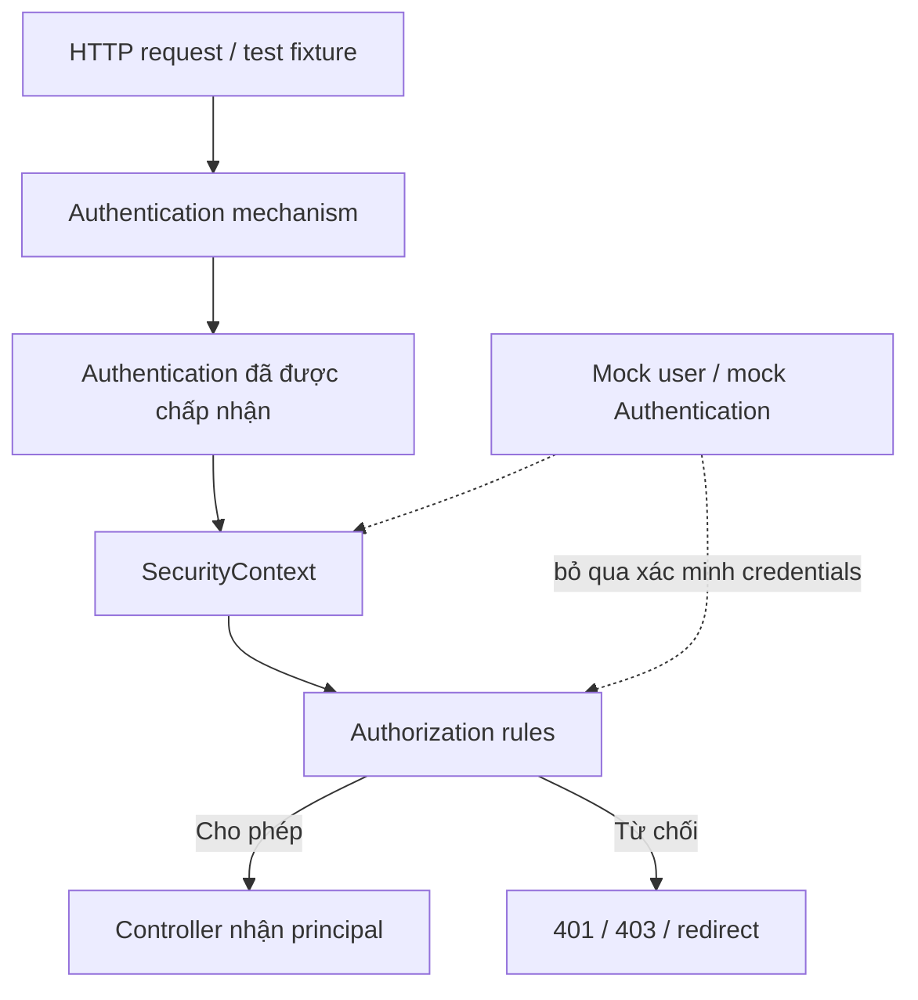

# Không suy ra cơ chế xác thực đã hoạt động chỉ vì controller nhận được principal

Một controller nhận được username hoặc principal trong tham số không tự chứng minh rằng cơ chế đăng nhập của ứng dụng đã chạy. Trong bài kiểm thử, danh tính có thể được gắn sẵn bằng `@WithMockUser`, `.with(user(...))`, `.with(authentication(...))` hoặc `.with(jwt())`. Các cách này hữu ích để kiểm tra controller và quy tắc phân quyền sau xác thực, nhưng chúng thường **bỏ qua bước xác minh credentials/token** mà ứng dụng sử dụng trong thực tế.

Bài học thuộc chương **Danh tính trên yêu cầu** của module `SPRING_SECURITY_TESTING`, chuyên kiểm chứng xác thực, phân quyền và bảo vệ HTTP thực tế bằng `spring-security-test` trên ứng dụng Servlet và Reactive. Trọng tâm là phân biệt bốn điều cần chứng minh: controller nhận đúng principal, request đi qua security filter chain, cơ chế xác thực thực sự chấp nhận hoặc từ chối credentials, và authorization cho phép hoặc từ chối quyền truy cập.

## 1. Controller nhận principal chứng minh điều gì?

Spring MVC có thể cung cấp danh tính cho controller qua nhiều dạng tham số:

- `@AuthenticationPrincipal UserDetails user` lấy principal từ `Authentication.getPrincipal()` trong `SecurityContext`.
- `Authentication authentication` cung cấp toàn bộ đối tượng xác thực, gồm principal và authorities.
- `Principal principal` cung cấp đối tượng đại diện danh tính theo cơ chế Servlet/MVC.
- Một tham số domain như `AccountPrincipal` có thể được đưa vào qua `@AuthenticationPrincipal` nếu kiểu principal trong context tương thích.

Ví dụ:

```java
@GetMapping("/api/me")
String currentUser(
        @AuthenticationPrincipal UserDetails user) {
    return user.getUsername();
}
```

Nếu request trả về chuỗi `alice`, ta biết rằng tại thời điểm xử lý handler, tham số principal đã được cung cấp và controller có thể đọc username. Nhưng chỉ riêng kết quả đó **không cho biết principal được tạo ra bằng cách nào**.

Principal có thể đến từ:

1. Người dùng thực sự gửi username/password và `AuthenticationProvider` xác minh thành công.
2. Một Bearer token được filter Resource Server giải mã và xác minh.
3. Context đã lưu trong HTTP session được `SecurityContextRepository` khôi phục.
4. `@WithMockUser` tạo context phục vụ test.
5. `.with(user("alice"))` hoặc `.with(authentication(auth))` gắn danh tính test trực tiếp vào request.
6. Một test tự đặt `Principal`/`Authentication` vào mock request hoặc context.

Vì thế, assertion `status().isOk()` cùng body `alice` chỉ chứng minh đường đi tới controller và kết quả binding principal trong **fixture hiện tại**. Muốn kết luận về cơ chế xác thực, phải kiểm tra chính đầu vào mà cơ chế đó xử lý.

## 2. Phân biệt binding principal, authentication và authorization

Ba giai đoạn này liên quan nhau nhưng trả lời các câu hỏi khác nhau:

| Giai đoạn | Câu hỏi cần trả lời | Thành phần thường liên quan |
| --- | --- | --- |
| Principal resolution / binding | Controller nhận đúng principal và kiểu dữ liệu chưa? | `AuthenticationPrincipalArgumentResolver`, `@AuthenticationPrincipal`, handler argument resolver |
| Authentication | Credentials hoặc token có được xác minh và tạo thành authentication hợp lệ không? | Filter, `AuthenticationManager`, `AuthenticationProvider`, `UserDetailsService`, password encoder, JWT decoder |
| Authorization | Danh tính đã có được phép truy cập endpoint/method này không? | `authorizeHttpRequests`, request matcher, `GrantedAuthority`, method security |

Một test chỉ dùng `user("alice").roles("USER")` có thể kiểm tra authorization rất tốt: Alice có quyền USER nên được phép vào endpoint yêu cầu `authenticated()`, nhưng bị từ chối ở endpoint yêu cầu ADMIN. Tuy nhiên, test đó không kiểm tra password của Alice vì không có bước so sánh password.

Tương tự, test dùng `jwt()` có thể kiểm tra quyền dựa trên scope và claims sau xác thực. Nó không chứng minh JWT thật có chữ ký hợp lệ hoặc decoder của ứng dụng chấp nhận token.



Sơ đồ cho thấy hai con đường test khác nhau: test giả lập có thể chuẩn bị thẳng context để tập trung kiểm tra authorization; test xác thực tích hợp phải gửi đầu vào qua cơ chế xác thực thực tế trước khi context được tạo.

## 3. Các fixture thường bỏ qua bước xác thực

Các API sau đây rất hữu ích, nhưng không nên dùng chúng để kết luận password/token đã được xác minh:

| Fixture | Dữ liệu nó chuẩn bị | Điều nó không chứng minh |
| --- | --- | --- |
| `@WithMockUser` | `SecurityContext` với principal chuẩn và authorities giả lập | Không gọi `AuthenticationManager`, không kiểm tra password |
| `@WithUserDetails` | Principal được tải từ `UserDetailsService` | Không gửi password qua filter và không xác minh credentials |
| `.with(user("alice"))` | `UserDetails` giả lập và authentication cho request | Không tải user từ database hoặc kiểm tra password |
| `.with(user(customUserDetails))` | Principal `UserDetails` đã dựng sẵn | Không chứng minh service production tạo principal đó đúng |
| `.with(authentication(auth))` | Một `Authentication` cụ thể do test tạo | Không chạy provider/decoder để xác minh token hoặc credentials |
| `.with(securityContext(context))` | Context đã chuẩn bị | Không chứng minh context được lưu/khôi phục từ session |
| `.with(jwt())` | JWT authentication giả lập | Không kiểm tra chữ ký, issuer, audience, expiration hoặc decoder |
| `.with(oauth2Login())` / `.with(oidcLogin())` | Principal OAuth2/OIDC đã đăng nhập giả lập | Không chạy redirect, authorization code flow hoặc xác minh ID Token |

`@WithUserDetails` có một điểm khác với `@WithMockUser`: nó thực sự gọi `UserDetailsService` để tải đối tượng `UserDetails`. Dù vậy, nó vẫn không thực hiện quy trình so khớp mật khẩu qua `AuthenticationManager`. Nếu mục tiêu là kiểm tra service tải tài khoản, annotation này hữu ích; nếu mục tiêu là kiểm tra login, cần gửi credentials qua filter hoặc gọi đúng authentication flow.

## 4. Một ví dụ HTTP Basic: cấu hình thật và controller

Ta xây ứng dụng Servlet đơn giản để minh họa sự khác nhau giữa fixture và cơ chế xác thực HTTP Basic.

Người dùng Alice có role USER. Endpoint `GET /api/me` yêu cầu đăng nhập; `GET /api/admin` yêu cầu role ADMIN.

Cấu hình:

```java
import org.springframework.context.annotation.Bean;
import org.springframework.context.annotation.Configuration;
import org.springframework.security.config.Customizer;
import org.springframework.security.config.annotation.web.builders.HttpSecurity;
import org.springframework.security.core.userdetails.User;
import org.springframework.security.core.userdetails.UserDetails;
import org.springframework.security.core.userdetails.UserDetailsService;
import org.springframework.security.crypto.factory.PasswordEncoderFactories;
import org.springframework.security.crypto.password.PasswordEncoder;
import org.springframework.security.provisioning.InMemoryUserDetailsManager;
import org.springframework.security.web.SecurityFilterChain;

@Configuration
class BasicAuthenticationTestConfiguration {

    @Bean
    PasswordEncoder passwordEncoder() {
        return PasswordEncoderFactories.createDelegatingPasswordEncoder();
    }

    @Bean
    UserDetailsService userDetailsService(PasswordEncoder encoder) {
        UserDetails alice = User.withUsername("alice")
                .password(encoder.encode("correct-password"))
                .roles("USER")
                .build();

        return new InMemoryUserDetailsManager(alice);
    }

    @Bean
    SecurityFilterChain securityFilterChain(HttpSecurity http)
            throws Exception {
        return http
            .authorizeHttpRequests(auth -> auth
                .requestMatchers("/api/me").authenticated()
                .requestMatchers("/api/admin").hasRole("ADMIN")
                .anyRequest().denyAll())
            .httpBasic(Customizer.withDefaults())
            .build();
    }
}
```

Ví dụ dùng `DelegatingPasswordEncoder` để mã hóa password fixture khi tạo user; request test vẫn gửi password gốc `correct-password`. Trong ứng dụng thực tế, chọn encoder và chính sách lưu trữ phù hợp với hệ thống.

Controller:

```java
import org.springframework.security.core.annotation.AuthenticationPrincipal;
import org.springframework.security.core.userdetails.UserDetails;
import org.springframework.web.bind.annotation.GetMapping;
import org.springframework.web.bind.annotation.RestController;

@RestController
class IdentityController {

    @GetMapping("/api/me")
    String me(@AuthenticationPrincipal UserDetails user) {
        return user.getUsername();
    }

    @GetMapping("/api/admin")
    String admin() {
        return "admin-area";
    }
}
```

Controller nhận `UserDetails` qua `@AuthenticationPrincipal`. Cùng controller này có thể được gọi bởi một request dùng mock user hoặc bởi request HTTP Basic đã xác thực. Vì vậy, cần xem test đã chuẩn bị principal theo con đường nào trước khi đưa ra kết luận.

## 5. Test bằng `user(...)` chỉ kiểm tra hành vi sau xác thực

Dependency cho test:

```xml
<dependency>
    <groupId>org.springframework.security</groupId>
    <artifactId>spring-security-test</artifactId>
    <scope>test</scope>
</dependency>
```

Test với request post-processor:

```java
import static org.springframework.security.test.web.servlet.request
        .SecurityMockMvcRequestPostProcessors.anonymous;
import static org.springframework.security.test.web.servlet.request
        .SecurityMockMvcRequestPostProcessors.user;
import static org.springframework.test.web.servlet.request.MockMvcRequestBuilders.get;
import static org.springframework.test.web.servlet.result.MockMvcResultMatchers.content;
import static org.springframework.test.web.servlet.result.MockMvcResultMatchers.status;

import org.junit.jupiter.api.Test;
import org.springframework.beans.factory.annotation.Autowired;
import org.springframework.boot.test.autoconfigure.web.servlet.AutoConfigureMockMvc;
import org.springframework.boot.test.context.SpringBootTest;
import org.springframework.test.web.servlet.MockMvc;

@SpringBootTest
@AutoConfigureMockMvc
class MockIdentityTests {

    @Autowired
    MockMvc mockMvc;

    @Test
    void mockUserCanReadOwnUsername() throws Exception {
        mockMvc.perform(get("/api/me")
                .with(user("alice").roles("USER")))
            .andExpect(status().isOk())
            .andExpect(content().string("alice"));
    }

    @Test
    void mockUserWithoutAdminRoleIsForbidden() throws Exception {
        mockMvc.perform(get("/api/admin")
                .with(user("alice").roles("USER")))
            .andExpect(status().isForbidden());
    }

    @Test
    void anonymousRequestCannotReadPrivateEndpoint() throws Exception {
        mockMvc.perform(get("/api/me").with(anonymous()))
            .andExpect(status().isUnauthorized());
    }
}
```

Các test này có giá trị: chúng kiểm tra endpoint yêu cầu authentication, kiểm tra role ADMIN và xác nhận khách vô danh bị chặn. Tuy nhiên, test đầu tiên **không kiểm tra mật khẩu**. Chuỗi username `alice` được đưa trực tiếp vào principal giả lập; `UserDetailsService` và password encoder không cần xác minh `correct-password`.

Một dấu hiệu nhận biết: test không cung cấp password qua header/form login mà vẫn có principal đã xác thực. Đó chính là mục đích của request post-processor.

`@WithMockUser` cũng có cùng giới hạn về xác thực:

```java
@Test
@WithMockUser(username = "alice", roles = "USER")
void annotationProvidesAuthenticatedTestContext() throws Exception {
    mockMvc.perform(get("/api/me"))
        .andExpect(status().isOk())
        .andExpect(content().string("alice"));
}
```

Annotation chuẩn bị context cho test lifecycle. Nó không chạy HTTP Basic filter hoặc xác minh password của Alice.

## 6. Test cơ chế HTTP Basic bằng credentials thật của ứng dụng

Để kiểm tra HTTP Basic, request phải mang header Basic và được xử lý bởi filter chain có bật HTTP Basic. Spring Security Test cung cấp `httpBasic(username, password)` để tạo header:

```java
import static org.springframework.security.test.web.servlet.request
        .SecurityMockMvcRequestPostProcessors.httpBasic;

@Test
void correctBasicCredentialsAuthenticateAlice() throws Exception {
    mockMvc.perform(get("/api/me")
            .with(httpBasic("alice", "correct-password")))
        .andExpect(status().isOk())
        .andExpect(content().string("alice"));
}

@Test
void wrongBasicPasswordIsRejected() throws Exception {
    mockMvc.perform(get("/api/me")
            .with(httpBasic("alice", "wrong-password")))
        .andExpect(status().isUnauthorized());
}

@Test
void unknownBasicUserIsRejected() throws Exception {
    mockMvc.perform(get("/api/me")
            .with(httpBasic("unknown", "any-password")))
        .andExpect(status().isUnauthorized());
}
```

Khác với `user(...)`, `httpBasic(...)` tạo HTTP Authorization header để `BasicAuthenticationFilter` xử lý. Khi test context dùng cấu hình và provider thật của ứng dụng, các ca trên kiểm tra được việc credentials hợp lệ được chấp nhận và credentials sai/tài khoản không tồn tại bị từ chối.

**Không gắn `@WithMockUser` hoặc `.with(user(...))` vào các test này.** Nếu test đã được cấp authentication giả lập, nó có thể không còn chứng minh được đường HTTP Basic đang hoạt động. Hãy để filter chain tự tạo authentication từ header.

Với HTTP Basic, request chưa xác thực thường nhận `401`. Cơ chế khác như form login có thể trả redirect `302`; API tùy chỉnh có thể trả JSON lỗi. Điều chỉnh assertion theo `AuthenticationEntryPoint` của ứng dụng.

## 7. Đảm bảo request thực sự đi qua SecurityFilterChain

Ngay cả khi test dùng `httpBasic(...)`, kết luận chỉ đáng tin khi request chạy qua filter chain có cơ chế HTTP Basic.

Trong Spring Boot, cấu hình phổ biến:

```java
@SpringBootTest
@AutoConfigureMockMvc
class BasicAuthenticationIntegrationTests {

    @Autowired
    MockMvc mockMvc;
}
```

Mặc định `@AutoConfigureMockMvc` đăng ký servlet filters từ application context. Nếu tự dựng `MockMvc`:

```java
import static org.springframework.security.test.web.servlet.setup
        .SecurityMockMvcConfigurers.springSecurity;

MockMvc mockMvc = MockMvcBuilders
        .webAppContextSetup(webApplicationContext)
        .apply(springSecurity())
        .build();
```

Cẩn thận với các thiết lập sau:

- `@AutoConfigureMockMvc(addFilters = false)` tắt servlet filters cho MockMvc. Test không còn xác minh HTTP Basic filter chain theo cách thông thường.
- `standaloneSetup(controller)` không tự động đại diện toàn bộ cấu hình filter của ứng dụng. Nếu dùng, phải đăng ký security filter và các thành phần MVC liên quan có chủ đích.
- Một test gọi trực tiếp method controller chỉ kiểm tra logic method với tham số đã truyền; nó không đi qua servlet filter, authentication provider hoặc argument resolver của HTTP request.
- Một test slice có thể dùng cấu hình security khác với production. Kiểm tra rõ bean `SecurityFilterChain` đang được nạp trong application context.

Một bài test authentication integration nên có cả credentials đúng và sai, đồng thời chứng minh filter chain được áp dụng.

## 8. Cách kiểm tra provider thực sự được gọi

Khi cần bằng chứng mạnh hơn rằng provider/service đã xử lý credentials, có thể quan sát thành phần xác thực trong test context:

- Dùng một `AuthenticationProvider` test-specific có thể ghi nhận lần gọi `authenticate(...)`.
- Dùng spy/fake cho `UserDetailsService` để xác nhận việc tải user xảy ra khi gửi Basic credentials.
- Với password encoder, kiểm tra password matching trong test thành phần riêng hoặc cấu hình provider thật với encoder test.
- Kiểm tra negative case: password sai và username không tồn tại phải bị từ chối theo hợp đồng ứng dụng.

Ví dụ minh họa một provider test có bộ đếm:

```java
import java.util.concurrent.atomic.AtomicInteger;

import org.springframework.security.authentication.AuthenticationProvider;
import org.springframework.security.authentication.UsernamePasswordAuthenticationToken;
import org.springframework.security.core.Authentication;

final class CountingAuthenticationProvider
        implements AuthenticationProvider {

    private final AuthenticationProvider delegate;
    private final AtomicInteger attempts = new AtomicInteger();

    CountingAuthenticationProvider(AuthenticationProvider delegate) {
        this.delegate = delegate;
    }

    @Override
    public Authentication authenticate(Authentication authentication) {
        attempts.incrementAndGet();
        return delegate.authenticate(authentication);
    }

    @Override
    public boolean supports(Class<?> authentication) {
        return delegate.supports(authentication);
    }

    int attempts() {
        return attempts.get();
    }
}
```

Đây là decorator cho một provider thật. Trong test thực tế, tạo `delegate` với `UserDetailsService` và `PasswordEncoder` phù hợp, đăng ký decorator vào `AuthenticationManager` của filter chain và reset bộ đếm giữa các test. Sau khi gửi request `httpBasic(...)`, assertions có thể xác nhận provider đã được gọi. Không nên chỉ assert response `200` nếu mục tiêu đặc biệt là xác minh một provider cụ thể tham gia.

Nếu ứng dụng dùng nhiều provider hoặc nhiều `SecurityFilterChain`, xác định request matcher nào chọn chain và provider nào hỗ trợ loại token tương ứng. Một provider không được gọi có thể là dấu hiệu request đang đi qua chain khác hoặc cơ chế authentication khác.

## 9. JWT: mock principal không chứng minh token đã được xác minh

Với OAuth2 Resource Server, controller có thể nhận `Jwt`:

```java
@GetMapping("/api/jwt-me")
String jwtMe(@AuthenticationPrincipal Jwt jwt) {
    return jwt.getSubject();
}
```

Test bằng `jwt()`:

```java
mockMvc.perform(get("/api/jwt-me")
        .with(jwt().jwt(token -> token.subject("alice"))))
    .andExpect(status().isOk())
    .andExpect(content().string("alice"));
```

Test này kiểm tra controller nhận principal JWT và có thể đọc subject. `jwt()` tạo authentication giả lập, nên không chứng minh token thực có chữ ký hợp lệ hoặc được decoder chấp nhận.

Muốn kiểm tra đường Bearer authentication, gửi header token qua filter chain:

```java
import org.springframework.http.HttpHeaders;

mockMvc.perform(get("/api/jwt-me")
        .header(HttpHeaders.AUTHORIZATION, "Bearer " + signedToken))
    .andExpect(status().isOk())
    .andExpect(content().string("alice"));
```

Trong integration test, cấu hình `JwtDecoder`/JWK hoặc một decoder test có hành vi xác minh được kiểm soát. Thêm negative cases cho chữ ký sai, token hết hạn, issuer/audience sai và token không hợp lệ. Nếu chỉ dùng `jwt()`, các bước decode/validate đó chưa được chạy.

## 10. OAuth2 Login và OIDC: principal giả lập khác với authorization flow

`oauth2Login()` và `oidcLogin()` giúp kiểm tra controller sau khi người dùng đã đăng nhập qua OAuth2/OIDC:

```java
mockMvc.perform(get("/api/oauth-me")
        .with(oauth2Login().attributes(attrs ->
                attrs.put("name", "Alice"))))
    .andExpect(status().isOk());

mockMvc.perform(get("/api/oidc-me")
        .with(oidcLogin().idToken(token ->
                token.claim("email", "alice@example.test"))))
    .andExpect(status().isOk());
```

Các test này phù hợp để kiểm tra cách controller đọc `OAuth2User`/`OidcUser`, authority mapping đã được chuẩn bị hoặc logic nghiệp vụ sau đăng nhập. Chúng không thực hiện redirect tới Identity Provider, nhận authorization code, đổi code lấy token, xác minh ID Token hoặc kiểm tra cấu hình client registration đầy đủ.

Nếu mục tiêu là xác minh OAuth2/OIDC login flow, cần một lớp integration test mô phỏng provider hoặc kiểm tra từng thành phần protocol/registration/callback. Không suy ra flow đã chạy chỉ từ việc `@AuthenticationPrincipal OidcUser` nhận được object.

## 11. Principal sai kiểu và lỗi binding không phải lỗi xác thực

Một controller có thể yêu cầu principal domain cụ thể:

```java
@GetMapping("/api/account")
String account(
        @AuthenticationPrincipal(errorOnInvalidType = true)
        AccountPrincipal principal) {
    return principal.getAccountId().toString();
}
```

Nếu test dùng `@WithMockUser` hoặc `user("alice")`, principal thường là `User` chuẩn chứ không phải `AccountPrincipal`. Khi `errorOnInvalidType = true`, resolver có thể ném `ClassCastException` do principal sai kiểu. Nếu thuộc tính này mặc định `false`, resolver có thể trả `null` và controller lỗi khi truy cập.

Đây là lỗi hợp đồng principal/binding, không phải bằng chứng password sai hoặc request chưa xác thực. Để kiểm tra controller với đúng kiểu domain, dùng `user(customUserDetails)` nếu principal triển khai `UserDetails`, hoặc `authentication(customAuth)` với principal phù hợp.

Một test riêng nên xác nhận:
- Principal đúng kiểu và đủ authority: controller nhận dữ liệu đúng.
- Principal đúng kiểu nhưng thiếu authority: authorization từ chối trước controller.
- Principal sai kiểu: argument resolver phản ánh lỗi kiểu như cấu hình.
- Request anonymous: entry point/handler từ chối theo chính sách.

## 12. Phân biệt 401, 403 và lỗi controller

Không nên dùng một status code để suy luận toàn bộ quá trình bảo mật:

| Kết quả | Nguyên nhân điển hình | Cần kiểm tra |
| --- | --- | --- |
| `200` | Request được phép và controller xử lý thành công | Principal/body đúng chưa; fixture hay authentication thật? |
| `201`/`204` | Thao tác được phép và controller trả status tương ứng | Authorization, CSRF và tác động nghiệp vụ |
| `302` | Entry point form login chuyển hướng khách tới login | Cấu hình form login và success/failure handler |
| `401` | Chưa xác thực hoặc credentials/token bị từ chối | Entry point, filter, provider/decoder và credentials |
| `403` | Đã xác thực nhưng thiếu quyền, hoặc CSRF/logic nghiệp vụ từ chối | Authority, CSRF, ownership/tenant và tầng từ chối |
| `500` | Lỗi trong controller, argument resolver hoặc ứng dụng | Exception cụ thể; không mặc định là authentication failure |

Một request `403` không nhất thiết là do thiếu role: CSRF filter có thể chặn trước authorization, hoặc controller có thể từ chối tenant. Một `500` khi principal sai kiểu cũng không phải `401`. Hãy tách ca kiểm thử theo nguyên nhân và assert body/exception khi cần.

## 13. Ma trận chọn loại test theo mục tiêu

| Mục tiêu | Công cụ phù hợp | Điều có thể kết luận |
| --- | --- | --- |
| Controller đọc đúng username/claim | `user(...)`, `jwt()`, `oauth2Login()` | Principal được binding đúng trong fixture |
| Quy tắc role/authority cho phép hoặc từ chối | Mock principal + filter chain | Authorization hoạt động với authentication đã chuẩn bị |
| `UserDetailsService` tải principal đúng | `@WithUserDetails` hoặc test service | Service cung cấp đúng `UserDetails` |
| HTTP Basic chấp nhận/sai password | `httpBasic(username, password)` qua filter chain | Cơ chế Basic và provider xử lý credentials |
| Form login tạo session | POST login với credentials + CSRF, rồi gửi lại session | Authentication flow và session persistence |
| JWT signature/issuer/expiry | Bearer header qua Resource Server filter + decoder/validator | Token validation được thực thi |
| OAuth2/OIDC redirect và callback | Integration test flow với provider giả lập hoặc test protocol components | Các bước authorization flow theo cấu hình |
| Logout vô hiệu hóa session | Login thật, POST logout, request tiếp theo | Logout handler và session/context invalidation |

Một bộ test cân bằng thường có cả **test authorization nhanh** bằng mock principal và **test authentication integration** bằng credentials/token thật. Không cần chạy toàn bộ login flow trong mọi test controller; nhưng phải có test riêng chứng minh các cơ chế xác thực được cấu hình đúng.

## 14. Ranh giới Servlet và Reactive

Các ví dụ `MockMvc` ở trên thuộc Servlet stack. Với WebFlux, `WebTestClient` và `SecurityMockServerConfigurers.mockUser()/mockJwt()` có thể chuẩn bị danh tính giả lập trong Reactor Context. Chúng vẫn phù hợp để kiểm tra authorization và controller sau khi đã có principal, nhưng không tự chứng minh credentials hoặc bearer token thật được xác minh.

Với Reactive Resource Server, để kiểm tra JWT thật, gửi header `Authorization: Bearer ...` qua WebTestClient đã tích hợp WebFlux Security và cấu hình `ReactiveJwtDecoder` tương ứng. Với authentication username/password Reactive, gửi credentials qua endpoint/filter thật của ứng dụng. Giữ rõ sự khác nhau giữa `mutateWith(mockUser(...))` và request được xác thực bởi cơ chế production.

## 15. Quy trình tự đánh giá một bài test có chứng minh authentication không

Trước khi kết luận một test đã xác minh cơ chế đăng nhập, hãy tự hỏi:

1. Request có gửi credentials/token mà cơ chế production thực sự đọc không?
2. Có chạy đúng `SecurityFilterChain`/filter của ứng dụng không?
3. `AuthenticationManager`, `AuthenticationProvider`, `UserDetailsService` hoặc decoder tương ứng có được thực thi không?
4. Test có ca credentials/token hợp lệ và ca không hợp lệ không?
5. Có tránh dùng `@WithMockUser` hoặc request post-processor đặt sẵn cùng authentication trong bài test đang chứng minh login không?
6. Kết quả có được phân biệt giữa authentication failure, authorization failure, CSRF failure và controller/binding failure không?
7. Nếu cần kiểm tra session, test có gửi lại cùng session ở request tiếp theo và kiểm tra sau logout không?

Nếu câu trả lời cho câu đầu là không, test có thể chỉ đang kiểm tra controller hoặc authorization sau khi danh tính được giả lập. Điều đó vẫn có giá trị, nhưng không đủ để kết luận cơ chế xác thực đã hoạt động.

Một bài kiểm thử Spring Security đáng tin cậy phải nói rõ **principal được tạo từ đâu**, **credentials/token có được xác minh hay không**, **filter chain nào đã chạy**, và **quy tắc nào quyết định request được phép hoặc bị từ chối**. Controller nhận được principal là một mắt xích trong chuỗi đó, không phải bằng chứng thay thế cho toàn bộ chuỗi xác thực.
