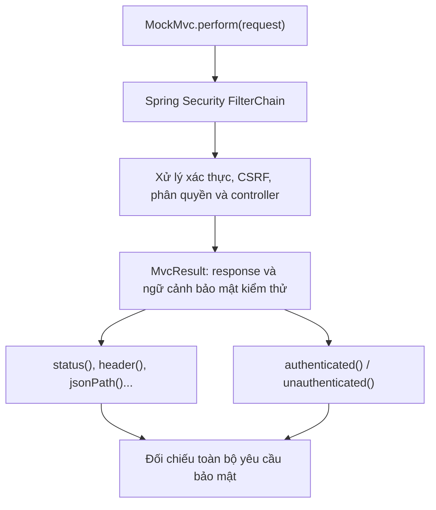

# SecurityMockMvcResultMatchers và kết quả bảo mật sau request

## 1. Vì sao cần khẳng định kết quả bảo mật?

Trong kiểm thử Spring Security, việc nhận được HTTP `200 OK`, `401 Unauthorized` hay `403 Forbidden` mới cho biết **kết quả giao tiếp HTTP**. Một ca kiểm thử bảo mật còn cần trả lời: request đó có người dùng được xác thực hay không, tên người dùng là gì, các quyền nào đã được gắn vào `Authentication`, và ứng dụng có áp dụng chính sách truy cập đúng như mong đợi không?

Đây là một phần của kỹ thuật kiểm thử **SPRING_SECURITY_TESTING**: kiểm chứng xác thực, phân quyền và cơ chế bảo vệ HTTP trên ứng dụng Servlet bằng `MockMvc` và `spring-security-test`. Các phép kiểm tra trong bài có thể kết hợp với `@WithMockUser`, `user()`, `httpBasic()`, `formLogin()`, `jwt()`, `oauth2Login()` hoặc `oidcLogin()`. Ở ứng dụng Reactive, dùng `WebTestClient` và các tiện ích kiểm thử tương ứng; `SecurityMockMvcResultMatchers` dành riêng cho **Spring MVC/Servlet**.

Giả sử một hệ thống quản lý tài liệu có quy tắc:

| Tình huống | Trạng thái HTTP mong đợi với cấu hình HTTP Basic | Trạng thái xác thực cần kiểm tra |
| --- | --- | --- |
| Người chưa đăng nhập gọi `/api/me` | `401` | Không có người dùng đã xác thực |
| Đăng nhập với mật khẩu sai | `401` | Không có người dùng đã xác thực |
| Người có role `USER` gọi `/api/me` | `200` | Đã xác thực, đúng username/role |
| Người có role `USER` gọi `/api/admin/report` | `403` | Vẫn là người dùng đã xác thực nhưng thiếu quyền |
| Người có role `ADMIN` gọi `/api/admin/report` | `200` | Đã xác thực với role `ADMIN` |
| Người đã đăng nhập gửi `POST` thiếu CSRF token khi CSRF được bật | `403` | Request bị từ chối dù đã có danh tính |

Các mã trạng thái trong bảng phụ thuộc cấu hình `SecurityFilterChain`. Với form login, request chưa đăng nhập thường được chuyển hướng `302` tới trang đăng nhập; với API dùng Bearer token, cách trả mã lỗi còn phụ thuộc `AuthenticationEntryPoint` và `AccessDeniedHandler`. Không nên mặc định mọi ứng dụng đều có cùng mã trạng thái.

## 2. Vị trí của `SecurityMockMvcResultMatchers`

Lớp `org.springframework.security.test.web.servlet.response.SecurityMockMvcResultMatchers` cung cấp các `ResultMatcher` để kết hợp với `MockMvc.andExpect(...)`:

```java
import static org.springframework.security.test.web.servlet.response.SecurityMockMvcResultMatchers.*;

mockMvc.perform(get("/api/me").with(user("an").roles("USER")))
       .andExpect(status().isOk())
       .andExpect(authenticated().withUsername("an").withRoles("USER"));
```

Ở đây có **hai lớp khẳng định bổ sung cho nhau**:

1. `status().isOk()` từ `MockMvcResultMatchers` so sánh trạng thái HTTP.
2. `authenticated().withUsername(...).withRoles(...)` từ `SecurityMockMvcResultMatchers` khẳng định danh tính và quyền trong kết quả xử lý request.

Sơ đồ luồng kiểm thử:



`SecurityMockMvcResultMatchers` tập trung vào **bằng chứng xác thực gắn với kết quả request**. Nó không thay thế việc kiểm tra status, response body, header, tác động lên dữ liệu hay điều kiện phân quyền. Ngược lại, chỉ kiểm tra `authenticated()` không chứng minh người dùng đã được phép truy cập tài nguyên: request có thể trả `403` dù danh tính đã được xác thực.

### Các matcher quan trọng

| Matcher | Ý nghĩa | Ví dụ |
| --- | --- | --- |
| `authenticated()` | Có người dùng được xác thực, không chỉ là anonymous authentication | `.andExpect(authenticated())` |
| `unauthenticated()` | Không có người dùng được xác thực | `.andExpect(unauthenticated())` |
| `authenticated().withUsername("an")` | Kiểm tra username của principal | `.andExpect(authenticated().withUsername("an"))` |
| `authenticated().withRoles("USER")` | Kiểm tra role theo quy ước role của Spring Security | `.andExpect(authenticated().withRoles("USER"))` |
| `authenticated().withAuthorities("SCOPE_report:read")` | Kiểm tra authority theo tên đầy đủ | `.andExpect(authenticated().withAuthorities("SCOPE_report:read"))` |
| `authenticated().withAuthentication(auth -> ...)` | Thực hiện khẳng định tùy biến trên đối tượng `Authentication` | Xem mục 5 |

`withRoles("ADMIN")` dùng tên role **không kèm** tiền tố `ROLE_`; Spring Security thường biểu diễn role này thành authority `ROLE_ADMIN`. `withAuthorities(...)` nhận tên authority đầy đủ, chẳng hạn `ROLE_ADMIN` hoặc `SCOPE_report:read`. Đừng viết `withRoles("ROLE_ADMIN")` theo thói quen, vì như vậy nhầm lẫn giữa role và authority.

## 3. Chuẩn bị môi trường kiểm thử Servlet

Trong dự án Spring Boot có `spring-boot-starter-web`, `spring-boot-starter-security` và `spring-boot-starter-test`, bổ sung thư viện kiểm thử bảo mật nếu chưa có:

```xml
<!-- pom.xml: phiên bản được quản lý bởi Spring Boot BOM -->
<dependency>
    <groupId>org.springframework.security</groupId>
    <artifactId>spring-security-test</artifactId>
    <scope>test</scope>
</dependency>
```

Với Gradle:

```groovy
testImplementation 'org.springframework.security:spring-security-test'
```

`MockMvc` phải chạy với **Spring Security filter chain**. Một cách phổ biến trong Spring Boot là:

```java
@SpringBootTest
@AutoConfigureMockMvc
class ApiSecurityTest {
    @Autowired MockMvc mockMvc;
}
```

Khi tự xây dựng `MockMvc` từ `WebApplicationContext`, hãy áp dụng `springSecurity()`:

```java
mockMvc = MockMvcBuilders.webAppContextSetup(context)
        .apply(springSecurity())
        .build();
```

`springSecurity()` tích hợp filter chain cùng sự hỗ trợ của ngữ cảnh kiểm thử, cần thiết cho các request post-processor như `user()` và annotation như `@WithMockUser`. Nếu dùng `standaloneSetup(...)` mà chưa gắn đúng bộ lọc, test có thể bỏ qua kiểm soát truy cập, tạo kết quả xanh giả. Hãy ưu tiên cấu hình có bộ lọc bảo mật thật cho các ca kiểm tra hành vi HTTP.

## 4. Ví dụ xuyên suốt: kiểm tra thành công và bị từ chối

Để có một hệ thống cụ thể, ứng dụng ví dụ cung cấp ba endpoint:

```java
@RestController
@RequestMapping("/api")
class SampleApi {

    @GetMapping("/me")
    Map<String, String> me(Authentication authentication) {
        return Map.of("username", authentication.getName());
    }

    @GetMapping("/admin/report")
    String report() {
        return "report-ready";
    }

    @PostMapping("/items")
    ResponseEntity<Void> createItem() {
        return ResponseEntity.status(HttpStatus.CREATED).build();
    }
}
```

`SecurityFilterChain` sau bật HTTP Basic, giữ CSRF mặc định và yêu cầu role `ADMIN` cho báo cáo quản trị:

```java
@Configuration
class SecurityConfig {

    @Bean
    SecurityFilterChain apiSecurity(HttpSecurity http) throws Exception {
        http.authorizeHttpRequests(authorize -> authorize
                    .requestMatchers("/api/admin/**").hasRole("ADMIN")
                    .requestMatchers("/api/**").authenticated()
                    .anyRequest().permitAll()
                )
                .httpBasic(Customizer.withDefaults());
        return http.build();
    }

    @Bean
    UserDetailsService users() {
        return new InMemoryUserDetailsManager(
                User.withUsername("an")
                    .password("{noop}pass")
                    .roles("USER")
                    .build(),
                User.withUsername("quantri")
                    .password("{noop}pass")
                    .roles("ADMIN")
                    .build()
        );
    }
}
```

`{noop}` ở đây chỉ nhằm đơn giản hóa dữ liệu thử nghiệm; ứng dụng thực tế phải dùng bộ mã hóa mật khẩu phù hợp. Controller và cấu hình này cần nằm trong phạm vi quét component của ứng dụng Spring Boot được kiểm thử.

### 4.1. Bộ kiểm thử mẫu

Các static import chính:

```java
import static org.springframework.security.test.web.servlet.request.SecurityMockMvcRequestPostProcessors.*;
import static org.springframework.security.test.web.servlet.response.SecurityMockMvcResultMatchers.*;
import static org.springframework.test.web.servlet.request.MockMvcRequestBuilders.*;
import static org.springframework.test.web.servlet.result.MockMvcResultMatchers.*;
```

Các test bên dưới dùng JUnit Jupiter (`@Test`), `@SpringBootTest`, `@AutoConfigureMockMvc` và `@Autowired`:

```java
@SpringBootTest
@AutoConfigureMockMvc
class ApiSecurityTest {

    @Autowired
    MockMvc mockMvc;

    @Test
    void anonymousCannotReadProtectedApi() throws Exception {
        mockMvc.perform(get("/api/me"))
               .andExpect(status().isUnauthorized())
               .andExpect(unauthenticated());
    }

    @Test
    void invalidBasicCredentialsAreRejected() throws Exception {
        mockMvc.perform(get("/api/me").with(httpBasic("an", "wrong")))
               .andExpect(status().isUnauthorized())
               .andExpect(unauthenticated());
    }

    @Test
    void correctBasicCredentialsIdentifyTheUser() throws Exception {
        mockMvc.perform(get("/api/me").with(httpBasic("an", "pass")))
               .andExpect(status().isOk())
               .andExpect(authenticated().withUsername("an").withRoles("USER"))
               .andExpect(jsonPath("$.username").value("an"));
    }

    @Test
    void authenticatedUserWithoutAdminRoleIsForbidden() throws Exception {
        mockMvc.perform(get("/api/admin/report")
                    .with(user("an").roles("USER")))
               .andExpect(status().isForbidden())
               .andExpect(authenticated().withUsername("an").withRoles("USER"));
    }

    @Test
    void adminCanReadReport() throws Exception {
        mockMvc.perform(get("/api/admin/report")
                    .with(user("quantri").roles("ADMIN")))
               .andExpect(status().isOk())
               .andExpect(authenticated().withUsername("quantri").withRoles("ADMIN"))
               .andExpect(content().string("report-ready"));
    }

    @Test
    void csrfIsRequiredForPost() throws Exception {
        mockMvc.perform(post("/api/items")
                    .with(user("an").roles("USER")))
               .andExpect(status().isForbidden())
               .andExpect(authenticated().withUsername("an"));

        mockMvc.perform(post("/api/items")
                    .with(user("an").roles("USER"))
                    .with(csrf()))
               .andExpect(status().isCreated())
               .andExpect(authenticated().withUsername("an"));
    }
}
```

Test `invalidBasicCredentialsAreRejected` khác căn bản với test dùng `.with(user("an"))`:

- `httpBasic("an", "wrong")` tạo header `Authorization: Basic ...`. **Bộ lọc xác thực thực tế** đọc header và kiểm tra thông tin đăng nhập qua cơ chế ứng dụng cấu hình.
- `user("an").roles("USER")` đưa một danh tính giả lập đã xác thực vào request. Nó phù hợp để cô lập bài kiểm tra **phân quyền** hoặc logic controller, nhưng không kiểm tra việc xác minh mật khẩu.
- `@WithMockUser(username = "an", roles = "USER")` cũng tạo ngữ cảnh xác thực thử nghiệm, thường dùng khi nhiều request trong một phương thức test cần cùng danh tính.

Chọn cách tạo danh tính phù hợp với mục tiêu kiểm thử. Không dùng `user()` hay `@WithMockUser` để tuyên bố rằng endpoint đăng nhập hoặc mật khẩu thực đã được xác minh thành công.

### 4.2. Đọc đúng kết quả của `401` và `403`

Phân biệt hai tầng:

- **`401` + `unauthenticated()`**: request chưa cung cấp được danh tính hợp lệ để truy cập tài nguyên được bảo vệ; với HTTP Basic, server thường trả cả header `WWW-Authenticate`.
- **`403` + `authenticated()`**: request có danh tính đã xác thực nhưng bị từ chối bởi quy tắc quyền, hoặc một điều kiện bảo vệ khác (ví dụ thiếu CSRF token).

Không suy luận ngược một cách máy móc: HTTP `403` **không bảo đảm** luôn có người dùng đã xác thực, và HTTP `200` **không bảo đảm** endpoint yêu cầu xác thực. Một số filter chặn request trước khi authentication hoàn tất; endpoint `permitAll()` có thể trả `200` cho người dùng ẩn danh. Hãy viết cả status assertion và security assertion theo **cấu hình thực tế** của endpoint.

## 5. Khẳng định sâu hơn về Authentication và quyền

`authenticated()` có thể kết hợp nhiều điều kiện trong một chuỗi:

```java
mockMvc.perform(get("/api/me").with(user("an").roles("USER")))
       .andExpect(authenticated()
           .withUsername("an")
           .withRoles("USER")
           .withAuthorities("ROLE_USER"));
```

Khi cần kiểm tra loại token, principal hoặc chi tiết riêng của ứng dụng, dùng `withAuthentication(Consumer<Authentication>)`:

```java
import static org.assertj.core.api.Assertions.assertThat;

mockMvc.perform(get("/api/me").with(user("an").roles("USER")))
       .andExpect(authenticated().withAuthentication(auth -> {
           assertThat(auth).isInstanceOf(UsernamePasswordAuthenticationToken.class);
           assertThat(auth.getName()).isEqualTo("an");
           assertThat(auth.getAuthorities())
               .extracting(GrantedAuthority::getAuthority)
               .contains("ROLE_USER");
       }));
```

Phép khẳng định tùy biến nên tập trung vào **thuộc tính có ý nghĩa đối với chính sách**, ví dụ `Authentication.getName()`, token type, claim hay danh sách quyền. Tránh so sánh toàn bộ đối tượng principal nếu nó có dữ liệu thay đổi theo môi trường, như thời điểm tạo, phiên hoặc thuộc tính được framework bổ sung.

Một số phiên bản còn cung cấp các phương thức như `withAuthenticationPrincipal(...)`, `withAuthenticationName(...)` và `withSecurityContext(...)` trên `AuthenticatedMatcher`. Chỉ dùng chúng khi cần kiểm tra đặc tính cụ thể; trường hợp phổ biến thường đủ với `withUsername`, `withRoles`, `withAuthorities` hoặc lambda tùy biến.

## 6. Tình huống form login: so sánh kết quả trước và sau đăng nhập

Với ứng dụng bật `formLogin(Customizer.withDefaults())` và có tài khoản `an/pass`, `formLogin()` tạo request `POST /login` cùng CSRF token hợp lệ. Có thể khẳng định:

```java
mockMvc.perform(formLogin().user("an").password("pass"))
       .andExpect(status().is3xxRedirection())
       .andExpect(authenticated().withUsername("an"));

mockMvc.perform(formLogin().user("an").password("wrong"))
       .andExpect(status().is3xxRedirection())
       .andExpect(unauthenticated());
```

Với cấu hình mặc định, đăng nhập thành công thường redirect tới `/`, còn thất bại tới `/login?error`; ứng dụng có success/failure handler riêng có thể trả hướng khác hoặc JSON. Vì thế, chỉ thêm `redirectedUrl(...)` sau khi xác nhận chính sách chuyển hướng của ứng dụng.

`authenticated()` ở request đăng nhập chứng minh `Authentication` đã được tạo trong quá trình xử lý request đó. Nếu yêu cầu nghiệp vụ là **duy trì đăng nhập cho request kế tiếp**, cần kiểm tra thêm việc truyền lại session/cookie và truy cập endpoint được bảo vệ, thay vì xem matcher đầu tiên là bằng chứng đủ về session persistence.

## 7. JWT, OAuth2 và OIDC: kiểm tra ngữ cảnh bảo mật giả lập

Đối với resource server, thường cần xác minh policy dựa trên scope hoặc claim JWT. `jwt()` từ `SecurityMockMvcRequestPostProcessors` tạo JWT giả lập và đặt `JwtAuthenticationToken` vào ngữ cảnh thử nghiệm. Ví dụ sau giả định `/api/report` có quy tắc `hasAuthority("SCOPE_report:read")` và resource server được cấu hình nhận JWT:

```java
mockMvc.perform(get("/api/report")
            .with(jwt()
                .jwt(token -> token.subject("account-42"))
                .authorities(new SimpleGrantedAuthority("SCOPE_report:read"))))
       .andExpect(status().isOk())
       .andExpect(authenticated().withAuthorities("SCOPE_report:read"))
       .andExpect(authenticated().withAuthentication(auth -> {
           assertThat(auth).isInstanceOf(JwtAuthenticationToken.class);
           JwtAuthenticationToken jwtAuth = (JwtAuthenticationToken) auth;
           assertThat(jwtAuth.getToken().getSubject()).isEqualTo("account-42");
       }));
```

Để kiểm tra **thiếu scope**, đổi authorities của request sang `SCOPE_report:write` rồi kỳ vọng `403` nếu policy yêu cầu `SCOPE_report:read`. Cần phân biệt `SCOPE_report:read` với `ROLE_ADMIN`: đây là hai authority khác nhau, trừ khi ứng dụng chủ động cấu hình ánh xạ giữa chúng.

Với OAuth2 Login hoặc OIDC Login, `oauth2Login()` và `oidcLogin()` cũng tạo principal thích hợp cho kiểm thử controller hoặc phân quyền. Ví dụ khi controller nhận `OidcUser` và ứng dụng đã cấu hình OAuth2/OIDC:

```java
mockMvc.perform(get("/api/oidc-profile")
            .with(oidcLogin().idToken(token -> token.claim("email", "an@example.test"))))
       .andExpect(status().isOk())
       .andExpect(authenticated().withAuthentication(auth -> {
           assertThat(auth.getPrincipal()).isInstanceOf(OidcUser.class);
           OidcUser user = (OidcUser) auth.getPrincipal();
           assertThat(user.getEmail()).isEqualTo("an@example.test");
       }));
```

Ví dụ OAuth2/OIDC là một **mẫu áp dụng cho endpoint và cấu hình tương ứng**, không thuộc `SampleApi` ở mục 4; cần điều chỉnh URL, yêu cầu quyền và dependency OAuth2 theo ứng dụng thực tế.

**Giới hạn kiểm thử quan trọng:** `jwt()`, `oauth2Login()` và `oidcLogin()` chủ yếu giả lập kết quả xác thực. Chúng **không chứng minh** ứng dụng đã kiểm tra chữ ký JWT, `iss`, `aud`, thời hạn token, luồng callback OAuth2, trao đổi authorization code hay ID Token từ nhà cung cấp danh tính. Muốn kiểm tra đường đi đó, cần ca kiểm thử riêng với Bearer token thật/giả lập decoder, phản hồi provider hoặc môi trường tích hợp thích hợp.

## 8. Không nhầm kết quả request với `SecurityContextHolder` sau request

Spring Security quản lý `SecurityContextHolder` theo vòng đời request. Filter chain thường **xóa ngữ cảnh khỏi thread** sau khi request hoàn tất. Vì vậy cách sau không đáng tin cậy để khẳng định kết quả `MockMvc`:

```java
mockMvc.perform(get("/api/me").with(user("an")));

// Không dựa vào SecurityContextHolder của thread sau perform(...)
Authentication authentication = SecurityContextHolder.getContext().getAuthentication();
```

Hãy khẳng định trực tiếp trên `MvcResult` bằng `authenticated()` hoặc `unauthenticated()`. Nếu có yêu cầu đặc biệt cần đưa ngữ cảnh thử nghiệm trở lại cho thao tác repository sau request, Spring Security Test có `SecurityMockMvcResultHandlers.exportTestSecurityContext()`. Khi dùng cách này phải quản lý việc dọn ngữ cảnh giữa các test để tránh rò rỉ trạng thái.

Một điểm khác: matcher trả về thành công **không đồng nghĩa** request đã lưu `SecurityContext` vào HTTP session hoặc việc cấp token cho client đã đúng. Hãy kiểm tra `Set-Cookie`, session reuse hoặc response token theo hợp đồng của ứng dụng khi đó là yêu cầu của ca kiểm thử.

## 9. Xác định phạm vi kiểm thử và tránh kết luận sai

| Kỹ thuật | Mô phỏng/kiểm tra trực tiếp | Chưa đủ để kết luận |
| --- | --- | --- |
| `.with(user(...))` hoặc `@WithMockUser` + `authenticated()` | Phân quyền và logic xử lý khi có danh tính đã xác thực | Xác minh mật khẩu và đăng nhập từ bên ngoài |
| `.with(httpBasic(...))` + matcher | Kiểm thử header Basic đi qua authentication filter và cơ chế xác thực đã cấu hình | Các giao thức OAuth2/JWT khác |
| `formLogin()` + `authenticated()` / `unauthenticated()` | Kết quả xử lý đăng nhập form, tạo `Authentication` | Phiên đăng nhập có sống qua request tiếp theo hay không |
| `.with(jwt())` + matcher | Quy tắc authority/claim và cách controller nhận `JwtAuthenticationToken` | Kiểm tra chữ ký, thuật toán, issuer/audience thực tế của token |
| `status()` / `jsonPath()` / `header()` | Hợp đồng HTTP, nội dung và metadata phản hồi | Danh tính/authority nếu không có assertion bảo mật tương ứng |

Những lỗi dễ gặp:

1. **Chỉ assert `200` hoặc `403`** rồi kết luận đã kiểm thử xong phân quyền. Hãy assert danh tính/role khi yêu cầu cần chứng minh trạng thái xác thực.
2. **Dùng role thay authority hoặc ngược lại.** `roles("ADMIN")` sinh `ROLE_ADMIN`; kiểm tra scope OAuth2 thường dùng `SCOPE_...`.
3. **Quên CSRF trong request thay đổi dữ liệu.** Khi CSRF bật, `POST`, `PUT`, `PATCH`, `DELETE` có thể bị chặn trước khi controller chạy. Dùng `.with(csrf())` nếu đang kiểm tra business flow; cố ý không gửi token khi kiểm tra khả năng chặn CSRF.
4. **Gắn `user()` rồi tưởng đã kiểm tra login.** Đây là dữ liệu định danh giả lập, không xác thực credential.
5. **Không gắn Spring Security vào MockMvc.** Nếu filter chain vắng mặt, kết quả test không phản ánh chính sách truy cập của ứng dụng.
6. **Đồng nhất `403` với “thiếu role”.** Hãy xét cả CSRF, policy method security, cấu hình exception và các filter tùy chỉnh.
7. **Dùng matcher Servlet cho Reactive.** Với WebFlux, cần `WebTestClient`, cấu hình bảo mật Reactive và các công cụ của `spring-security-test` dành cho WebFlux.

### Còn ứng dụng Reactive thì sao?

`SecurityMockMvcResultMatchers` là API của `MockMvc`, không áp dụng cho `WebTestClient`. Với WebFlux, ta kiểm tra status và body bằng các `expectStatus()`/`expectBody()` của `WebTestClient`, kết hợp `SecurityMockServerConfigurers.mockUser()`, `mockJwt()` hoặc hỗ trợ `@WithMockUser` tùy kiểu test. Ví dụ ý tưởng:

```java
webTestClient.mutateWith(mockUser("an").roles("USER"))
             .get().uri("/api/me")
             .exchange()
             .expectStatus().isOk();
```

Đoạn trên cần static import `org.springframework.security.test.web.reactive.server.SecurityMockServerConfigurers.mockUser` và `WebTestClient` đã được gắn Spring Security Reactive. Nếu muốn khẳng định identity trong WebFlux, có thể kiểm tra response từ endpoint hoặc logic xử lý `Authentication` bên trong ca test phù hợp; không gọi `authenticated()` từ Servlet MockMvc như trên.

## 10. Bài tập áp dụng và tiêu chí hoàn thành

Hãy bổ sung vào `SampleApi` một endpoint `GET /api/editor/reviews`, chỉ cho phép role `EDITOR`. Viết ít nhất bốn ca kiểm thử: anonymous bị từ chối, `USER` bị từ chối dù đã xác thực, `EDITOR` được phép, và request có `EDITOR` phải được nhận diện đúng username/role. Sau đó tạo `POST /api/editor/reviews` để kiểm tra cả trường hợp thiếu CSRF token và có token hợp lệ. Nếu ứng dụng có JWT, thử thay role bằng authority `SCOPE_review:write` và phân biệt ca thiếu scope với token không hợp lệ.

Một bộ kiểm thử đáp ứng bài học khi người đọc có thể:

- Giải thích được sự khác nhau giữa status HTTP và trạng thái `Authentication`.
- Dùng đúng `authenticated()`, `unauthenticated()`, `withUsername()`, `withRoles()`, `withAuthorities()` và `withAuthentication(...)`.
- Kiểm tra riêng các trường hợp anonymous, xác thực thất bại, đã xác thực nhưng thiếu quyền, có quyền và thiếu CSRF token.
- Xác định rõ test nào chỉ giả lập người dùng/JWT và test nào thật sự đi qua bộ lọc xác thực.
- Không dựa vào `SecurityContextHolder` sau khi `MockMvc.perform(...)` kết thúc, đồng thời phân biệt đúng công cụ của Servlet và Reactive.

## Tham khảo chính thức

- [Spring Security — SecurityMockMvcResultMatchers](https://docs.spring.io/spring-security/reference/servlet/test/mockmvc/result-matchers.html)
- [Spring Security — Setting Up MockMvc and Spring Security](https://docs.spring.io/spring-security/reference/servlet/test/mockmvc/setup.html)
- [Spring Security — Running a Test as a User in Spring MVC Test](https://docs.spring.io/spring-security/reference/servlet/test/mockmvc/authentication.html)
- [Spring Security — Testing Form Based Authentication](https://docs.spring.io/spring-security/reference/servlet/test/mockmvc/form-login.html)
- [Spring Security — Testing OAuth 2.0, OIDC and JWT](https://docs.spring.io/spring-security/reference/servlet/test/mockmvc/oauth2.html)
- [Spring Security — SecurityMockMvcResultHandlers](https://docs.spring.io/spring-security/reference/servlet/test/mockmvc/result-handlers.html)
