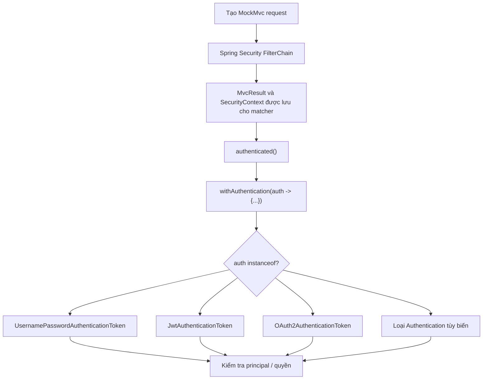

# `withAuthentication` để kiểm tra loại token hoặc principal cụ thể

## 1. Vì sao cần kiểm tra sâu vào `Authentication`?

Một request trả `200 OK` và vượt qua phép kiểm tra `authenticated()` cho thấy request đã có một danh tính được Spring Security chấp nhận trong ngữ cảnh kiểm thử. Tuy nhiên, trong nhiều ứng dụng, điều quan trọng tiếp theo là **danh tính đó được biểu diễn bằng loại `Authentication` nào, principal mang dữ liệu gì và những authority nào đang được dùng để phân quyền**.

Ví dụ, ứng dụng cần nhận `JwtAuthenticationToken` từ resource server, nhưng test vô tình chèn `UsernamePasswordAuthenticationToken` bằng `@WithMockUser`. Endpoint vẫn có thể trả `200` nếu chỉ dùng quy tắc `authenticated()`, trong khi logic đọc claim JWT hoặc tên tenant thực tế chưa được kiểm chứng. Tương tự, một request OAuth2/OIDC có principal là `OAuth2User` hoặc `OidcUser`; chỉ kiểm tra username không chứng minh được claim email, subject hay issuer.

Trong module **SPRING_SECURITY_TESTING**, người học kiểm chứng xác thực, phân quyền và bảo vệ HTTP với `spring-security-test` trên Servlet (`MockMvc`) và Reactive (`WebTestClient`). Bài thuộc chương **Khẳng định kết quả** này tập trung vào API **`SecurityMockMvcResultMatchers.authenticated().withAuthentication(...)` của Servlet**, giúp kiểm tra đối tượng `Authentication` được ghi nhận trong kết quả request.

Các mục tiêu chính:

- Phân biệt `Authentication`, `Principal`, `GrantedAuthority` và thông tin trong token.
- Dùng `withAuthentication(Consumer<Authentication>)` để kiểm tra kiểu runtime và dữ liệu của token/principal.
- Kết hợp kiểm tra loại token với status HTTP, username, role/authority, response và các trường hợp bị từ chối.
- Phân biệt kiểm thử bằng danh tính giả lập (`@WithMockUser`, `user()`, `jwt()`, `oauth2Login()`, `oidcLogin()`) với kiểm thử đi qua cơ chế xác thực thật.
- Nhận diện ranh giới giữa `MockMvc` trên Servlet và `WebTestClient` trên Reactive.

## 2. `withAuthentication` nằm ở đâu trong API?

Đối tượng `Authentication` thuộc `org.springframework.security.core.Authentication`, có những thành phần quan trọng:

| Thành phần | Vai trò | Ví dụ |
| --- | --- | --- |
| `getPrincipal()` | Đối tượng đại diện danh tính đã được nhận diện | `UserDetails`, `Jwt`, `OAuth2User`, `OidcUser`, principal tùy biến |
| `getName()` | Tên định danh do loại `Authentication` quyết định | `mai`, `account-42` |
| `getAuthorities()` | Các quyền mà cơ chế phân quyền sử dụng | `ROLE_USER`, `SCOPE_report:read` |
| `isAuthenticated()` | Cờ trạng thái xác thực ở tầng đối tượng | `true` với token đã xác thực |
| `getDetails()` | Thông tin phụ về request hoặc cơ chế xác thực, nếu có | `WebAuthenticationDetails` |
| `getCredentials()` | Dữ liệu xác thực nếu còn được giữ trong token | Có thể là `null` hoặc bị xóa sau đăng nhập |

Spring Security cung cấp nhiều implementation của interface `Authentication`. Hai request đều “đã xác thực” nhưng có thể chứa các kiểu token khác nhau.

`SecurityMockMvcResultMatchers` cung cấp matcher kết quả request; để truy cập `Authentication`, dùng:

```java
import static org.springframework.security.test.web.servlet.response
        .SecurityMockMvcResultMatchers.authenticated;

mockMvc.perform(get("/api/me").with(user("mai")))
       .andExpect(authenticated().withAuthentication(authentication -> {
           assertThat(authentication).isInstanceOf(
                   UsernamePasswordAuthenticationToken.class);
           assertThat(authentication.getName()).isEqualTo("mai");
       }));
```

Trong ví dụ, `withAuthentication` nhận một `Consumer<Authentication>`. Lambda được thực thi trong lúc `andExpect(...)` đánh giá kết quả; nếu một assertion trong lambda thất bại, test sẽ thất bại.

Cú pháp này khác với **request post-processor** `SecurityMockMvcRequestPostProcessors.authentication(authentication)`: post-processor dùng để *đưa một token vào request*, còn `authenticated().withAuthentication(...)` dùng để *đọc và khẳng định token của kết quả kiểm thử*.



### Khi nào nên dùng và khi nào không cần?

Một phép kiểm tra đơn giản như `authenticated().withUsername("mai")` thường đã đủ khi chỉ cần xác minh tài khoản. Hãy dùng `withAuthentication(...)` khi yêu cầu còn phụ thuộc **loại token**, **loại principal**, **claim**, **thuộc tính miền**, hoặc một quy tắc authority đặc thù.

Không bắt buộc kiểm tra mọi thuộc tính nội bộ của `Authentication`. Chỉ nên assert những dữ kiện phục vụ hợp đồng bảo mật; quá nhiều kiểm tra lớp nội bộ hoặc details thay đổi theo framework có thể khiến test dễ hỏng khi nâng phiên bản mà không phát hiện thêm lỗi nghiệp vụ.

## 3. Chuẩn bị dự án Servlet và ví dụ xuyên suốt

Ứng dụng Spring Boot Servlet cần các dependency kiểm thử phù hợp: `spring-boot-starter-web`, `spring-boot-starter-security`, `spring-boot-starter-test` và `spring-security-test`.

Với Maven, phần khai báo riêng của `spring-security-test`:

```xml
<dependency>
    <groupId>org.springframework.security</groupId>
    <artifactId>spring-security-test</artifactId>
    <scope>test</scope>
</dependency>
```

Với Gradle:

```groovy
testImplementation 'org.springframework.security:spring-security-test'
```

Khi dùng Spring Boot BOM, phiên bản của Spring Security thường do BOM quản lý. Các ví dụ kiểm tra đối tượng token trong bài sử dụng JUnit Jupiter và AssertJ đi kèm `spring-boot-starter-test`.

Tạo controller demo có endpoint cho người dùng thường, quản trị viên và người có quyền đọc báo cáo:

```java
@RestController
@RequestMapping("/api")
class ExampleController {

    @GetMapping("/me")
    Map<String, String> me(Authentication authentication) {
        return Map.of("username", authentication.getName());
    }

    @GetMapping("/admin")
    String admin() {
        return "admin-data";
    }

    @GetMapping("/reports")
    String reports() {
        return "report-data";
    }
}
```

Bảo vệ endpoint bằng cấu hình minh họa:

```java
@Configuration
class ExampleSecurityConfig {

    @Bean
    SecurityFilterChain securityFilterChain(HttpSecurity http) throws Exception {
        return http.authorizeHttpRequests(auth -> auth
                    .requestMatchers("/api/admin").hasRole("ADMIN")
                    .requestMatchers("/api/reports").hasAuthority("SCOPE_report:read")
                    .requestMatchers("/api/**").authenticated()
                    .anyRequest().permitAll()
                )
                .httpBasic(Customizer.withDefaults())
                .build();
    }

    @Bean
    UserDetailsService users() {
        return new InMemoryUserDetailsManager(
                User.withUsername("mai")
                    .password("{noop}secret")
                    .authorities("ROLE_USER", "SCOPE_report:read")
                    .build()
        );
    }
}
```

Các lớp phải nằm trong phạm vi component scan của ứng dụng Spring Boot. Import Spring/Java thông thường được lược bớt để tập trung vào ý tưởng. `{noop}` chỉ dùng cho ví dụ: ứng dụng thực tế phải dùng `PasswordEncoder` an toàn.

Bộ kiểm thử được tạo theo cấu hình Spring Boot:

```java
@SpringBootTest
@AutoConfigureMockMvc
class AuthenticationTypeTest {

    @Autowired
    MockMvc mockMvc;

    // Các test của những mục tiếp theo
}
```

Import tĩnh thường dùng:

```java
import static org.assertj.core.api.Assertions.assertThat;
import static org.springframework.security.test.web.servlet.request
        .SecurityMockMvcRequestPostProcessors.*;
import static org.springframework.security.test.web.servlet.response
        .SecurityMockMvcResultMatchers.*;
import static org.springframework.test.web.servlet.request.MockMvcRequestBuilders.*;
import static org.springframework.test.web.servlet.result.MockMvcResultMatchers.*;
```

`@AutoConfigureMockMvc` mặc định áp dụng các servlet filter của ứng dụng. Nếu tạo `MockMvc` thủ công bằng `webAppContextSetup(context)`, cần `.apply(springSecurity())` để tích hợp `springSecurityFilterChain` cùng hỗ trợ ngữ cảnh kiểm thử. Tránh dùng `standaloneSetup(...)` thiếu filter chain khi mục tiêu là xác minh bảo vệ HTTP.

## 4. Kiểm tra `UsernamePasswordAuthenticationToken` và `UserDetails`

### 4.1. Trường hợp HTTP Basic đi qua bộ lọc xác thực

Với tài khoản `mai/secret` ở cấu hình trên, request sử dụng `httpBasic(...)` sẽ gửi header `Authorization: Basic ...`. Spring Security thực hiện xác thực theo bộ lọc và cơ chế `UserDetailsService` đã cấu hình.

```java
import org.springframework.security.authentication.UsernamePasswordAuthenticationToken;
import org.springframework.security.core.GrantedAuthority;
import org.springframework.security.core.userdetails.UserDetails;

@Test
void validBasicCredentialsProduceExpectedAuthentication() throws Exception {
    mockMvc.perform(get("/api/me")
                .with(httpBasic("mai", "secret")))
           .andExpect(status().isOk())
           .andExpect(authenticated().withAuthentication(authentication -> {
               assertThat(authentication)
                       .isInstanceOf(UsernamePasswordAuthenticationToken.class);

               assertThat(authentication.isAuthenticated()).isTrue();
               assertThat(authentication.getName()).isEqualTo("mai");
               assertThat(authentication.getPrincipal())
                       .isInstanceOf(UserDetails.class);

               UserDetails principal = (UserDetails) authentication.getPrincipal();
               assertThat(principal.getUsername()).isEqualTo("mai");

               assertThat(authentication.getAuthorities())
                       .extracting(GrantedAuthority::getAuthority)
                       .contains("ROLE_USER", "SCOPE_report:read");
           }))
           .andExpect(jsonPath("$.username").value("mai"));
}
```

Ở đây có ba lớp bằng chứng:

1. **HTTP:** `status().isOk()` xác minh request được phép truy cập.
2. **Ngữ cảnh bảo mật:** `authenticated().withAuthentication(...)` xác minh loại token, principal và quyền theo cơ chế Basic/UserDetails của ứng dụng demo.
3. **Hợp đồng response:** `jsonPath(...)` xác minh controller trả tên danh tính đã nhận được.

Với một `AuthenticationProvider` tùy chỉnh, token sau xác thực có thể là loại khác. Vì vậy, assertion về lớp `UsernamePasswordAuthenticationToken` chỉ đúng nếu đó là **hợp đồng hoặc thiết kế xác thực** của hệ thống đang kiểm thử.

### 4.2. Trường hợp danh tính giả lập bằng `@WithMockUser`

`@WithMockUser` không gửi thông tin đăng nhập thật qua HTTP Basic. Spring Security Test dựng sẵn ngữ cảnh bảo mật, thường là `UsernamePasswordAuthenticationToken` chứa principal kiểu `User`:

```java
@Test
@WithMockUser(username = "mai", roles = "USER")
void mockUserCreatesUsernamePasswordToken() throws Exception {
    mockMvc.perform(get("/api/me"))
           .andExpect(status().isOk())
           .andExpect(authenticated().withAuthentication(authentication -> {
               assertThat(authentication)
                       .isInstanceOf(UsernamePasswordAuthenticationToken.class);
               assertThat(authentication.getPrincipal())
                       .isInstanceOf(UserDetails.class);
               assertThat(authentication.getName()).isEqualTo("mai");
           }));
}
```

Test này có giá trị khi kiểm tra controller/service hoặc một quy tắc phân quyền trong trạng thái **đã xác thực**. Nó chưa chứng minh hệ thống đã kiểm tra mật khẩu, khóa tài khoản hoặc các luật của `AuthenticationProvider` khi một client thật đăng nhập.

### 4.3. Trường hợp danh tính sai

Khi credentials không hợp lệ, không nên gọi `withAuthentication(...)` để khẳng định một token đã xác thực vốn không tồn tại. Thay vào đó, dùng `unauthenticated()`:

```java
@Test
void wrongPasswordIsRejected() throws Exception {
    mockMvc.perform(get("/api/me")
                .with(httpBasic("mai", "wrong")))
           .andExpect(status().isUnauthorized())
           .andExpect(unauthenticated());
}
```

HTTP `401` trong ví dụ đến từ HTTP Basic. Nếu ứng dụng dùng form login, kết quả khi chưa xác thực thường là redirect tới trang đăng nhập; với resource server, response phụ thuộc `AuthenticationEntryPoint`. Luôn gắn matcher bảo mật với chính sách endpoint cụ thể.

## 5. Kiểm tra loại token JWT và claim bằng `withAuthentication`

Ở resource server dùng JWT, đối tượng xác thực thường là `JwtAuthenticationToken` và principal là `Jwt`. Nếu endpoint yêu cầu scope `report:read`, Spring Security thường ánh xạ thành `SCOPE_report:read`.

Ví dụ cho endpoint `GET /api/reports`, với giả định dự án có dependency OAuth2 resource server/JWT và filter chain thích hợp:

```java
import org.springframework.security.oauth2.server.resource.authentication.JwtAuthenticationToken;
import org.springframework.security.core.authority.SimpleGrantedAuthority;

@Test
void mockedJwtHasExpectedTypeAndClaims() throws Exception {
    mockMvc.perform(get("/api/reports")
                .with(jwt()
                    .jwt(token -> token
                        .subject("account-42")
                        .claim("tenant_id", "tenant-a"))
                    .authorities(
                        new SimpleGrantedAuthority("SCOPE_report:read"))))
           .andExpect(status().isOk())
           .andExpect(authenticated().withAuthentication(authentication -> {
               assertThat(authentication).isInstanceOf(JwtAuthenticationToken.class);

               JwtAuthenticationToken jwtAuth =
                       (JwtAuthenticationToken) authentication;

               assertThat(jwtAuth.getToken().getSubject()).isEqualTo("account-42");
               assertThat(jwtAuth.getToken().getClaimAsString("tenant_id"))
                       .isEqualTo("tenant-a");
               assertThat(jwtAuth.getAuthorities())
                       .extracting(GrantedAuthority::getAuthority)
                       .contains("SCOPE_report:read");
           }))
           .andExpect(content().string("report-data"));
}
```

Ở đây **kiểu token được khẳng định bằng `isInstanceOf(JwtAuthenticationToken.class)`**, còn các giá trị chủ chốt đến từ `JwtAuthenticationToken.getToken()`. Ta không phải suy đoán `sub` là username hoặc một scope sẽ luôn trở thành role.

Để kiểm tra request JWT **thiếu quyền**, tạo authority khác và kiểm tra `403` cùng loại token:

```java
@Test
void jwtWithoutReadScopeIsForbiddenButStillAuthenticated() throws Exception {
    mockMvc.perform(get("/api/reports")
                .with(jwt()
                    .jwt(token -> token.subject("account-42"))
                    .authorities(
                        new SimpleGrantedAuthority("SCOPE_report:write"))))
           .andExpect(status().isForbidden())
           .andExpect(authenticated().withAuthentication(authentication -> {
               assertThat(authentication).isInstanceOf(JwtAuthenticationToken.class);
               assertThat(authentication.getAuthorities())
                       .extracting(GrantedAuthority::getAuthority)
                       .contains("SCOPE_report:write")
                       .doesNotContain("SCOPE_report:read");
           }));
}
```

**Giới hạn quan trọng:** `jwt()` của `SecurityMockMvcRequestPostProcessors` tạo JWT và ngữ cảnh xác thực giả lập cho test. Hai phép kiểm tra trên **không chứng minh** ứng dụng đã xác minh chữ ký JWT, thuật toán, `iss`, `aud` hay `exp`. Để kiểm tra các bước đó, viết ca riêng gửi header `Authorization: Bearer ...` qua `BearerTokenAuthenticationFilter` và `JwtDecoder`/validator thực tế hoặc cấu hình test tương ứng.

Nếu ứng dụng dùng Bearer opaque token, token và principal có thể có kiểu khác (ví dụ `BearerTokenAuthentication` với `OAuth2AuthenticatedPrincipal`). Đừng khẳng định `JwtAuthenticationToken` chỉ vì request mang Bearer token; hãy đối chiếu loại token ứng dụng thật sự sử dụng.

## 6. Kiểm tra `OAuth2AuthenticationToken`, `OAuth2User` và `OidcUser`

Với OAuth2 Login, `Authentication` điển hình là `OAuth2AuthenticationToken`, principal thường là `OAuth2User`. Với OpenID Connect, principal thường triển khai `OidcUser`. Các kiểu này phù hợp khi controller cần thông tin từ nhà cung cấp danh tính.

### 6.1. OAuth2 Login: đọc thuộc tính principal

Khi đã cấu hình ứng dụng để xử lý OAuth2 Login và endpoint `/api/oauth-profile` cần danh tính này, có thể dùng:

```java
import org.springframework.security.oauth2.client.authentication.OAuth2AuthenticationToken;
import org.springframework.security.oauth2.core.user.OAuth2User;

@Test
void oauth2LoginContainsUserAttributes() throws Exception {
    mockMvc.perform(get("/api/oauth-profile")
                .with(oauth2Login()
                    .attributes(attributes -> attributes.put("login", "mai"))))
           .andExpect(status().isOk())
           .andExpect(authenticated().withAuthentication(authentication -> {
               assertThat(authentication).isInstanceOf(OAuth2AuthenticationToken.class);
               assertThat(authentication.getPrincipal()).isInstanceOf(OAuth2User.class);

               OAuth2User principal = (OAuth2User) authentication.getPrincipal();
               assertThat(principal.getAttribute("login")).isEqualTo("mai");
           }));
}
```

Đây là ví dụ mở rộng: `/api/oauth-profile` cần được tạo và cho phép truy cập trong ứng dụng thực tế. Test giả lập principal OAuth2, **không** kiểm tra redirect tới provider, callback, đổi authorization code lấy access token hay chữ ký của token.

### 6.2. OIDC Login: principal là `OidcUser`

Với OIDC, `OidcUser` cung cấp ID Token và các claim như `sub`, `email`. Mẫu kiểm tra:

```java
import org.springframework.security.oauth2.core.oidc.user.OidcUser;

@Test
void oidcLoginContainsEmailClaim() throws Exception {
    mockMvc.perform(get("/api/oidc-profile")
                .with(oidcLogin().idToken(token ->
                    token.subject("oidc-sub-42")
                         .claim("email", "mai@example.test"))))
           .andExpect(status().isOk())
           .andExpect(authenticated().withAuthentication(authentication -> {
               assertThat(authentication).isInstanceOf(OAuth2AuthenticationToken.class);
               assertThat(authentication.getPrincipal()).isInstanceOf(OidcUser.class);

               OidcUser principal = (OidcUser) authentication.getPrincipal();
               assertThat(principal.getSubject()).isEqualTo("oidc-sub-42");
               assertThat(principal.getEmail()).isEqualTo("mai@example.test");
           }));
}
```

Tương tự, `/api/oidc-profile` ở đây là một endpoint ví dụ độc lập, cần có controller và policy phù hợp. Việc `OidcUser.getEmail()` trả đúng claim từ token giả lập chỉ chứng minh **logic đọc dữ liệu principal**, không chứng minh nhà cung cấp OIDC thực sự đã phát hành hoặc ký ID Token hợp lệ.

Nếu ứng dụng dùng claim tùy biến để làm tên định danh, đừng chỉ assert `authentication.getName()` rồi kết luận mọi claim đều đúng. Có thể khẳng định từng claim trực tiếp trên `OidcUser.getIdToken()` hoặc `Jwt.getClaims()` theo yêu cầu nghiệp vụ.

## 7. Kiểm tra principal tùy biến của ứng dụng

Một ứng dụng nhiều tenant có thể đưa `tenantId`, `accountId` hoặc loại tài khoản vào principal của mình. Khi đó, `withUsername(...)` chỉ kiểm tra được một phần.

Giả sử bạn định nghĩa một principal Java 17:

```java
import java.security.Principal;

record TenantPrincipal(String name, String tenantId) implements Principal {
    @Override
    public String getName() {
        return name;
    }
}
```

Để kiểm tra cách endpoint nhận principal tùy biến, có thể dùng request post-processor `authentication(...)`:

```java
import java.util.List;
import org.springframework.security.authentication.UsernamePasswordAuthenticationToken;

@Test
void requestCarriesTenantPrincipal() throws Exception {
    TenantPrincipal principal = new TenantPrincipal("mai", "tenant-a");

    Authentication supplied = UsernamePasswordAuthenticationToken.authenticated(
            principal,
            null,
            List.of(new SimpleGrantedAuthority("ROLE_USER")));

    mockMvc.perform(get("/api/me").with(authentication(supplied)))
           .andExpect(status().isOk())
           .andExpect(authenticated().withAuthentication(actual -> {
               assertThat(actual).isInstanceOf(UsernamePasswordAuthenticationToken.class);
               assertThat(actual.getPrincipal()).isInstanceOf(TenantPrincipal.class);

               TenantPrincipal tenantPrincipal = (TenantPrincipal) actual.getPrincipal();
               assertThat(tenantPrincipal.name()).isEqualTo("mai");
               assertThat(tenantPrincipal.tenantId()).isEqualTo("tenant-a");
           }));
}
```

Trong ví dụ, tên của `Authentication` được lấy từ `Principal.getName()` của `TenantPrincipal`. Đây là ca kiểm thử **đưa trước danh tính tùy biến**, hữu ích để kiểm tra logic endpoint khi có tenant context. Nó không kiểm chứng cơ chế chuyển token HTTP thành `TenantPrincipal`; yêu cầu đó cần một ca tích hợp khác dùng filter/provider thật.

Ở đây có hai API rất dễ nhầm:

| API | Vị trí | Công dụng |
| --- | --- | --- |
| `.with(authentication(supplied))` | Request post-processor trên `MockHttpServletRequestBuilder` | Đưa `Authentication` giả lập đã tạo vào request |
| `.andExpect(authenticated().withAuthentication(actual -> ...))` | Result matcher của `MvcResult` | Kiểm tra `Authentication` xuất hiện trong kết quả request |

Nếu dự án kiểm tra ngữ cảnh người dùng bằng annotation, có thể dùng `@WithSecurityContext` cùng factory tùy biến để tạo principal phức tạp. Phương pháp đó thay đổi **cách thiết lập test**; phần khẳng định bằng `withAuthentication(...)` vẫn giữ nguyên nguyên tắc.

## 8. Kết hợp loại token, authorization và response

### 8.1. `200` có thể đúng HTTP nhưng sai kiểu principal

Giả sử policy chỉ yêu cầu `authenticated()`, nhưng controller cần JWT để đọc claim tenant. Một test chỉ có:

```java
mockMvc.perform(get("/api/me").with(user("mai")))
       .andExpect(status().isOk())
       .andExpect(authenticated());
```

không chứng minh JWT đã đi vào hệ thống. Nếu đây là endpoint JWT, hãy đưa vào test `jwt()` với claim cần thiết, rồi kiểm tra `JwtAuthenticationToken` như ở mục 5.

### 8.2. `403` không đồng nghĩa với chưa xác thực

Request có `UsernamePasswordAuthenticationToken` của user thường khi truy cập endpoint `hasRole("ADMIN")`:

```java
mockMvc.perform(get("/api/admin")
            .with(user("mai").roles("USER")))
       .andExpect(status().isForbidden())
       .andExpect(authenticated().withAuthentication(authentication -> {
           assertThat(authentication)
                   .isInstanceOf(UsernamePasswordAuthenticationToken.class);
           assertThat(authentication.getName()).isEqualTo("mai");
       }));
```

Hai điều kiện không mâu thuẫn: người dùng đã xác thực nhưng thiếu role. Trong thực tế, `403` cũng có thể do CSRF hoặc các filter tùy chỉnh; cần kiểm tra nguyên nhân trong từng cấu hình.

### 8.3. Anonymous cần matcher khác

Một request ẩn danh có thể mang `AnonymousAuthenticationToken` do `AnonymousAuthenticationFilter` tạo ra. Token đó không được xem là người dùng đã xác thực theo nghĩa của `authenticated()`.

```java
mockMvc.perform(get("/api/me"))
       .andExpect(status().isUnauthorized())
       .andExpect(unauthenticated());
```

Với HTTP Basic trong ví dụ, request thiếu danh tính trả `401`; với form login có thể redirect `302`. Không dùng `authenticated().withAuthentication(...)` để khẳng định principal của request chưa xác thực. Nếu thực sự cần kiểm tra cách framework đặt `AnonymousAuthenticationToken` trong xử lý nội bộ, hãy dùng test ở tầng filter/service phù hợp thay vì nhầm với matcher kết quả dành cho authenticated request.

## 9. Các bẫy phổ biến khi kiểm tra kiểu token

| Hiện tượng | Nguyên nhân thường gặp | Cách xử lý |
| --- | --- | --- |
| `ClassCastException` khi ép `Authentication` thành `JwtAuthenticationToken` | Request đang dùng `user()` hoặc HTTP Basic | Khẳng định `isInstanceOf(...)` trước khi ép kiểu và dùng nguồn danh tính đúng |
| `authenticated()` pass nhưng claim JWT không có | Test chỉ cung cấp mock user hoặc token thiếu claim | Dùng `jwt().jwt(builder -> ...)` và assert giá trị claim cần thiết |
| Test dùng `oidcLogin()` pass nhưng callback OAuth2 thật lỗi | Danh tính OIDC chỉ được giả lập | Bổ sung test tích hợp với flow và handler OAuth2/OIDC |
| Test HTTP Basic pass nhưng loại token khác dự kiến | `AuthenticationProvider` của dự án trả loại token tùy chỉnh | Đối chiếu thiết kế provider; không gắn chặt vào `UsernamePasswordAuthenticationToken` nếu không phải hợp đồng |
| Kiểm tra `getCredentials()` fail sau đăng nhập | Spring Security có thể xóa credentials sau xác thực | Không đòi hỏi password còn trong `Authentication` khi đó không phải yêu cầu |
| So sánh cả `getDetails()` thất bại theo môi trường | Details có địa chỉ, session hoặc metadata request | Kiểm tra thuộc tính ổn định và có ý nghĩa bảo mật |
| Đọc `SecurityContextHolder` sau `perform()` thấy rỗng | Filter chain đã dọn context cuối request | Dùng `andExpect(authenticated().withAuthentication(...))` |
| Test vẫn xanh dù endpoint không được bảo vệ | `MockMvc` không tích hợp Spring Security filter chain | Sử dụng `@AutoConfigureMockMvc` hoặc `.apply(springSecurity())` thích hợp |

Phép kiểm tra type thường nên kết hợp **ít nhất một thuộc tính nghiệp vụ**: `sub`/`tenant_id` đối với JWT, username đối với Basic, email/subject đối với OIDC, hoặc tenantId đối với principal tùy biến. Chỉ kiểm tra class token có thể bỏ sót trường hợp danh tính của **người dùng khác** được chèn vào request.

## 10. Vì sao không đọc `SecurityContextHolder` sau `perform()`?

Spring Security có trách nhiệm đưa `SecurityContext` vào xử lý request và thường dọn nó khỏi thread sau khi filter chain kết thúc. Vì vậy:

```java
mockMvc.perform(get("/api/me").with(user("mai")));

// Tránh khẳng định kết quả request theo cách này:
Authentication a = SecurityContextHolder.getContext().getAuthentication();
```

Đối tượng `a` trong thread kiểm thử không phải nguồn kết quả đáng tin cậy để khẳng định `Authentication` của request vừa hoàn thành. Hãy gắn assertion với `MvcResult`:

```java
mockMvc.perform(get("/api/me").with(user("mai")))
       .andExpect(authenticated().withAuthentication(auth ->
           assertThat(auth.getName()).isEqualTo("mai")));
```

Nếu cần chứng minh session còn hiệu lực sau lần đăng nhập, cần một test **trên request kế tiếp** có truyền lại session/cookie hoặc token tương ứng. `withAuthentication(...)` chỉ xác minh request đang được kiểm tra; nó không tự chứng minh ngữ cảnh đã được lưu bền vững.

## 11. Cách làm tương ứng trên Reactive với `WebTestClient`

`SecurityMockMvcResultMatchers.authenticated().withAuthentication(...)` chỉ dành cho **Servlet/MockMvc**. WebFlux lưu ngữ cảnh bảo mật trong luồng reactive, thường được truy cập bằng `ReactiveSecurityContextHolder`, nên không thể dùng trực tiếp matcher Servlet.

Đối với WebFlux, `spring-security-test` cung cấp các công cụ như `SecurityMockServerConfigurers.mockUser()`, `mockJwt()` và hỗ trợ `@WithMockUser`. Có thể kiểm tra status và response bằng `WebTestClient`, ví dụ với một endpoint Reactive trả lại username:

```java
// static import SecurityMockServerConfigurers.mockUser

webTestClient.mutateWith(mockUser("mai").roles("USER"))
             .get().uri("/api/me")
             .exchange()
             .expectStatus().isOk()
             .expectBody()
             .jsonPath("$.username").isEqualTo("mai");
```

Nếu muốn chứng minh principal bên trong WebFlux có kiểu cụ thể, hãy viết test ở tầng controller/service hoặc phản ánh một thuộc tính cần thiết qua response rồi kiểm tra bằng `expectBody()`. Với resource server Reactive, `mockJwt()` vẫn chỉ cung cấp JWT giả lập; để xác minh decoder và chữ ký JWT, cần test tích hợp luồng Bearer token thật qua bảo mật Reactive.

## 12. Bài tập thực hành và tiêu chí đạt

Hãy bổ sung test cho các tình huống sau trong ứng dụng ví dụ:

1. **Basic:** gửi `httpBasic("mai", "secret")`, xác nhận HTTP `200`, `Authentication` là `UsernamePasswordAuthenticationToken` và principal là `UserDetails` có username `mai`.
2. **Sai mật khẩu:** gửi `httpBasic("mai", "wrong")`, xác nhận HTTP `401` và `unauthenticated()`. Giải thích vì sao không dùng `withAuthentication(...)` trong trường hợp này.
3. **Phân quyền:** gửi `user("mai").roles("USER")` tới `/api/admin`, khẳng định HTTP `403` nhưng danh tính vẫn được nhận diện là `UsernamePasswordAuthenticationToken` của `mai`.
4. **JWT:** dùng `jwt()` tạo `sub=account-42`, `tenant_id=tenant-a` và authority `SCOPE_report:read`; xác nhận `JwtAuthenticationToken`, hai claim và status của `/api/reports`.
5. **Principal tùy biến:** tạo `TenantPrincipal("mai", "tenant-a")`, truyền bằng request post-processor `authentication(...)` và khẳng định `tenantId` bên trong `withAuthentication(...)`. Sau đó thay `tenant-a` thành giá trị khác để chắc chắn test phát hiện sai khác.

Một bài làm đạt yêu cầu khi phân biệt được **loại Authentication** và **loại principal**, kiểm tra đúng dữ liệu cần thiết cho chính sách bảo mật, không nhầm kết quả HTTP với trạng thái xác thực và mô tả rõ trường hợp nào sử dụng dữ liệu giả lập.

## Tài liệu tham khảo chính thức

- [Spring Security — Testing Spring MVC and MockMvc](https://docs.spring.io/spring-security/reference/servlet/test/mockmvc/index.html)
- [Spring Security — Security Result Matchers](https://docs.spring.io/spring-security/reference/servlet/test/mockmvc/result-matchers.html)
- [Spring Security — MockMvc Setup](https://docs.spring.io/spring-security/reference/servlet/test/mockmvc/setup.html)
- [Spring Security — Running a Test as a User](https://docs.spring.io/spring-security/reference/servlet/test/mockmvc/authentication.html)
- [Spring Security — Testing OAuth2, OIDC and JWT](https://docs.spring.io/spring-security/reference/servlet/test/mockmvc/oauth2.html)
- [Spring Security — Reactive Testing](https://docs.spring.io/spring-security/reference/reactive/test/index.html)
