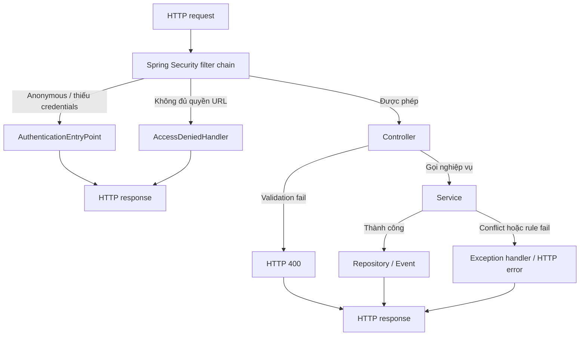

# Tránh chỉ kiểm tra status mà bỏ qua nhánh nghiệp vụ thực sự chạy

## 1. Vì sao status đúng vẫn chưa đủ?

Một test HTTP có thể nhận status mong đợi nhưng vẫn không chứng minh endpoint đã thực hiện đúng nghiệp vụ. Ví dụ, request duyệt hóa đơn trả 200 OK, nhưng controller không gọi service duyệt; hoặc request bị từ chối trả 403 Forbidden vì thiếu CSRF token, trong khi mục tiêu test là xác nhận user thiếu role bị chặn. Status cho biết kết quả giao thức, không tự mô tả đầy đủ nhánh code đã chạy.

Trong module **SPRING_SECURITY_TESTING**, người học kiểm chứng xác thực, phân quyền và bảo vệ HTTP thực tế bằng `spring-security-test` trên ứng dụng Servlet và Reactive. Bài thuộc chương **Khẳng định kết quả** này tập trung vào cách kết hợp assertion HTTP với bằng chứng về hành vi phía server: service nào được gọi, nhánh nào được chọn, tham số nào được truyền và repository/event nào đã hoặc chưa được tác động.

Một test tốt cần xác nhận những điều phù hợp với mục tiêu:

- Request được phép: status và response đúng, đúng service method được gọi với đúng dữ liệu.
- Request bị chặn ở filter chain: status và Authentication đúng, controller/service không được gọi.
- Request bị chặn ở method security: danh tính đã xác thực, method được bảo vệ đã được gọi tới proxy, nhưng thao tác phía sau authorization không xảy ra.
- Request không hợp lệ: response validation đúng, nghiệp vụ không được thực thi.
- Nhánh nghiệp vụ trả conflict hoặc từ chối: service được gọi, lỗi được ánh xạ đúng, không chạy nhánh ghi dữ liệu không phù hợp.

Không cần xác minh mọi lời gọi nội bộ. Hãy chọn một vài tương tác có ý nghĩa với hợp đồng của endpoint, tránh biến test thành bản sao chi tiết implementation.

## 2. Phân biệt ba lớp kết quả

Trong một request bảo vệ bằng Spring Security, kết quả có thể được tạo ở các lớp khác nhau:



| Lớp | Ví dụ | Bằng chứng nên kiểm tra |
| --- | --- | --- |
| Security filter chain | Anonymous, thiếu role, CSRF không hợp lệ | Status, authentication state, challenge/redirect; service không bị gọi nếu filter chặn trước controller |
| Controller và validation | Thiếu field, sai format, request không hợp lệ | Status/body validation; service không bị gọi |
| Business service | Hóa đơn đã duyệt, hạn mức vượt ngưỡng, tài nguyên xung đột | Status/body theo lỗi nghiệp vụ; service được gọi đúng lần và đúng tham số |
| Repository/event | Ghi trạng thái, phát event, tạo audit record | Trạng thái dữ liệu hoặc tương tác với repository/event publisher |

Điểm quan trọng là không suy ra nhánh chạy chỉ từ status. Hai nhánh khác nhau có thể cùng trả 403 hoặc 409; cùng trả 200 nhưng một nhánh là “đã xử lý”, nhánh kia là “đã tồn tại”. Hãy thêm assertion về body, header, invocation hoặc trạng thái dữ liệu để phân biệt.

## 3. MockMvc: kiểm tra nhánh được phép gọi service

### 3.1. Ví dụ endpoint duyệt hóa đơn

Giả sử endpoint chỉ cho phép người có role APPROVER duyệt hóa đơn:

```java
@RestController
@RequestMapping("/api/invoices")
class InvoiceController {

    private final InvoiceService invoiceService;

    InvoiceController(InvoiceService invoiceService) {
        this.invoiceService = invoiceService;
    }

    @PostMapping("/{id}/approve")
    ApprovalResult approve(
            @PathVariable String id,
            Authentication authentication) {
        return invoiceService.approve(id, authentication.getName());
    }
}
```

Service contract:

```java
public interface InvoiceService {
    ApprovalResult approve(String invoiceId, String approver);
}

public record ApprovalResult(
        String invoiceId,
        String status,
        String approvedBy) {
}
```

Security policy:

```java
@Bean
SecurityFilterChain apiSecurity(HttpSecurity http) throws Exception {
    return http.authorizeHttpRequests(auth -> auth
                .requestMatchers("/api/invoices/**").hasRole("APPROVER")
                .anyRequest().authenticated()
            )
            .httpBasic(Customizer.withDefaults())
            .build();
}
```

Trong test tích hợp, có thể thay InvoiceService bằng mock để quan sát controller orchestration:

```java
@SpringBootTest
@AutoConfigureMockMvc
class InvoiceApprovalHttpTest {

    @Autowired
    MockMvc mockMvc;

    @MockitoBean
    InvoiceService invoiceService;
}
```

`@MockitoBean` có trong Spring Framework 6.2+/Spring Boot 3.4+. Với phiên bản cũ, dùng cơ chế mock bean được phiên bản đó hỗ trợ, chẳng hạn `@MockBean`.

### 3.2. Xác nhận cả HTTP response và service invocation

```java
@Test
void approverCanApproveInvoiceAndControllerCallsService() throws Exception {
    given(invoiceService.approve("INV-42", "mai"))
            .willReturn(new ApprovalResult("INV-42", "APPROVED", "mai"));

    mockMvc.perform(post("/api/invoices/INV-42/approve")
                .with(user("mai").roles("APPROVER"))
                .with(csrf()))
           .andExpect(status().isOk())
           .andExpect(jsonPath("$.invoiceId").value("INV-42"))
           .andExpect(jsonPath("$.status").value("APPROVED"))
           .andExpect(jsonPath("$.approvedBy").value("mai"));

    then(invoiceService).should(times(1))
            .approve("INV-42", "mai");
}
```

Test này xác minh hai phần:

1. HTTP contract: request thành công và response có trạng thái APPROVED.
2. Hành vi controller: service được gọi đúng một lần với invoice ID và username lấy từ Authentication.

Nếu chỉ kiểm tra status().isOk(), test vẫn có thể xanh khi controller trả một response cố định mà không gọi service. Invocation assertion giúp phát hiện lỗi đó.

Dùng with(csrf()) trong test POST để request vượt qua CSRF filter. Như vậy, test đang kiểm tra quyền APPROVER và nhánh nghiệp vụ; nó không vô tình kiểm tra thiếu CSRF token.

### 3.3. Dùng ArgumentCaptor khi tham số được tạo trong controller

Khi tham số phụ thuộc request hoặc Authentication, ArgumentCaptor giúp kiểm tra giá trị thực tế:

```java
@Test
void controllerPassesAuthenticatedUsernameToService() throws Exception {
    given(invoiceService.approve(anyString(), anyString()))
            .willReturn(new ApprovalResult("INV-42", "APPROVED", "mai"));

    mockMvc.perform(post("/api/invoices/INV-42/approve")
                .with(user("mai").roles("APPROVER"))
                .with(csrf()))
           .andExpect(status().isOk());

    ArgumentCaptor<String> invoiceIdCaptor =
            ArgumentCaptor.forClass(String.class);
    ArgumentCaptor<String> approverCaptor =
            ArgumentCaptor.forClass(String.class);

    then(invoiceService).should()
            .approve(invoiceIdCaptor.capture(), approverCaptor.capture());

    assertThat(invoiceIdCaptor.getValue()).isEqualTo("INV-42");
    assertThat(approverCaptor.getValue()).isEqualTo("mai");
}
```

Dùng captor khi muốn kiểm tra tham số được tính toán, chuẩn hóa hoặc lấy từ principal. Với giá trị cố định, verify(service).method(expected) thường ngắn và dễ đọc hơn.

## 4. Request bị chặn ở filter chain: xác nhận service không chạy

Giả sử user mai chỉ có role USER, nhưng endpoint yêu cầu APPROVER:

```java
@Test
void userWithoutApproverRoleIsRejectedBeforeServiceInvocation() throws Exception {
    mockMvc.perform(post("/api/invoices/INV-42/approve")
                .with(user("mai").roles("USER"))
                .with(csrf()))
           .andExpect(status().isForbidden())
           .andExpect(authenticated()
                   .withUsername("mai")
                   .withRoles("USER"));

    then(invoiceService).shouldHaveNoInteractions();
}
```

shouldHaveNoInteractions() chứng minh controller không gọi service trong request này. Kết hợp với authenticated() giúp xác nhận đây là user đã xác thực nhưng thiếu role.

Nếu bỏ with(csrf()), request POST có thể bị CsrfFilter chặn trước khi authorization kiểm tra role. Test vẫn có thể trả 403 và service vẫn không được gọi, nhưng nó không còn chứng minh rule hasRole("APPROVER") đã từ chối request. Hãy cung cấp CSRF token trong ca kiểm tra role; viết test riêng cho CSRF nếu đó là mục tiêu.

### 4.1. Khi nào dùng verifyNoInteractions và never?

| Assertion Mockito | Ý nghĩa | Dùng khi |
| --- | --- | --- |
| verifyNoInteractions(mock) | Không có method nào trên mock được gọi | Filter chain hoặc validation phải chặn trước khi tới dependency |
| verify(mock, never()).save(any()) | Một method cụ thể không được gọi | Nhánh được phép đọc nhưng không được ghi |
| verify(mock, times(1)).approve(...) | Method được gọi đúng một lần | Xác minh command được thực thi một lần |
| verify(mock, atLeastOnce()).publishEvent(...) | Có ít nhất một lần phát event | Chỉ khi số lần gọi không phải hợp đồng cố định |
| InOrder | Xác minh thứ tự tương tác | Thứ tự giữa các collaborator là một yêu cầu nghiệp vụ |

Tránh lạm dụng verifyNoMoreInteractions(). Nó làm test phụ thuộc vào mọi lời gọi nội bộ, kể cả những thay đổi implementation không ảnh hưởng hợp đồng. Chỉ dùng khi việc không có tương tác bổ sung thực sự là yêu cầu.

## 5. Validation fail: xác nhận nhánh nghiệp vụ chưa chạy

Một request sai định dạng có thể trả 400 mà không chứng minh service chưa bị gọi. Nếu validation được đặt tại controller, hãy xác nhận dependency không nhận request.

DTO:

```java
public record CreateInvoiceRequest(
        @NotBlank String customerId,
        @Positive BigDecimal amount) {
}
```

Controller:

```java
@PostMapping
ResponseEntity<?> create(@Valid @RequestBody CreateInvoiceRequest request) {
    return ResponseEntity.status(HttpStatus.CREATED)
            .body(invoiceService.create(request));
}
```

Test:

```java
@Test
void invalidInvoiceRequestDoesNotCallService() throws Exception {
    mockMvc.perform(post("/api/invoices")
                .with(user("mai").roles("USER"))
                .with(csrf())
                .contentType(MediaType.APPLICATION_JSON)
                .content("""
                    {"customerId":"", "amount":-10}
                    """))
           .andExpect(status().isBadRequest());

    then(invoiceService).shouldHaveNoInteractions();
}
```

Test này chỉ đúng nếu Bean Validation được bật và request body bị từ chối trước khi controller gọi service. Nếu ứng dụng dùng validation thủ công bên trong service, kỳ vọng sẽ khác: service có thể được gọi rồi trả validation error. Hãy đặt assertion theo vị trí thực sự của validation.

## 6. Business branch: cùng một endpoint nhưng kết quả khác nhau

Có những nhánh chỉ xuất hiện sau khi service chạy. Ví dụ, hóa đơn có thể được duyệt thành công hoặc đang ở trạng thái không cho phép duyệt. Cả hai trường hợp đều đi qua authorization và controller.

```java
@Test
void alreadyApprovedInvoiceMapsBusinessConflictAndServiceWasCalled() throws Exception {
    given(invoiceService.approve("INV-42", "mai"))
            .willThrow(new InvoiceAlreadyApprovedException("INV-42"));

    mockMvc.perform(post("/api/invoices/INV-42/approve")
                .with(user("mai").roles("APPROVER"))
                .with(csrf()))
           .andExpect(status().isConflict())
           .andExpect(jsonPath("$.code").value("INVOICE_ALREADY_APPROVED"));

    then(invoiceService).should(times(1))
            .approve("INV-42", "mai");
}
```

Khác với filter-chain denial, ở đây service **phải được gọi** để phát hiện trạng thái nghiệp vụ. Nếu test chỉ khẳng định 409, nó chưa phân biệt được service đã phát hiện conflict hay một filter/controller khác tự trả 409.

Ví dụ HTTP trên giả định ứng dụng có exception handler ánh xạ `InvoiceAlreadyApprovedException` thành 409 và JSON code `INVOICE_ALREADY_APPROVED`.

Để kiểm tra logic của service thật, viết một service test riêng với repository mock. Giả sử hóa đơn đã ở trạng thái APPROVED, service phải ném lỗi nghiệp vụ và không lưu lại trạng thái:

```java
@Test
void alreadyApprovedInvoiceIsNotPersistedAgain() {
    Invoice invoice = Invoice.approved("INV-42");
    given(invoiceRepository.findById("INV-42"))
            .willReturn(Optional.of(invoice));

    assertThatThrownBy(() -> invoiceService.approve("INV-42", "mai"))
            .isInstanceOf(InvoiceAlreadyApprovedException.class);

    then(invoiceRepository).should().findById("INV-42");
    then(invoiceRepository).should(never())
            .save(any(Invoice.class));
}
```

HTTP test ở trên kiểm tra exception được ánh xạ thành 409 và service được gọi; service test này kiểm tra implementation thật không ghi dữ liệu khi conflict. Hai test cung cấp hai loại bằng chứng khác nhau.

## 7. Chọn đúng ranh giới mock: controller test hay service test?

Không có một test duy nhất chứng minh mọi lớp. Mỗi loại test có một ranh giới phù hợp:

| Loại test | Dependency | Điều chứng minh |
| --- | --- | --- |
| Controller/HTTP orchestration | Mock service | Controller gọi đúng use case và tạo response đúng |
| Service/business logic | Service thật, mock repository/gateway | Nhánh nghiệp vụ, quy tắc và thao tác persistence đúng |
| Security integration | Filter chain thật, danh tính giả lập hoặc credentials test | Security policy và HTTP result đúng |
| Persistence integration | Repository/backend thật | Dữ liệu thực sự được ghi/đọc theo transaction và mapping |
| End-to-end | Hệ thống gần thực tế | Các thành phần phối hợp qua giao thức thật |

Ví dụ service test với service thật và repository mock:

```java
@ExtendWith(MockitoExtension.class)
class InvoiceServiceTest {

    @Mock
    InvoiceRepository invoiceRepository;

    @Mock
    ApplicationEventPublisher eventPublisher;

    @InjectMocks
    InvoiceServiceImpl invoiceService;

    @Test
    void approvalChangesStatusAndPersistsInvoice() {
        Invoice invoice = Invoice.pending("INV-42");
        given(invoiceRepository.findById("INV-42"))
                .willReturn(Optional.of(invoice));

        ApprovalResult result = invoiceService.approve("INV-42", "mai");

        assertThat(result.status()).isEqualTo("APPROVED");
        assertThat(invoice.getStatus()).isEqualTo(InvoiceStatus.APPROVED);
        then(invoiceRepository).should().save(invoice);
    }
}
```

## 8. Xác minh event và audit side effect

Một nhánh nghiệp vụ có thể cập nhật database và phát domain event. Chỉ kiểm tra response 200 không chứng minh event đã được phát.

Giả sử service phát event sau khi duyệt:

```java
public record InvoiceApprovedEvent(
        String invoiceId,
        String approvedBy) {
}
```

Nếu event được phát bên trong service, hãy kiểm tra ở service test với ApplicationEventPublisher mock:

```java
@ExtendWith(MockitoExtension.class)
class InvoiceApprovalEventTest {

    @Mock
    InvoiceRepository invoiceRepository;

    @Mock
    ApplicationEventPublisher eventPublisher;

    @InjectMocks
    InvoiceServiceImpl invoiceService;

    @Test
    void successfulApprovalPublishesInvoiceApprovedEvent() {
        Invoice invoice = Invoice.pending("INV-42");
        given(invoiceRepository.findById("INV-42"))
                .willReturn(Optional.of(invoice));

        invoiceService.approve("INV-42", "mai");

        ArgumentCaptor<InvoiceApprovedEvent> eventCaptor =
                ArgumentCaptor.forClass(InvoiceApprovedEvent.class);

        then(eventPublisher).should()
                .publishEvent(eventCaptor.capture());

        assertThat(eventCaptor.getValue().invoiceId()).isEqualTo("INV-42");
        assertThat(eventCaptor.getValue().approvedBy()).isEqualTo("mai");
    }
}
```

Test này xác nhận event được phát với dữ liệu đúng khi nhánh thành công chạy. Nên có test tương ứng cho nhánh bị từ chối để bảo đảm event InvoiceApprovedEvent không phát ra khi invoice không thể duyệt.

Trong service test của nhánh bị từ chối, có thể khẳng định publisher không nhận event success:

```java
assertThatThrownBy(() -> invoiceService.approve("INV-42", "mai"))
        .isInstanceOf(InvoiceAlreadyApprovedException.class);
then(eventPublisher).shouldHaveNoInteractions();
```

Nếu hệ thống dùng transactional event listener hoặc outbox, cần phân biệt “publisher được gọi” với “event đã được commit/đưa tới broker”. Mockito chỉ xác nhận tương tác tại ranh giới mock. Muốn chứng minh giao nhận event qua broker, cần integration test cho outbox/message infrastructure.

## 9. Method security: phân biệt method được gọi với thao tác phía sau bị chặn

Khi dùng `@PreAuthorize`, proxy method security chặn lời gọi trước khi method body chạy. Controller có thể đã gọi service proxy, nhưng repository trong method body không được gọi.

```java
@Service
class SensitiveReportService {

    private final ReportRepository reportRepository;

    SensitiveReportService(ReportRepository reportRepository) {
        this.reportRepository = reportRepository;
    }

    @PreAuthorize("hasRole('ADMIN')")
    public Report loadSensitiveReport(String id) {
        return reportRepository.findById(id).orElseThrow();
    }
}
```

Method security phải được bật, ví dụ bằng `@EnableMethodSecurity`. Trong filter chain của test, chỉ yêu cầu authenticated cho URL báo cáo để lời gọi có thể đi tới proxy của service:

```java
@Configuration
@EnableMethodSecurity
class MethodSecurityConfiguration {
}

// Trong SecurityFilterChain:
.requestMatchers("/api/reports/**").authenticated()
```

Để cô lập method security, URL rule phải cho phép request đã xác thực tới controller; nếu URL matcher cũng yêu cầu ADMIN, filter chain sẽ chặn request trước method proxy. Trong test context, ReportRepository được thay bằng mock bean:

```java
@SpringBootTest
@AutoConfigureMockMvc
class SensitiveReportMethodSecurityTest {

    @Autowired
    MockMvc mockMvc;

    @MockitoBean
    ReportRepository reportRepository;

    @Test
    @WithMockUser(username = "mai", roles = "USER")
    void methodSecurityBlocksRepositoryAccess() throws Exception {
        mockMvc.perform(get("/api/reports/secret-42"))
               .andExpect(status().isForbidden())
               .andExpect(authenticated().withUsername("mai"));

        then(reportRepository).shouldHaveNoInteractions();
    }
}
```

Ở đây không nên khẳng định service proxy “không được gọi”: controller đã gọi method được bảo vệ, và proxy là nơi kiểm tra quyền. Bằng chứng phù hợp là repository không được chạm tới vì method body không chạy.

Nếu URL authorization cũng yêu cầu ADMIN trước khi controller chạy, request sẽ bị chặn ở filter chain và service proxy không được gọi. Hãy chọn cấu hình test sao cho nó cô lập đúng lớp đang muốn xác minh.

## 10. Kiểm tra nhánh nghiệp vụ qua trạng thái dữ liệu

Khi cần chứng minh kết quả ghi dữ liệu, assertion tương tác mock có thể chưa đủ. Một test integration có thể đọc lại trạng thái sau request:

```java
@Test
@WithMockUser(username = "mai", roles = "APPROVER")
void approvalRequestPersistsApprovedState() throws Exception {
    invoiceRepository.saveAndFlush(Invoice.pending("INV-42"));

    mockMvc.perform(post("/api/invoices/INV-42/approve")
                .with(csrf()))
           .andExpect(status().isOk())
           .andExpect(jsonPath("$.status").value("APPROVED"));

    Invoice persisted = invoiceRepository.findById("INV-42").orElseThrow();
    assertThat(persisted.getStatus()).isEqualTo(InvoiceStatus.APPROVED);
}
```

Test này giả định controller/service/repository thật được nạp trong Spring context và request được thực thi trong transaction phù hợp. Nếu test method có @Transactional, request MockMvc thường đi qua cùng application context nhưng transaction của server request có thể độc lập; hãy hiểu transaction boundary trước khi đọc dữ liệu. Không mặc định test transaction rollback bao phủ transaction của HTTP request.

Nếu chỉ cần xác minh service được gọi, controller test với mock service đơn giản và nhanh hơn. Nếu cần xác minh SQL, transaction hoặc mapping, dùng repository integration test với database phù hợp.

## 11. Reactive: WebTestClient và side effect của Publisher

Trong WebFlux, controller/service thường trả Mono hoặc Flux. Publisher có thể lazy; side effect chỉ chạy khi có subscription. WebTestClient.exchange() và việc consume response body sẽ kích hoạt luồng request, vì vậy hãy hoàn tất exchange/body assertion trước khi verify tương tác.

Ví dụ controller:

```java
@RestController
@RequestMapping("/api/invoices")
class ReactiveInvoiceController {

    private final ReactiveInvoiceService invoiceService;

    ReactiveInvoiceController(ReactiveInvoiceService invoiceService) {
        this.invoiceService = invoiceService;
    }

    @PostMapping("/{id}/approve")
    Mono<ApprovalResult> approve(
            @PathVariable String id,
            Authentication authentication) {
        return invoiceService.approve(id, authentication.getName());
    }
}
```

Test user có quyền:

```java
@Test
void reactiveApproverCallsServiceAndGetsApproval() {
    given(invoiceService.approve("INV-42", "mai"))
            .willReturn(Mono.just(
                    new ApprovalResult("INV-42", "APPROVED", "mai")));

    webTestClient.mutateWith(mockUser("mai").roles("APPROVER"))
            .mutateWith(csrf())
            .post()
            .uri("/api/invoices/INV-42/approve")
            .exchange()
            .expectStatus().isOk()
            .expectBody()
            .jsonPath("$.status").isEqualTo("APPROVED");

    then(invoiceService).should(times(1))
            .approve("INV-42", "mai");
}
```

Test user thiếu quyền:

```java
@Test
void reactiveUserWithoutRoleDoesNotReachService() {
    webTestClient.mutateWith(mockUser("mai").roles("USER"))
            .mutateWith(csrf())
            .post()
            .uri("/api/invoices/INV-42/approve")
            .exchange()
            .expectStatus().isForbidden();

    then(invoiceService).shouldHaveNoInteractions();
}
```

Các ví dụ giả định WebTestClient đã được cấu hình với Reactive Security filter chain, service mock là bean được controller sử dụng, và CSRF được bật. Nếu CSRF bị tắt cho API, điều chỉnh test theo cấu hình thực tế.

Với Reactive service thật, có thể dùng StepVerifier để xác minh kết quả publisher và mock repository để xác nhận side effect. Đừng gọi block() trong code production chỉ để thuận tiện cho test; test có thể dùng StepVerifier hoặc WebTestClient để duy trì mô hình Reactive.

HTTP test dùng mock service để xác minh controller wiring; service test dùng implementation thật để xác minh business logic. Nếu mock service trong HTTP test rồi kết luận dữ liệu đã được persist, đó là kết luận vượt quá bằng chứng của test.

Khi persistence là trọng tâm, dùng repository thật hoặc kiểm tra database state trong integration test. Nếu test chạy trong transaction tự rollback, hãy đọc dữ liệu trong cùng transaction hoặc cấu hình test rõ ràng để tránh nhầm giữa rollback và việc không ghi dữ liệu.

## 12. Kiểm tra thứ tự tương tác khi thứ tự là yêu cầu nghiệp vụ

Một số use case cần thứ tự rõ ràng: kiểm tra trạng thái trước, ghi dữ liệu sau, rồi mới phát event. Mockito InOrder có thể kiểm tra thứ tự:

```java
@Test
void approvalChecksAndPersistsBeforePublishingEvent() {
    Invoice invoice = Invoice.pending("INV-42");
    given(invoiceRepository.findById("INV-42"))
            .willReturn(Optional.of(invoice));

    invoiceService.approve("INV-42", "mai");

    InOrder order = inOrder(invoiceRepository, eventPublisher);
    order.verify(invoiceRepository).findById("INV-42");
    order.verify(invoiceRepository).save(invoice);
    order.verify(eventPublisher).publishEvent(any(InvoiceApprovedEvent.class));
}
```

Chỉ dùng kiểm tra thứ tự khi thứ tự đó có ý nghĩa, ví dụ event chỉ được phát sau khi state đã được lưu hoặc outbox record được ghi cùng transaction. Nếu event được publish sau commit bằng transactional listener, hãy kiểm tra ranh giới commit/outbox tương ứng thay vì giả định lời gọi publishEvent phải xảy ra sau repository.save trong cùng call stack. Nếu thứ tự lời gọi là chi tiết implementation, không nên cố định nó trong test.

## 13. Ma trận chọn bằng chứng cho từng nhánh

| Mục tiêu | HTTP assertion | Hành vi cần xác minh |
| --- | --- | --- |
| Anonymous bị chặn | 401 hoặc redirect theo entry point | Service không được gọi nếu filter chain chặn |
| Authenticated thiếu role | 403 + authenticated matcher | Service/controller không được gọi nếu URL rule chặn; repository không được gọi nếu method security chặn |
| User có quyền | 200/201 | Service đúng method, đúng tham số và đúng số lần |
| Request validation fail | 400 | Service không được gọi nếu validation ở controller |
| Business conflict | 409 | Service được gọi; không chạy repository write/event success |
| Business success | 200/201 | State được cập nhật; event/audit được phát nếu hợp đồng yêu cầu |
| Reactive request success | Status và body qua WebTestClient | Publisher được subscribe, collaborator được gọi sau exchange |
| Stateless token request | Status theo token/policy | Không dựa vào session; mỗi request cần token riêng |

Không cần tất cả assertion cho mọi test. Chọn bằng chứng trực tiếp trả lời câu hỏi của test.

## 14. Những lỗi thường gặp

| Biểu hiện | Nguyên nhân | Cách khắc phục |
| --- | --- | --- |
| Status 200 nhưng nghiệp vụ không chạy | Controller trả response cố định hoặc mock chưa được verify | Verify service method và tham số |
| Status 403 nhưng không rõ role hay CSRF | POST thiếu CSRF token | Thêm `with(csrf())` khi test authorization; tạo test CSRF riêng |
| verifyNoInteractions fail trên request bị từ chối | Request bị chặn ở method security sau khi controller đã gọi service proxy | Verify repository hoặc collaborator phía sau method guard |
| Test mock service nhưng kết luận database đã ghi | Mock không thực thi business implementation | Dùng service thật/repository mock hoặc integration test database |
| Verify quá nhiều method nội bộ | Test gắn chặt với implementation | Chỉ verify tương tác thuộc hợp đồng use case |
| Reactive verify chạy trước khi publisher được consume | Luồng lazy chưa được subscribe | Hoàn tất WebTestClient exchange/body hoặc dùng StepVerifier trước khi verify |
| times(1) fail do retry/re-subscription | Reactive retry hoặc client subscription làm method được gọi nhiều lần | Xác định retry có thuộc thiết kế; assert số lần đúng với hợp đồng |
| Event publisher được gọi nhưng message chưa tới broker | Mock chỉ chứng minh lời gọi tại boundary | Viết integration test cho outbox/broker nếu cần chứng minh delivery |

## 15. Bài tập thực hành

Dùng endpoint duyệt hóa đơn và API báo cáo trong bài để thực hiện:

1. Viết test MockMvc cho APPROVER: xác nhận HTTP thành công, body APPROVED, service được gọi đúng một lần với invoice ID và username.
2. Viết test user USER bị chặn: thêm CSRF token, xác nhận 403, Authentication vẫn là user đó và service không được gọi.
3. Viết test request thiếu field bắt buộc: xác nhận 400 và service không được gọi nếu validation nằm ở controller.
4. Mô phỏng service ném InvoiceAlreadyApprovedException: xác nhận 409, service đã được gọi và nhánh lưu/event success không chạy.
5. Viết service unit test với repository mock: xác nhận trạng thái invoice thay đổi, repository save đúng dữ liệu và event được phát đúng một lần.
6. Với `@PreAuthorize`, xác nhận user thiếu quyền không chạm tới repository dù controller đã gọi service proxy.
7. Với WebFlux, dùng WebTestClient để kiểm tra request thành công và request thiếu role; verify reactive service sau khi exchange/body đã được consume.
8. Thử bỏ một invocation assertion khỏi test và quan sát một lỗi controller trả response cố định có thể lọt qua status-only test như thế nào.

**Tiêu chí hoàn thành:** Người học biết status chỉ là một phần của kết quả; chọn đúng ranh giới mock; xác nhận được nhánh success, denied, validation và business conflict; đồng thời kiểm tra side effect ở service/repository/event theo đúng tầng.

## Tài liệu tham khảo chính thức

- [Spring Security — MockMvc Result Matchers](https://docs.spring.io/spring-security/reference/servlet/test/mockmvc/result-matchers.html)
- [Spring Security — MockMvc Setup](https://docs.spring.io/spring-security/reference/servlet/test/mockmvc/setup.html)
- [Spring Security — Reactive Testing](https://docs.spring.io/spring-security/reference/reactive/test/index.html)
- [Spring Security — Method Security](https://docs.spring.io/spring-security/reference/servlet/authorization/method-security.html)
- [Spring Framework — MockMvc](https://docs.spring.io/spring-framework/reference/testing/mockmvc.html)
- [Spring Framework — WebTestClient](https://docs.spring.io/spring-framework/reference/testing/webtestclient.html)
- [Mockito — Verification](https://javadoc.io/doc/org.mockito/mockito-core/latest/org/mockito/Mockito.html)
- [Reactor — Testing with StepVerifier](https://projectreactor.io/docs/core/release/reference/testing.html)

Các ví dụ lược bớt import thông thường. Tùy đoạn mã, cần thêm `@SpringBootTest`, `@AutoConfigureMockMvc`, `@MockitoBean`, `@WithMockUser`, `@EnableMethodSecurity`, Bean Validation annotations, các static import của Mockito (`given`, `then`, `verify`, `times`, `never`, `any`, `argThat`, `inOrder`), AssertJ, MockMvc request/result matchers, SecurityMockMvc request post-processors, `MockMvc`, `HttpStatus`, `MediaType`, `Authentication`, `ArgumentCaptor`, `InOrder`, `ApplicationEventPublisher`, `Mono`, `StepVerifier` và các kiểu domain minh họa.
