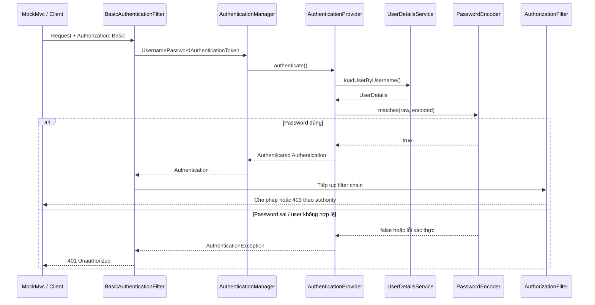

# Thông tin đúng, sai và không có thông tin xác thực

Khi kiểm thử đăng nhập HTTP, cần phân biệt ba tình huống: request gửi **thông tin xác thực hợp lệ**, request gửi **thông tin xác thực không hợp lệ**, và request **không gửi thông tin xác thực**. Cả hai trường hợp sau thường bị từ chối, nhưng chúng đi qua các nhánh xử lý khác nhau. Ngoài ra, request đã xác thực thành công vẫn có thể bị từ chối vì thiếu quyền. Vì vậy, chỉ nhìn một mã HTTP mà không biết request đã gửi credentials nào sẽ dễ dẫn đến kết luận sai.

Bài học thuộc chương **Đăng nhập qua HTTP** của module `SPRING_SECURITY_TESTING`, chuyên kiểm chứng xác thực, phân quyền và bảo vệ HTTP thực tế bằng `spring-security-test` trên ứng dụng Servlet và Reactive. Người học sử dụng `MockMvc`, `WebTestClient`, `@WithMockUser`, `SecurityContext`, JWT/OAuth2/OIDC giả lập và các ca kiểm thử được phép hoặc bị từ chối. Bài này tập trung vào HTTP Basic trên Servlet với `MockMvc`, sau đó đối chiếu với form login và chỉ ra cách phân biệt authentication failure với authorization/CSRF failure.

## 1. Ba trạng thái credentials cần kiểm thử

Với một endpoint yêu cầu đăng nhập, hãy tạo tối thiểu ba ca độc lập:

| Trạng thái request | Ví dụ | Kết quả điển hình với HTTP Basic |
| --- | --- | --- |
| Credentials đúng | Username tồn tại, password khớp | Authentication thành công; tiếp tục xét quyền |
| Credentials sai | Username không tồn tại hoặc password không khớp | `401 Unauthorized` |
| Không có credentials | Không có header `Authorization` | `401 Unauthorized` khi endpoint yêu cầu đăng nhập |

Có thêm một trường hợp cần tách riêng: credentials đúng nhưng người dùng thiếu authority. Đây là **authorization failure**, thường nhận `403 Forbidden`, không phải authentication failure.

Một ma trận đầy đủ cho endpoint riêng tư thường gồm:

1. Alice gửi password đúng và đủ quyền: được truy cập.
2. Alice gửi password sai: bị từ chối ở bước xác thực.
3. Username không tồn tại: bị từ chối ở bước xác thực.
4. Request không gửi credentials: bị yêu cầu xác thực.
5. Alice xác thực đúng nhưng thiếu role: bị từ chối ở bước phân quyền.
6. Admin xác thực đúng và có role cần thiết: được truy cập.

## 2. HTTP Basic xử lý credentials như thế nào?

HTTP Basic gửi username và password trong header:

```http
Authorization: Basic <base64(username:password)>
```

Base64 chỉ là cách mã hóa biểu diễn dữ liệu, không phải mã hóa bảo mật. Ứng dụng thực tế phải sử dụng HTTPS để bảo vệ credentials khi truyền qua mạng.

Trong ứng dụng Servlet, luồng xử lý cơ bản gồm:

1. Client gửi request có header `Authorization: Basic ...`.
2. `BasicAuthenticationFilter` đọc và phân tích header.
3. Filter tạo authentication request và chuyển tới `AuthenticationManager`.
4. Provider phù hợp, thường là `DaoAuthenticationProvider`, tải người dùng qua `UserDetailsService`.
5. `PasswordEncoder` so sánh password gửi lên với password đã lưu.
6. Nếu hợp lệ, một `Authentication` đã xác thực được đặt vào `SecurityContext`.
7. Authorization rules kiểm tra authority/role trước khi cho request vào controller.

Nếu header không có, filter không có credentials để xác thực. Khi endpoint yêu cầu người dùng đã đăng nhập, authorization xử lý request anonymous và `ExceptionTranslationFilter` gọi `AuthenticationEntryPoint` để yêu cầu xác thực. Với cấu hình HTTP Basic mặc định, phản hồi thường là `401` kèm header `WWW-Authenticate`.

Nếu header có nhưng password sai, `BasicAuthenticationFilter` nhận lỗi xác thực và chuyển tới entry point. Kết quả cũng thường là `401`, nhưng nguyên nhân là credentials đã được gửi và bị từ chối.



Sơ đồ mô tả luồng có credentials Basic. Với request không có header, nhánh Basic authentication không tạo authentication; khi endpoint yêu cầu đăng nhập, entry point được gọi ở bước xử lý truy cập.

## 3. Cấu hình ứng dụng mẫu với HTTP Basic

Ta dùng một người dùng Alice có role `USER` và một người dùng Root có role `ADMIN`. Endpoint `GET /api/profile` yêu cầu đăng nhập; `GET /api/admin` chỉ cho phép ADMIN; `GET /api/public` công khai.

Ví dụ cấu hình Spring Security:

```java
import org.springframework.context.annotation.Bean;
import org.springframework.context.annotation.Configuration;
import org.springframework.security.config.Customizer;
import org.springframework.security.config.annotation.web.builders.HttpSecurity;
import org.springframework.security.core.userdetails.User;
import org.springframework.security.core.userdetails.UserDetails;
import org.springframework.security.core.userdetails.UserDetailsService;
import org.springframework.security.crypto.factory.PasswordEncoderFactories;
import org.springframework.security.crypto.password.PasswordEncoder;
import org.springframework.security.provisioning.InMemoryUserDetailsManager;
import org.springframework.security.web.SecurityFilterChain;

@Configuration
class HttpBasicSecurityConfiguration {

    @Bean
    PasswordEncoder passwordEncoder() {
        return PasswordEncoderFactories.createDelegatingPasswordEncoder();
    }

    @Bean
    UserDetailsService userDetailsService(PasswordEncoder encoder) {
        UserDetails alice = User.withUsername("alice")
                .password(encoder.encode("alice-password"))
                .roles("USER")
                .build();

        UserDetails root = User.withUsername("root")
                .password(encoder.encode("root-password"))
                .roles("ADMIN")
                .build();

        return new InMemoryUserDetailsManager(alice, root);
    }

    @Bean
    SecurityFilterChain securityFilterChain(HttpSecurity http)
            throws Exception {
        return http
            .authorizeHttpRequests(auth -> auth
                .requestMatchers("/api/public").permitAll()
                .requestMatchers("/api/profile").authenticated()
                .requestMatchers("/api/admin").hasRole("ADMIN")
                .anyRequest().denyAll())
            .httpBasic(Customizer.withDefaults())
            .build();
    }
}
```

Ở đây `DelegatingPasswordEncoder` mã hóa password khi tạo dữ liệu người dùng. Test sẽ gửi password gốc qua HTTP Basic; provider dùng encoder để so khớp với giá trị đã lưu. Đây là ví dụ in-memory để minh họa. Ứng dụng thực tế thường tải người dùng từ database hoặc một identity store khác.

Controller:

```java
import org.springframework.security.core.Authentication;
import org.springframework.web.bind.annotation.GetMapping;
import org.springframework.web.bind.annotation.RestController;

@RestController
class HttpBasicController {

    @GetMapping("/api/public")
    String publicResource() {
        return "public";
    }

    @GetMapping("/api/profile")
    String profile(Authentication authentication) {
        return "hello-" + authentication.getName();
    }

    @GetMapping("/api/admin")
    String admin() {
        return "admin-area";
    }
}
```

Controller chỉ được gọi sau khi request vượt qua các filter và quy tắc truy cập. Việc controller nhận được `Authentication` ở đây không tự chứng minh credentials đã được xác minh; test phải cho thấy request đã đi qua HTTP Basic filter với header phù hợp.

## 4. Cấu hình MockMvc để chạy filter chain

Thêm dependency `spring-security-test` trong test scope nếu dự án chưa có:

```xml
<dependency>
    <groupId>org.springframework.security</groupId>
    <artifactId>spring-security-test</artifactId>
    <scope>test</scope>
</dependency>
```

Với Spring Boot, cấu hình thường dùng:

```java
@SpringBootTest
@AutoConfigureMockMvc
class HttpBasicAuthenticationTests {

    @Autowired
    MockMvc mockMvc;
}
```

`@AutoConfigureMockMvc` mặc định đăng ký các servlet filter của application context. Nếu tự dựng `MockMvc`, phải tích hợp Spring Security:

```java
import static org.springframework.security.test.web.servlet.setup
        .SecurityMockMvcConfigurers.springSecurity;

MockMvc mockMvc = MockMvcBuilders
        .webAppContextSetup(webApplicationContext)
        .apply(springSecurity())
        .build();
```

Không dùng `@AutoConfigureMockMvc(addFilters = false)` cho các test đang cần xác minh HTTP Basic. Nếu filter chain bị tắt, test có thể chỉ kiểm tra controller mà không hề chạy `BasicAuthenticationFilter`, `AuthenticationManager` hoặc authorization rules.

## 5. Gửi credentials đúng bằng httpBasic(...)

`SecurityMockMvcRequestPostProcessors.httpBasic(username, password)` tạo header HTTP Basic cho request. Nó khác với `user(username)`: `httpBasic(...)` cung cấp credentials để filter xử lý, còn `user(...)` gắn sẵn một danh tính đã xác thực cho request test.

```java
import static org.springframework.security.test.web.servlet.request
        .SecurityMockMvcRequestPostProcessors.httpBasic;
import static org.springframework.test.web.servlet.request.MockMvcRequestBuilders.get;
import static org.springframework.test.web.servlet.result.MockMvcResultMatchers.content;
import static org.springframework.test.web.servlet.result.MockMvcResultMatchers.status;

@Test
void validCredentialsAuthenticateAlice() throws Exception {
    mockMvc.perform(get("/api/profile")
            .with(httpBasic("alice", "alice-password")))
        .andExpect(status().isOk())
        .andExpect(content().string("hello-alice"));
}
```

Request này đi qua `BasicAuthenticationFilter`. Nếu filter chain dùng `UserDetailsService` và `PasswordEncoder` ở cấu hình ứng dụng, test kiểm tra được credentials mà ứng dụng chấp nhận.

Để kết luận chính xác, không gắn thêm `@WithMockUser`, `.with(user(...))`, `.with(authentication(...))` hoặc `.with(securityContext(...))` vào cùng test. Những fixture đó có thể chuẩn bị sẵn authentication và làm bài test không còn cô lập đường xác thực Basic mà ta muốn chứng minh.

## 6. Gửi password sai và username không tồn tại

Khi username tồn tại nhưng password sai, provider không xác thực được credentials. Với HTTP Basic mặc định, request nhận `401 Unauthorized`:

```java
@Test
void wrongPasswordIsRejected() throws Exception {
    mockMvc.perform(get("/api/profile")
            .with(httpBasic("alice", "wrong-password")))
        .andExpect(status().isUnauthorized());
}
```

Khi username không tồn tại, `UserDetailsService` không tải được tài khoản phù hợp và provider cũng từ chối:

```java
@Test
void unknownUsernameIsRejected() throws Exception {
    mockMvc.perform(get("/api/profile")
            .with(httpBasic("unknown-user", "any-password")))
        .andExpect(status().isUnauthorized());
}
```

Cả hai trường hợp thường có cùng mã `401`. Ứng dụng không nên tiết lộ ra ngoài liệu username tồn tại hay password sai; thông báo lỗi có thể được chuẩn hóa để tránh dò tìm tài khoản.

Ngoài hai trường hợp trên, cơ chế xác thực có thể từ chối người dùng bị khóa, bị vô hiệu hóa hoặc credentials hết hạn. Nếu ứng dụng có chính sách đó, bổ sung test tương ứng qua cùng filter/provider thực tế.

## 7. Không gửi credentials: request anonymous

Để kiểm tra request không có thông tin xác thực, đừng gắn bất kỳ request post-processor nào tạo danh tính:

```java
@Test
void missingCredentialsCannotReadPrivateProfile() throws Exception {
    mockMvc.perform(get("/api/profile"))
        .andExpect(status().isUnauthorized());
}
```

Ở đây request không có header `Authorization`, không có `user(...)` và không có context được test gắn sẵn. Vì `/api/profile` yêu cầu `authenticated()`, Spring Security xử lý request như anonymous và HTTP Basic entry point yêu cầu credentials.

Một số điểm cần lưu ý:

- Request không gửi credentials khác với request gửi password sai. Trường hợp đầu không có authentication attempt từ Basic header; trường hợp sau có attempt nhưng thất bại.
- Nếu test method gắn `@WithMockUser`, request có thể đã có context mặc định. Không dùng annotation đó trong test cần chứng minh hành vi khi thiếu credentials.
- Nếu `MockMvc` được cấu hình `defaultRequest(...with(user(...)))`, request không có `.with(...)` vẫn có thể kế thừa fixture. Hãy dùng client không có default identity hoặc chủ động kiểm tra cấu hình test.
- Endpoint `permitAll()` cho phép request không credentials. Điều đó không có nghĩa endpoint được bảo vệ đã chấp nhận anonymous.

Có thể kiểm tra endpoint công khai:

```java
@Test
void publicEndpointDoesNotRequireCredentials() throws Exception {
    mockMvc.perform(get("/api/public"))
        .andExpect(status().isOk())
        .andExpect(content().string("public"));
}
```

Một chi tiết hữu ích: nếu endpoint `permitAll()` nhận request có header Basic sai, `BasicAuthenticationFilter` vẫn có thể thử xác thực header đó trước khi authorization xét `permitAll()`. Khi credentials được gửi nhưng không hợp lệ, request có thể bị trả `401`. Vì vậy, public endpoint không đồng nghĩa ứng dụng phải bỏ qua một header xác thực sai được client chủ động gửi.

## 8. Phân biệt 401 với 403

`401 Unauthorized` và `403 Forbidden` biểu thị hai giai đoạn khác nhau:

- `401`: request chưa được xác thực hoặc credentials bị từ chối; client cần cung cấp credentials hợp lệ.
- `403`: request đã được xác thực nhưng không có authority cần thiết, hoặc bị một cơ chế bảo vệ khác từ chối.

Ví dụ Alice gửi password đúng nhưng chỉ có role USER, nên không được truy cập `/api/admin`:

```java
@Test
void validCredentialsButInsufficientRoleReturnsForbidden()
        throws Exception {
    mockMvc.perform(get("/api/admin")
            .with(httpBasic("alice", "alice-password")))
        .andExpect(status().isForbidden());
}

@Test
void adminCredentialsCanAccessAdminEndpoint() throws Exception {
    mockMvc.perform(get("/api/admin")
            .with(httpBasic("root", "root-password")))
        .andExpect(status().isOk())
        .andExpect(content().string("admin-area"));
}
```

Ma trận tổng hợp:

| Request | Credentials | Authentication | Authorization | Kết quả HTTP |
| --- | --- | --- | --- | --- |
| GET profile | Alice/password đúng | Thành công | `authenticated()` đạt | `200` |
| GET profile | Alice/password sai | Thất bại | Chưa đến bước quyền | `401` |
| GET profile | Username không tồn tại | Thất bại | Chưa đến bước quyền | `401` |
| GET profile | Không gửi header | Anonymous | Không đạt `authenticated()` | `401` |
| GET admin | Alice/password đúng | Thành công | Thiếu `ROLE_ADMIN` | `403` |
| GET admin | Root/password đúng | Thành công | Có `ROLE_ADMIN` | `200` |

Không suy ra rằng mọi `403` đều do thiếu role. CSRF filter, method security hoặc logic nghiệp vụ như kiểm tra tenant/ownership cũng có thể từ chối request.

## 9. Kiểm tra header WWW-Authenticate và nội dung lỗi

Với HTTP Basic entry point mặc định, phản hồi yêu cầu xác thực thường có header `WWW-Authenticate` để client biết cơ chế cần dùng. Có thể kiểm tra header này nếu đó là hợp đồng của API:

```java
import static org.hamcrest.Matchers.startsWith;
import static org.springframework.test.web.servlet.result.MockMvcResultMatchers.header;
import org.springframework.http.HttpHeaders;

@Test
void missingCredentialsReturnsBasicChallenge() throws Exception {
    mockMvc.perform(get("/api/profile"))
        .andExpect(status().isUnauthorized())
        .andExpect(header().string(
                HttpHeaders.WWW_AUTHENTICATE,
                startsWith("Basic")));
}
```

Body lỗi có thể rỗng hoặc theo định dạng do ứng dụng tùy chỉnh. Đừng gắn chặt test vào chuỗi lỗi nội bộ của provider nếu API không cam kết nội dung đó. Thường nên kiểm tra status, challenge header và các trường lỗi công khai mà API thực sự cam kết.

Nếu ứng dụng có `AuthenticationEntryPoint` riêng, header và body có thể khác. Khi đó, cập nhật test theo entry point đã cấu hình thay vì kỳ vọng mặc định HTTP Basic.

## 10. POST và CSRF: tránh nhầm lỗi bảo vệ request với lỗi credentials

HTTP Basic và CSRF là hai cơ chế khác nhau. Nếu ứng dụng bật CSRF mặc định, request thay đổi trạng thái như POST/PUT/PATCH/DELETE có thể bị từ chối trước khi ta quan sát được kết quả authorization mà mình muốn kiểm tra.

Khi mục tiêu là kiểm tra credentials và quyền trên POST, thêm CSRF token hợp lệ:

```java
import static org.springframework.security.test.web.servlet.request
        .SecurityMockMvcRequestPostProcessors.csrf;
import static org.springframework.security.test.web.servlet.request
        .SecurityMockMvcRequestPostProcessors.httpBasic;
import static org.springframework.test.web.servlet.request.MockMvcRequestBuilders.post;

@Test
void validBasicCredentialsAndCsrfCanReachProtectedPost()
        throws Exception {
    mockMvc.perform(post("/api/reports")
            .with(httpBasic("root", "root-password"))
            .with(csrf()))
        .andExpect(status().isCreated());
}
```

Đoạn trên giả định ứng dụng có endpoint POST được cấu hình yêu cầu quyền phù hợp và trả `201 Created`. Tách riêng các ca:

| Credentials | CSRF | Mục tiêu/kết quả |
| --- | --- | --- |
| Hợp lệ, đủ quyền | Hợp lệ | Xác nhận request có thể được phép |
| Hợp lệ, đủ quyền | Thiếu/sai | Xác nhận CSRF từ chối |
| Hợp lệ, thiếu quyền | Hợp lệ | Xác nhận authorization từ chối |
| Sai hoặc thiếu | Hợp lệ | Xác nhận authentication failure |

Không kết luận password sai chỉ từ một response `403` của POST thiếu CSRF. Với HTTP Basic, lỗi credentials thường dẫn đến `401`; với CSRF, request có thể bị chặn bằng `403`.

## 11. Đối chiếu với form login

Form login cũng xử lý username/password, nhưng cách gửi dữ liệu và phản hồi mặc định khác HTTP Basic. Form login thường nhận POST tới `/login` với các tham số `username` và `password`. Khi thành công, success handler mặc định thường redirect; khi thất bại, failure handler mặc định cũng redirect về trang login với tham số lỗi.

Cấu hình form login là một lựa chọn riêng trong filter chain:

```java
@Bean
SecurityFilterChain formLoginChain(HttpSecurity http) throws Exception {
    return http
        .authorizeHttpRequests(auth -> auth
            .requestMatchers("/api/profile").authenticated()
            .anyRequest().denyAll())
        .formLogin(Customizer.withDefaults())
        .build();
}
```

Test login thành công qua form:

```java
import static org.springframework.security.test.web.servlet.request
        .SecurityMockMvcRequestPostProcessors.csrf;
import static org.springframework.test.web.servlet.request.MockMvcRequestBuilders.post;
import static org.junit.jupiter.api.Assertions.assertNotNull;
import org.springframework.mock.web.MockHttpSession;
import org.springframework.test.web.servlet.MvcResult;

@Test
void formLoginWithCorrectCredentialsCreatesUsableSession()
        throws Exception {
    MvcResult result = mockMvc.perform(post("/login")
            .param("username", "alice")
            .param("password", "alice-password")
            .with(csrf()))
        .andExpect(status().is3xxRedirection())
        .andReturn();

    MockHttpSession session =
            (MockHttpSession) result.getRequest().getSession(false);

    assertNotNull(session);

    mockMvc.perform(get("/api/profile").session(session))
        .andExpect(status().isOk())
        .andExpect(content().string("alice"));
}
```

Test này kiểm tra credentials qua form login filter, sau đó gửi lại cùng session để chứng minh context được khôi phục. Với MockMvc, session không tự được duy trì như trình duyệt; cần lấy và gắn lại `MockHttpSession`.

Với credentials sai hoặc thiếu ở form login, phản hồi mặc định thường là redirect tới trang login (ví dụ `302` với `?error`) thay vì `401` như HTTP Basic. Nếu ứng dụng dùng success/failure handler tùy chỉnh, kiểm tra response theo hợp đồng đã cấu hình.

| Cơ chế | Dữ liệu request | Sai credentials thường trả | Thành công thường trả |
| --- | --- | --- | --- |
| HTTP Basic | Header `Authorization` | `401` | Tiếp tục endpoint, thường `200` |
| Form login | POST `/login`, fields username/password | Redirect `302` tới login error | Redirect `302`, session có thể lưu context |

Không dùng test HTTP Basic để kết luận form login hoạt động, hoặc ngược lại. Mỗi cơ chế có filter và entry point/handler riêng.

## 12. Vì sao không dùng @WithMockUser trong test credentials?

`@WithMockUser` tạo sẵn authentication cho test method/class. Nó phù hợp để kiểm tra authorization hoặc logic controller với một principal đã xác thực, nhưng nó bỏ qua việc gửi password qua HTTP.

Tương tự:

- `.with(user("alice"))` gắn principal giả lập vào request.
- `.with(authentication(auth))` gắn authentication do test tạo.
- `.with(jwt())` chuẩn bị JWT authentication giả lập.
- `@WithUserDetails` tải principal từ `UserDetailsService`, nhưng không thực hiện password matching qua login filter.

Các công cụ đó không sai; chúng chỉ trả lời câu hỏi khác. Dùng chúng cho test authorization, và dùng `.with(httpBasic(...))` hoặc POST form login để kiểm tra đường xác thực username/password.

Một nguyên tắc đơn giản: **test đang chứng minh cơ chế xác thực thì không cấp sẵn kết quả xác thực cho chính request đó**.

## 13. Các lỗi thường gặp và cách đọc kết quả

### Chỉ kiểm tra credentials đúng

Nếu chỉ có test thành công, ta chưa biết filter chain từ chối password sai hoặc request thiếu credentials. Bổ sung negative cases cho password sai, username không tồn tại và request không header.

### Dùng mock user trong test HTTP Basic

Nếu gắn `@WithMockUser` hoặc `.with(user(...))` vào test có mục tiêu xác minh HTTP Basic, test có thể thành công mà Basic filter/provider không cần xử lý password. Loại bỏ fixture đó khỏi nhóm test authentication.

### Tắt filter chain

`addFilters = false` hoặc gọi trực tiếp controller khiến test không đi qua HTTP Basic filter. Bảo đảm MockMvc dùng security filter chain của application context.

### Nhầm 401 và 403

`401` thường liên quan credentials thiếu/sai hoặc request chưa xác thực. `403` thường là đã xác thực nhưng thiếu quyền, hoặc bị CSRF/logic nghiệp vụ từ chối. Xác định filter/tầng tạo response trước khi sửa test.

### Quên CSRF ở POST form login

Nếu CSRF đang bật, POST login cũng cần token. Thiếu token có thể dẫn đến `403` trước khi kiểm tra username/password. Dùng `.with(csrf())` để cô lập kết quả credentials.

### Chỉ nhìn body controller

Body chứa username chứng minh controller nhận principal trong request đó. Để chứng minh password được kiểm tra, phải gửi credentials qua cơ chế HTTP và có negative test cho credentials sai.

## 14. Ranh giới với WebTestClient và Reactive

Các ví dụ HTTP Basic ở trên dùng Servlet stack và `MockMvc`. Với WebFlux, kiểm thử qua `WebTestClient` và cấu hình Reactive Security. Nếu mục tiêu là kiểm tra credentials thực, request cần gửi thông tin xác thực qua cơ chế Reactive mà ứng dụng cấu hình; không dùng `mutateWith(mockUser(...))` để kết luận password đã được xác minh.

Ví dụ dưới đây chỉ minh họa hình thức gửi Basic header từ WebTestClient; ứng dụng phải có WebFlux Security chain bật HTTP Basic và provider tương ứng:

```java
import java.nio.charset.StandardCharsets;
import java.util.Base64;
import org.springframework.http.HttpHeaders;

String basic = Base64.getEncoder().encodeToString(
        "alice:alice-password".getBytes(StandardCharsets.UTF_8));

webTestClient.get()
    .uri("/api/profile")
    .header(HttpHeaders.AUTHORIZATION, "Basic " + basic)
    .exchange()
    .expectStatus().isOk()
    .expectBody(String.class).isEqualTo("hello-alice");
```

Thêm các request tương tự với password sai và không có header để kiểm tra hai trường hợp bị từ chối. Với Reactive Resource Server JWT, gửi Bearer token qua filter chain nếu muốn kiểm tra decoder; `mockJwt()` chỉ phù hợp để kiểm tra controller/authorization sau khi authentication đã được giả lập.

## 15. Bài tập: lập ma trận thông tin xác thực

Giả sử API có ba endpoint:

- `GET /api/public`: `permitAll()`.
- `GET /api/profile`: `authenticated()`.
- `GET /api/admin`: `hasRole("ADMIN")`.

Người dùng Alice có role USER và Root có role ADMIN. Hãy viết test cho các trường hợp:

1. Alice/password đúng truy cập profile: được phép.
2. Alice/password sai truy cập profile: `401`.
3. Username không tồn tại truy cập profile: `401`.
4. Request không gửi Authorization header truy cập profile: `401`.
5. Alice/password đúng truy cập admin: `403`.
6. Root/password đúng truy cập admin: được phép.
7. Request không credentials truy cập public: được phép.
8. Request public gửi header Basic với password sai: quan sát hành vi của Basic filter và giải thích vì sao header xác thực sai có thể vẫn bị từ chối.
9. Thêm POST endpoint, tách ca CSRF thiếu/sai khỏi ca credentials và quyền không hợp lệ.
10. Nếu ứng dụng dùng form login, viết bộ test tương ứng và so sánh redirect của failure handler với challenge của HTTP Basic.

Khi hoàn thành, mỗi test phải nêu rõ **request đã gửi credentials gì**, **filter nào xử lý**, **authentication thành công hay thất bại**, **authority có đủ không**, và **thành phần nào tạo response**. Nhờ đó, các ca thông tin đúng, sai và không có thông tin xác thực sẽ kiểm chứng đúng hành vi đăng nhập HTTP của ứng dụng.
