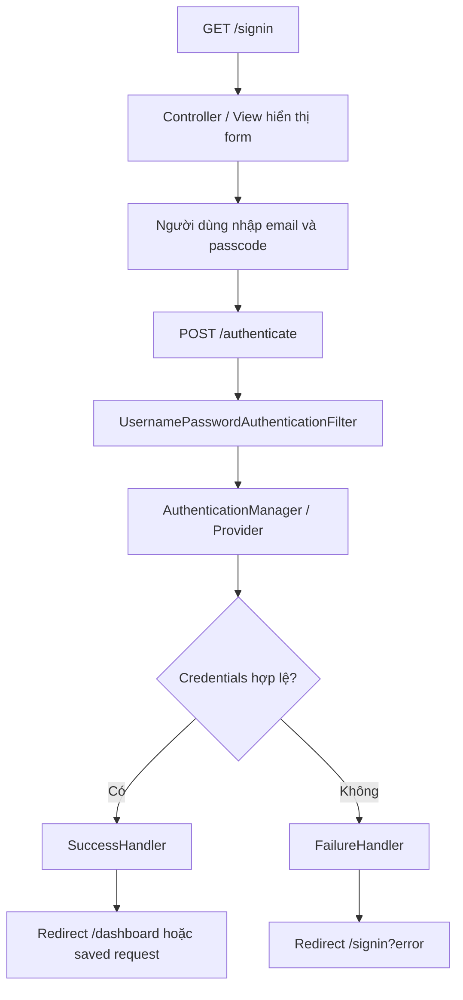

# formLogin và đường dẫn xử lý đăng nhập của ứng dụng

Trong ứng dụng Spring Security dùng form login, trang hiển thị biểu mẫu và endpoint nhận username/password là hai vai trò khác nhau. Người dùng mở trang đăng nhập bằng một request GET; khi gửi biểu mẫu, trình duyệt POST credentials tới URL mà filter đăng nhập đang lắng nghe. Nếu hai URL hoặc tên tham số không khớp cấu hình, request có thể không được xử lý như một lần đăng nhập.

Bài học thuộc chương **Đăng nhập qua HTTP** của module `SPRING_SECURITY_TESTING`, chuyên kiểm chứng xác thực, phân quyền và bảo vệ HTTP thực tế bằng `spring-security-test` trên ứng dụng Servlet và Reactive. Người học sử dụng `MockMvc`, `WebTestClient`, `@WithMockUser`, `SecurityContext`, JWT/OAuth2/OIDC giả lập và các ca kiểm thử được phép hoặc bị từ chối. Bài này tập trung vào `formLogin` trên Servlet: phân biệt login page với login processing URL, cấu hình tham số username/password, success/failure handler, CSRF và kiểm thử luồng đăng nhập bằng `MockMvc`.

## 1. Form login có hai đường dẫn với hai nhiệm vụ

Một cấu hình form login thường có ít nhất hai URL cần hiểu rõ:

| URL | Phương thức thường dùng | Thành phần xử lý | Nhiệm vụ |
| --- | --- | --- | --- |
| Login page, ví dụ `GET /signin` | GET | Controller/view hoặc trang login được Spring Security sinh | Hiển thị biểu mẫu đăng nhập |
| Login processing URL, ví dụ `POST /authenticate` | POST | `UsernamePasswordAuthenticationFilter` | Đọc credentials, gọi authentication manager và xử lý kết quả |

Login page là nơi người dùng nhìn thấy form. Login processing URL là địa chỉ mà form gửi credentials tới. **Login processing URL thường được xử lý bởi filter, không cần một controller `@PostMapping` tương ứng.**

Với cấu hình mặc định `formLogin(Customizer.withDefaults())` của Servlet:

- Trang đăng nhập mặc định thường ở `GET /login`.
- Filter mặc định xử lý `POST /login`.
- Tên tham số mặc định là `username` và `password`.
- Khi chưa cấu hình trang login riêng, Spring Security có thể sinh trang đăng nhập mặc định.

Khi ứng dụng cung cấp trang riêng, ta thường cấu hình `loginPage("/signin")`. Nếu không chỉ định processing URL riêng, Spring Security mặc định dùng URL login page làm URL xử lý đăng nhập; trong trường hợp này filter nhận `POST /signin`. Khi đặt tường minh `loginProcessingUrl("/authenticate")`, form phải gửi POST tới `/authenticate`.



Đường dẫn GET và POST có thể giống nhau theo mặc định, nhưng vai trò của chúng vẫn khác nhau: GET hiển thị form; POST được filter xử lý.

## 2. Cấu hình formLogin với loginPage và loginProcessingUrl

Ví dụ ứng dụng có trang login tại `/signin`, form gửi tới `/authenticate`, trường username được đổi thành `email` và trường password được đổi thành `passcode`.

```java
import org.springframework.context.annotation.Bean;
import org.springframework.context.annotation.Configuration;
import org.springframework.security.config.Customizer;
import org.springframework.security.config.annotation.web.builders.HttpSecurity;
import org.springframework.security.core.userdetails.User;
import org.springframework.security.core.userdetails.UserDetails;
import org.springframework.security.core.userdetails.UserDetailsService;
import org.springframework.security.crypto.factory.PasswordEncoderFactories;
import org.springframework.security.crypto.password.PasswordEncoder;
import org.springframework.security.provisioning.InMemoryUserDetailsManager;
import org.springframework.security.web.SecurityFilterChain;

@Configuration
class FormLoginSecurityConfiguration {

    @Bean
    PasswordEncoder passwordEncoder() {
        return PasswordEncoderFactories.createDelegatingPasswordEncoder();
    }

    @Bean
    UserDetailsService userDetailsService(PasswordEncoder encoder) {
        UserDetails alice = User.withUsername("alice@example.test")
                .password(encoder.encode("alice-password"))
                .roles("USER")
                .build();

        return new InMemoryUserDetailsManager(alice);
    }

    @Bean
    SecurityFilterChain securityFilterChain(HttpSecurity http)
            throws Exception {
        return http
            .authorizeHttpRequests(auth -> auth
                .requestMatchers("/signin", "/assets/**").permitAll()
                .requestMatchers("/dashboard").authenticated()
                .anyRequest().denyAll())
            .formLogin(form -> form
                .loginPage("/signin")
                .loginProcessingUrl("/authenticate")
                .usernameParameter("email")
                .passwordParameter("passcode")
                .defaultSuccessUrl("/dashboard", true)
                .failureUrl("/signin?error")
                .permitAll())
            .build();
    }
}
```

Các cấu hình có ý nghĩa:

- `loginPage("/signin")` cho biết URL trang login tùy chỉnh. Ứng dụng phải cung cấp GET handler/view cho đường dẫn này.
- `loginProcessingUrl("/authenticate")` đổi URL POST mà `UsernamePasswordAuthenticationFilter` xử lý.
- `usernameParameter("email")` và `passwordParameter("passcode")` đổi tên form fields mà filter đọc.
- `defaultSuccessUrl("/dashboard", true)` chuyển người dùng tới dashboard sau khi đăng nhập thành công, kể cả khi trước đó có saved request.
- `failureUrl("/signin?error")` chọn URL chuyển hướng khi authentication thất bại.
- `permitAll()` cho phép truy cập trang đăng nhập và đường xử lý đăng nhập khi người dùng chưa xác thực.

Trong ví dụ, username là email để minh họa quy ước của form. Giá trị này vẫn được chuyển tới `UserDetailsService` như username của tài khoản; nó không tự động kiểm tra định dạng email.

## 3. Cung cấp trang login và form HTML khớp cấu hình

Với login page tùy chỉnh, ứng dụng phải cung cấp GET handler:

```java
import org.springframework.stereotype.Controller;
import org.springframework.web.bind.annotation.GetMapping;

@Controller
class LoginPageController {

    @GetMapping("/signin")
    String signIn() {
        return "signin";
    }
}
```

Ví dụ endpoint sau đăng nhập mà test sẽ truy cập:

```java
import org.springframework.security.core.Authentication;
import org.springframework.web.bind.annotation.GetMapping;
import org.springframework.web.bind.annotation.RestController;

@RestController
class DashboardController {

    @GetMapping("/dashboard")
    String dashboard(Authentication authentication) {
        return "dashboard-for-" + authentication.getName();
    }
}
```

View `signin.html` cần gửi form đúng URL và đúng tên tham số:

```html
<form method="post" action="/authenticate">
    <label for="email">Email</label>
    <input id="email" name="email" type="email" autocomplete="username">

    <label for="passcode">Password</label>
    <input id="passcode" name="passcode" type="password"
           autocomplete="current-password">

    <!-- Thêm hidden CSRF input theo template engine / cấu hình ứng dụng. -->
    <button type="submit">Sign in</button>
</form>
```

Khi dùng Thymeleaf tích hợp Spring Security, form có `th:action` tới endpoint POST sẽ được tích hợp CSRF token theo cơ chế của template integration. Nếu tự viết HTML hoặc dùng template engine khác, phải render token CSRF theo cách phù hợp. Không xóa CSRF chỉ để làm cho test POST login chạy được.

Ba giá trị phải thống nhất:

| Trong Security config | Trong form | Giá trị ví dụ |
| --- | --- | --- |
| `loginPage(...)` | URL người dùng mở | `/signin` |
| `loginProcessingUrl(...)` | `action` của form | `/authenticate` |
| `usernameParameter(...)` | `name` của input username | `email` |
| `passwordParameter(...)` | `name` của input password | `passcode` |

Nếu form vẫn gửi tới `/login` trong khi filter chỉ xử lý `/authenticate`, request sẽ không được coi là login attempt theo cấu hình mới. Tương tự, nếu input vẫn mang tên `username`/`password` nhưng filter đang đọc `email`/`passcode`, filter không nhận được giá trị như mong đợi.

## 4. Login processing URL do filter xử lý, không phải controller

Một nhầm lẫn phổ biến là tạo controller:

```java
@PostMapping("/authenticate")
String authenticate(
        @RequestParam String email,
        @RequestParam String passcode) {
    // Không nên tự xác thực theo cách này nếu ứng dụng
    // đã giao form login cho Spring Security filter.
    return "redirect:/dashboard";
}
```

Khi đã cấu hình `formLogin().loginProcessingUrl("/authenticate")`, filter đăng nhập của Spring Security xử lý POST phù hợp trước khi request tới controller. Thông thường không cần và không nên tạo một `@PostMapping` cùng URL để tự xác thực lần nữa. Việc đó dễ tạo hai cơ chế đăng nhập cạnh tranh và bỏ qua các bảo vệ mà filter chain đang đảm nhiệm.

Controller/view vẫn cần xử lý GET trang login và các trang sau đăng nhập. Filter chịu trách nhiệm nhận credentials, gọi `AuthenticationManager` và chuyển kết quả sang success/failure handler.

Nếu ứng dụng có endpoint đăng nhập JSON tùy chỉnh thay vì HTML form, đó là một cơ chế khác: cần thiết kế authentication filter/controller và lưu context rõ ràng. Không nên nhầm endpoint JSON tùy chỉnh với `loginProcessingUrl` của form login.

## 5. Success URL, saved request và success handler

Sau khi credentials hợp lệ, Spring Security cần quyết định nơi chuyển người dùng tới. Các cách cấu hình thường gặp:

| Cấu hình | Hành vi |
| --- | --- |
| `defaultSuccessUrl("/dashboard")` | Chuyển tới dashboard nếu không có saved request phù hợp; saved request trước đó có thể được ưu tiên |
| `defaultSuccessUrl("/dashboard", true)` | Luôn dùng dashboard làm đích sau login |
| `successHandler(handler)` | Giao quyền quyết định response cho handler tùy chỉnh |

Ví dụ dùng `defaultSuccessUrl("/dashboard", true)` để test có redirect xác định. Nếu bỏ tham số `true`, người dùng có thể được chuyển về URL họ đã yêu cầu trước khi bị chuyển tới trang login. Điều này thường hữu ích trong UX nhưng làm assertion redirect phụ thuộc lịch sử request.

Nếu cần response JSON thay vì redirect, ứng dụng có thể cấu hình success handler tùy chỉnh. Khi đó test nên kiểm tra status, body hoặc header theo hợp đồng API. Không kỳ vọng `302` nếu success handler trả `200` hoặc `204`.

## 6. Failure URL và failure handler

Khi username/password không hợp lệ, authentication filter chuyển lỗi tới failure handler. Với:

```java
.formLogin(form -> form
    .failureUrl("/signin?error"))
```

Spring Security thường redirect về `/signin?error`. Trang login có thể hiển thị thông báo chung như “Email hoặc mật khẩu không đúng”. Không nên tiết lộ ra ngoài rằng email không tồn tại hay password sai, vì điều đó hỗ trợ dò tìm tài khoản.

Có thể dùng `failureHandler(...)` nếu cần response JSON, ghi log kiểm toán hoặc áp dụng chính sách riêng. Khi đã dùng handler tùy chỉnh, test phải xác nhận chính xác response mà handler tạo ra; đừng đồng thời giả định `failureUrl` vẫn quyết định kết quả cuối cùng.

## 7. CSRF bảo vệ POST đăng nhập

Form login gửi credentials bằng POST. Khi CSRF protection được bật, request POST cần token hợp lệ. CSRF filter chạy trước filter đăng nhập; nếu token thiếu hoặc sai, request có thể bị trả `403` trước khi username/password được kiểm tra.

Trong test, dùng `csrf()` để cô lập hành vi authentication:

```java
mockMvc.perform(post("/authenticate")
        .param("email", "alice@example.test")
        .param("passcode", "alice-password")
        .with(csrf()))
    .andExpect(status().is3xxRedirection());
```

Nếu muốn kiểm tra CSRF, tạo test riêng:

```java
mockMvc.perform(post("/authenticate")
        .param("email", "alice@example.test")
        .param("passcode", "alice-password"))
    .andExpect(status().isForbidden());
```

Test thứ hai không chứng minh password đúng hay sai vì CSRF filter chặn request trước bước xác thực. Để kiểm tra credentials sai, phải cung cấp CSRF hợp lệ rồi gửi password sai.

Không tắt CSRF chỉ để test login thuận tiện. Nếu ứng dụng có chính sách CSRF tùy chỉnh, assertions cần bám theo cấu hình đó.

## 8. Chuẩn bị MockMvc và SecurityFilterChain

Thêm dependency `spring-security-test` trong test scope:

```xml
<dependency>
    <groupId>org.springframework.security</groupId>
    <artifactId>spring-security-test</artifactId>
    <scope>test</scope>
</dependency>
```

Trong Spring Boot:

```java
@SpringBootTest
@AutoConfigureMockMvc
class FormLoginTests {

    @Autowired
    MockMvc mockMvc;
}
```

`@AutoConfigureMockMvc` mặc định tích hợp servlet filters từ application context. Nếu tự dựng client bằng `MockMvcBuilders`, cần áp dụng Spring Security:

```java
import static org.springframework.security.test.web.servlet.setup
        .SecurityMockMvcConfigurers.springSecurity;

MockMvc mockMvc = MockMvcBuilders
        .webAppContextSetup(webApplicationContext)
        .apply(springSecurity())
        .build();
```

Không tắt filter bằng `@AutoConfigureMockMvc(addFilters = false)` trong test muốn kiểm tra `UsernamePasswordAuthenticationFilter`, CSRF hoặc authorization. Nếu filter chain không chạy, test có thể chỉ kiểm tra controller/view chứ không kiểm tra login.

## 9. Kiểm tra login page và route xử lý đăng nhập

Với custom login page, test GET page để chắc rằng người dùng anonymous có thể mở:

```java
mockMvc.perform(get("/signin"))
    .andExpect(status().isOk());
```

Login page phải được cho phép truy cập khi chưa đăng nhập. Nếu quên `permitAll()` cho trang login, ứng dụng có thể chuyển hướng lặp về chính trang login hoặc trả lỗi truy cập.

Cần nhớ GET page và POST processing route không giống nhau. Trang login là controller/view; URL xử lý đăng nhập là filter endpoint. Một test chỉ xác nhận GET `/signin` trả 200 không chứng minh filter đã xử lý POST credentials.

## 10. Kiểm tra đăng nhập thành công

Dùng đúng processing URL và tên tham số đã cấu hình:

```java
import static org.junit.jupiter.api.Assertions.assertNotNull;
import static org.springframework.security.test.web.servlet.request
        .SecurityMockMvcRequestPostProcessors.csrf;
import static org.springframework.test.web.servlet.request.MockMvcRequestBuilders.get;
import static org.springframework.test.web.servlet.request.MockMvcRequestBuilders.post;
import static org.springframework.test.web.servlet.result.MockMvcResultMatchers.content;
import static org.springframework.test.web.servlet.result.MockMvcResultMatchers.redirectedUrl;
import static org.springframework.test.web.servlet.result.MockMvcResultMatchers.status;
import static org.springframework.security.test.web.servlet.response
        .SecurityMockMvcResultMatchers.authenticated;

import org.springframework.mock.web.MockHttpSession;
import org.springframework.test.web.servlet.MvcResult;

@Test
void validFormCredentialsAuthenticateAndCreateUsableSession()
        throws Exception {

    MvcResult loginResult = mockMvc.perform(post("/authenticate")
            .param("email", "alice@example.test")
            .param("passcode", "alice-password")
            .with(csrf()))
        .andExpect(status().is3xxRedirection())
        .andExpect(redirectedUrl("/dashboard"))
        .andExpect(authenticated()
                .withUsername("alice@example.test")
                .withRoles("USER"))
        .andReturn();

    MockHttpSession session =
            (MockHttpSession) loginResult.getRequest().getSession(false);

    assertNotNull(session, "Successful form login should create a session");

    mockMvc.perform(get("/dashboard").session(session))
        .andExpect(status().isOk())
        .andExpect(content().string(
                "dashboard-for-alice@example.test"));
}
```

Test này chứng minh:
1. POST tới đúng login processing URL.
2. Form field names khớp với `usernameParameter` và `passwordParameter`.
3. CSRF hợp lệ cho phép request tới authentication filter.
4. Authentication thành công và response đi qua success handler.
5. Session được lấy từ request login và gửi lại ở request sau để khôi phục danh tính.

`MockMvc` không tự duy trì cookie/session như trình duyệt. Muốn kiểm tra request tiếp theo dùng cùng phiên, phải gắn `.session(session)`. Nếu ứng dụng stateless hoặc có session policy khác, điều chỉnh kỳ vọng theo cấu hình thực tế.

## 11. Kiểm tra password sai, username không tồn tại và credentials thiếu

Khi gửi password sai nhưng CSRF hợp lệ, request tới được filter đăng nhập và được chuyển tới failure handler:

```java
@Test
void wrongPasswordRedirectsToFailureUrl() throws Exception {
    mockMvc.perform(post("/authenticate")
            .param("email", "alice@example.test")
            .param("passcode", "wrong-password")
            .with(csrf()))
        .andExpect(status().is3xxRedirection())
        .andExpect(redirectedUrl("/signin?error"));
}
```

Username không tồn tại cũng phải thất bại:

```java
@Test
void unknownEmailUsesSameGenericFailureResponse() throws Exception {
    mockMvc.perform(post("/authenticate")
            .param("email", "unknown@example.test")
            .param("passcode", "any-password")
            .with(csrf()))
        .andExpect(status().is3xxRedirection())
        .andExpect(redirectedUrl("/signin?error"));
}
```

Có thể kiểm tra POST không có trường credentials. Filter thường nhận giá trị rỗng cho tham số bị thiếu và quá trình xác thực thất bại; CSRF vẫn phải hợp lệ để request đến filter:

```java
@Test
void missingCredentialsReachFailureHandler() throws Exception {
    mockMvc.perform(post("/authenticate")
            .with(csrf()))
        .andExpect(status().is3xxRedirection())
        .andExpect(redirectedUrl("/signin?error"));
}
```

Phân biệt với request GET tới trang riêng tư mà không đăng nhập:

```java
@Test
void anonymousRequestToDashboardIsRedirectedToLoginPage()
        throws Exception {
    mockMvc.perform(get("/dashboard"))
        .andExpect(status().is3xxRedirection())
        .andExpect(redirectedUrl("/signin"));
}
```

Ca cuối không phải một lần gửi form credentials thiếu; đó là request tài nguyên riêng tư khi người dùng chưa có authentication. Hai tình huống có thể cùng dẫn tới trang login nhưng đi qua các nhánh xử lý khác nhau.

## 12. Sai processing URL hoặc sai tên tham số

Nếu filter được cấu hình xử lý `POST /authenticate` nhưng form/test gửi `POST /login`, request không khớp login filter. Nó không phải login attempt theo cấu hình hiện tại. Tương tự, nếu filter đọc `email` nhưng test gửi `username`, giá trị username có thể trở thành rỗng và authentication thất bại.

Ví dụ request sai tên tham số:

```java
@Test
void wrongParameterNamesDoNotAuthenticate() throws Exception {
    mockMvc.perform(post("/authenticate")
            .param("username", "alice@example.test")
            .param("password", "alice-password")
            .with(csrf()))
        .andExpect(status().is3xxRedirection())
        .andExpect(redirectedUrl("/signin?error"));
}
```

Test này giúp phát hiện lệch hợp đồng giữa HTML form và Security config. Tuy nhiên, khi URL không khớp filter, kết quả có thể là redirect do authorization/entry point hoặc response khác theo request matcher. Để chẩn đoán, kiểm tra filter có nhận đúng method/path và test có dùng đúng tham số hay không; không chỉ assert status chung.

Checklist khi login thất bại bất ngờ:

- Form có method POST không?
- `action` có khớp `loginProcessingUrl` không?
- Input username có `name` đúng với `usernameParameter` không?
- Input password có `name` đúng với `passwordParameter` không?
- CSRF token có được gửi và hợp lệ không?
- Request có thực sự đi qua `SecurityFilterChain` mong muốn không?
- `UserDetailsService` có tải được tài khoản và `PasswordEncoder` có khớp password không?

## 13. Success/failure handler và response tùy chỉnh

Nếu ứng dụng cần response JSON thay vì redirect, có thể cấu hình success và failure handler riêng. Ví dụ minh họa handler trả text để tập trung vào luồng:

```java
import jakarta.servlet.http.HttpServletResponse;

.formLogin(form -> form
    .loginPage("/signin")
    .loginProcessingUrl("/authenticate")
    .successHandler((request, response, authentication) -> {
        response.setStatus(HttpServletResponse.SC_OK);
        response.setContentType("text/plain");
        response.getWriter().write(authentication.getName());
    })
    .failureHandler((request, response, exception) -> {
        response.sendError(HttpServletResponse.SC_UNAUTHORIZED);
    })
    .permitAll())
```

Trong code production, nếu trả JSON hãy dùng serializer thay vì nối chuỗi thủ công, và không trả thông tin nội bộ của exception. Handler cũng cần được xem xét cùng chính sách session: nếu login stateful, context phải được lưu theo cơ chế Spring Security đã cấu hình. Khi test handler tùy chỉnh, assert status, content type, body và session theo hợp đồng thực tế thay cho redirect URL mặc định.

Khi dùng `successHandler`, cấu hình `defaultSuccessUrl` không còn là cơ chế quyết định response thành công. Khi dùng `failureHandler`, `failureUrl` không còn là cơ chế quyết định response thất bại. Chọn một chiến lược rõ ràng cho mỗi nhánh.

## 14. Phân biệt authentication failure, authorization failure và CSRF failure

Một số mã HTTP có thể giống nhau nhưng nguyên nhân khác nhau:

| Tình huống | Ví dụ | Phản hồi thường gặp | Tầng xử lý |
| --- | --- | --- | --- |
| Login password sai | POST processing URL, CSRF hợp lệ | Redirect tới failure URL hoặc status handler | Authentication filter/provider |
| Login thiếu username/password | POST processing URL, CSRF hợp lệ | Failure URL | Authentication filter/provider |
| CSRF thiếu/sai | POST login không token hợp lệ | `403` | CSRF filter trước login filter |
| Anonymous gọi dashboard | GET tài nguyên cần login | Redirect tới login page | Exception translation / entry point |
| User đăng nhập đúng nhưng thiếu role | GET admin | `403` | Authorization |
| Login thành công | POST processing URL | Redirect hoặc response handler | Success handler |

Đừng kết luận password sai từ một POST trả `403` nếu request không có CSRF token. Đừng kết luận login thành công chỉ vì trang login GET trả `200`. Hãy xác định request đang kiểm tra URL nào, method nào, credentials nào và filter/handler nào tạo response.

## 15. Ranh giới Servlet và Reactive

Các ví dụ `formLogin` và `MockMvc` ở trên thuộc Servlet stack. Với WebFlux, Spring Security có `formLogin` trong `SecurityWebFilterChain` và kiểm thử bằng `WebTestClient`. Cơ chế filter là reactive web filter, không phải `UsernamePasswordAuthenticationFilter` của Servlet.

Ví dụ hình thức cấu hình Reactive:

```java
@Bean
SecurityWebFilterChain webFilterChain(ServerHttpSecurity http) {
    return http
        .authorizeExchange(exchanges -> exchanges
            .pathMatchers("/signin").permitAll()
            .pathMatchers("/dashboard").authenticated()
            .anyExchange().denyAll())
        .formLogin(Customizer.withDefaults())
        .build();
}
```

Đường dẫn, cách render login page và cách test form POST phải bám theo cấu hình WebFlux thực tế. Dùng `WebTestClient` đã tích hợp Spring Security; không dùng `SecurityMockMvcRequestPostProcessors` hoặc giả định Servlet filter đang xử lý request Reactive.

Nếu chỉ muốn kiểm tra controller Reactive sau xác thực, các configurer như `mockUser()` có thể chuẩn bị principal. Nếu muốn kiểm tra username/password thực, phải gửi form credentials qua reactive form login filter và có test credentials sai/thiếu tương tự.

## 16. Bài tập: kiểm tra hợp đồng login page và processing URL

Với cấu hình `/signin`, `/authenticate`, `email` và `passcode` ở trên, hãy viết các ca:

1. GET `/signin` khi anonymous: trang login hiển thị được.
2. POST `/authenticate` với email/password đúng và CSRF hợp lệ: success handler chuyển tới `/dashboard`.
3. Gửi lại cùng `MockHttpSession` tới `/dashboard`: người dùng vẫn được nhận diện.
4. POST `/authenticate` với password sai và CSRF hợp lệ: chuyển tới `/signin?error`.
5. POST với email không tồn tại và CSRF hợp lệ: cùng failure response chung.
6. POST không có trường email/passcode nhưng CSRF hợp lệ: đi tới failure handler.
7. POST đúng credentials nhưng thiếu CSRF: bị từ chối trước bước xác thực.
8. POST tới URL cũ `/login`: chứng minh request không khớp processing URL đã cấu hình.
9. Gửi tên field `username/password` thay cho `email/passcode`: phát hiện form/config mismatch.
10. User đã đăng nhập nhưng không có ADMIN gọi endpoint admin: phân biệt `403` authorization với lỗi login.

Khi hoàn thành, hãy chỉ ra **login page**, **login processing URL**, **HTTP method**, **tên tham số**, **CSRF token**, **authentication result**, **success/failure handler** và **session được gửi lại hay không**. Đây là những thành phần quyết định form login của ứng dụng hoạt động đúng và có thể được kiểm chứng một cách rõ ràng bằng `MockMvc` hoặc `WebTestClient`.

