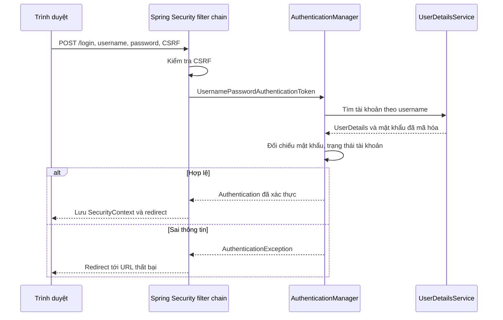

# Tên trường người dùng, mật khẩu và cấu hình form đăng nhập tùy chỉnh

Trong ứng dụng web sử dụng Spring Security, màn hình đăng nhập chỉ là giao diện nhập liệu; việc xác thực diễn ra khi bộ lọc bảo mật nhận yêu cầu HTTP gửi từ form. Một form có thể hiển thị nhãn **Email** và **Mật khẩu**, nhưng Spring Security không dựa vào nhãn hoặc `id` của ô nhập. Nó đọc **tên tham số HTTP** do các thuộc tính `name` quy định. Vì vậy, khi đổi tên trường từ `username` thành `email`, hoặc đổi đường dẫn xử lý đăng nhập, cần cập nhật đồng bộ cả form, cấu hình bảo mật và bài kiểm thử.

Bài này thuộc chủ đề **Đăng nhập qua HTTP** trong module **SPRING_SECURITY_TESTING**: kiểm chứng xác thực, phân quyền và hành vi bảo vệ HTTP bằng `spring-security-test` trên ứng dụng Servlet và Reactive. Trọng tâm là hiểu chính xác yêu cầu đăng nhập thật, cấu hình một form tùy chỉnh, rồi dùng **MockMvc** xác nhận cả đường đi được phép lẫn đường đi bị từ chối. Phần cuối chỉ rõ cách chuyển tư duy kiểm thử sang **WebTestClient** cho WebFlux.

## 1. Form login mặc định hoạt động như thế nào?

Với ứng dụng Spring MVC/Servlet có bật `formLogin` và chưa tùy biến, quy ước phổ biến là:

| Thành phần | Giá trị mặc định | Ý nghĩa |
| --- | --- | --- |
| Trang đăng nhập | `GET /login` | Spring Security có thể tạo trang mặc định nếu chưa chỉ định trang riêng. |
| Yêu cầu xác thực | `POST /login` | `UsernamePasswordAuthenticationFilter` nhận và xử lý yêu cầu. |
| Tham số định danh | `username` | Giá trị được dùng làm tên đăng nhập khi gọi cơ chế xác thực. |
| Tham số bí mật | `password` | Giá trị mật khẩu đầu vào. |
| Kiểu dữ liệu form | `application/x-www-form-urlencoded` | Trình duyệt gửi các cặp tên/giá trị từ form. |
| CSRF | Bật theo mặc định | Yêu cầu `POST` thường phải mang CSRF token hợp lệ. |
| Đăng nhập thành công | Chuyển hướng HTTP | Tùy yêu cầu đã lưu và cấu hình success handler. |
| Đăng nhập thất bại | Chuyển hướng HTTP | Thường về trang đăng nhập có tham số báo lỗi. |

Ví dụ payload theo quy ước mặc định:

```http
POST /login HTTP/1.1
Content-Type: application/x-www-form-urlencoded

username=alice&password=secret&<csrf-parameter>=<csrf-token>
```

Hai phần `<csrf-parameter>` và `<csrf-token>` ở đây là ký hiệu minh họa; trong HTML thực tế phải lấy đúng tên và giá trị token mà ứng dụng tạo ra. Không được gửi nguyên chuỗi ký hiệu đó.

Luồng đơn giản hóa trên **Servlet stack**:



Điểm cần tách bạch:

- **`loginPage`** là địa chỉ `GET` để người dùng *xem form*.
- **`loginProcessingUrl`** là địa chỉ `POST` để bộ lọc *nhận thông tin xác thực*. Địa chỉ này thường không cần phương thức controller `@PostMapping`.
- **`usernameParameter` / `passwordParameter`** là tên field trong request body, không phải tên thuộc tính Java hoặc tên hiển thị trên màn hình.
- **`UserDetailsService.loadUserByUsername`** nhận chuỗi định danh đã trích xuất. Nếu field tên `email`, ứng dụng vẫn cần một dịch vụ tra cứu tài khoản phù hợp với email; đổi tên field không tự biến cơ chế tra cứu username thành tra cứu email.

## 2. Thiết kế một form tùy chỉnh rõ ràng

Giả sử sản phẩm muốn người dùng mở `GET /signin`, nhập email và passcode, rồi gửi `POST /auth/session`. Bảng đối chiếu cấu hình là:

| Mục đích | Giá trị sử dụng |
| --- | --- |
| URL hiển thị trang | `/signin` |
| URL nhận POST đăng nhập | `/auth/session` |
| Tên tham số định danh | `email` |
| Tên tham số mật khẩu | `passcode` |
| Điều hướng sau thành công | `/account` |
| Điều hướng sau thất bại | `/signin?error` |

Trong Spring Security Servlet, có thể cấu hình bằng Java DSL hiện đại (phong cách lambda của Spring Security 6+):

```java
import org.springframework.context.annotation.Bean;
import org.springframework.context.annotation.Configuration;
import org.springframework.security.config.annotation.web.builders.HttpSecurity;
import org.springframework.security.core.userdetails.User;
import org.springframework.security.core.userdetails.UserDetails;
import org.springframework.security.core.userdetails.UserDetailsService;
import org.springframework.security.crypto.bcrypt.BCryptPasswordEncoder;
import org.springframework.security.crypto.password.PasswordEncoder;
import org.springframework.security.provisioning.InMemoryUserDetailsManager;
import org.springframework.security.web.SecurityFilterChain;

@Configuration
public class HttpLoginSecurityConfig {

    @Bean
    SecurityFilterChain securityFilterChain(HttpSecurity http) throws Exception {
        return http
            .authorizeHttpRequests(auth -> auth
                .requestMatchers("/signin", "/css/**", "/favicon.ico").permitAll()
                .anyRequest().authenticated()
            )
            .formLogin(form -> form
                .loginPage("/signin")
                .loginProcessingUrl("/auth/session")
                .usernameParameter("email")
                .passwordParameter("passcode")
                .defaultSuccessUrl("/account", true)
                .failureUrl("/signin?error")
                .permitAll()
            )
            .logout(logout -> logout
                .logoutUrl("/logout")
                .logoutSuccessUrl("/signin?logout")
            )
            .build();
    }

    @Bean
    UserDetailsService users(PasswordEncoder passwordEncoder) {
        UserDetails alice = User.withUsername("alice@example.test")
            .password(passwordEncoder.encode("Correct-Horse-42"))
            .roles("USER")
            .build();
        return new InMemoryUserDetailsManager(alice);
    }

    @Bean
    PasswordEncoder passwordEncoder() {
        return new BCryptPasswordEncoder();
    }
}
```

Tài khoản và mật khẩu ở đây chỉ là **fixture dùng để học và kiểm thử**; hệ thống thực tế dùng kho người dùng và cách cấp thông tin đăng nhập phù hợp, không nhúng mật khẩu thật trong mã nguồn. Mật khẩu lưu trữ phải được băm bằng encoder thích hợp.

Từng lựa chọn có tác dụng khác nhau:

1. `loginPage("/signin")` yêu cầu ứng dụng **tự cung cấp trang**. Spring Security không còn tự hiển thị trang đăng nhập mặc định thay cho trang này.
2. `loginProcessingUrl("/auth/session")` khai báo rõ đường dẫn POST mà filter sẽ xử lý; khai báo tường minh giúp form và kiểm thử không phụ thuộc suy luận về URL mặc định.
3. `usernameParameter("email")` và `passwordParameter("passcode")` đổi hai khóa HTTP mà filter cần tìm. Giá trị `alice@example.test` vẫn đi vào quy trình xác thực như định danh người dùng.
4. `defaultSuccessUrl("/account", true)` luôn chuyển về `/account` sau khi đăng nhập thành công. Nếu chọn `false`, yêu cầu được lưu trước lúc đăng nhập có thể được ưu tiên; cần sửa kỳ vọng redirect tương ứng khi kiểm thử.
5. `failureUrl("/signin?error")` chuyển hướng sau khi thông tin đăng nhập không hợp lệ. Sai mật khẩu thường dẫn tới redirect trong luồng form login, **không mặc định là HTTP 401**.
6. `permitAll()` cho phép truy cập tài nguyên phục vụ đăng nhập, còn `anyRequest().authenticated()` giữ các endpoint khác ở trạng thái cần xác thực.

Để cung cấp trang và một endpoint được bảo vệ, có thể dùng controller Spring MVC sau:

```java
import java.security.Principal;
import org.springframework.stereotype.Controller;
import org.springframework.web.bind.annotation.GetMapping;
import org.springframework.web.bind.annotation.ResponseBody;

@Controller
public class SignInController {

    @GetMapping("/signin")
    String signInPage() {
        return "signin"; // templates/signin.html
    }

    @GetMapping("/account")
    @ResponseBody
    String account(Principal principal) {
        return "Signed in as " + principal.getName();
    }
}
```

Với Spring MVC và Thymeleaf, đặt mẫu HTML tại `src/main/resources/templates/signin.html` (và bảo đảm dự án có dependency Thymeleaf):

```html
<!DOCTYPE html>
<html lang="vi" xmlns:th="http://www.thymeleaf.org">
<head>
    <meta charset="UTF-8">
    <title>Đăng nhập</title>
</head>
<body>
    <p th:if="${param.error}">Thông tin đăng nhập không hợp lệ.</p>
    <p th:if="${param.logout}">Bạn đã đăng xuất.</p>

    <form th:action="@{/auth/session}" method="post">
        <label for="email">Email</label>
        <input id="email" type="email" name="email"
               autocomplete="username" required>

        <label for="passcode">Mật khẩu</label>
        <input id="passcode" type="password" name="passcode"
               autocomplete="current-password" required>

        <input type="hidden" th:name="${_csrf.parameterName}"
               th:value="${_csrf.token}">
        <button type="submit">Đăng nhập</button>
    </form>
</body>
</html>
```

Form Thymeleaf tích hợp Spring Security có thể tự thêm CSRF field cho form POST; ở đây viết tường minh để thấy rõ tên và giá trị được chuyển xuống HTTP. Dù giao diện đặt `id="email"`, filter chỉ quan tâm `name="email"`. Một lỗi thường gặp là thay label và `id` mà quên đổi `name`: request vẫn chứa `username=...`, trong khi cấu hình chờ `email=...`, khiến đăng nhập thất bại.

Đường dẫn xử lý đăng nhập đi qua filter, nên không tạo controller `@PostMapping("/auth/session")` để tự kiểm tra mật khẩu. Nếu cần xác thực JSON, JWT hoặc OAuth2/OIDC thì phải chọn quy trình bảo mật phù hợp; form login ở đây dành cho HTTP form và session đăng nhập.

## 3. Dữ liệu HTTP và CSRF trong form login

Một request đúng với ví dụ đã cấu hình có dạng:

```http
POST /auth/session HTTP/1.1
Content-Type: application/x-www-form-urlencoded

email=alice%40example.test&passcode=Correct-Horse-42&_csrf=<token-hợp-lệ>
```

Trên hệ thống thật, tham số CSRF có thể mang tên được cấu hình riêng; `_csrf` chỉ là tên thường gặp. Spring Security kiểm tra token **trước** khi xử lý thông tin xác thực. Vì vậy:

- Email/mật khẩu đúng nhưng không có CSRF token khi CSRF bật → thường nhận **403 Forbidden**, chưa đi tới bước xác thực.
- Có CSRF token hợp lệ nhưng sai mật khẩu → filter xử lý rồi **redirect** về URL lỗi, thường là **302 Found**.
- Có CSRF token hợp lệ và thông tin đúng → xác thực thành công, lưu trạng thái xác thực theo cơ chế session/security context rồi **redirect** đến đích.
- Request `POST` tới sai URL hoặc dùng sai `name` không tạo ra cùng hành vi với request hợp lệ. Kết quả cụ thể phụ thuộc các route/controller/filter khác của ứng dụng.

Không nên tắt CSRF chỉ để làm bài kiểm thử chạy qua. Trong `spring-security-test`, hãy dùng `csrf()` khi gửi POST hợp lệ, đồng thời giữ riêng ca kiểm thử **thiếu CSRF phải bị từ chối**.

## 4. Kiểm thử toàn bộ luồng bằng MockMvc

Để kiểm tra bộ lọc bảo mật Servlet, dùng `spring-security-test` và `MockMvc` với Spring Security filter chain được áp dụng. Ví dụ dưới đây sử dụng Spring Boot Test, JUnit 5 và cấu hình/controller ở trên. Nếu dự án tạo `MockMvc` thủ công, cần kết nối Spring Security bằng `springSecurity()`; nếu không, kết quả sẽ không phản ánh filter thật.

Các dependency kiểm thử thường gồm `spring-boot-starter-test` và `spring-security-test`. Đặt kiểm thử trong `src/test/java`:

```java
import org.junit.jupiter.api.Test;
import org.springframework.beans.factory.annotation.Autowired;
import org.springframework.boot.test.autoconfigure.web.servlet.AutoConfigureMockMvc;
import org.springframework.boot.test.context.SpringBootTest;
import org.springframework.mock.web.MockHttpSession;
import org.springframework.test.web.servlet.MockMvc;
import org.springframework.test.web.servlet.MvcResult;

import static org.springframework.security.test.web.servlet.request.SecurityMockMvcRequestPostProcessors.csrf;
import static org.springframework.security.test.web.servlet.response.SecurityMockMvcResultMatchers.authenticated;
import static org.springframework.security.test.web.servlet.response.SecurityMockMvcResultMatchers.unauthenticated;
import static org.springframework.test.web.servlet.request.MockMvcRequestBuilders.get;
import static org.springframework.test.web.servlet.request.MockMvcRequestBuilders.post;
import static org.springframework.test.web.servlet.result.MockMvcResultMatchers.content;
import static org.springframework.test.web.servlet.result.MockMvcResultMatchers.redirectedUrl;
import static org.springframework.test.web.servlet.result.MockMvcResultMatchers.redirectedUrlPattern;
import static org.springframework.test.web.servlet.result.MockMvcResultMatchers.status;

@SpringBootTest
@AutoConfigureMockMvc
class CustomFormLoginTest {

    @Autowired
    MockMvc mvc;

    @Test
    void anonymousUserCanSeeCustomLoginPage() throws Exception {
        mvc.perform(get("/signin"))
            .andExpect(status().isOk());
    }

    @Test
    void anonymousUserIsRedirectedToCustomLoginPage() throws Exception {
        mvc.perform(get("/account"))
            .andExpect(status().is3xxRedirection())
            .andExpect(redirectedUrlPattern("**/signin"));
    }

    @Test
    void validCustomFieldsAuthenticateAndPersistSession() throws Exception {
        MvcResult login = mvc.perform(post("/auth/session")
                .param("email", "alice@example.test")
                .param("passcode", "Correct-Horse-42")
                .with(csrf()))
            .andExpect(status().is3xxRedirection())
            .andExpect(redirectedUrl("/account"))
            .andExpect(authenticated().withUsername("alice@example.test"))
            .andReturn();

        MockHttpSession session =
            (MockHttpSession) login.getRequest().getSession(false);

        mvc.perform(get("/account").session(session))
            .andExpect(status().isOk())
            .andExpect(content().string("Signed in as alice@example.test"));
    }

    @Test
    void wrongPasswordIsRejectedByAuthentication() throws Exception {
        mvc.perform(post("/auth/session")
                .param("email", "alice@example.test")
                .param("passcode", "incorrect")
                .with(csrf()))
            .andExpect(status().is3xxRedirection())
            .andExpect(redirectedUrl("/signin?error"))
            .andExpect(unauthenticated());
    }

    @Test
    void legacyFieldNamesDoNotMatchCustomParameters() throws Exception {
        mvc.perform(post("/auth/session")
                .param("username", "alice@example.test")
                .param("password", "Correct-Horse-42")
                .with(csrf()))
            .andExpect(status().is3xxRedirection())
            .andExpect(redirectedUrl("/signin?error"))
            .andExpect(unauthenticated());
    }

    @Test
    void loginWithoutCsrfIsRejectedBeforeAuthentication() throws Exception {
        mvc.perform(post("/auth/session")
                .param("email", "alice@example.test")
                .param("passcode", "Correct-Horse-42"))
            .andExpect(status().isForbidden())
            .andExpect(unauthenticated());
    }
}
```

### Vì sao mỗi phép kiểm tra cần thiết?

| Ca kiểm thử | Bằng chứng cung cấp | Kỳ vọng |
| --- | --- | --- |
| `GET /signin` ẩn danh | Trang tùy chỉnh thực sự được public và được render | `200` |
| `GET /account` ẩn danh | Endpoint được bảo vệ bằng filter chain | Redirect đến trang login |
| `POST /auth/session` đúng `email/passcode` và CSRF | Filter đọc đúng khóa, xác thực hợp lệ | Redirect `/account`, principal đúng |
| Truy cập `/account` với session từ POST thành công | Trạng thái đăng nhập có thể sử dụng ở request kế tiếp | `200`, principal đúng |
| Sai mật khẩu nhưng CSRF hợp lệ | Bác bỏ credential, dùng nhánh thất bại | Redirect `/signin?error` |
| Gửi `username/password` cũ | Cấu hình tên tham số mới thực sự được áp dụng | Đăng nhập thất bại |
| Thiếu CSRF | Chính sách bảo vệ POST hoạt động | `403` |

Đừng chỉ assert `302` ở ca thành công: **cả đăng nhập thành công lẫn thất bại đều có thể redirect**. Cần kiểm tra đúng địa chỉ redirect, `authenticated()`/ `unauthenticated()`, và khi kiểm thử toàn luồng thì sử dụng session nhận được để gọi endpoint cần xác thực. Chuyển hướng đơn lẻ không chứng minh đã đăng nhập.

`@WithMockUser`, `user("alice")` và `mockUser()` hữu ích khi kiểm thử **phân quyền** của người dùng đã có sẵn `SecurityContext`. Tuy nhiên, các công cụ đó tạo sẵn danh tính kiểm thử và **không chứng minh** filter đã đọc `email/passcode`, đối chiếu mật khẩu hay xử lý form login. Với mục tiêu kiểm chứng đăng nhập HTTP thật, cần gửi `POST` qua filter như các ví dụ trên.

Ngoài `post(...).param(...).with(csrf())`, `spring-security-test` có request builder `formLogin()` hỗ trợ mô phỏng form login. Khi tên tham số hoặc processing URL được tùy chỉnh, phải truyền chúng đúng cấu hình, thay vì dùng mặc định `/login`, `username` và `password`.

## 5. Các lỗi thường gặp khi tùy chỉnh form

| Triệu chứng | Nguyên nhân cần kiểm tra | Hướng khắc phục |
| --- | --- | --- |
| Nhập đúng nhưng luôn quay về `?error` | HTML gửi `name="username"` trong khi filter đợi `email`; mật khẩu dùng sai tên; kho người dùng không tìm thấy định danh | So khớp chính xác `name` với `usernameParameter/passwordParameter` và kiểm tra cách tìm user |
| `POST` không đi vào quy trình login | `action` khác `loginProcessingUrl`, method không phải POST, hoặc request không đi qua security chain mong muốn | Kiểm tra `action`, method, matcher và thứ tự SecurityFilterChain |
| `GET /signin` bị 404 | Đã khai báo `loginPage` nhưng chưa tạo controller hoặc template | Tạo GET handler và view tương ứng |
| Bị redirect lặp giữa trang login và login | Trang login không cho anonymous truy cập hoặc controller lại yêu cầu xác thực | Cho phép `/signin` cùng tài nguyên giao diện cần thiết |
| `POST` trả 403 dù credential đúng | Thiếu hoặc sai CSRF token | Dùng token thật từ form; trong MockMvc dùng `.with(csrf())` |
| Mong 401 nhưng nhận 302 ở ca sai mật khẩu | Form login theo cơ chế chuyển hướng của trình duyệt | Assert failure redirect khi kiểm thử form; chỉ mong 401 nếu có handler/API policy riêng |
| Test với `@WithMockUser` qua nhưng người dùng thật không đăng nhập được | Test đã bỏ qua form authentication | Viết thêm POST form login và kiểm tra session thực |
| Tên field là `email` nhưng tài khoản không được tìm ra | Tên parameter và chiến lược tải người dùng là hai vấn đề khác nhau | Cấu hình `UserDetailsService` tìm đúng định danh |

Khi gỡ lỗi, có thể bật log dành cho Spring Security trong môi trường phát triển để quan sát filter và matcher, nhưng **không ghi giá trị mật khẩu, token nhạy cảm hoặc session ID vào log**. Không hiển thị thông báo phân biệt quá chi tiết giữa “tài khoản không tồn tại” và “mật khẩu sai” nếu điều đó làm lộ thông tin người dùng.

## 6. Liên hệ với Reactive WebFlux và WebTestClient

Ứng dụng Spring WebFlux dùng **`SecurityWebFilterChain`**, `ServerHttpSecurity` và các web filter bất đồng bộ thay cho `SecurityFilterChain`, `HttpSecurity` và `UsernamePasswordAuthenticationFilter` của Servlet. Do đó, không bê nguyên lớp cấu hình MockMvc vào WebFlux. Tuy nhiên, nguyên tắc xác nhận yêu cầu HTTP là giống nhau:

1. Xác định chính xác trang đăng nhập, **processing URL** và tên tham số được cấu hình trên Reactive stack.
2. Gửi `POST` dưới dạng form URL-encoded, kèm CSRF token hợp lệ nếu CSRF đang bật.
3. Kiểm tra nhánh thành công, nhánh thất bại và trường hợp thiếu CSRF.
4. Kiểm tra quyền truy cập endpoint bảo vệ với trạng thái đăng nhập đã hình thành, thay vì suy ra thành công từ redirect đơn lẻ.

Ví dụ tối thiểu với **form login mặc định của WebFlux** (`POST /login` có `username`/`password`) và `WebTestClient` được bind tới application context có Spring Security:

```java
import org.springframework.http.MediaType;
import org.springframework.test.web.reactive.server.WebTestClient;
import org.springframework.web.reactive.function.BodyInserters;

import static org.springframework.security.test.web.reactive.server.SecurityMockServerConfigurers.csrf;

// webTestClient đã được cấu hình kết nối vào ứng dụng WebFlux.
webTestClient.mutateWith(csrf())
    .post()
    .uri("/login")
    .contentType(MediaType.APPLICATION_FORM_URLENCODED)
    .body(BodyInserters.fromFormData("username", "alice@example.test")
        .with("password", "Correct-Horse-42"))
    .exchange()
    .expectStatus().is3xxRedirection();
```

Với form tùy chỉnh trong WebFlux, cấu hình xác thực cần sử dụng converter phù hợp để đọc đúng các tham số mới (chẳng hạn `ServerFormLoginAuthenticationConverter` hỗ trợ đổi tham số người dùng/mật khẩu), rồi điều chỉnh `uri` và `fromFormData` cho khớp. Ví dụ trên cố ý dùng **mặc định Reactive** để không giả định `/auth/session` của ví dụ Servlet cũng đã được cấu hình ở WebFlux.

`mockUser()` của Reactive test cũng tạo sẵn danh tính giống `@WithMockUser` bên Servlet: thích hợp để thử quyền truy cập, không thay thế được bài kiểm tra POST form thật. Nếu `WebTestClient` gửi đến máy chủ đang chạy qua mạng thay vì được bind vào application context, cần lấy CSRF token/cookie theo luồng HTTP thực tế; không giả định `mutateWith(csrf())` có thể tự chèn token vào một phiên trình duyệt từ xa.

## 7. Bài thực hành tự kiểm chứng

Giữ nguyên form ở `/signin`, nhưng đổi `passwordParameter("passcode")` thành `passwordParameter("loginSecret")`. Hãy cập nhật HTML và ca MockMvc thành công để `POST /auth/session` gửi `email` cùng `loginSecret`. Sau đó cố tình gửi lại trường `passcode` cũ: kết quả mong muốn là chuyển về `/signin?error` và không có người dùng được xác thực. Cuối cùng, bỏ `.with(csrf())` khỏi request có dữ liệu đúng: kỳ vọng `403`, giúp phân biệt rõ **lỗi CSRF** với **lỗi credential**.

Một bài mở rộng là thay `.defaultSuccessUrl("/account", true)` bằng `.defaultSuccessUrl("/account", false)`, thử truy cập trước một URL được bảo vệ, rồi đăng nhập và quan sát request đã lưu ảnh hưởng đến redirect thành công như thế nào.

**Tiêu chí hoàn thành:** giải thích được sự khác nhau giữa `loginPage` và `loginProcessingUrl`; ánh xạ chính xác hai HTTP parameter từ form sang filter; chứng minh thành công và thất bại bằng kiểm thử qua security chain; phát hiện lỗi tên tham số, mật khẩu sai và CSRF thiếu qua các kết quả HTTP tương ứng. Những kỹ năng này là nền tảng để kiểm thử đăng nhập Servlet và áp dụng nguyên tắc tương tự cho WebFlux.
