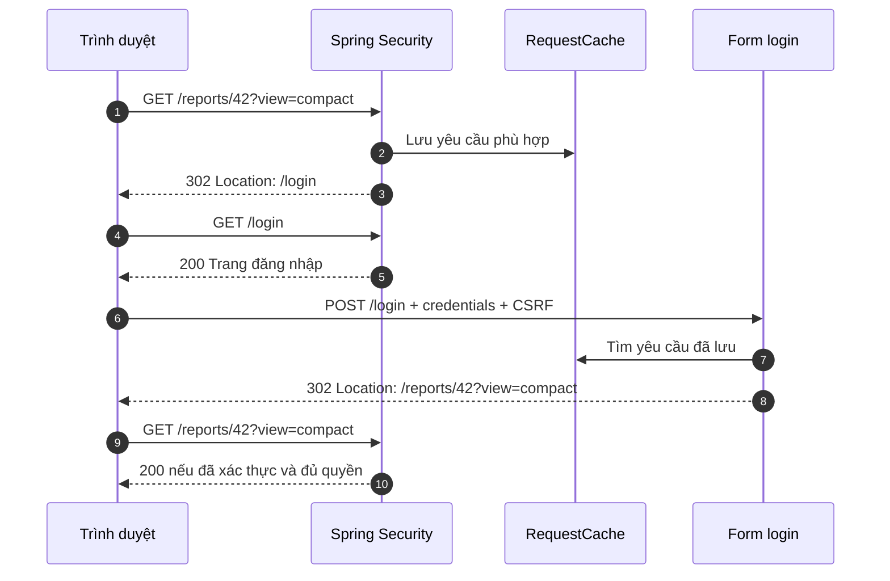

# Request cache và quay lại tài nguyên ban đầu theo cấu hình

## 1. Bài toán: đăng nhập xong phải đến đúng nơi người dùng muốn mở

Giả sử người dùng chưa đăng nhập và truy cập trực tiếp trang `GET /reports/42?view=compact`. Ứng dụng yêu cầu xác thực trước khi cho xem báo cáo. Nếu sau khi đăng nhập thành công người dùng luôn bị đưa về `/dashboard`, họ phải tìm lại đường dẫn ban đầu. **Request cache** giải quyết tình huống này bằng cách lưu yêu cầu truy cập trước khi chuyển sang trang đăng nhập, rồi dùng thông tin đã lưu để điều hướng về tài nguyên đó.

Trong module **SPRING_SECURITY_TESTING**, mục tiêu không dừng ở việc cấu hình chuyển hướng. Ta cần **kiểm chứng hành vi HTTP thực tế**: mã trạng thái, header `Location`, session/cookie, `SecurityContext`, quyền của người dùng và sự khác nhau giữa Servlet với Reactive. Công cụ chính là `spring-security-test` kết hợp `MockMvc`, `WebTestClient` và các bộ tạo xác thực giả lập.

Sau bài học, bạn có thể:

- Giải thích vì sao yêu cầu ban đầu được lưu, được lấy lại và bị bỏ qua theo từng cấu hình.
- Cấu hình lưu các điều hướng HTML phù hợp, tránh lưu yêu cầu API và thao tác thay đổi dữ liệu.
- Viết phép thử cho chuỗi **chưa xác thực → trang đăng nhập → đăng nhập thành công → tài nguyên ban đầu**.
- Phân biệt tình huống **302 chuyển hướng đăng nhập**, **401 chưa xác thực** và **403 không đủ quyền**.
- Dùng `@WithMockUser`, `SecurityContext`, `jwt()`, `oauth2Login()` và `oidcLogin()` đúng mục đích, không nhầm xác thực giả lập với quy trình đăng nhập thật.

### 1.1. Luồng HTTP điển hình



Trong thực tế, `Location` có thể là URL tuyệt đối và có thể chứa tham số phụ phục vụ cơ chế khôi phục của phiên bản Spring Security đang dùng. Phép thử nên kiểm tra **đường dẫn, query cần giữ và hành vi cuối cùng**, thay vì cố định mọi chi tiết hình thức của URL chuyển hướng.

Lưu ý: chuyển hướng sau đăng nhập là **một yêu cầu HTTP mới** từ trình duyệt. Request cache không có nghĩa là Spring Security tự chạy lại một yêu cầu POST bất kỳ hoặc tự khôi phục đầy đủ request body.

## 2. Các thành phần và ranh giới trách nhiệm

| Thành phần | Servlet | Reactive/WebFlux | Vai trò |
|---|---|---|---|
| Nơi giữ yêu cầu | `RequestCache`, thường là `HttpSessionRequestCache` | `ServerRequestCache`, thường là `WebSessionServerRequestCache` | Lưu và tìm yêu cầu truy cập trước khi xác thực |
| Trạng thái phiên | `HttpSession` | `WebSession` | Gắn yêu cầu đã lưu với cùng một phiên trình duyệt |
| Chặn truy cập | `ExceptionTranslationFilter` cùng `AuthenticationEntryPoint` / `AccessDeniedHandler` | Các thành phần xử lý authentication/authorization và entry point trong WebFlux Security | Quyết định chuyển hướng đăng nhập hay trả lỗi |
| Sau đăng nhập | Thường là `SavedRequestAwareAuthenticationSuccessHandler` | Success handler chuyển hướng có thể dùng `ServerRequestCache` | Chọn địa chỉ đã lưu hoặc địa chỉ mặc định |
| Khôi phục khi nhận yêu cầu tiếp theo | `RequestCacheAwareFilter` phối hợp `RequestCache` | Cơ chế request cache trong chuỗi `SecurityWebFilterChain` | Khớp và tiêu thụ yêu cầu đã lưu theo implementation |
| Công cụ kiểm thử | `MockMvc` + `spring-security-test` | `WebTestClient` + `spring-security-test` | Mô phỏng và quan sát các trao đổi HTTP |

Phân biệt hai kết quả dễ nhầm:

- **Chưa đăng nhập** và truy cập một trang HTML cần đăng nhập: entry point của **form login** thường phản hồi **302 đến `/login`** và có thể lưu yêu cầu.
- **Đã đăng nhập nhưng thiếu quyền**: thường nhận **403 Forbidden**; yêu cầu không trở thành một lần đăng nhập mới và không cần được cache.
- Với **REST API** dùng bearer token hoặc HTTP authentication, client thường cần **401 Unauthorized** khi thiếu xác thực, **403 Forbidden** khi đã xác thực nhưng thiếu quyền; chuyển hướng đến HTML login thường không phù hợp.

Thứ tự được ưu tiên sau khi đăng nhập thành công phụ thuộc vào success handler. Với hành vi `SavedRequestAwareAuthenticationSuccessHandler` thông thường: yêu cầu đã lưu được ưu tiên; nếu không có yêu cầu phù hợp thì chuyển đến URL mặc định. Một `AuthenticationSuccessHandler` tự viết hoặc cấu hình “luôn dùng URL mặc định” có thể thay đổi quy tắc này.

## 3. Cấu hình Servlet: chỉ nhớ điều hướng HTML được phép

Ví dụ sau dùng `SecurityFilterChain`, form login mặc định và `HttpSessionRequestCache`. Ta chỉ lưu **GET đến các trang báo cáo có header `Accept` chứa `text/html`**. Đây là chủ ý của ứng dụng: các API, POST và yêu cầu không phải điều hướng HTML không được đưa vào bộ nhớ chuyển hướng.

```java
@Configuration
@EnableWebSecurity
public class ServletSecurityConfig {

    @Bean
    SecurityFilterChain webSecurity(HttpSecurity http) throws Exception {
        HttpSessionRequestCache requestCache = new HttpSessionRequestCache();

        requestCache.setRequestMatcher(request ->
            "GET".equalsIgnoreCase(request.getMethod())
                && request.getRequestURI().startsWith("/reports/")
                && request.getHeader("Accept") != null
                && request.getHeader("Accept").contains("text/html")
        );

        return http
            .authorizeHttpRequests(auth -> auth
                .requestMatchers("/login", "/css/**").permitAll()
                .requestMatchers("/reports/**").hasRole("REPORT_VIEWER")
                .anyRequest().authenticated()
            )
            .formLogin(form -> form
                // false: dùng đường dẫn đã cache nếu có; /dashboard là dự phòng.
                .defaultSuccessUrl("/dashboard", false)
            )
            .requestCache(cache -> cache.requestCache(requestCache))
            .build();
    }

    // Tài khoản chỉ để minh họa/test, không dùng mật khẩu {noop} trong production.
    @Bean
    UserDetailsService users() {
        return new InMemoryUserDetailsManager(
            User.withUsername("alice")
                .password("{noop}secret")
                .roles("REPORT_VIEWER")
                .build(),
            User.withUsername("bob")
                .password("{noop}secret")
                .roles("USER")
                .build()
        );
    }
}
```

Những kiểu cần import ở ví dụ trên thuộc `org.springframework.security.config.annotation.web.builders.HttpSecurity`, `org.springframework.security.config.annotation.web.configuration.EnableWebSecurity`, `org.springframework.security.web.SecurityFilterChain`, `org.springframework.security.web.savedrequest.HttpSessionRequestCache`, `org.springframework.security.core.userdetails.*` và `org.springframework.context.annotation.*`.

Ví dụ giả định ứng dụng có endpoint `GET /reports/{id}` trả về nội dung nếu có quyền `ROLE_REPORT_VIEWER`. Cấu hình `formLogin()` mặc định cung cấp giao diện đăng nhập và xử lý POST `/login`; **không cần tự tạo controller cho form đăng nhập** trong tình huống này. Nếu dùng `loginPage("/login")` để tạo trang riêng, ứng dụng phải thực sự cung cấp trang đó.

### 3.1. Tại sao cần điều kiện lưu request?

`HttpSessionRequestCache` gắn yêu cầu đã lưu với `HttpSession`. Việc chỉ cache GET điều hướng HTML có ba lợi ích: giảm dữ liệu lưu trong session, tránh cố quay lại các lệnh thay đổi trạng thái, và tách hành vi browser login khỏi API. Matcher trong ví dụ là bản đơn giản để dễ học; sản phẩm thực tế nên xét thêm context path, cách phân tích `Accept` theo chuẩn HTTP và danh sách đường dẫn đủ điều kiện.

Ví dụ với cấu hình trên:

| Request ban đầu của người chưa đăng nhập | Được cache? | Kết quả mong muốn |
|---|---|---|
| `GET /reports/42`, `Accept: text/html` | Có | 302 đến login; đăng nhập thành công quay lại `/reports/42` |
| `GET /reports/42?view=compact`, `Accept: text/html` | Có | Đường dẫn và query của lần điều hướng ban đầu được bảo toàn |
| `GET /reports/42`, `Accept: application/json` | Không | Không ghi saved request; entry point HTTP vẫn do cấu hình security quyết định |
| `POST /reports/42` | Không | Không replay POST sau khi xác thực |
| `GET /admin` | Không theo matcher này | Sau đăng nhập dùng đích dự phòng nếu không có request khác đã lưu |

Điểm quan trọng: **không cache** không đồng nghĩa với **trả 401**. Hai quyết định độc lập: *request cache có lưu không* và *authentication entry point phản hồi như thế nào*. Một API dùng cùng filter chain form login vẫn có thể nhận 302 nếu chưa cấu hình entry point dành riêng cho API.

### 3.2. Khi nào URL mặc định thắng?

```java
// Nếu không có request được lưu: về /dashboard.
.formLogin(form -> form.defaultSuccessUrl("/dashboard", false))

// Nếu luôn muốn về /dashboard: bỏ ưu tiên saved request.
.formLogin(form -> form.defaultSuccessUrl("/dashboard", true))

// Nếu chủ ý không lưu bất cứ yêu cầu nào trong Servlet:
.requestCache(cache -> cache.requestCache(new NullRequestCache()))
```

Các dòng trên là **những lựa chọn cấu hình thay thế nhau**, không ghép ba lần `formLogin`/`requestCache` vào cùng ví dụ. `NullRequestCache` nằm trong `org.springframework.security.web.savedrequest`.

Nếu đã đặt success handler tùy biến, hãy kiểm tra chính handler đó có dùng `RequestCache` không. Chỉ cấu hình cache sẽ không bảo đảm điều hướng về địa chỉ ban đầu khi handler tự quyết định URL đích.

## 4. Kiểm thử end-to-end của luồng Servlet bằng MockMvc

Thêm thư viện kiểm thử tương ứng với phiên bản Spring Security mà dự án đang dùng:

```kotlin
// build.gradle.kts
dependencies {
    testImplementation("org.springframework.security:spring-security-test")
}
```

Với Maven, dùng artifact trên ở scope `test`; thông thường Spring Boot dependency management sẽ đồng bộ phiên bản. Khi dùng `MockMvc`, cần chạy **security filter chain thật**. `@SpringBootTest` cùng `@AutoConfigureMockMvc` là một cách thực hiện; nếu dùng `MockMvcBuilders.standaloneSetup(...)`, phải chủ động gắn Spring Security bằng cấu hình kiểm thử phù hợp.

### 4.1. Test: request bị chặn được đưa trở lại sau login

```java
@SpringBootTest
@AutoConfigureMockMvc
class RequestCacheMvcTest {

    @Autowired
    MockMvc mvc;

    @Test
    void redirectsToOriginalReportAfterSuccessfulLogin() throws Exception {
        // 1. Đưa request HTML vào filter chain trong trạng thái anonymous.
        MvcResult blocked = mvc.perform(
                get("/reports/42").accept(MediaType.TEXT_HTML))
            .andExpect(status().is3xxRedirection())
            .andExpect(header().string("Location", containsString("/login")))
            .andReturn();

        // 2. Yêu cầu đã lưu phải gắn với chính session của browser.
        MockHttpSession session =
            (MockHttpSession) blocked.getRequest().getSession(false);
        assertThat(session).isNotNull();
        assertThat(session.getAttribute("SPRING_SECURITY_SAVED_REQUEST"))
            .isInstanceOf(SavedRequest.class);

        // 3. Gửi POST /login dùng lại session và CSRF hợp lệ.
        MvcResult loggedIn = mvc.perform(
                post("/login")
                    .session(session)
                    .with(csrf())
                    .param("username", "alice")
                    .param("password", "secret"))
            .andExpect(status().is3xxRedirection())
            .andReturn();

        // 4. Đích chuyển hướng là báo cáo ban đầu, không phải /dashboard.
        String location = loggedIn.getResponse().getHeader("Location");
        assertThat(location).isNotNull();
        assertThat(URI.create(location).getPath()).isEqualTo("/reports/42");
    }

    @Test
    @WithMockUser(roles = "REPORT_VIEWER")
    void allowsAuthorizedUser() throws Exception {
        mvc.perform(get("/reports/42").accept(MediaType.TEXT_HTML))
            .andExpect(status().isOk());
    }

    @Test
    @WithMockUser(roles = "USER")
    void refusesAuthenticatedUserWithoutRequiredRole() throws Exception {
        mvc.perform(get("/reports/42").accept(MediaType.TEXT_HTML))
            .andExpect(status().isForbidden());
    }
}
```

Các import đặc trưng cho test: `MockMvc`, `MvcResult`, `MockHttpSession`, `SavedRequest`, `URI`, `MediaType`, `@SpringBootTest`, `@AutoConfigureMockMvc`, `@WithMockUser`, `@Autowired`, `@Test`; dùng static import từ `MockMvcRequestBuilders.get/post`, `MockMvcResultMatchers.status/header`, `SecurityMockMvcRequestPostProcessors.csrf`, `org.hamcrest.Matchers.containsString` và `org.assertj.core.api.Assertions.assertThat`.

**Điều kiện để test chạy đúng:** ứng dụng phải có `GET /reports/42` thực sự, người dùng `alice` và `bob` ở cấu hình mẫu, không có filter hoặc handler bổ sung thay đổi kết quả. Nếu dự án có login URL, tên field form, security chain hoặc CSRF repository khác, chỉnh chúng theo ứng dụng rồi vẫn giữ các bước kiểm chứng cơ bản.

Điểm đáng chú ý trong phép thử:

1. Bước đầu phải gửi request **anonymous**, vì `@WithMockUser` sẽ giả lập đăng nhập sẵn và tránh được nhánh lưu request.
2. `MockHttpSession` của request đầu phải được đưa vào POST login. Nếu tạo session mới, handler thường không tìm thấy request ban đầu.
3. POST login mặc định được bảo vệ bởi **CSRF**; dùng `.with(csrf())` để không nhầm lỗi 403 CSRF với lỗi xác thực.
4. Kiểm tra `URI.getPath()` giúp test chịu được cả `Location: /reports/42` và `Location: http://localhost/reports/42`. Nên có thêm case bảo toàn query khi ứng dụng cần kiểm soát query string.
5. `200 OK` sau khi truy cập lại tài nguyên là một kiểm chứng bổ sung hữu ích, nhưng cần endpoint hợp lệ. **302 ở bước login tự nó chưa chứng minh GET kế tiếp được cấp quyền**.

### 4.2. Các biến thể nên kiểm thử

- **Vào thẳng `/login` rồi đăng nhập:** không có saved request mới; success handler đưa người dùng về `/dashboard`.
- **Sai mật khẩu:** form login trả về trang/đích báo lỗi, không chuyển thành người dùng đã xác thực; không được tuyên bố đã quay về tài nguyên.
- **Request có query:** thử `GET /reports/42?view=compact` và đối chiếu cả path/query khi chuyển hướng.
- **Header Accept không phù hợp:** matcher không lưu; kết quả sau login đi theo fallback nếu không có saved request khác.
- **Mất cookie session:** thử login trong session mới để chứng minh mất khả năng khôi phục yêu cầu ban đầu.
- **Đã xác thực nhưng thiếu quyền:** assert 403, không mong chờ một vòng login mới.
- **Bảo vệ CSRF:** cố ý bỏ `csrf()` khi POST login để xác nhận hành vi 403 nếu cấu hình đang bật CSRF.

Cần tách session giữa các test để không có saved request cũ ảnh hưởng kết quả. Những test sử dụng `@WithMockUser` nên kiểm chứng authorization riêng; test luồng login phải dùng form login thực, không gắn mock authentication trước request đầu tiên.

## 5. Reactive/WebFlux: cùng mục tiêu, khác API và trạng thái

Ứng dụng Reactive không dùng `HttpServletRequest` và `HttpSessionRequestCache`. Nó dùng `ServerWebExchange`, `WebSession` và `ServerRequestCache`. Cấu hình tương đương:

```java
@Configuration
@EnableWebFluxSecurity
public class ReactiveSecurityConfig {

    @Bean
    SecurityWebFilterChain springSecurityFilterChain(ServerHttpSecurity http) {
        return http
            .authorizeExchange(exchanges -> exchanges
                .pathMatchers("/login").permitAll()
                .pathMatchers("/reports/**").hasRole("REPORT_VIEWER")
                .anyExchange().authenticated()
            )
            .formLogin(Customizer.withDefaults())
            .requestCache(cache ->
                cache.requestCache(new WebSessionServerRequestCache()))
            .build();
    }

    @Bean
    MapReactiveUserDetailsService reactiveUsers() {
        return new MapReactiveUserDetailsService(
            User.withUsername("alice")
                .password("{noop}secret")
                .roles("REPORT_VIEWER")
                .build()
        );
    }
}
```

Những lớp đặc trưng nằm trong `org.springframework.security.config.web.server.ServerHttpSecurity`, `org.springframework.security.web.server.SecurityWebFilterChain`, `org.springframework.security.web.server.savedrequest.WebSessionServerRequestCache`, `org.springframework.security.config.annotation.web.reactive.EnableWebFluxSecurity` và `org.springframework.security.core.userdetails.MapReactiveUserDetailsService`. Cấu hình này dựa vào form login và session; khi dùng client bearer token thuần túy cần thiết kế entry point và request cache khác.

### 5.1. Kiểm chứng bằng WebTestClient

Với `@SpringBootTest(webEnvironment = MOCK)` và `@AutoConfigureWebTestClient` trong ứng dụng WebFlux, có thể kiểm tra chuyển hướng, rồi dùng lại cookie `SESSION` để gửi form đăng nhập. Mẫu test dưới đây giả định tên cookie session mặc định; nếu ứng dụng thay đổi tên cookie, phải lấy theo cấu hình thực tế.

```java
@SpringBootTest(webEnvironment = SpringBootTest.WebEnvironment.MOCK)
@AutoConfigureWebTestClient
class RequestCacheWebFluxTest {

    @Autowired
    WebTestClient client;

    @Test
    void redirectsToOriginalReportAfterReactiveLogin() {
        EntityExchangeResult<Void> blocked = client.get()
            .uri("/reports/42")
            .accept(MediaType.TEXT_HTML)
            .exchange()
            .expectStatus().is3xxRedirection()
            .expectHeader().valueMatches("Location", ".*[/]login.*")
            .returnResult(Void.class);

        ResponseCookie cookie =
            blocked.getResponseCookies().getFirst("SESSION");
        assertThat(cookie).isNotNull();

        EntityExchangeResult<Void> loggedIn = client.mutateWith(csrf())
            .post()
            .uri("/login")
            .cookie("SESSION", cookie.getValue())
            .contentType(MediaType.APPLICATION_FORM_URLENCODED)
            .body(BodyInserters.fromFormData("username", "alice")
                .with("password", "secret"))
            .exchange()
            .expectStatus().is3xxRedirection()
            .returnResult(Void.class);

        URI redirect = loggedIn.getResponseHeaders().getLocation();
        assertThat(redirect).isNotNull();
        assertThat(redirect.getPath()).isEqualTo("/reports/42");
    }

    @Test
    void permitsCorrectRole() {
        client.mutateWith(mockUser("alice").roles("REPORT_VIEWER"))
            .get().uri("/reports/42")
            .exchange().expectStatus().isOk();
    }

    @Test
    void deniesInsufficientRole() {
        client.mutateWith(mockUser("bob").roles("USER"))
            .get().uri("/reports/42")
            .exchange().expectStatus().isForbidden();
    }
}
```

Ở đây, `csrf()` và `mockUser(...)` là static helpers từ `SecurityMockServerConfigurers`; `ResponseCookie` thuộc `org.springframework.http`, `BodyInserters` thuộc `org.springframework.web.reactive.function`, `EntityExchangeResult`/`WebTestClient` thuộc `org.springframework.test.web.reactive.server`. Cấu hình test phải có tích hợp `springSecurity()` phù hợp; với cách dựng client thủ công thường dùng `WebTestClient.bindToApplicationContext(context).apply(springSecurity()).build()`.

**Phân biệt chế độ test:** `mockUser` và `csrf` của `WebTestClient` thao tác trên mock server exchange, nên phù hợp với test gắn trực tiếp vào application context. Khi gửi HTTP thật qua `RANDOM_PORT`, không thể kỳ vọng các mock authentication post-processor tự truyền sang server; cần đăng nhập thực hoặc cấp token/credential đúng giao thức.

Có thể kiểm chứng đầy đủ hơn bằng việc dùng cookie sau login để GET URL redirect rồi expect `200`; khi ứng dụng quay vòng session ID sau đăng nhập, sử dụng cookie session mới nếu response cấp mới. Đó là lý do cần kiểm tra **cookie qua từng response** thay vì giả định mọi request dùng một session ID cố định.

### 5.2. Servlet và Reactive không hoán đổi các helper

| Mục tiêu | Servlet / MockMvc | Reactive / WebTestClient |
|---|---|---|
| Mock người dùng | `@WithMockUser`, `with(user(...))` | `mutateWith(mockUser(...))` |
| Gắn xác thực cụ thể | `with(authentication(...))` hoặc `with(securityContext(...))` | `mutateWith(mockAuthentication(...))` |
| CSRF khi gửi form | `with(csrf())` | `mutateWith(csrf())` |
| Lưu yêu cầu ban đầu | `HttpSessionRequestCache` | `WebSessionServerRequestCache` |
| Client thực hiện chuỗi login | Giữ `MockHttpSession` | Giữ cookie `SESSION` / `WebSession` |

## 6. Kiểm chứng phân quyền với JWT, OAuth2 và OIDC giả lập

`@WithMockUser` tạo authentication trong ngữ cảnh kiểm thử. Nó hữu ích khi câu hỏi là **“quyền này được phép hay bị từ chối?”**, nhưng không kiểm chứng rằng browser đã qua login form, rằng JWT có chữ ký hợp lệ, hay rằng ứng dụng đã hoàn tất authorization code flow với nhà cung cấp OAuth2/OIDC.

Trong ứng dụng dùng Spring Security Resource Server với rule `hasAuthority("SCOPE_reports:read")`, có thể viết test:

```java
// Giả sử /api/reports/** yêu cầu SCOPE_reports:read.
@Test
void permitsJwtWithRequiredScope() throws Exception {
    mvc.perform(get("/api/reports/42").with(
            jwt().authorities(
                new SimpleGrantedAuthority("SCOPE_reports:read"))))
        .andExpect(status().isOk());
}

@Test
void deniesJwtWithoutRequiredScope() throws Exception {
    mvc.perform(get("/api/reports/42").with(jwt()))
        .andExpect(status().isForbidden());
}
```

Hai phép thử trên cần endpoint, cấu hình authorization và resource-server chain phù hợp. `jwt()` dựng một `JwtAuthenticationToken` để đưa qua authorization; **nó không kiểm tra chữ ký, thời hạn token, issuer, audience hay JWK endpoint**. Muốn kiểm chứng các thuộc tính ấy, phải thêm integration test tại ranh giới decoder và HTTP bearer authentication thật.

Với ứng dụng sử dụng OAuth2 Login hoặc OpenID Connect, `spring-security-test` hỗ trợ:

```java
// Kiểm thử tài nguyên yêu cầu OAuth2 Authentication sau login.
mvc.perform(get("/account").with(oauth2Login()))
    .andExpect(status().isOk());

// Kiểm thử tài nguyên phụ thuộc OIDC principal/claim.
mvc.perform(get("/account").with(oidcLogin()))
    .andExpect(status().isOk());
```

`oauth2Login()` và `oidcLogin()` giả lập một người dùng đã đăng nhập theo các loại authentication tương ứng; chúng **không** kiểm chứng redirect đến authorization server, callback, trao đổi authorization code hay việc quay lại saved request sau OAuth2/OIDC login. Muốn test chuỗi chuyển hướng thật, cần dựng luồng request/session/cookie và một authorization server giả lập hoặc môi trường integration có kiểm soát.

Khi cần `Authentication` tự định nghĩa thay vì `@WithMockUser`, có thể tạo `SecurityContext` riêng cho một request:

```java
SecurityContext context = SecurityContextHolder.createEmptyContext();
context.setAuthentication(new UsernamePasswordAuthenticationToken(
    "alice",
    "N/A",
    List.of(new SimpleGrantedAuthority("ROLE_REPORT_VIEWER"))
));

mvc.perform(get("/reports/42").with(securityContext(context)))
    .andExpect(status().isOk());
```

Cách này làm rõ authority chính xác được đưa vào filter chain, đồng thời tránh thao tác thủ công lên `SecurityContextHolder` toàn cục giữa các test. Với cả form login và OAuth2/OIDC, hãy giữ **test redirect sau đăng nhập** tách khỏi **test quyền khi đã xác thực** để mỗi kết quả chỉ chứng minh điều nó thật sự quan sát.

## 7. API không nên sử dụng browser request cache mặc định

Giả sử ứng dụng có hai nhóm endpoint: `/reports/**` là trang HTML cần form login, còn `/api/**` là API dùng bearer JWT. Nếu cả hai cùng áp dụng entry point form login, API client có thể nhận 302 đến `/login` thay vì 401. Với API, một cấu hình hợp lý thường là security chain riêng, authentication entry point phù hợp, session stateless và `NullRequestCache`:

```java
@Bean
@Order(1)
SecurityFilterChain apiSecurity(HttpSecurity http) throws Exception {
    return http
        .securityMatcher("/api/**")
        .authorizeHttpRequests(auth -> auth
            .requestMatchers("/api/reports/**")
                .hasAuthority("SCOPE_reports:read")
            .anyRequest().authenticated()
        )
        .oauth2ResourceServer(oauth2 -> oauth2.jwt(Customizer.withDefaults()))
        .sessionManagement(session ->
            session.sessionCreationPolicy(SessionCreationPolicy.STATELESS))
        .requestCache(cache -> cache.requestCache(new NullRequestCache()))
        .csrf(AbstractHttpConfigurer::disable)
        .build();
}

@Bean
@Order(2)
SecurityFilterChain browserSecurity(HttpSecurity http) throws Exception {
    // Cấu hình browser form login + HttpSessionRequestCache ở mục 3.
    // Hai chain cần được định nghĩa như các bean độc lập.
    return http
        .authorizeHttpRequests(auth -> auth
            .requestMatchers("/reports/**").hasRole("REPORT_VIEWER")
            .anyRequest().authenticated()
        )
        .formLogin(Customizer.withDefaults())
        .build();
}
```

Đây là **mẫu chia hai chain** để hiểu nguyên tắc, không phải phần thay thế tự động cho cấu hình mục 3. Khi áp dụng thực tế, gắn `HttpSessionRequestCache` đã chọn vào browser chain thứ hai, giữ thứ tự chain và cấu hình `JwtDecoder` phù hợp. Rule `/api/**` và `/reports/**` phải khớp endpoint thực; CSRF chỉ nên disable có chủ đích cho API stateless không xác thực bằng cookie.

Các assertion tương ứng:

| Bối cảnh | Kết quả HTTP mong muốn |
|---|---|
| Anonymous gọi `GET /api/reports/42` | 401, không chuyển tới `/login` |
| JWT hợp lệ nhưng thiếu `SCOPE_reports:read` | 403 |
| JWT có `SCOPE_reports:read` | 200 nếu endpoint trả thành công |
| Anonymous mở `GET /reports/42` bằng trình duyệt | 302 đến login, có request cache nếu matcher cho phép |
| Browser đăng nhập đúng và đủ quyền | 302 về tài nguyên đã lưu, sau đó 200 |

Như vậy, test `jwt()` là bước nhanh để kiểm tra mapping authorities → authorization; test với bearer token thật là bước riêng để kiểm tra decoder và response 401/403 theo HTTP.

## 8. Lỗi phổ biến và cách xác định nguyên nhân

| Triệu chứng | Nguyên nhân cần kiểm tra | Cách kiểm chứng/sửa |
|---|---|---|
| Sau login luôn về `/dashboard` | Không có saved request; session mất; matcher không nhận request; cấu hình ép default URL | Kiểm tra request đầu tiên, session/cookie và `defaultSuccessUrl(..., true/false)` |
| Anonymous vào báo cáo nhận 401 thay vì 302 | Chain hoặc entry point đang là API/Bearer/Basic | Kiểm tra `securityMatcher`, thứ tự filter chain và entry point |
| Anonymous vào API nhận HTML login | API rơi vào browser chain | Tách matcher/entry point và dùng `NullRequestCache` cho API |
| POST `/login` trả 403 | Thiếu hoặc sai CSRF token | Dùng `with(csrf())` / `mutateWith(csrf())` và kiểm tra CSRF repository |
| Đăng nhập xong vẫn nhận 403 ở báo cáo | Authentication có nhưng thiếu `ROLE_REPORT_VIEWER` | Kiểm tra role/authority, `ROLE_` prefix và rule `hasRole`/`hasAuthority` |
| Request cache “không hoạt động” với `@WithMockUser` | Test đã tạo authentication trước GET | Test riêng chuỗi anonymous → login thật |
| Redirect đúng path nhưng sai query | Matcher, URL encode, proxy/context path hoặc custom success handler | So sánh `Location` dưới dạng `URI`, cả path và query |
| Reactive login không giữ đích ban đầu | Cookie `SESSION` không được mang qua các request, WebSession thay đổi | Đọc và gửi lại cookie phù hợp; quan sát response sau mỗi bước |

Khi cần tìm lỗi, bật log Spring Security ở mức DEBUG/TRACE **trong môi trường test có kiểm soát**. Trên Servlet, quan sát các thành phần `org.springframework.security.web.savedrequest` và các handler xác thực; trên Reactive, quan sát `org.springframework.security.web.server.savedrequest` và authentication/authorization web filters. Đối chiếu lần lượt **request đầu → Location login → session/cookie → POST login → Location sau login → GET đích → trạng thái cuối**. Không ghi thông tin mật khẩu, bearer token hoặc session secret vào log báo cáo.

## 9. Lưu ý an toàn khi tùy biến hành vi quay lại

Request cache chủ yếu phục vụ **điều hướng an toàn của người dùng trong một phiên**. Những nguyên tắc cần duy trì:

1. **Giới hạn yêu cầu được lưu:** ưu tiên GET điều hướng HTML hợp lệ; không coi request cache là công cụ replay giao dịch ghi dữ liệu.
2. **Giữ ranh giới quyền:** quay về URL ban đầu không đồng nghĩa được phép truy cập; server vẫn phải xác thực và kiểm tra authorization ở request cuối.
3. **Bảo vệ session và CSRF:** sử dụng cookie hợp lý (`HttpOnly`, `Secure`, `SameSite` theo mô hình triển khai), giữ cơ chế chống session fixation và xác minh CSRF ở form POST.
4. **Kiểm soát URL chuyển hướng:** nếu tự dùng `targetUrl`/`returnTo` từ query hoặc header, cần kiểm tra URL nội bộ/allowlist để tránh open redirect. Cấu hình reverse proxy và trusted forwarded headers cũng ảnh hưởng URL tuyệt đối được tạo ra.
5. **Tách browser với API:** JWT bearer API stateless thường không cần lưu yêu cầu trong session; ưu tiên 401/403 và trả thông tin phù hợp cho client.

## 10. Kịch bản thực hành hoàn chỉnh

Để xác nhận chức năng sau khi tích hợp vào dự án, hãy xây dựng một bộ test gồm các nhánh sau:

1. **Happy path:** anonymous mở `/reports/42?view=compact` với `Accept: text/html` → 302 login → POST login có CSRF và cùng session → 302 về đúng path/query → GET đích thành công với 200.
2. **Không có saved request:** mở `/login` trực tiếp → login đúng → đích dự phòng `/dashboard`.
3. **Thiếu quyền:** đăng nhập tài khoản chỉ có `ROLE_USER` → truy cập `/reports/42` → 403.
4. **Request không đủ điều kiện lưu:** mở trang bằng `Accept: application/json` hoặc gửi POST → không cache; xác nhận sau login không replay POST.
5. **API token:** anonymous `/api/reports/42` → 401; JWT thiếu scope → 403; JWT có scope → 200.
6. **Đối chiếu Servlet/Reactive:** thực hiện cùng kịch bản trên `MockMvc` và `WebTestClient`, giữ session/cookie theo đúng stack.

**Tiêu chí kết luận:** Chỉ ghi nhận luồng “quay lại tài nguyên ban đầu” là PASS khi test chứng minh được cả **request đã được lưu trong đúng phiên**, **login thành công tạo redirect phù hợp** và **request cuối thật sự được xử lý theo quyền**. Một assertion `302` đơn lẻ hoặc một request gắn `@WithMockUser` chưa đủ chứng minh toàn bộ hành vi này.
