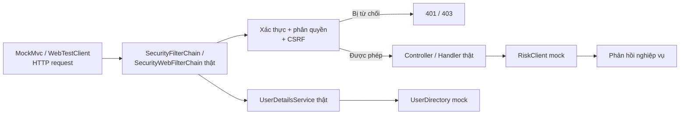

# Giữ bảo mật filter chain khi mock kho người dùng hoặc dịch vụ bên ngoài

> **Chương:** Đăng nhập qua HTTP  
> **Module:** SPRING_SECURITY_TESTING  
> **Trọng tâm:** Kiểm thử đăng nhập, phân quyền và các lớp bảo vệ HTTP bằng `spring-security-test` trên ứng dụng Servlet (`MockMvc`) và Reactive (`WebTestClient`), trong khi kho người dùng hoặc dịch vụ bên ngoài được giả lập có kiểm soát.

## 1. Bài toán: mock phụ thuộc mà không vô hiệu hóa bảo mật

Một ứng dụng thường phải tra cứu tài khoản trong cơ sở dữ liệu, gọi dịch vụ xác minh danh tính, kiểm tra rủi ro hoặc truy cập hệ thống đối tác. Các phụ thuộc này có thể chậm, không ổn định hoặc không phù hợp để gọi thật trong kiểm thử. Chúng ta có thể mock chúng, nhưng **request HTTP vẫn phải đi qua chuỗi filter bảo mật thực của ứng dụng** nếu mục tiêu là xác minh hành vi đăng nhập, phân quyền và bảo vệ HTTP.

Hãy xét API `POST /api/transfers`: chỉ người dùng mang vai trò `ADMIN` được gọi, request phải có CSRF token trong cấu hình dùng session/HTTP Basic của ví dụ, và controller sẽ hỏi dịch vụ `RiskClient` trước khi chấp nhận. Các kết quả cần phân biệt:

| Request | Kết quả mong đợi | Có gọi `RiskClient`? |
| --- | --- | --- |
| Không có thông tin xác thực, có CSRF hợp lệ | `401 Unauthorized` | Không |
| Sai mật khẩu, có CSRF hợp lệ | `401 Unauthorized` | Không |
| Đăng nhập đúng nhưng chỉ có vai trò `USER`, có CSRF | `403 Forbidden` | Không |
| `ADMIN` đăng nhập đúng nhưng thiếu CSRF | `403 Forbidden` | Không |
| `ADMIN` đăng nhập đúng, có CSRF, dịch vụ cho phép | `204 No Content` | Có, đúng một lần |

Trong môi trường thực, `401` thường biểu thị chưa xác thực hoặc thông tin xác thực không hợp lệ; `403` biểu thị đã xác thực nhưng không đủ quyền, hoặc bị một cơ chế như CSRF từ chối. **Mã trạng thái thực tế phụ thuộc entry point, access-denied handler và thứ tự filter mà ứng dụng cấu hình.** Đặc biệt, POST thiếu CSRF có thể bị chặn `403` trước khi hệ thống xử lý HTTP Basic, nên bài kiểm thử `401` bên dưới chủ động gửi CSRF hợp lệ.

### 1.1. Ranh giới đúng để đặt mock



Điểm quan trọng:

- **Mock kho dữ liệu** `UserDirectory`, để `UserDetailsService` và `AuthenticationProvider` vẫn thực hiện việc tra cứu, đối chiếu mật khẩu và tạo `Authentication` thật theo luồng HTTP Basic hoặc form login.
- **Mock dịch vụ bên ngoài** `RiskClient` tại ranh giới nghiệp vụ, để controller chỉ được gọi sau khi request vượt qua các filter bảo mật.
- **Giữ cấu hình bảo mật đang sử dụng trong production**: `SecurityFilterChain`, `SecurityWebFilterChain`, thứ tự filter, matcher, `PasswordEncoder`, `AuthenticationManager` và các cơ chế bảo vệ HTTP.
- **Không dùng mock danh tính để chứng minh rằng chức năng đăng nhập hoạt động.** `@WithMockUser`, `user()` hoặc `mockUser()` rất hữu ích để kiểm thử phân quyền, nhưng chúng cung cấp sẵn một danh tính đã xác thực.

## 2. Phân biệt mock danh tính với mock phụ thuộc

Hai kiểu kiểm thử thường bị nhầm lẫn:

| Kỹ thuật | Phần được giả lập | Có kiểm thử mật khẩu / token đi qua cơ chế xác thực HTTP? | Dùng để |
| --- | --- | --- | --- |
| `@WithMockUser` hoặc `.with(user("alice"))` | `SecurityContext` / principal | Không | Kiểm tra quyền, method security, hành vi endpoint với danh tính đã có |
| `.with(httpBasic("alice", "secret"))` + mock kho người dùng | Nguồn dữ liệu tài khoản | **Có**, qua `BasicAuthenticationFilter` và provider thực nếu ứng dụng cấu hình HTTP Basic | Kiểm tra credential đúng/sai, vai trò, `401/403` |
| `formLogin()` + mock kho người dùng | Nguồn dữ liệu tài khoản | **Có**, qua filter xử lý form login nếu đã bật `formLogin` | Kiểm tra `POST /login`, xác thực và phiên đăng nhập |
| Request có `Authorization: Bearer ...` + mock `JwtDecoder` | Bước decode/verify của decoder | Có qua bearer filter, **không** kiểm chứng mật mã thật | Kiểm tra cách HTTP bearer được xử lý và quyền từ claims |
| `jwt()`, `oauth2Login()`, `oidcLogin()` | Token hoặc danh tính OAuth2/OIDC trong test | Không xác minh toàn bộ giao thức / token thật | Kiểm tra authorization, mapping quyền và controller |
| Mock `RiskClient` hoặc HTTP stub của dịch vụ đối tác | Phụ thuộc nghiệp vụ phía sau handler | Không làm thay đổi xác thực HTTP đầu vào | Kiểm tra rằng 401/403 ngăn side effect và request hợp lệ đi tiếp |

`@WithMockUser` **không nhất thiết tắt filter chain**: filter vẫn có thể chạy để áp dụng authorization hoặc CSRF. Nhưng danh tính được cài sẵn nên bài test sẽ không phát hiện được lỗi tra cứu người dùng, sai `PasswordEncoder` hay cấu hình HTTP Basic/form login. Chọn công cụ theo điều thực sự cần chứng minh.

## 3. Thiết lập kiểm thử Servlet với MockMvc

Cần có `spring-security-test` cùng bộ test của Spring Boot. Ví dụ Gradle:

```groovy
dependencies {
    testImplementation("org.springframework.boot:spring-boot-starter-test")
    testImplementation("org.springframework.security:spring-security-test")
}
```

Để kiểm thử toàn bộ filter chain với cấu hình ứng dụng thực, sử dụng:

```java
@SpringBootTest
@AutoConfigureMockMvc(addFilters = true)
class TransferSecurityIT {
    @Autowired MockMvc mvc;
}
```

`@SpringBootTest` nạp application context; `@AutoConfigureMockMvc(addFilters = true)` đăng ký các filter từ context vào `MockMvc`. `addFilters` mặc định là `true`, nhưng ghi rõ ở đây giúp người đọc hiểu ý đồ. Kiểm thử không cần mở cổng HTTP thật; request đi qua `MockMvc`, servlet filters, `DispatcherServlet` rồi controller.

Nếu dựng `MockMvc` bằng tay từ web context, cần tích hợp Spring Security:

```java
MockMvc mvc = MockMvcBuilders.webAppContextSetup(webApplicationContext)
    .apply(springSecurity())
    .build();
```

`springSecurity()` ở đây là `SecurityMockMvcConfigurers.springSecurity()`. Chỉ dùng `standaloneSetup(controller)` hoặc tắt filter bằng `addFilters = false` có thể khiến test controller chạy thành công dù request sẽ bị chặn trong ứng dụng thật.

### 3.1. Mô hình ứng dụng cần kiểm thử

Đoạn mã sau là cấu hình Servlet tối giản để minh họa ranh giới mock; ứng dụng thực có thể có repository, bảng tài khoản và client HTTP riêng.

```java
public record LocalAccount(
        String username,
        String passwordHash,
        String role) {}

public interface UserDirectory {
    Optional<LocalAccount> findByUsername(String username);
}

public interface RiskClient {
    boolean allowTransfer(String accountId);
}
```

`UserDetailsService` **không bị mock**. Nó chuyển dữ liệu từ `UserDirectory` thành `UserDetails`; `PasswordEncoder` thật sẽ được Spring Security dùng khi xác thực mật khẩu:

```java
@Configuration
class SecurityConfig {

    @Bean
    SecurityFilterChain security(HttpSecurity http) throws Exception {
        return http
            .authorizeHttpRequests(auth -> auth
                .requestMatchers(HttpMethod.POST, "/api/transfers")
                    .hasRole("ADMIN")
                .anyRequest().authenticated())
            .httpBasic(Customizer.withDefaults())
            .csrf(Customizer.withDefaults())
            .build();
    }

    @Bean
    PasswordEncoder passwordEncoder() {
        return new BCryptPasswordEncoder();
    }

    @Bean
    UserDetailsService userDetailsService(UserDirectory directory) {
        return username -> directory.findByUsername(username)
            .map(account -> User.withUsername(account.username())
                .password(account.passwordHash())
                .roles(account.role())
                .build())
            .orElseThrow(() -> new UsernameNotFoundException(username));
    }
}
```

`roles("ADMIN")` tạo authority `ROLE_ADMIN`. Vì vậy, `hasRole("ADMIN")` là nhất quán với dữ liệu. Khi dự án dùng `hasAuthority("SCOPE_...")` hoặc bộ chuyển đổi JWT riêng, bài test phải khớp đúng quy tắc ấy, không tự thêm prefix `ROLE_`.

Controller chỉ thực hiện thao tác nghiệp vụ sau khi đã vượt qua filter chain:

```java
@RestController
class TransferController {
    private final RiskClient riskClient;

    TransferController(RiskClient riskClient) {
        this.riskClient = riskClient;
    }

    @PostMapping("/api/transfers")
    ResponseEntity<Void> transfer(@RequestParam String accountId) {
        if (!riskClient.allowTransfer(accountId)) {
            return ResponseEntity.unprocessableEntity().build();
        }
        return ResponseEntity.noContent().build();
    }
}
```

Trong hệ thống thật, `UserDirectory` và `RiskClient` có implementation được Spring quản lý. Trong test, ta thay đúng hai bean này bằng mock. **Không mock `SecurityConfig`, `SecurityFilterChain` hoặc `UserDetailsService`** vì chúng là thành phần đang được kiểm chứng.

### 3.2. Bài test HTTP Basic: năm nhánh bảo mật

Ví dụ sau dùng `@MockitoBean` (Spring Framework 6.2+; với Spring Boot đời cũ hơn có thể dùng `@MockBean`). Các import Java thông dụng được lược bớt; các helper chính đến từ `SecurityMockMvcRequestPostProcessors`, `MockMvcRequestBuilders`, `MockMvcResultMatchers` và Mockito.

```java
@SpringBootTest
@AutoConfigureMockMvc(addFilters = true)
class TransferSecurityIT {
    @Autowired MockMvc mvc;
    @Autowired PasswordEncoder passwordEncoder;

    @MockitoBean UserDirectory directory;
    @MockitoBean RiskClient riskClient;

    private void account(String username, String password, String role) {
        when(directory.findByUsername(username)).thenReturn(
            Optional.of(new LocalAccount(
                username, passwordEncoder.encode(password), role)));
    }

    @Test
    void anonymousRequestIsUnauthorized() throws Exception {
        mvc.perform(post("/api/transfers")
                .param("accountId", "A-42")
                .with(csrf()))
            .andExpect(status().isUnauthorized());

        verifyNoInteractions(riskClient);
    }

    @Test
    void wrongPasswordIsUnauthorized() throws Exception {
        account("bob", "correct-password", "ADMIN");

        mvc.perform(post("/api/transfers")
                .param("accountId", "A-42")
                .with(httpBasic("bob", "wrong-password"))
                .with(csrf()))
            .andExpect(status().isUnauthorized());

        verify(directory).findByUsername("bob");
        verifyNoInteractions(riskClient);
    }

    @Test
    void authenticatedUserWithoutRoleIsForbidden() throws Exception {
        account("alice", "alice-password", "USER");

        mvc.perform(post("/api/transfers")
                .param("accountId", "A-42")
                .with(httpBasic("alice", "alice-password"))
                .with(csrf()))
            .andExpect(status().isForbidden());

        verifyNoInteractions(riskClient);
    }

    @Test
    void missingCsrfIsForbidden() throws Exception {
        account("bob", "correct-password", "ADMIN");

        mvc.perform(post("/api/transfers")
                .param("accountId", "A-42")
                .with(httpBasic("bob", "correct-password")))
            .andExpect(status().isForbidden());

        verifyNoInteractions(riskClient);
    }

    @Test
    void authorizedRequestReachesBusinessService() throws Exception {
        account("bob", "correct-password", "ADMIN");
        when(riskClient.allowTransfer("A-42")).thenReturn(true);

        mvc.perform(post("/api/transfers")
                .param("accountId", "A-42")
                .with(httpBasic("bob", "correct-password"))
                .with(csrf()))
            .andExpect(status().isNoContent());

        verify(directory).findByUsername("bob");
        verify(riskClient).allowTransfer("A-42");
    }
}
```

Cách đọc các assertion:

1. `httpBasic()` tạo header HTTP Basic hợp lệ về mặt cú pháp, **không đăng nhập sẵn**; `BasicAuthenticationFilter` đọc header và dùng luồng xác thực thật của ứng dụng.
2. `directory.findByUsername()` là mock, nhưng kết quả chứa **mật khẩu đã mã hóa bằng encoder thật**; nhập mật khẩu sai phải bị từ chối.
3. `csrf()` tạo token hợp lệ cho kiểm thử CSRF. Nó chứng minh filter kiểm tra token; nó **không** thay thế bài test riêng về việc trình duyệt lấy và gửi token thông qua cookie/header hay form thực.
4. `verifyNoInteractions(riskClient)` chứng minh request bị từ chối trước điểm gọi dịch vụ bên ngoài. Assertion này đặc biệt hữu ích với API có giao dịch, ghi dữ liệu hoặc side effect.
5. Nhánh thành công kiểm tra cả mã trạng thái lẫn việc gọi phụ thuộc, giúp tránh tình trạng một matcher chặn tất cả request nhưng các bài kiểm thử âm tính vẫn xanh.

Trong bộ test thực tế, nên bổ sung tài khoản không tồn tại, tài khoản bị khóa/hết hạn, thiếu `Authorization`, mật khẩu rỗng, vai trò khác và phản hồi lỗi của `RiskClient` theo nghiệp vụ. Với lỗi nghiệp vụ của dịch vụ mock, cần chắc chắn người dùng đã vượt qua xác thực và phân quyền trước khi assert `422` hoặc `5xx`.

### 3.3. Khi ứng dụng dùng form login

Chỉ áp dụng khi production bật `http.formLogin(...)`. Với `UserDirectory` mock như trên, dùng request login thay vì `@WithMockUser`:

```java
account("bob", "correct-password", "ADMIN");

mockMvc.perform(formLogin()
        .user("bob")
        .password("correct-password"))
    .andExpect(authenticated().withUsername("bob"));

mockMvc.perform(formLogin()
        .user("bob")
        .password("wrong-password"))
    .andExpect(unauthenticated());
```

`formLogin()` là request builder của `SecurityMockMvcRequestBuilders`; `authenticated()` và `unauthenticated()` là result matcher của `SecurityMockMvcResultMatchers`. Kiểm thử thêm redirect thành công/thất bại, session fixation, logout và CSRF theo cấu hình của ứng dụng. Nếu test một request được bảo vệ **sau login**, phải chuyển session/SecurityContext phù hợp sang request tiếp theo; việc mỗi lần `perform` tạo request mới không tự đảm bảo duy trì phiên.

## 4. Test slice và cấu hình MockMvc: những bẫy phổ biến

`@WebMvcTest(TransferController.class)` giúp kiểm thử phần MVC nhanh, nhưng chỉ nạp một phần application context. Nó có thể thiếu cấu hình `SecurityFilterChain` tùy cách tổ chức package/import; một bộ filter mặc định cho ra `401/403` **chưa chắc** là chính sách đang chạy ở production.

Nếu phải dùng slice, hãy nạp security configuration cần kiểm chứng và mock các bean phụ thuộc tương ứng:

```java
@WebMvcTest(TransferController.class)
@Import(SecurityConfig.class)
class TransferMvcSliceTest {
    @Autowired MockMvc mvc;
    @MockitoBean UserDirectory directory;
    @MockitoBean RiskClient riskClient;
}
```

Vì `SecurityConfig` còn cung cấp `UserDetailsService` và `PasswordEncoder`, slice mẫu này giữ được các mắt xích bảo mật cần thiết. Tuy nhiên vẫn phải kiểm tra những bean bổ sung trong cấu hình ứng dụng thực, như custom filter, `AuthenticationProvider`, JWT converter, handler tùy chỉnh hoặc method security. Dùng `@SpringBootTest` khi mục tiêu là độ trung thực của toàn bộ cấu hình bảo mật.

Không nên sửa lỗi test `403` bằng cách thêm `@AutoConfigureMockMvc(addFilters = false)`, `permitAll()` vào test configuration hoặc thay `SecurityFilterChain` bằng mock. Những cách này thay đổi thứ đang được đo. Hãy xác định lỗi nằm ở credential, CSRF, role, matcher hay bean phụ thuộc.

## 5. Tương đương trong ứng dụng Reactive với WebTestClient

Ở WebFlux, luồng request đi qua `SecurityWebFilterChain`, không phải servlet `FilterChainProxy`. Nguyên tắc giữ nguyên: mock `ReactiveUserDetailsService` hoặc repository phía sau nó, mock dịch vụ bên ngoài, nhưng cho request đi qua các `WebFilter` bảo mật thật.

Ví dụ cấu hình HTTP Basic và CSRF của ứng dụng Reactive:

```java
@Bean
SecurityWebFilterChain reactiveSecurity(ServerHttpSecurity http) {
    return http
        .authorizeExchange(exchanges -> exchanges
            .pathMatchers(HttpMethod.POST, "/api/transfers")
                .hasRole("ADMIN")
            .anyExchange().authenticated())
        .httpBasic(Customizer.withDefaults())
        .csrf(Customizer.withDefaults())
        .build();
}
```

Khi bind `WebTestClient` trực tiếp vào Spring application context, áp dụng security test configurer để tích hợp chính xác chuỗi filter:

```java
@SpringBootTest(webEnvironment = SpringBootTest.WebEnvironment.MOCK)
class ReactiveTransferSecurityIT {
    @Autowired ApplicationContext applicationContext;
    @Autowired PasswordEncoder passwordEncoder;
    @MockitoBean ReactiveUserDetailsService reactiveUsers;

    WebTestClient client;

    @BeforeEach
    void setUp() {
        client = WebTestClient.bindToApplicationContext(applicationContext)
            .apply(SecurityMockServerConfigurers.springSecurity())
            .configureClient()
            .build();

        when(reactiveUsers.findByUsername("bob")).thenReturn(
            Mono.just(User.withUsername("bob")
                .password(passwordEncoder.encode("correct-password"))
                .roles("ADMIN")
                .build()));
    }

    @Test
    void csrfAndHttpBasicStillProtectReactiveEndpoint() {
        client.post()
            .uri("/api/transfers")
            .headers(h -> h.setBasicAuth("bob", "correct-password"))
            .exchange()
            .expectStatus().isForbidden();

        client.mutateWith(SecurityMockServerConfigurers.csrf())
            .post()
            .uri("/api/transfers")
            .headers(h -> h.setBasicAuth("bob", "correct-password"))
            .exchange()
            .expectStatus().isNoContent();
    }
}
```

Ví dụ giả định ứng dụng Reactive đã có handler `POST /api/transfers` trả `204` khi thành công, và các phụ thuộc nghiệp vụ của handler được cấu hình/mocked để cho phép request. `reactiveUsers` được mock ở đây để minh họa trường hợp thay trực tiếp `ReactiveUserDetailsService`; nếu đang kiểm tra chính logic tải tài khoản thì nên giữ service này thật và mock repository reactive ở lớp dưới. Tương tự Servlet, thêm ca không xác thực, sai mật khẩu, thiếu role và kiểm tra không gọi dịch vụ nghiệp vụ ở các nhánh bị từ chối.

`WebTestClient.mutateWith(mockUser("bob"))` thích hợp khi kiểm tra authorization với principal đã có. Nó không chứng minh HTTP Basic đã xử lý thông tin xác thực. Nếu test dùng `bindToServer()` qua cổng HTTP thật, hãy gửi header/cookie/token thông thường; các test configurer giả lập `SecurityContext` chỉ áp dụng ở chế độ test client gắn với server application context.

## 6. JWT, OAuth2 và OIDC: chọn điểm mock theo mục tiêu

Mặc dù ví dụ chính dùng HTTP Basic, nguyên tắc phân lớp vẫn áp dụng khi ứng dụng là OAuth2 Resource Server hoặc OIDC client.

### 6.1. Kiểm tra HTTP Bearer filter khi mock JwtDecoder

Để kiểm tra đường đi của header `Authorization: Bearer ...` qua resource server filter, cấu hình production cần bật `oauth2ResourceServer(oauth2 -> oauth2.jwt(...))`. Trong test, mock `JwtDecoder` và gửi header thật:

```java
@MockitoBean JwtDecoder jwtDecoder;

@Test
void bearerHeaderIsProcessedBySecurityChain() throws Exception {
    Jwt token = Jwt.withTokenValue("test-token")
        .header("alg", "RS256")
        .subject("alice")
        .claim("scope", "profile:read")
        .build();
    when(jwtDecoder.decode("test-token")).thenReturn(token);

    mockMvc.perform(get("/api/profile")
            .header(HttpHeaders.AUTHORIZATION, "Bearer test-token"))
        .andExpect(status().isOk());

    verify(jwtDecoder).decode("test-token");
}
```

Đoạn test giả định `GET /api/profile` tồn tại và yêu cầu quyền phù hợp với `SCOPE_profile:read` (theo converter mà ứng dụng dùng). `BearerTokenAuthenticationFilter` vẫn lấy token từ request, gọi decoder, dựng authentication và áp dụng authorization. **Vì decoder đã bị mock, test này không xác minh chữ ký, issuer, audience hoặc thời hạn JWT bằng bộ kiểm chứng thật.** Để kiểm chứng các yếu tố ấy cần giữ decoder thật, dùng khóa/JWK test và nguồn JWKS giả lập nếu cần.

Với bài test chỉ tập trung vào quyền hoặc controller, có thể dùng `jwt()` từ `SecurityMockMvcRequestPostProcessors`:

```java
mockMvc.perform(get("/api/profile")
        .with(jwt().authorities(
            new SimpleGrantedAuthority("SCOPE_profile:read"))))
    .andExpect(status().isOk());
```

Lệnh này cài sẵn `JwtAuthenticationToken` cho test; nó không chứng minh bearer header được parse hay `JwtDecoder` được gọi. Kiểm thử riêng cần bao phủ không có token, token lỗi, claims không hợp lệ và quyền không đủ; đừng đánh đồng test phân quyền với test xác minh JWT.

### 6.2. OAuth2 login và OIDC

`oauth2Login()` và `oidcLogin()` của `spring-security-test` tạo danh tính đã đăng nhập (ví dụ OIDC user có claims và authorities). Chúng phù hợp để test route bảo vệ bằng `OAuth2AuthenticationToken`, ánh xạ role/claim hoặc sử dụng principal trong controller. Chúng **không chạy toàn bộ authorization-code redirect, callback, đổi code lấy token, kiểm tra ID Token hoặc gọi UserInfo endpoint**.

Nếu yêu cầu là kiểm chứng luồng đăng nhập OIDC end-to-end, phải giữ các filter/client tương ứng và giả lập phía identity provider ở ranh giới HTTP/OAuth2 phù hợp (authorization, token, JWK, UserInfo), đồng thời kiểm tra `state`, `nonce`, redirect URI và session theo thiết kế ứng dụng. Việc mock một client nghiệp vụ phía sau đăng nhập không thay thế được các kiểm thử này.

## 7. Mock dịch vụ bên ngoài sao cho test phát hiện lỗi bảo mật

Đối với client phụ thuộc như `RiskClient`, nên chọn một trong hai mức:

| Cách giả lập | Phần giữ thật | Trường hợp thích hợp |
| --- | --- | --- |
| `@MockitoBean RiskClient` | Security filters, controller, service gọi client | Kiểm tra 401/403, thứ tự gọi nghiệp vụ, số lần gọi, hành vi khi đối tác trả trạng thái |
| HTTP stub, ví dụ WireMock hoặc MockWebServer | Security filters **và** logic HTTP client (serialization, header, timeout mapping) | Kiểm tra cả contract giữa ứng dụng và dịch vụ bên ngoài mà không gọi hạ tầng thật |

Với cả hai mức, cần test **đường bị từ chối** và **đường được phép**. Assertion `verifyNoInteractions(riskClient)` ở các nhánh `401/403` và `verify(riskClient).allowTransfer(...)` ở nhánh `204` là một cặp bằng chứng. Không chỉ assert status: controller có thể vô tình gọi dịch vụ trước khi từ chối, tạo giao dịch phụ hoặc lộ dữ liệu dù mã trả về cuối cùng có vẻ đúng.

Nếu ứng dụng có custom filter tự gọi dịch vụ danh tính/risk trước controller, hãy mock đúng client mà filter phụ thuộc và **giữ custom filter đó trong chain**. Khi đó không áp dụng máy móc kỳ vọng “không có lệnh gọi client cho mọi request bị từ chối”; phải xác định chính xác ở bước nào filter cần gọi client để quyết định.

## 8. Checklist chẩn đoán khi test bảo mật chạy sai

| Hiện tượng | Kiểm tra nguyên nhân |
| --- | --- |
| Test 200 dù không gửi credential | `addFilters=false`, `standaloneSetup`, filter chain chưa được đăng ký, matcher `permitAll` quá rộng |
| Test 401 dù dùng `@WithMockUser` | Có đúng Spring test listener và security test integration? Test có tạo context ở đúng thời điểm? Endpoint đang dùng cơ chế bảo mật khác? |
| Test 403 ngay cả khi credential đúng | CSRF bị thiếu, role/authority sai, request matcher khác dự kiến hoặc custom authorization |
| Test 401 khi credential đúng | Mock kho người dùng không trả account, mật khẩu chưa encode đúng, `PasswordEncoder` khác production, account disabled/locked |
| JWT test xanh nhưng token giả/sai chữ ký vẫn qua | Đang dùng `jwt()` hoặc mock `JwtDecoder`, nên chưa kiểm tra chữ ký thật |
| Test âm tính xanh nhưng production bị lọt quyền | Slice thiếu production security config, chỉ kiểm tra status mà không kiểm tra positive path/side effect |
| Reactive test bỏ qua security | `WebTestClient` chưa bind vào application context với `springSecurity()` hoặc chỉ test handler trực tiếp |

Khi điều tra, bật log `org.springframework.security` ở mức DEBUG trong môi trường test để quan sát filter chain và quyết định authorization; không đưa token, mật khẩu hoặc dữ liệu cá nhân thật vào log. Kiểm tra đúng route, HTTP method, csrf repository, authority prefix và cấu hình security riêng cho từng `SecurityFilterChain`.

## 9. Bài thực hành và tiêu chí đạt

Giữ nguyên endpoint chuyển tiền trong ví dụ; thay `UserDirectory` và `RiskClient` bằng mock. Viết các ca test độc lập cho tài khoản không tồn tại, sai mật khẩu, đúng mật khẩu thiếu quyền, đúng quyền thiếu CSRF, đúng cả hai và dịch vụ bên ngoài từ chối. Sau đó thêm một endpoint đọc chỉ yêu cầu `USER` và xác minh role matcher tương ứng. Nếu chuyển sang Reactive, thực hiện cùng ma trận bằng `WebTestClient` và bảo đảm `SecurityWebFilterChain` được tải từ application context.

Một bộ kiểm thử đạt yêu cầu khi:

1. Request HTTP thực sự đi qua filter chain của ứng dụng, bao gồm authentication và authorization phù hợp.
2. Chỉ các phụ thuộc cần kiểm soát bị mock; mật khẩu/vai trò/token được đưa vào hệ thống ở đúng điểm tương ứng với mục tiêu test.
3. Ca `401` và `403` xác nhận tác vụ nghiệp vụ bị chặn, còn ca thành công xác nhận tác vụ được gọi đúng.
4. CSRF, role, session, bearer/JWT và OAuth2/OIDC được kiểm tra ở cấp độ phù hợp; kết quả không khẳng định quá những gì mock có thể chứng minh.
5. Bài test không thay đổi cấu hình bảo mật production chỉ để đạt mã trạng thái mong muốn.

**Nguyên tắc ghi nhớ:** Muốn kiểm chứng bảo mật HTTP, hãy giả lập **dữ liệu và dịch vụ phụ thuộc** nhưng giữ nguyên **đường đi của request qua cơ chế bảo mật**. Muốn kiểm chứng một phần đã giả lập (như xác minh chữ ký JWT hoặc trao đổi mã OIDC), phải thêm một bài test ở mức sâu hơn, nơi phần đó chạy thật.
