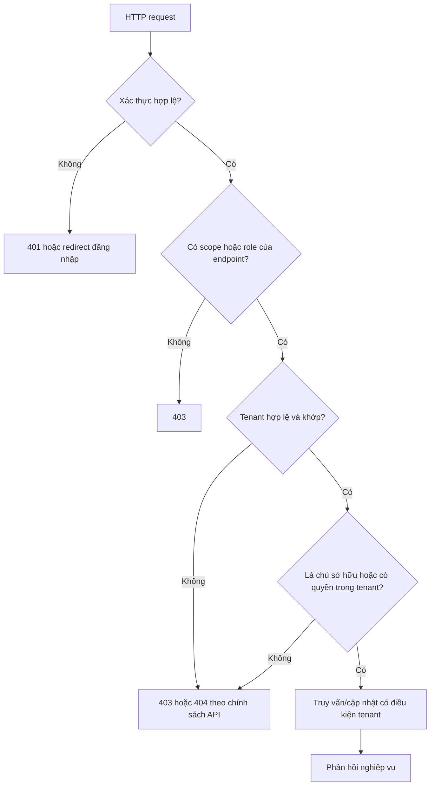

# Quyền theo chủ sở hữu hoặc tenant trong tầng HTTP và nghiệp vụ

## 1. Đăng nhập đúng, có role đúng nhưng vẫn không được xem tài nguyên

Giả sử Alice và Bob đều đã đăng nhập và đều có quyền `SCOPE_orders.read`. Alice sở hữu đơn hàng `A-101`. Nếu Bob đổi ID trên URL từ đơn hàng của mình sang `A-101` và đọc được nội dung, hệ thống có lỗi **Broken Object Level Authorization (BOLA)**, thường được nhắc đến như một dạng **IDOR (Insecure Direct Object Reference)**. Với hệ thống nhiều tổ chức, lỗi còn nguy hiểm hơn: tài khoản của tenant B có thể truy cập đơn hàng của tenant A.

Một quy tắc URL như:

```java
.requestMatchers(HttpMethod.GET, "/api/orders/**")
    .hasAuthority("SCOPE_orders.read")
```

chỉ chứng minh người gọi có quyền đọc **một loại tài nguyên**. Nó chưa chứng minh người đó có quyền đọc **đối tượng cụ thể** trong URL. Để bảo vệ đúng, ứng dụng cần kiểm tra đồng thời:

1. **Quyền HTTP:** Người gọi đã xác thực và có scope/role cần thiết cho thao tác?
2. **Ranh giới tenant:** Người gọi thực sự thuộc tenant được yêu cầu và tài nguyên có nằm trong tenant đó?
3. **Quyền nghiệp vụ:** Người gọi là chủ sở hữu, quản trị viên của **đúng tenant**, hoặc có quyền truy cập được nghiệp vụ cấp rõ ràng?
4. **Truy vấn dữ liệu:** Query chỉ đọc/sửa dữ liệu thuộc phạm vi tenant và người dùng được phép?

Trong module **SPRING_SECURITY_TESTING**, chúng ta kiểm chứng những ranh giới này bằng `spring-security-test` trên **Servlet** với `MockMvc` và **Reactive** với `WebTestClient`. Các test sử dụng `SecurityContext`, `@WithMockUser` hoặc JWT/OAuth2/OIDC giả lập cần phân biệt rõ: giả lập danh tính giúp kiểm tra **logic phân quyền**, còn chữ ký token, claim đáng tin cậy và quy trình đăng nhập thật cần các kiểm thử riêng.

### Kết quả mong đợi sau bài học

- Phân biệt quyền ở tầng HTTP với quyền trên bản ghi/tài nguyên và phạm vi tenant.
- Thiết kế chính sách **deny by default**, không tin ID người dùng/tenant do client tự khai.
- Kiểm tra chủ sở hữu dựa trên danh tính đã xác thực và dữ liệu tin cậy ở server.
- Dùng `@PreAuthorize`/service policy và repository query có ràng buộc tenant; hiểu nguy cơ khi kiểm tra xong rồi truy vấn/sửa không có điều kiện.
- Viết đủ ca được phép, sai chủ sở hữu, sai tenant, thiếu scope và chưa xác thực trên MockMvc/WebTestClient.
- Biết khi nào `403` hoặc `404` là lựa chọn API phù hợp và cách kiểm tra không rò rỉ dữ liệu hoặc gây tác dụng phụ.

## 2. Mô hình ví dụ: đơn hàng thuộc người dùng và tổ chức

Giả sử API quản lý đơn hàng theo mô hình nhiều tenant:

```text
Tenant A
 ├─ alice (USER)       ── sở hữu order A1
 ├─ bob (USER)         ── sở hữu order A2
 └─ admin-a (TENANT_ADMIN)

Tenant B
 ├─ charlie (USER)     ── sở hữu order B1
 └─ admin-b (TENANT_ADMIN)
```

Các principal chỉ được cấp quyền trong tenant đã được xác thực của họ. `ROLE_TENANT_ADMIN` **không** có nghĩa quản trị mọi tenant; chỉ có quyền quản trị trong tenant tương ứng khi vượt qua bước kiểm tra tenant.

API dùng hai endpoint chính:

| Request | Quyền ở lớp HTTP | Quyền ở lớp nghiệp vụ |
| --- | --- | --- |
| `GET /api/tenants/{tenantId}/orders/{orderId}` | Đã xác thực và có `SCOPE_orders.read` | Tenant khớp danh tính **và** là chủ sở hữu hoặc quản trị viên của tenant |
| `PATCH /api/tenants/{tenantId}/orders/{orderId}` | Đã xác thực và có `SCOPE_orders.write` | Tenant khớp danh tính **và** là chủ sở hữu hoặc quản trị viên của tenant |

Trong ví dụ, tenant đang được chọn nằm trong claim `tenant_id` của JWT **đã được Resource Server xác minh**. Claim `sub` là định danh người dùng; một bản ghi đơn hàng lưu `tenantId` và `ownerSubject`. Chúng ta chủ động dùng bearer token cho API để tập trung vào quyền; CSRF được tắt **chỉ trong cấu hình API không sử dụng cookie để xác thực**. Nếu frontend sử dụng session/cookie, hãy áp dụng CSRF phù hợp, không sao chép cấu hình tắt CSRF.

Một ID có dạng UUID khó đoán **không thay thế** authorization. Kẻ tấn công vẫn có thể lấy ID từ log, đường dẫn được chia sẻ, API khác hoặc dữ liệu bị lộ.

## 3. Ba lớp kiểm soát và trách nhiệm của từng lớp

| Lớp | Thông tin có sẵn | Nên kiểm tra | Không thể kết luận chỉ từ lớp này |
| --- | --- | --- | --- |
| **HTTP security** | Method, path, Authentication, GrantedAuthority | Đã xác thực, quyền gọi loại endpoint, mặc định chặn đường dẫn lạ | Người dùng có sở hữu `orderId` không |
| **Service/domain policy** | Principal đáng tin cậy, tenant, bản ghi, trạng thái nghiệp vụ | Tenant hợp lệ, ownership, quyền trong tổ chức, trạng thái cho phép sửa | Decoder đã kiểm tra JWT thật nếu test chỉ dùng principal giả |
| **Repository/database** | Dữ liệu gốc và điều kiện truy vấn | Luôn lọc theo tenant; với update/delete thêm điều kiện sở hữu/quyền khi cần | Bản thân query đã thay thế toàn bộ quy tắc HTTP |

Một request hợp lệ thường đi qua chuỗi:



**Nguyên tắc chính:** URL có thể chứa `tenantId` và `orderId` để định tuyến, nhưng chúng là **đầu vào chưa tin cậy**. Không suy ra quyền từ việc người gọi biết ID hoặc tự gửi header `X-Tenant-Id`. Nếu hệ thống cho phép một người dùng chuyển giữa nhiều tenant, server phải xác minh tư cách thành viên và tenant đang chọn bằng nguồn tin cậy trước khi áp dụng quyền.

## 4. Ma trận phân quyền theo owner và tenant

Giả sử có các bản ghi:

| Bản ghi | Tenant trong DB | `ownerSubject` |
| --- | --- | --- |
| `A1` | `tenant-a` | `alice` |
| `A2` | `tenant-a` | `bob` |
| `B1` | `tenant-b` | `charlie` |

Với tất cả request `GET` đã xác thực trong bảng sau, giả sử principal được cấp `SCOPE_orders.read`; ca `PATCH` dùng `SCOPE_orders.write`. Ví dụ này **trả 403** khi service policy từ chối truy cập đối tượng, bao gồm cả đối tượng không được tìm thấy trong tenant. Một ứng dụng có thể chọn che giấu tài nguyên bằng `404`; phải quyết định và kiểm thử nhất quán.

| Danh tính | Request | Kết quả | Lý do |
| --- | --- | ---: | --- |
| Anonymous | `GET tenant-a/A1` | `401` | Chưa có danh tính |
| Alice, tenant A | `GET tenant-a/A1` | `200` | Đúng tenant, đúng chủ sở hữu |
| Bob, tenant A | `GET tenant-a/A1` | `403` | Cùng tenant nhưng không sở hữu |
| Admin A, tenant A | `GET tenant-a/A1` | `200` | Quyền quản trị trong đúng tenant |
| Charlie, tenant B | `GET tenant-a/A1` | `403` | Sai tenant dù có scope |
| Admin B, tenant B | `GET tenant-a/A1` | `403` | Admin tenant B không quản trị tenant A |
| Alice, tenant A, **thiếu scope đọc** | `GET tenant-a/A1` | `403` | Không qua tầng HTTP |
| Alice, tenant A | `PATCH tenant-a/A1` | `204` | Đúng tenant, owner, scope ghi |
| Bob, tenant A | `PATCH tenant-a/A1` | `403` | Không phải owner và không có quyền quản trị |
| Admin A, tenant A | `PATCH tenant-a/A1` | `204` | Quản trị viên đúng tenant, có scope ghi |
| Alice, tenant A, **thiếu scope ghi** | `PATCH tenant-a/A1` | `403` | Không qua tầng HTTP |

Điểm đáng chú ý: **Hai người có cùng role và scope vẫn có kết quả khác nhau** nếu một người sở hữu đối tượng còn người kia không. Tương tự, hai quản trị viên tenant khác nhau không có cùng phạm vi truy cập.

## 5. Cấu hình HTTP trên Servlet: kiểm tra loại thao tác

Ví dụ Spring MVC dùng JWT Bearer Resource Server:

```java
@Configuration
@EnableMethodSecurity
class OrderSecurityConfig {
    @Bean
    SecurityFilterChain securityFilterChain(HttpSecurity http) throws Exception {
        return http
            .authorizeHttpRequests(auth -> auth
                .requestMatchers(
                    HttpMethod.GET,
                    "/api/tenants/{tenantId}/orders/{orderId}"
                ).hasAuthority("SCOPE_orders.read")
                .requestMatchers(
                    HttpMethod.PATCH,
                    "/api/tenants/{tenantId}/orders/{orderId}"
                ).hasAuthority("SCOPE_orders.write")
                .anyRequest().denyAll()
            )
            .oauth2ResourceServer(oauth2 ->
                oauth2.jwt(Customizer.withDefaults()))
            .sessionManagement(session ->
                session.sessionCreationPolicy(SessionCreationPolicy.STATELESS))
            .csrf(AbstractHttpConfigurer::disable)
            .build();
    }
}
```

Giả định API này chỉ dùng `Authorization: Bearer ...`, không sử dụng cookie phiên cho các thao tác thay đổi trạng thái. Trong hệ thống có cả web session/cookie, nên tách các filter chain phù hợp và **giữ CSRF cho những phần cần bảo vệ**. Mọi thay đổi cấu hình CSRF phải được kiểm chứng qua test thực tế.

Cấu hình này có hai giới hạn cần hiểu:

- `hasAuthority("SCOPE_orders.read")` bảo đảm principal có authority tương ứng **sau khi ánh xạ JWT**. Nó không tự kiểm tra tenant hay ownership.
- `@EnableMethodSecurity` kích hoạt method security, nhưng chỉ có tác dụng khi lời gọi đi qua **Spring proxy** của bean được bảo vệ; lời gọi tự gọi bên trong cùng đối tượng (`self-invocation`) có thể bỏ qua interceptor.

JWT Resource Server cần một `JwtDecoder` được cấu hình phù hợp để xác thực chữ ký, issuer, thời hạn và các yêu cầu token khác. Một kiểm thử dùng `jwt()` của `spring-security-test` sẽ giả lập principal và **không chạy qua toàn bộ việc giải mã chữ ký**.

## 6. Lấy tenant từ nguồn tin cậy

Với tenant đơn trong mỗi access token, một `JwtAuthenticationToken` đã được xác thực có thể chứa:

```json
{
  "sub": "alice",
  "tenant_id": "tenant-a",
  "scope": "orders.read orders.write"
}
```

Để tin `tenant_id` và `sub` trong request thật, ứng dụng phải xác minh token của issuer được chấp nhận, chữ ký, hạn sử dụng và các ràng buộc cần thiết (chẳng hạn audience). Nếu token không đáng tin, cả tenant lẫn chủ thể trong claim đều có thể bị giả mạo.

Trong API có URL `/api/tenants/tenant-a/orders/...`, **so sánh tenant từ path với tenant đáng tin cậy trong Authentication**. Ví dụ, một JWT mang `tenant_id=tenant-b` không được đổi URL sang `tenant-a` để đọc dữ liệu của tenant A.

Đối với hệ thống một tài khoản có nhiều tenant, không nên nhét danh sách quyền vào một header rồi tin header đó. Một trong các cách hợp lệ là:

1. Token chứa tenant đang hoạt động do hệ thống phát hành đáng tin cậy xác nhận, có quy tắc chuyển tenant được kiểm soát; hoặc
2. Server nhận tenant được chọn từ request, rồi tra cứu membership/role của principal trong tenant đó ở **nguồn dữ liệu tin cậy**.

Tenant từ route/header khi chưa được xác minh chỉ là **tham số yêu cầu**, không phải quyền truy cập.

## 7. Kiểm tra ownership ở tầng nghiệp vụ

Giả sử bảng `orders` có các cột `id`, `tenant_id`, `owner_subject` và `title`. Repository Spring Data JPA cần cung cấp truy vấn theo cả ID và tenant:

```java
interface OrderRepository extends JpaRepository<OrderEntity, UUID> {
    Optional<OrderEntity> findByIdAndTenantId(UUID id, String tenantId);
}
```

Không dùng `findById(orderId)` rồi giả định chỉ vì ID hợp lệ thì đơn hàng thuộc tenant người gọi. Một phép tìm có điều kiện tenant tạo thêm ranh giới dữ liệu và giúp giảm rủi ro bỏ sót kiểm tra trong nhánh nghiệp vụ khác.

Tiếp theo định nghĩa policy bean. Nó kiểm tra đồng thời token, tenant, scope và quyền đối với bản ghi:

```java
@Component("orderPolicy")
class OrderPolicy {
    private final OrderRepository repository;

    OrderPolicy(OrderRepository repository) {
        this.repository = repository;
    }

    public boolean canRead(Authentication auth, String tenantId, UUID orderId) {
        return allowed(auth, tenantId, orderId, "SCOPE_orders.read");
    }

    public boolean canRename(Authentication auth, String tenantId, UUID orderId) {
        return allowed(auth, tenantId, orderId, "SCOPE_orders.write");
    }

    private boolean allowed(
            Authentication auth, String tenantId, UUID orderId,
            String requiredScope) {

        if (tenantId == null || orderId == null
                || !(auth instanceof JwtAuthenticationToken jwtAuth)
                || !auth.isAuthenticated()
                || !tenantId.equals(
                    jwtAuth.getToken().getClaimAsString("tenant_id"))
                || jwtAuth.getToken().getSubject() == null
                || !hasAuthority(auth, requiredScope)) {
            return false;
        }

        // Chỉ truy vấn sau khi tenant từ JWT đã khớp tenant yêu cầu.
        return repository.findByIdAndTenantId(orderId, tenantId)
            .map(order -> canAccessLoaded(auth, tenantId, order, requiredScope))
            .orElse(false);
    }

    public boolean canAccessLoaded(
            Authentication auth, String tenantId,
            OrderEntity order, String requiredScope) {

        if (!(auth instanceof JwtAuthenticationToken jwtAuth)
                || !auth.isAuthenticated()) {
            return false;
        }

        Jwt jwt = jwtAuth.getToken();
        String tokenTenant = jwt.getClaimAsString("tenant_id");
        String subject = jwt.getSubject();

        if (tokenTenant == null || subject == null
                || !tokenTenant.equals(tenantId)
                || !tenantId.equals(order.getTenantId())
                || !hasAuthority(auth, requiredScope)) {
            return false;
        }

        boolean isOwner = subject.equals(order.getOwnerSubject());
        boolean isTenantAdmin =
            hasAuthority(auth, "ROLE_TENANT_ADMIN");

        return isOwner || isTenantAdmin;
    }

    private boolean hasAuthority(Authentication auth, String authority) {
        return auth.getAuthorities().stream()
            .anyMatch(a -> authority.equals(a.getAuthority()));
    }
}
```

**Vì sao policy nhận cả `tenantId` và `orderId`?** Tenant từ URL là đối tượng được yêu cầu, còn tenant trong JWT xác định phạm vi danh tính có quyền truy cập. Bản ghi cũng phải thuộc đúng tenant đó. Kiểm tra cả ba tránh trường hợp quên một mối quan hệ quan trọng.

Policy này dùng `ROLE_TENANT_ADMIN` trong tenant hiện tại. Nếu tenant admin có quyền khác với owner, chẳng hạn chỉ được đọc mà không sửa, hãy tách quy tắc `canRead` và `canRename` thay vì dùng chung quyền như ví dụ.

### Giới hạn của `@WithMockUser`

Policy trên yêu cầu `JwtAuthenticationToken` và các claim `tenant_id`/`sub`. Một test chỉ dùng:

```java
@WithMockUser(username = "alice", roles = "USER")
```

không tự có hai claim đó và cũng không tạo `JwtAuthenticationToken`. Nếu áp dụng y nguyên, policy sẽ trả `false`. Trong test cho **ứng dụng dùng JWT**, hãy dùng `jwt()` (MockMvc), `mockJwt()` (WebFlux) hoặc một `@WithSecurityContext` factory được xây theo kiểu Authentication của ứng dụng.

Với ứng dụng dùng session login, policy nên nhận principal chuyên biệt của domain, hoặc tra cứu tenant membership bằng `Authentication.getName()` từ server; không ép ứng dụng session phải dùng `JwtAuthenticationToken` chỉ để chạy theo ví dụ JWT này.

## 8. Gắn policy vào service và giữ điều kiện tenant khi truy vấn

Service thực hiện quyền ở ranh giới nghiệp vụ:

```java
@Service
class OrderService {
    private final OrderRepository repository;
    private final OrderPolicy policy;

    OrderService(OrderRepository repository, OrderPolicy policy) {
        this.repository = repository;
        this.policy = policy;
    }

    @PreAuthorize(
        "@orderPolicy.canRead(authentication, #tenantId, #orderId)")
    @Transactional(readOnly = true)
    public OrderView read(
            @P("tenantId") String tenantId,
            @P("orderId") UUID orderId) {

        OrderEntity order = repository
            .findByIdAndTenantId(orderId, tenantId)
            .orElseThrow(() -> new ResponseStatusException(HttpStatus.NOT_FOUND));

        return new OrderView(order.getId(), order.getTitle());
    }

    @PreAuthorize(
        "@orderPolicy.canRename(authentication, #tenantId, #orderId)")
    @Transactional
    public void rename(
            @P("tenantId") String tenantId,
            @P("orderId") UUID orderId,
            RenameOrderRequest request) {

        OrderEntity order = repository
            .findByIdAndTenantId(orderId, tenantId)
            .orElseThrow(() -> new ResponseStatusException(HttpStatus.NOT_FOUND));

        // Kiểm tra lại quyền trên bản ghi sẽ sửa trong transaction.
        Authentication auth =
            SecurityContextHolder.getContext().getAuthentication();
        if (!policy.canAccessLoaded(
                auth, tenantId, order, "SCOPE_orders.write")) {
            throw new AccessDeniedException("Cannot update order");
        }

        order.setTitle(request.title()); // JPA dirty checking trong transaction
    }
}

record OrderView(UUID id, String title) {}

record RenameOrderRequest(String title) {}
```

Annotation `@P` ở đây đến từ `org.springframework.security.access.method.P`, giúp SpEL nhận đúng `#tenantId` và `#orderId` ngay cả khi cấu hình compiler không giữ tên tham số. Đoạn ví dụ giả định `OrderEntity` là JPA entity có getters và setter phù hợp.

Controller chỉ truyền tham số request vào service; không tự xác nhận quyền dựa trên giá trị từ client:

```java
@RestController
@RequestMapping("/api/tenants/{tenantId}/orders")
class OrderController {
    private final OrderService orders;

    OrderController(OrderService orders) {
        this.orders = orders;
    }

    @GetMapping("/{orderId}")
    OrderView read(
            @PathVariable String tenantId,
            @PathVariable UUID orderId) {
        return orders.read(tenantId, orderId);
    }

    @PatchMapping("/{orderId}")
    ResponseEntity<Void> rename(
            @PathVariable String tenantId,
            @PathVariable UUID orderId,
            @RequestBody RenameOrderRequest request) {

        orders.rename(tenantId, orderId, request);
        return ResponseEntity.noContent().build();
    }
}
```

Ví dụ kiểm tra ownership ở cả `@PreAuthorize` và bên trong thao tác sửa. Lý do: kết quả kiểm tra trước service có thể trở nên cũ nếu quyền sở hữu/tài nguyên thay đổi đồng thời; đối với cập nhật quan trọng, cần đảm bảo điều kiện tenant/owner vẫn đúng **tại thời điểm ghi**.

Để tránh lỗi **time-of-check/time-of-use (TOCTOU)**, ngoài việc kiểm tra trong transaction, có thể dùng câu lệnh `UPDATE ... WHERE id = ? AND tenant_id = ? AND owner_subject = ?` hoặc cơ chế locking/versioning phù hợp, rồi kiểm tra số hàng thực sự được cập nhật. Những biện pháp này quan trọng với thao tác có concurrency cao hoặc dữ liệu ownership có thể thay đổi. Nếu chính sách cho tenant admin sửa mọi đơn hàng trong tenant, câu lệnh cập nhật cần phản ánh chính xác hai nhánh quyền đó.

**Giới hạn hiệu năng:** Ví dụ `@PreAuthorize` và service đọc repository hai lần để dễ diễn giải. Trong ứng dụng thực tế có thể thiết kế một service duy nhất tải bản ghi theo tenant, kiểm quyền trên bản ghi vừa tải và thực hiện thao tác trong transaction, hoặc dùng query điều kiện để giảm lần truy vấn. Không nên hy sinh tính nhất quán vì muốn viết policy ngắn.

## 9. MockMvc: kiểm thử quyền truy cập trên đối tượng thật

Để chứng minh cả HTTP rule lẫn `@PreAuthorize`, nên dùng test chạy qua **security filter chain và service thật**. Nếu dùng `@WebMvcTest` rồi mock toàn bộ `OrderService`, phương thức service với `@PreAuthorize` có thể không được gọi; kết quả `200` hoặc `403` từ HTTP slice chưa chứng minh ownership.

Một lựa chọn là `@SpringBootTest` + `@AutoConfigureMockMvc`, giữ service và policy thực, còn repository được giả lập có kiểm soát cho ca quyền. Các ví dụ dưới đây giả định test dùng Spring Boot 3.4+ có `@MockitoBean`; ở phiên bản cũ, điều chỉnh sang cơ chế mock bean được hỗ trợ. Với `@SpringBootTest`, context còn cần `JwtDecoder` hợp lệ hoặc bean decoder giả lập để khởi tạo Resource Server, dù `jwt()` có thể bỏ qua bước decoder trong request test.

Fixture giả định:

```java
static final UUID A1 = UUID.fromString(
    "11111111-1111-1111-1111-111111111111");
static final UUID B1 = UUID.fromString(
    "22222222-2222-2222-2222-222222222222");

@MockitoBean OrderRepository repository;

@BeforeEach
void fixture() {
    when(repository.findByIdAndTenantId(A1, "tenant-a"))
        .thenReturn(Optional.of(
            new OrderEntity(A1, "tenant-a", "alice", "alice order")));
    when(repository.findByIdAndTenantId(B1, "tenant-b"))
        .thenReturn(Optional.of(
            new OrderEntity(B1, "tenant-b", "charlie", "charlie order")));
}
```

Trong ví dụ, `OrderEntity(...)` là constructor test nhận `id`, `tenantId`, `ownerSubject`, `title`. Các phép thử dùng static import của Mockito `when`, Spring Security Test `jwt`, và MockMvc `get`, `patch`, `status`.

Tạo một helper để cấp danh tính có tenant cùng authority:

```java
private RequestPostProcessor principal(
        String subject, String tenant, String... authorities) {

    SimpleGrantedAuthority[] granted = Arrays.stream(authorities)
        .map(SimpleGrantedAuthority::new)
        .toArray(SimpleGrantedAuthority[]::new);

    return jwt()
        .jwt(token -> token
            .subject(subject)
            .claim("tenant_id", tenant))
        .authorities(granted);
}
```

### Ca dương và ca âm cho cùng một đơn hàng

Các phương thức sau nằm trong lớp test có `@Autowired MockMvc mvc` và fixture ở trên:

```java
@Test
void ownerCanReadOwnOrder() throws Exception {
    mvc.perform(get("/api/tenants/tenant-a/orders/{id}", A1)
            .with(principal("alice", "tenant-a", "SCOPE_orders.read")))
       .andExpect(status().isOk())
       .andExpect(jsonPath("$.title").value("alice order"));
}

@Test
void sameTenantDifferentOwnerIsForbidden() throws Exception {
    mvc.perform(get("/api/tenants/tenant-a/orders/{id}", A1)
            .with(principal("bob", "tenant-a", "SCOPE_orders.read")))
       .andExpect(status().isForbidden());
}

@Test
void tenantAdminCanReadWithinOwnTenant() throws Exception {
    mvc.perform(get("/api/tenants/tenant-a/orders/{id}", A1)
            .with(principal(
                "admin-a", "tenant-a",
                "SCOPE_orders.read", "ROLE_TENANT_ADMIN")))
       .andExpect(status().isOk());
}

@Test
void otherTenantIsForbiddenEvenWithReadScope() throws Exception {
    mvc.perform(get("/api/tenants/tenant-a/orders/{id}", A1)
            .with(principal("charlie", "tenant-b", "SCOPE_orders.read")))
       .andExpect(status().isForbidden());
}

@Test
void otherTenantAdminIsAlsoForbidden() throws Exception {
    mvc.perform(get("/api/tenants/tenant-a/orders/{id}", A1)
            .with(principal(
                "admin-b", "tenant-b",
                "SCOPE_orders.read", "ROLE_TENANT_ADMIN")))
       .andExpect(status().isForbidden());
}

@Test
void ownerWithoutReadScopeIsForbiddenByHttpRule() throws Exception {
    mvc.perform(get("/api/tenants/tenant-a/orders/{id}", A1)
            .with(principal("alice", "tenant-a", "SCOPE_profile.read")))
       .andExpect(status().isForbidden());
}

@Test
void anonymousMustAuthenticate() throws Exception {
    mvc.perform(get("/api/tenants/tenant-a/orders/{id}", A1))
       .andExpect(status().isUnauthorized());
}
```

Test về owner và tenant cố ý cấp **cùng scope `SCOPE_orders.read`** để lỗi `403` đến từ policy nghiệp vụ thay vì thiếu scope. Ngược lại, test thiếu scope dùng đúng owner/tenant để cô lập điều kiện ở tầng HTTP.

### Kiểm thử thao tác ghi và tác dụng phụ

Với Bearer Resource Server không dùng cookie phiên như ví dụ, CSRF đã được tắt cho API này. Nếu ứng dụng dùng session/cookie, test `PATCH` phải gửi CSRF hợp lệ để không nhầm `403` từ CSRF với `403` từ quyền đối tượng.

```java
@Test
void ownerWithWriteScopeCanRename() throws Exception {
    mvc.perform(patch("/api/tenants/tenant-a/orders/{id}", A1)
            .with(principal("alice", "tenant-a", "SCOPE_orders.write"))
            .contentType(MediaType.APPLICATION_JSON)
            .content("{\"title\":\"renamed\"}"))
       .andExpect(status().isNoContent());
}

@Test
void anotherUserCannotRenameOwnersOrder() throws Exception {
    mvc.perform(patch("/api/tenants/tenant-a/orders/{id}", A1)
            .with(principal("bob", "tenant-a", "SCOPE_orders.write"))
            .contentType(MediaType.APPLICATION_JSON)
            .content("{\"title\":\"stolen\"}"))
       .andExpect(status().isForbidden());
}

@Test
void ownerWithoutWriteScopeCannotRename() throws Exception {
    mvc.perform(patch("/api/tenants/tenant-a/orders/{id}", A1)
            .with(principal("alice", "tenant-a", "SCOPE_orders.read"))
            .contentType(MediaType.APPLICATION_JSON)
            .content("{\"title\":\"stolen\"}"))
       .andExpect(status().isForbidden());
}
```

Với fixture repository mock, có thể giữ một tham chiếu `OrderEntity` và so sánh `title` sau request bị cấm để kiểm tra service không chạy nhánh sửa. **Không** được coi đó là bằng chứng persistence thật không bị thay đổi. Cần bổ sung integration test dùng database test và đọc lại bản ghi sau request `403`, đặc biệt với thao tác ghi có side effect hoặc sự kiện bất đồng bộ.

### Phân biệt mock repository và test database

| Kiểu test | Có thể chứng minh | Chưa chứng minh đầy đủ |
| --- | --- | --- |
| MockMvc + service/policy thật, repository mock | Filter chain, method security, logic owner/tenant theo dữ liệu giả lập | SQL thật có lọc tenant đúng không, race condition, transaction ghi |
| `@DataJpaTest`/repository integration | Query `findByIdAndTenantId`, mapping database, giới hạn tenant | Toàn bộ chuỗi HTTP security |
| End-to-end/integration với DB thật hoặc Testcontainers | Request → xác thực/authorization → service → truy vấn → dữ liệu | Việc token giả lập được kiểm tra chữ ký, trừ khi thực sự gửi Bearer token qua decoder |

Nên có ít nhất một test đối chiếu truy vấn thật:

```java
assertThat(repository.findByIdAndTenantId(A1, "tenant-a")).isPresent();
assertThat(repository.findByIdAndTenantId(A1, "tenant-b")).isEmpty();
```

Đặt các assert này trong test repository sử dụng database fixture thực; không dùng chúng làm bằng chứng truy vấn SQL nếu repository đang bị mock.

## 10. Reactive/WebFlux: giữ tenant trong Reactor Context

Trên WebFlux, HTTP authorization dùng `SecurityWebFilterChain`. Có thể giữ cùng quy tắc về scope:

```java
@Configuration
class ReactiveOrderSecurityConfig {
    @Bean
    SecurityWebFilterChain securityWebFilterChain(ServerHttpSecurity http) {
        return http
            .authorizeExchange(auth -> auth
                .pathMatchers(HttpMethod.GET,
                    "/api/tenants/{tenantId}/orders/{orderId}")
                    .hasAuthority("SCOPE_orders.read")
                .pathMatchers(HttpMethod.PATCH,
                    "/api/tenants/{tenantId}/orders/{orderId}")
                    .hasAuthority("SCOPE_orders.write")
                .anyExchange().denyAll())
            .oauth2ResourceServer(oauth2 ->
                oauth2.jwt(Customizer.withDefaults()))
            .csrf(ServerHttpSecurity.CsrfSpec::disable)
            .build();
    }
}
```

Trong WebFlux, không lấy danh tính bằng cách trông chờ `SecurityContextHolder` dạng `ThreadLocal` tồn tại xuyên suốt một luồng reactive. Dùng `ReactiveSecurityContextHolder` hoặc truyền principal đã được kiểm chứng qua phương thức service.

Ví dụ service Reactive dùng `ReactiveOrderRepository` với phương thức `Mono<OrderEntity> findByIdAndTenantId(UUID id, String tenantId)`:

```java
@Service
class ReactiveOrderService {
    private final ReactiveOrderRepository repository;

    ReactiveOrderService(ReactiveOrderRepository repository) {
        this.repository = repository;
    }

    Mono<OrderView> read(String tenantId, UUID orderId) {
        return ReactiveSecurityContextHolder.getContext()
            .map(SecurityContext::getAuthentication)
            .filter(auth -> auth instanceof JwtAuthenticationToken)
            .switchIfEmpty(Mono.error(
                new AccessDeniedException("Missing JWT authentication")))
            .flatMap(auth -> {
                Jwt jwt = ((JwtAuthenticationToken) auth).getToken();
                if (!tenantId.equals(jwt.getClaimAsString("tenant_id"))
                        || jwt.getSubject() == null) {
                    return Mono.error(
                        new AccessDeniedException("Tenant mismatch"));
                }
                return repository.findByIdAndTenantId(orderId, tenantId)
                    .switchIfEmpty(Mono.error(
                        new ResponseStatusException(HttpStatus.NOT_FOUND)))
                    .flatMap(order -> {
                        boolean owner =
                            jwt.getSubject().equals(order.getOwnerSubject());
                        boolean tenantAdmin = auth.getAuthorities().stream()
                            .anyMatch(a -> "ROLE_TENANT_ADMIN"
                                .equals(a.getAuthority()));
                        if (!owner && !tenantAdmin) {
                            return Mono.error(
                                new AccessDeniedException("Not permitted"));
                        }
                        return Mono.just(
                            new OrderView(order.getId(), order.getTitle()));
                    });
            });
    }
}
```

Code trên kiểm tra tenant và ownership trong reactive pipeline, còn `SecurityWebFilterChain` kiểm tra scope đọc trước khi đi vào handler. Nếu service được gọi từ nguồn khác HTTP, nên chuyển điều kiện scope vào policy/service để bảo vệ toàn bộ entry point. Việc dùng repository đồng bộ chặn thread trong WebFlux có thể gây vấn đề hiệu năng; cần chọn driver/repository Reactive phù hợp hoặc bố trí blocking IO đúng cách.

Test WebFlux giả lập JWT bằng `mockJwt()` trong `SecurityMockServerConfigurers`:

```java
@Test
void reactiveOwnerCanRead() {
    client.mutateWith(mockJwt()
            .jwt(jwt -> jwt.subject("alice")
                .claim("tenant_id", "tenant-a"))
            .authorities(
                new SimpleGrantedAuthority("SCOPE_orders.read")))
          .get().uri("/api/tenants/tenant-a/orders/{id}", A1)
          .exchange()
          .expectStatus().isOk();
}

@Test
void reactiveOtherTenantCannotRead() {
    client.mutateWith(mockJwt()
            .jwt(jwt -> jwt.subject("charlie")
                .claim("tenant_id", "tenant-b"))
            .authorities(
                new SimpleGrantedAuthority("SCOPE_orders.read")))
          .get().uri("/api/tenants/tenant-a/orders/{id}", A1)
          .exchange()
          .expectStatus().isForbidden();
}
```

Đoạn test giả định `WebTestClient client` đã được gắn vào ứng dụng Reactive và repository test trả về bản ghi A1; nếu không có bản ghi/fixture, ca được phép có thể trả `404`. Dùng `@WebFluxTest` kèm import service và cấu hình bảo mật, hoặc full integration context tương ứng. `mockJwt()` không xác minh chữ ký token thật; khi kiểm tra authentication pipeline, cần test với Bearer token thật và Reactive JWT decoder.

## 11. 403 hay 404 cho tài nguyên ngoài phạm vi?

Hai chiến lược thường gặp:

| Chiến lược | Ý nghĩa | Lợi ích và yêu cầu |
| --- | --- | --- |
| **403 Forbidden** | Đối tượng bị policy từ chối | Dễ phản ánh quyết định authorization, nhưng cần chú ý không tiết lộ sự tồn tại của đối tượng qua khác biệt phản hồi |
| **404 Not Found** | Không cung cấp thông tin về tài nguyên ngoài phạm vi cho người gọi | Hữu ích để giảm khả năng liệt kê ID; cần áp dụng nhất quán giữa bản ghi không tồn tại và bản ghi không được phép xem |

Ví dụ `OrderPolicy` ở mục 7 trả `false` nếu repository không thấy bản ghi trong tenant, nên `@PreAuthorize` thường trả **403** cho cả đối tượng không tồn tại trong tenant. Nếu API chọn `404` cho tài nguyên không được phép, hãy thiết kế luồng truy vấn/exception handler thống nhất, đồng thời duy trì nguyên tắc **không đọc hoặc trả dữ liệu ngoài tenant**.

Đừng dựa duy nhất vào `404` như một biện pháp bảo mật: kể cả khi che giấu status, khác biệt thời gian xử lý, response body hoặc side effect vẫn có thể làm lộ thông tin. Quan trọng hơn là quyền được kiểm tra và dữ liệu chỉ được truy vấn trong phạm vi hợp lệ.

## 12. Danh sách, tìm kiếm, thống kê và các đường truy cập khác

Kiểm tra quyền của `GET /orders/{id}` chưa đủ nếu API còn:

- `GET /orders` hoặc tìm kiếm theo điều kiện: truy vấn phải giới hạn tenant và phạm vi được phép của người gọi.
- Export CSV/PDF, báo cáo tổng hợp: phải áp dụng cùng quy tắc tenant/ownership trước khi sinh file hoặc tổng hợp dữ liệu.
- Download attachment, lấy ảnh, lịch sử cập nhật: các URL liên quan cũng phải gắn tenant và parent resource.
- API batch hoặc bulk update: kiểm tra **từng đối tượng** được yêu cầu, hoặc dùng câu truy vấn có điều kiện tenant/owner bảo đảm không cập nhật vượt phạm vi.
- WebSocket, background job hoặc message consumer: khi không có HTTP request, không thể phụ thuộc hoàn toàn vào `SecurityContext` của request; phải truyền và kiểm chứng chủ thể/tenant theo ngữ cảnh nghiệp vụ.

Ví dụ query danh sách cho user thông thường:

```java
List<OrderEntity> findAllByTenantIdAndOwnerSubject(
    String tenantId, String ownerSubject);
```

Với tenant admin, có thể dùng `findAllByTenantId(tenantId)` **sau khi** đã xác minh vai trò của principal trong tenant được yêu cầu. Tránh truy vấn `findAll()` rồi lọc bằng Java sau khi đã tải dữ liệu của mọi tenant: dễ rò rỉ trong logs, cache, pagination và tốn tài nguyên.

Nếu dùng ORM hỗ trợ tenant filter, database row-level security hoặc partition theo tenant, các lớp này hữu ích như **defense in depth**; không thay thế việc kiểm chứng nguồn tenant và quyền trên đối tượng.

## 13. Những lỗi kiểm thử khiến tưởng rằng ownership đã được bảo vệ

| Lỗi | Vì sao nguy hiểm | Test/cách sửa |
| --- | --- | --- |
| Chỉ dùng `@WithMockUser(roles = "USER")` với policy đòi JWT tenant claim | Fixture không có `tenant_id`, mọi ca âm `403` có thể xanh sai nguyên nhân | Dùng `jwt()`/`mockJwt()` hoặc domain principal đúng kiểu |
| Chỉ test cùng tenant, cùng owner | Không phát hiện IDOR hoặc xuyên tenant | Thêm **cùng tenant khác owner** và **khác tenant cùng scope** |
| Chỉ kiểm tra status `403` | CSRF, thiếu scope hoặc routing có thể là nguyên nhân | Cấp scope/CSRF hợp lệ trước khi thử owner/tenant |
| Mock toàn bộ service có `@PreAuthorize` | Method security trên bean thật không chạy | Test service thật qua Spring proxy |
| Dùng `findById(id)` cho dữ liệu nhiều tenant | Dễ quên kiểm soát tenant khi code thay đổi | Test query thật `findByIdAndTenantId` và các mutation |
| Dùng role `ADMIN` toàn cục cho quản trị tenant | Admin tenant B có thể xem dữ liệu tenant A | Luôn gắn role với membership/tenant đang được kiểm chứng |
| Tin `X-Tenant-Id` hoặc `tenantId` do client gửi | Dễ giả mạo phạm vi tenant | So khớp với claim được xác minh hoặc membership ở server |
| Chỉ giả lập JWT, không có test decoder | Không phát hiện token sai chữ ký/issuer/hết hạn | Integration test gửi Bearer token qua decoder |
| Test request bị chặn nhưng không kiểm dữ liệu | Side effect vẫn có thể xảy ra trước khi trả lỗi | Kiểm tra DB, event hoặc state sau ca âm |

### Phân biệt 401, 403, 404 và CSRF

- `401 Unauthorized`: thường khi Bearer token thiếu hoặc không hợp lệ; phụ thuộc cấu hình authentication entry point.
- `403 Forbidden`: principal có xác thực nhưng thiếu scope/role, hoặc bị policy nghiệp vụ từ chối; cũng có thể do CSRF trong cấu hình áp dụng CSRF.
- `404 Not Found`: tài nguyên không tồn tại trong phạm vi truy vấn, hoặc API chủ động che giấu sự tồn tại của tài nguyên bị cấm.
- `302 Found`: ứng dụng form login có thể chuyển anonymous đến trang đăng nhập thay vì `401`.

Trong API Bearer token không dùng cookie của ví dụ, CSRF được tắt. Khi chuyển ví dụ sang cookie/session, hãy bổ sung `csrf()` với MockMvc hoặc `csrf()` của WebFlux Test cho thao tác ghi và kiểm thử CSRF riêng. Nếu một ca âm nhận `403`, phải biết filter hoặc service nào đã từ chối trước khi coi test là bằng chứng của ownership.

## 14. Thực hành: phá vỡ rồi sửa một ranh giới tenant

Một hệ thống tài liệu có endpoint:

```text
GET    /api/tenants/{tenantId}/documents/{documentId}
PATCH  /api/tenants/{tenantId}/documents/{documentId}
GET    /api/tenants/{tenantId}/documents
```

Chính sách:

- Người đọc cần `SCOPE_documents.read`; người sửa cần `SCOPE_documents.write`.
- Thành viên thường chỉ đọc/sửa tài liệu do mình sở hữu trong tenant hợp lệ.
- `ROLE_TENANT_ADMIN` có quyền xem/sửa tài liệu của các thành viên trong **tenant của chính mình**, khi cũng có scope tương ứng.
- Người thuộc tenant khác không được xem tài liệu, kể cả biết ID hoặc có role admin của tenant bên kia.

Hãy thực hiện:

1. Tạo dữ liệu tối thiểu hai tenant; trong tenant A có ít nhất hai người dùng sở hữu hai tài liệu khác nhau.
2. Viết các matcher cho HTTP method và scope, kết thúc bằng `denyAll()`.
3. Viết policy ở service kiểm chứng tenant từ principal đáng tin cậy, ownership hoặc tenant-admin; repository luôn lọc dữ liệu theo tenant.
4. Viết các test MockMvc/WebTestClient: chủ sở hữu được đọc, người khác cùng tenant bị từ chối, admin cùng tenant được đọc, admin tenant khác bị từ chối, thiếu scope bị từ chối, anonymous phải xác thực.
5. Với `PATCH`, xác minh tài liệu **không thay đổi** sau các request sai owner/tenant hoặc thiếu scope. Với `GET` danh sách, xác minh không trả tài liệu ngoài tenant hoặc của người dùng khác.
6. Bổ sung test database cho query tenant và integration test Bearer token thật khi ứng dụng cần chứng minh decoder/claim đáng tin cậy.

**Tiêu chí hoàn thành:** mỗi hàng của ma trận có ca kiểm thử dương hoặc âm thể hiện đúng ranh giới; scope ở HTTP không thể thay thế quyền owner/tenant; service và dữ liệu cùng áp dụng ràng buộc tenant; một tài khoản dù biết ID cũng không thể đọc/sửa bản ghi ngoài quyền của mình; các request bị cấm không làm thay đổi dữ liệu.
