# Nhiều SecurityFilterChain và lựa chọn chuỗi theo securityMatcher

## 1. Vì sao một ứng dụng cần nhiều filter chain?

Một ứng dụng có thể phục vụ nhiều nhóm request với cách xác thực và bảo vệ khác nhau:

- API dành cho mobile hoặc service-to-service dùng Bearer JWT, stateless, không dùng session.
- Web UI dùng session cookie và form login.
- Endpoint vận hành như health/info có chính sách truy cập riêng.

Nếu gom tất cả vào một `SecurityFilterChain`, cấu hình dễ trở nên phức tạp: API có thể vô tình chịu redirect đăng nhập của web; trang web có thể bị áp dụng chính sách stateless; CSRF, CORS, session và entry point có thể không phù hợp với từng nhóm request.

Spring Security cho phép khai báo nhiều `SecurityFilterChain`. Mỗi request được chọn **chain đầu tiên có matcher khớp** theo thứ tự chain. Bên trong chain đã chọn, các matcher authorization lại được xét theo thứ tự để quyết định request có được phép thực hiện hay không.

Trong module **SPRING_SECURITY_TESTING**, người học dùng `spring-security-test`, `MockMvc`, `WebTestClient`, `@WithMockUser`, `SecurityContext` và JWT/OAuth2/OIDC giả lập để kiểm chứng xác thực, phân quyền và bảo vệ HTTP. Bài này giúp bạn thiết kế, lựa chọn và kiểm thử nhiều chain mà không nhầm hai tầng matcher.

Sau bài học, bạn có thể:

- Phân biệt `securityMatcher` với `requestMatchers`/`pathMatchers`.
- Hiểu vai trò của `@Order` và nguyên tắc first matching chain.
- Tách API Bearer token và web session/form login thành các chain riêng.
- Thiết kế chain cuối để bảo vệ request không thuộc các vùng chuyên biệt.
- Kiểm tra session, CSRF, CORS, authentication entry point và fallback theo từng chain.
- Viết test chứng minh request đi vào đúng chain và các request ngoài dự kiến vẫn được bảo vệ.

## 2. Hai tầng lựa chọn: chain trước, authorization sau

Có hai câu hỏi khác nhau:

| Tầng | API | Vai trò | Kết quả |
| --- | --- | --- | --- |
| Chọn filter chain | `HttpSecurity.securityMatcher(...)` hoặc `ServerHttpSecurity.securityMatcher(...)` | Chọn bộ filter/security configuration xử lý request | Một `SecurityFilterChain` hoặc `SecurityWebFilterChain` |
| Chọn authorization rule | `authorizeHttpRequests(...).requestMatchers(...)` hoặc `authorizeExchange(...).pathMatchers(...)` | Chọn chính sách quyền bên trong chain đã chọn | `permitAll`, `authenticated`, `hasRole`, `denyAll`... |

Ví dụ:

```java
http
    .securityMatcher("/api/**")
    .authorizeHttpRequests(auth -> auth
        .requestMatchers(HttpMethod.GET, "/api/orders/**")
            .hasAuthority("SCOPE_orders.read")
        .requestMatchers("/api/admin/**")
            .hasRole("ADMIN")
        .anyRequest().denyAll());
```

`securityMatcher("/api/**")` xác định chain chỉ nhận request thuộc vùng API. Hai `requestMatchers` bên trong chỉ có tác dụng **sau khi request đã vào chain**.

Nếu request `/web/profile` không khớp `securityMatcher("/api/**")`, các rule `requestMatchers` của chain API không được xét. Request sẽ tiếp tục được kiểm tra với các chain tiếp theo theo thứ tự.

## 3. FilterChainProxy chọn chain đầu tiên khớp

Spring Security đăng ký một `FilterChainProxy` làm entry point cho các filter chain. Về khái niệm, quá trình chọn chain:

```mermaid
flowchart TD
    A[HTTP request] --> B{Chain @Order 1 matcher khớp?}
    B -- Có --> C[Chọn chain 1]
    B -- Không --> D{Chain @Order 2 matcher khớp?}
    D -- Có --> E[Chọn chain 2]
    D -- Không --> F{Chain tiếp theo khớp?}
    F -- Có --> G[Chọn chain đầu tiên khớp]
    F -- Không --> H[Không có chain nào xử lý request]
    C --> I[Chạy filters của chain đã chọn]
    E --> I
    G --> I
    I --> J[Authorization rules bên trong chain]
```



**Chỉ một chain đầu tiên khớp được dùng cho request đó.** Các chain phía sau không tiếp tục chạy để bổ sung filter hoặc quyền. Vì vậy, thứ tự chain khác với thứ tự rule trong `authorizeHttpRequests`.

### Ý nghĩa của @Order

`@Order` hoặc thứ tự bean tương ứng xác định chain nào được xét trước. Giá trị order nhỏ hơn được ưu tiên trước. Ví dụ:

```java
@Bean
@Order(1)
SecurityFilterChain apiChain(HttpSecurity http) throws Exception {
    // ...
}

@Bean
@Order(2)
SecurityFilterChain webChain(HttpSecurity http) throws Exception {
    // ...
}
```

API chain được xét trước web chain. Nếu đặt một chain tổng quát có matcher mặc định bao phủ mọi request ở `@Order(1)`, các chain chuyên biệt ở order sau có thể không bao giờ được chọn.

## 4. Thiết kế API chain và Web chain

Giả sử ứng dụng có hai vùng:

| Vùng | Xác thực | Session | CSRF | Anonymous |
| --- | --- | --- | --- | --- |
| `/api/**` | OAuth2 Resource Server JWT | Stateless | Có thể tắt nếu chỉ dùng Bearer token, không dùng cookie | Trả 401 qua Bearer entry point |
| `/web/**` | Form login | Session | Bật cho request thay đổi trạng thái | Redirect đến trang login |

Một cấu hình Servlet minh họa:

```java
@Configuration
class MultiChainSecurityConfig {

    @Bean
    @Order(1)
    SecurityFilterChain apiChain(HttpSecurity http) throws Exception {
        return http
            .securityMatcher("/api/**")
            .authorizeHttpRequests(auth -> auth
                .requestMatchers(HttpMethod.GET, "/api/public/**")
                    .permitAll()
                .requestMatchers(HttpMethod.GET, "/api/orders/**")
                    .hasAuthority("SCOPE_orders.read")
                .requestMatchers(HttpMethod.POST, "/api/orders/**")
                    .hasAuthority("SCOPE_orders.write")
                .anyRequest().denyAll())
            .sessionManagement(session ->
                session.sessionCreationPolicy(SessionCreationPolicy.STATELESS))
            .csrf(AbstractHttpConfigurer::disable)
            .oauth2ResourceServer(oauth2 ->
                oauth2.jwt(Customizer.withDefaults()))
            .build();
    }

    @Bean
    @Order(2)
    SecurityFilterChain webChain(HttpSecurity http) throws Exception {
        return http
            // Include the default form-login page and processing endpoint.
            .securityMatcher("/web/**", "/login")
            .authorizeHttpRequests(auth -> auth
                .requestMatchers("/login", "/web/assets/**").permitAll()
                .requestMatchers("/web/admin/**").hasRole("ADMIN")
                .anyRequest().authenticated())
            .formLogin(Customizer.withDefaults())
            .build();
    }

    @Bean
    @Order(3)
    SecurityFilterChain fallbackChain(HttpSecurity http) throws Exception {
        return http
            .authorizeHttpRequests(auth -> auth
                .anyRequest().denyAll())
            .build();
    }
}
```

Đây là ví dụ về **phân vùng bảo mật**, không phải cấu hình đầy đủ cho mọi ứng dụng. Cần có controller/login page phù hợp và các bean JWT decoder cần thiết. `fallbackChain` không khai báo `securityMatcher` nên nhận các request còn lại chưa được chain trước xử lý, rồi từ chối theo mặc định.

### Vì sao API chain có thể tắt CSRF?

Ví dụ giả định API chỉ xác thực bằng Bearer token trong `Authorization` header và không dựa vào cookie được browser tự động gửi. Trong mô hình đó, CSRF protection có thể được tắt cho API chain.

Nếu API dùng cookie/session, hoặc một phần endpoint nhận thông tin xác thực tự động từ browser, không được sao chép cấu hình tắt CSRF một cách máy móc. Hãy bật CSRF phù hợp, kiểm thử token hợp lệ/thiếu/sai, và tách chính sách đó khỏi test role/scope.

### Login endpoint cũng phải thuộc phạm vi web chain

Form login mặc định dùng `/login` cho trang đăng nhập và xử lý POST credentials. Vì vậy, matcher của web chain phải bao gồm cả `/web/**` và `/login`. Ví dụ trên dùng overload `securityMatcher(String...)` để nhận cả hai vùng; rule `requestMatchers("/login").permitAll()` cho phép truy cập trang đăng nhập.

## 5. Chain cuối và nguy cơ không có chain nào khớp

`anyRequest().denyAll()` chỉ là fallback **bên trong chain đã được chọn**. Nó không phải fallback toàn cục cho mọi request của ứng dụng.

Ví dụ chỉ có hai chain:

```java
@Bean
@Order(1)
SecurityFilterChain apiChain(HttpSecurity http) throws Exception {
    return http.securityMatcher("/api/**")
        .authorizeHttpRequests(auth -> auth.anyRequest().authenticated())
        .httpBasic(Customizer.withDefaults())
        .build();
}

@Bean
@Order(2)
SecurityFilterChain webChain(HttpSecurity http) throws Exception {
    return http.securityMatcher("/web/**")
        .authorizeHttpRequests(auth -> auth.anyRequest().authenticated())
        .formLogin(Customizer.withDefaults())
        .build();
}
```

Request `/internal/health` không khớp chain nào. Khi không có `SecurityFilterChain` nào khớp, `FilterChainProxy` không tự lấy `anyRequest()` của API hoặc web chain để áp dụng. Request có thể đi tiếp mà không qua các security filters do những chain đó cung cấp.

Vì vậy, ứng dụng có nhiều chain thường nên khai báo một chain cuối có phạm vi nhận phần còn lại và chính sách rõ ràng:

```java
@Bean
@Order(99)
SecurityFilterChain fallbackChain(HttpSecurity http) throws Exception {
    return http
        .authorizeHttpRequests(auth -> auth
            .anyRequest().denyAll())
        .build();
}
```

Không đặt chain fallback tổng quát ở order trước các chain chuyên biệt. Nếu fallback có matcher mặc định bao phủ mọi request và được xét trước, nó sẽ che API/Web chain.

Một số ứng dụng chủ ý không dùng fallback chain vì có filter chain khác ở container/gateway hoặc vùng request cần bỏ qua. Khi đó phải ghi rõ ranh giới và kiểm thử request ngoài các matcher; đừng mặc định rằng không khớp chain đồng nghĩa được bảo vệ.

## 6. Nhiều chain với cùng path nhưng khác authentication

Có thể dùng nhiều chain theo path, nhưng cũng có thể phân chia bằng các điều kiện request khác như servlet path hoặc matcher tùy chỉnh. Cần thận trọng: nếu hai chain có matcher chồng lấp, chain ở order trước sẽ nhận request, dù chain sau có cấu hình authentication phù hợp hơn.

Ví dụ:

```java
@Bean
@Order(1)
SecurityFilterChain adminApi(HttpSecurity http) throws Exception {
    return http
        .securityMatcher("/api/admin/**")
        .authorizeHttpRequests(auth -> auth
            .anyRequest().hasRole("ADMIN"))
        .httpBasic(Customizer.withDefaults())
        .build();
}

@Bean
@Order(2)
SecurityFilterChain generalApi(HttpSecurity http) throws Exception {
    return http
        .securityMatcher("/api/**")
        .authorizeHttpRequests(auth -> auth
            .anyRequest().hasAuthority("SCOPE_api.read"))
        .oauth2ResourceServer(oauth2 ->
            oauth2.jwt(Customizer.withDefaults()))
        .build();
}
```

`/api/admin/**` khớp cả hai matcher, nhưng admin chain đứng trước được chọn. Một request admin có Bearer token mà không có HTTP Basic credentials có thể không được xác thực theo cách mong đợi, vì chain đầu tiên dùng Basic. Nếu muốn admin API cũng dùng JWT, hãy cấu hình authentication phù hợp ngay trong admin chain hoặc thiết kế matcher để hai vùng không chồng lấp ngoài ý muốn.

Đừng chỉ nhìn authorization rule để kết luận request sẽ được xử lý bởi JWT hay Basic. **Authentication filter nằm trong chain được chọn**, do đó việc chọn chain quyết định cả cơ chế xác thực.

## 7. Kiểm thử chain selection bằng MockMvc

Để chứng minh chain nào được chọn, có thể kiểm tra những hành vi đặc trưng của từng chain. Trong ví dụ API dùng Bearer Resource Server và web dùng form login:

- Anonymous vào `/api/orders` nhận `401` với challenge Bearer.
- Anonymous vào `/web/profile` được chuyển hướng đến `/web/login`.
- Người có `SCOPE_orders.read` vào API được phép.
- Người đã đăng nhập vào web profile được phép.
- Request ngoài hai vùng được fallback chain từ chối.

Controller fixture:

```java
@RestController
class MultiChainController {
    @GetMapping("/api/orders")
    String apiOrders() { return "api-orders"; }

    @GetMapping("/api/public/status")
    String apiStatus() { return "api-ok"; }

    @GetMapping("/web/profile")
    String webProfile() { return "web-profile"; }

    @GetMapping("/web/admin/audit")
    String webAudit() { return "web-audit"; }
}
```

Test:

```java
@SpringBootTest
@AutoConfigureMockMvc
class MultiChainSelectionTest {
    @Autowired MockMvc mvc;

    @Test
    void apiUsesBearerEntryPoint() throws Exception {
        mvc.perform(get("/api/orders"))
           .andExpect(status().isUnauthorized())
           .andExpect(header().string(
               HttpHeaders.WWW_AUTHENTICATE,
               org.hamcrest.Matchers.startsWith("Bearer")));
    }

    @Test
    void webUsesFormLoginEntryPoint() throws Exception {
        mvc.perform(get("/web/profile"))
           .andExpect(status().is3xxRedirection())
           .andExpect(redirectedUrl("/login"));
    }

    @Test
    @WithMockUser
    void authenticatedPrincipalCanEnterWebProfile() throws Exception {
        mvc.perform(get("/web/profile"))
           .andExpect(status().isOk())
           .andExpect(content().string("web-profile"));
    }

    @Test
    @WithMockUser(authorities = "SCOPE_orders.read")
    void readerCanEnterApiChain() throws Exception {
        mvc.perform(get("/api/orders"))
           .andExpect(status().isOk())
           .andExpect(content().string("api-orders"));
    }

    @Test
    @WithMockUser
    void unmatchedRequestIsDeniedByFallbackChain() throws Exception {
        mvc.perform(get("/internal/health"))
           .andExpect(status().isForbidden());
    }
}
```

Ví dụ test giả định context có đủ `JwtDecoder` để khởi tạo Resource Server. `@WithMockUser` tạo Authentication cho authorization test; nó không gửi Bearer token và không kiểm tra JWT decoder. Ca anonymous của API chứng minh entry point Bearer đang được dùng; nếu cần kiểm tra token thật, thêm integration test gửi `Authorization: Bearer` qua decoder thật.

### Kiểm tra role admin của web chain

```java
@Test
@WithMockUser(roles = "USER")
void ordinaryUserCannotEnterWebAdmin() throws Exception {
    mvc.perform(get("/web/admin/audit"))
       .andExpect(status().isForbidden());
}

@Test
@WithMockUser(roles = "ADMIN")
void adminCanEnterWebAdmin() throws Exception {
    mvc.perform(get("/web/admin/audit"))
       .andExpect(status().isOk());
}
```

Các test trên xác minh authorization bên trong web chain. Nếu cấu hình sai thứ tự và API chain có matcher rộng hơn, hành vi đặc trưng của chain (entry point, headers, session behavior) sẽ giúp phát hiện request đi nhầm chain.

## 8. Kiểm thử Session, CSRF và trạng thái stateless theo chain

API chain và web chain thường có cấu hình session khác nhau:

| Thuộc tính | API Bearer | Web form login |
| --- | --- | --- |
| Session creation | `STATELESS` | `IF_REQUIRED` mặc định thường phù hợp |
| Authentication | Bearer JWT | Session SecurityContext sau login |
| CSRF | Có thể tắt khi không dùng cookie | Thường bật |
| Anonymous | Bearer 401 | Redirect login |
| Logout/session | Không dùng session API | Có logout và invalidation |

Để kiểm thử session web, có thể dùng `formLogin()` của MockMvc:

```java
@Test
void loginCreatesAuthenticatedSession() throws Exception {
    MvcResult result = mvc.perform(formLogin("/web/login")
            .user("alice")
            .password("password"))
        .andExpect(status().is3xxRedirection())
        .andReturn();

    MockHttpSession session =
        (MockHttpSession) result.getRequest().getSession(false);

    mvc.perform(get("/web/profile").session(session))
       .andExpect(status().isOk());
}
```

Đoạn test giả định test context có user `alice` với password `password` trong authentication provider và form login xử lý thành công. Đây là test xác thực session; khác với `@WithMockUser`, nó đi qua form login filter. Không dùng password ví dụ này trong môi trường thật.

Với web chain có CSRF, request POST/PATCH/DELETE từ session phải gửi token:

```java
@Test
@WithMockUser(roles = "ADMIN")
void webPostNeedsCsrf() throws Exception {
    mvc.perform(post("/web/admin/jobs"))
       .andExpect(status().isForbidden());

    mvc.perform(post("/web/admin/jobs").with(csrf()))
       .andExpect(status().isCreated());
}
```

Nếu API chain stateless tắt CSRF và chỉ dùng Bearer header, test API POST không nên nhận CSRF failure. Hãy giữ test theo đúng chain đã chọn, không áp dụng cấu hình CSRF của web cho API hoặc ngược lại.

## 9. Nhiều SecurityFilterChain trong WebFlux

WebFlux sử dụng `SecurityWebFilterChain` và `ServerHttpSecurity`. Nguyên tắc lựa chọn vẫn tương tự: chain đầu tiên có `securityMatcher` khớp request được chọn.

Ví dụ:

```java
@Configuration
class ReactiveMultiChainConfig {
    @Bean
    @Order(1)
    SecurityWebFilterChain apiChain(ServerHttpSecurity http) {
        return http
            .securityMatcher(new PathPatternParserServerWebExchangeMatcher(
                "/api/**"))
            .authorizeExchange(auth -> auth
                .pathMatchers(HttpMethod.GET, "/api/orders/**")
                    .hasAuthority("SCOPE_orders.read")
                .anyExchange().denyAll())
            .oauth2ResourceServer(oauth2 ->
                oauth2.jwt(Customizer.withDefaults()))
            .csrf(ServerHttpSecurity.CsrfSpec::disable)
            .build();
    }

    @Bean
    @Order(2)
    SecurityWebFilterChain webChain(ServerHttpSecurity http) {
        return http
            .securityMatcher(new OrServerWebExchangeMatcher(
                new PathPatternParserServerWebExchangeMatcher("/web/**"),
                new PathPatternParserServerWebExchangeMatcher("/login")))
            .authorizeExchange(auth -> auth
                .pathMatchers("/login", "/web/assets/**").permitAll()
                .anyExchange().authenticated())
            .formLogin(Customizer.withDefaults())
            .build();
    }

    @Bean
    @Order(3)
    SecurityWebFilterChain fallbackChain(ServerHttpSecurity http) {
        return http
            .authorizeExchange(auth -> auth.anyExchange().denyAll())
            .build();
    }
}
```

Các matcher cụ thể của WebFlux dùng `ServerWebExchangeMatcher`; ví dụ `PathPatternParserServerWebExchangeMatcher` kiểm tra path theo semantics Reactive. Không sử dụng `HttpServletRequest`, `MvcRequestMatcher` hoặc `SecurityFilterChain` trong ứng dụng WebFlux.

### Kiểm thử WebTestClient

Giả sử controller Reactive có các route tương ứng:

```java
@WebFluxTest(ReactiveMultiChainController.class)
@Import(ReactiveMultiChainConfig.class)
class ReactiveMultiChainSelectionTest {
    @Autowired WebTestClient client;

    @Test
    void anonymousApiRequestGetsUnauthorized() {
        client.get().uri("/api/orders/42")
              .exchange()
              .expectStatus().isUnauthorized();
    }

    @Test
    void apiReaderCanReadOrders() {
        client.mutateWith(mockJwt().authorities(
                    new SimpleGrantedAuthority("SCOPE_orders.read")))
              .get().uri("/api/orders/42")
              .exchange()
              .expectStatus().isOk();
    }

    @Test
    void anonymousWebRequestRedirectsToLogin() {
        client.get().uri("/web/profile")
              .exchange()
              .expectStatus().is3xxRedirection();
    }

    @Test
    void unmatchedRequestIsDenied() {
        client.mutateWith(mockUser("alice"))
              .get().uri("/internal/health")
              .exchange()
              .expectStatus().isForbidden();
    }
}
```

Trong WebFlux, `mockJwt` thuộc `SecurityMockServerConfigurers`. Nếu Resource Server yêu cầu decoder để tạo context, cung cấp bean decoder trong test slice; `mockJwt()` chỉ giả lập principal cho authorization. Cần kiểm tra response redirect cụ thể nếu login page tùy chỉnh, và bảo đảm WebTestClient được gắn với ứng dụng cùng `SecurityWebFilterChain`.

## 10. Những lỗi thường gặp khi có nhiều chain

| Lỗi | Hậu quả | Cách phát hiện |
| --- | --- | --- |
| Chain tổng quát đứng trước chain API | API request đi vào chain web | Test entry point/WWW-Authenticate hoặc session behavior của API |
| API chain thiếu `securityMatcher` | Chain API có thể nhận cả web request | Kiểm tra phạm vi matcher và test URL web |
| Không có fallback chain | Request ngoài mọi matcher có thể không qua Spring Security chain nào | Gửi request lạ và kiểm tra FilterChainProxy/response |
| Fallback chain ở order đầu | Che toàn bộ chain chuyên biệt | Kiểm tra `@Order` và matcher mặc định |
| Nhầm `securityMatcher` với `requestMatchers` | Rule bên trong chain không bao giờ được áp dụng vì request không vào chain | Test cả chain selection và authorization |
| Tắt CSRF ở web chain | Request dùng session/cookie có nguy cơ CSRF | Test POST thiếu/sai token |
| Bật redirect login cho API | Client API nhận HTML redirect thay vì lỗi HTTP phù hợp | Kiểm tra entry point và challenge Bearer |
| Dùng `@WithMockUser` để kết luận JWT decoder đúng | Bỏ qua xác thực chữ ký/issuer/audience | Thêm test Bearer token thật |
| MockMvc/WebTestClient không gắn security | Test đi thẳng tới controller | Tích hợp security filters và kiểm tra ca anonymous |

### Checklist review

- Mỗi chain có `securityMatcher` hoặc phạm vi mặc định được hiểu rõ không?
- Các chain có `@Order` không chồng lấp ngoài dự kiến không?
- Có chain cuối bảo vệ phần request còn lại không?
- Authentication mechanism có phù hợp từng vùng không?
- CSRF, CORS, session và exception handling được cấu hình riêng đúng nhu cầu không?
- Authorization matcher bên trong mỗi chain có thứ tự đúng không?
- Test chứng minh API dùng Bearer entry point, web dùng login entry point và request lạ bị xử lý theo fallback không?
- Các test phân quyền có tách biệt với test decoder/token thật không?

## 11. Thực hành: tách API và Web UI thành các chain

Một ứng dụng bán hàng có ba vùng:

| Vùng | Yêu cầu |
| --- | --- |
| `/api/**` | Bearer JWT, stateless; `GET /api/orders/**` cần `SCOPE_orders.read`; các request khác bị từ chối |
| `/web/**` | Form login, session; `/web/login` và assets công khai; `/web/admin/**` cần `ROLE_ADMIN`; phần còn lại cần đăng nhập |
| Còn lại | Không thuộc hai vùng trên thì bị từ chối |

Hãy thực hiện:

1. Tạo ba `SecurityFilterChain` với thứ tự API, Web, fallback.
2. Khai báo `securityMatcher` cho API và Web; fallback nhận phần còn lại.
3. Kiểm tra API stateless, Bearer entry point và quyền scope; kiểm tra Web form login, session, CSRF và role admin.
4. Viết MockMvc test cho anonymous API, API reader, anonymous Web, user Web, admin Web và request ngoài hai vùng.
5. Viết cấu hình tương ứng với `SecurityWebFilterChain` nếu ứng dụng dùng WebFlux; kiểm tra `mockJwt`/`mockUser` qua WebTestClient.
6. Thử đặt một chain tổng quát ở order đầu trong nhánh thử nghiệm; xác nhận test chain selection phát hiện request đi nhầm chain.

**Tiêu chí hoàn thành:** mỗi request đi vào đúng chain đầu tiên khớp; cơ chế xác thực và filter của chain phù hợp vùng request; authorization rule bên trong chain có hiệu lực; request ngoài các vùng chuyên biệt vẫn được bảo vệ; các ca test phân biệt được lỗi chain selection, lỗi authorization và lỗi xác thực.
