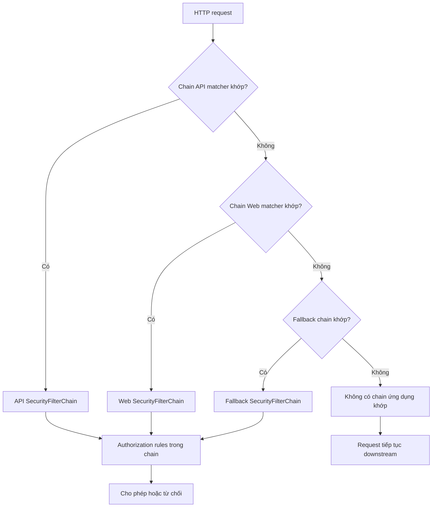

# Phát hiện endpoint lọt ra ngoài mọi chuỗi bảo mật

## 1. Endpoint tồn tại nhưng không đi qua Spring Security

Một ứng dụng có thể có nhiều `SecurityFilterChain`:

- API dùng Bearer JWT tại `/api/**`.
- Web UI dùng session/form login tại `/web/**`.
- Endpoint vận hành, file tĩnh, servlet phụ hoặc đường dẫn nội bộ ở các vùng khác.

Nếu request không khớp `securityMatcher` của **bất kỳ chain nào**, `FilterChainProxy` không tìm được chain để áp dụng các filter bảo mật đã cấu hình. Request có thể tiếp tục xuống servlet/container mà không được xử lý bởi authentication, authorization, CSRF hoặc security headers của những chain đó. `HttpFirewall` vẫn là một phần của `FilterChainProxy` và có thể từ chối request không hợp lệ; vì vậy, cần diễn đạt chính xác rằng request **không đi qua filter chain bảo mật nào**, không phải mọi thành phần Spring Security đều biến mất.

Đây là lỗi cấu hình nguy hiểm vì endpoint vẫn hoạt động bình thường. Một route quản trị hoặc servlet phụ có thể trả `200 OK` cho anonymous chỉ vì đường dẫn của nó không thuộc matcher nào.

Trong module **SPRING_SECURITY_TESTING**, chúng ta dùng `spring-security-test` để kiểm chứng xác thực, phân quyền và bảo vệ HTTP trên Servlet/Reactive bằng `MockMvc`, `WebTestClient`, `@WithMockUser`, `SecurityContext` và JWT/OAuth2/OIDC giả lập. Bài này tập trung vào việc **kiểm kê endpoint, phát hiện request không được chain nào nhận và viết test bắt lỗi lọt chain**.

Sau bài học, bạn có thể:

- Phân biệt request không khớp chain với request khớp chain nhưng không khớp authorization rule.
- Hiểu vai trò của `FilterChainProxy`, `securityMatcher`, `anyRequest()` và chain fallback.
- Phân biệt `permitAll()`, `web.ignoring()` và request không có chain khớp.
- Phát hiện endpoint ở servlet mapping riêng, static resource, Actuator, error/login endpoint hoặc context path khác bị bỏ sót.
- Dùng MockMvc/WebTestClient kiểm tra cả endpoint dự kiến lẫn endpoint nằm ngoài phạm vi matcher.
- Bảo đảm request mới hoặc route mới không vô tình trở thành public.

## 2. Hai tình huống khác nhau: không có chain và không có rule

Đây là phân biệt quan trọng nhất:

| Tình huống | Điều gì xảy ra? | Ví dụ |
| --- | --- | --- |
| **Có chain khớp, có rule khớp** | Chain chạy; rule authorization đầu tiên khớp quyết định quyền | `/api/orders` vào API chain và cần `SCOPE_orders.read` |
| **Có chain khớp, không có rule cụ thể** | Fallback `anyRequest()`/`anyExchange()` bên trong chain được áp dụng | API chain có `anyRequest().denyAll()` |
| **Không có chain nào khớp** | Không có các security filters của chain ứng dụng xử lý request; request tiếp tục xuống downstream | Chain chỉ nhận `/api/**` nhưng request đến `/internal/probe` |
| **Bị loại khỏi security filters bằng ignoring** | Request được cấu hình bỏ qua các filter bảo mật thông thường | Static path được đưa vào `web.ignoring()` |

`anyRequest().denyAll()` không thể bảo vệ một request nếu request chưa từng vào chain chứa rule đó. Đây là lý do một cấu hình có fallback bên trong API chain vẫn có thể để lọt endpoint nằm ngoài `/api/**`.

### Sơ đồ lựa chọn chain



Trong sơ đồ, mỗi request chỉ được xử lý bởi **chain đầu tiên khớp**. Fallback chain phải được sắp sau các chain chuyên biệt và nhận những request còn lại.

## 3. Vì sao request không khớp chain có thể lọt qua?

Giả sử ứng dụng chỉ khai báo:

```java
@Bean
@Order(1)
SecurityFilterChain apiChain(HttpSecurity http) throws Exception {
    return http
        .securityMatcher("/api/**")
        .authorizeHttpRequests(auth -> auth
            .requestMatchers("/api/public/**").permitAll()
            .anyRequest().authenticated())
        .httpBasic(Customizer.withDefaults())
        .build();
}
```

Chain này chỉ nhận request trong `/api/**`. Các đường dẫn sau không khớp:

| Request | Có vào API chain? | Nguy cơ nếu không có chain khác |
| --- | --- | --- |
| `GET /api/orders` | Có | Authorization được kiểm tra |
| `GET /web/profile` | Không | Không có API security filters |
| `GET /internal/health` | Không | Không có API security filters |
| `GET /actuator/env` | Không | Endpoint vận hành có thể lọt nếu không được chain khác bảo vệ |
| `GET /legacy-admin/users` | Không | Servlet/controller phụ có thể không được bảo vệ |

`anyRequest().authenticated()` chỉ bao phủ request **đã vào API chain**. Nó không có nghĩa toàn bộ ứng dụng yêu cầu đăng nhập.

Tình huống này thường xuất hiện khi:

- Thêm chain mới với `securityMatcher("/api/**")` nhưng quên vùng web hoặc endpoint nội bộ.
- Chuyển controller sang servlet mapping khác như `/legacy/*` hoặc `/mvc/*`.
- Thêm Actuator, servlet phụ, Jersey/CXF hoặc endpoint do thư viện đăng ký.
- Thay đổi context path, management port hoặc base path.
- Dùng nhiều chain nhưng không có chain nhận phần request còn lại.

## 4. Thêm fallback chain để đóng mọi request còn lại

Một giải pháp phổ biến là thêm chain cuối cùng **không khai báo `securityMatcher`**, nên matcher mặc định nhận request còn lại:

```java
@Bean
@Order(1)
SecurityFilterChain apiChain(HttpSecurity http) throws Exception {
    return http
        .securityMatcher("/api/**")
        .authorizeHttpRequests(auth -> auth
            .requestMatchers("/api/public/**").permitAll()
            .requestMatchers(HttpMethod.GET, "/api/orders/**")
                .hasAuthority("SCOPE_orders.read")
            .anyRequest().denyAll())
        .oauth2ResourceServer(oauth2 ->
            oauth2.jwt(Customizer.withDefaults()))
        .sessionManagement(session ->
            session.sessionCreationPolicy(SessionCreationPolicy.STATELESS))
        .csrf(AbstractHttpConfigurer::disable)
        .build();
}

@Bean
@Order(2)
SecurityFilterChain webChain(HttpSecurity http) throws Exception {
    return http
        .securityMatcher("/web/**", "/login")
        .authorizeHttpRequests(auth -> auth
            .requestMatchers("/login", "/web/assets/**").permitAll()
            .requestMatchers("/web/admin/**").hasRole("ADMIN")
            .anyRequest().authenticated())
        .formLogin(Customizer.withDefaults())
        .build();
}

@Bean
@Order(99)
SecurityFilterChain fallbackChain(HttpSecurity http) throws Exception {
    return http
        .authorizeHttpRequests(auth -> auth
            .anyRequest().denyAll())
        .httpBasic(Customizer.withDefaults())
        .build();
}
```

Kết quả:

- `/api/**` đi vào API chain.
- `/web/**` và `/login` đi vào web chain.
- Request không khớp hai chain trước đi vào fallback chain và bị từ chối.

Fallback chain có `@Order(99)` để được xét sau các chain chuyên biệt. Không đặt chain mặc định ở order đầu vì chain không có `securityMatcher` sẽ nhận gần như mọi request và che các chain phía sau.

### Fallback chain không thay thế authorization của các chain chuyên biệt

Nếu `/api/orders` vào API chain nhưng thiếu scope, fallback chain **không** được thử tiếp. Request đã được API chain nhận và rule của API chain sẽ quyết định kết quả. Fallback chỉ nhận request mà các chain trước không khớp.

### Chọn entry point phù hợp

Fallback ở ví dụ dùng HTTP Basic để anonymous request có thể nhận `401` qua authentication entry point. Nếu không cấu hình cơ chế xác thực/entry point, phản hồi cụ thể của anonymous khi bị `denyAll` có thể khác, thường là `403` với entry point mặc định. Người đã xác thực nhưng bị `denyAll` sẽ nhận `403`.

Mục tiêu cốt lõi của fallback là bảo đảm request đi qua một chain và bị áp dụng chính sách mặc định. Không dùng một status duy nhất để suy ra chain selection nếu entry point chưa được xác định.

## 5. Phân biệt permitAll, web.ignoring và không có chain

Ba cách có vẻ giống nhau vì anonymous có thể truy cập được, nhưng tác động khác nhau:

| Cách cấu hình | Request đi qua security filters? | Authorization | Trường hợp sử dụng |
| --- | --- | --- | --- |
| `permitAll()` | Có | Cho phép tại rule tương ứng | Trang/file tĩnh hoặc endpoint công khai cần giữ security headers và các filter chung |
| `web.ignoring()` | Bỏ qua các filter bảo mật thông thường của Spring Security cho request khớp | Không chạy authorization rules trong chain | Một số tài nguyên tĩnh thực sự không cần các filter đó |
| Không chain nào khớp | Không có chain ứng dụng áp dụng | Không có authorization rule của chain để kiểm tra | Thường là lỗ hổng cấu hình ngoài ý muốn |

Ví dụ ưu tiên `permitAll`:

```java
.authorizeHttpRequests(auth -> auth
    .requestMatchers("/assets/**", "/favicon.ico").permitAll()
    .requestMatchers("/api/admin/**").hasRole("ADMIN")
    .anyRequest().denyAll())
```

Request static vẫn đi qua security chain; các filter như security headers có thể tiếp tục hoạt động. Trong khi đó:

```java
@Bean
WebSecurityCustomizer webSecurityCustomizer() {
    return web -> web.ignoring()
        .requestMatchers("/assets/**");
}
```

`web.ignoring()` cấu hình request bỏ qua các security filters. Không dùng nó như một cách sửa lỗi cho request không khớp chain. Nếu tài nguyên công khai nhưng vẫn cần security headers, logging/audit filter hoặc các biện pháp chung khác, `permitAll` thường phù hợp hơn.

**Lưu ý:** `web.ignoring()` là API Servlet. Không sao chép cấu hình đó sang WebFlux; ứng dụng Reactive có `SecurityWebFilterChain` và các `WebFilter` riêng.

## 6. Kiểm kê mọi điểm vào của ứng dụng

Không chỉ kiểm tra controller trong `DispatcherServlet`. Một ứng dụng Spring Boot có thể có nhiều loại endpoint:

| Nhóm endpoint | Ví dụ | Câu hỏi cần xác minh |
| --- | --- | --- |
| Spring MVC controller | `/api/**`, `/web/**` | Có chain nhận toàn bộ path/method cần bảo vệ không? |
| Static resources | `/assets/**`, `/favicon.ico` | Dùng `permitAll` hay ignoring có chủ đích? |
| Spring Boot Actuator | `/actuator/health`, `/actuator/env` | Management endpoint có chain và role vận hành phù hợp không? |
| Login/OAuth2 | `/login`, `/oauth2/authorization/**`, `/login/oauth2/code/**` | Login initiation/callback có nằm trong chain dùng đúng authentication mechanism không? |
| Servlet mapping riêng | `/legacy/*`, `/mvc/*` | Matcher có xét đúng servlet path/base path không? |
| Error/forward/async dispatch | `/error`, dispatch nội bộ | Có dispatch nào không được kiểm tra theo chính sách mong muốn không? |
| Thư viện tích hợp | Jersey, CXF, GraphQL servlet, H2 console | Endpoint được đăng ký ở servlet/filter nào và chain nào bảo vệ? |
| Management server riêng | Cổng management khác cổng ứng dụng | Security context/chain của management server có được cấu hình và test riêng không? |

### Actuator cần được kiểm tra riêng

Nếu Actuator chạy cùng server, có thể dùng matcher chuyên biệt:

```java
@Bean
@Order(1)
SecurityFilterChain actuatorChain(HttpSecurity http) throws Exception {
    return http
        .securityMatcher(EndpointRequest.toAnyEndpoint())
        .authorizeHttpRequests(auth -> auth
            .requestMatchers(EndpointRequest.to("health")).permitAll()
            .anyRequest().hasRole("OPS"))
        .httpBasic(Customizer.withDefaults())
        .build();
}
```

Các endpoint nhạy cảm như `env`, `beans` hoặc `heapdump` không nên được mở chỉ vì `health` cần public. Matcher `EndpointRequest` giúp tránh phụ thuộc cứng vào base path Actuator; vẫn phải xác minh cấu hình exposure và port thực tế.

Nếu `management.server.port` khác cổng ứng dụng, management server có thể có web context riêng. Test chỉ gọi cổng ứng dụng không chứng minh management endpoint được bảo vệ. Hãy khởi chạy test với management server thực tế, xác định chain/configuration áp dụng ở management context và gọi đúng management port.

### Servlet đăng ký ngoài Spring MVC

Một servlet phụ có thể được đăng ký ở `/legacy/*` trong khi security chain chỉ nhận `/api/**` và `/web/**`. Controller MVC test không nhìn thấy endpoint này. Cần kiểm tra servlet registration, filter mapping và URL pattern của nó; nếu servlet phục vụ dữ liệu nhạy cảm, đưa nó vào chain phù hợp hoặc bảo vệ bằng cơ chế tương đương được kiểm thử.

## 7. MockMvc: tái hiện endpoint lọt chain

Giả sử ứng dụng có endpoint:

```java
@RestController
class ProbeController {
    @GetMapping("/api/orders")
    String orders() { return "protected-orders"; }

    @GetMapping("/internal/probe")
    String internalProbe() { return "probe"; }
}
```

Và chỉ có API chain:

```java
@Configuration
class ApiOnlySecurityConfig {
    @Bean
    SecurityFilterChain apiOnlyChain(HttpSecurity http) throws Exception {
        return http
            .securityMatcher("/api/**")
            .authorizeHttpRequests(auth -> auth
                .anyRequest().authenticated())
            .httpBasic(Customizer.withDefaults())
            .build();
    }
}
```

Test dưới đây là **bài kiểm tra tái hiện lỗi**, không phải cấu hình nên giữ trong ứng dụng:

```java
@SpringBootTest
@AutoConfigureMockMvc
@Import(ApiOnlySecurityConfig.class)
class UnmatchedEndpointRegressionTest {
    @Autowired MockMvc mvc;

    @Test
    void endpointOutsideEveryChainCanReachController() throws Exception {
        mvc.perform(get("/internal/probe"))
           .andExpect(status().isOk())
           .andExpect(content().string("probe"));
    }
}
```

Giả định đây là test application có đúng một chain tùy chỉnh như trên, không có chain khác nhận `/internal/**`. Khi request không khớp chain, các authentication/authorization filters của chain API không được chạy và anonymous có thể tới controller.

Không dùng `@WithMockUser` trong ca tái hiện này: mục tiêu là chứng minh request anonymous không được chain nào xử lý. Nếu test context còn một chain khác từ cấu hình ứng dụng hoặc test slice, kết quả sẽ khác; hãy kiểm tra toàn bộ chain được tạo trong test context.

## 8. MockMvc: thêm fallback và chứng minh endpoint được bảo vệ

Giữ controller, thêm fallback chain:

```java
@Configuration
class ApiWithFallbackSecurityConfig {
    @Bean
    @Order(1)
    SecurityFilterChain apiChain(HttpSecurity http) throws Exception {
        return http
            .securityMatcher("/api/**")
            .authorizeHttpRequests(auth -> auth
                .anyRequest().authenticated())
            .httpBasic(Customizer.withDefaults())
            .build();
    }

    @Bean
    @Order(99)
    SecurityFilterChain fallbackChain(HttpSecurity http) throws Exception {
        return http
            .authorizeHttpRequests(auth -> auth
                .anyRequest().denyAll())
            .httpBasic(Customizer.withDefaults())
            .build();
    }
}
```

Test:

```java
@SpringBootTest
@AutoConfigureMockMvc
@Import(ApiWithFallbackSecurityConfig.class)
class FallbackChainRegressionTest {
    @Autowired MockMvc mvc;

    @Test
    void anonymousCannotReachEndpointOutsideApiChain() throws Exception {
        mvc.perform(get("/internal/probe"))
           .andExpect(status().isUnauthorized());
    }

    @Test
    @WithMockUser
    void authenticatedUserIsStillDeniedByFallback() throws Exception {
        mvc.perform(get("/internal/probe"))
           .andExpect(status().isForbidden());
    }

    @Test
    @WithMockUser
    void authenticatedUserCanReachApiEndpoint() throws Exception {
        mvc.perform(get("/api/orders"))
           .andExpect(status().isOk());
    }
}
```

Vì fallback chain cấu hình HTTP Basic, anonymous request bị yêu cầu xác thực và nhận `401`; principal đã xác thực nhưng không có rule cho `/internal/probe` bị `denyAll` và nhận `403`. Endpoint API vẫn được xử lý bởi chain chuyên biệt.

Nếu ứng dụng dùng entry point khác, status anonymous có thể thay đổi. Điều cần kiểm chứng là request đi qua fallback và không tới controller; có thể xác minh bằng một counter/mock service không được gọi khi bị từ chối.

### Kiểm tra endpoint không tồn tại

Một request đến URL không có controller mapping cũng cần được kiểm tra. Nếu không có chain khớp, nó có thể đi thẳng tới routing và nhận `404`. Với fallback `denyAll`, request bị chặn trước MVC routing. Test hai trường hợp giúp phân biệt:

```java
@Test
@WithMockUser
void unknownRouteIsDeniedBeforeMvcRouting() throws Exception {
    mvc.perform(get("/internal/not-mapped"))
       .andExpect(status().isForbidden());
}
```

Test này phải chạy trong context có fallback chain và không có rule cho route đó. `403` chứng minh fallback authorization đã chặn request; nó không chứng minh route tồn tại.

## 9. Kiểm tra endpoint tĩnh: permitAll vẫn qua chain

Giả sử `/assets/app.css` được công khai. Với:

```java
.authorizeHttpRequests(auth -> auth
    .requestMatchers("/assets/**").permitAll()
    .anyRequest().denyAll())
```

Anonymous có thể lấy tài nguyên nhưng request vẫn đi qua security chain. Test có thể xác minh:

```java
@Test
void anonymousCanReadPublicAsset() throws Exception {
    mvc.perform(get("/assets/app.css"))
       .andExpect(status().isOk())
       .andExpect(header().string(
           "X-Content-Type-Options", "nosniff"));
}
```

Header minh họa phụ thuộc cấu hình security headers và response thực tế. Nếu test dùng `web.ignoring()`, security header filter có thể không thêm header đó. Không dùng header đơn lẻ để chứng minh chain selection nếu ứng dụng có proxy/filter khác cũng thêm header; hãy kết hợp test authorization và cấu hình filter chain.

## 10. WebFlux: endpoint không khớp SecurityWebFilterChain

Reactive có cơ chế tương tự qua `WebFilterChainProxy` và các `SecurityWebFilterChain`. Chain đầu tiên có `securityMatcher` khớp exchange được chọn. Nếu không có chain nào khớp, các security web filters trong những chain cấu hình không được áp dụng cho exchange đó.

Ví dụ chỉ bảo vệ API:

```java
@Configuration
class ReactiveApiOnlyConfig {
    @Bean
    @Order(1)
    SecurityWebFilterChain apiChain(ServerHttpSecurity http) {
        return http
            .securityMatcher(
                new PathPatternParserServerWebExchangeMatcher("/api/**"))
            .authorizeExchange(auth -> auth
                .anyExchange().authenticated())
            .httpBasic(Customizer.withDefaults())
            .build();
    }
}
```

Giả sử controller có:

```java
@RestController
class ReactiveProbeController {
    @GetMapping("/api/orders")
    Mono<String> orders() { return Mono.just("orders"); }

    @GetMapping("/internal/probe")
    Mono<String> probe() { return Mono.just("probe"); }
}
```

Nếu `WebTestClient` được gắn vào application context chỉ có chain API trên, request `/internal/probe` có thể tới controller mà không qua các security filters của chain API. Đây là test tái hiện lỗ hổng cấu hình; trong context khác có fallback hoặc chain auto-config, kết quả sẽ khác.

### Thêm fallback chain trong WebFlux

```java
@Bean
@Order(99)
SecurityWebFilterChain reactiveFallback(ServerHttpSecurity http) {
    return http
        .authorizeExchange(auth -> auth
            .anyExchange().denyAll())
        .httpBasic(Customizer.withDefaults())
        .build();
}
```

Chain này không khai báo `securityMatcher` nên nhận exchange còn lại. Test với `WebTestClient`:

```java
@SpringBootTest
@AutoConfigureWebTestClient
@Import(ReactiveApiOnlyConfig.class)
class ReactiveUnmatchedEndpointTest {
    @Autowired WebTestClient client;

    @Test
    void unmatchedEndpointIsDeniedByFallback() {
        client.mutateWith(mockUser("alice"))
              .get().uri("/internal/probe")
              .exchange()
              .expectStatus().isForbidden();
    }
}
```

Test trên giả định fallback chain đã được import/đăng ký cùng API chain. `mockUser` tạo principal cho test authorization; nó không kiểm tra HTTP Basic credentials. Với JWT Resource Server, dùng `mockJwt()` để kiểm tra authority và test decoder/token thật riêng.

## 11. Kiểm thử bao phủ endpoint bằng ma trận request

Một danh sách controller mapping không đủ để chứng minh toàn bộ điểm vào đã được bảo vệ. Hãy lập inventory theo **method + path + servlet/context/management scope**:

| Nhóm | Request mẫu | Chain dự kiến | Kết quả anonymous |
| --- | --- | --- | --- |
| API orders | `GET /api/orders` | API chain | 401 |
| API write | `POST /api/orders` | API chain | 401 |
| Web profile | `GET /web/profile` | Web chain | Redirect login |
| Login page | `GET /login` | Web chain | Public qua `permitAll` |
| Static assets | `GET /web/assets/app.css` | Web chain | Public qua `permitAll` |
| Management | `GET /actuator/health` | Actuator chain hoặc chain được chọn | Theo chính sách health |
| Unknown path | `GET /internal/probe` | Fallback chain | Bị từ chối |
| Legacy servlet | `GET /legacy/admin` | Chain nhận servlet path này | Bị yêu cầu xác thực/quyền |

Các status trong bảng là ví dụ theo cơ chế xác thực của từng chain; cần thay bằng hợp đồng thật của ứng dụng. Với login page hoặc health public, xác minh rằng chúng được mở **có chủ đích** trong chain chứ không phải do không có chain nào khớp.

### Tổ chức test theo vùng

- **Positive tests:** anonymous được phép gọi endpoint public; user đúng scope/role gọi endpoint bảo vệ thành công.
- **Negative tests:** anonymous bị chặn ở endpoint yêu cầu đăng nhập; user thiếu quyền bị chặn; request ở vùng chưa được khai báo bị fallback từ chối.
- **Chain selection tests:** API có Bearer challenge; Web có login redirect; management endpoint được bảo vệ bởi chain/port tương ứng.
- **Regression tests:** thêm một path mới ngoài các matcher hiện tại và xác minh fallback chặn nó.

Không nhất thiết phải tạo một test riêng cho mọi URL nếu có thể dùng parameterized tests; nhưng phải giữ danh sách các cặp method/path quan trọng và ít nhất một ca đại diện cho mỗi vùng servlet/chain.

## 12. Những dấu hiệu cho thấy endpoint đã lọt ra ngoài

| Dấu hiệu | Nguyên nhân cần điều tra |
| --- | --- |
| Anonymous gọi endpoint nội bộ nhận `200` | Không có chain khớp hoặc endpoint bị ignoring/permitAll |
| Security headers xuất hiện ở API nhưng không xuất hiện ở servlet phụ | Servlet phụ có thể không đi qua security chain |
| API nhận redirect login thay vì Bearer challenge | Request có thể vào web chain thay vì API chain |
| Actuator được mở dù API chain đã có `denyAll` | Actuator không khớp API chain; có thể nằm trong management context/port riêng |
| Static asset công khai nhưng thiếu các filter chung | Có thể đang dùng `web.ignoring()` thay cho `permitAll()` |
| Endpoint mới hoạt động sau khi deploy mà không có test security | Fallback chain thiếu hoặc chain matcher quá hẹp |
| Test MockMvc bảo vệ endpoint nhưng production servlet phụ không được bảo vệ | Test chỉ bao phủ DispatcherServlet, chưa bao phủ servlet mapping khác |

### Quy trình điều tra

1. Gửi request anonymous tới endpoint và ghi lại method, URI, context path, servlet path, port và dispatcher type.
2. Liệt kê các `SecurityFilterChain` trong application context và thứ tự của chúng.
3. Kiểm tra `securityMatcher` của từng chain; xác định chain đầu tiên khớp hoặc xác nhận không có chain nào khớp.
4. Nếu chain đã khớp, kiểm tra matcher authorization và fallback trong chain đó.
5. Kiểm tra `WebSecurityCustomizer`/`web.ignoring()`, servlet registration, filter mapping, management port và context.
6. Thêm test hồi quy bằng MockMvc/WebTestClient hoặc test server thật cho đúng điểm vào đó.

Đừng sửa bằng cách thêm `permitAll()` cho endpoint đang lỗi trước khi biết request đang đi qua chain nào. Điều đó có thể che giấu lỗi chain selection và biến endpoint thành public trong một chain vốn phải bảo vệ nó.

## 13. Thực hành: phát hiện và đóng một endpoint bị bỏ sót

Một ứng dụng nội bộ có:

| Endpoint | Yêu cầu |
| --- | --- |
| `/api/**` | Bearer JWT; scope theo từng API |
| `/web/**` | Session/form login; role theo chức năng |
| `/actuator/health` | Public có chủ đích |
| `/actuator/env` | Chỉ role vận hành |
| `/legacy/admin/**` | Chỉ admin |
| Mọi request còn lại | Từ chối |

Hãy thực hiện:

1. Tạo các chain API, Web, Actuator và fallback với `@Order`/`securityMatcher` rõ ràng.
2. Xác minh login, OAuth2 callback, static resources và servlet phụ thuộc chain nào.
3. Viết test anonymous cho `/legacy/admin/users` trước khi thêm chain legacy; quan sát hành vi lọt chain trong test tái hiện.
4. Thêm matcher/chain phù hợp hoặc đưa request vào fallback; chứng minh anonymous và user thường bị từ chối, admin hợp lệ được phép.
5. Kiểm tra `/actuator/health` được public qua `permitAll` trong chain Actuator; `/actuator/env` yêu cầu role vận hành.
6. Nếu management server chạy cổng riêng, viết test gọi đúng cổng management thay vì chỉ gọi cổng ứng dụng.
7. Viết test endpoint lạ `/internal/unlisted` và xác minh fallback chặn request.
8. Lặp lại ý tưởng trên WebFlux với `SecurityWebFilterChain` và `WebTestClient` nếu ứng dụng có Reactive stack.

**Tiêu chí hoàn thành:** mỗi điểm vào đã kiểm kê đều thuộc một chain bảo mật dự kiến hoặc được bỏ qua một cách có chủ đích; không có endpoint nhạy cảm lọt ra ngoài mọi chain; fallback nhận request còn lại; test anonymous, thiếu quyền và được phép chứng minh đúng chính sách của từng vùng.
