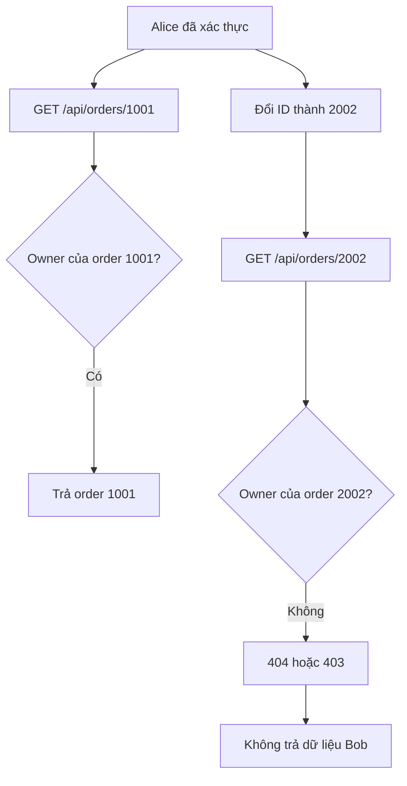

# Ca đổi định danh tài nguyên để kiểm tra truy cập ngang quyền

## 1. Một người dùng đổi ID và đọc được dữ liệu của người khác

Giả sử Alice và Bob đều là người dùng bình thường, cùng có quyền `SCOPE_orders.read`. Alice truy cập:

```http
GET /api/orders/1001
```

Server trả đơn hàng của Alice. Alice thử đổi ID:

```http
GET /api/orders/2002
```

Nếu server trả đơn hàng của Bob, ứng dụng mắc lỗi **Broken Object Level Authorization (BOLA)**, thường được gọi là **IDOR (Insecure Direct Object Reference)**. Đây là lỗi phân quyền ngang: người dùng không nâng role, không giả mạo đăng nhập, chỉ thay định danh một đối tượng mà họ không sở hữu.

Trong module **SPRING_SECURITY_TESTING**, người học kiểm chứng xác thực, phân quyền và bảo vệ HTTP bằng `spring-security-test` trên ứng dụng Servlet và Reactive. Bài này tập trung vào cách tạo test có chủ đích để đổi ID của tài nguyên giữa các danh tính cùng quyền, rồi xác nhận server chỉ trả dữ liệu thuộc phạm vi của principal hiện tại.

Sau bài học, bạn có thể:

- Phân biệt phân quyền ngang (horizontal) với phân quyền dọc (vertical).
- Kiểm thử IDOR bằng cách thay resource ID trong path, query, body, nested route hoặc bulk request.
- Tạo hai người dùng cùng role/scope nhưng sở hữu các tài nguyên khác nhau.
- Bảo đảm server lấy danh tính từ `Authentication`/SecurityContext và truy vấn theo owner.
- Kiểm tra response không tiết lộ dữ liệu, request bị từ chối không gây side effect.
- Viết test bằng MockMvc và WebTestClient; hiểu giới hạn của `@WithMockUser` và JWT giả lập.

## 2. Phân quyền ngang khác gì phân quyền dọc?

**Phân quyền dọc (vertical authorization)** kiểm tra người dùng có được thực hiện một loại hành động hay không. Ví dụ, `ROLE_USER` không được xóa tài khoản quản trị; `ROLE_ADMIN` mới được phép.

**Phân quyền ngang (horizontal authorization)** kiểm tra người dùng có được truy cập **đối tượng cụ thể** trong cùng mức quyền hay không. Ví dụ, Alice và Bob đều có `ROLE_USER` nhưng Alice chỉ được đọc hồ sơ Alice, Bob chỉ được đọc hồ sơ Bob.

| Loại kiểm tra | Câu hỏi | Ví dụ test |
| --- | --- | --- |
| Authentication | Ai đang gọi? | Anonymous không được đọc API yêu cầu đăng nhập |
| Phân quyền dọc | Người gọi có quyền thực hiện hành động này? | USER không được gọi endpoint admin |
| Phân quyền ngang | Người gọi có quyền với bản ghi/đối tượng này? | Alice không đọc được order của Bob |
| Tenant isolation | Đối tượng thuộc phạm vi tổ chức nào? | Thành viên tenant A không đọc dữ liệu tenant B |

Một test chỉ chứng minh `ROLE_USER` gọi được `GET /api/orders/{id}` **chưa chứng minh** quyền sở hữu. Để kiểm tra ngang quyền, phải giữ role/scope như nhau và thay đổi **subject hoặc resource ID**.

## 3. Thiết kế fixture để phát hiện IDOR

Tạo hai người dùng và hai tài nguyên:

| Chủ thể | Role/authority | Tài nguyên sở hữu |
| --- | --- | --- |
| `alice` | `ROLE_USER`, `SCOPE_orders.read` | Order `1001` |
| `bob` | `ROLE_USER`, `SCOPE_orders.read` | Order `2002` |

Hai tài khoản có cùng quyền ở lớp HTTP. Chính sách nghiệp vụ là:

- Alice đọc được order 1001.
- Bob đọc được order 2002.
- Alice không đọc được order 2002.
- Bob không đọc được order 1001.
- Anonymous không đọc được order nào.

Ma trận kỳ vọng:

| Danh tính request | `GET /api/orders/1001` | `GET /api/orders/2002` |
| --- | ---: | ---: |
| Anonymous | `401` | `401` |
| Alice | `200` | `404` |
| Bob | `404` | `200` |

Ví dụ chọn `404` khi tài nguyên không tồn tại **trong phạm vi mà người gọi được phép nhìn thấy**. Như vậy, ID không tồn tại và ID thuộc người khác có cùng biểu hiện ở API. Một ứng dụng có thể chọn `403` để thể hiện rõ bị cấm; điều quan trọng là quyết định nhất quán và không trả nội dung tài nguyên trái phép.

### Sơ đồ đổi ID



Một test tốt không chỉ kiểm tra status. Nó còn phải chứng minh body không chứa dữ liệu bí mật và request bị từ chối không làm thay đổi trạng thái hệ thống.

## 4. Quy tắc quan trọng: owner lấy từ principal, không lấy từ client

Giả sử request body có trường `ownerId`:

```json
{
  "ownerId": "alice",
  "title": "New order title"
}
```

Nếu server tin `ownerId` từ body để quyết định người gọi là ai, Bob có thể gửi `ownerId=alice` và sửa tài nguyên của Alice. Owner phải được suy ra từ danh tính đã xác thực, ví dụ `Authentication.getName()` hoặc claim `sub` của JWT đã được xác minh.

Các nguồn đầu vào cần xem là **không đáng tin** cho tới khi server xác minh:

- ID trong path: `/api/orders/2002`.
- ID trong query: `?orderId=2002`.
- ID trong body: `{"orderId":"2002"}`.
- Header tùy chỉnh: `X-User-Id`, `X-Owner-Id`, `X-Tenant-Id`.
- ID của tài nguyên cha/con: `/users/alice/orders/2002`.

Client được phép chỉ ra **đối tượng muốn thao tác**. Client không được tự khai danh tính hoặc quan hệ sở hữu để cấp quyền cho chính mình.

## 5. Bảo vệ bằng truy vấn theo owner

Một cách an toàn là kết hợp resource ID với owner trong truy vấn dữ liệu. Với Spring Data JPA:

```java
interface OrderRepository extends JpaRepository<OrderEntity, UUID> {
    Optional<OrderEntity> findByIdAndOwnerSubject(
        UUID id, String ownerSubject);

    List<OrderEntity> findAllByOwnerSubject(String ownerSubject);
}
```

Service lấy subject từ `Authentication`:

```java
@Service
class OrderService {
    private final OrderRepository repository;

    OrderService(OrderRepository repository) {
        this.repository = repository;
    }

    OrderView readOwnOrder(UUID orderId, Authentication authentication) {
        return repository.findByIdAndOwnerSubject(
                orderId, authentication.getName())
            .map(order -> new OrderView(order.getId(), order.getTitle()))
            .orElseThrow(() ->
                new ResponseStatusException(HttpStatus.NOT_FOUND));
    }

    OrderView createFor(String ownerSubject, CreateOrderRequest request) {
        OrderEntity saved = repository.save(new OrderEntity(
            UUID.randomUUID(), ownerSubject, request.title()));
        return new OrderView(saved.getId(), saved.getTitle());
    }

    List<OrderView> listOwnOrders(Authentication authentication) {
        return repository.findAllByOwnerSubject(authentication.getName())
            .stream()
            .map(order -> new OrderView(order.getId(), order.getTitle()))
            .toList();
    }
}

record OrderView(UUID id, String title) {}
```

Truy vấn `findByIdAndOwnerSubject` chỉ trả bản ghi khi **cả ID lẫn owner đều khớp**. Nếu Bob yêu cầu order của Alice, repository trả `Optional.empty()` và service trả `404`.

Controller truyền Authentication do Spring Security cung cấp:

```java
@RestController
@RequestMapping("/api/orders")
class OrderController {
    private final OrderService orders;

    OrderController(OrderService orders) {
        this.orders = orders;
    }

    @GetMapping("/{id}")
    OrderView read(
            @PathVariable UUID id,
            Authentication authentication) {
        return orders.readOwnOrder(id, authentication);
    }

    @GetMapping
    List<OrderView> list(Authentication authentication) {
        return orders.listOwnOrders(authentication);
    }

    @PostMapping
    ResponseEntity<OrderView> create(
            @RequestBody CreateOrderRequest request,
            Authentication authentication) {
        OrderView created = orders.createFor(authentication.getName(), request);
        return ResponseEntity.status(HttpStatus.CREATED).body(created);
    }
}

record CreateOrderRequest(String title, String ownerSubject) {}
```

Không dùng `findById(id)` rồi trả entity trước, sau đó mới quyết định có được xem hay không. Cũng không tải toàn bộ bảng rồi lọc bằng Java nếu query có thể giới hạn ngay tại database. Cách query theo owner giúp giảm nguy cơ quên kiểm tra ở một nhánh xử lý khác và tránh tải dữ liệu ngoài phạm vi.

### Phân quyền ở HTTP vẫn cần thiết

Query theo owner không thay thế authentication hoặc scope:

```java
@Bean
SecurityFilterChain orderSecurity(HttpSecurity http) throws Exception {
    return http
        .authorizeHttpRequests(auth -> auth
            .requestMatchers(
                HttpMethod.GET, "/api/orders", "/api/orders/**",
                "/api/order-detail")
                .hasAuthority("SCOPE_orders.read")
            .requestMatchers(HttpMethod.POST, "/api/orders")
                .hasAuthority("SCOPE_orders.write")
            .requestMatchers(HttpMethod.PATCH, "/api/orders/**")
                .hasAuthority("SCOPE_orders.write")
            .anyRequest().denyAll())
        .httpBasic(Customizer.withDefaults())
        .build();
}
```

Ở đây HTTP layer xác nhận người gọi có scope đọc order; service xác nhận order có thuộc người gọi hay không. Hai điều kiện giải quyết hai câu hỏi khác nhau.

## 6. Kiểm thử MockMvc: đổi ID giữa hai người cùng role

Để test có giá trị, cần chạy qua Spring Security filter chain và service/repository thực hoặc fixture dữ liệu có kiểm soát. Nếu mock toàn bộ `OrderService`, test chỉ kiểm tra controller gọi mock; logic owner trong service không được thực thi.

Ví dụ integration test dùng Spring Boot, MockMvc và database test:

```java
@SpringBootTest
@AutoConfigureMockMvc
@Transactional
class HorizontalOrderAuthorizationTest {
    private static final UUID ALICE_ORDER =
        UUID.fromString("11111111-1111-1111-1111-111111111111");
    private static final UUID BOB_ORDER =
        UUID.fromString("22222222-2222-2222-2222-222222222222");

    @Autowired MockMvc mvc;
    @Autowired OrderRepository repository;

    @BeforeEach
    void setUp() {
        repository.save(new OrderEntity(
            ALICE_ORDER, "alice", "Alice confidential order"));
        repository.save(new OrderEntity(
            BOB_ORDER, "bob", "Bob confidential order"));
    }

    @Test
    @WithMockUser(username = "alice",
                  authorities = {"ROLE_USER", "SCOPE_orders.read"})
    void aliceCanReadHerOwnOrder() throws Exception {
        mvc.perform(get("/api/orders/{id}", ALICE_ORDER))
           .andExpect(status().isOk())
           .andExpect(jsonPath("$.title")
               .value("Alice confidential order"));
    }

    @Test
    @WithMockUser(username = "alice",
                  authorities = {"ROLE_USER", "SCOPE_orders.read"})
    void aliceCannotReadBobsOrderAfterChangingId() throws Exception {
        mvc.perform(get("/api/orders/{id}", BOB_ORDER))
           .andExpect(status().isNotFound())
           .andExpect(content().string(
               not(containsString("Bob confidential order"))));
    }

    @Test
    @WithMockUser(username = "bob",
                  authorities = {"ROLE_USER", "SCOPE_orders.read"})
    void bobCanReadHisOwnOrder() throws Exception {
        mvc.perform(get("/api/orders/{id}", BOB_ORDER))
           .andExpect(status().isOk())
           .andExpect(jsonPath("$.title")
               .value("Bob confidential order"));
    }

    @Test
    @WithMockUser(username = "bob",
                  authorities = {"ROLE_USER", "SCOPE_orders.read"})
    void bobCannotReadAlicesOrder() throws Exception {
        mvc.perform(get("/api/orders/{id}", ALICE_ORDER))
           .andExpect(status().isNotFound())
           .andExpect(content().string(
               not(containsString("Alice confidential order"))));
    }

    @Test
    void anonymousCannotReadEitherOrder() throws Exception {
        mvc.perform(get("/api/orders/{id}", ALICE_ORDER))
           .andExpect(status().isUnauthorized());
        mvc.perform(get("/api/orders/{id}", BOB_ORDER))
           .andExpect(status().isUnauthorized());
    }
}
```

Ví dụ lược bỏ `import` và constructor/entity getters. Cần static imports từ MockMvc, MockMvcResultMatchers và Hamcrest như `not`, `containsString`; test context phải có cấu hình authentication tương thích. `@WithMockUser` tạo Authentication giả lập với username/authority đã chỉ định; nó không xác minh mật khẩu hoặc JWT.

Điểm quan trọng của cặp test Alice/Bob:

- Cùng `ROLE_USER` và `SCOPE_orders.read`.
- Cùng endpoint và method.
- Chỉ đổi username hoặc resource ID.
- Request chéo chủ sở hữu phải thất bại.

Đây là bằng chứng trực tiếp cho kiểm soát truy cập ngang quyền.

### Vì sao không mock service?

Nếu viết:

```java
@MockitoBean OrderService orderService;
```

thì `@PreAuthorize` hoặc logic ownership trong service thật có thể không chạy. Controller chỉ gọi mock đã được lập trình trả kết quả. Test đó hữu ích cho controller contract, nhưng không chứng minh server ngăn IDOR. Để kiểm tra ownership, giữ service/policy thật và mock ở ranh giới dữ liệu nếu cần; tốt hơn nữa là dùng database test cho repository query.

## 7. Kiểm tra danh sách và tìm kiếm, không chỉ endpoint theo ID

Một ứng dụng có thể bảo vệ `GET /api/orders/{id}` nhưng lại để lộ dữ liệu qua danh sách:

```java
@GetMapping("/api/orders")
List<OrderView> list() {
    return repository.findAll().stream()
        .map(this::toView)
        .toList();
}
```

Nếu endpoint này chỉ yêu cầu scope đọc, Alice có thể xem tất cả order. Hãy lọc ngay trong truy vấn:

```java
@GetMapping("/api/orders")
List<OrderView> list(Authentication authentication) {
    return repository.findAllByOwnerSubject(authentication.getName())
        .stream()
        .map(this::toView)
        .toList();
}
```

Test:

```java
@Test
@WithMockUser(username = "alice", authorities = "SCOPE_orders.read")
void listContainsOnlyAlicesOrders() throws Exception {
    mvc.perform(get("/api/orders"))
       .andExpect(status().isOk())
       .andExpect(jsonPath("$[*].id")
           .value(hasItem(ALICE_ORDER.toString())))
       .andExpect(jsonPath("$[*].id")
           .value(not(hasItem(BOB_ORDER.toString()))));
}
```

Với pagination, sorting, search và export, owner filter phải được áp dụng trước khi phân trang/tổng hợp. Không tải mọi bản ghi rồi lọc ở tầng hiển thị; điều đó có thể làm sai tổng số, lộ metadata hoặc đưa dữ liệu ngoài phạm vi vào cache/log.

## 8. Đổi ID trong query, body và nested resource

IDOR không chỉ xuất hiện ở path variable. Cần kiểm tra mọi vị trí client có thể điều khiển định danh.

| Vị trí ID | Ví dụ request | Rủi ro |
| --- | --- | --- |
| Path | `GET /api/orders/2002` | Thay ID trực tiếp trên URL |
| Query | `GET /api/order-detail?orderId=2002` | Endpoint truy vấn dùng ID do client gửi |
| JSON body | `POST /api/orders/2002/notes` với `{"orderId":"2002"}` | Body chứa ID khác với tài nguyên cha trên path |
| Nested path | `GET /api/users/alice/orders/2002` | User ID trên path không khớp principal hoặc order owner |
| Header | `X-Owner-Id: alice` | Client tự khai owner |
| Bulk array | `DELETE /api/orders` với danh sách ID | Một số ID thuộc người khác |

### Query parameter

Với endpoint `GET /api/order-detail?orderId=...`, service vẫn phải truy vấn theo ID và owner:

```java
@GetMapping("/api/order-detail")
OrderView detail(
        @RequestParam UUID orderId,
        Authentication authentication) {
    return orders.readOwnOrder(orderId, authentication);
}
```

Test thay ID:

```java
@Test
@WithMockUser(username = "alice", authorities = "SCOPE_orders.read")
void queryParameterCannotSelectAnotherUsersOrder() throws Exception {
    mvc.perform(get("/api/order-detail")
            .queryParam("orderId", BOB_ORDER.toString()))
       .andExpect(status().isNotFound());
}
```

### ID trong body không thể ghi đè owner

Khi tạo tài nguyên, owner phải lấy từ principal:

```java
record CreateOrderRequest(String title, String ownerSubject) {}
```

Trong ví dụ này, trường `ownerSubject` trong request DTO nên được loại bỏ khỏi contract nếu client không có quyền chỉ định owner; nếu vẫn tồn tại vì lý do tương thích, server phải bỏ qua và không dùng nó để cấp quyền. Một cách rõ hơn:

```java
record CreateOrderRequest(String title) {}
```

Test gửi owner giả:

```java
@Test
@WithMockUser(username = "bob", authorities = "SCOPE_orders.write")
void clientCannotCreateOrderForAliceBySpoofingOwner() throws Exception {
    mvc.perform(post("/api/orders").with(csrf())
            .contentType(MediaType.APPLICATION_JSON)
            .content("{\"title\":\"test\",\"ownerSubject\":\"alice\"}"))
       .andExpect(status().isCreated());

    assertThat(repository.findAllByOwnerSubject("bob"))
        .anyMatch(order -> "test".equals(order.getTitle()));
    assertThat(repository.findAllByOwnerSubject("alice"))
        .noneMatch(order -> "test".equals(order.getTitle()));
}
```

Test gửi CSRF hợp lệ vì cấu hình HTTP Basic ở ví dụ vẫn giữ CSRF mặc định. Test cần chứng minh tài nguyên mới thuộc Bob, dù request cố gửi owner Alice; service chỉ dùng `authentication.getName()` để gán owner.

### Nested resource

Với `/api/users/{userId}/orders/{orderId}`, server phải xác minh cả user cha lẫn order:

```java
OrderView readUserOrder(
        String userId, UUID orderId, Authentication authentication) {
    if (!userId.equals(authentication.getName())) {
        throw new ResponseStatusException(HttpStatus.NOT_FOUND);
    }
    return readOwnOrder(orderId, authentication);
}
```

Chỉ kiểm tra `userId` không đủ: order vẫn phải thuộc principal. Chỉ kiểm tra order owner cũng không đủ nếu response hoặc nghiệp vụ còn dùng user ID trên path để tải thông tin người khác.

## 9. Kiểm thử thao tác ghi: không chỉ trả lỗi mà còn không đổi dữ liệu

Với thao tác `PATCH`/`DELETE`, một ca âm phải chứng minh dữ liệu không thay đổi. Ví dụ service chỉ tìm bản ghi thuộc owner:

```java
@Transactional
void renameOwnOrder(
        UUID orderId, String title, Authentication authentication) {
    OrderEntity order = repository
        .findByIdAndOwnerSubject(orderId, authentication.getName())
        .orElseThrow(() ->
            new ResponseStatusException(HttpStatus.NOT_FOUND));

    order.setTitle(title);
}
```

Test:

```java
@Test
@WithMockUser(username = "alice", authorities = "SCOPE_orders.write")
void aliceCannotRenameBobsOrder() throws Exception {
    mvc.perform(patch("/api/orders/{id}", BOB_ORDER).with(csrf())
            .contentType(MediaType.APPLICATION_JSON)
            .content("{\"title\":\"changed by alice\"}"))
       .andExpect(status().isNotFound());

    OrderEntity bobOrder = repository.findById(BOB_ORDER).orElseThrow();
    assertThat(bobOrder.getTitle()).isEqualTo("Bob confidential order");
}
```

Test phải đọc lại từ database trong cùng test transaction hoặc sau khi flush/clear persistence context để tránh chỉ nhìn thấy entity còn nằm trong first-level cache. Với test có transaction rollback, hãy bảo đảm việc đọc lại phản ánh dữ liệu sau thao tác được kiểm tra.

### Tránh lỗi TOCTOU

Không nên thực hiện:

1. Tìm order theo ID.
2. Kiểm tra owner trong Java.
3. Sau đó gọi một câu update chỉ theo ID.

Giữa bước kiểm tra và bước cập nhật, trạng thái hoặc quan hệ sở hữu có thể thay đổi. Với thao tác quan trọng, giữ điều kiện owner trong câu truy vấn ghi:

```sql
UPDATE orders
SET title = :title
WHERE id = :orderId
  AND owner_subject = :authenticatedSubject
```

Kiểm tra số hàng được cập nhật. Nếu bằng 0, tài nguyên không thuộc phạm vi hoặc không tồn tại. Với tenant, thêm `tenant_id` vào điều kiện. Cơ chế optimistic locking/versioning hoặc transaction phù hợp cũng có thể cần thiết khi dữ liệu thay đổi đồng thời.

## 10. WebTestClient: kiểm tra ngang quyền trên WebFlux

Với Reactive, repository có thể khai báo:

```java
interface ReactiveOrderRepository
        extends ReactiveCrudRepository<OrderEntity, UUID> {
    Mono<OrderEntity> findByIdAndOwnerSubject(
        UUID id, String ownerSubject);

    Flux<OrderEntity> findAllByOwnerSubject(String ownerSubject);
}
```

Service đọc danh tính từ Reactor Security Context:

```java
@Service
class ReactiveOrderService {
    private final ReactiveOrderRepository repository;

    ReactiveOrderService(ReactiveOrderRepository repository) {
        this.repository = repository;
    }

    Mono<OrderView> readOwnOrder(UUID id) {
        return ReactiveSecurityContextHolder.getContext()
            .map(SecurityContext::getAuthentication)
            .switchIfEmpty(Mono.error(
                new AccessDeniedException("Missing authentication")))
            .flatMap(authentication ->
                repository.findByIdAndOwnerSubject(
                    id, authentication.getName())
                .switchIfEmpty(Mono.error(
                    new ResponseStatusException(HttpStatus.NOT_FOUND)))
                .map(order -> new OrderView(
                    order.getId(), order.getTitle())));
    }
}
```

Trong Reactive pipeline, không dựa vào `SecurityContextHolder` dạng ThreadLocal của Servlet. Dùng `ReactiveSecurityContextHolder` hoặc truyền principal theo cách phù hợp với thiết kế service.

Test với `WebTestClient`:

```java
@WebFluxTest(ReactiveOrderController.class)
@Import(ReactiveOrderSecurityConfig.class)
class ReactiveHorizontalOrderAuthorizationTest {
    @Autowired WebTestClient client;

    @Test
    void aliceCanReadHerOwnOrder() {
        client.mutateWith(mockUser("alice")
                    .authorities(
                        new SimpleGrantedAuthority("SCOPE_orders.read")))
              .get().uri("/api/orders/{id}", ALICE_ORDER)
              .exchange()
              .expectStatus().isOk();
    }

    @Test
    void aliceCannotReadBobsOrderAfterIdSwap() {
        client.mutateWith(mockUser("alice")
                    .authorities(
                        new SimpleGrantedAuthority("SCOPE_orders.read")))
              .get().uri("/api/orders/{id}", BOB_ORDER)
              .exchange()
              .expectStatus().isNotFound();
    }

    @Test
    void bobCanReadHisOwnOrder() {
        client.mutateWith(mockUser("bob")
                    .authorities(
                        new SimpleGrantedAuthority("SCOPE_orders.read")))
              .get().uri("/api/orders/{id}", BOB_ORDER)
              .exchange()
              .expectStatus().isOk();
    }
}
```

Đoạn test giả định reactive repository có dữ liệu fixture cho hai ID và `ReactiveOrderController` gọi service thật. `mockUser` thuộc `SecurityMockServerConfigurers`; nếu tự bind WebTestClient, bảo đảm client đi qua `SecurityWebFilterChain`.

### Khi principal là JWT

Nếu service đọc claim `sub` hoặc tenant từ JWT, dùng `mockJwt()` thay vì `mockUser()`:

```java
client.mutateWith(mockJwt()
        .jwt(jwt -> jwt.subject("alice"))
        .authorities(new SimpleGrantedAuthority("SCOPE_orders.read")))
    .get().uri("/api/orders/{id}", BOB_ORDER)
    .exchange()
    .expectStatus().isNotFound();
```

Tương tự ở Servlet, `jwt()` của MockMvc có thể đặt subject và authority. Các helper này giả lập một JWT principal để kiểm tra authorization; chúng **không** xác minh chữ ký, issuer, audience, hạn sử dụng hoặc bộ chuyển đổi claim của decoder thật. Nếu mục tiêu là kiểm tra authentication JWT, cần integration test gửi Bearer token qua Resource Server thực tế.

## 11. ID tuần tự, UUID và khả năng dò tài nguyên

ID tuần tự như `1001` dễ bị tăng/giảm để dò dữ liệu. Chuyển sang UUID hoặc ID ngẫu nhiên làm khó việc đoán ID nhưng **không giải quyết lỗi phân quyền**:

| Biện pháp | Tác dụng | Có thay authorization không? |
| --- | --- | --- |
| UUID khó đoán | Giảm khả năng đoán ID | Không |
| Rate limiting | Giảm tốc độ dò ID | Không |
| Ẩn ID trên giao diện | Giảm lộ thông tin trong một số luồng | Không |
| Query theo owner/tenant | Giới hạn bản ghi mà principal có thể truy cập | Có, là một phần kiểm soát authorization |
| Test đổi ID | Phát hiện truy cập chéo chủ sở hữu | Là bằng chứng kiểm thử quan trọng |

Đừng coi việc ID khó đoán là hàng rào bảo mật. ID có thể bị lộ qua URL được chia sẻ, log, export, email, response khác hoặc tham chiếu từ client.

## 12. Bulk operations, attachment và các đường dẫn phụ

Kẻ tấn công không nhất thiết đổi một ID duy nhất. Các trường hợp cần test:

- **Bulk delete:** Alice gửi danh sách `[1001, 2002]` trong đó 2002 thuộc Bob. Chính sách cần xác định thao tác là atomic (từ chối toàn bộ) hay xử lý từng phần; không được xóa tài nguyên Bob.
- **Attachment:** `/api/orders/2002/attachments/9` phải xác minh attachment 9 thuộc order 2002 và order đó thuộc Alice.
- **Export/download:** đường dẫn tải file phải kiểm tra cùng ownership như endpoint đọc dữ liệu; không dựa vào URL file khó đoán.
- **Nested route:** kiểm tra quan hệ giữa parent ID và child ID, tránh child của Bob được trả dưới parent của Alice.
- **Search/filter:** query có `ownerId` do client gửi phải bị ràng buộc với principal, không cho phép đổi sang owner khác.

Với bulk request, có thể viết query theo owner:

```java
int deleteOwnedOrders(
        Collection<UUID> ids, String ownerSubject);
```

Repository phải thực hiện điều kiện tương đương `WHERE id IN (:ids) AND owner_subject = :owner`. Kiểm tra số lượng bản ghi bị tác động và chính sách atomicity. Không lặp qua ID rồi xóa bằng `deleteById(id)` mà không xác minh owner cho từng bản ghi.

## 13. Chọn 403 hay 404 và tránh rò rỉ dữ liệu

Hai phản hồi phổ biến:

| Status | Cách hiểu | Khi phù hợp |
| --- | --- | --- |
| `403 Forbidden` | Người gọi đã xác thực nhưng không được phép truy cập đối tượng | API muốn thể hiện rõ quyết định authorization |
| `404 Not Found` | Không tiết lộ tài nguyên có tồn tại ngoài phạm vi hay không | API muốn che giấu sự tồn tại của ID thuộc người khác |

Nếu dùng `404`, hãy bảo đảm bản ghi không tồn tại và bản ghi thuộc người khác có phản hồi tương đương về status/body theo hợp đồng. Không trả tên owner, title, tenant, số lượng hoặc metadata của tài nguyên bị từ chối.

Test âm nên xác minh:

- Status theo chính sách.
- Response body không chứa dữ liệu của chủ sở hữu khác.
- Không có event, email, notification hoặc side effect được phát.
- Database không bị thay đổi.
- Audit log ghi đúng principal và resource attempt nhưng không ghi dữ liệu nhạy cảm quá mức.

Không dùng status duy nhất làm bằng chứng rằng mọi lớp đã an toàn. Một controller có thể trả 404 nhưng đã tải hoặc log dữ liệu trái phép trước đó.

## 14. Checklist kiểm thử IDOR

Trước khi hoàn thành một endpoint có resource ID, kiểm tra:

| Câu hỏi | Ca kiểm thử |
| --- | --- |
| Owner đọc được tài nguyên của mình? | Positive: Alice → order Alice |
| Người cùng role nhưng khác owner bị chặn? | Negative: Alice → order Bob |
| Đổi ngược ID cũng bị chặn? | Negative: Bob → order Alice |
| Anonymous bị chặn? | Không có Authentication |
| Principal thiếu scope bị chặn? | Cùng owner nhưng bỏ authority |
| ID ở query/body/header có thể giả mạo owner? | Thử thay ID và owner field |
| Nested resource có khớp parent? | Child của Bob dưới parent Alice |
| Danh sách/search/export chỉ chứa dữ liệu được phép? | So sánh ID trong response |
| Write/delete bị từ chối có giữ nguyên dữ liệu? | Đọc lại DB sau request |
| Bulk operation xử lý ID trái phép đúng chính sách? | Danh sách trộn ID own/foreign |
| UUID khó đoán có bị coi là bảo vệ? | Thay ID bằng ID hợp lệ của user khác |

Một test hồi quy hiệu quả phải giữ cùng quyền HTTP cho hai người dùng và chỉ thay đổi quan hệ giữa principal với tài nguyên. Nếu một ca âm thất bại do thiếu scope, nó chưa chứng minh được owner check.

## 15. Thực hành: phát hiện và sửa IDOR trên API hóa đơn

Một API có:

```text
GET    /api/invoices/{invoiceId}
PATCH  /api/invoices/{invoiceId}
GET    /api/invoices?customerId=...
POST   /api/invoices/bulk-export
```

Chính sách: mỗi nhân viên chỉ đọc/sửa hóa đơn của khách hàng được phân công; quản lý có thể truy cập các hóa đơn trong phạm vi nhóm mình. Tất cả người dùng có cùng `SCOPE_invoices.read` ở lớp HTTP.

Hãy thực hiện:

1. Tạo hai principal cùng role/scope nhưng có customer assignment khác nhau và ít nhất hai invoice.
2. Viết test chủ sở hữu đọc được invoice của mình, đổi ID sang invoice người khác thì bị từ chối, rồi đổi ngược lại để xác nhận tính đối xứng.
3. Thử thay `customerId` trong query và `invoiceId` trong body; server phải lấy assignment/owner từ nguồn tin cậy.
4. Kiểm tra nested attachment và bulk export để không có ID ngoài phạm vi.
5. Với PATCH, xác minh invoice của người khác không thay đổi sau request bị từ chối.
6. Dùng MockMvc cho Servlet hoặc WebTestClient cho Reactive; giữ service/policy thật trong test ownership.
7. Nếu API dùng JWT, bổ sung test converter/decoder riêng khi cần xác minh claim subject; không coi `jwt()`/`mockJwt()` là kiểm thử chữ ký token.

**Tiêu chí hoàn thành:** đổi ID không giúp người dùng cùng quyền đọc/sửa dữ liệu của nhau; owner luôn lấy từ danh tính đã xác thực; mọi đường dẫn truy cập đối tượng đều kiểm tra quyền; ca âm không làm lộ body hoặc tạo side effect; danh sách, bulk và nested resource được bảo vệ như endpoint theo ID.
