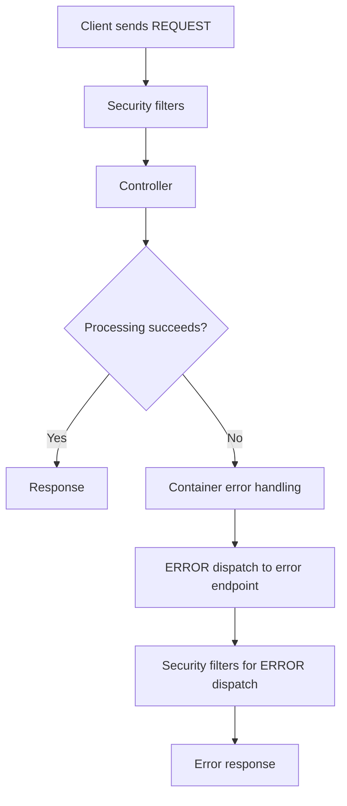

# Dispatch thông thường, lỗi hoặc bất đồng bộ khi ứng dụng có chính sách riêng

## 1. Một request có thể đi qua nhiều lần dispatch

Trong ứng dụng Servlet, một HTTP request không phải lúc nào cũng chỉ được xử lý đúng một lần ở một servlet mapping. Container có thể dispatch request qua các giai đoạn khác nhau:

- Request ban đầu từ client.
- Forward nội bộ sang servlet hoặc view khác.
- Include nội dung từ một resource khác.
- Dispatch đến error page sau khi có lỗi.
- Dispatch lại khi xử lý bất đồng bộ hoàn tất.

Mỗi lần dispatch có thể có **DispatcherType** khác nhau. Nếu ứng dụng có chính sách bảo mật riêng cho request thường, forward, error hoặc async, việc kiểm thử chỉ bằng một request GET thông thường là chưa đủ.

Trong module **SPRING_SECURITY_TESTING**, người học sử dụng `spring-security-test` để kiểm chứng xác thực, phân quyền và bảo vệ HTTP trên Servlet và Reactive bằng `MockMvc`, `WebTestClient`, `@WithMockUser`, `SecurityContext` và JWT/OAuth2/OIDC giả lập. Bài này tập trung vào dispatch trong Servlet, cách Spring Security áp dụng matcher theo dispatcher type, cách bảo vệ error/forward/async và cách kiểm thử những đường đi đó.

Sau bài học, bạn có thể:

- Phân biệt `REQUEST`, `FORWARD`, `INCLUDE`, `ERROR` và `ASYNC`.
- Chọn chính sách cho từng dispatcher type mà không vô tình mở rộng quyền của endpoint.
- Hiểu vì sao error dispatch có thể bị chặn và che mất lỗi ban đầu.
- Kiểm tra forward/include đến resource nội bộ theo quyền phù hợp.
- Kiểm thử async request bằng `asyncDispatch` và hiểu việc truyền `SecurityContext`.
- Phân biệt Servlet dispatch với xử lý exception/reactive pipeline trong WebFlux.

## 2. Các DispatcherType trong Servlet

Servlet API định nghĩa các loại dispatch phổ biến:

| DispatcherType | Khi nào xảy ra? | Ví dụ |
| --- | --- | --- |
| `REQUEST` | Request ban đầu do client gửi đến ứng dụng | `GET /api/orders/42` |
| `FORWARD` | Servlet hoặc controller forward nội bộ đến resource khác | Controller forward sang view hoặc servlet nội bộ |
| `INCLUDE` | Một resource include nội dung từ resource khác vào response hiện tại | JSP include fragment/header |
| `ERROR` | Container dispatch đến error page sau lỗi hoặc status error | Exception không được xử lý dẫn đến `/error` |
| `ASYNC` | Container dispatch lại khi xử lý bất đồng bộ hoàn tất | Servlet async hoặc Spring MVC async result |

Dispatcher type không phải HTTP method. Một request `GET` có thể bắt đầu là `REQUEST`, sau đó được forward hoặc error dispatch. HTTP method, URI, servlet path và dispatcher type là những thuộc tính khác nhau của cùng luồng xử lý.

### Hình dung một luồng có lỗi



Một lỗi có thể phát sinh sau khi request ban đầu đã qua authorization. Khi container dispatch sang `/error`, Spring Security có thể đánh giá request dispatch đó một lần nữa tùy cách filter được đăng ký và cấu hình. Nếu error endpoint bị bảo vệ như một endpoint thông thường nhưng không có Authentication phù hợp, response lỗi ban đầu có thể bị thay bằng `401` hoặc `403`.

## 3. Phân quyền theo dispatcher type

Spring Security Servlet hỗ trợ matcher theo dispatcher type trong `authorizeHttpRequests`:

```java
import jakarta.servlet.DispatcherType;

http.authorizeHttpRequests(auth -> auth
    .dispatcherTypeMatchers(DispatcherType.ERROR).permitAll()
    .requestMatchers("/assets/**").permitAll()
    .requestMatchers("/admin/**").hasRole("ADMIN")
    .anyRequest().authenticated()
);
```

`dispatcherTypeMatchers(DispatcherType.ERROR)` chỉ khớp request có dispatcher type `ERROR`. Nó khác với:

```java
.requestMatchers("/error").permitAll()
```

Rule path `/error` có thể cho phép cả request `REQUEST` trực tiếp đến URL đó. Rule theo dispatcher type cho phép error dispatch mà không tự động biến URL error thành một endpoint public cho mọi request thông thường.

### Thứ tự dispatcher matcher và path matcher

Các rule authorization vẫn tuân theo nguyên tắc first-match-wins. Nếu `ERROR` được cho phép, hãy đặt rule dispatcher type trước các rule URL tổng quát:

```java
.authorizeHttpRequests(auth -> auth
    .dispatcherTypeMatchers(DispatcherType.ERROR).permitAll()
    .requestMatchers("/admin/**").hasRole("ADMIN")
    .anyRequest().authenticated())
```

Điều này chỉ cho phép **error dispatch** ở tầng authorization. Nó không bỏ qua toàn bộ filter chain và không có nghĩa endpoint quản trị có thể được gọi trực tiếp bởi anonymous. Request trực tiếp có dispatcher type `REQUEST` vẫn phải đi qua rule path tương ứng.

### Không cho phép rộng FORWARD hoặc ASYNC một cách máy móc

Ví dụ:

```java
.dispatcherTypeMatchers(DispatcherType.FORWARD).permitAll()
.dispatcherTypeMatchers(DispatcherType.ASYNC).permitAll()
```

có thể bỏ qua các điều kiện quyền theo URL trong những lần dispatch đó. Một forward đến nội dung quản trị hoặc async redispatch của một endpoint nhạy cảm có thể vượt qua rule role/scope nếu chỉ xét dispatcher type.

Thông thường:

- Cho phép `ERROR` theo một chính sách hẹp nếu error dispatch cần render trang lỗi chung.
- Giữ `FORWARD`/`INCLUDE` qua authorization hoặc chỉ cho phép các target được xác định rõ.
- Với `ASYNC`, bảo đảm danh tính và quyền của request ban đầu vẫn được giữ; không dùng `permitAll` để tránh lỗi context propagation.

## 4. Error dispatch: tránh lỗi 403 che mất lỗi gốc

Một ứng dụng Spring Boot MVC thường có error endpoint như `/error`. Khi controller ném exception mà không được xử lý tại chỗ, container có thể dispatch đến error handling path. Nếu rule cuối yêu cầu authentication hoặc role, error dispatch có thể bị từ chối.

Ví dụ cấu hình dễ gây vấn đề:

```java
.authorizeHttpRequests(auth -> auth
    .requestMatchers("/api/**").authenticated()
    .anyRequest().denyAll())
```

Request `GET /api/orders/42` của user đã xác thực có thể vào controller. Nếu controller phát sinh exception và container chuyển đến `/error`, error dispatch không còn khớp `/api/**`; nó rơi vào `denyAll`. Client có thể nhận `403` thay vì error response dự kiến.

Một cách cấu hình thường dùng:

```java
@Bean
SecurityFilterChain applicationSecurity(HttpSecurity http) throws Exception {
    return http
        .authorizeHttpRequests(auth -> auth
            .dispatcherTypeMatchers(DispatcherType.ERROR).permitAll()
            .requestMatchers("/api/**").authenticated()
            .anyRequest().denyAll())
        .httpBasic(Customizer.withDefaults())
        .build();
}
```

Error dispatch được phép ở bước URL authorization, còn request trực tiếp đến endpoint API vẫn cần đăng nhập. Hãy giữ response lỗi chung, tránh trả stack trace, SQL, access token hoặc thông tin nhạy cảm cho client.

### Error dispatch không phải quyền truy cập resource gốc

Khi `ERROR` được permit, điều đó không cấp quyền đọc order, user hay dữ liệu quản trị. Error handler nên trả thông tin lỗi tối thiểu; không nên tải resource nhạy cảm hoặc dựng response chứa dữ liệu mà caller không có quyền xem.

Nếu error handler cần hiển thị thông tin gắn với tài nguyên, hãy kiểm tra quyền ở service trước khi đưa thông tin đó vào error response.

### Request trực tiếp đến /error

Nên có hai test riêng:

1. `REQUEST /error`: phải tuân theo chính sách URL bình thường.
2. `ERROR /error`: được xử lý theo rule dispatcher type nếu ứng dụng chủ ý cho phép.

Đây là lý do rule dispatcher type thường an toàn hơn việc mở rộng `/error` bằng `permitAll` mà không phân biệt loại dispatch.

## 5. FORWARD và INCLUDE: resource đích vẫn có thể nhạy cảm

`FORWARD` và `INCLUDE` thường xuất hiện trong ứng dụng dùng JSP, servlet hoặc view rendering. Request ban đầu có thể đến một controller công khai, sau đó forward đến resource nội bộ.

Ví dụ:

```java
@Controller
class ReportPageController {
    @GetMapping("/reports/preview")
    String preview() {
        return "forward:/WEB-INF/reports/preview.jsp";
    }
}
```

Một forward nội bộ có thể cần được cho phép để render trang, nhưng không nên cấp quyền rộng cho mọi forward. Cần phân biệt:

- Forward đến view/template nội bộ chỉ phục vụ request đã qua controller.
- Forward đến servlet hoặc controller khác có dữ liệu nhạy cảm.
- Forward từ một nguồn không đáng tin hoặc từ endpoint có quyền thấp.

Nếu cấu hình:

```java
.dispatcherTypeMatchers(DispatcherType.FORWARD).permitAll()
```

thì rule path của target có thể không còn được áp dụng cho forward dispatch đó. Hãy chỉ dùng khi toàn bộ nguồn forward và target được kiểm soát chặt, hoặc giữ authorization theo path/dispatcher để không mở nội dung quản trị.

Với `INCLUDE`, tương tự: nội dung được include có thể chứa fragment nhạy cảm. Không cho phép mọi include chỉ vì ứng dụng có JSP; hãy xác minh include target và quyền của request ban đầu.

Ví dụ giữ authorization theo target path:

```java
@Configuration
class ForwardDispatchSecurityConfig {
    @Bean
    SecurityFilterChain webSecurity(HttpSecurity http) throws Exception {
        return http
            .authorizeHttpRequests(auth -> auth
                .dispatcherTypeMatchers(DispatcherType.ERROR).permitAll()
                .requestMatchers("/web/admin/**").hasRole("ADMIN")
                .anyRequest().authenticated())
            .httpBasic(Customizer.withDefaults())
            .build();
    }
}

@RestController
class ForwardTargetController {
    @GetMapping("/web/reports/preview-target")
    String previewTarget() {
        return "preview";
    }

    @GetMapping("/web/admin/fragment")
    String adminFragment() {
        return "admin-only-fragment";
    }
}
```

Kiểm thử target:

```java
@WebMvcTest(ForwardTargetController.class)
@Import(ForwardDispatchSecurityConfig.class)
class ForwardAuthorizationTest {
    @Autowired MockMvc mvc;

    @Test
    @WithMockUser(roles = "USER")
    void authenticatedUserCanForwardToAllowedPreview() throws Exception {
        mvc.perform(forward("/web/reports/preview-target"))
           .andExpect(status().isOk());
    }

    @Test
    @WithMockUser(roles = "USER")
    void includeDispatchCannotReadAdminFragment() throws Exception {
        mvc.perform(get("/web/admin/fragment")
                .with(dispatchAs(DispatcherType.INCLUDE)))
           .andExpect(status().isForbidden());
    }
}
```

Test INCLUDE ở đây đặt dispatcher type để kiểm tra matcher/authorization của target. Nó không mô phỏng đầy đủ một JSP thực sự gọi `RequestDispatcher.include`; nếu ứng dụng dùng include thật, bổ sung integration test với servlet/view container.

## 6. ASYNC dispatch và SecurityContext

Spring MVC hỗ trợ xử lý bất đồng bộ thông qua `Callable`, `DeferredResult` và các kiểu return async khác. Servlet container có thể dispatch lại request khi kết quả sẵn sàng; lần dispatch đó có `DispatcherType.ASYNC`.

Ví dụ controller:

```java
@RestController
class AsyncReportController {
    @GetMapping("/api/reports/async")
    Callable<String> report(Authentication authentication) {
        String subject = authentication.getName();
        return () -> "report for " + subject;
    }
}
```

Spring Security tích hợp với Spring MVC để truyền `SecurityContext` cho các `Callable` được quản lý qua cơ chế async của MVC. Tuy nhiên, nếu ứng dụng tự gửi công việc sang executor riêng, không được mặc định rằng `SecurityContextHolder` tự xuất hiện trên thread mới.

### Executor riêng cần truyền SecurityContext

Không nên viết:

```java
executor.submit(() -> {
    Authentication authentication =
        SecurityContextHolder.getContext().getAuthentication();
    // Có thể null hoặc không phải principal của request hiện tại.
});
```

Với Servlet security context dạng ThreadLocal, có thể bọc executor:

```java
Executor delegate = Executors.newFixedThreadPool(4);
Executor securityAwareExecutor =
    new DelegatingSecurityContextExecutor(delegate);

securityAwareExecutor.execute(() -> {
    Authentication authentication =
        SecurityContextHolder.getContext().getAuthentication();
    processFor(authentication.getName());
});
```

`DelegatingSecurityContextExecutor` truyền SecurityContext tại thời điểm submit sang tác vụ. Hãy quản lý vòng đời executor và bảo đảm tác vụ không giữ context lâu hơn cần thiết. Không tự copy Authentication vào một static field hoặc chia sẻ mutable SecurityContext giữa các request.

### DeferredResult và callback tự quản lý

Với `DeferredResult`, ứng dụng có thể hoàn tất kết quả từ callback chạy ở thread khác. Nếu callback cần truy cập Authentication, hãy truyền context bằng executor/delegating wrapper hoặc truyền một định danh nghiệp vụ đã được xác minh theo thiết kế. Không đọc ThreadLocal từ thread tùy ý và giả định đó là người dùng đã khởi tạo request.

Nếu async task chỉ tính toán dữ liệu không cần danh tính, không cần truyền toàn bộ SecurityContext; chỉ truyền dữ liệu tối thiểu cần thiết.

## 7. Kiểm thử async bằng MockMvc

MockMvc cung cấp `asyncDispatch` để tiếp tục kiểm tra kết quả sau khi request async hoàn tất:

```java
@Configuration
class AsyncApiSecurityConfig {
    @Bean
    SecurityFilterChain apiSecurity(HttpSecurity http) throws Exception {
        return http
            .authorizeHttpRequests(auth -> auth
                .dispatcherTypeMatchers(DispatcherType.ERROR).permitAll()
                .requestMatchers(HttpMethod.GET, "/api/reports/async")
                    .hasAuthority("SCOPE_reports.read")
                .anyRequest().denyAll())
            .httpBasic(Customizer.withDefaults())
            .build();
    }
}

@WebMvcTest(AsyncReportController.class)
@Import(AsyncApiSecurityConfig.class)
class AsyncSecurityMvcTest {
    @Autowired MockMvc mvc;

    @Test
    @WithMockUser(username = "alice",
                  authorities = "SCOPE_reports.read")
    void asyncCallableKeepsAuthenticatedPrincipal() throws Exception {
        MvcResult result = mvc.perform(get("/api/reports/async"))
            .andExpect(request().asyncStarted())
            .andReturn();

        mvc.perform(asyncDispatch(result))
            .andExpect(status().isOk())
            .andExpect(content().string("report for alice"));
    }
}
```

Test có hai pha:

1. Gửi request ban đầu và xác nhận `asyncStarted()`.
2. Dùng `asyncDispatch(result)` để dispatch lại khi kết quả sẵn sàng, rồi kiểm tra response.

Đây là test quan trọng để chứng minh async MVC giữ được danh tính theo cơ chế tích hợp Spring Security. Nó không thay thế test cho executor riêng hoặc callback tự quản lý của ứng dụng.

### Kiểm tra thiếu authority trước khi async bắt đầu

Nếu endpoint yêu cầu scope:

```java
@Test
@WithMockUser(username = "alice", authorities = "SCOPE_profile.read")
void missingReportScopeIsDeniedBeforeAsyncStarts() throws Exception {
    mvc.perform(get("/api/reports/async"))
       .andExpect(status().isForbidden());
}
```

Request thiếu quyền phải bị từ chối trước khi tác vụ async được khởi chạy. Có thể bổ sung verify rằng service/executor không được gọi để chứng minh request không tạo side effect.

## 8. Kiểm thử ERROR dispatch và request trực tiếp

MockMvc có thể dựng request với dispatcher type cụ thể bằng request postprocessor:

```java
private static RequestPostProcessor dispatchAs(DispatcherType type) {
    return request -> {
        request.setDispatcherType(type);
        return request;
    };
}
```

Giả sử cấu hình:

```java
http.authorizeHttpRequests(auth -> auth
    .dispatcherTypeMatchers(DispatcherType.ERROR).permitAll()
    .requestMatchers("/api/**").authenticated()
    .anyRequest().denyAll());
```

Test:

```java
@RestController
class ErrorDispatchFixtureController {
    @RequestMapping("/error")
    String error() {
        return "handled";
    }
}

@WebMvcTest(ErrorDispatchFixtureController.class)
@Import(AsyncApiSecurityConfig.class)
class ErrorDispatchAuthorizationTest {
    @Autowired MockMvc mvc;

    @Test
    void errorDispatchCanReachErrorHandler() throws Exception {
        mvc.perform(get("/error").with(dispatchAs(DispatcherType.ERROR)))
           .andExpect(status().isOk());
    }

    @Test
    @WithMockUser
    void directRequestToErrorPathIsNotPublic() throws Exception {
        mvc.perform(get("/error").with(dispatchAs(DispatcherType.REQUEST)))
           .andExpect(status().isForbidden());
    }
}
```

Fixture trên dùng handler tối giản để cô lập dispatcher matcher; nếu test context có `BasicErrorController` mặc định của Spring Boot, dùng cấu hình test không đăng ký controller mặc định trùng `/error` hoặc kiểm tra error endpoint thực tế của ứng dụng. Trong ứng dụng thực, response error có thể là `4xx`/`5xx` theo lỗi gốc; điều cần xác nhận là error dispatch không bị authorization từ chối và request trực tiếp vẫn theo chính sách bình thường.

**Giới hạn quan trọng:** MockMvc không tự tái tạo đầy đủ mọi hành vi error dispatch của Servlet container khi controller ném exception. Một test gọi `get("/error")` với dispatcher type ERROR là test matcher/authorization theo dispatcher type. Muốn xác minh container thật tự dispatch khi exception hoặc status error, hãy bổ sung integration test chạy server embedded hoặc container phù hợp.

### Kiểm thử FORWARD

MockMvc có request builder `forward` để mô phỏng forward đến target. Ví dụ `ForwardAuthorizationTest` ở mục 5 kiểm tra forward tới preview đã xác thực và kiểm tra INCLUDE tới fragment admin bị từ chối. Nếu target có quyền riêng, test cần xác minh rule của target/dispatcher thay vì permit mọi FORWARD. Với servlet/JSP include thực tế, cần thêm integration test chạy qua container.

## 9. Filter registration phải bao phủ dispatcher types cần bảo vệ

Authorization rule chỉ chạy nếu Spring Security filter proxy được gọi cho dispatcher type đó. Trong Servlet container, filter registration có dispatcher type mapping. Nếu filter chỉ đăng ký cho `REQUEST`, error/async/forward dispatch có thể không đi qua cùng filter chain như dự kiến.

Vì vậy, khi kiểm thử các loại dispatch, xác minh:

- `DelegatingFilterProxy`/Spring Security filter registration có dispatcher types cần thiết.
- Cấu hình servlet container hoặc Spring Boot không loại trừ `ERROR`/`ASYNC` ngoài ý muốn.
- Các filter tùy chỉnh có dispatcher type mapping tương thích.
- MockMvc test không được coi là bằng chứng duy nhất cho filter registration ở embedded server.

Spring Boot và container có thể cung cấp registration mặc định khác nhau theo phiên bản/cấu hình. Nếu thay đổi registration, hãy test bằng embedded server với request thật để xác minh các filter chạy trong từng dispatch.

## 10. WebFlux: không có Servlet DispatcherType

WebFlux không chạy trên `HttpServletRequest`/`DispatcherServlet`. Vì vậy, các khái niệm `REQUEST`, `FORWARD`, `INCLUDE`, `ERROR` và `ASYNC` của Servlet không áp dụng trực tiếp cho Reactive.

Trong WebFlux:

- Request đi qua `WebFilter` và `SecurityWebFilterChain`.
- Exception được xử lý qua `@ExceptionHandler`, `@ControllerAdvice` hoặc `WebExceptionHandler`.
- Xử lý bất đồng bộ dựa trên `Mono`/`Flux` và Reactor pipeline.
- `SecurityContext` được truyền qua Reactor Context, truy xuất bằng `ReactiveSecurityContextHolder`.

Ví dụ:

```java
@EnableWebFluxSecurity
@Configuration
class ReactiveSecurityConfig {
    @Bean
    SecurityWebFilterChain reactiveSecurity(ServerHttpSecurity http) {
        return http
            .authorizeExchange(auth -> auth
                .pathMatchers(HttpMethod.GET, "/api/reports/async")
                    .hasAuthority("SCOPE_reports.read")
                .anyExchange().denyAll())
            .httpBasic(Customizer.withDefaults())
            .build();
    }
}

@RestController
class ReactiveReportController {
    @GetMapping("/api/reports/async")
    Mono<String> report() {
        return ReactiveSecurityContextHolder.getContext()
            .map(SecurityContext::getAuthentication)
            .map(Authentication::getName)
            .map(name -> "report for " + name);
    }
}
```

Không đọc `SecurityContextHolder` dạng ThreadLocal bên trong reactive pipeline. Việc chuyển thread trong Reactor không đảm bảo giữ ThreadLocal; dùng Reactor Context hoặc các cơ chế context propagation được hỗ trợ.

### WebTestClient kiểm tra async và exception

WebTestClient có thể kiểm tra response từ pipeline reactive:

```java
@WebFluxTest(ReactiveReportController.class)
@Import(ReactiveSecurityConfig.class)
class ReactiveReportSecurityTest {
    @Autowired WebTestClient client;

    @Test
    void authenticatedReaderCanGetAsyncReport() {
        client.mutateWith(mockUser("alice").authorities(
                    new SimpleGrantedAuthority("SCOPE_reports.read")))
              .get().uri("/api/reports/async")
              .exchange()
              .expectStatus().isOk()
              .expectBody(String.class)
              .isEqualTo("report for alice");
    }

    @Test
    void missingScopeIsForbidden() {
        client.mutateWith(mockUser("alice").roles("USER"))
              .get().uri("/api/reports/async")
              .exchange()
              .expectStatus().isForbidden();
    }
}
```

Với Reactive, không gọi `asyncDispatch` như MockMvc. `WebTestClient` chờ publisher hoàn tất và kiểm tra response. Nếu test dùng `mockJwt()` hoặc `mockUser()`, đó là kiểm thử authorization với principal giả lập; decoder JWT thật cần integration test riêng.

## 11. Ma trận test theo dispatcher type

Với ứng dụng Servlet có chính sách riêng, lập ma trận:

| Dispatcher type | Principal | Target | Kỳ vọng | Điều cần chứng minh |
| --- | --- | --- | --- | --- |
| `REQUEST` | Anonymous | `/api/reports` | `401`/redirect | Request ban đầu cần xác thực |
| `REQUEST` | Reader | `/api/reports` | `200` | Có scope đọc |
| `REQUEST` | User thường | `/admin/audit` | `403` | Thiếu role admin |
| `ERROR` | Anonymous/đang xử lý lỗi | `/error` | Error handler chạy | Error dispatch không bị chặn ngoài ý muốn |
| `REQUEST` | Anonymous | `/error` | Theo rule URL thường | Không mở trực tiếp error path |
| `FORWARD` | User đã xác thực | View nội bộ | Theo chính sách target | Không permit mọi forward |
| `INCLUDE` | User có quyền phù hợp | Fragment | Theo chính sách include | Không lộ fragment nhạy cảm |
| `ASYNC` | Reader | Async endpoint | Response thành công | SecurityContext được truyền đúng |
| `ASYNC` | User thiếu scope | Async endpoint | Bị từ chối | Không chạy tác vụ khi thiếu quyền |

Ma trận này là mẫu; ứng dụng không sử dụng JSP/include hoặc không có async endpoint có thể bỏ những dòng tương ứng. Không cần cấu hình riêng mọi dispatcher type nếu chính sách path-based hiện tại đã đáp ứng yêu cầu. Điều quan trọng là hiểu dispatch nào được container sử dụng và test những luồng ứng dụng thực sự có.

## 12. Những lỗi thường gặp và cách chẩn đoán

| Triệu chứng | Nguyên nhân có thể | Cách kiểm tra |
| --- | --- | --- |
| Exception gốc nhưng client nhận `403` | `ERROR` dispatch rơi vào fallback authorization | Thử matcher `dispatcherTypeMatchers(ERROR)` và test error handler |
| Anonymous gọi trực tiếp `/error` cũng được phép | Mở path `/error` bằng `permitAll` | Tách test REQUEST và ERROR dispatcher |
| Forward đến trang admin không cần role | Permit mọi `FORWARD` | Kiểm tra target và bỏ rule permit rộng |
| Async callable không thấy Authentication | Tác vụ chạy ngoài MVC async integration hoặc executor riêng | Dùng `DelegatingSecurityContextExecutor`/cơ chế context phù hợp |
| Test async chỉ kiểm tra request đầu | Chưa gọi `asyncDispatch` | Kiểm tra response sau khi async hoàn tất |
| MockMvc không tái hiện error dispatch container | MockMvc xử lý exception qua resolver thay vì container dispatch thật | Bổ sung embedded-server integration test |
| WebFlux test dùng ThreadLocal context | Nhầm mô hình Servlet với Reactor | Dùng `ReactiveSecurityContextHolder` |
| Rule dispatcher type không có tác dụng | Security filter proxy không được gọi cho dispatcher đó | Kiểm tra filter registration và dispatcher type mapping |

Khi điều tra, ghi nhận cả dispatcher type, method, URI, context path, principal, chain đã chọn và rule authorization đã khớp. Đừng sửa bằng cách `permitAll` toàn bộ error/forward/async trước khi biết lớp nào tạo ra phản hồi.

## 13. Thực hành: bảo vệ request, error và async

Một ứng dụng báo cáo có:

- `GET /api/reports/{id}`: cần `SCOPE_reports.read`.
- `GET /api/reports/async`: trả kết quả qua `Callable`.
- Error page `/error`: chỉ được phép cho error dispatch.
- Trang xem `/web/reports/preview`: forward đến view nội bộ.
- `/web/admin/**`: cần `ROLE_ADMIN`.

Hãy thực hiện:

1. Viết authorization rule cho request bình thường, đặt dispatcher matcher ERROR trước fallback và không permit rộng FORWARD/INCLUDE/ASYNC.
2. Viết test anonymous và reader cho endpoint report.
3. Tạo controller async trả `Callable`; kiểm tra `asyncStarted()` và `asyncDispatch(result)`, xác nhận principal đúng được giữ.
4. Tạo test `ERROR` dispatch tới error handler và test `REQUEST` trực tiếp đến `/error` để chứng minh hai luồng khác nhau.
5. Kiểm thử forward đến view; xác minh user không có quyền không thể forward để đọc nội dung admin.
6. Nếu dùng executor riêng hoặc DeferredResult callback, viết test chứng minh context được truyền có chủ đích hoặc công việc không dựa vào ThreadLocal.
7. Chạy thêm integration test trên embedded server để xác minh filter registration cho `ERROR` và `ASYNC`.
8. Nếu có WebFlux, viết bài test tương đương cho `Mono`/`Flux`, exception handler và `ReactiveSecurityContextHolder`; không dùng Servlet DispatcherType trong cấu hình Reactive.

**Tiêu chí hoàn thành:** request thường vẫn chịu chính sách method/path; error dispatch không bị chặn che lỗi gốc nhưng URL error không trở thành public; forward/include không mở nội dung ngoài quyền; async giữ đúng SecurityContext; filter registration được kiểm chứng trên server thật; Reactive được kiểm thử theo Reactor Context.
