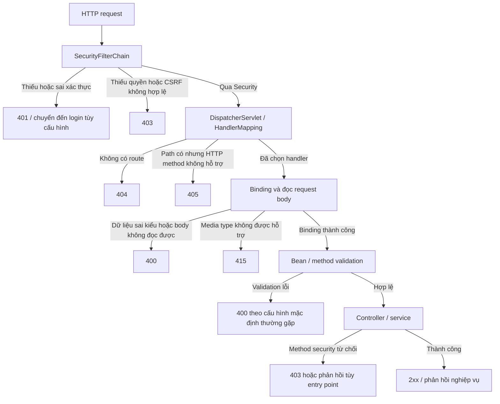

# Phân biệt lỗi phân quyền với lỗi routing, binding hoặc validation

Một request bị trả về `401`, `403` hay `400` không nhất thiết đã đi đến cùng một lớp xử lý. Khi kiểm thử HTTP authorization với **Spring Security Test**, cần xác định chính xác request bị chặn bởi Security filter, không khớp route, không chuyển đổi được dữ liệu đầu vào, hay không vượt qua validation. Nếu chỉ nhìn status code rồi kết luận “phân quyền sai”, bài kiểm thử rất dễ che giấu lỗi ở controller hoặc tạo cảm giác an toàn giả.

Bài này thuộc chương **Phân quyền HTTP** của **SPRING_SECURITY_TESTING**. Mục tiêu là kiểm chứng xác thực, phân quyền và bảo vệ HTTP thực tế trên ứng dụng **Servlet** và **Reactive** bằng `MockMvc`, `WebTestClient`, `@WithMockUser`, mock JWT/OAuth2/OIDC và cả ca được phép lẫn bị từ chối.

## 1. Một request đi qua những lớp nào?

### Servlet: từ Security filter đến controller

Trong ứng dụng Spring MVC thông thường, request đi qua `SecurityFilterChain` trước khi được `DispatcherServlet` định tuyến đến handler. Security có thể kết thúc request trước khi MVC tìm controller. Nếu request qua được Security, MVC mới tiếp tục chọn mapping, chuyển đổi path/query/body, kiểm tra validation và gọi controller. Method security (ví dụ `@PreAuthorize` trên service) có thể từ chối ở thời điểm gọi phương thức, tức là sau khi route đã được chọn.



Sơ đồ thể hiện thứ tự thường gặp, không phải một cam kết rằng mọi dự án đều trả status giống hệt nhau. `AuthenticationEntryPoint`, `AccessDeniedHandler`, `@ControllerAdvice`, các filter tùy chỉnh, handler lỗi và quy tắc giấu tài nguyên có thể thay đổi phản hồi.

**Hệ quả quan trọng:** Một URL không tồn tại vẫn có thể trả `401` hoặc `403` nếu Security chặn request trước bước tìm route. Vì vậy, status `403` **không chứng minh** URL đó có controller hợp lệ.

### Reactive: cùng nguyên tắc, khác thành phần

Với WebFlux, `SecurityWebFilterChain` xử lý bảo mật trước routing/handler trong luồng reactive. Dùng `WebTestClient` cùng các configurer thuộc `SecurityMockServerConfigurers` thay cho các request post-processor của MockMvc. Về chẩn đoán, vẫn cần tách bạch việc từ chối ở lớp Security với lỗi từ WebFlux routing, binding hoặc validation.

## 2. Đọc status code đúng ngữ cảnh

| HTTP status | Nguyên nhân điển hình | Cần kiểm chứng thêm |
|---|---|---|
| **401 Unauthorized** | Thiếu hoặc không hợp lệ thông tin xác thực ở API dùng HTTP Basic/Bearer | Có cấu hình entry point trả 401 không? Bearer token có bị reject? Header `WWW-Authenticate` có gì? |
| **403 Forbidden** | Đã xác thực nhưng thiếu authority/role; hoặc request bị CSRF protection từ chối | Identity thực tế là gì? Authority nào đang có? HTTP method có yêu cầu CSRF token không? |
| **404 Not Found** | Không khớp route; hoặc controller/service chủ động trả not found | Request có đến DispatcherServlet/handler không? Đường dẫn, context path, API prefix có đúng? |
| **400 Bad Request** | Sai kiểu `@PathVariable`/`@RequestParam`, JSON lỗi, `@Valid` thất bại | Exception được MVC/WebFlux xử lý là loại nào? Body và `Content-Type` có đúng không? |
| **405 Method Not Allowed** | Path có mapping nhưng HTTP method không được hỗ trợ | Có dùng đúng GET/POST/PUT/DELETE? Có `Allow` header không? |
| **415 Unsupported Media Type** | Controller không chấp nhận `Content-Type` của body | Request gửi JSON nhưng lại khai báo `text/plain`, hoặc `consumes` yêu cầu kiểu khác? |
| **422 Unprocessable Content** | Ứng dụng chủ động quy ước lỗi nghiệp vụ/validation là 422 | Có exception handler tùy chỉnh? Không mặc định suy ra Spring Security trả 422. |

Hai lưu ý thường gây nhầm:

- **401 không có nghĩa “thiếu quyền”.** Với Bearer API, 401 thường gắn với xác thực; thiếu authority của một JWT hợp lệ thường dẫn đến 403. Trong ứng dụng form login, request chưa đăng nhập có thể nhận **302 redirect đến trang login** thay vì 401.
- **403 không luôn có nghĩa “đăng nhập rồi nhưng thiếu role”.** `CsrfFilter` có thể chặn POST/PUT/PATCH/DELETE thiếu CSRF token bằng 403, kể cả trước khi đến controller. Với request chưa xác thực, cách `ExceptionTranslationFilter` chọn entry point hay denied handler còn phụ thuộc cấu hình và loại exception.

Không dựa vào tên status để xác định nguồn lỗi. Hãy kiểm tra **điều kiện của request**, **handler có được chọn hay không**, và **exception/entry point nào tạo phản hồi**.

## 3. Thiết kế thí nghiệm: giữ nguyên request, đổi một yếu tố

Giả sử API báo cáo có ba quy tắc:

1. `GET /api/reports/{id}` cần authority `SCOPE_reports.read`.
2. `POST /api/reports` cần `SCOPE_reports.write`.
3. Khi chưa qua kiểm tra Security, API trả theo entry point/handler đã cấu hình; khi đã qua Security, MVC xử lý mapping, binding và validation.

Ma trận sau tạo bằng chứng riêng cho từng nguyên nhân:

| Request | Identity / quyền | Input | Kỳ vọng thường gặp | Ý nghĩa |
|---|---|---|---|---|
| `GET /api/reports/42` | Chưa xác thực | ID hợp lệ | 401 | Bảo vệ xác thực |
| `GET /api/reports/42` | JWT hợp lệ, chỉ có `SCOPE_reports.write` | ID hợp lệ | 403 | Sai authority |
| `GET /api/reports/42` | JWT có `SCOPE_reports.read` | ID hợp lệ | 200 | Route, quyền và binding đều đi qua |
| `GET /api/reports/abc` | JWT có `SCOPE_reports.read` | `abc` không đổi được thành `Long` | 400 | Lỗi binding sau khi đã qua Security |
| `GET /api/reports/42/extra` | JWT có `SCOPE_reports.read` | URL không có mapping | 404 | Lỗi routing sau khi đã qua Security |
| `POST /api/reports` | JWT có `SCOPE_reports.write`, CSRF hợp lệ nếu được yêu cầu | `title` rỗng | 400 | Lỗi Bean Validation |
| `POST /api/reports/42` | Identity hợp lệ, CSRF hợp lệ nếu cần | Method không có mapping phù hợp | 405 | Lỗi HTTP method |
| `POST /api/reports` | JWT có `SCOPE_reports.write`, CSRF hợp lệ nếu cần | `Content-Type: text/plain` | 415 | Sai media type |

Đây là **kỳ vọng cho cấu hình ví dụ** ở phần tiếp theo, không phải bảng “Spring luôn trả như vậy”. Một dự án có `@ControllerAdvice` tùy biến, nhiều filter chain hoặc method security bổ sung phải điều chỉnh expected status cho đúng contract.

Nguyên tắc viết test là **mở khóa các lớp trước lớp mình muốn kiểm tra**. Muốn chứng minh lỗi routing thì gửi identity đủ quyền; muốn chứng minh lỗi validation thì dùng route, method, authority, media type và CSRF hợp lệ. Nếu bỏ qua bước này, security response có thể che hoàn toàn lỗi phía sau.

## 4. Ví dụ tối thiểu trên Servlet: controller và Security

Giả sử ứng dụng Spring Boot dùng Spring MVC, Spring Security OAuth2 Resource Server, Jakarta Validation và Java 17+. Controller sau minh họa một route GET có binding số và một route POST có validation:

```java
@RestController
@RequestMapping("/api/reports")
class ReportController {

    @GetMapping("/{id}")
    Map<String, Object> findById(@PathVariable Long id) {
        return Map.of("id", id);
    }

    @PostMapping
    ResponseEntity<Map<String, String>> create(
            @Valid @RequestBody CreateReport body) {
        return ResponseEntity.ok(Map.of("title", body.title()));
    }

    record CreateReport(@NotBlank String title) {}
}
```

```java
@Configuration
@EnableWebSecurity
class ApiSecurityConfig {

    @Bean
    SecurityFilterChain apiSecurity(HttpSecurity http) throws Exception {
        http.authorizeHttpRequests(auth -> auth
                .requestMatchers(HttpMethod.GET, "/api/reports/**")
                    .hasAuthority("SCOPE_reports.read")
                .requestMatchers(HttpMethod.POST, "/api/reports")
                    .hasAuthority("SCOPE_reports.write")
                .anyRequest().authenticated()
        );

        http.oauth2ResourceServer(oauth2 ->
                oauth2.jwt(Customizer.withDefaults()));
        return http.build();
    }
}
```

Ví dụ **giữ nguyên CSRF protection mặc định**: khi test POST qua MockMvc, thêm token bằng `.with(csrf())` để không nhầm lỗi CSRF với validation. API thực tế dùng Bearer token thuần stateless có thể cấu hình CSRF khác theo kiến trúc và threat model của hệ thống; bài kiểm thử phải phản ánh cấu hình thật.

`SCOPE_reports.read` là **authority**. Nó khác `ROLE_ADMIN`: biểu thức `hasRole("ADMIN")` thông thường kiểm tra authority `ROLE_ADMIN`, còn `hasAuthority("SCOPE_reports.read")` so khớp chính xác chuỗi authority. Khi dùng JWT Resource Server, converter mặc định thường tạo authority tiền tố `SCOPE_` từ claim `scope` hoặc `scp`; nếu ứng dụng dùng converter tùy chỉnh thì cần test theo converter đó.

## 5. MockMvc: chứng minh 403 là do thiếu quyền

Đưa Spring Security Test và Spring Boot Test vào test dependencies; ví dụ Gradle:

```kotlin
dependencies {
    testImplementation("org.springframework.boot:spring-boot-starter-test")
    testImplementation("org.springframework.security:spring-security-test")
}
```

Với `@SpringBootTest` + `@AutoConfigureMockMvc`, MockMvc chạy cùng filter chain của application context. Cấu hình ứng dụng Resource Server vẫn phải có các bean cần thiết để khởi tạo (chẳng hạn `JwtDecoder` hoặc cấu hình issuer/JWK hợp lệ); `jwt()` chỉ giả lập authentication cho request, không thay thế mọi bean khởi tạo của ứng dụng.

```java
import static org.springframework.security.test.web.servlet.request
        .SecurityMockMvcRequestPostProcessors.jwt;
import static org.springframework.security.test.web.servlet.request
        .SecurityMockMvcRequestPostProcessors.csrf;
import static org.springframework.test.web.servlet.request
        .MockMvcRequestBuilders.get;
import static org.springframework.test.web.servlet.request
        .MockMvcRequestBuilders.post;
import static org.springframework.test.web.servlet.result
        .MockMvcResultMatchers.handler;
import static org.springframework.test.web.servlet.result
        .MockMvcResultMatchers.status;

@SpringBootTest
@AutoConfigureMockMvc
class ReportSecurityMvcTest {

    @Autowired MockMvc mvc;

    private static RequestPostProcessor withScope(String scope) {
        return jwt().authorities(
                new SimpleGrantedAuthority("SCOPE_" + scope));
    }

    @Test
    void unauthenticatedRequestIsRejected() throws Exception {
        mvc.perform(get("/api/reports/42"))
                .andExpect(status().isUnauthorized());
    }

    @Test
    void validJwtWithoutReadScopeIsForbidden() throws Exception {
        mvc.perform(get("/api/reports/42")
                        .with(withScope("reports.write")))
                .andExpect(status().isForbidden());
    }

    @Test
    void authorizedRequestReachesExpectedHandler() throws Exception {
        mvc.perform(get("/api/reports/42")
                        .with(withScope("reports.read")))
                .andExpect(status().isOk())
                .andExpect(handler().handlerType(ReportController.class))
                .andExpect(handler().methodName("findById"));
    }

    @Test
    void invalidPathVariableIsBindingError() throws Exception {
        mvc.perform(get("/api/reports/not-a-number")
                        .with(withScope("reports.read")))
                .andExpect(status().isBadRequest());
    }

    @Test
    void absentRouteIsRoutingError() throws Exception {
        mvc.perform(get("/api/reports/42/extra")
                        .with(withScope("reports.read")))
                .andExpect(status().isNotFound());
    }

    @Test
    void invalidBodyIsValidationError() throws Exception {
        mvc.perform(post("/api/reports")
                        .with(withScope("reports.write"))
                        .with(csrf())
                        .contentType(MediaType.APPLICATION_JSON)
                        .content("{\"title\":\"\"}"))
                .andExpect(status().isBadRequest());
    }
}
```

Các import Java cho `RequestPostProcessor`, `SimpleGrantedAuthority`, `MediaType`, annotation JUnit/Spring và kiểu controller được lược bớt để tập trung vào phép thử; IDE có thể thêm import tương ứng. `@NotBlank` cần Bean Validation provider trên classpath, thường qua `spring-boot-starter-validation`.

Đọc chuỗi test từ trên xuống: ca thiếu xác thực loại trừ việc ai cũng vào được API; ca thiếu scope chứng minh authority thực sự được kiểm tra; ca thành công và assert handler chứng minh mapping tồn tại; hai ca 400/404 dùng **đúng scope đã thành công** nên lỗi không còn bị chồng bởi access control.

### Phân biệt hai loại 400 bằng exception

Status `400` chưa đủ phân biệt conversion và validation. Với MockMvc, kiểm tra loại MVC exception đã được xử lý:

```java
// GET /api/reports/not-a-number với JWT đủ scope
.andExpect(result ->
    assertInstanceOf(
        MethodArgumentTypeMismatchException.class,
        result.getResolvedException()));

// POST /api/reports, body {"title":""}, JWT đủ scope và CSRF hợp lệ
.andExpect(result ->
    assertInstanceOf(
        MethodArgumentNotValidException.class,
        result.getResolvedException()));
```

Hai đoạn trên là các **expectation nối tiếp** vào đúng request đã mô tả, không phải hai statement Java độc lập ở đầu một method. Tùy phiên bản Spring, kiểu binding, cách khai báo validation và `@ControllerAdvice`, exception thực tế có thể khác. Chẳng hạn JSON không hợp lệ thường gây `HttpMessageNotReadableException`; validation trên method parameter có thể đi qua `HandlerMethodValidationException`. Khi thay exception handler, cần xác nhận phản hồi và mã lỗi theo API contract thay vì cố định tên exception của framework.

### Phân biệt 405 và 415

```java
@Test
void wrongMethodIsNotAuthorizationFailure() throws Exception {
    mvc.perform(post("/api/reports/42")
                    .with(withScope("reports.write"))
                    .with(csrf())
                    .contentType(MediaType.APPLICATION_JSON)
                    .content("{\"title\":\"draft\"}"))
            .andExpect(status().isMethodNotAllowed());
}

@Test
void unsupportedContentTypeIsNotAuthorizationFailure() throws Exception {
    mvc.perform(post("/api/reports")
                    .with(withScope("reports.write"))
                    .with(csrf())
                    .contentType(MediaType.TEXT_PLAIN)
                    .content("draft"))
            .andExpect(status().isUnsupportedMediaType());
}
```

Trong ca 405, matcher `POST /api/reports` không khớp chính xác request `POST /api/reports/42`, nhưng quy tắc `anyRequest().authenticated()` vẫn cho identity đã xác thực đi tiếp để MVC báo sai method. Trong ca 415, security và CSRF đã qua, nhưng `@RequestBody` của controller không chấp nhận body `text/plain` theo cấu hình message converter hiện tại.

## 6. Cách quan sát Security có chặn trước MVC hay không

Khi test đang thất bại, thực hiện ba phép quan sát bổ sung:

1. Với cùng HTTP method/path/body, thử identity đủ quyền. Nếu kết quả đổi từ 403 sang 200/400/404/405 thì lớp Security đã che một kết quả phía sau. Đây là **dấu hiệu**, cần đối chiếu với quy tắc filter chain.
2. Dùng `.andDo(print())` của MockMvc để xem request, response, handler và resolved exception. `MvcResult.getHandler() == null` là manh mối request chưa vào MVC handler, nhưng **không tự chứng minh** nguyên nhân: có thể do filter chặn hoặc không có mapping.
3. Bật log `org.springframework.security` ở mức DEBUG **chỉ trong môi trường test** khi cần xem filter chain, matcher, principal và quyết định access. Đối chiếu với log `org.springframework.web`, exception resolver và route mapping; tránh ghi token/credential thật vào log.

Ví dụ một phép chẩn đoán có chủ đích:

```java
mvc.perform(get("/api/reports/42")
                .with(withScope("reports.write")))
        .andDo(print())
        .andExpect(status().isForbidden());

mvc.perform(get("/api/reports/42")
                .with(withScope("reports.read")))
        .andDo(print())
        .andExpect(status().isOk())
        .andExpect(handler().methodName("findById"));
```

Nếu đã có `@ControllerAdvice` đổi mọi exception thành một JSON body chung, đừng nhận diện nguồn lỗi chỉ bằng trường `message`. Kiểm tra status, exception/entry point, mã lỗi ứng dụng và test bằng input đối chứng. Exception xuất phát từ filter bảo mật thường xảy ra **ngoài** vòng xử lý exception của `@ControllerAdvice` cho controller.

## 7. Ba bẫy thường biến test routing/validation thành test Security

### Bẫy 1 — POST thiếu CSRF trả 403

Trong ứng dụng web có CSRF protection, request ghi dữ liệu cần token hợp lệ:

```java
// Có thể trả 403 do CSRF, chưa chắc đã vào @Valid
mockMvc.perform(post("/api/reports")
        .with(withScope("reports.write"))
        .contentType(MediaType.APPLICATION_JSON)
        .content("{\"title\":\"\"}"));

// Cho phép đi tiếp đến validation trong cấu hình có yêu cầu CSRF
mockMvc.perform(post("/api/reports")
        .with(withScope("reports.write"))
        .with(csrf())
        .contentType(MediaType.APPLICATION_JSON)
        .content("{\"title\":\"\"}"))
    .andExpect(status().isBadRequest());
```

Ở đây `csrf()` là helper của Spring Security Test, không phải token lấy từ browser. Chỉ thêm nó trong bài kiểm thử mà security policy thực tế yêu cầu CSRF. Việc disable CSRF riêng cho test để đạt 400 sẽ khiến kiểm thử không còn phản ánh chuỗi bảo mật đã triển khai.

### Bẫy 2 — Dùng role thay cho authority

```java
@WithMockUser(roles = "ADMIN")
// Thường tạo authority ROLE_ADMIN

@WithMockUser(authorities = "SCOPE_reports.read")
// Tạo đúng authority mà hasAuthority("SCOPE_reports.read") yêu cầu
```

`@WithMockUser` và `user("...")` thích hợp để kiểm tra authorization dựa trên `Authentication` giả lập; chúng **không đảm bảo** kiểu principal và claim giống một JWT/OIDC thực tế. Với Resource Server, ưu tiên `jwt()`; với session OAuth2 Login, dùng `oauth2Login()`; với OIDC Login, dùng `oidcLogin()`. Nếu controller khai báo `@AuthenticationPrincipal Jwt` hoặc service yêu cầu `JwtAuthenticationToken`, `@WithMockUser` có thể không phù hợp dù authorities “trông đúng”.

### Bẫy 3 — MockMvc không chạy đúng filter chain

`@AutoConfigureMockMvc(addFilters = false)` bỏ filter khỏi MockMvc và có thể khiến endpoint nhạy cảm trả 200 trong test dù production trả 401/403. Tương tự, `MockMvcBuilders.standaloneSetup(controller)` tự nó chỉ dựng MVC controller, không tự kích hoạt Spring Security; khi sử dụng builder dựa trên context, cần tích hợp Spring Security đúng cách, ví dụ `.apply(springSecurity())` trong setup phù hợp.

Test slice `@WebMvcTest` cần import security configuration/các bean phụ thuộc phù hợp để test đúng rule. Một `@MockBean` hoặc `@MockitoBean` cho service có thể làm controller trả 200 ngoài dự kiến hoặc giấu `@PreAuthorize` ở service thật. Chọn full context khi cần kiểm chứng các filter, controller và method security phối hợp.

## 8. Cùng ma trận trên WebFlux bằng WebTestClient

Trong ứng dụng Reactive, cấu hình minh họa tương đương là:

```java
@Configuration
@EnableWebFluxSecurity
class ReactiveSecurityConfig {

    @Bean
    SecurityWebFilterChain apiSecurity(ServerHttpSecurity http) {
        return http
                .authorizeExchange(exchange -> exchange
                        .pathMatchers(HttpMethod.GET, "/api/reports/**")
                            .hasAuthority("SCOPE_reports.read")
                        .anyExchange().authenticated())
                .oauth2ResourceServer(oauth2 ->
                        oauth2.jwt(Customizer.withDefaults()))
                .build();
    }
}
```

Với WebFlux test đã liên kết với `ApplicationContext` và Spring Security, dùng `SecurityMockServerConfigurers.mockJwt()`:

```java
import static org.springframework.security.test.web.reactive.server
        .SecurityMockServerConfigurers.mockJwt;

@WebFluxTest(ReportController.class)
@Import(ReactiveSecurityConfig.class)
class ReportSecurityWebFluxTest {

    @Autowired WebTestClient client;

    @Test
    void missingAuthenticationIsUnauthorized() {
        client.get().uri("/api/reports/42")
                .exchange()
                .expectStatus().isUnauthorized();
    }

    @Test
    void jwtWithoutReadAuthorityIsForbidden() {
        client.mutateWith(mockJwt().authorities(
                    new SimpleGrantedAuthority("SCOPE_reports.write")))
                .get().uri("/api/reports/42")
                .exchange()
                .expectStatus().isForbidden();
    }

    @Test
    void allowedJwtReachesController() {
        client.mutateWith(mockJwt().authorities(
                    new SimpleGrantedAuthority("SCOPE_reports.read")))
                .get().uri("/api/reports/42")
                .exchange()
                .expectStatus().isOk()
                .expectBody()
                .jsonPath("$.id").isEqualTo(42);
    }

    @Test
    void invalidPathVariableReturnsBadRequestAfterAuthorization() {
        client.mutateWith(mockJwt().authorities(
                    new SimpleGrantedAuthority("SCOPE_reports.read")))
                .get().uri("/api/reports/wrong-id")
                .exchange()
                .expectStatus().isBadRequest();
    }

    @Test
    void unknownRouteReturnsNotFoundAfterAuthorization() {
        client.mutateWith(mockJwt().authorities(
                    new SimpleGrantedAuthority("SCOPE_reports.read")))
                .get().uri("/api/reports/42/extra")
                .exchange()
                .expectStatus().isNotFound();
    }
}
```

Đoạn test giả định ứng dụng **thực sự chạy WebFlux** và đã có cấu hình cần thiết để khởi tạo Resource Server, đặc biệt `ReactiveJwtDecoder` nếu cấu hình JWT yêu cầu. Slice test không tự có tất cả bean của ứng dụng; hãy cung cấp cấu hình hoặc mock decoder thích hợp cho phiên bản Spring Boot đang dùng. `mockJwt()` tạo một authentication phục vụ test, không xác nhận chữ ký token.

Nếu tự tạo client để test WebFlux trong memory, cần bảo đảm đã tích hợp Spring Security:

```java
WebTestClient client = WebTestClient.bindToApplicationContext(context)
        .apply(springSecurity())
        .configureClient()
        .build();
```

Nếu không cấu hình Security cho client/context, test 200 có thể chỉ chứng minh handler hoạt động, không chứng minh quyền truy cập được bảo vệ.

## 9. Lỗi validation trong Servlet và Reactive

Có nhiều tầng được người dùng gọi chung là “validation” nhưng exception khác nhau:

| Tầng | Input ví dụ | Servlet: tín hiệu thường gặp | Reactive: tín hiệu thường gặp |
|---|---|---|---|
| Path/query binding | `id=abc` cho `Long` | `MethodArgumentTypeMismatchException` | `ServerWebInputException` và các nguyên nhân chuyển đổi |
| JSON decoding | JSON sai cú pháp, kiểu trường không chuyển đổi được | `HttpMessageNotReadableException` | `ServerWebInputException` / decoding exception |
| Bean Validation trên body | `@Valid @RequestBody` với `@NotBlank` sai | `MethodArgumentNotValidException` | `WebExchangeBindException` |
| Method parameter validation | `@Min`, `@NotNull` trên tham số phương thức | `HandlerMethodValidationException` hoặc cơ chế validation khác tùy version | Lỗi method validation tương ứng, tùy phiên bản/cấu hình |
| Business rule | ID hợp lệ nhưng tài nguyên không tồn tại | `ResponseStatusException`/domain exception do app phát | `ResponseStatusException`/domain exception do app phát |

Không tự gọi mọi 400 là “request bị security từ chối”. Với lỗi binding/validation, hãy kiểm tra rằng security condition đã thỏa và test có bằng chứng input bị từ chối ở đúng tầng. Nếu một `@ControllerAdvice` đổi lỗi validation thành 422, assert 422 cùng error code của app; khi không có override, 400 là lựa chọn thường gặp của Spring MVC/WebFlux.

## 10. Method security, nhiều filter chain và thứ tự matcher

Phân quyền HTTP ở `authorizeHttpRequests` hoặc `authorizeExchange` không phải nơi duy nhất từ chối quyền. Ví dụ:

```java
@Service
class ReportExportService {
    @PreAuthorize("hasAuthority('SCOPE_reports.export')")
    byte[] export(Long reportId) {
        // ...
        return new byte[0];
    }
}
```

Khi bật `@EnableMethodSecurity` (Servlet) hoặc cấu hình reactive method security tương ứng, một request có `SCOPE_reports.read` có thể **qua HTTP matcher** nhưng bị chặn khi controller gọi `export()`. Trong trường hợp này, MVC handler có thể đã được chọn; 403 xuất hiện ở lớp method security. Test phải chứng minh cả URL rule và method rule, và lời gọi cần đi qua Spring proxy, không tự gọi nội bộ `this.export(...)` để suy ra method security đã hoạt động.

Với nhiều `SecurityFilterChain` hoặc `SecurityWebFilterChain`, một endpoint có thể khớp chain khác dự kiến. Cần phân biệt:

- **Chain selection:** `securityMatcher(...)` hoặc matcher của chain quyết định request thuộc chain nào.
- **Rule selection:** `requestMatchers(...)` / `pathMatchers(...)` và thứ tự quy tắc quyết định quyền trong chain đã chọn.
- **Fallback:** `anyRequest()` / `anyExchange()` và các chain còn lại xử lý request chưa khớp quy tắc trước đó.

Một typo trong path matcher có thể khiến 401/403 xuất hiện vì fallback thay vì vì rule mục tiêu đang hoạt động. Để phát hiện, kết hợp test quyền **được phép**, quyền **bị từ chối**, route **không tồn tại** và các HTTP method liên quan.

## 11. OAuth2/OIDC giả lập và giới hạn của mock authentication

Spring Security Test cung cấp nhiều cách dựng authentication để thử các chính sách HTTP:

| Bối cảnh | Servlet MockMvc | Reactive WebTestClient |
|---|---|---|
| User và authority đơn giản | `@WithMockUser`, `user("name")` | `mockUser()` |
| Bearer JWT resource server | `jwt()` | `mockJwt()` |
| Opaque bearer token | `opaqueToken()` | `mockOpaqueToken()` |
| OAuth2 login | `oauth2Login()` | `mockOAuth2Login()` |
| OpenID Connect login | `oidcLogin()` | `mockOidcLogin()` |

Ví dụ với Servlet, OAuth2 Login và OIDC Login là **mô phỏng principal đăng nhập**, thích hợp kiểm tra quyền dựa trên authorities/claims mà ứng dụng đọc:

```java
mockMvc.perform(get("/account")
                .with(oauth2Login()))
        .andExpect(status().isOk());

mockMvc.perform(get("/profile")
                .with(oidcLogin()))
        .andExpect(status().isOk());
```

Hai route `/account` và `/profile` ở đây chỉ là minh họa: phải dùng endpoint và rule thực tế của ứng dụng. Nếu muốn kiểm tra claim OIDC cụ thể, hãy dựng user/ID token tương ứng thay vì dựa vào giá trị mock mặc định.

**Mock JWT không kiểm tra** chữ ký, `iss`, `aud`, `exp`, JWKS, quy trình lấy token, hay converter thật nếu test cấp authorities trực tiếp. `@WithMockUser` cũng không chứng minh bearer filter chấp nhận HTTP Authorization header. Cần bổ sung integration test gửi header `Authorization: Bearer ...` qua decoder/issuer/JWKS phù hợp khi yêu cầu là xác minh **cơ chế xác thực token thật**, chứ không chỉ kiểm tra authorization sau khi đã có `Authentication`.

## 12. Quy trình truy lỗi khi một test báo sai status

Khi kỳ vọng `403` nhưng nhận `404`, hoặc kỳ vọng `400` nhưng nhận `403`, áp dụng trình tự sau:

1. **Đóng băng request:** Ghi chính xác HTTP method, full path, query, headers, `Content-Type`, body, CSRF và cách tạo principal. Kiểm tra context path và API prefix.
2. **Xác nhận security chain:** Biết chain nào match và rule HTTP nào được áp dụng; xem authorities thực tế, không suy đoán từ role hoặc tên claim.
3. **Tạo request đối chứng có quyền:** Cùng method/path/body, đổi sang authentication có authority hợp lệ. Nếu trả 400/404/405/415, tiếp tục điều tra MVC/WebFlux; nếu vẫn 403, xem CSRF, method security và rule khác.
4. **Tách routing khỏi binding:** Dùng một URL chắc chắn hợp lệ để chứng minh handler tồn tại, sau đó thử path thiếu, method sai và tham số sai kiểu bằng các test riêng.
5. **Tách binding khỏi validation:** Đầu tiên gửi body JSON hợp lệ cả cú pháp lẫn kiểu; sau đó thay đúng một ràng buộc (`@NotBlank`, `@Size`, `@Min`). Kiểm tra loại exception hoặc error code do API định nghĩa.
6. **Kiểm chứng phản hồi thật:** Assert status cùng thông tin có ý nghĩa như handler, error code, `WWW-Authenticate` khi được cấu hình, và bảo đảm service không thực thi hành vi nhạy cảm trong ca bị từ chối.

Một mẫu kiểm thử có sức phân biệt tốt là:

```text
NO_AUTH + VALID_ROUTE + VALID_INPUT       -> 401 (hoặc 302 với form login)
WRONG_SCOPE + VALID_ROUTE + VALID_INPUT   -> 403
RIGHT_SCOPE + VALID_ROUTE + VALID_INPUT   -> 2xx
RIGHT_SCOPE + UNKNOWN_ROUTE              -> 404
RIGHT_SCOPE + BAD_PATH_VARIABLE          -> 400
RIGHT_SCOPE + INVALID_DTO + VALID_CSRF   -> 400
RIGHT_SCOPE + UNSUPPORTED_METHOD         -> 405
RIGHT_SCOPE + WRONG_CONTENT_TYPE         -> 415
```

Nếu ứng dụng cố ý ẩn sự tồn tại của tài nguyên bằng 404, dùng 422 cho validation, hoặc redirect đến login, hãy thay ma trận bằng contract thực tế và viết rõ lý do. Điều cần chứng minh luôn là **đúng lớp đã chặn request và đúng chính sách đã được thực thi**.

## 13. Bài thực hành tự kiểm tra

Cho một API `GET /api/admin/audit/{id}` yêu cầu `ROLE_AUDITOR` và một API `POST /api/admin/audit` yêu cầu thêm CSRF token. Hãy viết các test độc lập chứng minh:

1. Anonymous không được xem log; người có `ROLE_USER` cũng không được xem; `ROLE_AUDITOR` đọc một ID hợp lệ thành công.
2. Người có `ROLE_AUDITOR` gửi `id=abc` bị lỗi chuyển đổi kiểu, không bị “nhầm” thành 403.
3. Với identity hợp lệ, một đường dẫn `/api/admin/audit/1/unmapped` trả lỗi định tuyến theo API contract.
4. POST với body không hợp lệ nhưng có đủ role và CSRF đi đến validation; cùng request bỏ CSRF bị từ chối tại lớp bảo vệ request nếu policy có bật CSRF.
5. Test nhận diện một API chỉ có `@PreAuthorize` trên service: HTTP matcher cho đi qua nhưng quyền nghiệp vụ vẫn từ chối.

**Tiêu chí hoàn thành:** Mỗi test điều khiển đúng một biến, tên test nêu nguyên nhân cần chứng minh, và request thành công làm đối chứng cho request thất bại. Đừng chấp nhận một assertion `status().isForbidden()` đơn lẻ như bằng chứng rằng route, binding và validation đã được kiểm thử.
