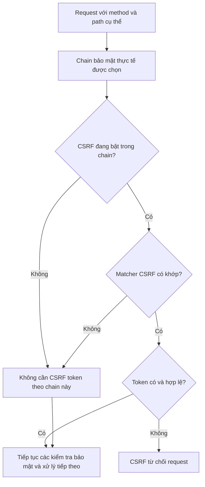

# Xác định request cần được bảo vệ theo cấu hình thực tế

Trong **Spring Security Testing**, câu hỏi quan trọng trước khi viết một ca kiểm thử CSRF là: *với URL, HTTP method, cơ chế đăng nhập và `SecurityFilterChain` hiện tại, request này có thực sự phải mang CSRF token không?* Không thể chỉ nhìn thấy `POST` rồi kết luận request sẽ bị từ chối, cũng không thể thấy API dùng JWT rồi mặc định kết luận CSRF đã bị tắt.

Bài học hướng dẫn cách đọc cấu hình bảo mật đang chạy, xác định request nào cần token và kiểm chứng bằng `spring-security-test` trên ứng dụng **Servlet (`MockMvc`)** hoặc **Reactive (`WebTestClient`)**. Trọng tâm là phân biệt việc CSRF có được áp dụng với việc người gọi có được xác thực và có quyền thực hiện thao tác hay không.

## 1. CSRF bảo vệ điều gì?

Cross-Site Request Forgery (CSRF) xảy ra khi trình duyệt của người dùng đã đăng nhập tự gửi thông tin xác thực đến một website, trong khi request gây thay đổi trạng thái lại được kích hoạt từ nguồn không đáng tin cậy. Cookie phiên là ví dụ phổ biến: một trang lạ có thể khiến trình duyệt gửi request đến ứng dụng, và trình duyệt tự đính kèm cookie phù hợp.

CSRF token bổ sung một giá trị mà phía tấn công thông thường không thể tự cung cấp hợp lệ. Trên server, Spring Security so sánh token của request với token được lưu hoặc xác định bởi `CsrfTokenRepository`/cơ chế tương ứng. Khi request thuộc diện cần CSRF mà token thiếu hoặc không hợp lệ, bộ lọc CSRF từ chối request trước khi logic nghiệp vụ được gọi.

Hai câu hỏi khác nhau cần được tách bạch:

- **Có cần CSRF token không?** Phụ thuộc vào chuỗi lọc bảo mật được chọn và quy tắc CSRF áp dụng cho request.
- **Request có được phép thực hiện không?** Còn phụ thuộc vào đăng nhập, vai trò, scope, quy tắc phân quyền, dữ liệu đầu vào và xử lý nghiệp vụ.

`permitAll()` chỉ nới quy tắc **phân quyền**. Nó không tự tắt CSRF. Tương tự, `@WithMockUser` tạo danh tính giả lập cho phép thử nhưng không tự cung cấp CSRF token.

## 2. Quy trình xác định request cần CSRF

Hãy đánh giá một request theo thứ tự sau, sử dụng **cấu hình thực sự được nạp trong môi trường kiểm thử**:

1. **Xác định `SecurityFilterChain` được chọn.** Với Servlet có nhiều chain, Spring Security chọn chain đầu tiên có `securityMatcher` khớp request, thường dựa trên `@Order`. Các quy tắc ở chain sau không được áp dụng bổ sung cho request đã khớp chain trước.
2. **Kiểm tra CSRF có bật trong chain đó không.** Trên ứng dụng web Spring Security thông thường, CSRF được bật mặc định. Cấu hình `csrf(csrf -> csrf.disable())` chỉ tắt CSRF cho chain tương ứng. Nếu request không đi qua bộ lọc CSRF thì không có kiểm tra token của Spring Security ở bước này.
3. **Kiểm tra matcher xác định request cần bảo vệ.** Mặc định, các method `GET`, `HEAD`, `TRACE`, `OPTIONS` không yêu cầu CSRF token; các method khác, điển hình là `POST`, `PUT`, `PATCH`, `DELETE`, yêu cầu token. Có thể thay đổi kết luận này bằng matcher tùy chỉnh.
4. **Kiểm tra ngoại lệ theo đường dẫn hoặc matcher.** Ví dụ `ignoringRequestMatchers("/webhooks/**")` trong cấu hình Servlet loại các request khớp khỏi yêu cầu CSRF. Cần đối chiếu chính xác method, path, servlet path và loại matcher thực tế; đừng suy ra từ tên endpoint.
5. **Nếu CSRF áp dụng, kiểm tra token được gửi theo đúng cơ chế.** Token có thể đến từ form parameter hoặc header; nơi lưu và cách giải mã token phụ thuộc `CsrfTokenRepository` và request handler. Token thiếu hoặc không hợp lệ sẽ bị từ chối.
6. **Đánh giá xác thực và phân quyền riêng biệt.** Token CSRF hợp lệ không cấp quyền truy cập. Request vẫn có thể trả `401`, `302`, `403` hoặc trạng thái khác vì các quy tắc bảo mật không liên quan đến CSRF.



### Quy tắc mặc định theo HTTP method

| Method | CSRF mặc định | Ý nghĩa khi thiết kế kiểm thử |
| --- | --- | --- |
| `GET` | Không yêu cầu | Dùng cho đọc dữ liệu; kiểm tra request không cần token. |
| `HEAD` | Không yêu cầu | Được xem là method an toàn trong matcher mặc định. |
| `OPTIONS` | Không yêu cầu | Ví dụ preflight CORS không yêu cầu token theo matcher mặc định; CORS vẫn là cơ chế riêng. |
| `TRACE` | Không yêu cầu | Được loại trừ trong matcher mặc định, nhưng máy chủ hoặc firewall có thể chặn TRACE vì lý do khác. |
| `POST` | Yêu cầu | Kiểm tra thiếu token, token sai và token hợp lệ. |
| `PUT` / `PATCH` / `DELETE` | Yêu cầu | Áp dụng cùng nguyên tắc với POST. |

**Lưu ý:** Bảng mô tả *matcher CSRF mặc định*, không bảo đảm endpoint tồn tại hoặc trả `200`. Ví dụ, request `HEAD` đến endpoint chỉ hỗ trợ `POST` có thể nhận `405` vì routing, dù không cần CSRF token. Một endpoint `GET` mà lại thay đổi dữ liệu là lỗi thiết kế HTTP: việc không yêu cầu CSRF trên GET không khiến thao tác thay đổi trạng thái đó an toàn.

## 3. Đọc cấu hình và rút ra ma trận request

Xét ứng dụng Servlet minh họa có ba thao tác:

- `GET /demo/profile`: đọc hồ sơ; yêu cầu người dùng đã đăng nhập.
- `POST /demo/profile`: cập nhật hồ sơ; yêu cầu đăng nhập và CSRF token.
- `POST /demo/public-action`: endpoint công khai theo phân quyền, nhưng vẫn yêu cầu CSRF token.
- `POST /demo/webhook`: endpoint nhận callback từ hệ thống bên ngoài, được miễn CSRF bằng cấu hình cụ thể.

Cấu hình bảo mật:

```java
@Configuration
@EnableWebSecurity
class DemoSecurityConfiguration {

    @Bean
    SecurityFilterChain securityFilterChain(HttpSecurity http) throws Exception {
        http
            .csrf(csrf -> csrf
                .ignoringRequestMatchers("/demo/webhook"))
            .authorizeHttpRequests(auth -> auth
                .requestMatchers("/demo/webhook", "/demo/public-action").permitAll()
                .anyRequest().authenticated())
            .formLogin(Customizer.withDefaults());

        return http.build();
    }
}
```

Controller tối giản để các kiểm thử bên dưới có kết quả xác định:

```java
@RestController
@RequestMapping("/demo")
class DemoController {

    @GetMapping("/profile")
    String profile() {
        return "profile";
    }

    @PostMapping("/profile")
    ResponseEntity<Void> saveProfile() {
        return ResponseEntity.noContent().build();
    }

    @PostMapping("/public-action")
    ResponseEntity<Void> publicAction() {
        return ResponseEntity.noContent().build();
    }

    @PostMapping("/webhook")
    ResponseEntity<Void> webhook() {
        return ResponseEntity.noContent().build();
    }
}
```

Các đoạn mã minh họa lược bỏ phần `import` và giả định các lớp nằm trong phạm vi component scan của ứng dụng Spring Boot. Khi chạy ở dự án thật, thay đường dẫn và mã trạng thái thành hành vi thực tế của controller.

| Request | Xác thực theo ví dụ | CSRF bắt buộc? | Căn cứ |
| --- | --- | --- | --- |
| `GET /demo/profile` | Có | Không | Method GET được loại theo matcher mặc định. |
| `POST /demo/profile` | Có | Có | Method POST và không thuộc ngoại lệ. |
| `POST /demo/public-action` | Không | Có | `permitAll()` không tác động đến CSRF. |
| `POST /demo/webhook` | Không | Không | Path được chỉ rõ trong `ignoringRequestMatchers`. |
| `DELETE /demo/profile` | Có | Có | Method DELETE cần CSRF, dù controller ví dụ chưa khai báo route DELETE. |

Với hàng cuối, nếu muốn kiểm chứng **403 do CSRF**, trước tiên cần có endpoint DELETE phù hợp. Khi gửi token hợp lệ, ứng dụng minh họa có thể trả `405 Method Not Allowed` vì không có handler DELETE; không được gọi đó là lỗi CSRF.

## 4. Kiểm chứng bằng MockMvc và `spring-security-test`

Để thử đúng chuỗi lọc Servlet, dùng `@SpringBootTest` cùng `@AutoConfigureMockMvc` hoặc cấu hình `MockMvc` có gắn `springSecurity()`. Tránh `MockMvcBuilders.standaloneSetup(controller)` mà không gắn chuỗi lọc nếu mục tiêu là xác minh CSRF: request có thể qua controller và làm bài test tưởng như thành công nhưng thực tế không kiểm tra `CsrfFilter`.

Dependency kiểm thử cần có `spring-security-test` (với Spring Boot thường được đưa vào test dependencies bên cạnh `spring-boot-starter-test`). Các tiện ích chính:

- `@WithMockUser`: giả lập người dùng đăng nhập, giúp cô lập phép kiểm thử CSRF khỏi lỗi chưa xác thực.
- `.with(csrf())`: thêm CSRF token hợp lệ vào request.
- `.with(csrf().useInvalidToken())`: thêm token không hợp lệ để thử nhánh bị từ chối.
- `.with(csrf().asHeader())`: gửi token theo header thay vì form parameter.

```java
import static org.springframework.security.test.web.servlet.request.SecurityMockMvcRequestPostProcessors.csrf;
import static org.springframework.test.web.servlet.request.MockMvcRequestBuilders.get;
import static org.springframework.test.web.servlet.request.MockMvcRequestBuilders.post;
import static org.springframework.test.web.servlet.result.MockMvcResultMatchers.status;

@SpringBootTest
@AutoConfigureMockMvc
class CsrfProtectionTest {

    @Autowired
    MockMvc mvc;

    @Test
    @WithMockUser
    void getProfileDoesNotNeedCsrfToken() throws Exception {
        mvc.perform(get("/demo/profile"))
            .andExpect(status().isOk());
    }

    @Test
    @WithMockUser
    void postProfileWithoutTokenIsRejected() throws Exception {
        mvc.perform(post("/demo/profile"))
            .andExpect(status().isForbidden());
    }

    @Test
    @WithMockUser
    void postProfileWithInvalidTokenIsRejected() throws Exception {
        mvc.perform(post("/demo/profile").with(csrf().useInvalidToken()))
            .andExpect(status().isForbidden());
    }

    @Test
    @WithMockUser
    void postProfileWithValidTokenSucceeds() throws Exception {
        mvc.perform(post("/demo/profile").with(csrf()))
            .andExpect(status().isNoContent());
    }

    @Test
    void permitAllEndpointStillRequiresToken() throws Exception {
        mvc.perform(post("/demo/public-action"))
            .andExpect(status().isForbidden());

        mvc.perform(post("/demo/public-action").with(csrf().asHeader()))
            .andExpect(status().isNoContent());
    }

    @Test
    void ignoredWebhookCanPostWithoutToken() throws Exception {
        mvc.perform(post("/demo/webhook"))
            .andExpect(status().isNoContent());
    }
}
```

Điểm quan trọng là **kiểm thử cặp đối chứng**: cùng method, path và danh tính, request thiếu token bị từ chối còn request có token hợp lệ được xử lý thành công. Chỉ có một assertion `403` là chưa đủ để kết luận CSRF hoạt động, vì `403` cũng có thể đến từ phân quyền hoặc quy tắc khác. Với endpoint công khai trong ví dụ, cặp đối chứng còn chứng minh `permitAll()` không vô hiệu hóa CSRF.

Nếu endpoint trả trạng thái khác `204`, thay `.isNoContent()` bằng kết quả nghiệp vụ đúng; cần giữ lại đối chứng *thiếu token / token hợp lệ*. Kiểm tra response body hoặc thay đổi dữ liệu nếu cần chứng minh handler đã thực sự chạy, đặc biệt khi ứng dụng có exception handler hoặc filter tùy chỉnh.

## 5. Khi cấu hình thực tế có nhiều chain hoặc matcher tùy chỉnh

Đừng suy kết quả từ một đoạn `csrf()` rời rạc. Trước hết lập bảng phân loại theo chain:

| Cấu hình thực tế | `POST /api/orders` | `POST /app/settings` |
| --- | --- | --- |
| Chain đầu khớp `/api/**` và gọi `csrf.disable()`; chain web phía sau bật CSRF | Không cần token theo chain API | Cần token theo chain web |
| Một chain chung bật CSRF mặc định, không đặt ngoại lệ | Cần token | Cần token |
| Một chain chung bật CSRF, `ignoringRequestMatchers("/api/**")` | Không cần token nếu matcher khớp | Cần token |

Đây là **các cấu hình giả định để so sánh**, không phải quy tắc mặc định cho tất cả API. Việc API dùng JWT, OAuth2 hay OIDC không quyết định một cách tự động kết quả của `CsrfFilter`. Cách token xác thực được gửi có ý nghĩa đối với đánh giá rủi ro: nếu trình duyệt tự gửi cookie hoặc thông tin xác thực, CSRF vẫn có thể là mối đe dọa; nếu client chủ động gắn Bearer token vào `Authorization` header và server không dựa vào thông tin xác thực tự gửi, mô hình rủi ro khác. Nhưng **khi kiểm thử**, kỳ vọng cuối cùng vẫn phải dựa trên chain và matcher đã cấu hình.

Ví dụ về một ngoại lệ khác trong chain Servlet:

```java
http.csrf(csrf -> csrf
    .ignoringRequestMatchers("/external/callback/**"));
```

Ngoại lệ trên không tự miễn CSRF cho tất cả `/external/**`. Cần có kiểm thử cho đường dẫn nằm trong và ngoài phạm vi ngoại lệ, đồng thời cân nhắc phương pháp xác thực webhook riêng (chẳng hạn xác minh chữ ký). Nếu dùng `requireCsrfProtectionMatcher(...)`, chính matcher tùy chỉnh đó quyết định request nào phải mang token; bảng method mặc định có thể không còn áp dụng.

Đặc biệt chú ý các trường hợp cấu hình hoặc môi trường test làm thay đổi thực tế:

- **`securityMatcher` và `@Order`:** endpoint có thể được xử lý bởi chain khác dự kiến. Hãy kiểm tra đường dẫn khớp và thứ tự chain trước khi nghi ngờ `csrf()`.
- **`csrf.disable()`:** áp dụng cho chain được cấu hình; đừng suy ra cho mọi chain.
- **`@WebMvcTest`:** test slice có thể chỉ nạp một phần cấu hình. Nếu kiểm tra chính sách bảo mật của ứng dụng, chủ động import chain liên quan hoặc chọn integration test nạp cấu hình thật.
- **`@AutoConfigureMockMvc(addFilters = false)`:** vô hiệu hóa việc đăng ký các filter trong MockMvc, khiến kiểm thử không phản ánh quy tắc CSRF thực tế.
- **Request path và matcher:** context path, servlet path, API version, đường dẫn con và matcher tùy chỉnh có thể làm request khớp nhánh khác dự kiến.
- **Method bị chặn ở lớp khác:** `TRACE` hoặc method lạ có thể bị firewall/container chặn trước controller; lỗi này không chứng minh CSRF matcher yêu cầu token.

## 6. Tương đương trên Reactive với WebTestClient

Ứng dụng WebFlux sử dụng `SecurityWebFilterChain` và cấu hình `ServerHttpSecurity`, thay vì `SecurityFilterChain`/`HttpSecurity` của Servlet. Tư duy vẫn giống nhau: xác định chain có hiệu lực, matcher cần CSRF, ngoại lệ và token. Với WebFlux, `SecurityMockServerConfigurers.csrf()` thêm CSRF token hợp lệ trong kiểm thử `WebTestClient`; `mockUser()` mô phỏng người dùng đã xác thực.

Ví dụ dưới đây giả định ứng dụng **WebFlux** có endpoint `POST /demo/profile` trả `204` khi xử lý thành công và CSRF đang bật cho endpoint đó:

```java
import static org.springframework.security.test.web.reactive.server.SecurityMockServerConfigurers.csrf;
import static org.springframework.security.test.web.reactive.server.SecurityMockServerConfigurers.mockUser;
import static org.springframework.security.test.web.reactive.server.SecurityMockServerConfigurers.springSecurity;

@SpringBootTest
class ReactiveCsrfProtectionTest {

    @Autowired
    ApplicationContext context;

    WebTestClient client;

    @BeforeEach
    void setUp() {
        client = WebTestClient.bindToApplicationContext(context)
            .apply(springSecurity())
            .configureClient()
            .build();
    }

    @Test
    void requestWithoutTokenIsRejected() {
        client.mutateWith(mockUser())
            .post().uri("/demo/profile")
            .exchange()
            .expectStatus().isForbidden();
    }

    @Test
    void requestWithTokenSucceeds() {
        client.mutateWith(mockUser()).mutateWith(csrf())
            .post().uri("/demo/profile")
            .exchange()
            .expectStatus().isNoContent();
    }
}
```

Đây là cấu hình kiểm thử khi `WebTestClient` được bind vào application context. Nếu kiểm thử qua cổng HTTP thực bằng một client khác, cần thực hiện luồng nhận và gửi token phù hợp với cơ chế CSRF của ứng dụng. Không trộn mutator của `MockMvc` vào `WebTestClient` hoặc dùng Servlet `HttpSecurity` để suy ra cấu hình Reactive.

## 7. Từ kiểm thử giả lập đến HTTP thực tế

`.with(csrf())` hoặc `.mutateWith(csrf())` rất phù hợp để xác minh **server bắt buộc và chấp nhận token trong những nhánh nào**. Tuy nhiên, chúng không tự kiểm chứng toàn bộ quá trình browser lấy token, lưu cookie/session rồi gửi lại khi submit form hoặc gọi API.

Với các bài kiểm thử HTTP đầu cuối, cần xác nhận thêm:

1. Client lấy token qua form/endpoint hoặc cơ chế cấp token mà ứng dụng hỗ trợ.
2. Cookie, session và token được giữ đúng ngữ cảnh giữa request nhận token và request thay đổi trạng thái.
3. Token được gửi bằng tên parameter/header tương thích với `CsrfTokenRepository` và request handler.
4. Trường hợp thiếu token, sai token, sai session và token hợp lệ tạo ra các kết quả tương ứng.

Ví dụ, cấu hình `CookieCsrfTokenRepository` thường gắn với cookie `XSRF-TOKEN` và header `X-XSRF-TOKEN`, trong khi cơ chế mặc định ở Servlet có thể lưu token trong HTTP session. Ở các phiên bản Spring Security có xử lý token phục vụ chống BREACH, giá trị token được render/gửi ra client còn phụ thuộc request handler; không nên tự giả định có thể sao chép nguyên giá trị cookie sang header ở **mọi** cấu hình.

## 8. Bộ ca kiểm thử nên có cho một chức năng thay đổi dữ liệu

Sau khi đọc chain thật, chọn ít nhất các ca phù hợp sau:

| Nhóm | Request kiểm thử | Điều cần chứng minh |
| --- | --- | --- |
| Method an toàn | `GET` không có CSRF token, đã xác thực nếu cần | Không bị bộ lọc CSRF từ chối. |
| Method thay đổi trạng thái | `POST`/`PUT`/`PATCH`/`DELETE` thiếu token, đã xác thực | Bị từ chối khi matcher yêu cầu token. |
| Token sai | Cùng request với token không hợp lệ | Bị từ chối dù có danh tính hợp lệ. |
| Token hợp lệ | Cùng request với token đúng | Đi tiếp đến xử lý nghiệp vụ/phân quyền. |
| Endpoint `permitAll` | `POST` công khai nhưng không có ngoại lệ CSRF | Vẫn cần token nếu matcher CSRF khớp. |
| Ngoại lệ có chủ đích | `POST` đúng path được miễn CSRF | Không bị CSRF chặn; các cơ chế bảo vệ khác vẫn hoạt động. |
| Ranh giới ngoại lệ | `POST` path gần giống nhưng không khớp ngoại lệ | Vẫn bị CSRF chặn nếu thuộc chain yêu cầu token. |
| Nhiều chain | Cùng method ở hai vùng URL có chính sách khác nhau | Mỗi request tuân theo chain được chọn. |

Khi một ca `403` thất bại, kiểm tra lần lượt: request đã khớp chain nào, filter CSRF có hoạt động không, matcher có khớp không, token có hợp lệ không, rồi mới đến phân quyền. Với `401` hoặc redirect đăng nhập, cần kiểm tra danh tính và cấu hình entry point. Đừng sửa test bằng cách thêm `csrf()` vào tất cả request: điều đó có thể che đi sai lệch giữa chính sách mong muốn và chính sách đang chạy.

## Ghi nhớ

**Một request phải mang CSRF token khi nó đi qua chain có CSRF đang bật và khớp quy tắc yêu cầu bảo vệ của chain đó.** HTTP method là điểm xuất phát hữu ích, nhưng ngoại lệ, matcher tùy chỉnh, nhiều chain và cấu hình test mới quyết định hành vi thực tế. Kiểm thử tốt luôn ghép **thiếu token → bị từ chối** với **token hợp lệ → đi tiếp**, giữ nguyên danh tính và dữ liệu, đồng thời xác minh riêng xác thực và phân quyền.
