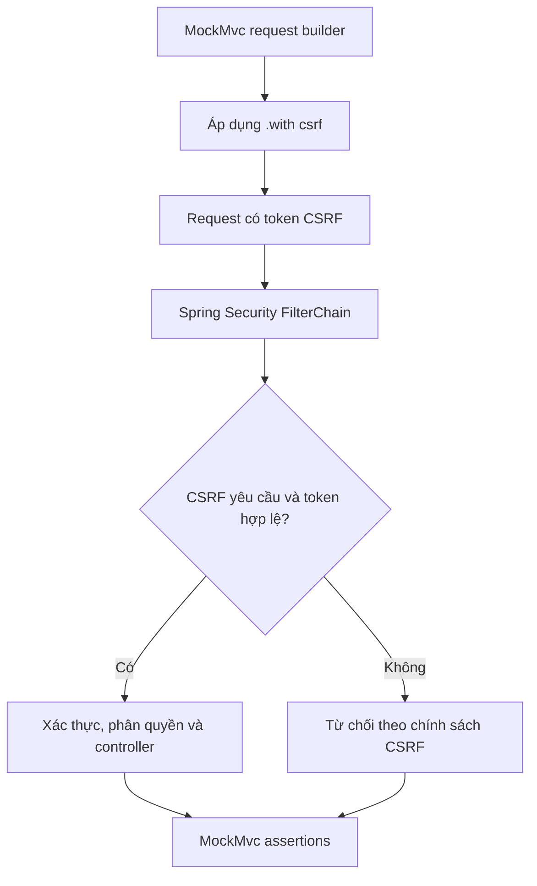

# csrf làm RequestPostProcessor cho MockMvc

Khi kiểm thử HTTP trên ứng dụng **Spring Security Servlet** bằng `MockMvc`, ta thường cần gửi một request `POST`, `PUT`, `PATCH` hoặc `DELETE` đi qua cơ chế CSRF. Tự tạo chuỗi token, tự đặt tên header và tự chuẩn bị session cho từng phép thử vừa dài dòng vừa dễ sai. Thư viện **`spring-security-test`** cung cấp `SecurityMockMvcRequestPostProcessors.csrf()`, một **`RequestPostProcessor`** dùng cùng `MockMvc` để thêm CSRF token vào request kiểm thử.

Mục đích của bài là hiểu rõ `csrf()` làm gì khi gọi `.with(csrf())`, cách dùng token hợp lệ và không hợp lệ, cách gửi qua parameter hoặc header, và điều kiện cần có để assertion kiểm thử phản ánh **cấu hình bảo vệ HTTP thực tế**. `csrf()` xử lý token CSRF; các công cụ như `@WithMockUser`, `user()`, `jwt()` hay `oauth2Login()` mới đảm nhận phần mô phỏng danh tính/xác thực.

## 1. `csrf()` nằm ở đâu trong luồng MockMvc?

Khai báo static import:

```java
import static org.springframework.security.test.web.servlet.request
    .SecurityMockMvcRequestPostProcessors.csrf;
```

Sử dụng với request builder:

```java
mockMvc.perform(post("/demo/notes").with(csrf()))
    .andExpect(status().isNoContent());
```

Ở đây:

- `post("/demo/notes")` tạo một request `POST` trong `MockMvc`.
- `csrf()` tạo một đối tượng triển khai giao diện **`org.springframework.test.web.servlet.request.RequestPostProcessor`**.
- `.with(...)` yêu cầu request builder áp dụng post-processor trước khi chuyển request vào chuỗi filter và Spring MVC.
- Post-processor chuẩn bị CSRF token cho request, để cơ chế kiểm tra CSRF của Spring Security có thể chấp nhận token hợp lệ khi request được xử lý.
- `.andExpect(...)` kiểm tra kết quả của **toàn bộ request** sau khi qua filter, phân quyền và controller. `csrf()` tự nó không tạo kết quả HTTP `204`.

`csrf()` **không phải** một filter, annotation hoặc lựa chọn bật/tắt CSRF trong cấu hình ứng dụng. Nó là công cụ dựng **request kiểm thử**. Điều kiện cần là request đang thực sự đi qua Spring Security filter chain, và chain đó đang yêu cầu CSRF token.



Với endpoint không cần CSRF token (chẳng hạn `GET` theo matcher mặc định hoặc endpoint được miễn trừ), việc gọi `csrf()` không chứng minh rằng endpoint thực sự được bảo vệ. Cần đối chiếu với `SecurityFilterChain` hoặc các matcher được ứng dụng sử dụng.

## 2. Thiết lập môi trường có Spring Security Test

`csrf()` thuộc dependency kiểm thử `spring-security-test`:

```groovy
// Gradle
dependencies {
    testImplementation 'org.springframework.security:spring-security-test'
}
```

```xml
<!-- Maven -->
<dependency>
    <groupId>org.springframework.security</groupId>
    <artifactId>spring-security-test</artifactId>
    <scope>test</scope>
</dependency>
```

Trong dự án Spring Boot, `@SpringBootTest` kết hợp `@AutoConfigureMockMvc` là một cách thông dụng để đưa cấu hình ứng dụng và các security filter vào phép thử:

```java
@SpringBootTest
@AutoConfigureMockMvc
class NotesSecurityTest {
    @Autowired
    MockMvc mockMvc;
}
```

Nếu tự dựng `MockMvc` từ `WebApplicationContext`, phải kết nối Spring Security:

```java
@Autowired
WebApplicationContext context;

MockMvc mockMvc = MockMvcBuilders
    .webAppContextSetup(context)
    .apply(springSecurity())
    .build();
```

Ví dụ thứ hai cần static import:

```java
import static org.springframework.security.test.web.servlet.setup
    .SecurityMockMvcConfigurers.springSecurity;
```

Ngược lại, `MockMvcBuilders.standaloneSetup(controller)` nếu không gắn filter bảo mật và cấu hình tương ứng chỉ chạy phần MVC, khiến việc “kiểm thử CSRF” thiếu đối tượng cần kiểm thử. Tương tự, khi dùng `@AutoConfigureMockMvc(addFilters = false)`, request không đi qua các filter được đăng ký tự động.

## 3. Ví dụ xuyên suốt: endpoint POST yêu cầu CSRF và vai trò EDITOR

Giả sử ứng dụng Servlet có hai endpoint:

| Request | Hành vi mong muốn | Chính sách |
| --- | --- | --- |
| `GET /demo/notes` | Trả danh sách ghi chú | Cho truy cập công khai, không cần CSRF theo matcher mặc định. |
| `POST /demo/notes` | Tạo ghi chú, trả `204` trong ví dụ | Cần CSRF token và người dùng có role `EDITOR`. |

Một cấu hình giản lược như sau:

```java
@Configuration
@EnableWebSecurity
class DemoSecurityConfiguration {

    @Bean
    SecurityFilterChain securityFilterChain(HttpSecurity http) throws Exception {
        http
            .csrf(Customizer.withDefaults())
            .authorizeHttpRequests(auth -> auth
                .requestMatchers(HttpMethod.GET, "/demo/notes").permitAll()
                .requestMatchers(HttpMethod.POST, "/demo/notes").hasRole("EDITOR")
                .anyRequest().denyAll())
            .httpBasic(Customizer.withDefaults());

        return http.build();
    }
}

@RestController
@RequestMapping("/demo/notes")
class DemoNotesController {

    @GetMapping
    String list() {
        return "notes";
    }

    @PostMapping
    ResponseEntity<Void> create() {
        return ResponseEntity.noContent().build();
    }
}
```

Các đoạn mã minh họa lược bỏ `import` thông thường và giả định controller/configuration được nạp bởi ứng dụng Spring Boot trong test. Trên dự án thật, thay endpoint, role và trạng thái thành kết quả nghiệp vụ đang có.

### Ca 1: POST không gửi token

```java
@Test
@WithMockUser(username = "editor", roles = "EDITOR")
void missingCsrfToken_isRejected() throws Exception {
    mockMvc.perform(post("/demo/notes"))
        .andExpect(status().isForbidden());
}
```

Danh tính đã được giả lập bằng `@WithMockUser`. Request vẫn bị từ chối do không có CSRF token. Với cấu hình xử lý lỗi mặc định, mã trạng thái thường là `403 Forbidden`. Việc cố định danh tính đủ quyền giúp hạn chế nhầm lỗi CSRF với lỗi đăng nhập/phân quyền.

### Ca 2: POST có token hợp lệ từ `csrf()`

```java
@Test
@WithMockUser(username = "editor", roles = "EDITOR")
void validCsrfToken_allowsRequestToReachController() throws Exception {
    mockMvc.perform(post("/demo/notes").with(csrf()))
        .andExpect(status().isNoContent());
}
```

`.with(csrf())` thêm dữ liệu CSRF hợp lệ vào request kiểm thử. Khi filter chấp nhận token và người dùng có role `EDITOR`, controller ví dụ trả `204 No Content`. Kết quả này tạo **đối chứng** cho ca thiếu token.

Không nên xem “có `csrf()`” là “chắc chắn thành công”. Nếu controller trả `400` do input không hợp lệ hoặc chính sách yêu cầu role khác, kết quả sẽ khác dù kiểm tra CSRF đã được vượt qua.

### Ca 3: POST có token không hợp lệ

```java
@Test
@WithMockUser(username = "editor", roles = "EDITOR")
void invalidCsrfToken_isRejected() throws Exception {
    mockMvc.perform(post("/demo/notes")
            .with(csrf().useInvalidToken()))
        .andExpect(status().isForbidden());
}
```

`useInvalidToken()` chuyển post-processor sang chế độ tạo token **không hợp lệ** cho phép thử âm tính. Ca này khác ca thiếu token: request có trường chứa token nhưng giá trị không được chấp nhận. Nó phát hiện trường hợp ứng dụng chỉ kiểm tra token có tồn tại mà không kiểm tra tính hợp lệ.

## 4. Một lớp test hoàn chỉnh với ba ca đối chứng

Đặt ba ca vào cùng một lớp để thấy rõ chỉ có **trạng thái CSRF token** thay đổi:

```java
import org.junit.jupiter.api.Test;
import org.springframework.beans.factory.annotation.Autowired;
import org.springframework.boot.test.autoconfigure.web.servlet.AutoConfigureMockMvc;
import org.springframework.boot.test.context.SpringBootTest;
import org.springframework.security.test.context.support.WithMockUser;
import org.springframework.test.web.servlet.MockMvc;

import static org.springframework.security.test.web.servlet.request
    .SecurityMockMvcRequestPostProcessors.csrf;
import static org.springframework.test.web.servlet.request
    .MockMvcRequestBuilders.get;
import static org.springframework.test.web.servlet.request
    .MockMvcRequestBuilders.post;
import static org.springframework.test.web.servlet.result
    .MockMvcResultMatchers.status;

@SpringBootTest
@AutoConfigureMockMvc
class CsrfRequestPostProcessorTest {

    @Autowired
    MockMvc mockMvc;

    @Test
    @WithMockUser(username = "editor", roles = "EDITOR")
    void postWithoutToken_returns403() throws Exception {
        mockMvc.perform(post("/demo/notes"))
            .andExpect(status().isForbidden());
    }

    @Test
    @WithMockUser(username = "editor", roles = "EDITOR")
    void postWithValidToken_returns204() throws Exception {
        mockMvc.perform(post("/demo/notes").with(csrf()))
            .andExpect(status().isNoContent());
    }

    @Test
    @WithMockUser(username = "editor", roles = "EDITOR")
    void postWithInvalidToken_returns403() throws Exception {
        mockMvc.perform(post("/demo/notes").with(csrf().useInvalidToken()))
            .andExpect(status().isForbidden());
    }

    @Test
    void getWithoutToken_returns200() throws Exception {
        mockMvc.perform(get("/demo/notes"))
            .andExpect(status().isOk());
    }
}
```

`GET` ở ví dụ không yêu cầu CSRF token và được phân quyền `permitAll()`; không cần gắn `csrf()` để “chữa” một lỗi `403` không liên quan. Trong bài kiểm thử nghiêm ngặt hơn, nên xác minh thêm kết quả nghiệp vụ và trạng thái dữ liệu: hai ca âm tính không được tạo ghi chú, còn ca token hợp lệ thực sự tạo ghi chú.

## 5. `csrf()` dạng request parameter và dạng header

Mặc định, `csrf()` thêm CSRF token vào **request parameter**:

```java
mockMvc.perform(post("/demo/notes")
        .with(csrf()))
    .andExpect(status().isNoContent());
```

Khi muốn kiểm thử trường hợp ứng dụng nhận token từ **HTTP header**, gọi `asHeader()`:

```java
mockMvc.perform(post("/demo/notes")
        .with(csrf().asHeader()))
    .andExpect(status().isNoContent());
```

Hai biến thể âm tính tương ứng:

```java
// Token sai qua request parameter
mockMvc.perform(post("/demo/notes")
        .with(csrf().useInvalidToken()))
    .andExpect(status().isForbidden());

// Token sai qua HTTP header
mockMvc.perform(post("/demo/notes")
        .with(csrf().asHeader().useInvalidToken()))
    .andExpect(status().isForbidden());
```

Với cấu hình CSRF mặc định trên Servlet, tên parameter thường là `_csrf` và tên header thường là `X-CSRF-TOKEN`. Nếu ứng dụng cấu hình `CookieCsrfTokenRepository`, quy ước thông dụng là cookie `XSRF-TOKEN` và header `X-XSRF-TOKEN`. Các tên thực tế được quyết định bởi token repository và cấu hình của ứng dụng; trong test, dùng post-processor thay vì tự hard-code tên header là cách thuận tiện để kiểm tra filter.

**Lưu ý về token trong trình duyệt:** Một số cấu hình Spring Security có CSRF token được biểu diễn/mã hóa để giảm rủi ro BREACH và xử lý token bằng `CsrfTokenRequestHandler`. Post-processor giúp tạo request hợp lệ trong MockMvc; nó không xác minh toàn bộ quá trình giao diện nhận token, cookie/session được lưu hay JavaScript lấy token từ cookie rồi gửi header. Các luồng đó cần kiểm thử tích hợp qua HTTP/trình duyệt thực.

## 6. Ghép `csrf()` với authentication RequestPostProcessor

Spring Security Test có các công cụ phục vụ những lớp bảo mật khác nhau:

| Công cụ | Làm gì trong kiểm thử Servlet | Có thay `csrf()` được không? |
| --- | --- | --- |
| `@WithMockUser` | Gắn người dùng giả lập vào security context của test. | Không. |
| `user("editor").roles("EDITOR")` | Gắn người dùng giả lập cho một request MockMvc. | Không. |
| `jwt()` | Tạo authentication kiểu JWT cho kiểm thử resource server. | Không. |
| `oauth2Login()` / `oidcLogin()` | Giả lập OAuth2/OIDC login để kiểm thử nhánh bảo mật tương ứng. | Không. |
| `csrf()` | Thêm CSRF token kiểm thử hợp lệ; có biến thể token sai/header. | Không xác thực hoặc cấp quyền cho người dùng. |

Khi chỉ muốn tạo danh tính cho **một request**, có thể dùng `user()` và `csrf()` cùng nhau:

```java
import static org.springframework.security.test.web.servlet.request
    .SecurityMockMvcRequestPostProcessors.user;

mockMvc.perform(post("/demo/notes")
        .with(user("editor").roles("EDITOR"))
        .with(csrf()))
    .andExpect(status().isNoContent());
```

Điều kiện quan trọng vẫn là mock request phải được xử lý qua Spring Security filter chain. Kết hợp các post-processor giúp phép thử giữ chính xác hai thông tin độc lập: **ai gọi request** và **request có token CSRF hay không**.

Đối với endpoint xử lý JWT, có thể có test tương tự:

```java
// Minh họa cho chain resource server vẫn đang yêu cầu CSRF.
mockMvc.perform(post("/api/notes")
        .with(jwt())
        .with(csrf()))
    .andExpect(status().isNoContent());
```

Đoạn cuối **chỉ minh họa cách ghép**: muốn chạy phải có `/api/notes`, cấu hình `oauth2ResourceServer` phù hợp và quyền đủ để nhận `204`. Không được suy ra chỉ từ `jwt()` rằng CSRF bắt buộc hoặc đã được tắt. Nếu API thật sử dụng Bearer token chủ động gắn vào header và cấu hình vô hiệu hóa CSRF cho chain đó, test sẽ có kỳ vọng khác.

### Token hợp lệ nhưng vẫn trả 403: phân biệt CSRF và quyền

Trong ví dụ, đổi danh tính thành role `VIEWER`:

```java
mockMvc.perform(post("/demo/notes")
        .with(user("viewer").roles("VIEWER"))
        .with(csrf()))
    .andExpect(status().isForbidden());
```

Token CSRF hợp lệ nhưng người dùng thiếu role `EDITOR`. Lỗi `403` ở đây là **phân quyền**, vì vậy không thể dùng một assertion `403` đơn lẻ để chứng minh bộ lọc CSRF đang chạy. Muốn quy trách nhiệm cho CSRF, hãy cố định cùng một danh tính đủ quyền, kiểm tra cả trường hợp token hợp lệ và thiếu/sai token.

## 7. Dùng `csrf()` với các HTTP method

Theo matcher CSRF mặc định, các method `GET`, `HEAD`, `TRACE` và `OPTIONS` không cần token; các method không thuộc nhóm này phải mang token nếu request đi qua chain bật CSRF. Chính sách đó có thể đổi bằng matcher tùy chỉnh hoặc ngoại lệ.

```java
// Những endpoint này chỉ là ví dụ: cần handler phù hợp trên ứng dụng thật.
mockMvc.perform(put("/demo/notes/42").with(csrf()));
mockMvc.perform(patch("/demo/notes/42").with(csrf()));
mockMvc.perform(delete("/demo/notes/42").with(csrf()));
```

Đặc biệt chú ý các thao tác upload file/multipart:

```java
mockMvc.perform(multipart("/demo/attachments")
        .file("file", new byte[] {1, 2, 3})
        .with(csrf()));
```

Trong ứng dụng thực, cách phân tích multipart và vị trí CSRF token (parameter/header) có thể phụ thuộc cấu hình bộ lọc và xử lý multipart. Luồng multipart từ trình duyệt cần được thử riêng, nhất là khi bạn muốn bảo đảm token được xử lý đúng trước khi nhận và ghi file. Đoạn minh họa chỉ cho thấy cách gắn `RequestPostProcessor` vào builder.

## 8. Khi nào `.with(csrf())` không đủ để kết luận tính đúng đắn?

| Tình huống | Sai lầm thường gặp | Cách xử lý |
| --- | --- | --- |
| Test không có security filter | Request `POST` qua controller dù thiếu token, khiến kết luận sai về CSRF. | Dùng `@AutoConfigureMockMvc` có filter hoặc `webAppContextSetup(...).apply(springSecurity())`. |
| Nhiều `SecurityFilterChain` | Dựa vào cấu hình chain khác với chain khớp URL đang thử. | Kiểm tra `securityMatcher` và thứ tự `@Order`. |
| CSRF bị tắt hoặc request được miễn | Gắn `csrf()` rồi tưởng endpoint đang được bảo vệ. | Thử request thiếu token và xem matcher, `csrf.disable()`, `ignoringRequestMatchers(...)`. |
| `permitAll()` | Tưởng không cần CSRF vì không cần đăng nhập. | Kiểm tra CSRF độc lập với authorization. |
| Chỉ kiểm tra `403` | Không rõ bị chặn vì CSRF hay thiếu role. | Giữ danh tính có quyền, so sánh thiếu token / hợp lệ / sai token. |
| Gửi token hợp lệ nhưng vẫn lỗi | Nhầm lỗi nghiệp vụ, validator, authorization với lỗi CSRF. | Kiểm tra status, response body, quyền, input và filter chain. |
| Cấu hình custom repository/handler | Tự đặt `_csrf` hoặc header sai, không đúng cách token được xử lý. | Đọc cấu hình token repository/request handler, thử cả luồng client thực tế. |
| `@WebMvcTest` chỉ nạp một phần ứng dụng | Kiểm thử chạy với filter chain khác dự định. | Nạp/import cấu hình bảo mật liên quan hoặc dùng integration test với ứng dụng đầy đủ. |

Một lỗi khó phát hiện là sửa tất cả ca `403` bằng cách thêm `.with(csrf())`. Cách này có thể làm một test “xanh” nhưng che mất câu hỏi quan trọng: endpoint đó có thực sự cần CSRF token theo thiết kế hay không? Trước khi thêm post-processor, hãy xác định chính sách CSRF kỳ vọng cho method, path và chain tương ứng.

## 9. Kiểm tra controller không bị gọi khi token bị từ chối

Với endpoint thay đổi dữ liệu, mã trạng thái chỉ là một phần của bằng chứng. Test tốt còn xác minh rằng thao tác nghiệp vụ **không diễn ra** khi token thiếu hoặc sai. Ví dụ nếu controller gọi `noteService.create(...)`, có thể sử dụng Mockito để kiểm tra service không nhận lệnh tạo ghi chú khi request thiếu token, và nhận đúng một lệnh khi token hợp lệ.

Một hướng kiểm chứng thực tế là:

1. Chuẩn bị dữ liệu ban đầu, tài khoản có quyền và cùng input hợp lệ.
2. Gửi `POST` thiếu token; assert `403` và xác minh dữ liệu không đổi.
3. Gửi `POST` với `csrf().useInvalidToken()`; assert `403` và xác minh dữ liệu không đổi.
4. Gửi `POST` với `csrf()`; assert trạng thái thành công và xác minh dữ liệu được tạo đúng.

Nếu mục tiêu là kiểm tra **toàn bộ trải nghiệm trình duyệt**, dùng thêm bài test end-to-end: lấy token do server render/trả về, giữ cookie/session tương ứng, gửi request thành công rồi thử token thiếu/sai. `MockMvc` với `csrf()` giúp cô lập bảo vệ phía server nhưng không thay thế các bước cấp phát và truyền token của browser.

## 10. Phân biệt với Reactive WebTestClient

`SecurityMockMvcRequestPostProcessors.csrf()` là **RequestPostProcessor cho MockMvc/Servlet**. Với ứng dụng **WebFlux/Reactive**, Spring Security Test dùng một API khác:

```java
import static org.springframework.security.test.web.reactive.server
    .SecurityMockServerConfigurers.csrf;

webTestClient.mutateWith(mockUser("editor"))
    .mutateWith(csrf())
    .post().uri("/demo/notes")
    .exchange()
    .expectStatus().isNoContent();
```

Đây chỉ là cách diễn đạt tương ứng khi client đã được cấu hình Spring Security dành cho WebFlux và endpoint đủ quyền/trả `204`. Trong Reactive, không dùng `MockMvcRequestBuilders.post(...).with(csrf())`, và không lấy `useInvalidToken()` từ request post-processor của Servlet để áp dụng cho `WebTestClient`. Muốn kiểm thử token sai qua HTTP thật, lấy token từ ứng dụng, giữ đúng cookie/session rồi gửi một giá trị đã thay đổi theo cấu hình CSRF thực tế.

## 11. Bài tập thực hành

Ứng dụng có các endpoint:

- `GET /library/books`: công khai, chỉ đọc.
- `POST /library/books`: yêu cầu role `LIBRARIAN` và CSRF.
- `DELETE /library/books/7`: yêu cầu role `LIBRARIAN` và CSRF.
- `POST /events/webhook`: được cấu hình `permitAll()` và nằm trong danh sách miễn CSRF.

Hãy quyết định có cần `.with(csrf())` không, và dự đoán nguyên nhân nếu kết quả sai:

| Test | Kỳ vọng |
| --- | --- |
| Người dùng `LIBRARIAN` gửi `GET /library/books` không token | Không bị CSRF từ chối. |
| Người dùng `LIBRARIAN` gửi `POST /library/books` không token | Bị CSRF từ chối (thường `403`). |
| Người dùng `LIBRARIAN` gửi `POST /library/books` với `csrf()` | Vượt CSRF, tiếp tục xử lý nghiệp vụ. |
| Người dùng `LIBRARIAN` gửi `DELETE /library/books/7` với `csrf().useInvalidToken()` | Bị CSRF từ chối (thường `403`). |
| Người dùng `VIEWER` gửi `POST /library/books` với `csrf()` | Vượt CSRF nhưng bị từ chối do thiếu role. |
| Client gửi `POST /events/webhook` không token | Không bị chặn bởi CSRF do ngoại lệ đã cấu hình; còn phụ thuộc các kiểm tra khác. |

**Gợi ý mở rộng:** Thay cách gửi token hợp lệ từ parameter sang `csrf().asHeader()` và thử cùng một request. Sau đó kiểm tra lại cấu hình `CsrfTokenRepository`/request handler và triển khai một phép thử trình duyệt thực sự lấy token rồi gửi nó qua header.

## Ghi nhớ

`csrf()` của `SecurityMockMvcRequestPostProcessors` là một **`RequestPostProcessor`** được gắn vào `MockMvc` bằng `.with(csrf())`. Dùng `csrf()` cho token hợp lệ, `csrf().useInvalidToken()` cho token sai, và `csrf().asHeader()` khi muốn gửi token qua header. Hãy luôn có ca **thiếu token** để đối chứng, giữ người dùng có đủ quyền và chắc chắn test đang chạy qua filter chain thực tế. Token CSRF chỉ đáp ứng một lớp bảo vệ; xác thực, phân quyền và hành vi nghiệp vụ vẫn cần kiểm chứng riêng.
