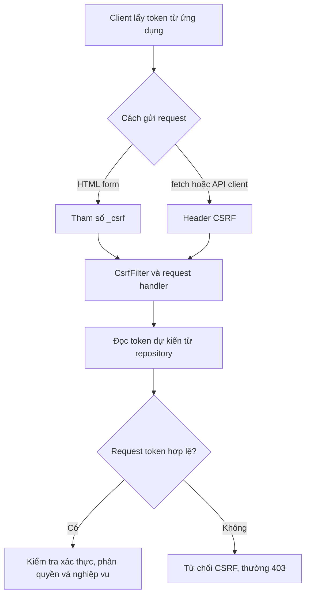

# Truyền CSRF token qua tham số hoặc header

Trong **Spring Security Testing**, kiểm thử CSRF không dừng ở việc xác nhận một request `POST` thiếu token bị từ chối. Ứng dụng còn phải **nhận token qua đúng vị trí mà client sử dụng**: tham số của biểu mẫu HTML hoặc HTTP header của lời gọi JavaScript/API. Bài này giải thích đường đi của token trong ứng dụng **Servlet** và cách dùng `spring-security-test` với `MockMvc` để xác nhận từng cách gửi; đồng thời chỉ ra những khác biệt cần lưu ý khi dùng **WebTestClient** cho ứng dụng Reactive.

Điểm cốt lõi: **CSRF token là dữ liệu gắn với ngữ cảnh bảo vệ của server; nơi truyền token phải khớp với `CsrfTokenRepository` và `CsrfTokenRequestHandler` đang được cấu hình.** Gửi một chuỗi có tên `_csrf` hoặc `X-CSRF-TOKEN` chưa đủ bảo đảm được chấp nhận. Request còn phải đi qua chain đang yêu cầu CSRF, mang token hợp lệ và đáp ứng xác thực, phân quyền độc lập.

## 1. Khi nào request cần gửi CSRF token?

CSRF (Cross-Site Request Forgery) xảy ra khi trình duyệt tự động gửi thông tin xác thực, điển hình là cookie phiên đăng nhập, tới một website trong request do nguồn bên ngoài kích hoạt. CSRF token là một biện pháp giúp server phân biệt request hợp lệ của ứng dụng với request không có bằng chứng CSRF phù hợp.

Với `SecurityFilterChain` Servlet bật CSRF mặc định, `GET`, `HEAD`, `TRACE` và `OPTIONS` thường **không yêu cầu** token; các method khác như `POST`, `PUT`, `PATCH` và `DELETE` **yêu cầu** token. Tuy nhiên, `csrf.disable()`, `ignoringRequestMatchers(...)`, `requireCsrfProtectionMatcher(...)` hay việc có nhiều chain có thể làm thay đổi kết luận. Cần xác định chain và matcher thực tế trước khi kỳ vọng `403`.

| Tình huống | CSRF theo cấu hình mặc định | Hình thức gửi token thường gặp |
| --- | --- | --- |
| Tải trang `GET /demo/profile` | Không bắt buộc | Không cần gửi token. |
| Submit form `POST /demo/profile/form` | Bắt buộc | Hidden form field, thường là `_csrf`. |
| Gửi JSON `POST /demo/profile/json` bằng `fetch` | Bắt buộc | HTTP header, thường là `X-CSRF-TOKEN`. |
| Gửi `DELETE` bằng JavaScript | Bắt buộc | HTTP header có token hợp lệ. |
| `POST` vào endpoint được miễn CSRF rõ ràng | Không bắt buộc theo ngoại lệ đó | Không cần token để qua bộ lọc CSRF; vẫn phải qua bảo vệ khác. |

`permitAll()` chỉ tác động đến **phân quyền**, không tự miễn CSRF. Ngược lại, `@WithMockUser` tạo user giả lập trong phép thử, nhưng không tự thêm CSRF token. JWT, OAuth2 và OIDC cũng không tự quyết định CSRF bật hay tắt: mô hình rủi ro phụ thuộc cách client gửi credential, còn kỳ vọng của phép thử phụ thuộc chain được cấu hình.

## 2. Server nhận token ở đâu?

Trong Spring Security Servlet, `CsrfFilter` sử dụng `CsrfTokenRepository` để nạp hoặc tạo token dự kiến; `CsrfTokenRequestHandler` hỗ trợ cung cấp token cho request và giải quyết giá trị token mà client gửi vào. Khi cần bảo vệ, filter so sánh giá trị request với token dự kiến. Token thiếu hoặc không hợp lệ sẽ bị từ chối, mặc định thường là `403 Forbidden`.

Các thành phần liên quan:

- **`CsrfTokenRepository`:** lưu/nạp token dự kiến, ví dụ `HttpSessionCsrfTokenRepository` (lưu trong HTTP session) hoặc `CookieCsrfTokenRepository` (lưu token trong cookie theo cấu hình của repository).
- **`CsrfToken`:** chứa `token`, `parameterName` và `headerName`. Client nên lấy thông tin do ứng dụng cung cấp thay vì đoán tên cố định.
- **`CsrfTokenRequestHandler`:** quyết định cách token được trình bày trong request và cách đọc giá trị gửi về. Cấu hình bảo vệ BREACH có thể làm giá trị được render ra khác giá trị lưu thô.
- **`CsrfFilter`:** áp dụng matcher để quyết định request cần CSRF hay không, sau đó kiểm tra token.

Với repository mặc định dựa trên session ở Servlet, các tên thường gặp là:

| Trường | Giá trị thường gặp | Vai trò |
| --- | --- | --- |
| Form/request parameter | `_csrf` | Giá trị token khi gửi form hoặc query/request parameter được server chấp nhận. |
| HTTP header | `X-CSRF-TOKEN` | Giá trị token gửi từ JavaScript hoặc HTTP client. |
| HTTP session | Ví dụ `JSESSIONID` là cookie định danh phiên, không phải CSRF token | Giúp server tìm đúng token dự kiến trong session. |

Đừng nhầm **cookie phiên đăng nhập** với **CSRF token**. Trình duyệt tự gửi cookie phiên, còn form hoặc script phải cung cấp giá trị CSRF request đúng cách. Nếu session thay đổi, token đã lấy từ phiên cũ có thể không còn hợp lệ.



## 3. Ví dụ Servlet: cấu hình và endpoint để thử

Để thấy rõ hai cách truyền, ví dụ dùng **hai endpoint POST** khác kiểu body: form URL encoded và JSON. Cả hai được xử lý bởi chain có CSRF bật và yêu cầu người dùng đăng nhập.

```java
@Configuration
@EnableWebSecurity
class DemoSecurityConfiguration {

    @Bean
    SecurityFilterChain securityFilterChain(HttpSecurity http) throws Exception {
        http
            .csrf(Customizer.withDefaults())
            .authorizeHttpRequests(auth -> auth
                .requestMatchers("/demo/form").authenticated()
                .requestMatchers(HttpMethod.POST, "/demo/profile/**").authenticated()
                .anyRequest().denyAll())
            .formLogin(Customizer.withDefaults());

        return http.build();
    }
}

@RestController
class DemoProfileController {

    @PostMapping(
        path = "/demo/profile/form",
        consumes = MediaType.APPLICATION_FORM_URLENCODED_VALUE
    )
    ResponseEntity<Void> updateViaForm(@RequestParam String displayName) {
        // Trong ứng dụng thật: kiểm tra và lưu displayName.
        return ResponseEntity.noContent().build();
    }

    record ProfileInput(String displayName) {}

    @PostMapping(
        path = "/demo/profile/json",
        consumes = MediaType.APPLICATION_JSON_VALUE
    )
    ResponseEntity<Void> updateViaJson(@RequestBody ProfileInput input) {
        // Trong ứng dụng thật: kiểm tra và lưu input.displayName().
        return ResponseEntity.noContent().build();
    }
}

@Controller
class DemoFormController {

    @GetMapping("/demo/form")
    String formPage() {
        return "profile-form"; // template profile-form.html, ví dụ Thymeleaf
    }
}
```

Đây là các bean minh họa trong ứng dụng Spring Boot Servlet có Spring MVC, Spring Security và phần template tương ứng; các đoạn code lược bỏ `import`. `204` chỉ là kết quả của controller ví dụ, không phải status mặc định do CSRF sinh ra. Nếu dự án thật có validation hoặc policy khác, thay assertion bằng hành vi thực tế.

## 4. Cách A: gửi token bằng tham số của biểu mẫu

### 4.1 Server đưa token vào form

Trang HTML có form cập nhật hồ sơ có thể dùng Thymeleaf để render token từ request attribute `_csrf`:

```html
<!doctype html>
<html xmlns:th="http://www.thymeleaf.org">
<body>
  <form action="/demo/profile/form" method="post">
    <label for="displayName">Tên hiển thị</label>
    <input id="displayName" name="displayName" value="Lan">

    <input type="hidden"
           th:name="${_csrf.parameterName}"
           th:value="${_csrf.token}">

    <button type="submit">Lưu</button>
  </form>
</body>
</html>
```

Ví dụ trên dùng `action` HTML thông thường để minh họa **tự chèn** hidden input. Trong dự án Thymeleaf tích hợp Spring MVC/Spring Security, dùng `th:action` thường cho phép framework tự thêm hidden CSRF field qua cơ chế xử lý form; khi đó **không chèn thủ công lần nữa** nếu template đã tự cung cấp trường token. Hãy kiểm tra HTML render thực tế để bảo đảm chỉ có trường phù hợp.

Khi server render, phần hidden input có thể thành:

```html
<input type="hidden"
       name="_csrf"
       value="token-do-server-render-cho-request-nay">
```

Giá trị này là ký hiệu minh họa. Ở các phiên bản/cấu hình sử dụng XOR/BREACH protection, giá trị render có thể được mã hóa/masked và thay đổi qua các lần render dù token gốc được lưu trong session chưa đổi. **Luôn dùng giá trị được render cho request hiện tại**; không tự đoán hoặc lấy chuỗi đã lưu từ nơi khác.

Khi người dùng bấm Lưu, browser gửi request gần tương tự:

```http
POST /demo/profile/form HTTP/1.1
Host: app.example
Cookie: JSESSIONID=<session-da-dang-nhap>
Content-Type: application/x-www-form-urlencoded

displayName=Lan&_csrf=<csrf-token-da-duoc-url-encode>
```

Trong form chuẩn, trình duyệt mã hóa các ký tự đặc biệt theo quy tắc `application/x-www-form-urlencoded`. Khi dùng client thủ công, cần URL encode token nếu có ký tự đặc biệt, tránh truyền sai giá trị.

### 4.2 Test form bằng MockMvc

Spring Security Test có `csrf()` dưới dạng `RequestPostProcessor`. Mặc định, `.with(csrf())` gửi token bằng **request parameter**, phù hợp việc kiểm tra luồng form:

```java
@Test
@WithMockUser(username = "lan")
void formParameter_validToken_returns204() throws Exception {
    mockMvc.perform(post("/demo/profile/form")
            .contentType(MediaType.APPLICATION_FORM_URLENCODED)
            .param("displayName", "Lan")
            .with(csrf()))
        .andExpect(status().isNoContent());
}
```

Tham số `displayName` là dữ liệu nghiệp vụ, còn request parameter chứa token được tạo bởi `csrf()`. Với token hợp lệ, request đi qua CSRF và tới controller. Test này **không** tự kiểm chứng template đã render đúng hidden input; hãy bổ sung kiểm thử view/HTML hoặc end-to-end nếu cần bảo đảm điều đó.

### 4.3 Trường hợp thiếu hoặc sai tham số

```java
@Test
@WithMockUser(username = "lan")
void formParameter_missingToken_returns403() throws Exception {
    mockMvc.perform(post("/demo/profile/form")
            .contentType(MediaType.APPLICATION_FORM_URLENCODED)
            .param("displayName", "Lan"))
        .andExpect(status().isForbidden());
}

@Test
@WithMockUser(username = "lan")
void formParameter_invalidToken_returns403() throws Exception {
    mockMvc.perform(post("/demo/profile/form")
            .contentType(MediaType.APPLICATION_FORM_URLENCODED)
            .param("displayName", "Lan")
            .with(csrf().useInvalidToken()))
        .andExpect(status().isForbidden());
}
```

Hai ca âm tính phải giữ cùng tài khoản, URL, method và dữ liệu nghiệp vụ với ca token hợp lệ. Nếu endpoint thiếu quyền hoặc không tồn tại, mã `403` có thể đến từ phân quyền thay vì CSRF; ca token hợp lệ thành công là đối chứng giúp phát hiện nhầm lẫn đó.

## 5. Cách B: gửi token bằng HTTP header

Header thích hợp khi JavaScript gửi JSON hoặc method `PUT`/`PATCH`/`DELETE` và không sử dụng form HTML. Không nên kỳ vọng thêm trường `"_csrf"` vào **JSON body** sẽ được Spring Security đọc như request parameter: `CsrfFilter` thông thường không parse nội dung JSON để tìm token. Client cần gửi đúng header hoặc sử dụng cách truyền đã được request handler cấu hình.

### 5.1 Render token cho JavaScript từ một trang cùng origin

Ứng dụng có thể render thông tin của `CsrfToken` vào các meta tag của một trang Thymeleaf:

```html
<meta name="_csrf" th:content="${_csrf.token}">
<meta name="_csrf_header" th:content="${_csrf.headerName}">
```

Script trên trang dùng chính tên header do server cung cấp:

```javascript
const token = document.querySelector('meta[name="_csrf"]').content;
const headerName = document.querySelector('meta[name="_csrf_header"]').content;

async function updateProfile() {
  const response = await fetch('/demo/profile/json', {
    method: 'POST',
    credentials: 'same-origin',
    headers: {
      'Content-Type': 'application/json',
      [headerName]: token
    },
    body: JSON.stringify({ displayName: 'Lan' })
  });

  if (!response.ok) {
    throw new Error('Không cập nhật được hồ sơ: ' + response.status);
  }
}
```

`credentials: 'same-origin'` cho phép browser gửi credential như cookie trong request cùng origin khi phù hợp; thông tin đăng nhập chỉ xác định ngữ cảnh người dùng, còn **header mang token** là bằng chứng CSRF cần thiết. Đoạn script giả định trang được chính ứng dụng bảo vệ render, có hai meta tag trên và response thành công là `204`.

Không nhúng CSRF token cố định trong JavaScript bundle hoặc cấu hình công khai của ứng dụng. Token cần được lấy từ nguồn server dự kiến cho người dùng/session hiện tại và được cập nhật khi ứng dụng thay đổi token, đặc biệt sau đăng nhập hoặc đăng xuất.

### 5.2 Test header bằng MockMvc

Chuyển `csrf()` sang gửi header bằng `.asHeader()`:

```java
@Test
@WithMockUser(username = "lan")
void jsonHeader_validToken_returns204() throws Exception {
    mockMvc.perform(post("/demo/profile/json")
            .contentType(MediaType.APPLICATION_JSON)
            .content("{\"displayName\":\"Lan\"}")
            .with(csrf().asHeader()))
        .andExpect(status().isNoContent());
}
```

Để thử token sai qua header:

```java
@Test
@WithMockUser(username = "lan")
void jsonHeader_invalidToken_returns403() throws Exception {
    mockMvc.perform(post("/demo/profile/json")
            .contentType(MediaType.APPLICATION_JSON)
            .content("{\"displayName\":\"Lan\"}")
            .with(csrf().asHeader().useInvalidToken()))
        .andExpect(status().isForbidden());
}
```

Ca thiếu header/token cũng cần có:

```java
@Test
@WithMockUser(username = "lan")
void jsonHeader_missingToken_returns403() throws Exception {
    mockMvc.perform(post("/demo/profile/json")
            .contentType(MediaType.APPLICATION_JSON)
            .content("{\"displayName\":\"Lan\"}"))
        .andExpect(status().isForbidden());
}
```

`csrf().asHeader()` thêm header theo thông tin của token repository/request processor. Nó kiểm thử **server chấp nhận token qua header**, chứ không chứng minh JavaScript trong trình duyệt đã đọc được đúng token. Để chứng minh luồng client, thực hiện thêm một phép thử qua HTTP thật với cookie/session và token được cấp bởi server.

## 6. Một lớp kiểm thử chứa cả parameter và header

Ví dụ tổng hợp dưới đây dùng hai endpoint được định nghĩa ở mục 3. Nó cần `spring-security-test` (phụ thuộc `test`) và Spring Boot test hỗ trợ MockMvc:

```java
import org.junit.jupiter.api.Test;
import org.springframework.beans.factory.annotation.Autowired;
import org.springframework.boot.test.autoconfigure.web.servlet.AutoConfigureMockMvc;
import org.springframework.boot.test.context.SpringBootTest;
import org.springframework.http.MediaType;
import org.springframework.security.test.context.support.WithMockUser;
import org.springframework.test.web.servlet.MockMvc;

import static org.springframework.security.test.web.servlet.request
    .SecurityMockMvcRequestPostProcessors.csrf;
import static org.springframework.test.web.servlet.request
    .MockMvcRequestBuilders.post;
import static org.springframework.test.web.servlet.result
    .MockMvcResultMatchers.status;

@SpringBootTest
@AutoConfigureMockMvc
@WithMockUser(username = "lan")
class CsrfParameterAndHeaderTest {

    @Autowired
    MockMvc mockMvc;

    @Test
    void formWithParameter_isAccepted() throws Exception {
        mockMvc.perform(post("/demo/profile/form")
                .contentType(MediaType.APPLICATION_FORM_URLENCODED)
                .param("displayName", "Lan")
                .with(csrf()))
            .andExpect(status().isNoContent());
    }

    @Test
    void formWithoutToken_isRejected() throws Exception {
        mockMvc.perform(post("/demo/profile/form")
                .contentType(MediaType.APPLICATION_FORM_URLENCODED)
                .param("displayName", "Lan"))
            .andExpect(status().isForbidden());
    }

    @Test
    void jsonWithHeader_isAccepted() throws Exception {
        mockMvc.perform(post("/demo/profile/json")
                .contentType(MediaType.APPLICATION_JSON)
                .content("{\"displayName\":\"Lan\"}")
                .with(csrf().asHeader()))
            .andExpect(status().isNoContent());
    }

    @Test
    void jsonWithInvalidHeader_isRejected() throws Exception {
        mockMvc.perform(post("/demo/profile/json")
                .contentType(MediaType.APPLICATION_JSON)
                .content("{\"displayName\":\"Lan\"}")
                .with(csrf().asHeader().useInvalidToken()))
            .andExpect(status().isForbidden());
    }
}
```

Nếu muốn dùng MockMvc tự dựng, cần bảo đảm bộ lọc Spring Security được gắn đúng, ví dụ `MockMvcBuilders.webAppContextSetup(context).apply(springSecurity()).build()`. Tránh dùng `standaloneSetup` không có security filter để rút ra kết luận về CSRF, và chú ý `@AutoConfigureMockMvc(addFilters = false)` vô hiệu hóa filter trong test.

## 7. Cách xử lý khi dùng CookieCsrfTokenRepository

Một cấu hình phổ biến cho ứng dụng có JavaScript client là `CookieCsrfTokenRepository`. Repository này dùng tên cookie thường gặp `XSRF-TOKEN`, tên header `X-XSRF-TOKEN` và tham số `_csrf`. Khi bật `CookieCsrfTokenRepository.withHttpOnlyFalse()`, JavaScript có thể đọc cookie token. **Điều này không có nghĩa mọi ứng dụng chỉ cần sao chép nguyên cookie vào header là thành công.**

Ví dụ cấu hình repository:

```java
http.csrf(csrf -> csrf
    .csrfTokenRepository(CookieCsrfTokenRepository.withHttpOnlyFalse()));
```

Cấu hình trên chỉ chỉ ra **nơi lưu token và khả năng JavaScript đọc cookie**. Với các phiên bản Spring Security dùng xử lý XOR/BREACH theo mặc định, giá trị token được trình bày qua request attribute có thể bị masked, trong khi giá trị đọc từ cookie thường là token thô. Để JavaScript gửi giá trị token thô qua header, ứng dụng có thể cần **`CsrfTokenRequestHandler` tương thích với luồng SPA**; tài liệu Spring Security mô tả mẫu handler dành cho SPA. Không nên sao chép cấu hình repository trên vào một hệ thống thật rồi mặc định cho rằng SPA đã hoạt động đầy đủ.

Khi đánh giá thiết kế:

- **Server-rendered HTML:** thường lấy token đã render trong form hoặc meta tag; session-based repository là lựa chọn phổ biến.
- **SPA đọc token từ cookie:** cần xem `CookieCsrfTokenRepository`, `HttpOnly`, cách client lấy token, request handler và chiến lược tải lại token sau login/logout.
- **SPA lấy token qua endpoint riêng:** endpoint trả token phải có chính sách truy cập và CORS phù hợp; cần bảo đảm token thuộc cùng phiên/ngữ cảnh sẽ được dùng cho request thay đổi trạng thái.

Token CSRF giúp chống CSRF, **không chống XSS**. Nếu ứng dụng cho phép JavaScript đọc token, phải tiếp tục bảo vệ khỏi script độc hại bằng kiểm soát đầu vào/đầu ra, CSP và các biện pháp phù hợp. Đừng mở CORS tùy tiện cho nguồn không tin cậy chỉ để việc lấy/gửi CSRF token được dễ hơn.

## 8. Đối chiếu với một request HTTP thật

Các post-processor của `MockMvc` phù hợp để thử bộ lọc ở phía server. Với HTTP client thật như `curl`, RestAssured hoặc browser automation, cần có **hai yếu tố đồng bộ**: cookie/session của người dùng và token do server cấp cho ngữ cảnh đó.

Ví dụ minh họa sau giả định client đã đăng nhập, lưu cookie vào `cookies.txt` và lấy token đúng từ biểu mẫu của server cho cùng phiên:

```bash
# Cách gửi form: token là request parameter được URL encode.
curl -i -b cookies.txt -c cookies.txt \
  --data-urlencode "displayName=Lan" \
  --data-urlencode "_csrf=<token-tu-form-cung-session>" \
  https://app.example/demo/profile/form

# Cách gửi JSON: token là HTTP header.
curl -i -b cookies.txt -c cookies.txt \
  -H "Content-Type: application/json" \
  -H "X-CSRF-TOKEN: <token-tu-server-cung-session>" \
  -d '{"displayName":"Lan"}' \
  https://app.example/demo/profile/json
```

Đây là **mẫu lệnh**, không phải các request có thể chạy nguyên văn: URL `app.example`, cookie, token và tên header phải thay theo ứng dụng. Với `CookieCsrfTokenRepository`, header có thể là `X-XSRF-TOKEN` và token gửi theo cách client/repository/request handler hỗ trợ.

Khi test luồng thật, nên chạy thêm hai request giống hệt, chỉ khác token: một request **bỏ token**, một request **thay một phần token**. Kỳ vọng với endpoint có CSRF bật là bị từ chối, thường `403`, trong khi request có token hợp lệ được xử lý. Kiểm tra cả trạng thái dữ liệu để xác nhận hai request bị từ chối không tạo tác dụng phụ.

### Câu hỏi hay gặp về tên header và session

**Có thể gửi cả parameter và header không?** Không nên dựa vào hành vi khi hai giá trị mâu thuẫn. Quy tắc ưu tiên đọc header/parameter có thể phụ thuộc request handler. Mỗi luồng client nên gửi một nguồn token rõ ràng và test đúng luồng đó.

**Gửi đúng tên `_csrf` nhưng nhận `403`?** Kiểm tra token có đúng và còn hiệu lực cho session không, đã URL encode đúng chưa, custom repository/request handler có đổi tên hoặc cách xử lý token không, và request có bị chain/filter khác từ chối không.

**Header `X-CSRF-TOKEN` có phải luôn hợp lệ?** Không. Tên header lấy từ `CsrfToken.headerName` hoặc cấu hình repository. Cookie-based repository thường dùng tên khác.

**CORS preflight `OPTIONS` có cần CSRF không?** Theo matcher mặc định thì không; tuy nhiên preflight có thể thất bại vì chính sách CORS hoặc cấu hình filter khác. CORS và CSRF giải quyết các vấn đề khác nhau.

## 9. Reactive: WebTestClient sử dụng cách gắn token khác

Trong ứng dụng Spring WebFlux, cấu hình bảo mật dùng `SecurityWebFilterChain` và `ServerHttpSecurity`. Spring Security Test cung cấp `SecurityMockServerConfigurers.csrf()` để gắn token hợp lệ vào request thử với `WebTestClient` đã tích hợp Spring Security:

```java
import static org.springframework.security.test.web.reactive.server
    .SecurityMockServerConfigurers.csrf;
import static org.springframework.security.test.web.reactive.server
    .SecurityMockServerConfigurers.mockUser;

webTestClient
    .mutateWith(mockUser("lan"))
    .mutateWith(csrf())
    .post()
    .uri("/demo/profile/json")
    .contentType(MediaType.APPLICATION_JSON)
    .bodyValue(new ProfileInput("Lan"))
    .exchange()
    .expectStatus().isNoContent();
```

Đoạn minh họa giả định WebFlux có handler JSON tương ứng, người dùng được cấp quyền, CSRF bật và test client đã `apply(springSecurity())`. `csrf()` ở đây là **mutator của WebTestClient**, khác với `RequestPostProcessor` của MockMvc; không trộn `.with(csrf().asHeader())` của Servlet vào Reactive test.

Với phép thử **HTTP thật** cho WebFlux, nguyên tắc vẫn là lấy token từ server và gửi qua header/parameter tương thích với `ServerCsrfTokenRepository` và request handler của ứng dụng, đồng thời giữ session/cookie liên quan. Chỉ thấy `403` không đủ quy kết lỗi CSRF nếu request còn bị authentication hoặc authorization chặn.

## 10. Checklist kiểm thử tham số và header

| Ca kiểm thử | Điều kiện giữ nguyên | Kết quả cần chứng minh |
| --- | --- | --- |
| Form thiếu token | User đã xác thực, có quyền, `POST` đúng URL và body | Bị CSRF từ chối; dữ liệu không đổi. |
| Form có token hợp lệ | Cùng ngữ cảnh như trên, thêm parameter CSRF | Đi tiếp tới controller và xử lý thành công. |
| Form có token sai | Cùng ngữ cảnh, parameter có giá trị sai | Bị CSRF từ chối. |
| JSON thiếu header | Cùng user, URL, method và JSON body | Bị CSRF từ chối. |
| JSON có header hợp lệ | Thêm header theo tên server cung cấp | Đi tiếp tới controller. |
| JSON có header sai | Cùng header nhưng giá trị bị sửa | Bị CSRF từ chối. |
| Session/token không tương ứng | Giữ token của phiên A và dùng với phiên B | Bị từ chối trong cấu hình ràng buộc token theo phiên. |
| Method an toàn `GET` | Không gửi token | Không bị CSRF chặn theo matcher mặc định. |

Nếu phép thử nhận `302`, `401` hoặc `403` ngoài dự kiến, hãy kiểm tra lần lượt: filter chain có được gắn trong client test không; endpoint có yêu cầu CSRF không; method/path có khớp ngoại lệ không; token repository/handler có khớp cách gửi không; session có giữ nguyên không; cuối cùng mới đến quyền và logic nghiệp vụ. Với ứng dụng có nhiều security chain, mỗi URL có thể dùng quy tắc CSRF khác nhau.

## Ghi nhớ

Để gửi CSRF token qua **tham số**, đưa token server cấp vào hidden input của form hoặc dùng `MockMvc` với `.with(csrf())`. Để gửi qua **header**, JavaScript lấy token và tên header do server cung cấp rồi thêm vào request; trong `MockMvc` dùng `.with(csrf().asHeader())`. Ở cả hai hướng, hãy ghép **thiếu token → từ chối**, **token hợp lệ → đi tiếp**, **token sai → từ chối** với cùng danh tính, session, method và dữ liệu nghiệp vụ. Việc cấu hình `CsrfTokenRepository`, `CsrfTokenRequestHandler` và security chain quyết định chính xác giá trị nào được chấp nhận.
