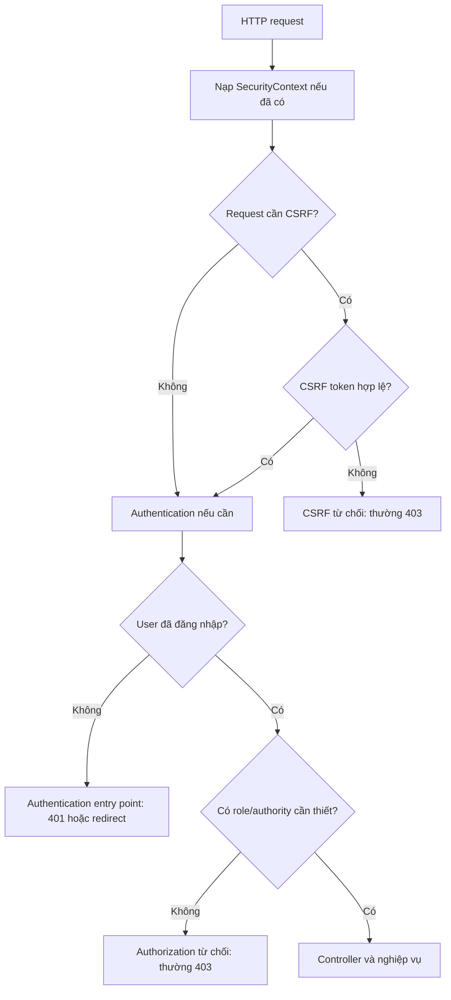

# Kết hợp CSRF với người dùng có và không có quyền

Khi kiểm thử CSRF, mã trạng thái `403 Forbidden` có thể xuất hiện vì nhiều lý do: request thiếu CSRF token, token không hợp lệ, hoặc người dùng đã đăng nhập nhưng không có quyền thực hiện thao tác. Để đọc đúng kết quả, cần kiểm tra **CSRF và phân quyền như hai lớp bảo vệ độc lập**, đồng thời giữ danh tính người dùng ổn định giữa các ca thử.

Trong **Spring Security Testing**, `@WithMockUser` giúp thiết lập người dùng và quyền trong `SecurityContext` của test Servlet; `@WithAnonymousUser` mô phỏng người dùng chưa đăng nhập. Kết hợp chúng với `csrf()` của MockMvc sẽ cho thấy request bị chặn ở lớp nào và vì sao. Với ứng dụng Reactive, `WebTestClient` dùng mutator riêng để mô phỏng user và CSRF.

## 1. CSRF token không cấp quyền cho người dùng

CSRF bảo vệ ứng dụng khỏi request thay đổi trạng thái được trình duyệt gửi kèm thông tin xác thực ngoài ý muốn. Token CSRF chứng minh request có giá trị token phù hợp với ngữ cảnh server mong đợi. Nó **không xác nhận người dùng có quyền nghiệp vụ**.

Phân quyền (authorization) trả lời một câu hỏi khác: danh tính hiện tại có role, authority hoặc scope được yêu cầu cho endpoint hay không? Ví dụ:

- Người dùng `EDITOR` có CSRF token hợp lệ: có thể được phép tạo báo cáo.
- Người dùng `VIEWER` có CSRF token hợp lệ: CSRF được chấp nhận, nhưng phân quyền vẫn từ chối nếu endpoint yêu cầu `EDITOR`.
- Người dùng `VIEWER` không có token: request có thể bị từ chối ngay ở CSRF trước khi quy tắc role được xét.
- Người dùng chưa đăng nhập có token hợp lệ: request đi qua bước CSRF, nhưng vẫn cần xác thực; với HTTP Basic, kết quả thường là `401 Unauthorized`.

Vì vậy, không thể kết luận “user không có quyền” chỉ từ một response `403`. Cần thử lại **cùng user, cùng method, cùng URL và cùng dữ liệu nhưng thêm token hợp lệ** để tách nhánh CSRF khỏi nhánh phân quyền.

## 2. Thứ tự xử lý giải thích vì sao hai lỗi có thể cùng trả 403

Trong chuỗi filter Servlet tiêu chuẩn của Spring Security, `CsrfFilter` kiểm tra request trước khi quy tắc phân quyền ở `AuthorizationFilter` được thực thi. Nếu request thuộc diện cần CSRF mà token thiếu hoặc sai, bộ lọc CSRF từ chối request. Khi token hợp lệ, request mới tiếp tục đến các bước xác thực/phân quyền tiếp theo.

Sơ đồ khái quát việc nạp `SecurityContext`, kiểm tra CSRF rồi đi tiếp tới xác thực/phân quyền. Trong filter chain tiêu chuẩn, `CsrfFilter` chạy trước `AuthorizationFilter`; cơ chế xác thực như HTTP Basic có thể được thực hiện ở filter phía sau CSRF. `@WithMockUser` thiết lập context cho test trước khi request được thực thi. Ứng dụng có thể thay đổi entry point, access denied handler, matcher, filter hoặc nhiều `SecurityFilterChain`; khi đó response cụ thể phụ thuộc cấu hình đang chạy.

Với request `POST` cần CSRF, một số kết quả thường gặp:

| Danh tính | CSRF token | Lớp quyết định kết quả | Kết quả điển hình với HTTP Basic |
| --- | --- | --- | --- |
| EDITOR, đủ quyền | Thiếu | CSRF | `403` |
| EDITOR, đủ quyền | Sai | CSRF | `403` |
| EDITOR, đủ quyền | Hợp lệ | Controller | Thành công, ví dụ `204` |
| VIEWER, thiếu quyền | Thiếu | CSRF trước phân quyền | `403` |
| VIEWER, thiếu quyền | Hợp lệ | Authorization | `403` |
| Anonymous | Thiếu | CSRF | `403` |
| Anonymous | Hợp lệ | Authentication | `401` với HTTP Basic; có thể redirect nếu dùng form login |

Hai hàng của VIEWER đều có thể trả `403` nhưng ý nghĩa khác nhau. Chỉ khi so sánh request token hợp lệ mới biết user đã vượt qua CSRF nhưng không đủ quyền.

## 3. Cấu hình ví dụ: chỉ EDITOR được tạo báo cáo

Ví dụ dùng ứng dụng Servlet, CSRF bật và HTTP Basic để kết quả của người dùng anonymous dễ dự đoán:

~~~java
@Configuration
@EnableWebSecurity
class ReportSecurityConfiguration {

    @Bean
    SecurityFilterChain securityFilterChain(HttpSecurity http) throws Exception {
        http
            .csrf(Customizer.withDefaults())
            .authorizeHttpRequests(auth -> auth
                .requestMatchers(HttpMethod.POST, "/reports")
                    .hasRole("EDITOR")
                .anyRequest().denyAll())
            .httpBasic(Customizer.withDefaults());

        return http.build();
    }
}

@RestController
class ReportController {

    @PostMapping("/reports")
    ResponseEntity<Void> createReport() {
        // Ví dụ minh họa: thao tác tạo báo cáo.
        return ResponseEntity.noContent().build();
    }
}
~~~

Endpoint `POST /reports` yêu cầu role `EDITOR`. CSRF không bị tắt và không có matcher miễn trừ. Với HTTP Basic, request anonymous đi đến entry point sẽ nhận `401 Unauthorized` khi CSRF token hợp lệ.

Trong dự án thật, thay cấu hình và kết quả controller bằng chính sách của ứng dụng. Nếu dùng form login, anonymous có thể được chuyển hướng tới trang đăng nhập thay vì nhận `401`.

## 4. Thiết lập danh tính trong MockMvc

Dependency kiểm thử cần có `spring-security-test`. Ví dụ dùng Spring Boot:

~~~groovy
testImplementation 'org.springframework.security:spring-security-test'
~~~

MockMvc phải chạy qua filter bảo mật, thường bằng `@SpringBootTest` và `@AutoConfigureMockMvc`:

~~~java
@SpringBootTest
@AutoConfigureMockMvc
class ReportSecurityTest {

    @Autowired
    MockMvc mockMvc;
}
~~~

Các annotation phổ biến:

| Annotation | Ý nghĩa |
| --- | --- |
| `@WithMockUser(username = "editor", roles = "EDITOR")` | Tạo user đã xác thực với authority `ROLE_EDITOR`. |
| `@WithMockUser(username = "viewer", roles = "VIEWER")` | Tạo user đã xác thực nhưng chỉ có `ROLE_VIEWER`. |
| `@WithMockUser(authorities = "reports:write")` | Tạo user với authority chính xác `reports:write`. |
| `@WithAnonymousUser` | Thiết lập ngữ cảnh anonymous cho test. |

Spring Security Test thiết lập `SecurityContext` trước test và dọn ngữ cảnh sau đó. Mỗi test nên khai báo danh tính rõ ràng để không phụ thuộc vào trạng thái từ test khác. `@WithMockUser` và `@WithAnonymousUser` là tiện ích mô phỏng trong test; chúng không đăng nhập thật hoặc tạo session trình duyệt.

## 5. Ba ca cơ bản: đủ quyền, thiếu quyền và anonymous

### 5.1 EDITOR có token hợp lệ: request được phép

~~~java
@Test
@WithMockUser(username = "editor", roles = "EDITOR")
void editorWithValidToken_canCreateReport() throws Exception {
    mockMvc.perform(post("/reports").with(csrf()))
        .andExpect(status().isNoContent());
}
~~~

User có authority `ROLE_EDITOR` nên thỏa `hasRole("EDITOR")`. `csrf()` thêm token hợp lệ, request vượt qua CSRF và quy tắc phân quyền, rồi controller trả `204 No Content`.

### 5.2 VIEWER có token hợp lệ: CSRF qua, phân quyền từ chối

~~~java
@Test
@WithMockUser(username = "viewer", roles = "VIEWER")
void viewerWithValidToken_isForbiddenByAuthorization() throws Exception {
    mockMvc.perform(post("/reports").with(csrf()))
        .andExpect(status().isForbidden());
}
~~~

Đây là ca quan trọng để kiểm tra **người dùng đã xác thực nhưng thiếu quyền**. Token hợp lệ khiến request qua bước CSRF; `hasRole("EDITOR")` từ chối VIEWER. Response mặc định là `403 Forbidden`.

### 5.3 VIEWER không có token: CSRF từ chối trước

~~~java
@Test
@WithMockUser(username = "viewer", roles = "VIEWER")
void viewerWithoutToken_isForbiddenByCsrf() throws Exception {
    mockMvc.perform(post("/reports"))
        .andExpect(status().isForbidden());
}
~~~

Ca này cũng trả `403`, nhưng không chứng minh quy tắc role đã được thực thi. Vì thiếu token, request bị CSRF từ chối trước khi tới bước phân quyền. Muốn kiểm tra thiếu quyền của VIEWER, phải dùng token hợp lệ như ca 5.2.

### 5.4 EDITOR thiếu token hoặc token sai: lỗi CSRF độc lập với role

~~~java
@Test
@WithMockUser(username = "editor", roles = "EDITOR")
void editorWithoutToken_isForbiddenByCsrf() throws Exception {
    mockMvc.perform(post("/reports"))
        .andExpect(status().isForbidden());
}

@Test
@WithMockUser(username = "editor", roles = "EDITOR")
void editorWithInvalidToken_isForbiddenByCsrf() throws Exception {
    mockMvc.perform(post("/reports")
            .with(csrf().useInvalidToken()))
        .andExpect(status().isForbidden());
}
~~~

Ngay cả user đủ quyền cũng không được bỏ qua CSRF. Phân quyền đúng không thay thế token; token sai cũng không được chấp nhận chỉ vì user là EDITOR.

### 5.5 Anonymous có token hợp lệ: cần xác thực

~~~java
@Test
@WithAnonymousUser
void anonymousWithValidToken_requiresAuthentication() throws Exception {
    mockMvc.perform(post("/reports").with(csrf()))
        .andExpect(status().isUnauthorized());
}
~~~

Ví dụ cấu hình `httpBasic()` nên entry point trả `401 Unauthorized`. Nếu ứng dụng dùng form login, kết quả có thể là redirect tới trang đăng nhập. Token CSRF hợp lệ chỉ cho phép request tiếp tục đến bước xác thực; nó không biến anonymous thành user đã đăng nhập.

### 5.6 Anonymous không có token: CSRF có thể trả 403 trước

~~~java
@Test
@WithAnonymousUser
void anonymousWithoutToken_isRejectedByCsrf() throws Exception {
    mockMvc.perform(post("/reports"))
        .andExpect(status().isForbidden());
}
~~~

Trong cấu hình ví dụ, request thuộc diện CSRF nhưng thiếu token nên bị từ chối tại bộ lọc CSRF. Vì vậy, response có thể là `403` thay vì `401` dù người gọi chưa đăng nhập. Đây là lý do cần tách test xác thực và CSRF, thay vì dựa vào một status duy nhất để suy ra nguyên nhân.

## 6. Tổng hợp ma trận kiểm thử

Với cùng endpoint `POST /reports` và chain ở mục 3:

| User giả lập | Token | Assertion | Ý nghĩa |
| --- | --- | --- | --- |
| EDITOR | Không có | `403 Forbidden` | CSRF bắt buộc token. |
| EDITOR | Không hợp lệ | `403 Forbidden` | CSRF kiểm tra giá trị token. |
| EDITOR | Hợp lệ | `204 No Content` | Vượt CSRF và đủ quyền. |
| VIEWER | Không có | `403 Forbidden` | Bị CSRF chặn; chưa kiểm tra role. |
| VIEWER | Hợp lệ | `403 Forbidden` | Vượt CSRF nhưng thiếu role. |
| Anonymous | Không có | `403 Forbidden` | CSRF chặn trước bước xác thực. |
| Anonymous | Hợp lệ | `401 Unauthorized` | Vượt CSRF nhưng chưa xác thực; do HTTP Basic. |

Đối với VIEWER, hai ca thiếu token và token hợp lệ cùng trả `403`. Bằng chứng phân biệt nằm ở phép thử có token hợp lệ: nó loại bỏ CSRF khỏi nguyên nhân, để kết quả còn lại phản ánh phân quyền. Với anonymous, dùng token hợp lệ để kiểm tra authentication entry point và kỳ vọng status theo cơ chế đăng nhập của ứng dụng.

## 7. Role và authority: chọn đúng cách mô phỏng quyền

Spring Security phân biệt role và authority:

- `hasRole("EDITOR")` thường kiểm tra authority `ROLE_EDITOR`.
- `hasAuthority("reports:write")` kiểm tra đúng chuỗi `reports:write`.
- `@WithMockUser(roles = "EDITOR")` tự thêm tiền tố `ROLE_`.
- `@WithMockUser(authorities = "reports:write")` sử dụng authority đúng như khai báo, không tự thêm tiền tố role.

Ví dụ nếu endpoint dùng authority nghiệp vụ:

~~~java
http.authorizeHttpRequests(auth -> auth
    .requestMatchers(HttpMethod.POST, "/reports")
        .hasAuthority("reports:write")
    .anyRequest().denyAll());
~~~

Test user đủ quyền phải khai báo:

~~~java
@Test
@WithMockUser(authorities = "reports:write")
void userWithWriteAuthority_canCreateReport() throws Exception {
    mockMvc.perform(post("/reports").with(csrf()))
        .andExpect(status().isNoContent());
}
~~~

Nếu thay thành `@WithMockUser(roles = "reports:write")`, authority được tạo sẽ là `ROLE_reports:write` và **không khớp** với `hasAuthority("reports:write")`. Đây là lỗi cấu hình test thường gặp khiến người học tưởng CSRF từ chối, trong khi nguyên nhân thực là thiếu authority.

Có thể khai báo nhiều quyền cùng lúc:

~~~java
@WithMockUser(authorities = {
    "reports:read",
    "reports:write",
    "audit:view"
})
~~~

Khi endpoint kiểm tra scope JWT, hãy tạo authority đúng định dạng mà resource server converter sinh ra, ví dụ `SCOPE_reports.write` nếu ứng dụng dùng quy ước scope mặc định. Đừng thay thế quyền thật của ứng dụng bằng một role gần giống chỉ để test vượt qua.

## 8. Kết hợp CSRF với JWT, OAuth2 và OIDC giả lập

Các post-processor như `jwt()`, `oauth2Login()` và `oidcLogin()` mô phỏng kiểu xác thực hoặc principal tương ứng. Chúng **không tự tạo CSRF token**. Nếu request đi qua chain Servlet đang bật CSRF, hãy cung cấp token riêng:

~~~java
@Test
void jwtWithCsrf_canReachProtectedEndpoint() throws Exception {
    mockMvc.perform(post("/reports")
            .with(jwt().authorities(
                new SimpleGrantedAuthority("ROLE_EDITOR")
            ))
            .with(csrf()))
        .andExpect(status().isNoContent());
}
~~~

Ví dụ giả định chain resource server chấp nhận JWT, endpoint yêu cầu `ROLE_EDITOR` và CSRF vẫn bật. Nếu ứng dụng cấu hình API Bearer token riêng với CSRF bị tắt, test phải phản ánh chính sách của chain đó. Không kết luận CSRF bật/tắt chỉ từ việc principal là JWT, OAuth2 hay OIDC.

Với OAuth2/OIDC login, cũng cần đảm bảo authority được ánh xạ đúng như cấu hình ứng dụng. Một principal được giả lập thành công nhưng không có role/scope cần thiết vẫn bị phân quyền từ chối sau khi CSRF hợp lệ.

## 9. Chứng minh request bị từ chối không làm thay đổi dữ liệu

Assertion status nên đi cùng kiểm tra tác dụng phụ. Ví dụ controller gọi `reportService.create()`, có thể dùng mock service để xác minh:

~~~java
@Test
@WithMockUser(username = "viewer", roles = "VIEWER")
void viewerWithValidToken_doesNotCallCreateService() throws Exception {
    mockMvc.perform(post("/reports").with(csrf()))
        .andExpect(status().isForbidden());

    verifyNoInteractions(reportService);
}
~~~

Ở đây user đã có token hợp lệ nhưng thiếu role; controller không được gọi. Với test tích hợp dùng database, thay assertion mock bằng cách đọc lại dữ liệu và xác nhận báo cáo không được tạo.

Nên xác minh riêng:

- Token thiếu/sai: service không được gọi và dữ liệu không đổi.
- Token hợp lệ, user thiếu quyền: service không được gọi và dữ liệu không đổi.
- Token hợp lệ, user đủ quyền: service được gọi đúng với dữ liệu dự kiến và trạng thái được cập nhật.

Nếu chỉ kiểm tra `403`, test có thể vẫn xanh dù controller đã chạy một phần logic trước khi lỗi xảy ra hoặc exception handler thay đổi response. Kiểm tra trạng thái nghiệp vụ làm rõ hơn ranh giới bảo vệ.

## 10. Đối chiếu trên Reactive với WebTestClient

Với ứng dụng WebFlux, dùng `SecurityWebFilterChain` và `WebTestClient`. API mô phỏng user và CSRF là mutator của Reactive, không dùng `@WithMockUser` hay `RequestPostProcessor` của MockMvc cho client này.

Ví dụ user đủ quyền:

~~~java
webTestClient
    .mutateWith(mockUser().roles("EDITOR"))
    .mutateWith(csrf())
    .post()
    .uri("/reports")
    .exchange()
    .expectStatus().isNoContent();
~~~

Ví dụ user thiếu quyền nhưng có token hợp lệ:

~~~java
webTestClient
    .mutateWith(mockUser().roles("VIEWER"))
    .mutateWith(csrf())
    .post()
    .uri("/reports")
    .exchange()
    .expectStatus().isForbidden();
~~~

Hai ca này thể hiện cùng mục tiêu: tách danh tính/quyền khỏi CSRF token. Cần bảo đảm WebTestClient đã được cấu hình tích hợp Spring Security, endpoint và policy Reactive tương ứng tồn tại. Khi test qua HTTP thật, hãy giữ cookie/session và lấy token theo repository/request handler của ứng dụng.

## 11. Những lỗi dễ làm sai kết luận

| Hiện tượng | Nguyên nhân có thể | Cách kiểm tra |
| --- | --- | --- |
| EDITOR có token hợp lệ vẫn `403` | Role mapping sai, chain khác được chọn, rule khác từ chối | Kiểm tra `hasRole`/`hasAuthority` và authority trong SecurityContext. |
| VIEWER không token và có token đều `403` | Một ca do CSRF, ca còn lại do phân quyền | So sánh với EDITOR có token hợp lệ; xác minh từng điều kiện. |
| Anonymous có token hợp lệ trả redirect thay vì `401` | Ứng dụng dùng form login | Assert redirect hoặc cấu hình HTTP Basic trong test riêng. |
| Anonymous thiếu token trả `403` | CSRF filter chặn trước authorization | Gửi token hợp lệ để kiểm tra nhánh authentication. |
| Mọi request đều thành công dù thiếu token | CSRF tắt, endpoint miễn trừ hoặc filter không chạy | Kiểm tra chain, matcher và cấu hình MockMvc. |
| Test user có role nhưng không khớp quyền | Dùng `roles` trong khi endpoint yêu cầu authority tùy chỉnh | Dùng `authorities` với đúng chuỗi. |
| JWT test bị `403` | JWT principal thiếu authority hoặc CSRF chưa được cung cấp | Kiểm tra converter/authority và thêm token nếu chain yêu cầu. |

Khi có nhiều `SecurityFilterChain`, cùng một user và endpoint tương tự có thể nhận chính sách CSRF hoặc phân quyền khác nhau tùy chain được chọn. Luôn xác định matcher và thứ tự chain trước khi sửa test.

## Bài tập thực hành

Một ứng dụng có endpoint `POST /invoices` với chính sách `hasAuthority("invoice:approve")` và CSRF bật. Viết các ca kiểm thử sau bằng MockMvc:

1. User có authority `invoice:approve`, không token: bị CSRF từ chối.
2. User có authority `invoice:approve`, token hợp lệ: request thành công.
3. User chỉ có authority `invoice:read`, token hợp lệ: bị từ chối do phân quyền.
4. User chỉ có authority `invoice:read`, token sai: bị CSRF từ chối trước phân quyền.
5. Anonymous có token hợp lệ: yêu cầu xác thực; kiểm tra status theo entry point.

**Tự kiểm tra:** Vì sao ca 3 và ca 4 đều có thể trả `403`? Câu trả lời cần chỉ ra ca 3 đã vượt CSRF nhưng thiếu authority, còn ca 4 bị chặn ở CSRF trước khi authorization được đánh giá.

## Ghi nhớ

CSRF token và quyền người dùng là hai điều kiện độc lập. Để kiểm tra chính xác, hãy giữ user cố định và so sánh token thiếu, sai, hợp lệ; sau đó giữ token hợp lệ và so sánh user đủ quyền, thiếu quyền, anonymous. `@WithMockUser`/`@WithAnonymousUser` thiết lập SecurityContext cho MockMvc, còn `csrf()` kiểm tra token. Một response `403` chỉ có ý nghĩa khi biết request bị chặn ở lớp CSRF hay authorization.
