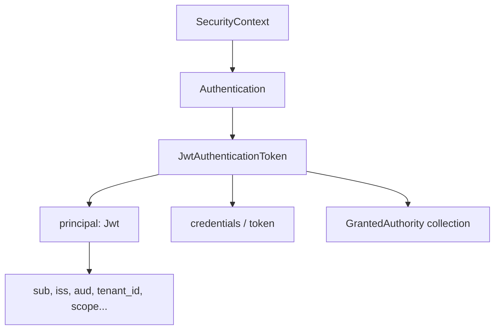

# Giả lập JwtAuthenticationToken và principal đúng kiểu

> **Chương:** JWT với MockMvc  
> **Module:** `SPRING_SECURITY_TESTING` — kiểm chứng xác thực, phân quyền và bảo vệ HTTP bằng `spring-security-test` trên ứng dụng Servlet và Reactive. Bài này hướng dẫn dựng đúng `JwtAuthenticationToken`, hiểu kiểu principal mà controller nhận được và chọn helper phù hợp với hợp đồng principal của ứng dụng.

## 1. Vì sao kiểu principal quan trọng?

Một request resource server có thể được xác thực bằng JWT. Trong cấu hình mặc định của Spring Security, sau khi token được chấp nhận, authentication thường là `JwtAuthenticationToken` và principal của nó là object `Jwt`.

Điều này ảnh hưởng trực tiếp đến cách controller/service đọc danh tính:

- `@AuthenticationPrincipal Jwt jwt` nhận object JWT.
- `Authentication authentication` nhận đối tượng authentication, thường là `JwtAuthenticationToken` trong resource server JWT flow.
- `authentication.getPrincipal()` trả về `Jwt` với authentication mặc định này.
- `((JwtAuthenticationToken) authentication).getToken()` trả về JWT đã gắn với authentication.
- `authentication.getName()` thường trả về subject `sub`, trừ khi converter được cấu hình principal name khác.

Nếu test dùng `@WithMockUser` trong khi controller yêu cầu `@AuthenticationPrincipal Jwt`, test đang cung cấp principal kiểu khác. Nếu controller yêu cầu một custom principal như `PartnerPrincipal` nhưng test chỉ dùng `jwt()` mặc định, test cũng chưa mô phỏng đúng hợp đồng principal.

Mục tiêu của bài:

1. Hiểu quan hệ giữa `Authentication`, `JwtAuthenticationToken` và `Jwt` principal.
2. Dùng `jwt()` để dựng authentication đúng kiểu cho MockMvc.
3. Kiểm tra subject, token, claims, authorities và tên principal.
4. Tự tạo `JwtAuthenticationToken` khi cần kiểm soát toàn bộ authentication.
5. Xử lý trường hợp ứng dụng dùng custom principal hoặc custom authentication.
6. Phân biệt test downstream principal với test converter/decoder thực.

## 2. Authentication, principal, credentials và authorities

Trong Spring Security, `Authentication` đại diện cho kết quả xác thực và thông tin bảo mật của request. Một authentication thường chứa:

| Thành phần | Ý nghĩa | Với JwtAuthenticationToken mặc định |
|---|---|---|
| `Authentication` | Đối tượng xác thực được security context lưu giữ | `JwtAuthenticationToken` |
| `principal` | Chủ thể mà authentication đại diện | Object `Jwt` |
| `credentials` | Thông tin xác thực hoặc credential object | JWT token object trong token authentication abstraction |
| `authorities` | Các quyền Spring Security sử dụng | Collection `GrantedAuthority` |
| `name` | Tên định danh của authentication | Thường lấy từ JWT subject `sub` |
| `token` | OAuth2 token gắn với authentication | `Jwt` |

Sơ đồ:



Hai câu hỏi cần tách biệt:

- **Ai đang được xác thực?** Xem principal, subject hoặc tên authentication.
- **Principal được phép làm gì?** Xem authorities và policy.

Một JWT có `sub = partner-42` không tự động có quyền đọc báo cáo. Ngược lại, authority `SCOPE_reports.read` không cho biết tenant nếu claim tenant không được cung cấp hoặc policy không kiểm tra.

## 3. jwt() tạo JwtAuthenticationToken mặc định

Helper `SecurityMockMvcRequestPostProcessors.jwt()` dựng JWT authentication cho request MockMvc. Ví dụ:

```java
mvc.perform(get("/api/reports")
        .with(jwt()))
    .andExpect(status().isOk());
```

Khi không tùy chỉnh gì, helper tạo một JWT giả lập với dữ liệu mặc định phù hợp cho test và gắn authentication vào request. Để test dễ đọc, nên đặt subject và claim cần thiết một cách tường minh:

```java
mvc.perform(get("/api/reports")
        .with(jwt().jwt(jwt -> jwt
            .subject("partner-42")
            .claim("tenant_id", "acme")
            .claim("scope", "reports.read"))))
    .andExpect(status().isOk());
```

Với post-processor này:

- Authentication được tạo là JWT authentication.
- Principal mặc định là object `Jwt`.
- `sub` thường là tên authentication.
- Claims có thể được controller đọc qua `@AuthenticationPrincipal Jwt`.
- Authorities được tạo theo cấu hình helper, trừ khi test gán trực tiếp bằng `authorities(...)`.

`jwt()` không tạo compact token đã ký và không gọi `JwtDecoder`. Nó dựng authentication ở ranh giới test để kiểm tra phần xử lý sau authentication.

## 4. Phân biệt Authentication với @AuthenticationPrincipal

Một lỗi thường gặp là nhầm `JwtAuthenticationToken` với principal mà controller nhận.

Controller nhận principal:

```java
@GetMapping("/api/me")
Profile me(@AuthenticationPrincipal Jwt jwt) {
    return new Profile(
        jwt.getSubject(),
        jwt.getClaimAsString("tenant_id"));
}
```

Controller nhận authentication:

```java
@GetMapping("/api/me/details")
Profile me(Authentication authentication) {
    JwtAuthenticationToken jwtAuthentication =
        (JwtAuthenticationToken) authentication;

    Jwt jwt = jwtAuthentication.getToken();

    return new Profile(
        jwt.getSubject(),
        jwt.getClaimAsString("tenant_id"));
}
```

Hai chữ ký method có mục đích khác nhau:

| Tham số controller | Giá trị được inject | Ví dụ với resource server JWT mặc định |
|---|---|---|
| `@AuthenticationPrincipal Jwt jwt` | Principal object | `Jwt` |
| `Authentication authentication` | Authentication hiện tại | `JwtAuthenticationToken` |
| `Principal principal` | Principal hiện tại | Authentication wrapper theo request, thường là authentication |
| `@AuthenticationPrincipal CustomPrincipal p` | Principal nếu đúng kiểu | Chỉ có nếu ứng dụng tạo principal kiểu đó |

Không khai báo `@AuthenticationPrincipal JwtAuthenticationToken` nếu authentication mặc định vẫn có principal là `Jwt`. Annotation này lấy principal, không lấy chính authentication object. Nếu muốn nhận `JwtAuthenticationToken`, dùng tham số `Authentication` rồi kiểm tra/cast đúng kiểu hoặc truy cập authentication qua cơ chế context phù hợp.

### Làm rõ lỗi kiểu bằng errorOnInvalidType

Trong code cần fail fast, có thể dùng `@AuthenticationPrincipal(errorOnInvalidType = true)`. Nếu principal thực tế là `Jwt` nhưng tham số yêu cầu một lớp khác, Spring sẽ báo lỗi kiểu thay vì âm thầm truyền null. Điều này hữu ích để phát hiện cấu hình principal không khớp, nhưng chỉ bật khi contract của endpoint thực sự yêu cầu kiểu cụ thể.

## 5. Kiểm tra principal đúng kiểu trong MockMvc

Có thể xác minh request thực sự có `JwtAuthenticationToken` và principal là `Jwt` bằng request principal:

```java
@Test
void jwtHelperCreatesJwtAuthenticationWithJwtPrincipal()
        throws Exception {

    mvc.perform(get("/api/me")
            .with(jwt().jwt(jwt -> jwt
                .subject("partner-42")
                .claim("tenant_id", "acme"))))
        .andExpect(status().isOk())
        .andExpect(authenticated().withUsername("partner-42"))
        .andDo(result -> {
            Principal requestPrincipal =
                result.getRequest().getUserPrincipal();

            assertThat(requestPrincipal)
                .isInstanceOf(JwtAuthenticationToken.class);

            Authentication authentication =
                (Authentication) requestPrincipal;

            assertThat(authentication.getPrincipal())
                .isInstanceOf(Jwt.class);

            Jwt token = ((JwtAuthenticationToken) authentication)
                .getToken();

            assertThat(token.getSubject()).isEqualTo("partner-42");
            assertThat(token.getClaimAsString("tenant_id"))
                .isEqualTo("acme");
        });
}
```

Ví dụ giả định request đã được xác thực bằng `jwt()` và ứng dụng dùng wrapper request của Spring Security. Trong Servlet, `request.getUserPrincipal()` trả về authentication của request khi security request wrapper được áp dụng.

Có thể kiểm tra thêm authorities:

```java
mvc.perform(get("/api/reports")
        .with(jwt().authorities(
            new SimpleGrantedAuthority("SCOPE_reports.read"))))
    .andExpect(authenticated().withAuthorities(
        new SimpleGrantedAuthority("SCOPE_reports.read")));
```

Matcher authentication kiểm tra trạng thái request; đoạn `andDo` ở trên kiểm tra kiểu object. Hai loại assertion bổ sung cho nhau.

## 6. Đọc subject, name và token

`JwtAuthenticationToken` có các phương thức hữu ích:

- `getName()` trả tên authentication.
- `getPrincipal()` trả principal object, mặc định là `Jwt`.
- `getToken()` trả JWT.
- `getAuthorities()` trả collection quyền.
- `isAuthenticated()` cho biết authentication đang được đánh dấu authenticated.

Ví dụ:

```java
mvc.perform(get("/api/me")
        .with(jwt().jwt(jwt -> jwt
            .subject("partner-42")
            .claim("tenant_id", "acme"))))
    .andDo(result -> {
        Authentication authentication =
            (Authentication) result.getRequest().getUserPrincipal();

        JwtAuthenticationToken jwtAuthentication =
            (JwtAuthenticationToken) authentication;

        assertThat(jwtAuthentication.isAuthenticated()).isTrue();
        assertThat(jwtAuthentication.getName()).isEqualTo("partner-42");
        assertThat(jwtAuthentication.getPrincipal()).isInstanceOf(Jwt.class);
        assertThat(jwtAuthentication.getToken().getSubject())
            .isEqualTo("partner-42");
    });
```

`getName()` không phải lúc nào cũng bằng email hoặc username trong hệ thống. Theo mặc định, tên thường lấy từ `sub`; nếu ứng dụng đổi `principalClaimName` hoặc dùng converter riêng, hãy test theo cấu hình đó.

Đừng dùng `getName()` làm tenant identifier nếu tenant nằm trong custom claim. Subject và tenant là hai thuộc tính khác nhau.

## 7. Tạo Jwt fixture và JwtAuthenticationToken tường minh

Thông thường `jwt()` là đủ. Khi muốn kiểm soát authentication object rõ ràng hoặc tái sử dụng một fixture JWT, có thể tạo `Jwt` trước:

```java
Jwt token = Jwt.withTokenValue("mock-token")
    .header("alg", "none")
    .subject("partner-42")
    .claim("tenant_id", "acme")
    .claim("scope", "reports.read")
    .issuedAt(Instant.parse("2026-11-25T08:00:00Z"))
    .expiresAt(Instant.parse("2026-11-25T09:00:00Z"))
    .build();
```

Tạo authentication:

```java
List<GrantedAuthority> authorities = List.of(
    new SimpleGrantedAuthority("SCOPE_reports.read"),
    new SimpleGrantedAuthority("TENANT_acme")
);

JwtAuthenticationToken authentication =
    new JwtAuthenticationToken(
        token,
        authorities,
        "partner-42");
```

Gắn vào request bằng `authentication(...)`:

```java
mvc.perform(get("/api/reports")
        .with(authentication(authentication)))
    .andExpect(status().isOk())
    .andExpect(authenticated().withUsername("partner-42"));
```

Cách này cho phép kiểm soát rõ:

- JWT object và claims.
- Tập authority.
- Tên authentication.
- Kiểu authentication cụ thể.

Constructor ba tham số của `JwtAuthenticationToken` nhận JWT, authorities và name. Nếu dùng constructor khác, tên thường lấy từ subject theo hành vi mặc định của class.

Đây vẫn là authentication giả lập. `tokenValue("mock-token")` không phải compact token đã ký; header `alg = none` chỉ là dữ liệu của object test.

## 8. So sánh jwt() và authentication()

Hai post-processor có điểm bắt đầu khác nhau:

| Helper | Việc helper thực hiện | Khi phù hợp |
|---|---|---|
| `jwt()` | Tạo JWT authentication cho request từ JWT fixture | Test resource-server principal mặc định |
| `authentication(authentication)` | Gắn Authentication object do test cung cấp | Test một authentication cụ thể hoặc custom principal |
| `user("an")` | Dựng username/password-style authentication | Policy không phụ thuộc JWT principal |
| `@WithMockUser` | Thiết lập security context cho test method | Method security với user/authority đơn giản |

Ví dụ dùng `jwt()`:

```java
mvc.perform(get("/api/me")
        .with(jwt().jwt(jwt -> jwt.subject("partner-42"))))
    .andExpect(status().isOk());
```

Ví dụ gắn `JwtAuthenticationToken` được tạo trước:

```java
JwtAuthenticationToken authentication =
    new JwtAuthenticationToken(
        token,
        List.of(new SimpleGrantedAuthority("SCOPE_reports.read")),
        "partner-42");

mvc.perform(get("/api/me")
        .with(authentication(authentication)))
    .andExpect(status().isOk());
```

Dùng `jwt()` khi muốn mô tả JWT fixture trực tiếp và để helper tạo token authentication. Dùng `authentication()` khi test cần chính xác một authentication object đã tạo hoặc custom authentication.

Cả hai đều bỏ qua việc parse Bearer header và xác minh token qua decoder. Chúng không thay thế authentication integration test.

## 9. @AuthenticationPrincipal nhận Jwt như thế nào?

Annotation `@AuthenticationPrincipal` lấy principal từ authentication hiện tại. Với JWT resource server mặc định, principal là `Jwt`:

```java
@GetMapping("/api/partner/profile")
PartnerProfile profile(@AuthenticationPrincipal Jwt jwt) {
    return new PartnerProfile(
        jwt.getSubject(),
        jwt.getClaimAsString("tenant_id"),
        jwt.getClaimAsString("partner_type"));
}
```

Test:

```java
mvc.perform(get("/api/partner/profile")
        .with(jwt().jwt(jwt -> jwt
            .subject("partner-42")
            .claim("tenant_id", "acme")
            .claim("partner_type", "reseller"))))
    .andExpect(status().isOk())
    .andExpect(jsonPath("$.subject").value("partner-42"))
    .andExpect(jsonPath("$.tenantId").value("acme"))
    .andExpect(jsonPath("$.partnerType").value("reseller"));
```

Nếu controller chỉ cần subject và một vài claims, nhận `Jwt` trực tiếp giúp thể hiện rõ contract. Không trả toàn bộ claims ra response; chỉ expose dữ liệu được phép.

Nếu test dùng `@WithMockUser` ở đây, principal mặc định không phải `Jwt`. Hãy dùng `jwt()` hoặc fixture authentication có principal đúng kiểu.

## 10. Khi ứng dụng dùng custom principal

Một số ứng dụng không muốn domain service phụ thuộc trực tiếp vào `Jwt`. Thay vào đó, ứng dụng chuyển token thành principal nội bộ:

```java
public record PartnerPrincipal(
        String partnerId,
        String tenantId) implements Principal {

    @Override
    public String getName() {
        return partnerId;
    }
}
```

Controller có thể nhận:

```java
@GetMapping("/api/partner/profile")
PartnerProfile profile(
        @AuthenticationPrincipal PartnerPrincipal principal) {
    return new PartnerProfile(
        principal.partnerId(),
        principal.tenantId());
}
```

Điểm cần nhớ: `jwt()` mặc định tạo `JwtAuthenticationToken` với principal là `Jwt`. Chỉ thêm claim `partnerId` hoặc `tenant_id` không tự biến principal thành `PartnerPrincipal`.

Nếu production thực sự có custom authentication converter tạo principal kiểu `PartnerPrincipal`, test cần mô phỏng đúng boundary đó. Có hai cách tùy mục tiêu:

- Test code downstream nhận principal bằng cách gắn một authentication có principal đúng kiểu.
- Test converter và wiring production bằng Bearer token thật qua decoder và converter.

### Test downstream với custom principal

Nếu method/service chỉ cần principal kiểu `PartnerPrincipal` và không cần chứng minh converter, có thể tạo authentication test phù hợp:

```java
PartnerPrincipal principal =
    new PartnerPrincipal("partner-42", "acme");

TestingAuthenticationToken authentication =
    new TestingAuthenticationToken(
        principal,
        null,
        List.of(new SimpleGrantedAuthority("SCOPE_reports.read")));

mvc.perform(get("/api/partner/profile")
        .with(authentication(authentication)))
    .andExpect(status().isOk())
    .andExpect(jsonPath("$.partnerId").value("partner-42"))
    .andExpect(jsonPath("$.tenantId").value("acme"));
```

Đây là test với `TestingAuthenticationToken` và custom principal. Nó không phải `JwtAuthenticationToken` và không chứng minh JWT converter production tạo ra principal này. Nó chỉ cô lập code downstream theo principal contract.

Nếu ứng dụng bắt buộc authentication phải là một custom subclass của `JwtAuthenticationToken`, hãy tạo đúng subclass/fixture tương ứng thay vì thay bằng `TestingAuthenticationToken`.

## 11. Kiểm tra custom converter tạo principal đúng kiểu

Resource server cho phép cấu hình converter để biến `Jwt` thành authentication. Converter mặc định tạo `JwtAuthenticationToken` với principal là `Jwt`. Nếu ứng dụng có custom converter trả về một authentication khác, cần kiểm tra cả:

1. Input JWT có claims cần thiết.
2. Converter tạo principal đúng kiểu.
3. Authorities được ánh xạ đúng.
4. Security chain thực sự dùng converter đó.
5. Controller/service nhận đúng principal.

Một unit test converter có thể kiểm tra object đầu ra:

```java
@Test
void converterCreatesPartnerPrincipal() {
    Jwt jwt = Jwt.withTokenValue("test-token")
        .header("alg", "none")
        .subject("partner-42")
        .claim("tenant_id", "acme")
        .build();

    AbstractAuthenticationToken authentication =
        partnerJwtConverter.convert(jwt);

    assertThat(authentication.getPrincipal())
        .isInstanceOf(PartnerPrincipal.class);

    PartnerPrincipal principal =
        (PartnerPrincipal) authentication.getPrincipal();

    assertThat(principal.partnerId()).isEqualTo("partner-42");
    assertThat(principal.tenantId()).isEqualTo("acme");
}
```

Đây là unit test converter. Để xác minh converter đã được gắn vào resource server, cần integration test gửi Bearer token thật qua decoder và kiểm tra request/controller nhận principal đúng kiểu. Một unit test converter xanh không chứng minh cấu hình chain đã dùng converter đó.

## 12. Principal và authority là hai hợp đồng độc lập

Một principal đúng kiểu vẫn có thể thiếu authority. Một authentication có authority đúng vẫn có thể mang principal sai kiểu cho controller.

| Principal | Authorities | Kết quả cần kiểm tra |
|---|---|---|
| `Jwt` đúng subject/tenant | `SCOPE_reports.read` | Được phép nếu policy yêu cầu scope |
| `Jwt` đúng subject/tenant | Chỉ `SCOPE_orders.read` | Bị từ chối đọc báo cáo |
| `Jwt` tenant `beta` | `SCOPE_reports.read` | Bị từ chối nếu tài nguyên thuộc `acme` |
| `PartnerPrincipal` đúng kiểu | Authority đủ | Controller/domain code nhận đúng principal |
| `PartnerPrincipal` đúng kiểu | Authority thiếu | Method/request policy từ chối |
| Principal sai kiểu | Authority có vẻ đủ | Không được xem là test hợp lệ cho controller yêu cầu custom principal |

Tách assertion:

- Principal type và fields: kiểm tra kiểu, subject, tenant.
- Authentication: kiểm tra class và authenticated state.
- Authorities: kiểm tra danh sách quyền.
- Authorization: kiểm tra allow/deny.
- Business policy: kiểm tra owner/tenant/state và side effects.

Không dùng một status `200` để suy ra tất cả các thuộc tính trên đều đúng.

## 13. Dùng @WebMvcTest và @SpringBootTest đúng phạm vi

### MVC slice

`@WebMvcTest` có thể kiểm tra controller nhận principal đúng kiểu khi security configuration được nạp:

```java
@WebMvcTest(PartnerProfileController.class)
@Import(ApiSecurityConfiguration.class)
class PartnerProfileMvcTest {

    @Autowired
    MockMvc mvc;

    @MockitoBean
    PartnerProfileService service;

    @Test
    void jwtPrincipalIsInjected() throws Exception {
        when(service.profile("partner-42"))
            .thenReturn(new PartnerProfile("partner-42", "acme"));

        mvc.perform(get("/api/partner/profile")
                .with(jwt().jwt(jwt -> jwt
                    .subject("partner-42")
                    .claim("tenant_id", "acme"))))
            .andExpect(status().isOk())
            .andExpect(jsonPath("$.partnerId").value("partner-42"));

        verify(service).profile("partner-42");
    }
}
```

Ví dụ dùng `@MockitoBean` trên phiên bản Spring Framework hỗ trợ; dự án cũ có thể dùng mock-bean annotation tương ứng. Giữ filter chain thật nếu mục tiêu gồm request authorization. Không dùng `addFilters = false`.

### Application context đầy đủ

`@SpringBootTest` phù hợp khi cần controller, service, method security và các bean liên quan:

```java
@SpringBootTest
@AutoConfigureMockMvc
class PartnerPrincipalIntegrationTest {

    @Autowired
    MockMvc mvc;

    @Test
    void reportReaderUsesJwtPrincipalAndAuthority() throws Exception {
        mvc.perform(get("/api/reports")
                .with(jwt()
                    .jwt(jwt -> jwt
                        .subject("partner-42")
                        .claim("tenant_id", "acme"))
                    .authorities(
                        new SimpleGrantedAuthority("SCOPE_reports.read"))))
            .andExpect(status().isOk());
    }
}
```

Application context rộng hơn không làm authentication giả lập trở thành token thật. Nếu cần kiểm tra Bearer parsing, signature, issuer, audience hoặc expiration, gửi token ký thật qua decoder.

## 14. Lỗi thường gặp về JwtAuthenticationToken và principal

| Lỗi | Vì sao sai | Cách làm đúng |
|---|---|---|
| Dùng `@AuthenticationPrincipal JwtAuthenticationToken` | Principal mặc định là `Jwt`, không phải authentication | Nhận `Jwt` hoặc tham số `Authentication` |
| Dùng `@WithMockUser` cho controller yêu cầu `Jwt` | Principal mặc định không phải Jwt | Dùng `jwt()` |
| Thêm claim custom và nghĩ principal tự đổi kiểu | Claims vẫn nằm trong object Jwt | Dùng custom converter/principal nếu production có |
| Chỉ assert username | Không chứng minh principal class/claims | Assert type, token, claims và authorities |
| Gọi `SecurityContextHolder` sau khi request kết thúc | Context có thể đã được dọn theo lifecycle | Assert trong request hoặc dùng matcher |
| Tạo `new JwtAuthenticationToken` rồi kết luận decoder chạy | Authentication được dựng trực tiếp | Bearer token thật qua decoder |
| Dùng `TestingAuthenticationToken` rồi gọi đó là JWT authentication | Đây là loại Authentication khác | Ghi rõ test downstream principal contract |
| Gán authority trực tiếp rồi kết luận converter đúng | Bỏ qua bước claim mapping | Test converter và integration wiring |
| Mock service có `@PreAuthorize` | Interceptor không chạy trên mock | Gọi bean thật qua Spring proxy |

## 15. Bài tập thực hành: principal cho API đối tác nhiều tenant

API có:

- `GET /api/partner/profile` trả subject và tenant.
- `GET /api/partner/reports` yêu cầu `SCOPE_reports.read`.
- Policy chỉ cho phép principal thuộc tenant sở hữu báo cáo.
- Controller mặc định nhận `@AuthenticationPrincipal Jwt`.
- Một module khác dùng custom `PartnerPrincipal` do converter tạo.

Hãy viết các test:

1. Dùng `jwt()` và kiểm tra authentication là `JwtAuthenticationToken`.
2. Xác minh `getPrincipal()` là `Jwt` và `getToken()` chứa subject/tenant đúng.
3. Kiểm tra `@AuthenticationPrincipal Jwt` nhận đúng object.
4. Kiểm tra `Authentication.getName()` theo `sub`.
5. Dùng `jwt().authorities(...)` để tạo scope đủ/thiếu và kiểm tra allow/deny.
6. Kết hợp subject, tenant claims và authorities để kiểm tra tenant isolation.
7. Tạo `JwtAuthenticationToken` tường minh và gắn bằng `authentication(...)`.
8. Dùng `TestingAuthenticationToken` với `PartnerPrincipal` để test downstream contract; ghi rõ đây không phải JwtAuthenticationToken.
9. Unit test custom converter tạo đúng `PartnerPrincipal` và authority.
10. Integration test Bearer token thật qua decoder/converter để chứng minh wiring production.

Với từng test, ghi rõ principal type, authentication type, authority, lớp nào được chạy thật và điều gì test không chứng minh.

**Tiêu chí hoàn thành:** Bạn có thể phân biệt object `Authentication` với principal bên trong nó, dựng `JwtAuthenticationToken` có subject/claims/authorities đúng cho MockMvc, và tránh lỗi kiểu khi controller dùng `@AuthenticationPrincipal`. Nếu ứng dụng có custom principal, bạn biết cách cô lập code downstream và cách kiểm tra converter/wiring riêng bằng token thật.
