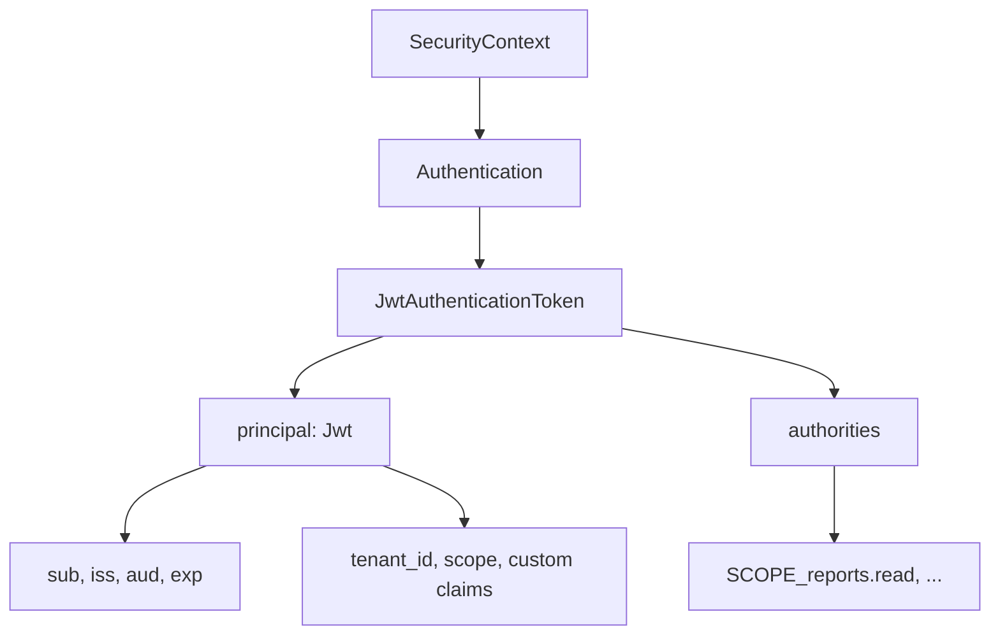

# Controller đọc Jwt qua @AuthenticationPrincipal

> **Chương:** JWT với MockMvc  
> **Module:** `SPRING_SECURITY_TESTING` — kiểm chứng xác thực, phân quyền và bảo vệ HTTP bằng `spring-security-test` trên ứng dụng Servlet và Reactive. Bài tập trung vào cách Spring MVC đưa JWT principal vào tham số controller bằng `@AuthenticationPrincipal` và cách kiểm thử hành vi đó với `MockMvc`.

## 1. Controller nhận JWT principal từ đâu?

Khi một request Bearer token đi qua Spring Security resource server, chuỗi xử lý mặc định có thể được tóm tắt như sau:

1. Bearer token authentication filter đọc header `Authorization: Bearer ...`.
2. `JwtDecoder` xác minh token và các validator được cấu hình.
3. `JwtAuthenticationConverter` chuyển JWT thành authentication và authorities.
4. `SecurityContext` giữ authentication của request.
5. Spring MVC argument resolver đọc principal từ authentication để cung cấp cho tham số controller có `@AuthenticationPrincipal`.

Với JWT resource server mặc định, authentication là `JwtAuthenticationToken` và principal bên trong là object `Jwt`. Vì vậy controller có thể khai báo:

```java
@GetMapping("/api/me")
Profile me(@AuthenticationPrincipal Jwt jwt) {
    return new Profile(
        jwt.getSubject(),
        jwt.getClaimAsString("tenant_id"));
}
```

`@AuthenticationPrincipal` không tự đọc header Bearer, không tự parse token và không xác minh chữ ký. Annotation lấy principal đã có trong security context. Việc xác thực token phải được thực hiện ở filter/decoder trước khi controller được gọi.

Đây là ranh giới quan trọng:

- **Authentication layer:** kiểm tra token và tạo authentication.
- **Argument resolution:** lấy principal từ authentication để truyền vào controller.
- **Authorization/business layer:** quyết định principal được phép truy cập endpoint hoặc tài nguyên nào.

## 2. Quan hệ giữa JwtAuthenticationToken và Jwt principal

Hai kiểu này thường bị nhầm lẫn:

| Kiểu | Vai trò | Cách truy cập |
|---|---|---|
| `JwtAuthenticationToken` | Authentication object được lưu trong SecurityContext | `Authentication` hoặc cast từ authentication |
| `Jwt` | Principal mặc định bên trong JWT authentication | `@AuthenticationPrincipal Jwt jwt` |
| `GrantedAuthority` | Quyền của authentication | `authentication.getAuthorities()` |
| `Authentication.getName()` | Tên định danh của authentication | Thường là subject `sub` |

Sơ đồ:



Do đó, chữ ký controller đúng thường là:

```java
@GetMapping("/api/profile")
Profile profile(@AuthenticationPrincipal Jwt jwt) {
    // jwt là principal
}
```

Nếu muốn nhận cả authentication wrapper, khai báo:

```java
@GetMapping("/api/profile/details")
Profile profile(Authentication authentication) {
    JwtAuthenticationToken jwtAuthentication =
        (JwtAuthenticationToken) authentication;

    Jwt jwt = jwtAuthentication.getToken();
    return new Profile(jwt.getSubject(), jwt.getClaimAsString("tenant_id"));
}
```

Không khai báo tham số `@AuthenticationPrincipal JwtAuthenticationToken` nếu principal mặc định là `Jwt`. Annotation lấy principal, không lấy authentication object.

## 3. Khai báo @AuthenticationPrincipal trong controller

Annotation nằm trong package:

```java
import org.springframework.security.core.annotation.AuthenticationPrincipal;
import org.springframework.security.oauth2.jwt.Jwt;
```

Một DTO response:

```java
public record CurrentUserResponse(
    String subject,
    String tenantId,
    String email
) {}
```

Controller:

```java
@RestController
@RequestMapping("/api")
class CurrentUserController {

    @GetMapping("/me")
    CurrentUserResponse me(@AuthenticationPrincipal Jwt jwt) {
        return new CurrentUserResponse(
            jwt.getSubject(),
            jwt.getClaimAsString("tenant_id"),
            jwt.getClaimAsString("email")
        );
    }
}
```

Spring MVC argument resolver lấy principal từ authentication của request rồi truyền vào tham số. Controller không cần tự gọi `SecurityContextHolder.getContext()` cho trường hợp thông thường.

Nên giữ controller mỏng: lấy những thuộc tính cần thiết từ principal rồi gọi service với dữ liệu rõ ràng. Không truyền toàn bộ JWT xuống mọi tầng nếu domain service chỉ cần subject hoặc tenant ID.

### Không trả toàn bộ JWT cho client

JWT có thể chứa email, nhóm, tenant, quyền, định danh nội bộ hoặc thông tin nhạy cảm khác. Chỉ trả những trường được API contract cho phép. Tránh trả `jwt.getTokenValue()`, toàn bộ `jwt.getClaims()` hoặc ghi nguyên token vào log.

## 4. Đọc subject và tên principal

Subject thường được dùng làm định danh ổn định của principal:

```java
String subject = jwt.getSubject();
```

Với `JwtAuthenticationToken` mặc định, `Authentication.getName()` thường dựa trên subject. Ví dụ:

```java
@GetMapping("/api/me/identity")
Map<String, String> identity(
        @AuthenticationPrincipal Jwt jwt,
        Authentication authentication) {

    return Map.of(
        "subject", jwt.getSubject(),
        "authenticationName", authentication.getName()
    );
}
```

Trong cấu hình mặc định, hai giá trị thường giống nhau. Tuy nhiên ứng dụng có thể cấu hình claim khác làm principal name hoặc dùng custom converter. Nếu ứng dụng đổi principal claim name, hãy kiểm tra theo cấu hình thực tế thay vì giả định `getName()` luôn là `sub`.

Không dùng subject thay tenant ID. Một partner có thể có subject `partner-42` và tenant `acme`; đây là hai thuộc tính khác nhau.

## 5. Đọc standard claims và custom claims

`Jwt` cung cấp accessor cho standard claims:

| Claim | Accessor | Kiểu dữ liệu |
|---|---|---|
| `sub` | `getSubject()` | String |
| `iss` | `getIssuer()` | URI |
| `aud` | `getAudience()` | List<String> |
| `exp` | `getExpiresAt()` | Instant |
| `iat` | `getIssuedAt()` | Instant |
| `jti` | `getId()` | String |
| Custom | `getClaim(name)` | Kiểu theo schema issuer |

Ví dụ đọc tenant và nhóm:

```java
@GetMapping("/api/partner/context")
PartnerContext context(@AuthenticationPrincipal Jwt jwt) {
    return new PartnerContext(
        jwt.getSubject(),
        jwt.getClaimAsString("tenant_id"),
        jwt.getClaimAsStringList("groups")
    );
}
```

Hãy giữ kiểu dữ liệu theo contract của issuer. Nếu `groups` là collection chuỗi, dùng accessor list phù hợp. Không giả định claim luôn có mặt hoặc luôn đúng kiểu.

### Claim có thể vắng mặt

`getClaimAsString("tenant_id")` có thể trả `null` khi claim không có. Nếu tenant là bắt buộc cho policy, hãy từ chối khi thiếu hoặc rỗng thay vì tự gán tenant mặc định.

Ví dụ:

```java
@GetMapping("/api/tenant/reports")
ReportList reports(@AuthenticationPrincipal Jwt jwt) {
    String tenantId = jwt.getClaimAsString("tenant_id");

    if (tenantId == null || tenantId.isBlank()) {
        throw new AccessDeniedException("Missing tenant claim");
    }

    return reportService.findForTenant(tenantId);
}
```

Ví dụ này minh họa fail closed. Trong ứng dụng thực, có thể dùng exception riêng và exception handler để ánh xạ response theo contract; không đưa claim/token nhạy cảm vào error message.

## 6. Dùng expression để lấy một thuộc tính của principal

`@AuthenticationPrincipal` hỗ trợ expression để lấy một phần dữ liệu từ principal:

```java
@GetMapping("/api/me/subject")
String subject(
        @AuthenticationPrincipal(expression = "subject") String subject) {
    return subject;
}
```

Với principal là `Jwt`, expression `subject` truy cập thuộc tính subject. Có thể đọc claim lồng nhau bằng expression tương ứng, ví dụ:

```java
@GetMapping("/api/me/tenant")
String tenant(
        @AuthenticationPrincipal(
            expression = "claims['tenant_id']") String tenantId) {
    return tenantId;
}
```

Cách này phù hợp khi controller chỉ cần một giá trị đơn giản. Khi cần nhiều claim hoặc logic kiểm tra, nhận `Jwt` rõ ràng thường dễ đọc và dễ test hơn.

Expression chỉ lấy dữ liệu từ principal hiện có. Nó không xác minh claim, không thay thế decoder và không nên được dùng để cấp quyền dựa trên dữ liệu chưa được xác thực.

## 7. Kiểm soát principal sai kiểu

Theo mặc định, `@AuthenticationPrincipal` trả `null` nếu principal không tương thích với kiểu tham số. Điều này có thể làm controller lỗi khi code giả định principal luôn là `Jwt`.

Có thể yêu cầu resolver báo lỗi khi kiểu không khớp:

```java
@GetMapping("/api/me")
CurrentUserResponse me(
        @AuthenticationPrincipal(errorOnInvalidType = true) Jwt jwt) {
    return new CurrentUserResponse(
        jwt.getSubject(),
        jwt.getClaimAsString("tenant_id"),
        jwt.getClaimAsString("email"));
}
```

Khi bật `errorOnInvalidType = true`, principal sai kiểu sẽ tạo lỗi thay vì âm thầm trả null. Đây là lựa chọn phù hợp khi endpoint chỉ chấp nhận JWT principal và security configuration bảo đảm authentication đúng kiểu.

Nếu endpoint công khai và anonymous được phép, tham số principal có thể là null. Khi đó phải thiết kế nhánh anonymous tường minh thay vì bật fail-fast rồi coi lỗi kiểu là hành vi mong muốn.

### Vì sao @WithMockUser có thể không phù hợp?

`@WithMockUser` thường tạo authentication với principal dạng user mặc định/`UserDetails`, không phải `Jwt`. Vì vậy nó phù hợp với policy chỉ cần username/authority, nhưng không phù hợp để test controller yêu cầu `@AuthenticationPrincipal Jwt`.

Với controller nhận JWT, dùng `jwt()`. Nếu muốn kiểm tra một custom principal khác, hãy dựng đúng principal contract đó.

## 8. Cấu hình resource server và endpoint được bảo vệ

Một cấu hình tối giản cho ví dụ:

```java
@Configuration
@EnableWebSecurity
class ApiSecurityConfiguration {

    @Bean
    SecurityFilterChain apiChain(HttpSecurity http) throws Exception {
        return http
            .authorizeHttpRequests(auth -> auth
                .requestMatchers(HttpMethod.GET, "/api/me")
                    .authenticated()
                .requestMatchers(HttpMethod.GET, "/api/tenant/reports")
                    .hasAuthority("SCOPE_reports.read")
                .anyRequest().denyAll()
            )
            .oauth2ResourceServer(oauth2 -> oauth2
                .jwt(Customizer.withDefaults())
            )
            .build();
    }
}
```

Cấu hình triển khai còn cần một `JwtDecoder` được cung cấp qua issuer/JWK hoặc bean tương ứng. Bài test dùng `jwt()` có thể dựng authentication trực tiếp để kiểm tra controller/authorization mà không gọi decoder, nhưng ứng dụng production vẫn phải cấu hình decoder đúng.

Với API resource server mặc định, request anonymous vào endpoint bảo vệ thường nhận `401`. JWT authentication đã có nhưng thiếu `SCOPE_reports.read` thường nhận `403`. Status cuối cùng cần khớp entry point và handler của ứng dụng.

## 9. Kiểm thử argument injection bằng MockMvc

`MockMvc` có thể xác minh rằng controller nhận đúng JWT principal qua `@AuthenticationPrincipal`.

Ví dụ test:

```java
@WebMvcTest(CurrentUserController.class)
@Import(ApiSecurityConfiguration.class)
class CurrentUserControllerTest {

    @Autowired
    MockMvc mvc;

    @MockitoBean
    JwtDecoder jwtDecoder;

    @Test
    void injectsJwtPrincipalIntoController() throws Exception {
        mvc.perform(get("/api/me")
                .with(jwt().jwt(jwt -> jwt
                    .subject("partner-42")
                    .claim("tenant_id", "acme")
                    .claim("email", "partner@example.test"))))
            .andExpect(status().isOk())
            .andExpect(jsonPath("$.subject").value("partner-42"))
            .andExpect(jsonPath("$.tenantId").value("acme"))
            .andExpect(jsonPath("$.email").value("partner@example.test"));
    }
}
```

`@WebMvcTest` giới hạn context vào MVC slice. `@Import` đưa security configuration cần kiểm tra vào context. Trong một số cấu hình resource server, `JwtDecoder` bean cần có để khởi tạo; có thể cung cấp mock bean khi test chỉ dùng `jwt()` và không kiểm tra decoder. Với Spring Framework cũ hơn, dùng mock-bean annotation tương ứng của phiên bản dự án.

Request post-processor `jwt()` gắn JWT authentication vào request test, nên decoder mock không được gọi. Đây là test argument resolution và downstream authorization, không phải token validation test.

Không tắt filter bằng `@AutoConfigureMockMvc(addFilters = false)`. Nếu filters bị tắt, test không còn chứng minh request đi qua security chain.

## 10. Kiểm tra anonymous và authenticated request

Bên cạnh ca principal được inject, cần kiểm tra endpoint được bảo vệ từ chối anonymous:

```java
@Test
void anonymousCannotReachJwtController() throws Exception {
    mvc.perform(get("/api/me"))
        .andExpect(status().isUnauthorized());
}
```

Ví dụ giả định resource server dùng Bearer authentication entry point mặc định. Nếu ứng dụng dùng form login, status có thể là redirect; hãy theo contract thật.

Ca authenticated với JWT:

```java
@Test
void authenticatedJwtCanReachController() throws Exception {
    mvc.perform(get("/api/me")
            .with(jwt().jwt(jwt -> jwt
                .subject("partner-42")
                .claim("tenant_id", "acme"))))
        .andExpect(status().isOk());
}
```

Cặp test chứng minh request anonymous bị chặn còn request có JWT authentication đi tiếp. Tuy nhiên, ca thứ hai vẫn không kiểm tra chữ ký JWT vì helper đã dựng authentication.

## 11. Kiểm tra claim bắt buộc và fail-closed policy

Nếu endpoint cần tenant, tạo cả ca có claim và thiếu claim:

```java
@WebMvcTest(TenantReportController.class)
@Import(ApiSecurityConfiguration.class)
class TenantReportControllerTest {

    @Autowired
    MockMvc mvc;

    @MockitoBean
    JwtDecoder jwtDecoder;

    @MockitoBean
    ReportService reportService;

    @Test
    void tenantClaimIsPassedToService() throws Exception {
        when(reportService.findForTenant("acme"))
            .thenReturn(new ReportList(List.of("R-100")));

        mvc.perform(get("/api/tenant/reports")
                .with(jwt().jwt(jwt -> jwt
                    .subject("partner-42")
                    .claim("tenant_id", "acme"))
                    .authorities(
                        new SimpleGrantedAuthority("SCOPE_reports.read"))))
            .andExpect(status().isOk())
            .andExpect(jsonPath("$.reportIds[0]").value("R-100"));

        verify(reportService).findForTenant("acme");
    }

    @Test
    void missingTenantClaimIsDenied() throws Exception {
        mvc.perform(get("/api/tenant/reports")
                .with(jwt()
                    .jwt(jwt -> jwt.subject("partner-42"))
                    .authorities(
                        new SimpleGrantedAuthority("SCOPE_reports.read"))))
            .andExpect(status().isForbidden());

        verifyNoInteractions(reportService);
    }
}
```

Ví dụ giả định controller kiểm tra tenant trước khi gọi service và exception được ánh xạ thành `403`. Nếu ứng dụng trả `404` để che giấu tài nguyên hoặc dùng error schema riêng, hãy điều chỉnh assertion. Điều cần chứng minh là claim thiếu không làm request truy cập dữ liệu mặc định.

### Kiểm tra tenant khác

Thêm một ca có `tenant_id = beta` trong khi fixture báo cáo thuộc `acme`. Giữ nguyên subject type và scope, chỉ thay tenant. Assert response bị từ chối và service không truy vấn ngoài phạm vi tenant. Điều này kiểm tra policy tenant, không phải chỉ việc inject claim.

## 12. Principal và authority cần được kiểm tra riêng

`@AuthenticationPrincipal Jwt jwt` giúp controller đọc principal, nhưng nó không nói principal có quyền gì. Authorities nằm trên authentication wrapper.

Ví dụ controller có thể nhận cả hai:

```java
@GetMapping("/api/partner/context")
PartnerContext context(
        @AuthenticationPrincipal Jwt jwt,
        Authentication authentication) {

    boolean canReadReports = authentication.getAuthorities().stream()
        .anyMatch(a -> a.getAuthority().equals("SCOPE_reports.read"));

    return new PartnerContext(
        jwt.getSubject(),
        jwt.getClaimAsString("tenant_id"),
        canReadReports
    );
}
```

Trong thiết kế thực tế, không nhất thiết controller phải tự kiểm tra authority nếu request matcher hoặc method security đã làm việc đó. Ví dụ chỉ minh họa rằng principal và authorities là hai dữ liệu khác nhau.

Test nên xác minh độc lập:

- Principal là đúng kiểu và có subject/claims mong đợi.
- Authentication có authority mong đợi.
- Authorization policy cho phép/từ chối đúng.
- Service chỉ được gọi khi điều kiện policy thỏa.

## 13. Khi controller cần Authentication hoặc JwtAuthenticationToken

Nếu cần truy cập authentication metadata, nhận `Authentication`:

```java
@GetMapping("/api/auth-details")
AuthDetails details(Authentication authentication) {
    if (!(authentication instanceof JwtAuthenticationToken jwtAuth)) {
        throw new AccessDeniedException("JWT authentication required");
    }

    Jwt jwt = jwtAuth.getToken();

    return new AuthDetails(
        jwtAuth.getName(),
        jwt.getSubject(),
        jwtAuth.getAuthorities().stream()
            .map(GrantedAuthority::getAuthority)
            .toList()
    );
}
```

Đây là cách nhận wrapper và kiểm tra loại authentication. Tránh cast mù nếu endpoint có thể được gọi bởi nhiều cơ chế authentication.

Thông thường, nếu chỉ cần claims, `@AuthenticationPrincipal Jwt` đơn giản hơn. Nếu cần authorities, có thể dùng `Authentication` hoặc để authorization framework quyết định thay vì tự lọc quyền trong controller.

## 14. Kiểm thử expression và custom annotation

Nếu controller chỉ cần subject, có thể dùng expression:

```java
@GetMapping("/api/me/subject")
String subject(
        @AuthenticationPrincipal(expression = "subject") String subject) {
    return subject;
}
```

Test:

```java
mvc.perform(get("/api/me/subject")
        .with(jwt().jwt(jwt -> jwt.subject("partner-42"))))
    .andExpect(status().isOk())
    .andExpect(content().string("partner-42"));
```

Nếu ứng dụng lặp lại cùng kiểu principal ở nhiều controller, có thể tạo meta-annotation:

```java
@Target(ElementType.PARAMETER)
@Retention(RetentionPolicy.RUNTIME)
@AuthenticationPrincipal
public @interface CurrentJwt {
}
```

Controller:

```java
@GetMapping("/api/me")
CurrentUserResponse me(@CurrentJwt Jwt jwt) {
    return new CurrentUserResponse(
        jwt.getSubject(),
        jwt.getClaimAsString("tenant_id"),
        jwt.getClaimAsString("email"));
}
```

Meta-annotation giúp thống nhất cách khai báo principal. Nó không thay đổi kiểu authentication, không tạo principal mới và không xác minh token.

## 15. Kiểm tra lỗi kiểu principal

Nếu controller yêu cầu `Jwt` nhưng test dùng `@WithMockUser`, principal mặc định không đúng kiểu. Với cấu hình mặc định, resolver có thể trả null; nếu controller dereference ngay, test có thể thất bại bằng NullPointerException. Có thể bật `errorOnInvalidType` để lỗi kiểu xuất hiện rõ hơn.

Ví dụ endpoint strict:

```java
@GetMapping("/api/me/strict")
String strict(
        @AuthenticationPrincipal(errorOnInvalidType = true) Jwt jwt) {
    return jwt.getSubject();
}
```

Trong test, dùng `jwt()`:

```java
mvc.perform(get("/api/me/strict")
        .with(jwt().jwt(jwt -> jwt.subject("partner-42"))))
    .andExpect(status().isOk());
```

Không thay `jwt()` bằng `@WithMockUser` cho endpoint yêu cầu JWT principal. Nếu mục tiêu là test controller với user mặc định, hãy khai báo tham số theo kiểu principal tương ứng hoặc dùng một test riêng.

## 16. Ranh giới giữa principal injection và JWT validation

`@AuthenticationPrincipal` chỉ lấy principal đã được thiết lập. `jwt()` trong MockMvc tạo authentication giả lập. Vì vậy những test sau có phạm vi khác nhau:

| Điều muốn kiểm tra | Test phù hợp |
|---|---|
| Controller nhận đúng `Jwt` principal | MockMvc + `jwt()` |
| Controller đọc đúng `sub`/`tenant_id` | MockMvc + `jwt()` với claims |
| Anonymous không gọi controller | MockMvc request không authentication |
| Scope đủ/thiếu quyền | `jwt()` với authorities/claims và security chain |
| Converter tạo principal custom | Unit test converter |
| Converter được gắn vào resource server | Bearer integration test qua decoder |
| Token chữ ký sai/hết hạn | Token ký thật qua `JwtDecoder` |
| Issuer/audience validation | Decoder thật với validators |
| Cookie/session/browser flow | HTTP integration hoặc browser E2E phù hợp |

Một test controller xanh không chứng minh token được xác thực. Một decoder test xanh cũng không tự chứng minh controller đang đọc đúng claim. Hai boundary cần bằng chứng riêng và có thể kết hợp trong test tích hợp.

## 17. WebFlux: cùng annotation, khác security context

Trong WebFlux, controller cũng có thể nhận principal bằng `@AuthenticationPrincipal`:

```java
@RestController
class ReactiveProfileController {

    @GetMapping("/api/me")
    Mono<CurrentUserResponse> me(
            @AuthenticationPrincipal Jwt jwt) {

        return Mono.just(new CurrentUserResponse(
            jwt.getSubject(),
            jwt.getClaimAsString("tenant_id"),
            jwt.getClaimAsString("email")));
    }
}
```

WebFlux lấy security context qua Reactor context thay vì dựa vào ThreadLocal như cách sử dụng Servlet truyền thống. Không đọc `SecurityContextHolder` trong reactive pipeline để lấy principal; dùng argument resolver hoặc `ReactiveSecurityContextHolder`.

Test tương ứng có thể dùng `WebTestClient` với `mockJwt()`:

```java
client.mutateWith(mockJwt().jwt(jwt -> jwt
        .subject("partner-42")
        .claim("tenant_id", "acme")))
    .get().uri("/api/me")
    .exchange()
    .expectStatus().isOk()
    .expectBody()
    .jsonPath("$.subject").isEqualTo("partner-42")
    .jsonPath("$.tenantId").isEqualTo("acme");
```

Đây là ví dụ Reactive tương đương về principal injection. Bài hiện tại tập trung vào MockMvc/Servlet; với WebFlux, cần bind WebTestClient với application context và security filter chain phù hợp.

## 18. Các lỗi thường gặp

| Lỗi | Vì sao sai | Cách sửa |
|---|---|---|
| Nhận `@AuthenticationPrincipal JwtAuthenticationToken` | Principal mặc định là `Jwt` | Nhận `Jwt` hoặc `Authentication` |
| Dùng `@WithMockUser` cho controller cần Jwt | Principal mặc định không phải Jwt | Dùng `jwt()` |
| Nghĩ annotation tự đọc Bearer header | Annotation chỉ lấy principal trong context | Giữ resource server filter/decoder |
| Nghĩ `jwt()` kiểm tra chữ ký | Helper dựng authentication giả | Bearer token thật qua decoder |
| Đọc claim mà không xử lý missing value | Có thể NPE hoặc policy fail open | Validate claim bắt buộc và fail closed |
| Trả toàn bộ claims/token ra response | Có thể lộ dữ liệu nhạy cảm | Chỉ expose field theo API contract |
| Cast Authentication mù sang JwtAuthenticationToken | Có thể endpoint dùng cơ chế khác | Kiểm tra loại authentication hoặc dùng Jwt principal |
| Tự dùng SecurityContextHolder trong controller | Tăng coupling và khó test | Ưu tiên argument injection |
| Test chỉ kiểm tra status | Không chứng minh controller nhận đúng principal | Assert body/subject/tenant và service interaction |
| Tắt filters trong MockMvc | Bỏ qua security chain | Giữ filters hoạt động |

## 19. Bài tập thực hành: controller profile cho đối tác

Một resource server cung cấp:

- `GET /api/me` trả subject, tenant và email đã được phép công bố.
- `GET /api/tenant/reports` yêu cầu scope `reports.read` và claim `tenant_id`.
- Controller nhận JWT qua `@AuthenticationPrincipal`.
- Service chỉ được truy vấn dữ liệu trong tenant của principal.

Hãy viết các test:

1. Anonymous gọi `GET /api/me` bị chặn theo authentication entry point.
2. JWT subject `partner-42` được inject đúng vào controller.
3. Claim `tenant_id = acme` và `email` được đọc đúng, nhưng chỉ expose field theo response contract.
4. JWT thiếu `tenant_id` bị từ chối và service không được gọi.
5. JWT tenant `beta` không đọc được báo cáo thuộc `acme`.
6. JWT có scope đúng được phép; scope thiếu bị từ chối.
7. `@WithMockUser` không được dùng làm fixture cho tham số `Jwt`; giải thích sự khác nhau về principal type.
8. Nếu controller nhận `Authentication`, kiểm tra authentication là `JwtAuthenticationToken` và principal bên trong là `Jwt`.
9. Nếu ứng dụng dùng `PartnerPrincipal`, viết test converter và test downstream principal riêng.
10. Viết một Bearer integration test với token ký thật để xác minh decoder; không dùng `jwt()` làm bằng chứng chữ ký.

Với mỗi test, ghi rõ principal type, authentication type, claim/authority đầu vào, status, service interaction và điều mà test không chứng minh.

**Tiêu chí hoàn thành:** Bạn có thể giải thích `@AuthenticationPrincipal` lấy principal từ authentication hiện tại như thế nào, khai báo controller nhận đúng `Jwt`, kiểm tra subject/claims bằng MockMvc và xử lý claim thiếu an toàn. Đồng thời, bạn phân biệt rõ principal injection với Bearer token validation và biết khi nào cần kiểm tra converter hoặc decoder bằng một test riêng.
